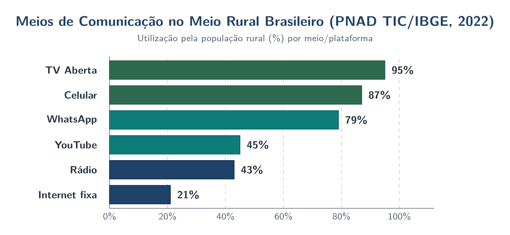

## [Abertura]{.pitch-tag .pitch-tag--teal} Visão Geral da Aula {#visao-geral .smaller-text .lesson-slide}

::: {.pitch-grid-50}
::: {.pitch-card}
[Roteiro da aula]{.pitch-card-index}
[Tópicos principais]{.pitch-heading}

- [1]{.circle} Comunicação de Massa — Conceitos
- [2]{.circle} Modelos Clássicos da Comunicação
- [3]{.circle} Comunicação Social e Ruralidade
- [4]{.circle} Publicidade Agropecuária e Efeitos
- [5]{.circle} Marketing Rural e Novas Mídias
:::

::: {.pitch-stack-2}
::: {.pitch-card .pitch-card--gold}
[Objetivo central]{.pitch-card-index}
[Mídia, marketing e extensão rural]{.pitch-heading}

Analisar os conceitos de comunicação de massa e comunicação social aplicados ao meio rural, compreendendo os efeitos da publicidade agropecuária e o papel das novas mídias na extensão rural contemporânea.
:::

::: {.pitch-pill-row}
[Thompson · Freire]{.pitch-pill}
[Shannon · Berlo · Schramm]{.pitch-pill .pitch-pill--gold}
[Rogers · PNAD TIC]{.pitch-pill}
:::

::: {.pitch-band .pitch-band--teal}
Do fluxo unidirecional da mídia massiva à comunicação dialógica e crítica no campo.
:::
:::
:::

# 1 · Comunicação de Massa e Modelos Clássicos {.section-header rotulo="Modelos Clássicos"}

## [Conceito]{.pitch-tag .pitch-tag--teal} Comunicação de Massa e Contexto Rural {#comunicacao-massa .smaller-text .lesson-slide}

::: {.pitch-cards-2}
::: {.pitch-card}
[Thompson (1998)]{.pitch-card-index}
[Comunicação de Massa]{.pitch-heading}

Refere-se à **difusão de mensagens** por meios técnicos (rádio, TV, impressos, internet) para audiências amplas, heterogêneas e dispersas.

- Produção centralizada e institucionalizada
- Fluxo predominantemente unidirecional
- Audiência massiva e anônima
- Mediação tecnológica
:::

::: {.pitch-card .pitch-card--gold}
[Aplicação histórica no campo]{.pitch-card-index}
[Contexto Rural]{.pitch-heading}

No meio rural, a comunicação de massa historicamente operou como veículo de:

1. Propaganda governamental (modernização)
2. Marketing de insumos agrícolas
3. Informação climática e de mercado
4. Programas educativos (rádio rural)
:::
:::

::: {.pitch-band}
A compreensão dos fluxos massivos revela como mensagens externas moldam expectativas tecnológicas e padrões de consumo no campo.
:::

## [Teoria]{.pitch-tag} Modelos Clássicos da Comunicação {#modelos-classicos .smaller-text .lesson-slide}

::: {.pitch-band .pitch-band--navy}
A compreensão dos modelos comunicacionais é fundamental para a atuação crítica do extensionista no meio rural.
:::

::: {.pitch-cards}
::: {.pitch-card}
[01 · Linear e mecânico]{.pitch-card-index}
[Shannon-Weaver (1949)]{.pitch-heading}

**Emissor → Codificação → Canal → Decodificação → Receptor (+ Ruído)**

Modelo **linear e mecânico**, que influenciou diretamente a abordagem difusionista da extensão rural.
:::

::: {.pitch-card .pitch-card--teal}
[02 · Variáveis contextuais]{.pitch-card-index}
[Berlo (1960)]{.pitch-heading}

Incorpora variáveis de **contexto** — habilidades comunicativas, atitudes, conhecimento e sistema sociocultural — tanto do emissor quanto do receptor.
:::

::: {.pitch-card .pitch-card--gold}
[03 · Referências mútuas]{.pitch-card-index}
[Schramm (1954)]{.pitch-heading}

Introduz o conceito de **campo de experiência compartilhada**: a comunicação só é eficaz quando emissor e receptor compartilham referências culturais.
:::
:::

## [Difusão]{.pitch-tag .pitch-tag--gold} Modelo de Rogers: Difusão de Inovações {#modelo-rogers .smaller-text .lesson-slide}

::: {.pitch-band}
**Everett Rogers (1962)** formulou a **Teoria da Difusão de Inovações**, amplamente aplicada na extensão rural para classificar o ritmo de adoção tecnológica.
:::

::: {.pitch-grid-55}
::: {.pitch-milestones}
::: {.pitch-milestone-item}
**Inovadores (2,5%):** experimentam primeiro.
:::

::: {.pitch-milestone-item}
**Adotantes iniciais (13,5%):** líderes de opinião.
:::

::: {.pitch-milestone-item}
**Maioria inicial (34%):** adotam após observar resultados.
:::

::: {.pitch-milestone-item}
**Maioria tardia (34%):** adotam por pressão social ou econômica.
:::

::: {.pitch-milestone-item}
**Retardatários (16%):** resistentes à mudança.
:::
:::

::: {.pitch-stack-2}
::: {.pitch-card .pitch-card--alert}
[Freire (1979) · Perspectiva agroecológica]{.pitch-card-index}
[Crítica ao modelo difusionista]{.pitch-heading}

O modelo de Rogers pressupõe que a inovação é **inerentemente boa** e que a resistência é **irracional** — premissa contestada por Paulo Freire (1979) e pela perspectiva agroecológica.
:::

::: {.pitch-band .pitch-band--teal}
Rotular agricultores como "retardatários" ignora racionalidades ecológicas, econômicas e territoriais próprias.
:::
:::
:::

# 2 · Comunicação Social e Meios no Campo {.section-header rotulo="Comunicação Rural"}

## [Comunicação]{.pitch-tag .pitch-tag--teal} Comunicação Social: Conceito e Dimensões {#comunicacao-social .smaller-text .lesson-slide}

::: {.pitch-band}
A **comunicação social**, diferentemente da comunicação de massa, enfatiza o **caráter relacional** e contextual da troca de mensagens.
:::

::: {.pitch-flow-4}
::: {.pitch-card}
[01 · Interpessoal]{.pitch-card-index}
[Diálogo direto]{.pitch-heading}

Interação face a face entre extensionista e agricultor.
:::

::: {.pitch-card .pitch-card--teal}
[02 · Grupal]{.pitch-card-index}
[Espaços coletivos]{.pitch-heading}

Reuniões comunitárias, dias de campo e mutirões.
:::

::: {.pitch-card .pitch-card--gold}
[03 · Organizacional]{.pitch-card-index}
[Rede institucional]{.pitch-heading}

Comunicação institucional (EMATER, cooperativas).
:::

::: {.pitch-card .pitch-card--forest}
[04 · Midiática]{.pitch-card-index}
[Canais territoriais]{.pitch-heading}

Rádio comunitária, redes sociais e WhatsApp.
:::
:::

::: {.pitch-formula}
**Paulo Freire (1979):** a comunicação social genuína é **dialógica** — pressupõe horizontalidade, co-participação e respeito mútuo. Quando se reduz à transmissão vertical, transforma-se em "extensão" no sentido pejorativo.
:::

## [Indicadores]{.pitch-tag .pitch-tag--teal} Meios de Comunicação no Campo (PNAD TIC/IBGE) {#comunicacao-campo-pnad .smaller-text .lesson-slide}

::: {.pitch-media-card .pitch-media-card--tall}

[Meios de Comunicação no Meio Rural Brasileiro (PNAD TIC/IBGE, 2022)]{.pitch-caption}
[TV Aberta (95%), Celular (87%) e WhatsApp (79%) lideram o acesso cotidiano frente a YouTube (45%), Rádio (43%) e Internet fixa (21%)]{.pitch-caption-sub}
:::

::: {.pitch-band .pitch-band--teal}
A convergência entre telefonia móvel e mensageria instantânea redefine a capilaridade comunicacional sem eliminar o peso estrutural da TV aberta e do rádio.
:::

## [Mídias]{.pitch-tag .pitch-tag--teal} Meios Tradicionais vs. Meios Digitais no Campo {#meios-tradicionais-digitais .smaller-text .lesson-slide}

::: {.pitch-cards-2}
::: {.pitch-card .pitch-card--gold}
[Alcance histórico e comunitário]{.pitch-card-index}
[Meios Tradicionais]{.pitch-heading}

O rádio permanece como o meio de comunicação mais acessível no meio rural brasileiro:

- Programas de rádio rural (Embrater, anos 1970)
- Rádios comunitárias rurais
- TV aberta — programas agropecuários (*Globo Rural*, *Canal do Boi*)
- Jornais e boletins de cooperativas
:::

::: {.pitch-card .pitch-card--teal}
[Expansão móvel e conectividade]{.pitch-card-index}
[Meios Digitais]{.pitch-heading}

A expansão da internet e dos smartphones transformou a comunicação rural:

- **WhatsApp** como principal ferramenta de articulação entre agricultores
- **YouTube** — canais sobre manejo agrícola (milhões de acessos)
- Redes sociais de cooperativas e feiras
- Aplicativos de monitoramento climático e mercado
:::
:::

::: {.pitch-band .pitch-band--navy}
O celular tornou-se o principal **vetor de comunicação de massa** no campo (Schwartz, 2014).
:::

# 3 · Publicidade, Ideologia e Marketing Rural {.section-header rotulo="Publicidade e Marketing"}

## [Mercado]{.pitch-tag .pitch-tag--gold} Publicidade Agropecuária: Emissores e Canais {#publicidade-agropecuaria .smaller-text .lesson-slide}

::: {.pitch-band}
A **publicidade agropecuária** tem como objetivo promover a venda de **insumos, tecnologias e serviços** ao produtor rural.
:::

::: {.pitch-cards-2}
::: {.pitch-card}
[Agentes econômicos]{.pitch-card-index}
[Emissores principais]{.pitch-heading}

- Multinacionais de defensivos e sementes (Syngenta, Bayer, BASF)
- Fabricantes de máquinas (John Deere, AGCO, CNH)
- Empresas de nutrição animal e saúde veterinária
- Bancos e seguradoras rurais
:::

::: {.pitch-card .pitch-card--gold}
[Estratégias de alcance]{.pitch-card-index}
[Canais preferenciais]{.pitch-heading}

- Feiras agrícolas (Agrishow, Expointer, Campo Grande Expo)
- Revistas especializadas (*A Granja*, *Globo Rural*)
- Programas televisivos voltados ao agro
- Influenciadores digitais do setor
:::
:::

## [Análise Crítica]{.pitch-tag .pitch-tag--alert} Publicidade Agropecuária: Efeitos e Críticas {#publicidade-efeitos-criticas .smaller-text .lesson-slide}

::: {.pitch-cards-2}
::: {.pitch-card .pitch-card--forest}
[Alcance informativo]{.pitch-card-index}
[Efeitos Positivos]{.pitch-heading}

- Difusão de tecnologias que aumentam produtividade
- Acesso a informações sobre manejo e cultivares
- Financiamento de conteúdo técnico (revistas, programas)
- Conexão entre produtor e mercado de insumos
:::

::: {.pitch-card .pitch-card--alert}
[Riscos socioeconômicos]{.pitch-card-index}
[Efeitos Negativos]{.pitch-heading}

- Indução ao consumo de **pacotes tecnológicos** desnecessários
- Criação de **dependência** do produtor em relação a insumos externos
- Invisibilização de alternativas agroecológicas
- Reforço do modelo difusionista criticado por Freire
- Assimetria de informação entre publicidade e **necessidades reais**
:::
:::

::: {.pitch-band}
A publicidade agropecuária frequentemente substitui a ATER independente, transformando o extensionista em **agente comercial** (Peixoto, 2008).
:::

## [Ideologia]{.pitch-tag .pitch-tag--alert} Propaganda e Ideologia do Agro {#propaganda-ideologia-agro .smaller-text .lesson-slide}

::: {.pitch-cards-2}
::: {.pitch-card .pitch-card--gold}
[Comunicação institucional]{.pitch-card-index}
[Campanhas de destaque]{.pitch-heading}

Nos últimos anos, o setor agropecuário investiu significativamente em **comunicação institucional** para construir uma imagem positiva junto à sociedade:

- *"Agro é Tech, Agro é Pop, Agro é Tudo"* (Globo/CNA, 2016)
- *"De Olho no Material Escolar"* (ABAG)
- Campanhas de associações de produtores (APROSOJA, ABIOVE)
:::

::: {.pitch-card .pitch-card--alert}
[Sauer e Leite (2012)]{.pitch-card-index}
[Análise sociológica]{.pitch-heading}

Essas campanhas constroem uma narrativa que **homogeneiza** o campo, invisibilizando:

- A agricultura familiar
- Os conflitos fundiários
- Os impactos ambientais da monocultura extensiva
:::
:::

::: {.pitch-band .pitch-band--navy}
O engenheiro agrônomo deve desenvolver **leitura crítica** da mídia agropecuária.
:::

## [Marketing]{.pitch-tag .pitch-tag--gold} Marketing Rural: Dimensões Estratégicas {#marketing-rural .smaller-text .lesson-slide}

::: {.pitch-band}
O **marketing rural** vai além da publicidade — envolve o **conjunto de estratégias** para comercialização de produtos e serviços no e para o meio rural.
:::

::: {.pitch-flow-4}
::: {.pitch-card}
[01 · Input marketing]{.pitch-card-index}
[Marketing de insumos]{.pitch-heading}

Venda de sementes, fertilizantes e máquinas ao produtor.
:::

::: {.pitch-card .pitch-card--gold}
[02 · Output marketing]{.pitch-card-index}
[Marketing de produtos]{.pitch-heading}

Comercialização da produção agrícola nos mercados.
:::

::: {.pitch-card .pitch-card--forest}
[03 · Identidade e origem]{.pitch-card-index}
[Marketing territorial]{.pitch-heading}

Promoção de regiões produtoras (indicações geográficas, *terroir*).
:::

::: {.pitch-card .pitch-card--teal}
[04 · Interesse público]{.pitch-card-index}
[Marketing social]{.pitch-heading}

Campanhas de saúde, educação ambiental e segurança do trabalho no campo.
:::
:::

::: {.pitch-band .pitch-band--teal}
Os princípios do marketing podem ser utilizados de forma **ética** para promover a adoção de práticas sustentáveis e ampliar o acesso a mercados pela agricultura familiar.
:::

# 4 · Novas Mídias, Formação Crítica e Síntese {.section-header rotulo="Novas Mídias e Síntese"}

## [Digital]{.pitch-tag .pitch-tag--teal} Novas Mídias e Extensão Rural {#novas-midias-extensao .smaller-text .lesson-slide}

::: {.pitch-cards-2}
::: {.pitch-card .pitch-card--teal}
[Convergência digital]{.pitch-card-index}
[Oportunidades]{.pitch-heading}

- **Podcasts** rurais e agronômicos
- **Lives** técnicas em plataformas sociais
- Grupos de WhatsApp como **redes de aprendizagem**
- Plataformas de **ATER Digital** (apps de manejo, diagnóstico remoto)
- Uso de drones e imagens satelitais como ferramenta comunicacional
:::

::: {.pitch-card .pitch-card--alert}
[Assimetrias e riscos]{.pitch-card-index}
[Desafios]{.pitch-heading}

- **Exclusão digital** — 22% dos domicílios rurais sem internet (PNAD, 2022)
- Desinformação e **fake news** agropecuárias
- Algoritmização da informação (bolhas informacionais)
- Substituição do contato presencial pelo digital
- Necessidade de **letramento midiático** do agricultor e do extensionista
:::
:::

::: {.pitch-band}
O desafio não é ter tecnologia, mas garantir que ela sirva à **comunicação dialógica** e não à mera difusão (Freire, 1979).
:::

## [Prática]{.pitch-tag .pitch-tag--forest} O Extensionista como Comunicador {#extensionista-comunicador .smaller-text .lesson-slide}

::: {.pitch-grid-50}
::: {.pitch-stack-2}
::: {.pitch-card}
[Formação do engenheiro agrônomo]{.pitch-card-index}
[Competências comunicacionais]{.pitch-heading}

Exige capacidades que vão além do domínio técnico:

- Capacidade de **escuta ativa** e leitura de contexto
- Domínio de **múltiplas linguagens** (oral, visual, digital)
- Habilidade para facilitar **processos grupais** (DRP, ECA)
- Leitura crítica da mídia e da publicidade
- Capacidade de produzir conteúdos acessíveis e culturalmente pertinentes
:::
:::

::: {.pitch-stack-2}
::: {.pitch-formula}
**Paulo Freire (1979):** o extensionista que se limita a "transmitir" conhecimento não comunica — **domestica**. Comunicar é **co-participar**, numa relação de igualdade e respeito mútuo.
:::

::: {.pitch-band .pitch-band--teal}
Comunicar no campo significa articular rigor agronômico, diálogo participativo e autonomia crítica frente à mídia.
:::
:::
:::

## [Síntese]{.pitch-tag .pitch-tag--teal} Conclusão {#conclusao .smaller-text .lesson-slide}

::: {.pitch-cards-2}
::: {.pitch-card}
[Influência estrutural]{.pitch-card-index}
[Mídia e comportamento agrário]{.pitch-heading}

A comunicação de massa e a publicidade agropecuária exercem influência estrutural sobre o campo brasileiro, moldando comportamentos de consumo, adoção tecnológica e percepção social da agricultura.
:::

::: {.pitch-card .pitch-card--gold}
[Atuação propositiva]{.pitch-card-index}
[Fundamentos e diálogo freireano]{.pitch-heading}

O engenheiro agrônomo deve dominar os fundamentos teóricos da comunicação para atuar de forma **crítica e propositiva**, articulando as ferramentas midiáticas contemporâneas com os princípios freireanos de diálogo e participação.
:::
:::

::: {.pitch-band .pitch-band--navy}
A extensão rural comprometida com o empoderamento transforma meios tradicionais e digitais em instrumentos de diálogo, nunca de domesticação.
:::

## [Referências]{.pitch-tag} Referências Bibliográficas {#referencias .smaller-text .lesson-slide}

::: {.pitch-cards-2}
::: {.pitch-card}
[Teoria da comunicação e extensão]{.pitch-card-index}
[Fundamentos e difusão]{.pitch-heading}

- Berlo, D. K. *O processo da comunicação* (1960).
- Freire, P. *Extensão ou Comunicação* (1979).
- Rogers, E. M. *Diffusion of Innovations* (1962).
- Shannon, C. E.; Weaver, W. *The Mathematical Theory of Communication* (1949).
:::

::: {.pitch-card .pitch-card--teal}
[Mídia, publicidade e ruralidade]{.pitch-card-index}
[Campo brasileiro e sociedade]{.pitch-heading}

- Peixoto, M. *Extensão rural no Brasil* (2008).
- Sauer, S.; Leite, S. P. *Expansão agrícola, preços e apropriação de terra por estrangeiros no Brasil* (2012).
- Schwartz, C. *Sociologia da comunicação rural* (2014).
- Thompson, J. B. *A mídia e a modernidade* (1998).
:::
:::

## {.center background-color="#2135A6"}

::: {style="text-align: center;"}
[Obrigado!]{.obrigado-fit-text style="color: white;"}

::: {style="color: white; font-size: 0.7em;"}
Luiz Diego Vidal Santos

Universidade Estadual de Feira de Santana (UEFS)
:::
:::
