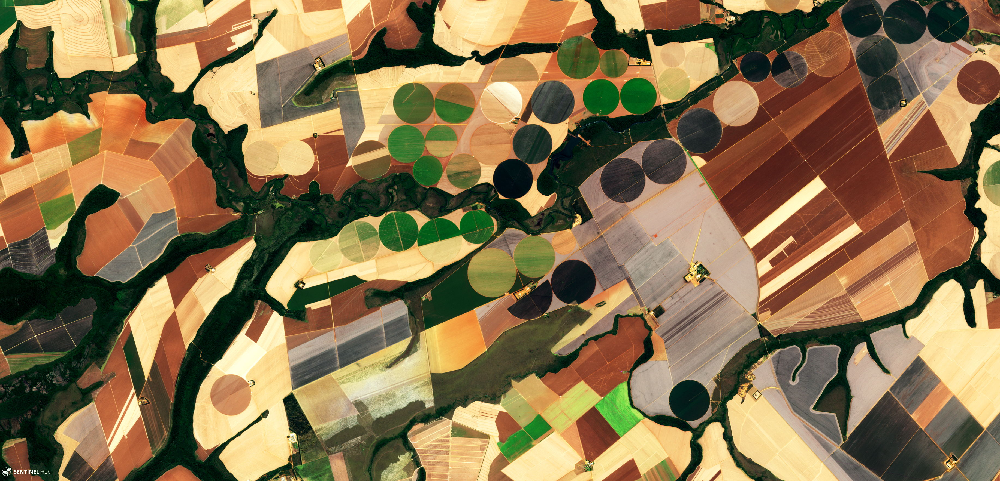
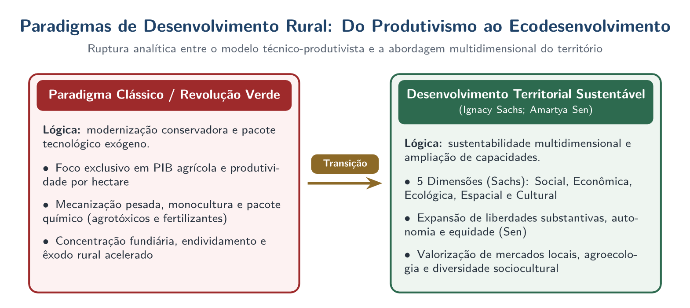

## [Abertura]{.pitch-tag .pitch-tag--forest} Visão Geral da Aula {#visao-geral .smaller-text .lesson-slide}

::: {.pitch-grid-50}
::: {.pitch-card}
[Roteiro da aula]{.pitch-card-index}
[Tópicos Principais]{.pitch-heading}

- [1]{.circle} Conceito de Desenvolvimento
- [2]{.circle} Desenvolvimento como Liberdade (Sen)
- [3]{.circle} Revolução Verde e Consequências
- [4]{.circle} Novas Abordagens Sustentáveis (Sachs)
- [5]{.circle} Meios de Vida Sustentáveis
:::

::: {.pitch-stack-2}
::: {.pitch-card .pitch-card--forest}
[Objetivo Central]{.pitch-card-index}
[Do produtivismo à sustentabilidade]{.pitch-heading}

Analisar as antigas e novas abordagens do desenvolvimento rural, da revolução verde às perspectivas de sustentabilidade e liberdade.
:::

::: {.pitch-pill-row}
[Sen · Martins · Favareto]{.pitch-pill}
[PROAGRO · EMBRATER]{.pitch-pill .pitch-pill--gold}
[Sachs · DFID]{.pitch-pill}
:::

::: {.pitch-band .pitch-band--teal}
Ruptura analítica entre crescimento econômico excludente e desenvolvimento territorial com autonomia humana.
:::
:::
:::

# 1 · Conceitos e Desenvolvimento como Liberdade {.section-header rotulo="Conceitos"}

## [Conceitos]{.pitch-tag .pitch-tag--forest} Conceito de Desenvolvimento {#conceito-desenvolvimento .smaller-text .lesson-slide}

::: {.pitch-cards-2}
::: {.pitch-card .pitch-card--alert}
[Visão reducionista]{.pitch-card-index}
[Pragmatismo econômico]{.pitch-heading}

O conceito de desenvolvimento foi por muito tempo associado ao **pragmatismo econômico e material** da produção industrial e tecnológica, gerando um modelo **excludente** sem ótica de **liberdade e autonomia humana**.
:::

::: {.pitch-card .pitch-card--forest}
[Arilson Favareto (2018)]{.pitch-card-index}
[Síntese socioecológica]{.pitch-heading}

O desenvolvimento deve considerar a relação intrínseca entre **preservação ecológica**, **erradicação da pobreza** e **ações do Estado**.
:::
:::

::: {.pitch-formula}
**Questão crítica:** *País que cresce financeiramente = país que se desenvolve?* Crescimento do PIB agrícola sem justiça social aprofunda assimetrias no campo.
:::

## [Liberdade]{.pitch-tag .pitch-tag--forest} Desenvolvimento como Liberdade {#desenvolvimento-liberdade .smaller-text .lesson-slide}

::: {.pitch-cards-2}
::: {.pitch-card .pitch-card--teal}
[Amartya Sen (2000)]{.pitch-card-index}
[Capacidades e custeios públicos]{.pitch-heading}

O combate à pobreza e a promoção do desenvolvimento sustentável podem ser impulsionados pela **"condução de custeios públicos"** e pela ampliação de liberdades substantivas.
:::

::: {.pitch-card .pitch-card--gold}
[José de Souza Martins (2008)]{.pitch-card-index}
[Libertação humana]{.pitch-heading}

> *"A pobreza deve ser entendida como a falta de realização das possibilidades criadas pelo próprio homem para sua libertação."*
:::
:::

::: {.pitch-band .pitch-band--navy}
A pobreza é uma **privação** não apenas material, mas também social e humana — e sua superação é **sinônimo de desenvolvimento**.
:::

## [Espaço Rural]{.pitch-tag .pitch-tag--teal} Meio Rural — Conceito e Pressupostos {#meio-rural-conceito .smaller-text .lesson-slide}

::: {.pitch-milestones}
::: {.pitch-milestone-item}
**1. Áreas verdes:** espaço com maior presença de **áreas verdes ou naturais** (Kageyama, 2008).
:::

::: {.pitch-milestone-item}
**2. Distâncias espaciais:** maiores **distâncias** entre unidades residenciais e comerciais.
:::

::: {.pitch-milestone-item}
**3. Baixa densidade:** maior **dispersão** e menor densidade populacional.
:::

::: {.pitch-milestone-item}
**4. Recursos naturais:** maior presença de atividades dependentes de **recursos naturais**.
:::

::: {.pitch-milestone-item}
**5. Identidade simbólica:** representações **culturais e simbólicas** ligadas à ruralidade.
:::
:::

::: {.pitch-band .pitch-band--teal}
**Grupo Rurbanos:** o conceito de rural e ruralidades **extrapola as fronteiras agrícolas** (Kageyama, 2008).
:::

# 2 · Revolução Verde e Seus Impactos {.section-header rotulo="Revolução Verde"}

## [Modernização]{.pitch-tag .pitch-tag--alert} Desenvolvimento Rural — Revolução Verde {#revolucao-verde .smaller-text .lesson-slide}

::: {.pitch-grid-55}
::: {.pitch-stack-2}
::: {.pitch-card .pitch-card--alert}
[Décadas de 1950–1970 · Lei 5.969/73]{.pitch-card-index}
[Pacote tecnológico e PROAGRO]{.pitch-heading}

A revolução verde baseava-se no processo **industrializante e tecnológico** do campo. O **PROAGRO** (Lei 5.969/73, crédito a partir de 1975) impulsionou a industrialização, mas com **exclusão social** dos camponeses sem terra ou com pouca terra.
:::

::: {.pitch-card}
[Atividades extensionistas · Peixoto (2008)]{.pitch-card-index}
[AIA e EMBRATER]{.pitch-heading}

- **Agência Americana para o Desenvolvimento (AIA)** — interesses empresariais
- **EMBRATER** — Lei 6.126/74: institucionalização estatal da extensão rural
:::
:::

::: {.pitch-media-card .pitch-media-card--photo .pitch-media-card--compact}

[Produção de soja no Brasil — símbolo da Revolução Verde]{.pitch-caption}
[Wikimedia Commons · Licença CC-BY-SA 2.0 · Monocultura intensiva em capital e insumos]{.pitch-caption-sub}
:::
:::

## [Impactos]{.pitch-tag .pitch-tag--alert} Consequências da Modernização {#consequencias-modernizacao .smaller-text .lesson-slide}

::: {.pitch-band}
Sustentada por grandes empresas estrangeiras e apoio restrito aos grandes produtores, a modernização do campo gerou impactos estruturais profundos:
:::

::: {.pitch-cards}
::: {.pitch-card .pitch-card--alert}
[01 · Segregação]{.pitch-card-index}
[Exclusão produtiva]{.pitch-heading}

**Exclusão** e criação de exército de reserva no campo, marginalizando pequenos produtores.
:::

::: {.pitch-card .pitch-card--gold}
[02 · Migração]{.pitch-card-index}
[Êxodo rural]{.pitch-heading}

**Êxodo rural** acelerado pelo encolhimento e perda de viabilidade das pequenas propriedades.
:::

::: {.pitch-card}
[03 · Emprego]{.pitch-card-index}
[Substituição do trabalho]{.pitch-heading}

Redução drástica da **mão de obra** necessária ao labor rural pela mecanização pesada.
:::
:::

::: {.pitch-formula}
**Síntese crítica:** A revolução verde transformou o desenvolvimento rural em ferramenta de **exclusão social**.
:::

## [Paradigmas]{.pitch-tag .pitch-tag--forest} Do Produtivismo ao Ecodesenvolvimento {#diagrama-paradigmas .smaller-text .lesson-slide}

::: {.pitch-media-card .pitch-media-card--tall}

[Paradigmas de Desenvolvimento Rural: Do Produtivismo ao Ecodesenvolvimento]{.pitch-caption}
[Ruptura analítica entre modernização conservadora e abordagem multidimensional do território (Sachs; Sen)]{.pitch-caption-sub}
:::

::: {.pitch-band .pitch-band--navy}
A transição paradigmática desloca o foco do PIB agrícola isolado para a **sustentabilidade multidimensional** e a **expansão das liberdades humanas**.
:::

# 3 · Novas Abordagens Sustentáveis {.section-header rotulo="Sustentabilidade"}

## [Abordagens]{.pitch-tag .pitch-tag--forest} Novas Abordagens: Desenvolvimento Sustentável {#novas-abordagens .smaller-text .lesson-slide}

::: {.pitch-band .pitch-band--teal}
**José Eli de Veiga (2001) e Sergio Schneider (2010):** novas abordagens para o desenvolvimento rural e a erradicação da pobreza sob a perspectiva de **liberdade, autonomia e sustentabilidade ambiental**.
:::

::: {.pitch-cards-2}
::: {.pitch-card .pitch-card--forest}
[Ignacy Sachs · Dimensões 1 a 4]{.pitch-card-index}
[Base socioecológica]{.pitch-heading}

- **Social** — equidade e qualidade de vida
- **Cultural** — respeito às identidades locais
- **Ecológica** — preservação dos ecossistemas
- **Ambiental** — capacidade de suporte da natureza
:::

::: {.pitch-card .pitch-card--gold}
[Ignacy Sachs · Dimensões 5 a 8]{.pitch-card-index}
[Base territorial e política]{.pitch-heading}

- **Territorial** — equilíbrio urbano-rural
- **Econômica** — eficiência macrossocial
- **Política nacional** — democracia e direitos
- **Política internacional** — cooperação global
:::
:::

## [Ecodesenvolvimento]{.pitch-tag .pitch-tag--teal} Sachs: Biomassa e Biotecnologia {#sachs-biomassa .smaller-text .lesson-slide}

::: {.pitch-cards}
::: {.pitch-card .pitch-card--forest}
[Pilar 1]{.pitch-card-index}
[Biomassa]{.pitch-heading}

Aproveitamento inteligente da **matéria orgânica renovável** como base produtiva e energética.
:::

::: {.pitch-card .pitch-card--teal}
[Pilar 2]{.pitch-card-index}
[Biodiversidade]{.pitch-heading}

Valorização estratégica da **riqueza natural dos trópicos** e de seus ecossistemas.
:::

::: {.pitch-card .pitch-card--gold}
[Pilar 3]{.pitch-card-index}
[Biotecnologia sustentável]{.pitch-heading}

**Soluções aplicadas** adaptadas às realidades ecológicas e sociais locais.
:::
:::

::: {.pitch-card}
[Benefícios esperados do modelo]{.pitch-card-index}
[Resultados econômicos e sociais]{.pitch-heading}

- Produção integrada de **alimentos, energia e materiais**
- Promoção do **emprego rural** e **sustentabilidade ambiental**
- Soluções intensivas em **conhecimento e mão de obra**, econômicas em capital
:::

## [Estratégias]{.pitch-tag .pitch-tag--gold} Meios de Vida Sustentáveis (*Sustainable Livelihoods*) {#meios-vida-sustentaveis .smaller-text .lesson-slide}

::: {.pitch-formula}
**Schneider (abordagem de *sustainable livelihoods*):** capacidade dos indivíduos ou famílias de se sustentarem de forma **viável e duradoura**, enfrentando estresses e choques.
:::

::: {.pitch-table-box}
| Capital (DFID) | Descrição |
| --- | --- |
| **Natural** | Recursos naturais disponíveis |
| **Físico** | Infraestrutura e bens produtivos |
| **Humano** | Saúde, educação, capacidades |
| **Financeiro** | Poupança, crédito, rendimentos |
| **Social** | Redes, relações de confiança |
:::

# 4 · Síntese e Referências {.section-header rotulo="Síntese"}

## [Síntese]{.pitch-tag .pitch-tag--forest} Conclusão {#conclusao .smaller-text .lesson-slide}

::: {.pitch-cards-2}
::: {.pitch-card .pitch-card--forest}
[Desenvolvimento e liberdade]{.pitch-card-index}
[Visão multidimensional]{.pitch-heading}

O verdadeiro **desenvolvimento** é também uma forma de **liberdade**, exigindo integração entre dimensões **econômicas, sociais e ambientais**.
:::

::: {.pitch-card .pitch-card--gold}
[Protagonismo familiar]{.pitch-card-index}
[Segurança alimentar e equidade]{.pitch-heading}

A **agricultura familiar**, com sua relevância na produção alimentar e conservação da biodiversidade, é **central** para políticas rurais **inclusivas, sustentáveis e equitativas**.
:::
:::

::: {.pitch-band .pitch-band--navy}
Superar a herança excludente da Revolução Verde exige políticas públicas orientadas para capacidades humanas, agroecologia e meios de vida sustentáveis.
:::

## [Referências]{.pitch-tag} Referências da Aula {#referencias .smaller-text .lesson-slide}

::: {.pitch-cards-2}
::: {.pitch-card}
[Bloco 1 · Políticas e Modernização]{.pitch-card-index}
[Legislação, ATER e espaço rural]{.pitch-heading}

- Brasil. *Lei 5.969/73 — PROAGRO* (1973).
- Kageyama, A. A. *Desenvolvimento rural* (2008).
- Navarro, Z. *Desenvolvimento rural no Brasil* (2001).
- Peixoto et al. *Extensão rural no Brasil* (2008).
:::

::: {.pitch-card .pitch-card--forest}
[Bloco 2 · Sustentabilidade e Liberdade]{.pitch-card-index}
[Abordagens contemporâneas]{.pitch-heading}

- Sachs, I. *Caminhos para o desenvolvimento sustentável* (2000).
- Schneider, S. *Situando o desenvolvimento rural no Brasil* (2010).
- Sen, A. *Desenvolvimento como liberdade* (2000).
- Veiga, J. E. *Desenvolvimento sustentável* (2010).
:::
:::

## {.center background-color="#2135A6"}

::: {style="text-align: center;"}
[Obrigado!]{.obrigado-fit-text style="color: white;"}

::: {style="color: white; font-size: 0.7em;"}
Luiz Diego Vidal Santos

Universidade Estadual de Feira de Santana (UEFS)
:::
:::
