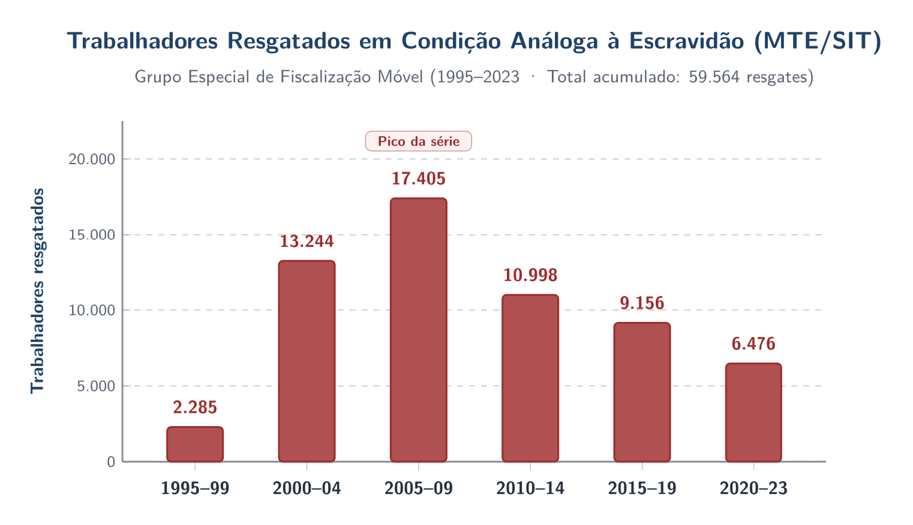
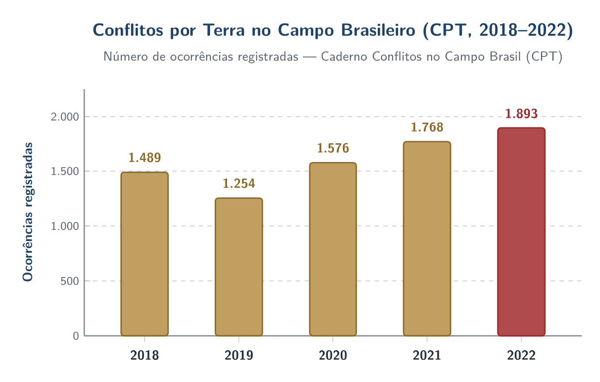

## [Abertura]{.pitch-tag .pitch-tag--alert} Visão Geral da Aula {#visao-geral .smaller-text .lesson-slide}

::: {.pitch-grid-50}
::: {.pitch-card}
[Roteiro da aula]{.pitch-card-index}
[Tópicos principais]{.pitch-heading}

- [1]{.circle} Direitos Humanos — Fundamentos
- [2]{.circle} Direitos Trabalhistas no Campo
- [3]{.circle} Trabalho Análogo à Escravidão
- [4]{.circle} Conflitos Agrários e Violência
- [5]{.circle} Extensão Rural e Educação em Direitos
:::

::: {.pitch-stack-2}
::: {.pitch-card .pitch-card--gold}
[Objetivo central]{.pitch-card-index}
[Trabalho, dignidade e justiça rural]{.pitch-heading}

Compreender os direitos humanos aplicados ao meio rural brasileiro, analisando violações estruturais, marcos legais de proteção e o papel do engenheiro agrônomo na promoção da dignidade e justiça no campo.
:::

::: {.pitch-pill-row}
[DUDH · CF/1988]{.pitch-pill}
[Art. 149 CP · NR-31]{.pitch-pill .pitch-pill--gold}
[PNEDH · PNATER · OIT]{.pitch-pill}
:::

::: {.pitch-band .pitch-band--teal}
Articulando marcos constitucionais, saúde do trabalhador e responsabilidade ética na ATER.
:::
:::
:::

# 1 · Fundamentos e Direitos Trabalhistas no Campo {.section-header rotulo="Fundamentos e Trabalho"}

## [Direitos]{.pitch-tag .pitch-tag--gold} Direitos Humanos: Fundamentos e Marcos Legais {#direitos-humanos-fundamentos .smaller-text .lesson-slide}

::: {.pitch-cards-2}
::: {.pitch-card}
[ONU (1948) · CF/1988]{.pitch-card-index}
[Fundamentos e princípios]{.pitch-heading}

Os direitos humanos são garantias fundamentais **inerentes a toda pessoa**, reconhecidos pela Declaração Universal dos Direitos Humanos (ONU, 1948) e incorporados à Constituição Federal de 1988.

**Princípios estruturantes:**

- Universalidade
- Indivisibilidade
- Interdependência
- Inalienabilidade
:::

::: {.pitch-card .pitch-card--gold}
[Ordenamento jurídico brasileiro]{.pitch-card-index}
[Marcos Legais no Brasil]{.pitch-heading}

- **CF/1988 — Art. 5º** (direitos fundamentais)
- **CF/1988 — Art. 6º** (direitos sociais)
- **CF/1988 — Art. 186** (função social da propriedade rural)
- **Estatuto da Terra** (Lei 4.504/64)
- **Estatuto do Trabalhador Rural** (Lei 5.889/73)
- **PNDH-3** — Decreto 7.037/2009
:::
:::

## [Vulnerabilidade]{.pitch-tag .pitch-tag--alert} Direitos Humanos e o Meio Rural {#direitos-humanos-campo .smaller-text .lesson-slide}

::: {.pitch-band}
No campo brasileiro, os direitos humanos apresentam violações de natureza **estrutural** e **histórica**, distribuídas em seis dimensões de vulnerabilidade.
:::

::: {.pitch-cards}
::: {.pitch-card .pitch-card--alert}
[01 · Acesso à terra]{.pitch-card-index}
[Concentração fundiária]{.pitch-heading}

Impede que milhões de famílias acessem terra para produção e moradia.
:::

::: {.pitch-card .pitch-card--alert}
[02 · Trabalho digno]{.pitch-card-index}
[Precarização laboral]{.pitch-heading}

Condições precárias, informalidade, sazonalidade e baixa remuneração.
:::

::: {.pitch-card .pitch-card--gold}
[03 · Segurança alimentar]{.pitch-card-index}
[Paradoxo rural]{.pitch-heading}

Paradoxo de quem produz alimento e passa fome no campo.
:::

::: {.pitch-card}
[04 · Educação]{.pitch-card-index}
[Escolas rurais]{.pitch-heading}

Infraestrutura deficiente e currículo descontextualizado da realidade agrária.
:::

::: {.pitch-card .pitch-card--teal}
[05 · Saúde]{.pitch-card-index}
[Atenção básica]{.pitch-heading}

Cobertura precária de serviços de saúde em municípios rurais.
:::

::: {.pitch-card .pitch-card--gold}
[06 · Participação política]{.pitch-card-index}
[Representação]{.pitch-heading}

Sub-representação das populações rurais nas instâncias decisórias.
:::
:::

## [Trabalho]{.pitch-tag .pitch-tag--gold} Estatuto do Trabalhador Rural (Lei 5.889/73) {#estatuto-trabalhador-rural .smaller-text .lesson-slide}

::: {.pitch-grid-55}
::: {.pitch-card}
[Lei 5.889/73 · CF/1988, Art. 7º]{.pitch-card-index}
[Equiparação de direitos urbanos e rurais]{.pitch-heading}

A legislação garante ao trabalhador rural os mesmos direitos do trabalhador urbano:

- Salário mínimo
- Jornada máxima de **8 horas diárias / 44 semanais**
- Repouso semanal remunerado
- Férias anuais + 1/3 constitucional
- 13º salário
- FGTS e aposentadoria
- Proteção à maternidade e paternidade
:::

::: {.pitch-stack-2}
::: {.pitch-card .pitch-card--alert}
[IBGE (2017)]{.pitch-card-index}
[Fosso entre norma e realidade]{.pitch-heading}

A informalidade no trabalho rural ultrapassa **60%** nos estados do Nordeste, significando que a maioria dos trabalhadores não tem acesso efetivo a esses direitos.
:::

::: {.pitch-band .pitch-band--navy}
A formalização do vínculo rural é condição básica para a proteção previdenciária e trabalhista no campo.
:::
:::
:::

# 2 · Trabalho Escravo Contemporâneo e Conflitos Agrários {.section-header rotulo="Trabalho Escravo e Conflitos"}

## [Violações]{.pitch-tag .pitch-tag--alert} Trabalho Análogo à Escravidão (Art. 149, CP) {#trabalho-escravo .smaller-text .lesson-slide}

::: {.pitch-cards-2}
::: {.pitch-card .pitch-card--alert}
[Art. 149 do Código Penal]{.pitch-card-index}
[Definição Legal]{.pitch-heading}

O trabalho análogo à escravidão se configura por:

- **Trabalho forçado** — cerceamento de liberdade
- **Jornada exaustiva** — degradação física extrema
- **Condições degradantes** — alojamento, alimentação e higiene
- **Servidão por dívida** — retenção por adiantamentos ou cobranças abusivas
:::

::: {.pitch-card}
[MTE/SIT · Fiscalização Móvel]{.pitch-card-index}
[Dados acumulados (1995–2023)]{.pitch-heading}

O Grupo Especial de Fiscalização Móvel resgatou:

- **59.564 trabalhadores** em condição análoga à escravidão entre 1995 e 2023
- **Setores mais frequentes no campo:** pecuária, cana-de-açúcar, soja, café, carvão vegetal
- **Estados com maior incidência:** Pará, Maranhão, Mato Grosso, Minas Gerais
:::
:::

::: {.pitch-band .pitch-band--navy}
A **"Lista Suja"** do trabalho escravo (Cadastro de Empregadores) é instrumento de **transparência e accountability**.
:::

## [Indicadores]{.pitch-tag .pitch-tag--alert} Resgates de Trabalho Análogo à Escravidão (MTE/SIT) {#trabalho-escravo-grafico .smaller-text .lesson-slide}

::: {.pitch-media-card .pitch-media-card--tall}

[Trabalhadores Resgatados em Condição Análoga à Escravidão (MTE/SIT, 1995–2023)]{.pitch-caption}
[Grupo Especial de Fiscalização Móvel · Total acumulado: 59.564 resgates · Pico da série em 2005–2009 (17.405)]{.pitch-caption-sub}
:::

::: {.pitch-band}
A persistência dos resgates ao longo de quase três décadas evidencia o caráter estrutural da superexploração em cadeias agropecuárias e extrativas.
:::

## [Caso]{.pitch-tag .pitch-tag--alert} Trabalho Escravo — Caso José Pereira vs. Brasil {#caso-jose-pereira .smaller-text .lesson-slide}

::: {.pitch-cards-2}
::: {.pitch-card .pitch-card--alert}
[Sul do Pará · 1989]{.pitch-card-index}
[A violação]{.pitch-heading}

Em 1989, o trabalhador rural **José Pereira**, então com 17 anos, foi submetido a trabalho forçado em uma fazenda no sul do Pará. Ao tentar fugir, foi baleado, perdendo a visão de um olho e o uso de uma mão.
:::

::: {.pitch-card .pitch-card--gold}
[CIDH · 2003]{.pitch-card-index}
[Responsabilização do Estado]{.pitch-heading}

O caso foi apresentado à **Comissão Interamericana de Direitos Humanos (CIDH)**, que responsabilizou o Estado brasileiro por **omissão** na proteção dos trabalhadores rurais.
:::
:::

::: {.pitch-band .pitch-band--teal}
**Consequência:** o Brasil firmou acordo reconhecendo a responsabilidade e se comprometeu a intensificar ações de combate ao trabalho escravo no campo — marco na construção da política nacional de enfrentamento.
:::

## [Indicadores]{.pitch-tag .pitch-tag--alert} Conflitos por Terra no Campo Brasileiro (CPT) {#conflitos-terra-grafico .smaller-text .lesson-slide}

::: {.pitch-media-card .pitch-media-card--tall}

[Conflitos por Terra no Campo Brasileiro (CPT, 2018–2022)]{.pitch-caption}
[Fonte: Comissão Pastoral da Terra — Caderno Conflitos no Campo Brasil (crescimento contínuo de 2019 a 2022, atingindo 1.893 ocorrências)]{.pitch-caption-sub}
:::

::: {.pitch-band}
Os registros da **CPT** revelam escalada contínua das disputas fundiárias e territoriais no campo brasileiro no período recente.
:::

## [Conflitos]{.pitch-tag .pitch-tag--alert} Conflitos Agrários e Violência no Campo {#conflitos-agrarios .smaller-text .lesson-slide}

::: {.pitch-cards-2}
::: {.pitch-card .pitch-card--alert}
[CPT · Dados de 2022]{.pitch-card-index}
[Violência documentada]{.pitch-heading}

A Comissão Pastoral da Terra documenta anualmente os conflitos no campo brasileiro:

- **1.893 conflitos por terra** registrados em 2022
- **47 assassinatos** de lideranças e trabalhadores rurais em 2022
- Aumento de ameaças e intimidações contra defensores de direitos no campo
- Invasões de territórios indígenas e quilombolas
:::

::: {.pitch-card}
[Múltiplas frentes de disputa]{.pitch-card-index}
[Tipologia dos Conflitos]{.pitch-heading}

- **Fundiários:** disputa pela posse e titulação de terras
- **Trabalhistas:** condições de trabalho e remuneração
- **Ambientais:** desmatamento e contaminação por agrotóxicos
- **Hídricos:** acesso à água, barragens e irrigação
- **Étnicos:** demarcação de terras indígenas e quilombolas
:::
:::

::: {.pitch-formula}
*"O campo brasileiro é, historicamente, o território onde os direitos humanos são mais frequentemente violados"* (Martins, 2000).
:::

# 3 · Saúde, Função Social da Terra e Convenções da OIT {.section-header rotulo="Saúde, Terra e OIT"}

## [Saúde]{.pitch-tag .pitch-tag--alert} Agrotóxicos e Direito à Saúde {#agrotoxicos-saude .smaller-text .lesson-slide}

::: {.pitch-band .pitch-band--navy}
O Brasil é o **maior consumidor de agrotóxicos do mundo desde 2008**, e a exposição ocupacional afeta diretamente os trabalhadores rurais.
:::

::: {.pitch-cards-2}
::: {.pitch-card .pitch-card--alert}
[Exposição ocupacional e ambiental]{.pitch-card-index}
[Impactos na saúde]{.pitch-heading}

- Intoxicações agudas (pele, olhos, sistema respiratório)
- Doenças crônicas (câncer, disfunções endócrinas, danos neurológicos)
- Contaminação de águas e alimentos nas comunidades adjacentes
- Suicídio entre agricultores expostos a organofosforados
:::

::: {.pitch-card .pitch-card--teal}
[NR-31 · Responsabilidade técnica]{.pitch-card-index}
[Marco legal e papel do agrônomo]{.pitch-heading}

A **NR-31** (Norma Regulamentadora de Segurança e Saúde no Trabalho na Agricultura) estabelece obrigações para empregadores quanto ao uso seguro de agrotóxicos, incluindo **EPIs, treinamento e exames periódicos**.

O engenheiro agrônomo, ao emitir **receituário agronômico**, tem responsabilidade direta na proteção da saúde do trabalhador.
:::
:::

## [Constituição]{.pitch-tag .pitch-tag--gold} Direito à Terra e Função Social (Art. 186, CF/88) {#funcao-social-terra .smaller-text .lesson-slide}

::: {.pitch-band}
A Constituição Federal de 1988, **Art. 186**, define que a propriedade rural cumpre sua **função social** quando atende simultaneamente quatro requisitos:
:::

::: {.pitch-flow-4}
::: {.pitch-card}
[01 · Produção]{.pitch-card-index}
[Uso racional]{.pitch-heading}

Aproveitamento racional e adequado do imóvel rural.
:::

::: {.pitch-card .pitch-card--forest}
[02 · Meio ambiente]{.pitch-card-index}
[Preservação]{.pitch-heading}

Utilização adequada dos recursos naturais e preservação ambiental.
:::

::: {.pitch-card .pitch-card--teal}
[03 · Trabalho]{.pitch-card-index}
[Leis trabalhistas]{.pitch-heading}

Observância das disposições que regulam as relações de trabalho.
:::

::: {.pitch-card .pitch-card--gold}
[04 · Bem-estar]{.pitch-card-index}
[Equilíbrio social]{.pitch-heading}

Exploração que favoreça proprietários e trabalhadores.
:::
:::

::: {.pitch-cards-2}
::: {.pitch-card .pitch-card--gold}
[CF/1988, Art. 184]{.pitch-card-index}
[Desapropriação]{.pitch-heading}

O descumprimento da função social é, constitucionalmente, motivo para **desapropriação** para fins de reforma agrária.
:::

::: {.pitch-card .pitch-card--alert}
[Fernandes (2001) · Sauer (2010)]{.pitch-card-index}
[Disputa política]{.pitch-heading}

Na prática, a aplicação desse dispositivo é **limitada e politicamente disputada**, exigindo mobilização social e fiscalização efetiva.
:::
:::

## [Normas OIT]{.pitch-tag} Convenções da OIT para o Meio Rural {#convencoes-oit .smaller-text .lesson-slide}

::: {.pitch-band}
A Organização Internacional do Trabalho (**OIT**) possui convenções específicas para a proteção do trabalhador rural:
:::

::: {.pitch-table-box}
| Convenção | Tema | Ratificação Brasil |
| --- | --- | --- |
| **C029** (1930) | Trabalho Forçado | 1957 |
| **C105** (1957) | Abolição do Trabalho Forçado | 1965 |
| **C141** (1975) | Organizações de Trabalhadores Rurais | 1994 |
| **C155** (1981) | Segurança e Saúde dos Trabalhadores | 1992 |
| **C169** (1989) | Povos Indígenas e Tribais | 2002 |
| **C184** (2001) | Segurança e Saúde na Agricultura | Não ratificada |
:::

::: {.pitch-band .pitch-band--teal}
A **não ratificação da Convenção 184**, específica sobre segurança na agricultura, é uma lacuna significativa na proteção dos trabalhadores rurais brasileiros.
:::

# 4 · Educação em Direitos Humanos, ATER e Síntese {.section-header rotulo="EDH e ATER"}

## [Educação]{.pitch-tag .pitch-tag--forest} Educação em Direitos Humanos na Agronomia {#edh-agronomo .smaller-text .lesson-slide}

::: {.pitch-cards-2}
::: {.pitch-card}
[PNEDH (2006)]{.pitch-card-index}
[O que é EDH?]{.pitch-heading}

A Educação em Direitos Humanos (EDH) é um processo de **formação continuada** que visa:

- Construir cultura de respeito à dignidade humana
- Desenvolver capacidade de identificar e combater violações
- Promover cidadania ativa e participativa
- Fortalecer mecanismos de proteção
:::

::: {.pitch-card .pitch-card--forest}
[Atuação cotidiana no campo]{.pitch-card-index}
[EDH na Formação do Agrônomo]{.pitch-heading}

Onde direitos são violados cotidianamente, a formação deve incluir:

- Reconhecimento de situações de trabalho degradante
- **Receituário agronômico** como instrumento de **proteção** (não apenas técnico)
- Mediação de conflitos em assentamentos e comunidades
- Noções de legislação trabalhista e ambiental
- Ética profissional na relação com trabalhadores rurais
:::
:::

## [ATER]{.pitch-tag .pitch-tag--forest} Extensão Rural e Direitos Humanos (PNATER) {#extensao-direitos-humanos .smaller-text .lesson-slide}

::: {.pitch-band .pitch-band--teal}
A **PNATER (Lei 12.188/2010)** incorpora princípios de direitos humanos ao definir que a extensão rural deve promover **inclusão social**, **equidade de gênero** e **respeito à diversidade**.
:::

::: {.pitch-grid-55}
::: {.pitch-milestones}
::: {.pitch-milestone-item}
**1.** Inclusão de temas de direitos nas atividades de formação (**Escolas de Campo**).
:::

::: {.pitch-milestone-item}
**2.** Articulação com órgãos de fiscalização (**MTE, MPT**) para denúncia de irregularidades.
:::

::: {.pitch-milestone-item}
**3.** Assessoria jurídica a assentamentos e comunidades tradicionais.
:::

::: {.pitch-milestone-item}
**4.** Promoção de **segurança do trabalho** como componente da ATER.
:::

::: {.pitch-milestone-item}
**5.** Formação de agentes comunitários de saúde e direitos.
:::
:::

::: {.pitch-stack-2}
::: {.pitch-formula}
*"O extensionista que ignora as violações de direitos no campo não é apenas omisso — é **cúmplice**"* (Martins, 2000).
:::

::: {.pitch-band}
A assistência técnica comprometida com direitos humanos transforma a rotina de campo em espaço de prevenção, denúncia e cidadania.
:::
:::
:::

## [Síntese]{.pitch-tag .pitch-tag--forest} Conclusão {#conclusao .smaller-text .lesson-slide}

::: {.pitch-cards-2}
::: {.pitch-card}
[Formação indissociável]{.pitch-card-index}
[Dignidade em jogo no campo]{.pitch-heading}

A educação em direitos humanos é componente indissociável da formação do engenheiro agrônomo. O profissional que atua no campo lida cotidianamente com situações onde a dignidade humana está em jogo — no receituário agronômico (saúde do trabalhador), na assistência técnica (condições de trabalho) e na mediação de conflitos (acesso à terra).
:::

::: {.pitch-card .pitch-card--gold}
[Atuação ética e propositiva]{.pitch-card-index}
[O agrônomo-extensionista]{.pitch-heading}

Conhecer os marcos legais, reconhecer as violações e atuar de forma ética e propositiva são competências que distinguem o **agrônomo-extensionista** do mero técnico de produção.
:::
:::

::: {.pitch-band .pitch-band--navy}
Garantir direitos trabalhistas, saúde ocupacional e função social da terra é parte integrante da engenharia agronômica democrática.
:::

## [Referências]{.pitch-tag} Referências Bibliográficas {#referencias .smaller-text .lesson-slide}

::: {.pitch-cards-2}
::: {.pitch-card}
[Marcos legais e internacionais]{.pitch-card-index}
[Legislação e convenções]{.pitch-heading}

- Brasil. *Constituição Federal* (1988) — Art. 5º, 6º, 7º, 184, 186.
- Brasil. *Lei 5.889/73* — Estatuto do Trabalhador Rural.
- Brasil. *Lei 12.188/2010* — PNATER.
- Brasil. *Decreto 7.037/2009* — PNDH-3.
- OIT. *Convenções fundamentais do trabalho* (2024).
:::

::: {.pitch-card .pitch-card--gold}
[Dados, relatórios e estudos]{.pitch-card-index}
[Literatura e monitoramento]{.pitch-heading}

- CPT. *Conflitos no Campo Brasil 2022* (2023).
- Fernandes, B. M. *Questão agrária, pesquisa e MST* (2001).
- Martins, J. S. *Reforma agrária: o impossível diálogo* (2000).
- MTE/SIT. *Trabalho escravo no Brasil em retrospectiva* (2023).
- Sauer, S. *Terra e modernidade* (2010).
:::
:::

## {.center background-color="#2135A6"}

::: {style="text-align: center;"}
[Obrigado!]{.obrigado-fit-text style="color: white;"}

::: {style="color: white; font-size: 0.7em;"}
Luiz Diego Vidal Santos

Universidade Estadual de Feira de Santana (UEFS)
:::
:::
