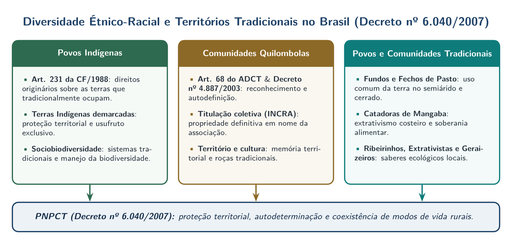
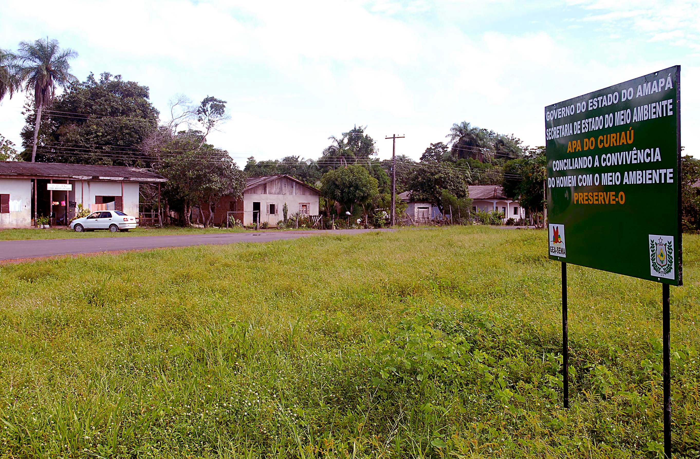
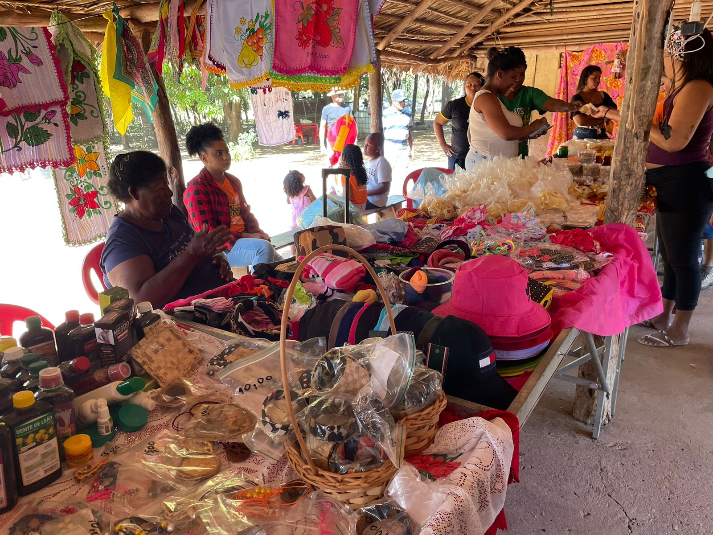
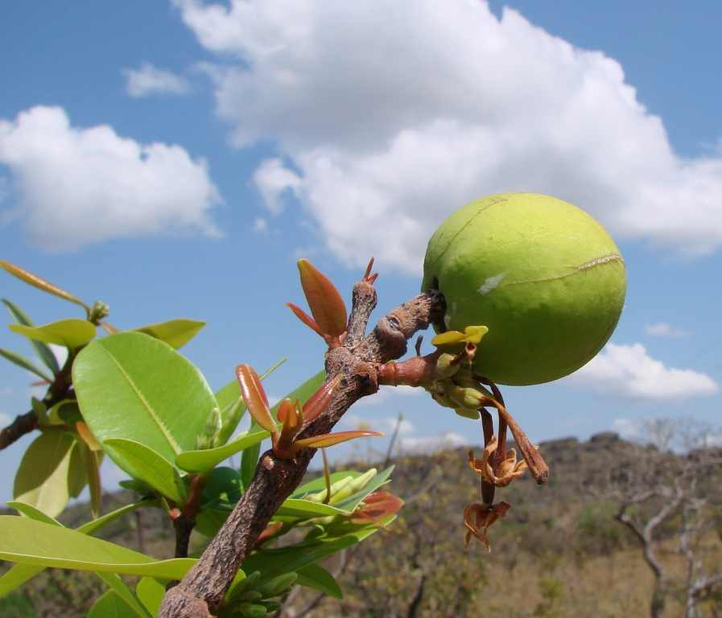

## [Abertura]{.pitch-tag .pitch-tag--forest} Visão Geral da Aula {#visao-geral .smaller-text .lesson-slide}

::: {.pitch-grid-50}
::: {.pitch-card}
[Roteiro da aula]{.pitch-card-index}
[Tópicos principais]{.pitch-heading}

- [1]{.circle} Formação Étnico-Racial do Campo Brasileiro
- [2]{.circle} Comunidades Quilombolas — Território e Produção
- [3]{.circle} Povos Indígenas — Terra e Agroecologia
- [4]{.circle} Marcos Legais — Lei 10.639/03 e Lei 11.645/08
- [5]{.circle} ATER e Diversidade Étnico-Cultural
:::

::: {.pitch-stack-2}
::: {.pitch-card .pitch-card--gold}
[Objetivo central]{.pitch-card-index}
[Cultura, território e formação agronômica]{.pitch-heading}

Compreender a formação étnico-racial do campo brasileiro, o papel das comunidades tradicionais na produção e conservação, e as obrigações legais do ensino de história e cultura afro-brasileira e indígena na formação do engenheiro agrônomo.
:::

::: {.pitch-pill-row}
[Art. 68 ADCT · Art. 231 CF]{.pitch-pill}
[Leis 10.639/03 · 11.645/08]{.pitch-pill .pitch-pill--gold}
[PNPCT · OIT 169]{.pitch-pill}
:::

::: {.pitch-band .pitch-band--teal}
Reconhecendo povos indígenas, quilombolas e comunidades tradicionais como sujeitos de direitos e co-autores do conhecimento agrícola.
:::
:::
:::

# 1 · Formação Étnico-Racial e Estrutura Agrária {.section-header rotulo="Formação e Raízes"}

## [Matrizes]{.pitch-tag .pitch-tag--gold} Formação Étnico-Racial do Campo Brasileiro {#formacao-etnico-racial .smaller-text .lesson-slide}

::: {.pitch-cards-2}
::: {.pitch-card}
[Interação e exploração histórica]{.pitch-card-index}
[Três matrizes étnicas]{.pitch-heading}

O espaço rural brasileiro foi constituído historicamente pela **interação e exploração** de três matrizes étnicas:

- **Indígena:** povos originários com saberes milenares sobre manejo de ecossistemas
- **Africana:** trabalhadores escravizados que trouxeram e desenvolveram técnicas agrícolas, pecuárias e alimentares
- **Europeia:** colonizadores que impuseram modelos de propriedade e produção
:::

::: {.pitch-card .pitch-card--gold}
[Contribuições invisibilizadas]{.pitch-card-index}
[Herança no Campo]{.pitch-heading}

A agropecuária brasileira carrega contribuições frequentemente invisibilizadas:

- **Dendê, inhame, quiabo, café** — culturas de origem africana
- **Mandioca, milho, amendoim** — domesticação indígena
- **Roça de coivara, sistemas agroflorestais** — técnicas ancestrais
- **Terreiro e quintal produtivo** — espaço de resistência alimentar
:::
:::

## [História]{.pitch-tag .pitch-tag--alert} Escravidão e Estrutura Agrária {#escravidao-estrutura-agraria .smaller-text .lesson-slide}

::: {.pitch-band}
A compreensão da questão étnico-racial no campo exige a análise das **raízes coloniais** da estrutura fundiária brasileira.
:::

::: {.pitch-cards}
::: {.pitch-card}
[1500–1822]{.pitch-card-index}
[Período colonial]{.pitch-heading}

- Sistema de **Capitanias Hereditárias e Sesmarias** — concentração de terras na elite branca
- Mão de obra escravizada como base produtiva (engenhos, mineração, pecuária)
:::

::: {.pitch-card .pitch-card--gold}
[1850 · Mercantilização da terra]{.pitch-card-index}
[Lei de Terras]{.pitch-heading}

- Transformou a terra em **mercadoria**, impedindo futuros libertos da Lei Áurea (1888) de acessar propriedade por ocupação
- Política deliberada de **embranquecimento** — estímulo à imigração europeia para substituir o trabalho negro
:::

::: {.pitch-card .pitch-card--alert}
[Almeida (2019)]{.pitch-card-index}
[Resultado estrutural]{.pitch-heading}

A abolição sem reforma agrária condenou a população negra à condição de **trabalhadores sem terra**, realidade que persiste estruturalmente até hoje.
:::
:::

# 2 · Quilombolas, Indígenas e Comunidades Tradicionais {.section-header rotulo="Territórios Tradicionais"}

## [Territórios]{.pitch-tag .pitch-tag--forest} Territórios Tradicionais e Marco Constitucional {#territorios-tradicionais-diagrama .smaller-text .lesson-slide}

::: {.pitch-media-card .pitch-media-card--tall}

[Diversidade Étnico-Racial e Territórios Tradicionais no Brasil (Decreto nº 6.040/2007)]{.pitch-caption}
[Art. 231 da CF/1988 (Indígenas), Art. 68 do ADCT e Decreto nº 4.887/2003 (Quilombolas) e PNPCT (Povos e Comunidades Tradicionais)]{.pitch-caption-sub}
:::

::: {.pitch-band .pitch-band--teal}
A proteção territorial, a autodeterminação e a coexistência de modos de vida rurais formam o tripé da sociobiodiversidade brasileira.
:::

## [Quilombos]{.pitch-tag .pitch-tag--gold} Comunidades Quilombolas: Definição e Dados {#comunidades-quilombolas .smaller-text .lesson-slide}

::: {.pitch-grid-55}
::: {.pitch-stack-2}
::: {.pitch-card .pitch-card--gold}
[Art. 68 ADCT/CF-88 · Decreto 4.887/2003]{.pitch-card-index}
[Definição constitucional]{.pitch-heading}

Comunidades remanescentes de quilombos são grupos étnico-raciais com trajetória histórica própria, dotados de relações territoriais específicas e presumida ancestralidade negra.
:::

::: {.pitch-card}
[Fundação Cultural Palmares · INCRA (2023)]{.pitch-card-index}
[Dados de reconhecimento e titulação]{.pitch-heading}

- Mais de **6.300 comunidades** identificadas pela Fundação Cultural Palmares (2023)
- **2.849 processos** de titulação abertos no INCRA
- Apenas **145 títulos** emitidos até 2023 (cobrindo cerca de **310 comunidades**)
- Concentração no Maranhão, Bahia, Minas Gerais e Pará
:::
:::

::: {.pitch-media-card .pitch-media-card--photo}

[Comunidade Quilombola do Curiaú (Amapá)]{.pitch-caption}
[Foto: Wilson Dias / Agência Brasil (CC-BY 3.0 BR, Wikimedia Commons)]{.pitch-caption-sub}
:::
:::

::: {.pitch-band .pitch-band--navy}
A titulação quilombola é condição para a **segurança territorial** que viabiliza qualquer ação produtiva ou de ATER no território (Almeida, 2008).
:::

## [Quilombos]{.pitch-tag .pitch-tag--forest} Quilombolas: Sistemas Produtivos e Agrobiodiversidade {#quilombolas-producao .smaller-text .lesson-slide}

::: {.pitch-grid-55}
::: {.pitch-stack-2}
::: {.pitch-card .pitch-card--forest}
[Manejo e autonomia territorial]{.pitch-card-index}
[Características Produtivas]{.pitch-heading}

- **Roça de toco** (coivara controlada)
- Extrativismo vegetal (babaçu, buriti, mangaba, licuri)
- Pesca artesanal e mariscagem
- Pecuária de subsistência (aves, suínos, caprinos)
- **Quintais produtivos** com alta agrobiodiversidade
:::

::: {.pitch-card .pitch-card--gold}
[Patrimônio genético e cultural]{.pitch-card-index}
[Agrobiodiversidade]{.pitch-heading}

Guardiãs de **variedades crioulas e saberes tradicionais**: arroz-vermelho (MA e PA), feijão de corda, milho crioulo, mandioca multivarietal, plantas medicinais, fitoterápicos e sistemas agroflorestais ancestrais — patrimônio estratégico para a **engenharia agronômica** e a segurança alimentar nacional.
:::
:::

::: {.pitch-media-card .pitch-media-card--photo}

[Feira e Comercialização na Comunidade Quilombola de Mata Cavalo]{.pitch-caption}
[Acervo da disciplina · Saberes produtivos, fitoterápicos e geração de renda territorial]{.pitch-caption-sub}
:::
:::

## [Indígenas]{.pitch-tag .pitch-tag--forest} Povos Indígenas: Território e Produção {#povos-indigenas .smaller-text .lesson-slide}

::: {.pitch-band .pitch-band--navy}
O Brasil abriga **305 povos indígenas**, falantes de **274 línguas**, com população de **1.693.535 pessoas** (Censo 2022), das quais cerca de **460 mil** vivem em terras indígenas rurais.
:::

::: {.pitch-cards-2}
::: {.pitch-card .pitch-card--forest}
[Posey (1985) · Balée (2006)]{.pitch-card-index}
[Relação com a terra]{.pitch-heading}

- A terra indígena não é **propriedade individual** — é território coletivo de reprodução cultural, espiritual e material
- Os sistemas de manejo indígenas são reconhecidos como formas sofisticadas de **agroecologia** (Posey, 1985)
- A **"floresta cultural"** amazônica é resultado de milênios de manejo indígena (Balée, 2006)
:::

::: {.pitch-card .pitch-card--gold}
[CF/1988, Art. 231]{.pitch-card-index}
[Marco legal constitucional]{.pitch-heading}

A Constituição Federal de 1988 reconhece o **direito originário** dos povos indígenas sobre as terras que tradicionalmente ocupam, assegurando sua organização social, costumes, línguas, crenças e tradições.
:::
:::

## [Indígenas]{.pitch-tag .pitch-tag--forest} Indígenas: Saberes Agrícolas e Desafios Contemporâneos {#indigenas-saberes .smaller-text .lesson-slide}

::: {.pitch-cards-2}
::: {.pitch-card .pitch-card--forest}
[Manejo milenar]{.pitch-card-index}
[Contribuições à Agronomia]{.pitch-heading}

- **Domesticação da mandioca** — mais de 400 variedades
- **Domesticação do milho** — seleção milenar a partir do teosinto
- **Sistemas agroflorestais** complexos e multiestratos
- **Roça indígena** — manejo de capoeira e fertilidade
- Conhecimento sobre **bioindicadores** ambientais
:::

::: {.pitch-card .pitch-card--alert}
[Pressões territoriais]{.pitch-card-index}
[Desafios Contemporâneos]{.pitch-heading}

- Invasão de terras por garimpeiros, grileiros e madeireiros
- Contaminação de rios por **mercúrio e agrotóxicos**
- Desmatamento em terras não homologadas
- Pressão para integração ao modelo produtivo hegemônico
- Insegurança alimentar em terras degradadas
:::
:::

::: {.pitch-band .pitch-band--teal}
As terras indígenas representam **13,8% do território nacional** e são responsáveis pela **conservação de 80%** da biodiversidade brasileira em áreas protegidas (ISA, 2023).
:::

## [Tradicionais]{.pitch-tag .pitch-tag--teal} Comunidades Tradicionais (PNPCT — Decreto 6.040/2007) {#comunidades-tradicionais .smaller-text .lesson-slide}

::: {.pitch-band}
Além de quilombolas e indígenas, o campo brasileiro abriga diversas **comunidades tradicionais** reconhecidas pelo **Decreto 6.040/2007** (PNPCT):
:::

::: {.pitch-table-box}
| Comunidade | Região Principal | Atividade Produtiva |
| --- | --- | --- |
| **Ribeirinhos** | Amazônia | Pesca, extrativismo, várzea |
| **Quebradeiras de coco babaçu** | MA, PI, TO | Extrativismo do babaçu |
| **Faxinalenses** | PR | Criação extensiva em terras comuns |
| **Geraizeiros** | MG, BA | Agropecuária de cerrado |
| **Vazanteiros** | MG, BA | Agricultura de vazante |
| **Catadoras de mangaba** | SE, BA, AL | Extrativismo de mangaba |
| **Pescadores artesanais** | Litoral e rios | Pesca e maricultura |
:::

::: {.pitch-band .pitch-band--teal}
Cada grupo possui sistemas produtivos e saberes específicos que a extensão rural deve reconhecer e respeitar.
:::

# 3 · Marcos Legais, Racismo Estrutural e ATER Intercultural {.section-header rotulo="Marcos e ATER"}

## [Legislação]{.pitch-tag .pitch-tag--gold} Leis 10.639/2003 e 11.645/2008 na Agronomia {#leis-educacao-etnico-racial .smaller-text .lesson-slide}

::: {.pitch-cards-2}
::: {.pitch-card .pitch-card--gold}
[Lei 10.639/2003 · Res. CNE/CP nº 1/2004]{.pitch-card-index}
[História e Cultura Afro-Brasileira]{.pitch-heading}

Tornou obrigatório o ensino em todos os níveis educacionais:

- Reconhecimento das **contribuições africanas** à agropecuária brasileira
- Sistemas quilombolas como modelo de **resiliência e agrobiodiversidade**
- Compreensão do **racismo estrutural** no acesso à terra, crédito e ATER
- Visibilização de pesquisadores(as) negros(as) nas ciências agrárias
:::

::: {.pitch-card .pitch-card--forest}
[Lei 11.645/2008 · Convenção 169/OIT]{.pitch-card-index}
[Inclusão da História Indígena]{.pitch-heading}

Ampliou a Lei 10.639/2003 incluindo a temática indígena:

- Sistemas de **manejo ambiental indígena** como referência sustentável
- **Direitos territoriais** como pré-condição para qualquer intervenção agronômica
- **Consulta prévia** (Convenção 169/OIT) obrigatória em projetos que afetem terras indígenas
- Formação intercultural do extensionista
:::
:::

::: {.pitch-band .pitch-band--navy}
O agrônomo que desconhece a contribuição afro-brasileira e indígena à agricultura é um profissional **incompleto**.
:::

## [Desigualdade]{.pitch-tag .pitch-tag--alert} Racismo Estrutural e Políticas Afirmativas {#racismo-estrutural .smaller-text .lesson-slide}

::: {.pitch-cards-2}
::: {.pitch-card .pitch-card--alert}
[Almeida (2019) · IBGE (2017)]{.pitch-card-index}
[Dados e Indicadores]{.pitch-heading}

O racismo estrutural se materializa no campo em desigualdades mensuráveis:

- **Renda:** agricultores negros ganham em média **40% menos** que brancos (IBGE, 2017)
- **Terra:** famílias negras possuem propriedades menores e em piores condições edáficas
- **ATER:** comunidades negras rurais recebem menos assistência técnica proporcionalmente
- **Crédito:** menor acesso ao PRONAF e taxas mais altas de inadimplência forçada
:::

::: {.pitch-card .pitch-card--teal}
[Enfrentamento institucional]{.pitch-card-index}
[Políticas Afirmativas]{.pitch-heading}

Instrumentos de superação das desigualdades étnico-raciais no campo:

- **PRONAF B e Semiárido** — cobertura prioritária de comunidades vulneráveis
- **Chamadas de ATER Quilombola** — editais específicos do MDA
- **PAA e PNAE** — compras institucionais com cota para quilombolas e indígenas
- **Selos e certificações** — origem quilombola, indígena, orgânico
- **Territórios da Cidadania** — desenvolvimento territorial integrado
:::
:::

## [Extensão]{.pitch-tag .pitch-tag--teal} ATER Culturalmente Adequada {#ater-intercultural .smaller-text .lesson-slide}

::: {.pitch-band .pitch-band--teal}
A **PNATER (Lei 12.188/2010)** e a **Lei 11.326/2006** reconhecem que a extensão rural deve atender à **diversidade étnica e cultural** dos povos do campo.
:::

::: {.pitch-cards}
::: {.pitch-card}
[01 · Temporalidade]{.pitch-card-index}
[Calendários tradicionais]{.pitch-heading}

Respeito ao tempo do plantio, festas e rituais comunitários.
:::

::: {.pitch-card .pitch-card--gold}
[02 · Epistemologia]{.pitch-card-index}
[Valorização dos saberes]{.pitch-heading}

O agricultor quilombola ou indígena não é tábula rasa.
:::

::: {.pitch-card .pitch-card--forest}
[03 · Territorialidade]{.pitch-card-index}
[Abordagem coletiva]{.pitch-heading}

Territórios tradicionais são comunitários, não individuais.
:::

::: {.pitch-card .pitch-card--teal}
[04 · Comunicação]{.pitch-card-index}
[Linguagem acessível]{.pitch-heading}

Adaptação pedagógica ao universo cultural do grupo.
:::

::: {.pitch-card}
[05 · Representatividade]{.pitch-card-index}
[Equipe diversa]{.pitch-heading}

Presença de técnicos e técnicas negros e indígenas na ATER.
:::

::: {.pitch-card .pitch-card--alert}
[06 · Autodeterminação]{.pitch-card-index}
[Consulta prévia]{.pitch-heading}

Nenhuma intervenção técnica sem consentimento da comunidade.
:::
:::

# 4 · Estudos de Caso, Prática Agronômica e Síntese {.section-header rotulo="Casos e Síntese"}

## [Estudo de Caso]{.pitch-tag .pitch-tag--gold} Caso — Catadoras de Mangaba em Sergipe {#caso-mangaba .smaller-text .lesson-slide}

::: {.pitch-grid-55}
::: {.pitch-stack-2}
::: {.pitch-card .pitch-card--gold}
[Lei Estadual 7.082/2010 · Restinga e tabuleiros]{.pitch-card-index}
[Contexto territorial]{.pitch-heading}

Mulheres, majoritariamente negras, que praticam o extrativismo da mangaba (*Hancornia speciosa*) em áreas de restinga e tabuleiros costeiros:

- Reconhecidas como comunidade tradicional (Lei Estadual 7.082/2010)
- Ameaçadas pela especulação imobiliária e monocultura de cana e coco
- Organização em associações e movimentos sociais
:::

::: {.pitch-card .pitch-card--forest}
[Embrapa Tabuleiros Costeiros]{.pitch-card-index}
[Extensão Rural e Mangaba]{.pitch-heading}

- Reconhecimento de **saberes femininos e negros** sobre manejo de ecossistemas
- Políticas de proteção a áreas de **extrativismo coletivo** e **cadeias curtas** (polpas, geleias)
- Pesquisa participativa com catadoras
:::
:::

::: {.pitch-media-card .pitch-media-card--photo}

[Fruto da Mangaba (*Hancornia speciosa*)]{.pitch-caption}
[Wikimedia Commons (CC) · Patrimônio cultural e meio de vida de milhares de famílias em Sergipe]{.pitch-caption-sub}
:::
:::

## [Estudo de Caso]{.pitch-tag .pitch-tag--forest} Caso — Terra Indígena Xocó (SE) {#caso-xoco .smaller-text .lesson-slide}

::: {.pitch-cards-2}
::: {.pitch-card .pitch-card--forest}
[Ilha de São Pedro · Porto da Folha (SE)]{.pitch-card-index}
[Território e características]{.pitch-heading}

Os **Xocó** são o único povo indígena com terra demarcada em Sergipe, na Ilha de São Pedro, município de Porto da Folha, às margens do Rio São Francisco:

- População de aproximadamente **600 pessoas**
- Economia baseada em agricultura irrigada, pesca e artesanato
- Conflitos históricos com fazendeiros pela posse da ilha
- **Demarcação conquistada em 1991** após décadas de luta
:::

::: {.pitch-card .pitch-card--gold}
[Sensibilidade intercultural]{.pitch-card-index}
[Relevância para o agrônomo]{.pitch-heading}

O caso Xocó ilustra que a questão indígena no Nordeste e em Sergipe é real e próxima, não se restringindo à Amazônia.

O profissional formado pela **UFS** e pelas universidades agrárias nordestinas deve estar preparado para atuar com **sensibilidade intercultural** em seu próprio estado.
:::
:::

::: {.pitch-band .pitch-band--teal}
Articular ciência agronômica e respeito territorial é exigência concreta do exercício profissional em todo o Brasil.
:::

## [Atuação]{.pitch-tag .pitch-tag--teal} O Papel do Engenheiro Agrônomo {#papel-agronomo .smaller-text .lesson-slide}

::: {.pitch-cards-2}
::: {.pitch-card}
[Intervenção técnica contextualizada]{.pitch-card-index}
[Na prática profissional]{.pitch-heading}

- Reconhecer e respeitar os sistemas produtivos tradicionais antes de propor inovações
- Incorporar a **consulta prévia** como procedimento padrão em projetos que afetem comunidades tradicionais
- Emitir receituário agronômico com atenção à saúde de populações vulneráveis
- Articular-se com órgãos de proteção (**FUNAI, Fundação Palmares, INCRA**)
:::

::: {.pitch-card .pitch-card--teal}
[Compromisso antirracista]{.pitch-card-index}
[Na postura ética]{.pitch-heading}

- Combater o **racismo institucional** nas entidades de ATER
- Promover a visibilidade de técnicos e pesquisadores negros e indígenas
- Contribuir para a inclusão produtiva de comunidades historicamente marginalizadas
:::
:::

## [Síntese]{.pitch-tag .pitch-tag--forest} Conclusão {#conclusao .smaller-text .lesson-slide}

::: {.pitch-cards-2}
::: {.pitch-card}
[Raízes da agricultura brasileira]{.pitch-card-index}
[Memória e justiça agrária]{.pitch-heading}

A diversidade étnico-racial do campo brasileiro é constitutiva da nossa agricultura, da nossa alimentação e da nossa paisagem. Invisibilizar essa contribuição é reproduzir a violência colonial que fundou a estrutura agrária desigual.
:::

::: {.pitch-card .pitch-card--gold}
[Sujeitos e co-autores]{.pitch-card-index}
[Desenvolvimento sustentável e democrático]{.pitch-heading}

O engenheiro agrônomo deve compreender que quilombolas, indígenas e comunidades tradicionais não são "público-alvo" da extensão rural, mas **sujeitos de direitos** e **co-autores de conhecimento** agrícola.
:::
:::

::: {.pitch-band .pitch-band--navy}
A participação plena de povos indígenas, quilombolas e comunidades tradicionais é condição para um desenvolvimento rural sustentável, justo e democrático.
:::

## [Referências]{.pitch-tag} Referências Bibliográficas {#referencias .smaller-text .lesson-slide}

::: {.pitch-cards-2}
::: {.pitch-card}
[Marcos constitucionais, leis e dados]{.pitch-card-index}
[Normativas e levantamentos]{.pitch-heading}

- Brasil. *Constituição Federal* (1988) — Art. 68 ADCT, Art. 231.
- Brasil. *Lei 10.639/2003* — Ensino de História e Cultura Afro-Brasileira.
- Brasil. *Lei 11.645/2008* — Inclusão da Temática Indígena.
- Brasil. *Decreto 4.887/2003* — Regulamentação de Terras Quilombolas.
- Brasil. *Decreto 6.040/2007* — PNPCT.
- Fundação Palmares. *Certidões de autodefinição quilombola* (2023).
- IBGE. *Censo 2022 — Populações Indígenas* (2023).
:::

::: {.pitch-card .pitch-card--forest}
[Literatura socioambiental e étnico-racial]{.pitch-card-index}
[Obras de referência]{.pitch-heading}

- Almeida, A. W. B. *Terras tradicionalmente ocupadas* (2008).
- Almeida, S. L. *Racismo Estrutural* (2019).
- Balée, W. *The Research Program of Historical Ecology* (2006).
- ISA. *Terras Indígenas no Brasil* (2023).
- Posey, D. A. *Indigenous management of tropical forest ecosystems* (1985).
:::
:::

## {.center background-color="#2135A6"}

::: {style="text-align: center;"}
[Obrigado!]{.obrigado-fit-text style="color: white;"}

::: {style="color: white; font-size: 0.7em;"}
Luiz Diego Vidal Santos

Universidade Estadual de Feira de Santana (UEFS)
:::
:::
