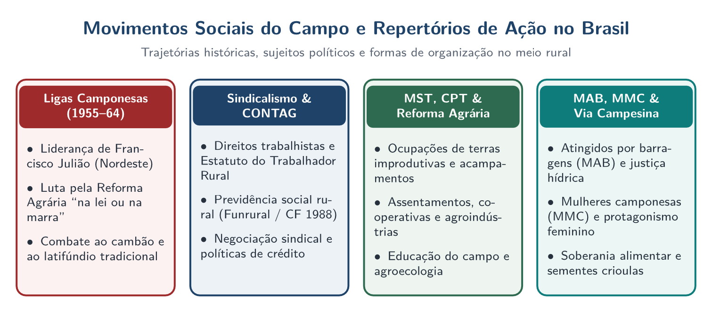
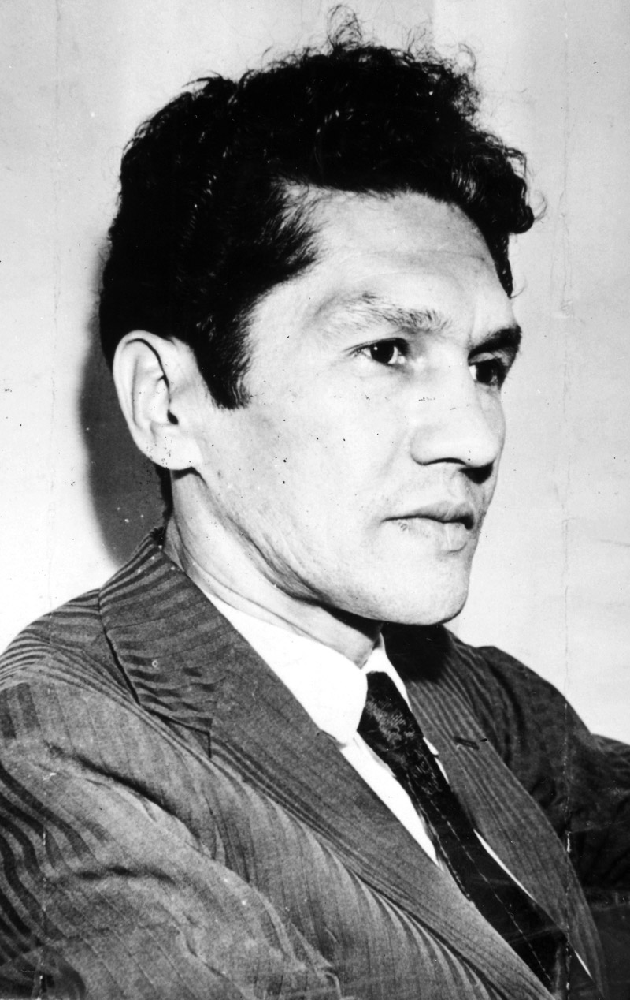
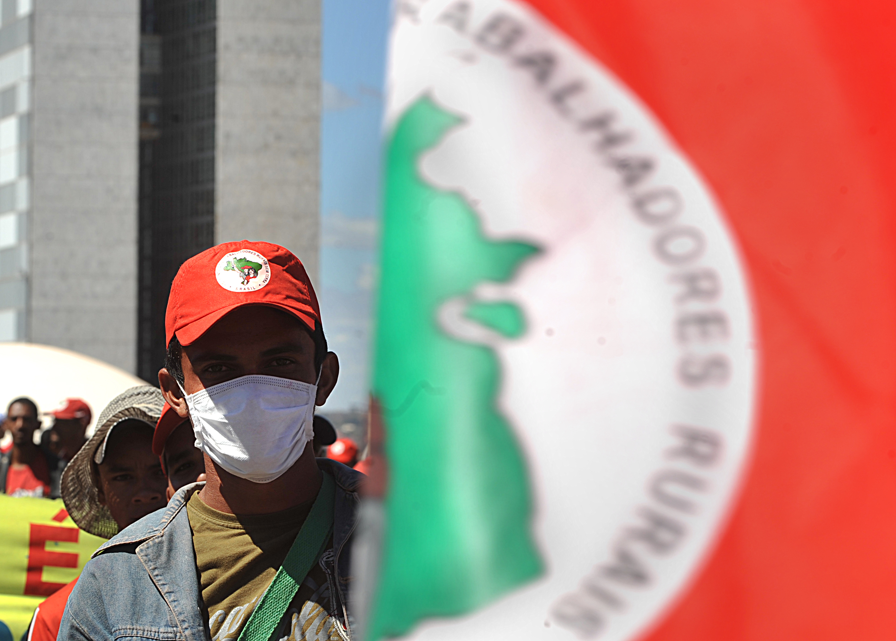

## [Abertura]{.pitch-tag .pitch-tag--gold} Visão Geral da Aula {#visao-geral .smaller-text .lesson-slide}

::: {.pitch-grid-50}
::: {.pitch-card}
[Roteiro da aula]{.pitch-card-index}
[Tópicos Principais]{.pitch-heading}

- [1]{.circle} Estrutura Agrária no Brasil
- [2]{.circle} Questão Agrária
- [3]{.circle} Ligas Camponesas no Nordeste
- [4]{.circle} MST, CPT e Sindicatos
- [5]{.circle} Assentamentos em Sergipe
:::

::: {.pitch-stack-2}
::: {.pitch-card .pitch-card--gold}
[Objetivo Central]{.pitch-card-index}
[Luta pela terra e resistência]{.pitch-heading}

Analisar a história dos movimentos sociais no campo brasileiro, das Ligas Camponesas ao MST, e o papel dos assentamentos como espaços de resistência.
:::

::: {.pitch-pill-row}
[Ligas Camponesas · CONTAG]{.pitch-pill}
[CPT · MST · CNBB]{.pitch-pill .pitch-pill--gold}
[Assentamentos em Sergipe]{.pitch-pill}
:::

::: {.pitch-band .pitch-band--navy}
A organização coletiva no campo é resposta histórica à concentração fundiária e condição para a democratização da terra.
:::
:::
:::

# 1 · Estrutura e Questão Agrária {.section-header rotulo="Questão Agrária"}

## [Estrutura]{.pitch-tag} Estrutura Agrária no Brasil {#estrutura-agraria .smaller-text .lesson-slide}

::: {.pitch-band}
**Definição:** padrão de distribuição e gestão das propriedades das terras agrícolas — regime de propriedade fundiária, produção agrícola e serviços complementares.
:::

::: {.pitch-milestones}
::: {.pitch-milestone-item}
**Brasil Colônia · Sesmarias:** concessão de grandes extensões territoriais que originou o latifúndio concentrado.
:::

::: {.pitch-milestone-item}
**Lei de Terras de 1850:** mercantilização do acesso à terra, ligada à política de embranquecimento e bloqueio ao campesinato negro e pobre.
:::

::: {.pitch-milestone-item}
**Século XX · Créditos fundiários:** mecanismos financeiros seletivos de acesso e modernização da propriedade rural.
:::

::: {.pitch-milestone-item}
**Década de 1960 · Revolução Verde:** tecnificação e mecanização concentradora do espaço agrário.
:::

::: {.pitch-milestone-item}
**Atualidade · Internacionalização:** expansão da apropriação e **internacionalização** das terras via comodato.
:::
:::

## [Conceito]{.pitch-tag .pitch-tag--gold} Questão Agrária e Movimentos Sociais {#questao-agraria .smaller-text .lesson-slide}

::: {.pitch-cards-2}
::: {.pitch-card .pitch-card--gold}
[Graziano da Silva (1980) · Veiga (1991) · Kageyama (1993)]{.pitch-card-index}
[Questão Agrária vs. Questão Agrícola]{.pitch-heading}

- **Questão agrária:** entende o campo enquanto **ambiente social** — formação pública, relações sociais, organização do trabalho, fonte de renda, direito e acesso à terra.
- **Questão agrícola:** trata o campo enquanto **negócio** rural e desempenho produtivo.
:::

::: {.pitch-card .pitch-card--forest}
[Enfrentamento à estrutura patronal]{.pitch-card-index}
[Movimentos Sociais no Campo]{.pitch-heading}

Surgem da **ausência** dos direitos relativos à questão agrária, focando na **reforma agrária**, no trabalho agrário e na agricultura familiar:

> Representam uma força vital na configuração das relações de propriedade de terra, direitos sociais, políticos e econômicos (Abramovay, 2010).
:::
:::

## [Panorama]{.pitch-tag .pitch-tag--gold} Movimentos Sociais do Campo e Repertórios {#diagrama-movimentos .smaller-text .lesson-slide}

::: {.pitch-media-card .pitch-media-card--tall}

[Movimentos Sociais do Campo e Repertórios de Ação no Brasil]{.pitch-caption}
[Trajetórias históricas, sujeitos políticos e formas de organização no meio rural brasileiro]{.pitch-caption-sub}
:::

::: {.pitch-band .pitch-band--navy}
Da luta contra o cambão nas Ligas Camponesas às pautas contemporâneas de agroecologia, justiça hídrica e soberania alimentar.
:::

# 2 · Ligas Camponesas, CPT e Sindicatos {.section-header rotulo="Ligas e Sindicatos"}

## [História]{.pitch-tag .pitch-tag--alert} Ligas Camponesas no Nordeste {#ligas-camponesas .smaller-text .lesson-slide}

::: {.pitch-grid-55}
::: {.pitch-stack-2}
::: {.pitch-card .pitch-card--alert}
[1954 · Engenho Galileia · Vitória de Santo Antão (PE)]{.pitch-card-index}
[Origem das Ligas Camponesas]{.pitch-heading}

**Marco histórico** na luta pela reforma agrária e contra a precarização do trabalho rural:

- Fundação da **Sociedade Agrícola e Pecuária de Pernambuco** (objetivo inicial: cuidar de seus mortos)
- O proprietário ameaçou os foreiros ao perceber aspirações mais amplas
:::

::: {.pitch-card .pitch-card--gold}
[Articulação jurídica e política]{.pitch-card-index}
[Francisco Julião e conquistas]{.pitch-heading}

Os camponeses procuraram o advogado **Francisco Julião**. Após intensas lutas, conquistaram a **desapropriação** do Engenho Galileia e fundaram núcleos em diversos estados.
:::
:::

::: {.pitch-media-card .pitch-media-card--photo .pitch-media-card--compact}

[Francisco Julião, líder das Ligas Camponesas]{.pitch-caption}
[Dvargas97chi / Wikimedia Commons · Licença CC-BY-SA 4.0]{.pitch-caption-sub}
:::
:::

## [Repressão]{.pitch-tag .pitch-tag--alert} Ligas Camponesas — Repressão e Legado {#ligas-repressao .smaller-text .lesson-slide}

::: {.pitch-cards-2}
::: {.pitch-card .pitch-card--alert}
[Golpe militar de 1964]{.pitch-card-index}
[Desarticulação violenta]{.pitch-heading}

- Utilizando como desculpa o perfil "comunista" das ligas (lema: *"a terra na lei ou na marra"*)
- O governo **esmagou** as Ligas Camponesas
- Líderes presos e cerca de **duas mil pessoas** mortas ou desaparecidas
:::

::: {.pitch-card .pitch-card--teal}
[Despertar organizativo]{.pitch-card-index}
[Legado histórico]{.pitch-heading}

Despertar da **consciência coletiva** no campo — base fundamental para a formação posterior de sindicatos, confederações e demais grupos organizados.
:::
:::

::: {.pitch-band .pitch-band--navy}
Mesmo sob repressão ditatorial, a experiência das Ligas inaugurou o campesinato como sujeito político nacional no Brasil.
:::

## [Igreja e Sindicatos]{.pitch-tag .pitch-tag--teal} Teoria da Libertação, CPT e CONTAG {#cpt-contag .smaller-text .lesson-slide}

::: {.pitch-grid-50}
::: {.pitch-card .pitch-card--teal}
[Teoria da Libertação · CPT e CNBB]{.pitch-card-index}
[Frentes progressistas da Igreja Católica]{.pitch-heading}

Surgimento da **Comissão Pastoral da Terra (CPT)** e atuação da **Confederação Nacional dos Bispos do Brasil (CNBB)**:

- Fomento à formação de **sindicatos** e movimentos classistas
- Retórica religiosa entrelaçada com questões **sociopolíticas**
- Eficiente no fortalecimento das discussões e da **consciência coletiva**
:::

::: {.pitch-card .pitch-card--gold}
[1961 · FETAPE, CONTAG e Sindicatos]{.pitch-card-index}
[1º Congresso Nacional dos Lavradores e Trabalhadores Agrícolas]{.pitch-heading}

Criação da **CONTAG** (Confederação Nacional dos Trabalhadores na Agricultura):

- Primeira entidade sindical camponesa de **caráter nacional**
- Reconhecida legalmente
- Ajustou diversas concepções: desde setores ligados à Igreja até comunistas
:::
:::

# 3 · MST e Assentamentos em Sergipe {.section-header rotulo="MST e Sergipe"}

## [MST]{.pitch-tag .pitch-tag--forest} Movimento dos Trabalhadores Rurais Sem Terra {#mst .smaller-text .lesson-slide}

::: {.pitch-grid-55}
::: {.pitch-stack-2}
::: {.pitch-card .pitch-card--forest}
[1983 · Stedile (1998)]{.pitch-card-index}
[Motivos do surgimento]{.pitch-heading}

- Expansão dos latifúndios de **soja e trigo** no Sul
- Influência da **Teoria da Libertação** (CPT)
- Experiência anterior do **MASTER**
:::

::: {.pitch-card}
[Atuação contemporânea]{.pitch-card-index}
[Atualidade]{.pitch-heading}

- Advoga pela **reforma agrária** como redistribuição de recursos
- Cooperativas e associações de **produção agroecológica**
- Entrada na bolsa de valores **B3**
:::
:::

::: {.pitch-media-card .pitch-media-card--photo .pitch-media-card--compact}

[Manifestação do MST, Brasília (2009)]{.pitch-caption}
[Marcello Casal JR / Agência Brasil · Licença CC-BY 3.0 BR]{.pitch-caption-sub}
:::
:::

## [Sergipe]{.pitch-tag .pitch-tag--gold} Assentamentos em Sergipe {#assentamentos-sergipe .smaller-text .lesson-slide}

::: {.pitch-band .pitch-band--teal}
Os primeiros movimentos em Sergipe foram movidos principalmente pela **CPT** e pela **Associação de Educação de Base**, dirigidos pela diocese de **Propriá** (Baixo São Francisco).
:::

::: {.pitch-cards}
::: {.pitch-card .pitch-card--gold}
[Canindé do São Francisco]{.pitch-card-index}
[Sertão sergipano]{.pitch-heading}

Conquista dos assentamentos **Cuiabá** e **Jacaré-Cutuba**.
:::

::: {.pitch-card .pitch-card--forest}
[Poço Redondo]{.pitch-card-index}
[Resistência sertaneja]{.pitch-heading}

Conquista dos assentamentos **Barra da Onça** e **Barra da Varjinha**.
:::

::: {.pitch-card}
[Neópolis]{.pitch-card-index}
[Baixo São Francisco]{.pitch-heading}

Conquista do assentamento **Matias de Souza**.
:::
:::

::: {.pitch-band}
**Alcance regional:** atendimento a mais de **1.000 famílias** assentadas no estado (Silva e Lopes, 1996).
:::

## [Xingó]{.pitch-tag .pitch-tag--gold} Assentamentos — Xingó e Marcha de 1997 {#assentamentos-xingo .smaller-text .lesson-slide}

::: {.pitch-cards-2}
::: {.pitch-card .pitch-card--alert}
[Deslocamento compulsório]{.pitch-card-index}
[Usina Hidroelétrica de Xingó]{.pitch-heading}

Os assentamentos **Cuiabá** e **Curituba** resultaram da **desocupação** de aproximadamente **2.000 famílias** para construção da **Usina Hidroelétrica de Xingó**.
:::

::: {.pitch-card .pitch-card--forest}
[1997 · MST, CPT, FETASE e outros]{.pitch-card-index}
[Marcha de quase 200 km]{.pitch-heading}

- **Marcha de quase 200 km** até a capital sergipana
- Objetivo: conscientizar os governantes sobre a **distribuição justa de terras**
:::
:::

::: {.pitch-band .pitch-band--navy}
Hoje, esses assentamentos consolidaram-se como **espaços de formação política e social**, produção agroecológica e organização comunitária.
:::

# 4 · Síntese e Referências {.section-header rotulo="Síntese"}

## [Síntese]{.pitch-tag .pitch-tag--gold} Conclusão {#conclusao .smaller-text .lesson-slide}

::: {.pitch-cards}
::: {.pitch-card .pitch-card--alert}
[01 · Origens]{.pitch-card-index}
[Das Ligas ao MST]{.pitch-heading}

Trajetória contínua de luta por direitos, reforma agrária e dignidade no campo brasileiro.
:::

::: {.pitch-card .pitch-card--teal}
[02 · Mediação]{.pitch-card-index}
[Da CPT aos sindicatos]{.pitch-heading}

Articulação histórica entre pastorais, sindicalismo rural e organização autônoma dos trabalhadores.
:::

::: {.pitch-card .pitch-card--forest}
[03 · Território]{.pitch-card-index}
[Assentamentos]{.pitch-heading}

Consolidação dos assentamentos como espaços vivos de **resistência e formação**.
:::
:::

::: {.pitch-band .pitch-band--navy}
A compreensão dessa trajetória é fundamental para qualquer profissional de **extensão rural** atuar com respeito à história e às organizações do campo.
:::

## [Referências]{.pitch-tag} Referências da Aula {#referencias .smaller-text .lesson-slide}

::: {.pitch-cards-2}
::: {.pitch-card}
[Bloco 1 · Legislação e Sindicalismo]{.pitch-card-index}
[Marcos legais e institucionais]{.pitch-heading}

- Brasil. *Lei 5.709/71 — Aquisição por estrangeiro* (1971).
- Brasil. *Lei 5.889/73 — Estatuto do Trabalhador Rural* (1973).
- CONTAG. *40 anos de fundação* (2003).
:::

::: {.pitch-card .pitch-card--gold}
[Bloco 2 · Campesinato e Reforma Agrária]{.pitch-card-index}
[História e experiências regionais]{.pitch-heading}

- Martins, J. S. *Os Camponeses e a Política no Brasil* (1986).
- Silva, R. *Conflitos de terra e reforma agrária em Sergipe* (1996).
- Stedile, J. P.; Fernandes, B. *Brava Gente* (1998).
:::
:::

## {.center background-color="#2135A6"}

::: {style="text-align: center;"}
[Obrigado!]{.obrigado-fit-text style="color: white;"}

::: {style="color: white; font-size: 0.7em;"}
Luiz Diego Vidal Santos

Universidade Estadual de Feira de Santana (UEFS)
:::
:::
