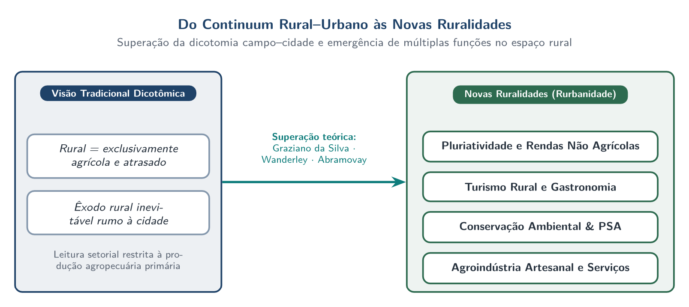
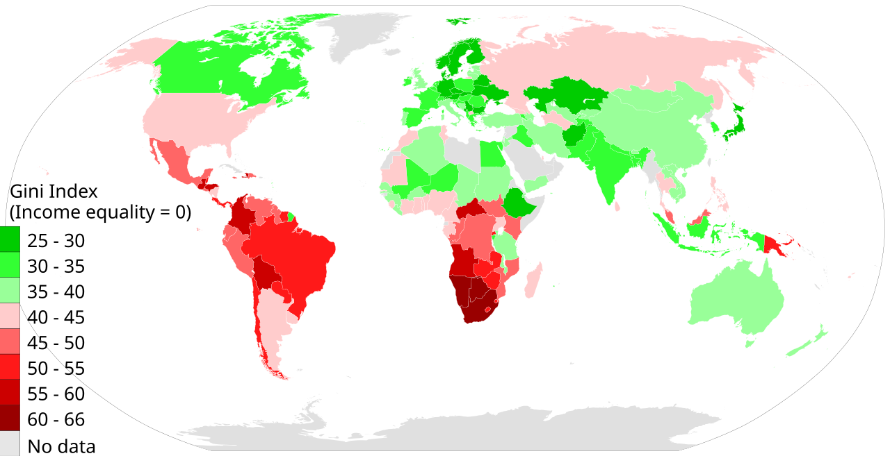
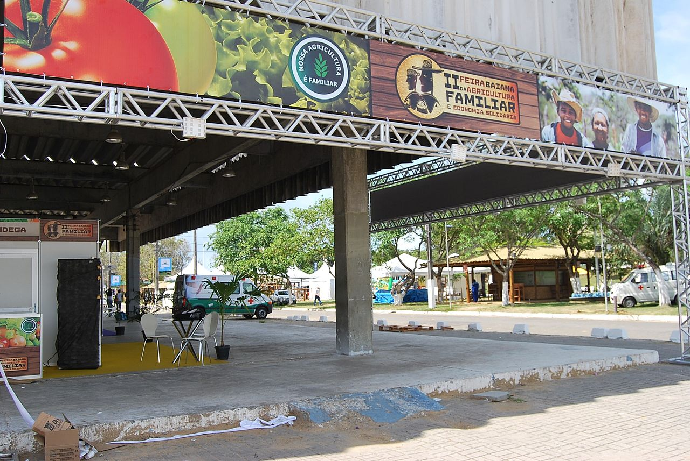

## [Abertura]{.pitch-tag .pitch-tag--teal} Visão Geral da Aula {#visao-geral .smaller-text .lesson-slide}

::: {.pitch-grid-50}
::: {.pitch-card}
[Roteiro da aula]{.pitch-card-index}
[Tópicos Principais]{.pitch-heading}

- [1]{.circle} O que são as Novas Ruralidades
- [2]{.circle} Fronteiras Rural-Urbano em Transição
- [3]{.circle} Novos Atores no Campo
- [4]{.circle} Empoderamento da Mulher no Campo
- [5]{.circle} Pluriatividade e Revalorização Sustentável
:::

::: {.pitch-stack-2}
::: {.pitch-card .pitch-card--teal}
[Objetivo Central]{.pitch-card-index}
[Multifuncionalidade e novos sujeitos]{.pitch-heading}

Explorar as transformações contemporâneas do espaço rural, os novos atores sociais e a revalorização do campo como espaço multifuncional.
:::

::: {.pitch-pill-row}
[Rurbanidade]{.pitch-pill}
[Lei 11.326/06 · PRONAF]{.pitch-pill .pitch-pill--gold}
[Pluriatividade]{.pitch-pill}
:::

::: {.pitch-band .pitch-band--teal}
Do rural exclusivamente agrícola à diversidade territorial de identidades, rendas e conservação ambiental.
:::
:::
:::

# 1 · Novas Ruralidades e Fronteiras {.section-header rotulo="Ruralidades"}

## [Ruralidades]{.pitch-tag .pitch-tag--teal} O Que São as Novas Ruralidades? {#que-sao-novas-ruralidades .smaller-text .lesson-slide}

::: {.pitch-band}
A **"nova ruralidade"** representa uma mudança paradigmática na forma como o campo é percebido e valorizado pela sociedade contemporânea.
:::

::: {.pitch-grid-50}
::: {.pitch-card .pitch-card--alert}
[Leitura tradicional · Wanderley (2006)]{.pitch-card-index}
[Antes: espaço residual]{.pitch-heading}

O rural era visto apenas como espaço de **produção agrícola e pecuária**, atrasado culturalmente, em contraposição direta ao urbano.
:::

::: {.pitch-card .pitch-card--teal}
[Leitura contemporânea]{.pitch-card-index}
[Agora: revalorização do campo como lócus de]{.pitch-heading}

- **Patrimônio cultural** e tradições
- **Biodiversidade** e serviços ecossistêmicos
- **Vivência** — onde as pessoas vivem, criam famílias e participam de comunidades
:::
:::

## [Ruralidades]{.pitch-tag .pitch-tag--teal} Rural-Urbano: Fronteiras em Transição {#fronteiras-transicao .smaller-text .lesson-slide}

::: {.pitch-grid-50}
::: {.pitch-stack-2}
::: {.pitch-card}
[Aproximação espacial]{.pitch-card-index}
[Abramovay e Graziano da Silva]{.pitch-heading}

Autores como **Ricardo Abramovay** e **José Graziano da Silva** apresentam o rural e o urbano como **espaços próximos** e articulados.
:::

::: {.pitch-card .pitch-card--gold}
[José Eli da Veiga · *Cidades Imaginárias*]{.pitch-card-index}
[Cidades rurais]{.pitch-heading}

Existem **cidades rurais** — pequenas cidades cuja economia gira em torno de negócios agrários e serviços vinculados ao campo.
:::
:::

::: {.pitch-card .pitch-card--teal}
[Nova concepção territorial]{.pitch-card-index}
[O campo na nova concepção]{.pitch-heading}

- Lugar de **patrimônio cultural** e tradições
- **Relações sociais complexas** — agricultores, ambientalistas, empreendedores e comunidades tradicionais
- Espaço de **qualidade de vida** e bem-estar
:::
:::

## [Síntese Visual]{.pitch-tag .pitch-tag--teal} Do Continuum Rural–Urbano às Novas Ruralidades {#diagrama-novas-ruralidades .smaller-text .lesson-slide}

::: {.pitch-media-card .pitch-media-card--tall}

[Do Continuum Rural–Urbano às Novas Ruralidades (Rurbanidade)]{.pitch-caption}
[Superação teórica da dicotomia campo–cidade: pluriatividade, turismo rural, PSA e agroindústria artesanal (Graziano da Silva; Wanderley; Abramovay)]{.pitch-caption-sub}
:::

::: {.pitch-band .pitch-band--navy}
A superação da leitura setorial reconhece o rural como território vivo de **serviços ambientais, cultura, lazer, agroindústria e cidadania**.
:::

# 2 · Novos Atores e Questão de Gênero {.section-header rotulo="Atores e Gênero"}

## [Atores]{.pitch-tag .pitch-tag--gold} Novos Atores no Campo e Desigualdade {#novos-atores .smaller-text .lesson-slide}

::: {.pitch-grid-55}
::: {.pitch-stack-2}
::: {.pitch-card .pitch-card--forest}
[Lei 11.326/06]{.pitch-card-index}
[Sujeitos incluídos além dos agricultores tradicionais]{.pitch-heading}

Reconhecimento legal de **povos originários, ribeirinhos e pescadores artesanais**, ampliando a fronteira da agricultura familiar.
:::

::: {.pitch-card .pitch-card--gold}
[Graziano da Silva (2000)]{.pitch-card-index}
[Novos habitantes e agentes internacionais]{.pitch-heading}

- **Neorurais** — profissionais liberais que passaram a residir no campo
- **Empreendedores rurais**
- **"Sem-sem"** — sem-terra, sem emprego, sem casa, sem saúde, sem educação
- **Agentes internacionais** — aquisição de terras por capital estrangeiro (especulação imobiliária)
:::
:::

::: {.pitch-media-card .pitch-media-card--compact}

[Coeficiente de Gini: desigualdade de renda global]{.pitch-caption}
[World Bank (2014) · M Tracy Hunter (CC-BY-SA 3.0) · Contexto estrutural da exclusão no campo]{.pitch-caption-sub}
:::
:::

## [Gênero]{.pitch-tag .pitch-tag--gold} Empoderamento da Mulher no Campo {#empoderamento-mulher .smaller-text .lesson-slide}

::: {.pitch-cards-2}
::: {.pitch-card .pitch-card--alert}
[Anita Brumer (2003)]{.pitch-card-index}
[Desafios estruturais]{.pitch-heading}

Mulheres rurais enfrentam **desafios estruturais significativos**, exacerbados por desigualdades de gênero no acesso e na propriedade da terra.
:::

::: {.pitch-card .pitch-card--teal}
[Maria Ignez S. Paulilo (2016)]{.pitch-card-index}
[Propriedade e autoridade]{.pitch-heading}

A propriedade da terra é **crucial para o empoderamento** — confere autoridade e capacidade de negociação na família e na comunidade.
:::
:::

::: {.pitch-formula}
**Posse da terra e cidadania:** A posse de terra não é apenas segurança econômica; é ferramenta para **desafiar normas de gênero tradicionais** (Paulilo, 2016).
:::

# 3 · Pluriatividade e Revalorização Sustentável {.section-header rotulo="Pluriatividade"}

## [Pluriatividade]{.pitch-tag .pitch-tag--forest} Pluriatividade e Plurirrendimentos {#pluriatividade .smaller-text .lesson-slide}

::: {.pitch-formula}
**Sergio Schneider (2003):** *"Combinação de uma ou mais formas de renda ou inserção profissional dos membros de uma mesma família."*
:::

::: {.pitch-table-box}
| Tipo de Pluriatividade | Descrição |
| --- | --- |
| **Intersetorial** | Agricultura + outros setores econômicos |
| **De base agrária** | Prestação de serviços, comercialização |
| **Sazonal** | Atividades esporádicas (turismo, comércio) |
| **Para-agrícola** | Processamento de produtos agrícolas |
| **Tradicional** | Múltiplas ocupações / autoconsumo |
:::

## [Sustentabilidade]{.pitch-tag .pitch-tag--forest} Revalorização a Partir do Sustentável {#revalorizacao-sustentavel .smaller-text .lesson-slide}

::: {.pitch-grid-50}
::: {.pitch-stack-2}
::: {.pitch-card .pitch-card--forest}
[Diretrizes do novo campo]{.pitch-card-index}
[O campo requer um desenvolvimento]{.pitch-heading}

- **Sustentado** e socialmente justo
- **Economicamente viável** e libertário
- Em **harmonia com o meio ambiente**
- Com soluções intensivas em **conhecimento e mão de obra**
:::

::: {.pitch-card}
[Décadas de 1980 e 1990 · Schneider (2010)]{.pitch-card-index}
[Agendas públicas]{.pitch-heading}

Fortalecimento das agendas públicas com **enfoque social**, democratização e **reforma agrária efetiva**.
:::
:::

::: {.pitch-media-card .pitch-media-card--photo .pitch-media-card--compact}

[II Feira Baiana da Agricultura Familiar e Economia Solidária]{.pitch-caption}
[Acervo institucional · Valorização territorial, geração de renda e mercados solidários na Bahia]{.pitch-caption-sub}
:::
:::

## [Políticas]{.pitch-tag .pitch-tag--forest} PRONAF e Respostas Públicas {#pronaf-respostas .smaller-text .lesson-slide}

::: {.pitch-cards-2}
::: {.pitch-card .pitch-card--alert}
[Décadas de 1990 e 2000]{.pitch-card-index}
[Crises alimentares]{.pitch-heading}

A **insegurança alimentar** exacerbada pelo crescimento das *plantations* levou a crises nos preços dos alimentos e exigiu respostas estruturantes do Estado.
:::

::: {.pitch-card .pitch-card--forest}
[Decreto Lei 1.946/96]{.pitch-card-index}
[PRONAF]{.pitch-heading}

**Programa Nacional para Fortalecimento da Agricultura Familiar:** instrumento central de crédito e apoio produtivo às unidades familiares.
:::
:::

::: {.pitch-band .pitch-band--teal}
Com a emergência de novos contextos sustentáveis, surgem também **novas necessidades** relativas à produção e ao meio ambiente.
:::

# 4 · Síntese e Referências {.section-header rotulo="Síntese"}

## [Síntese]{.pitch-tag .pitch-tag--teal} Conclusão {#conclusao .smaller-text .lesson-slide}

::: {.pitch-cards}
::: {.pitch-card}
[01 · Superação]{.pitch-card-index}
[Além da dicotomia]{.pitch-heading}

A nova ruralidade é um fenômeno que **transcende** a dicotomia rural-urbana.
:::

::: {.pitch-card .pitch-card--teal}
[02 · Multifuncionalidade]{.pitch-card-index}
[Revalorização territorial]{.pitch-heading}

**Revaloriza** o campo como espaço multifuncional e multidimensional de vida, cultura e conservação.
:::

::: {.pitch-card .pitch-card--forest}
[03 · Sustentabilidade]{.pitch-card-index}
[Necessidade estrutural]{.pitch-heading}

Não é apenas uma **característica**, mas uma **necessidade intrínseca** para o desenvolvimento sustentável.
:::
:::

::: {.pitch-band .pitch-band--navy}
Compreender as novas ruralidades capacita o engenheiro agrônomo a dialogar com a pluriatividade, os novos atores e a equidade de gênero no campo.
:::

## [Referências]{.pitch-tag} Referências da Aula {#referencias .smaller-text .lesson-slide}

::: {.pitch-cards-2}
::: {.pitch-card}
[Bloco 1 · Novo Rural e Pluriatividade]{.pitch-card-index}
[Dinâmicas agrárias contemporâneas]{.pitch-heading}

- Graziano da Silva, J. *A nova dinâmica da agricultura brasileira* (2007).
- Schneider, S. *Teoria social, agricultura familiar e pluriatividade* (2003).
- Schneider, S. et al. *Pluriatividade e plurirrendimentos* (2015).
:::

::: {.pitch-card .pitch-card--teal}
[Bloco 2 · Território e Ruralidades]{.pitch-card-index}
[Cidades, famílias e Brasil moderno]{.pitch-heading}

- Silva, J. G.; Del Grossi, M. E. *O novo rural brasileiro* (2000).
- Veiga, J. E. *Cidades imaginárias* (2001).
- Wanderley, M. N. *A ruralidade no Brasil moderno* (2001).
:::
:::

## {.center background-color="#2135A6"}

::: {style="text-align: center;"}
[Obrigado!]{.obrigado-fit-text style="color: white;"}

::: {style="color: white; font-size: 0.7em;"}
Luiz Diego Vidal Santos

Universidade Estadual de Feira de Santana (UEFS)
:::
:::
