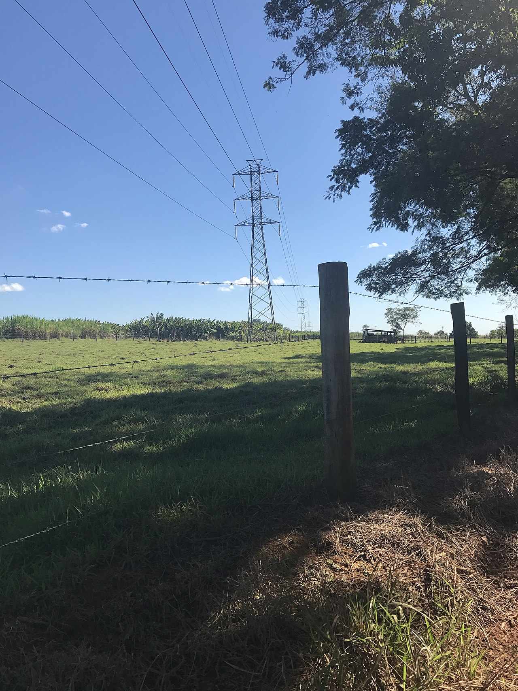
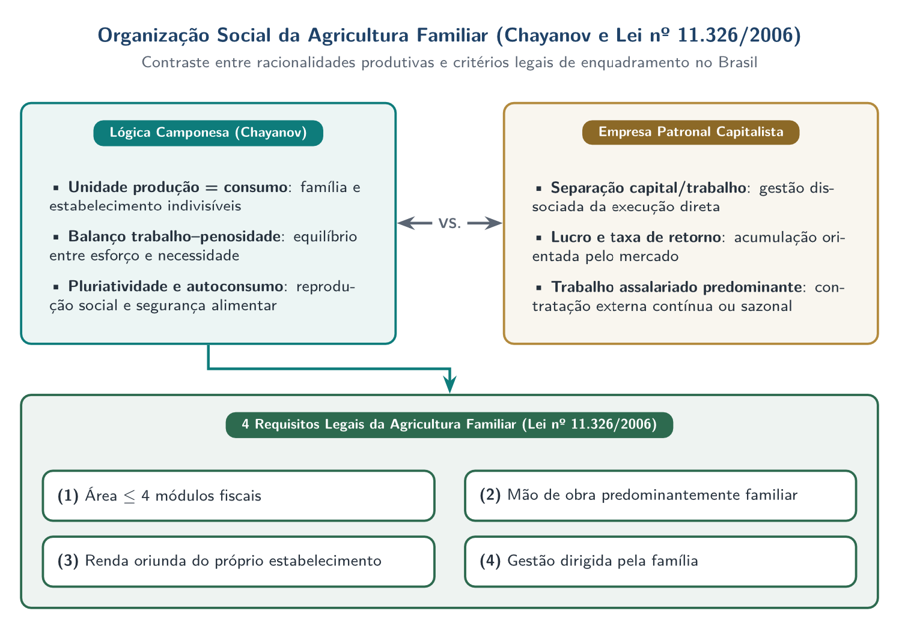

## [Abertura]{.pitch-tag .pitch-tag--forest} Visão Geral da Aula {#visao-geral .smaller-text .lesson-slide}

::: {.pitch-grid-50}
::: {.pitch-card}
[Roteiro da aula]{.pitch-card-index}
[Tópicos principais]{.pitch-heading}

- [1]{.circle} Campesinato e Agricultura Familiar
- [2]{.circle} Definição Legal — Lei 11.326/06
- [3]{.circle} Lógicas Produtivas
- [4]{.circle} Pluriatividade Rural
- [5]{.circle} PRONAF e Estratégias Produtivas
:::

::: {.pitch-stack-2}
::: {.pitch-card .pitch-card--forest}
[Objetivo da aula]{.pitch-card-index}
[Organização e reprodução social]{.pitch-heading}

Analisar a organização social da agricultura familiar brasileira, suas lógicas produtivas, estratégias de pluriatividade e políticas de apoio.
:::

::: {.pitch-pill-row}
[Chayanov · Wanderley · Schneider]{.pitch-pill}
[Lei 11.326/06]{.pitch-pill .pitch-pill--gold}
[PRONAF]{.pitch-pill}
:::

::: {.pitch-band .pitch-band--teal}
Da unidade produção-consumo camponesa às estratégias contemporâneas de pluriatividade, agroecologia e financiamento público.
:::
:::
:::

# 1 · Campesinato e Agricultura Familiar {.section-header rotulo="Campesinato"}

## [Origens]{.pitch-tag .pitch-tag--forest} Campesinato e Agricultura Familiar {#campesinato-agricultura-familiar .smaller-text .lesson-slide}

::: {.pitch-grid-60}
::: {.pitch-stack-2}
::: {.pitch-card}
[Construção conceitual]{.pitch-card-index}
[Três conjuntos de atores]{.pitch-heading}

1. **Grupos sociais** — MST, movimento camponês, CONTAG
2. **Acadêmicos** — Chayanov, Wanderley, Schneider
3. **Agentes públicos** — governo, terceiro setor
:::

::: {.pitch-card .pitch-card--forest}
[Alexander Chayanov]{.pitch-card-index}
[Unidade produtiva familiar]{.pitch-heading}

Entendia o campesinato como uma forma de organização econômica baseada nas **unidades produtivas familiares**, onde o produtor é simultaneamente empresário e trabalhador em constante **auto-exploração**.
:::
:::

::: {.pitch-media-card .pitch-media-card--photo .pitch-media-card--tall}

[Agricultura familiar em assentamento (Sumaré/SP)]{.pitch-caption}
[T. Almeida Cardoso · CC-BY-SA 4.0, Wikimedia Commons]{.pitch-caption-sub}
:::
:::

## [Teoria]{.pitch-tag .pitch-tag--teal} Campesinato vs. Agricultura Familiar {#campesinato-vs-familiar .smaller-text .lesson-slide}

::: {.pitch-cards-2}
::: {.pitch-card .pitch-card--gold}
[Maria Nazareth Wanderley (2003)]{.pitch-card-index}
[Ruptura e continuidade]{.pitch-heading}

A agricultura familiar e o campesinato no Brasil apresentam tanto **pontos de ruptura** quanto **elementos de continuidade**.
:::

::: {.pitch-card .pitch-card--teal}
[Sergio Schneider]{.pitch-card-index}
[Inserção econômica]{.pitch-heading}

A agricultura familiar combina relações internas e externas de produção, conectando a unidade familiar com **circuitos mais amplos de capital**.
:::
:::

::: {.pitch-formula}
*"O camponês é ao mesmo tempo patrão e empregado (auto-exploração) que luta pela sobrevivência."*
:::

## [Síntese Visual]{.pitch-tag .pitch-tag--forest} Racionalidades Produtivas e Marco Legal {#diagrama-organizacao .smaller-text .lesson-slide}

::: {.pitch-media-card .pitch-media-card--wide}

[Organização Social da Agricultura Familiar (Chayanov e Lei nº 11.326/2006)]{.pitch-caption}
[Contraste entre lógica camponesa e empresa patronal capitalista e os quatro requisitos legais no Brasil]{.pitch-caption-sub}
:::

::: {.pitch-band .pitch-band--navy}
A unidade familiar articula produção e consumo sob balanço trabalho-penosidade próprio, enquadrada legalmente pelos critérios da Lei nº 11.326/2006.
:::

# 2 · Definição Legal e Características {.section-header rotulo="Marco Legal"}

## [Legislação]{.pitch-tag .pitch-tag--gold} Definição Legal — Lei 11.326/06 {#definicao-legal .smaller-text .lesson-slide}

::: {.pitch-band .pitch-band--navy}
A **Lei 11.326/06 (Brasil, 2006)** define os critérios cumulativos para enquadramento de uma unidade rural na **agricultura familiar**.
:::

::: {.pitch-cards-2}
::: {.pitch-card .pitch-card--gold}
[Critérios da unidade familiar]{.pitch-card-index}
[Cinco requisitos centrais]{.pitch-heading}

- **Gestão** feita por indivíduos com laços de sangue ou casamento
- Maior parte do **trabalho** fornecida pela família
- Percentual mínimo de **renda** originada da propriedade rural
- **Propriedade** dos meios de produção pertence à família
- Não ultrapassa **quatro módulos fiscais**
:::

::: {.pitch-card .pitch-card--forest}
[Abrangência legal]{.pitch-card-index}
[Públicos incluídos]{.pitch-heading}

Além dos agricultores familiares convencionais, a lei contempla explicitamente:

- **Silvicultura** e manejo florestal
- **Extrativismo** sustentável
- **Pesca artesanal** e aquicultura familiar
- **Povos originários** e comunidades tradicionais
:::
:::

## [Fundamentos]{.pitch-tag .pitch-tag--forest} Características Fundamentais {#caracteristicas-fundamentais .smaller-text .lesson-slide}

::: {.pitch-cards}
::: {.pitch-card}
[01 · Vínculo familiar]{.pitch-card-index}
[Base socioafetiva]{.pitch-heading}

Emerge de uma **ligação socioafetiva e consanguínea** que organiza trabalho, gestão e sucessão.
:::

::: {.pitch-card .pitch-card--gold}
[02 · Racionalidade econômica]{.pitch-card-index}
[Leis de Chayanov e Lipton]{.pitch-heading}

**Não se limita** ao autoconsumo (**Lei de Chayanov**) e **não é** necessariamente aversa ao risco (**Lei de Lipton**).
:::

::: {.pitch-card .pitch-card--teal}
[03 · Mercados e adaptação]{.pitch-card-index}
[Inserção e tecnologia]{.pitch-heading}

A **pluriatividade** sustenta o sistema; é altamente **integrada ao mercado** (**Schneider, 2003**), incorpora **avanços técnicos** e responde a políticas governamentais.
:::
:::

# 3 · Lógicas Produtivas e Pluriatividade {.section-header rotulo="Pluriatividade"}

## [Produção]{.pitch-tag} Lógicas Produtivas na Agricultura Familiar {#logicas-produtivas .smaller-text .lesson-slide}

::: {.pitch-cards-2}
::: {.pitch-card}
[Dinâmica produtiva]{.pitch-card-index}
[Menos tecnificada que a agroindústria]{.pitch-heading}

- Produtos destinados ao **autoconsumo** e à **comercialização**
- Maior proximidade com o meio urbano (**Projeto Rurbano — Graziano da Silva**)
- Necessidade de **estratégias de pluriatividade** para sobrevivência econômica
:::

::: {.pitch-card .pitch-card--teal}
[Condicionantes externos]{.pitch-card-index}
[Fatores que moldam as estratégias]{.pitch-heading}

As estratégias produtivas são diretamente influenciadas por:

- **Acesso à informação e tecnologias**
- **Políticas públicas** territoriais
- **Sistemas de crédito** rural
:::
:::

## [Pluriatividade]{.pitch-tag .pitch-tag--teal} Pluriatividade Rural {#pluriatividade-rural .smaller-text .lesson-slide}

::: {.pitch-formula}
**Definição (Schneider, 2003):** Combinação de uma ou mais formas de **renda ou inserção profissional** dos membros de uma mesma família para manutenção econômica do seio familiar.
:::

::: {.pitch-cards}
::: {.pitch-card .pitch-card--teal}
[Permanência territorial]{.pitch-card-index}
[Moradia no campo]{.pitch-heading}

Membros da família exercem **atividades não agrícolas** preservando a **moradia no campo**.
:::

::: {.pitch-card .pitch-card--forest}
[Vínculo agrário]{.pitch-card-index}
[Ligação produtiva]{.pitch-heading}

Mantém-se a **ligação produtiva com a agricultura** dentro do estabelecimento familiar.
:::

::: {.pitch-card .pitch-card--gold}
[Sociabilidade]{.pitch-card-index}
[Vida no espaço rural]{.pitch-heading}

Assegura a continuidade da **vida no espaço rural** e da reprodução sociocultural da família.
:::
:::

## [Tipologia]{.pitch-tag .pitch-tag--teal} Tipos de Pluriatividade {#tipos-pluriatividade .smaller-text .lesson-slide}

::: {.pitch-table-box}
| Tipo | Descrição |
| --- | --- |
| **Intersetorial** | Articulação agricultura + outros setores; emprego paralelo não agrícola |
| **De base agrária** | Atividades agrícolas e não agrícolas (prestação de serviços, comercialização) |
| **Sazonal** | Atividades não agrícolas esporádicas (comércio informal, turismo) |
| **Para-agrícola** | Processamento e comercialização de produtos agrícolas |
| **Tradicional** | Múltiplas ocupações com foco no autoconsumo; fraca relação mercantil |
:::

::: {.pitch-band}
**Fonte conceitual:** tipologia da pluriatividade segundo **Schneider (2015)**.
:::

# 4 · Estratégias, PRONAF e Referências {.section-header rotulo="Estratégias"}

## [Agroecologia]{.pitch-tag .pitch-tag--forest} Estratégias Produtivas e Resiliência {#estrategias-produtivas .smaller-text .lesson-slide}

::: {.pitch-cards-2}
::: {.pitch-card .pitch-card--forest}
[Alinhamento com a agroecologia]{.pitch-card-index}
[Práticas de manejo diversificado]{.pitch-heading}

- **Policultivo** e diversificação de culturas
- **Sistemas agroflorestais**
- **Rotação de culturas**
:::

::: {.pitch-card .pitch-card--gold}
[Sustentação econômica]{.pitch-card-index}
[Resiliência e apoio público]{.pitch-heading}

- Eleva a **resiliência** dos sistemas agrícolas e preserva a **biodiversidade**
- Outra estratégia central: apoio governamental via **créditos e seguros agrícolas**
:::
:::

## [Política]{.pitch-tag .pitch-tag--gold} PRONAF: Programa Nacional de Fortalecimento {#pronaf .smaller-text .lesson-slide}

::: {.pitch-band .pitch-band--navy}
**PRONAF — Programa Nacional de Fortalecimento da Agricultura Familiar:** criado pelo **Decreto Lei 1.946/96** e fortalecido pela **Lei 11.326/06**, com objetivo de **subvencionar a produção agrícola de empreendimentos familiares**.
:::

::: {.pitch-cards}
::: {.pitch-card .pitch-card--gold}
[Inclusão social]{.pitch-card-index}
[PRONAF Mulher e Jovem]{.pitch-heading}

- **PRONAF Mulher** — autonomia produtiva e acesso a crédito
- **PRONAF Jovem** — sucessão rural e permanência no campo
:::

::: {.pitch-card .pitch-card--forest}
[Sustentabilidade]{.pitch-card-index}
[Agroecologia, ABC+ e Bioeconomia]{.pitch-heading}

- **PRONAF Agroecologia** — transição ecológica
- **PRONAF ABC+** — agricultura de baixo carbono
- **PRONAF Bioeconomia** — sociobiodiversidade
:::

::: {.pitch-card .pitch-card--teal}
[Estrutura produtiva]{.pitch-card-index}
[Mais Alimentos]{.pitch-heading}

- **PRONAF Mais Alimentos** — modernização de infraestrutura e máquinas adaptadas à escala familiar
:::
:::

## [Síntese]{.pitch-tag} Conclusão {#conclusao .smaller-text .lesson-slide}

::: {.pitch-band .pitch-band--teal}
A agricultura familiar no Brasil é uma entidade **complexa e multifacetada**, localizada na interseção de forças sociais, culturais e políticas.
:::

::: {.pitch-milestones}
::: {.pitch-milestone-item}
**Diversidade estrutural:** abrange variados **sistemas produtivos**, estratégias e práticas no território.
:::

::: {.pitch-milestone-item}
**Irredutibilidade conceitual:** não pode ser reduzida a uma **categoria simplista** ou homogênea.
:::

::: {.pitch-milestone-item}
**Pilar estratégico:** posiciona-se como **pilar crucial** para a **segurança alimentar** e a **sustentabilidade ambiental**.
:::
:::

## [Referências]{.pitch-tag} Referências Bibliográficas {#referencias .smaller-text .lesson-slide}

::: {.pitch-cards-2}
::: {.pitch-card}
[Marcos legais e institucionais]{.pitch-card-index}
[Legislação e diagnósticos]{.pitch-heading}

- Brasil. *Decreto Lei 1.946/96* — PRONAF (1996)
- Brasil. *Lei 11.326/06* — Agricultura Familiar (2006)
- INCRA/FAO. *Perfil da agricultura familiar no Brasil* (1996)
- Brumer, A. et al. *A exploração familiar no Brasil* (1993)
:::

::: {.pitch-card .pitch-card--forest}
[Literatura teórica]{.pitch-card-index}
[Campesinato, pluriatividade e liberdade]{.pitch-heading}

- Schneider, S. *A diversidade da agricultura familiar* (2006)
- Schneider, S. *Teoria social, agricultura familiar e pluriatividade* (2003)
- Sen, A. *Desenvolvimento como liberdade* (2003)
- Wanderley, M. N. B. *Agricultura familiar e campesinato* (2003)
:::
:::

## {.center background-color="#2135A6"}

::: {style="text-align: center;"}
[Obrigado!]{.obrigado-fit-text style="color: white;"}

::: {style="color: white; font-size: 0.7em;"}
Luiz Diego Vidal Santos

Universidade Estadual de Feira de Santana (UEFS)
:::
:::
