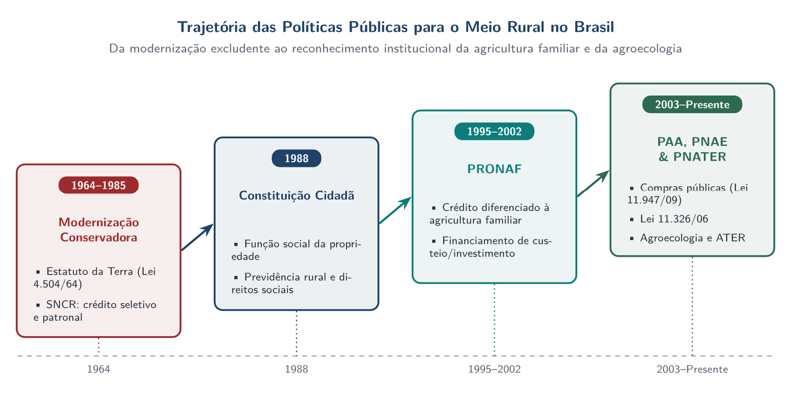
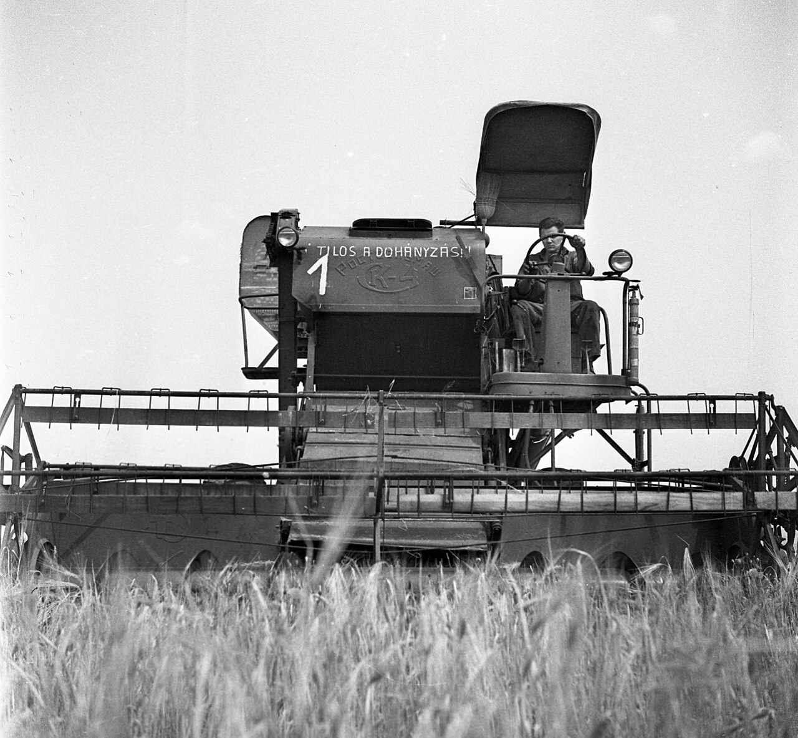
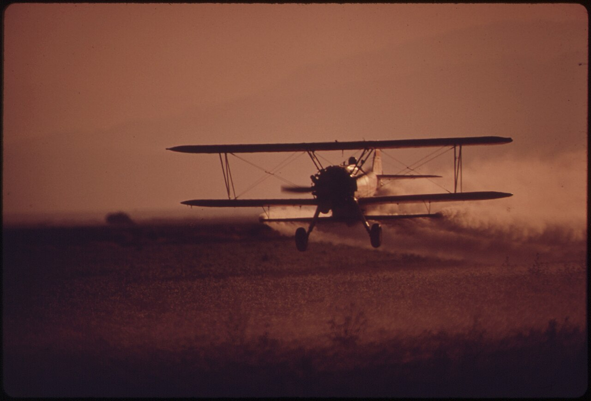
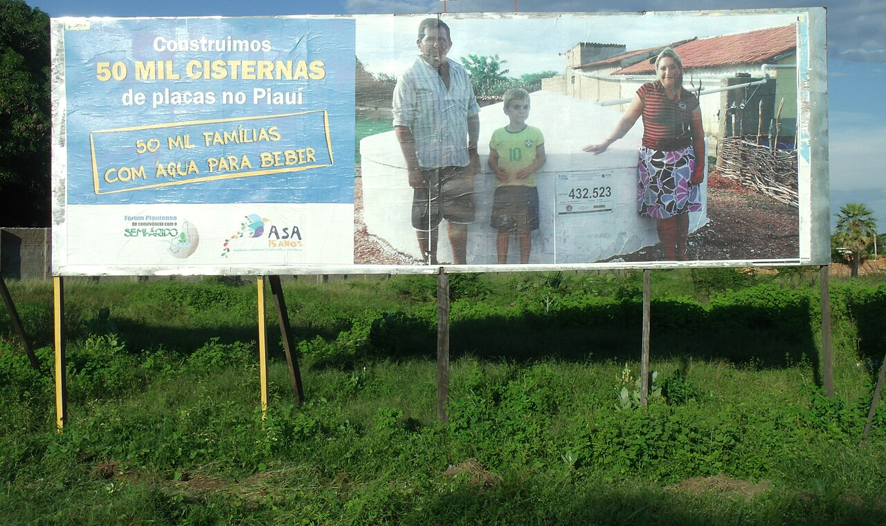

## [Abertura]{.pitch-tag} Visão Geral da Aula {#visao-geral .smaller-text .lesson-slide}

::: {.pitch-grid-50}
::: {.pitch-card}
[Roteiro da aula]{.pitch-card-index}
[Tópicos principais]{.pitch-heading}

- [1]{.circle} Conceitos Fundamentais (Rural e Questão Agrária)
- [2]{.circle} Contextualização Histórica
- [3]{.circle} Estatuto da Terra e Modernização
- [4]{.circle} Lei da Agricultura Familiar e PNATER
- [5]{.circle} PRONAF e Outros Programas
:::

::: {.pitch-stack-2}
::: {.pitch-card .pitch-card--gold}
[Objetivo da aula]{.pitch-card-index}
[Institucionalização no campo]{.pitch-heading}

Compreender as políticas públicas voltadas ao meio rural brasileiro, desde o Estatuto da Terra até a PNATER e os programas de apoio à agricultura familiar.
:::

::: {.pitch-pill-row}
[Lei 4.504/64]{.pitch-pill}
[Lei 11.326/06]{.pitch-pill .pitch-pill--gold}
[Lei 12.188/2010]{.pitch-pill}
:::

::: {.pitch-band .pitch-band--teal}
Da concentração fundiária e modernização seletiva às políticas diferenciadas de ATER, crédito e segurança alimentar.
:::
:::
:::

# 1 · Conceitos Fundamentais e História Agrária {.section-header rotulo="Conceitos"}

## [Conceitos]{.pitch-tag} Conceitos Fundamentais: O Meio Rural {#conceitos-fundamentais .smaller-text .lesson-slide}

::: {.pitch-band .pitch-band--teal}
Antes de abordar as políticas públicas, é fundamental definir os atributos do **Meio Rural (Kageyama, 2008)**.
:::

::: {.pitch-cards-2}
::: {.pitch-card}
[Base biofísica e espacial]{.pitch-card-index}
[Dimensões territoriais]{.pitch-heading}

1. Espaço com maior presença de **áreas verdes ou naturais**
2. Maiores **distâncias** entre unidades residenciais e comerciais
3. Maior **dispersão** e menor densidade populacional
:::

::: {.pitch-card .pitch-card--forest}
[Base produtiva e simbólica]{.pitch-card-index}
[Natureza e identidade]{.pitch-heading}

4. Maior presença de atividades dependentes de **recursos naturais**
5. Representações **culturais e simbólicas** atreladas à ruralidade
:::
:::

## [Dicotomia]{.pitch-tag .pitch-tag--teal} Questão Agrária vs. Questão Agrícola {#questao-agraria-agricola .smaller-text .lesson-slide}

::: {.pitch-cards-2}
::: {.pitch-card .pitch-card--teal}
[Graziano da Silva (1980); Veiga (1991); Navarro (2011)]{.pitch-card-index}
[Questão Agrária]{.pitch-heading}

Compreensão das **relações sociais** do meio rural — relações de trabalho, renda, direitos políticos e de gênero.

O campo enquanto **ambiente social**.
:::

::: {.pitch-card .pitch-card--gold}
[Enfoque produtivo-tecnológico]{.pitch-card-index}
[Questão Agrícola]{.pitch-heading}

O campo enquanto **artefato econômico** — produção, consumo, forças produtivas e tecnologias emergentes.
:::
:::

::: {.pitch-band .pitch-band--navy}
Políticas públicas restritas à **questão agrícola** ignoram as assimetrias sociais que estruturam a **questão agrária** brasileira.
:::

## [Histórico]{.pitch-tag .pitch-tag--alert} Breve Contextualização Histórica {#contextualizacao-historica .smaller-text .lesson-slide}

::: {.pitch-band .pitch-band--navy}
A institucionalização da estrutura agrária no Brasil foi marcada por políticas voltadas à consolidação de **poucos grupos oligárquicos**.
:::

::: {.pitch-milestones}
::: {.pitch-milestone-item}
**Sesmarias → Lei de Terras de 1850:** institucionalização da propriedade privada excludente.
:::

::: {.pitch-milestone-item}
**Consolidação de grandes latifúndios:** concentração fundiária persistente e **pouco feito ao pequeno produtor**.
:::

::: {.pitch-milestone-item}
**Pressão social:** a partir das **lutas dos movimentos sociais**, surgem discussões sobre possíveis ações do poder público.
:::
:::

## [Trajetória]{.pitch-tag} Trajetória das Políticas Públicas Rurais {#diagrama-trajetoria .smaller-text .lesson-slide}

::: {.pitch-media-card .pitch-media-card--wide}

[Trajetória das Políticas Públicas para o Meio Rural no Brasil]{.pitch-caption}
[Da modernização conservadora (1964–1985) à Constituição Cidadã (1988), PRONAF (1995–2002) e PAA, PNAE e PNATER (2003–Presente)]{.pitch-caption-sub}
:::

::: {.pitch-band}
A evolução normativa reflete a transição de um Estado focado apenas no padrão patronal para o reconhecimento institucional da agricultura familiar e da agroecologia.
:::

# 2 · Estatuto da Terra e Modernização Conservadora {.section-header rotulo="Modernização"}

## [Estatuto]{.pitch-tag .pitch-tag--gold} Estatuto da Terra (Lei 4.504/64) {#estatuto-da-terra .smaller-text .lesson-slide}

::: {.pitch-grid-55}
::: {.pitch-stack-2}
::: {.pitch-card .pitch-card--gold}
[Objetivos centrais]{.pitch-card-index}
[Uso social e crédito]{.pitch-heading}

- Regulamentar o **uso social** dos imóveis rurais
- *"Terra para quem vive, trabalha e mora"*
- Criar princípios da **reforma agrária**
- Incentivar o desenvolvimento de políticas de **crédito**
:::

::: {.pitch-card}
[Desdobramentos financeiros]{.pitch-card-index}
[Crédito e seguro rural]{.pitch-heading}

- Sistema Brasileiro de Crédito Rural (década de 1960)
- **PROAGRO** — **Lei 5.969/73**: seguro e financiamento agrícola (**Alves, 2012**)
:::
:::

::: {.pitch-media-card .pitch-media-card--photo .pitch-media-card--tall}

[Mecanização agrícola viabilizada pelo crédito rural]{.pitch-caption}
[Colheitadeira em operação · Fortepan / Urbán Tamás, CC-BY-SA 3.0]{.pitch-caption-sub}
:::
:::

## [Debate]{.pitch-tag .pitch-tag--alert} Modernização: Debate e Contradições {#modernizacao-debate .smaller-text .lesson-slide}

::: {.pitch-grid-55}
::: {.pitch-stack-2}
::: {.pitch-card .pitch-card--alert}
[Dilema estrutural]{.pitch-card-index}
[Solução agrária ou reserva de trabalho?]{.pitch-heading}

Há muitos debates sobre se a modernização do campo:

- Resolve de fato as **questões agrárias**, ou
- Apenas cria uma **reserva de mão de obra** no campo
:::

::: {.pitch-card}
[Décadas de 1970–2000]{.pitch-card-index}
[Inflexão para a pluralidade]{.pitch-heading}

A concentração de políticas na **questão agrícola** aprofundou as **diferenças sociais e econômicas** no campo. Somada às articulações de **movimentos sociais**, essa dinâmica levou à necessidade de políticas focadas na **pluralidade do campo**.
:::
:::

::: {.pitch-media-card .pitch-media-card--photo .pitch-media-card--tall}

[Pacote tecnológico da Revolução Verde]{.pitch-caption}
[Pulverização aérea de lavoura · Charles O'Rear / NARA, Domínio Público]{.pitch-caption-sub}
:::
:::

# 3 · Agricultura Familiar, ATER e PNATER {.section-header rotulo="ATER e PNATER"}

## [Legislação]{.pitch-tag .pitch-tag--forest} Lei da Agricultura Familiar (11.326/06) {#lei-agricultura-familiar .smaller-text .lesson-slide}

::: {.pitch-cards-2}
::: {.pitch-card .pitch-card--forest}
[Requisitos para titulação]{.pitch-card-index}
[Critérios legais da unidade familiar]{.pitch-heading}

- Gestão realizada por indivíduos com **laços familiares**
- Maior parte do trabalho fornecida pela **família**
- Renda mínima originada da **propriedade rural**
- Propriedade dos meios de produção pertence à **família**
- Máximo de **quatro módulos fiscais**
:::

::: {.pitch-card .pitch-card--gold}
[Reconhecimento da sociobiodiversidade]{.pitch-card-index}
[Ampliação da lei]{.pitch-heading}

A **Lei 11.326/06** estende a política de agricultura familiar a categorias produtivas e identitárias historicamente invisibilizadas:

- **Silvicultura** e **extrativismo**
- **Pesca artesanal**
- **Povos originários**
:::
:::

## [Extensão]{.pitch-tag .pitch-tag--alert} Extensão Rural — EMBRATER {#extensao-embrater .smaller-text .lesson-slide}

::: {.pitch-card}
[Lei 6.126/74 · Peixoto (2008)]{.pitch-card-index}
[Estatização da extensão rural]{.pitch-heading}

A assistência técnica e extensão rural tomou força com a **Lei 6.126/74**:

- **Estatizou** o sistema brasileiro de extensão rural
- Instituiu a **EMBRATER** (Peixoto, 2008)
:::

::: {.pitch-band .pitch-band--navy}
**Limite histórico:** a ATER focada majoritariamente na **questão agrícola** conduziu o Brasil a **aprofundar as diferenças no campo**.
:::

## [PNATER]{.pitch-tag .pitch-tag--teal} PNATER e PRONATER (Lei 12.188/2010) {#pnater-pronater .smaller-text .lesson-slide}

::: {.pitch-band .pitch-band--teal}
**Lei 12.188/2010 — Política Nacional de ATER:** voltada para a **melhoria das condições de vida** da população rural (**MDA, 2013**).
:::

::: {.pitch-flow-4}
::: {.pitch-card}
[Subprograma 01]{.pitch-card-index}
[Agentes de ATER]{.pitch-heading}

Capacitação de **agentes de ATER** para atuação nos territórios.
:::

::: {.pitch-card .pitch-card--gold}
[Subprograma 02]{.pitch-card-index}
[Agricultores Familiares]{.pitch-heading}

Capacitação técnica e organizativa de **agricultores familiares**.
:::

::: {.pitch-card .pitch-card--teal}
[Subprograma 03]{.pitch-card-index}
[Programas Estaduais]{.pitch-heading}

Fortalecimento de **programas estaduais de ATER**.
:::

::: {.pitch-card .pitch-card--forest}
[Subprograma 04]{.pitch-card-index}
[ATER Setorial]{.pitch-heading}

Execução de **ATER Setorial** para públicos e cadeias específicas.
:::
:::

## [Diretrizes]{.pitch-tag .pitch-tag--forest} Princípios da PNATER {#principios-pnater .smaller-text .lesson-slide}

::: {.pitch-cards}
::: {.pitch-card}
[01 · Equidade]{.pitch-card-index}
[Inclusão social]{.pitch-heading}

Superar discriminação e exclusão histórica no meio rural.
:::

::: {.pitch-card .pitch-card--forest}
[02 · Ecologia]{.pitch-card-index}
[Transição agroecológica]{.pitch-heading}

Transição para agricultura ecológica e práticas agroecológicas.
:::

::: {.pitch-card .pitch-card--teal}
[03 · Integração]{.pitch-card-index}
[ATER–pesquisa–ensino]{.pitch-heading}

Articulação ATER-pesquisa-ensino com integração institucional.
:::

::: {.pitch-card .pitch-card--gold}
[04 · Identidades]{.pitch-card-index}
[Diversidades]{.pitch-heading}

Reconhecimento de povos originários, quilombolas e pescadores.
:::

::: {.pitch-card}
[05 · Economia]{.pitch-card-index}
[Ocupação e renda]{.pitch-heading}

Geração de ocupação e renda via diversificação produtiva.
:::

::: {.pitch-card .pitch-card--teal}
[06 · Governança]{.pitch-card-index}
[Atuação em redes]{.pitch-heading}

Cooperação interinstitucional entre entidades nos territórios.
:::
:::

# 4 · PRONAF, Programas Territoriais e Síntese {.section-header rotulo="Programas"}

## [Crédito e Semiárido]{.pitch-tag .pitch-tag--gold} PRONAF e Políticas de Convivência com o Semiárido {#pronaf .smaller-text .lesson-slide}

::: {.pitch-grid-55}
::: {.pitch-stack-2}
::: {.pitch-card .pitch-card--gold}
[BACEN · Decreto Lei 1.946/96]{.pitch-card-index}
[PRONAF]{.pitch-heading}

**Programa Nacional de Fortalecimento da Agricultura Familiar**, criado por resolução do **BACEN** e regulamentado pelo **Decreto Lei 1.946/96**.

**Objetivo:** melhorar a qualidade de vida do produtor rural por meio de subvenções e apoio financeiro/técnico.
:::

::: {.pitch-card .pitch-card--forest}
[Linhas de atuação]{.pitch-card-index}
[Subprogramas e território]{.pitch-heading}

- **PRONAF** Mulher, Jovem, Mais Alimentos
- **PRONAF** ABC+, Agroecologia
- **Grupo B**, Cotas Partes
- Articulação no **Semiárido** com políticas de acesso à água e convivência produtiva (ASA)
:::
:::

::: {.pitch-media-card .pitch-media-card--photo .pitch-media-card--tall}

[Programa de Cisternas da ASA no Semiárido (Piauí)]{.pitch-caption}
[Academia de Letras de CM · CC-BY-SA 3.0 BR · políticas públicas para agricultura familiar no Semiárido]{.pitch-caption-sub}
:::
:::

## [Tipologia]{.pitch-tag .pitch-tag--teal} Outros Programas Públicos {#outros-programas .smaller-text .lesson-slide}

::: {.pitch-band .pitch-band--teal}
As políticas públicas para o meio rural podem ser segmentadas por **natureza e objetivo**.
:::

::: {.pitch-table-box}
| Natureza | Exemplos |
| --- | --- |
| **Políticas sociais** | Luz para Todos, Programa Nacional de Habitação Rural |
| **Segurança alimentar** | PAA, PNAE |
| **Políticas agrárias** | Seguro Rural, Crédito Fundiário |
| **Políticas agrícolas** | PRONAF, PNATER |
:::

## [Síntese]{.pitch-tag} Conclusão {#conclusao .smaller-text .lesson-slide}

::: {.pitch-band .pitch-band--navy}
A trajetória histórica das políticas agrárias e agrícolas demonstra uma **evolução significativa** na abordagem e reconhecimento das particularidades do setor.
:::

::: {.pitch-cards}
::: {.pitch-card .pitch-card--forest}
[01 · Abastecimento]{.pitch-card-index}
[Segurança alimentar]{.pitch-heading}

Fortalecimento da oferta de alimentos diversificados e de base familiar.
:::

::: {.pitch-card .pitch-card--teal}
[02 · Ecossistemas]{.pitch-card-index}
[Proteção ambiental]{.pitch-heading}

Integração entre produção rural, biodiversidade e manejo sustentável.
:::

::: {.pitch-card .pitch-card--gold}
[03 · Governança]{.pitch-card-index}
[Desenvolvimento sustentável]{.pitch-heading}

Estado, **sociedade civil** e **movimentos sociais** aprimorando políticas para as demandas do campo.
:::
:::

## [Referências]{.pitch-tag} Referências Bibliográficas e Marcos Legais {#referencias .smaller-text .lesson-slide}

::: {.pitch-cards-2}
::: {.pitch-card}
[Legislação brasileira]{.pitch-card-index}
[Leis e instrumentos normativos]{.pitch-heading}

- Brasil. *Lei 4.504/64* — Estatuto da Terra (1964)
- Brasil. *Lei 5.969/73* — PROAGRO (1973)
- Brasil. *Lei 6.126/74* — EMBRATER (1974)
- Brasil. *Lei 11.326/06* — Agricultura Familiar (2006)
- Brasil. *Lei 12.188/2010* — PNATER/PRONATER (2010)
:::

::: {.pitch-card .pitch-card--teal}
[Literatura científica]{.pitch-card-index}
[Referências teóricas]{.pitch-heading}

- Alves, P. D. *Políticas Agrícolas para agricultura familiar* (2012)
- Kageyama, A. A. *Desenvolvimento rural* (2008)
- Peixoto et al. *Extensão rural no Brasil* (2008)
- Schneider, S.; Grisa, C. *Três Gerações de Políticas Públicas* (2015)
:::
:::

## {.center background-color="#2135A6"}

::: {style="text-align: center;"}
[Obrigado!]{.obrigado-fit-text style="color: white;"}

::: {style="color: white; font-size: 0.7em;"}
Luiz Diego Vidal Santos

Universidade Estadual de Feira de Santana (UEFS)
:::
:::
