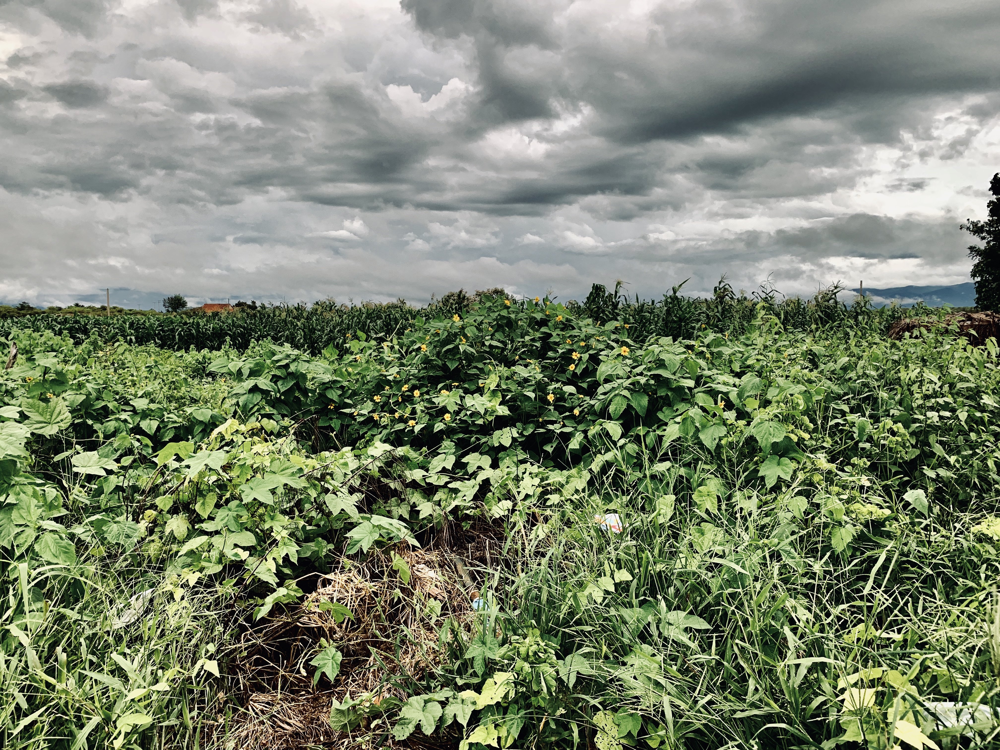
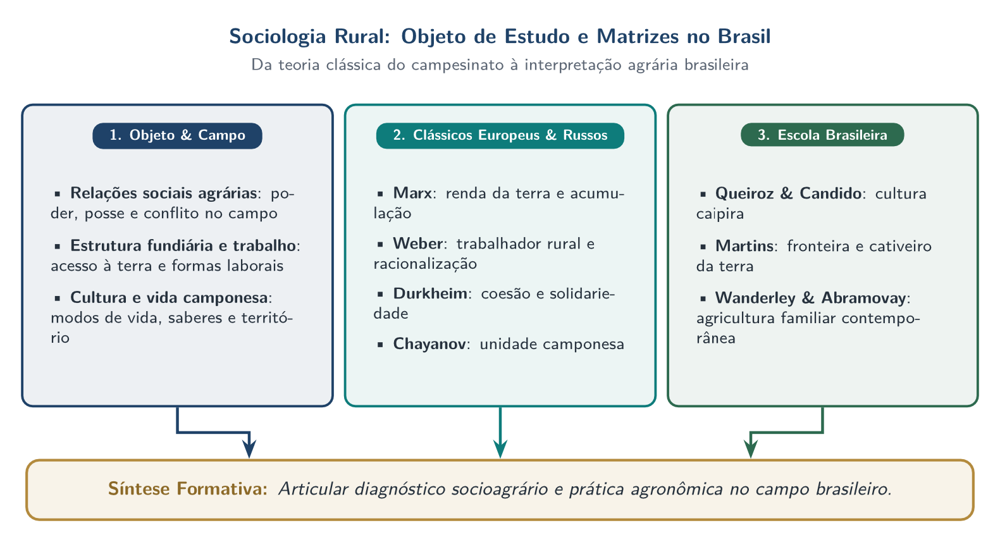

## [Abertura]{.pitch-tag} Visão Geral da Aula {#visao-geral .smaller-text .lesson-slide}

::: {.pitch-grid-50}
::: {.pitch-card}
[Roteiro da aula]{.pitch-card-index}
[Tópicos principais]{.pitch-heading}

- [1]{.circle} O que é Sociologia Rural
- [2]{.circle} Consolidação no Brasil
- [3]{.circle} Atores: pesquisadores e grupos sociais
- [4]{.circle} Temas: agricultura familiar e questão agrária
- [5]{.circle} Novas ruralidades e desenvolvimento sustentável
:::

::: {.pitch-stack-2}
::: {.pitch-card .pitch-card--gold}
[Objetivo da aula]{.pitch-card-index}
[Fundamentos socioagrários]{.pitch-heading}

Compreender os fundamentos da sociologia rural brasileira, seus atores, temas centrais e teorias que orientam o estudo das dinâmicas sociais no campo.
:::

::: {.pitch-pill-row}
[Marx · Weber · Chayanov]{.pitch-pill}
[Questão Agrária]{.pitch-pill .pitch-pill--gold}
[Novas Ruralidades]{.pitch-pill}
:::

::: {.pitch-band .pitch-band--teal}
Das matrizes clássicas à leitura contemporânea da agricultura familiar, dos movimentos sociais e da sustentabilidade rural.
:::
:::
:::

# 1 · Fundamentos e Consolidação no Brasil {.section-header rotulo="Fundamentos"}

## [Fundamentos]{.pitch-tag} O que é Sociologia Rural? {#o-que-e-sociologia-rural .smaller-text .lesson-slide}

::: {.pitch-formula}
**Definição:** A sociologia rural, enquanto campo da ciência social, dedica-se ao estudo das **dinâmicas coletivas** — processos, artefatos, ideias ou produtos — que mediam as relações entre seres humanos no campo e a intersecção com o urbano.
:::

::: {.pitch-cards}
::: {.pitch-card}
[01 · Território e vínculos]{.pitch-card-index}
[Comunidades e urbano-rural]{.pitch-heading}

- Particularidades das **comunidades agrárias**
- **Relações urbano-rurais** e suas fronteiras em transformação
:::

::: {.pitch-card .pitch-card--gold}
[02 · Estrutura e economia]{.pitch-card-index}
[Capitalismo e terra]{.pitch-heading}

- **Capitalismo** e **questão fundiária** no espaço agrário
- **Relações de trabalho** no meio rural
:::

::: {.pitch-card .pitch-card--teal}
[03 · Vida social]{.pitch-card-index}
[Cotidiano no campo]{.pitch-heading}

- **Cotidiano social** do meio rural e modos de sociabilidade
- Práticas, valores e instituições comunitárias
:::
:::

## [Cotidiano]{.pitch-tag .pitch-tag--gold} A Sociologia Rural e o Cotidiano {#cotidiano-rural .smaller-text .lesson-slide}

::: {.pitch-grid-55}
::: {.pitch-stack-2}
::: {.pitch-formula}
**José de Souza Martins (2003):**

*"O cotidiano é uma dimensão fundamental da vida social, e está intrinsecamente relacionado com o processo de desenvolvimento."*
:::

::: {.pitch-card .pitch-card--forest}
[Dimensões analíticas]{.pitch-card-index}
[Cultura, identidade e resistência]{.pitch-heading}

A Sociologia Rural não apenas analisa as transformações econômicas e tecnológicas, mas também se aprofunda nas **questões culturais, identitárias** e nas **formas de resistência e adaptação** das comunidades rurais.
:::
:::

::: {.pitch-media-card .pitch-media-card--photo .pitch-media-card--tall}

[Paisagem agrícola na Caatinga nordestina]{.pitch-caption}
[CC-BY-SA, Wikimedia Commons · cotidiano produtivo e socioambiental no Semiárido]{.pitch-caption-sub}
:::
:::

## [Matrizes]{.pitch-tag .pitch-tag--teal} Objeto de Estudo e Matrizes no Brasil {#matrizes-sociologia-rural .smaller-text .lesson-slide}

::: {.pitch-media-card .pitch-media-card--wide}

[Sociologia Rural: Objeto de Estudo e Matrizes no Brasil]{.pitch-caption}
[Da teoria clássica europeia e russa (Marx, Weber, Durkheim, Chayanov) à interpretação agrária brasileira]{.pitch-caption-sub}
:::

::: {.pitch-band .pitch-band--navy}
**Síntese formativa:** articular o diagnóstico socioagrário — relações de poder, estrutura fundiária e modos de vida — à prática agronômica no campo brasileiro.
:::

## [Trajetória]{.pitch-tag} Consolidação da Sociologia Rural no Brasil {#consolidacao-brasil .smaller-text .lesson-slide}

::: {.pitch-milestones}
::: {.pitch-milestone-item}
**Década de 1950 · Origens acadêmicas:** consolidação inicial a partir da **USP**, com forte influência das teorias de **Marx** e **Weber**.
:::

::: {.pitch-milestone-item}
**Década de 1960 · Pós-graduação:** criação dos primeiros programas de pós-graduação na **UFRGS**, **USP-Piracicaba (ESALQ)**, **UFV** e **UFRPE**.
:::

::: {.pitch-milestone-item}
**Pós-1964 · Institucionalização:** a sociologia rural estabelece-se como campo disciplinar chave, com foco em **comunicação agrícola** e **modernização do campo**.
:::
:::

::: {.pitch-band}
A consolidação institucional deslocou os estudos rurais de descrições folclóricas para análises sistemáticas da estrutura agrária e da difusão tecnológica.
:::

# 2 · Atores da Sociologia Rural Brasileira {.section-header rotulo="Atores"}

## [Pesquisadores]{.pitch-tag .pitch-tag--teal} Atores: Pesquisadores e Contribuições {#atores-pesquisadores .smaller-text .lesson-slide}

::: {.pitch-grid-60}
::: {.pitch-table-box}
| Pesquisador | Contribuição principal |
| --- | --- |
| **Pitirim Sorokin e Carle Zimmerman** | Interações sociais rurais |
| **José de Souza Martins** | Questão agrária, movimentos sociais, campesinato |
| **Afrânio Garcia Jr.** | Categorias de análise, modernização agrícola |
| **Maria Nazareth Wanderley** | Resistência e resiliência dos pequenos agricultores |
| **Sergio Schneider** | Pluriatividade, sistemas agroalimentares |
| **Maria Ignez S. Paulilo e Anita Brumer** | Mulheres no campo, gênero |
:::

::: {.pitch-card .pitch-card--gold}
[Diálogo interdisciplinar]{.pitch-card-index}
[Outros pesquisadores relevantes (não sociólogos)]{.pitch-heading}

- **Alexander Chayanov** — Economia camponesa
- **Ignacy Sachs** — Desenvolvimento sustentável
- **Ricardo Abramovay** — Capitalismo agrário
- **Amartya Sen** — Desenvolvimento como liberdade
:::
:::

## [Movimentos]{.pitch-tag .pitch-tag--alert} Atores: Grupos Sociais no Campo {#grupos-sociais-campo .smaller-text .lesson-slide}

::: {.pitch-band .pitch-band--navy}
Os movimentos sociais no campo representam uma **força vital** na configuração das relações sociais, políticas e econômicas em áreas rurais.
:::

::: {.pitch-cards-2}
::: {.pitch-card .pitch-card--alert}
[Respostas à injustiça social (Abramovay et al., 2010)]{.pitch-card-index}
[Eixos de conflito]{.pitch-heading}

Emergem como respostas a diversas formas de **injustiça social**:

- **Concentração fundiária**
- **Exploração laboral**
- **Degradação ambiental**
:::

::: {.pitch-card .pitch-card--gold}
[Expressões históricas e contemporâneas]{.pitch-card-index}
[Destaques no Brasil]{.pitch-heading}

- **Ligas Camponesas** no Nordeste brasileiro
- **MST** — maior movimento social livre do Brasil
:::
:::

## [Instituições]{.pitch-tag .pitch-tag--gold} Atores: Agentes Públicos e Terceiro Setor {#agentes-publicos-terceiro-setor .smaller-text .lesson-slide}

::: {.pitch-cards-2}
::: {.pitch-card}
[Mediação sindical e produtiva]{.pitch-card-index}
[Órgãos públicos e coletivos]{.pitch-heading}

- **Sindicatos** e confederações sindicais (**CONTAG**)
- **Associações rurais**
- **Cooperativas** (caráter misto)
:::

::: {.pitch-card .pitch-card--teal}
[Atuação pastoral e comunitária]{.pitch-card-index}
[Terceiro setor]{.pitch-heading}

- **Igreja Católica** — Teoria da Libertação
- **Comissões Pastorais da Terra (CPT)**
- **Confederação Nacional dos Bispos do Brasil (CNBB)**
- **Associações Cristãs de Base (ACB)**
:::
:::

::: {.pitch-band .pitch-band--teal}
A organização social no campo articula representação sindical, cooperativismo econômico e redes pastorais de base territorial.
:::

# 3 · Temas Centrais e Questão Agrária {.section-header rotulo="Temas"}

## [Campesinato]{.pitch-tag .pitch-tag--forest} Temas: Agricultura Familiar e Campesinato {#agricultura-familiar-campesinato .smaller-text .lesson-slide}

::: {.pitch-grid-50}
::: {.pitch-stack-2}
::: {.pitch-band .pitch-band--teal}
A agricultura familiar é **vital** para garantir a **segurança alimentar** e a **proteção ambiental**.
:::

::: {.pitch-formula}
**Anita Brumer (1993):**

*"A agricultura camponesa e de base familiar nasceu no Brasil sob o signo da precariedade — jurídica, econômica, social."*
:::
:::

::: {.pitch-card .pitch-card--forest}
[Lógica socioeconômica]{.pitch-card-index}
[Características da agricultura familiar]{.pitch-heading}

- Ligação **socioafetiva e consanguínea**
- Não se limita ao autoconsumo (**Lei de Chayanov**)
- Não é necessariamente aversa ao risco (**Lei de Lipton**)
- **Pluriatividade** evidente na sobrevivência do sistema
:::
:::

## [Questão Agrária]{.pitch-tag .pitch-tag--alert} Temas: Questão Agrária {#questao-agraria .smaller-text .lesson-slide}

::: {.pitch-band .pitch-band--navy}
A questão agrária brasileira é **multifacetada**, envolvendo a análise das **relações sociais no campo** e das **dinâmicas econômicas agrícolas** (produção, consumo, tecnologias e reforma agrária).
:::

::: {.pitch-flow-4}
::: {.pitch-card .pitch-card--alert}
[Dimensão 01]{.pitch-card-index}
[Reforma agrária]{.pitch-heading}

Democratização do acesso à terra e função social da propriedade.
:::

::: {.pitch-card}
[Dimensão 02]{.pitch-card-index}
[Assistência técnica]{.pitch-heading}

Mediação tecnológica e fortalecimento organizativo no campo.
:::

::: {.pitch-card .pitch-card--teal}
[Dimensão 03]{.pitch-card-index}
[Desenvolvimento rural]{.pitch-heading}

Equidade socioeconômica e dinâmica territorial integrada.
:::

::: {.pitch-card .pitch-card--forest}
[Dimensão 04]{.pitch-card-index}
[Segurança alimentar]{.pitch-heading}

Abastecimento interno e soberania alimentar da população.
:::
:::

::: {.pitch-band}
**Autores-chave:** Graziano da Silva (1980), José Eli de Veiga (1991) e Zander Navarro (2011).
:::

## [Trabalho]{.pitch-tag .pitch-tag--alert} Temas: Relações de Trabalho e Renda {#relacoes-trabalho-renda .smaller-text .lesson-slide}

::: {.pitch-cards-2}
::: {.pitch-card .pitch-card--alert}
[José de Souza Martins (2000)]{.pitch-card-index}
[Precarização do trabalho]{.pitch-heading}

O trabalho rural, frequentemente à margem da lei, expõe trabalhadores a **vulnerabilidades sociológicas**, incluindo **trabalho análogo à escravidão**.
:::

::: {.pitch-card .pitch-card--gold}
[Transição demográfica]{.pitch-card-index}
[Envelhecimento da população rural]{.pitch-heading}

- **Êxodo juvenil** para áreas urbanas
- **Pressão** sobre sistemas de produção
- **Ameaça** à continuidade do modo de vida rural
:::
:::

::: {.pitch-band}
A superação da precariedade laboral e a sucessão geracional constituem desafios centrais para a sustentabilidade social do campo.
:::

# 4 · Novas Ruralidades, Gênero e Sustentabilidade {.section-header rotulo="Ruralidades"}

## [Ruralidades]{.pitch-tag .pitch-tag--teal} Temas: Novas Ruralidades {#novas-ruralidades .smaller-text .lesson-slide}

::: {.pitch-band .pitch-band--teal}
O conceito de **"novas ruralidades"** refere-se às **mudanças significativas** no mundo rural nas últimas décadas.
:::

::: {.pitch-cards-2}
::: {.pitch-card}
[Reestruturação produtiva e social]{.pitch-card-index}
[Novos papéis e atores]{.pitch-heading}

- Da fazenda à empresa moderna e exportadora (**Graziano da Silva, 1998**)
- Pluralidade de novas atividades no campo
- **Pluriatividade rural** (**Schneider, 2015**)
:::

::: {.pitch-card .pitch-card--gold}
[Reconhecimento e cidadania]{.pitch-card-index}
[Direitos e diversidade]{.pitch-heading}

- **Questão indígena** e **povos originários**
- **Mulheres no campo** como cidadãs de iguais direitos
- Valorização das múltiplas identidades rurais
:::
:::

## [Gênero]{.pitch-tag .pitch-tag--gold} Temas: Modernização e Gênero {#modernizacao-genero .smaller-text .lesson-slide}

::: {.pitch-cards-2}
::: {.pitch-card .pitch-card--alert}
[Impactos assimétricos]{.pitch-card-index}
[Modernização do campo]{.pitch-heading}

A **revolução verde** e a transição para a agricultura industrial resultaram em discrepâncias:

- Monoculturas intensivas *vs.* marginalização da agricultura familiar
:::

::: {.pitch-card .pitch-card--gold}
[Brumer (2003); Paulilo (2016)]{.pitch-card-index}
[Empoderamento da mulher no campo]{.pitch-heading}

- Mulheres rurais enfrentam **desafios estruturais** agravados por desigualdades de gênero
- Acesso limitado à **propriedade de terra**
- Preferência por **herdeiros homens**
:::
:::

::: {.pitch-band .pitch-band--navy}
A modernização tecnológica sem reforma das relações de posse e de gênero reproduz assimetrias históricas dentro da própria unidade familiar.
:::

## [Sustentabilidade]{.pitch-tag .pitch-tag--forest} Temas: Desenvolvimento Rural Sustentável {#desenvolvimento-sustentavel .smaller-text .lesson-slide}

::: {.pitch-grid-50}
::: {.pitch-card .pitch-card--teal}
[Veiga · Schneider · Sachs · Sen]{.pitch-card-index}
[Eixos conceituais]{.pitch-heading}

Autores de referência ressaltam a importância de:

- **Liberdade e autonomia** no desenvolvimento rural
- **Conexão ambiental** e sustentabilidade
:::

::: {.pitch-card .pitch-card--forest}
[Ignacy Sachs]{.pitch-card-index}
[Modelo baseado em ecodesenvolvimento]{.pitch-heading}

- Uso de **biomassa, biodiversidade e biotecnologia sustentável**
- **Múltiplas dimensões:** sociais, culturais, ecológicas, psicológicas
- Soluções intensivas em **conhecimento e mão de obra**, mas **econômicas em capital**
:::
:::

::: {.pitch-band .pitch-band--teal}
Desenvolvimento rural sustentável exige integrar autonomia humana, justiça social e base ecológica de baixo custo em capital.
:::

## [Referências]{.pitch-tag} Referências Bibliográficas {#referencias .smaller-text .lesson-slide}

::: {.pitch-cards-2}
::: {.pitch-card}
[Marco legal e questão agrária]{.pitch-card-index}
[Legislação e análises clássicas]{.pitch-heading}

- Brasil. *Lei 4.504/64* — Estatuto da Terra (1964)
- Brumer, A. *Estudos agrários no Brasil* (2006)
- Graziano da Silva, J. *O que é questão agrária* (1980)
- Kageyama, A. A. *A questão agrária extrapola fronteiras* (1993)
:::

::: {.pitch-card .pitch-card--teal}
[Sociabilidade e desenvolvimento]{.pitch-card-index}
[Literatura de referência]{.pitch-heading}

- Martins, J. S. *A sociabilidade do homem simples* (2003)
- Navarro, Z. *Desenvolvimento rural no Brasil* (2001)
- Schneider, S. *Situando o desenvolvimento rural no Brasil* (2010)
- Veiga, J. E. *O Desenvolvimento Agrícola* (1991)
:::
:::

## {.center background-color="#2135A6"}

::: {style="text-align: center;"}
[Obrigado!]{.obrigado-fit-text style="color: white;"}

::: {style="color: white; font-size: 0.7em;"}
Luiz Diego Vidal Santos

Universidade Estadual de Feira de Santana (UEFS)
:::
:::
