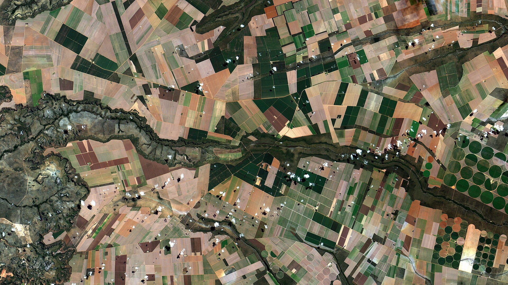
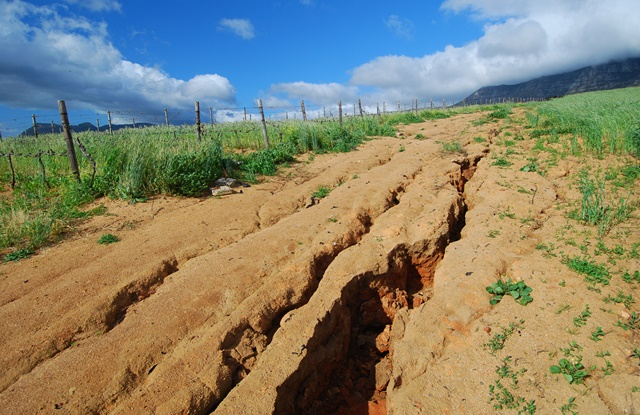
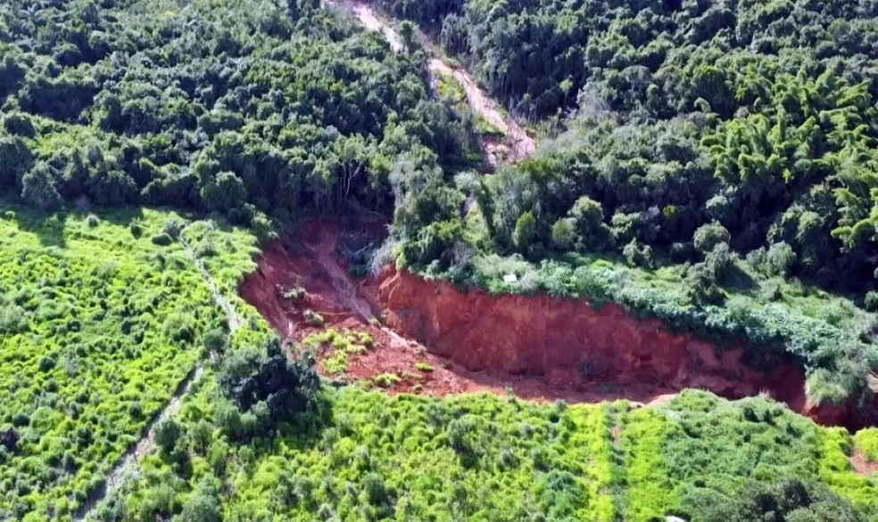
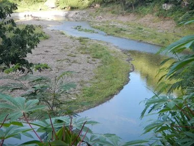
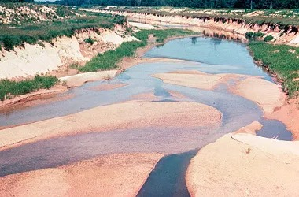
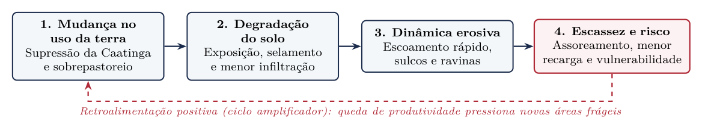
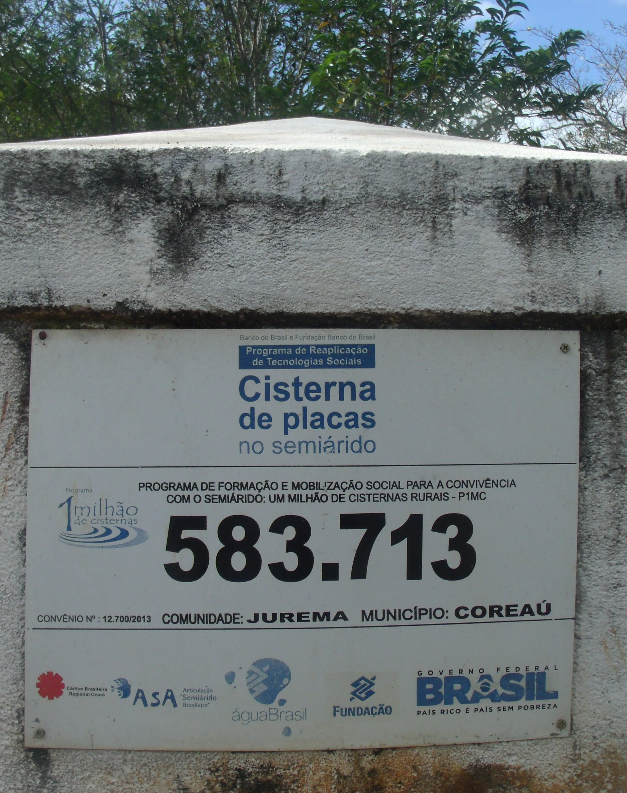
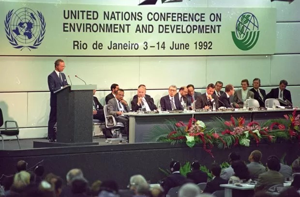
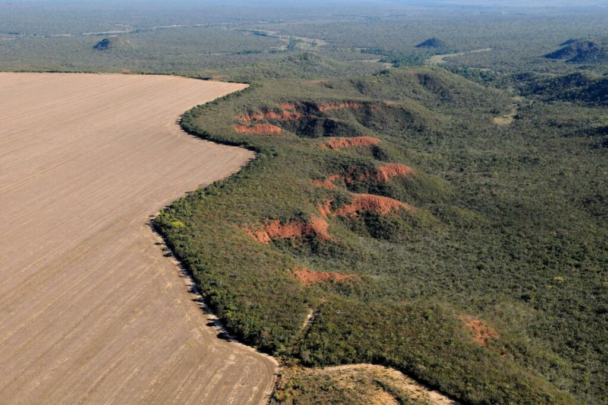
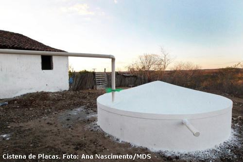

# A Questão Ambiental Contemporânea e o Papel da Geografia {#cap:questao_ambiental}

A questão ambiental envolve as condições de reprodução da vida, a transformação dos sistemas naturais e a distribuição social de benefícios e danos. Uma análise geográfica começa pela identificação dos processos que conectam esses planos. A perda de solo em uma encosta, por exemplo, depende da chuva e das propriedades do terreno, enquanto a exposição da superfície também resulta de decisões sobre produção, infraestrutura e acesso à terra.

::: {.callout-note title="O que você vai aprender neste capítulo"}
A aprendizagem se concentra na construção de explicações que articulem processos ambientais e organização do território. Ao concluir este capítulo, você será capaz de explicar a crise ambiental como crise civilizatória e de racionalidade (Leff, 2001), analisar a interação entre degradação dos solos, escassez hídrica e mudanças no uso da terra no Semiárido Baiano, distinguir criticamente desenvolvimento sustentável de sustentabilidade socioambiental (Porto-Gonçalves, 2006), diferenciar abordagens disciplinares, multidisciplinares e interdisciplinares e fundamentar o papel integrador da Geografia no planejamento ambiental.
:::

::: {.callout-tip title="Revisando o que você precisa saber"}
A leitura exige familiaridade com o ciclo da água, as funções da cobertura vegetal e o conceito de espaço geográfico. A chuva fornece água e energia ao sistema, enquanto o uso da terra modifica a infiltração e o percurso do escoamento. Nos domínios da Bahia (Caatinga no Semiárido, Cerrado no Oeste Baiano e remanescentes de Mata Atlântica no litoral e Recôncavo), a escala de observação define quais dessas relações podem ser reconhecidas nos dados.
:::

Na Análise Ambiental, a **questão ambiental** designa o conjunto de tensões ecológicas, econômicas, políticas e culturais derivadas do modo como as sociedades contemporâneas se apropriam da natureza e distribuem benefícios e danos territoriais. Enrique Leff (2001) interpreta esse quadro como uma **crise civilizatória**, na qual a **racionalidade econômica** voltada à maximização produtiva de curto prazo e à externalização de custos colide com os limites biofísicos do planeta. Superar essa fratura exige construir uma **racionalidade ambiental** sustentada pelo **saber ambiental** e pela **interdisciplinaridade**, rearticulando ciências e saberes locais. Esse debate repercute diretamente na distinção entre o discurso convencional de **desenvolvimento sustentável** e o projeto de **sustentabilidade** socioambiental (Porto-Gonçalves, 2006), orientando o **planejamento ambiental** em múltiplas escalas.

## A Questão Ambiental Contemporânea, Crise Civilizatória e de Racionalidade

Na linguagem cotidiana e em parte da mídia, a expressão “problema ambiental” costuma aparecer reduzida a episódios visíveis e pontuais, como um vazamento de óleo, o acúmulo de resíduos em um riacho urbano ou um incêndio florestal em determinado município. Embora esses eventos exijam resposta técnica imediata, interpretá-los como acidentes isolados oculta suas causas estruturais. A partir da segunda metade do século XX, especialmente após a aceleração industrial do pós-guerra, a intensificação da urbanização e a expansão globalizada das fronteiras agropecuárias e extrativistas, os danos aos ecossistemas revelaram-se consequências sistemáticas do próprio modelo de desenvolvimento adotado. Nesse horizonte consolida-se a **questão ambiental contemporânea**, um campo de debates científicos, políticos e territoriais que interroga a forma como a sociedade moderna produz, consome, ocupa o espaço e organiza o conhecimento.

Em *Epistemologia ambiental* (2001, cap. 2), Enrique Leff analisa a crise ambiental como uma **crise civilizatória e de racionalidade** que ultrapassa perturbações restritas aos ciclos biogeoquímicos. Segundo o autor, a modernidade consolidou uma **racionalidade econômica e instrumental** que trata a natureza como estoque inesgotável de matérias-primas e depósito passivo de rejeitos. Dentro dessa lógica contábil, os danos gerados sobre o solo, a água, a biodiversidade e a saúde humana são classificados como “externalidades”, permanecendo fora do cálculo econômico tradicional.

Ao mesmo tempo, essa racionalidade econômica apoiou-se na **fragmentação disciplinar do conhecimento científico**. Cada ciência especializou-se em recortar um fragmento da realidade, levando a agronomia a focar a produtividade da cultura, a engenharia civil a concentrar-se na resistência de estruturas, a economia a modelar fluxos monetários e a sociologia a examinar instituições humanas, frequentemente sem diálogo efetivo entre si. Diante de fenômenos complexos como a desertificação, a degradação de bacias hidrográficas ou as mudanças climáticas, essa divisão estanque mostra-se insuficiente.

Para Leff (2001), superar a crise exige construir uma **racionalidade ambiental** sustentada por um **saber ambiental**. Esse saber preserva o rigor analítico de cada ciência e transforma internamente as disciplinas ao confrontá-las com os limites ecológicos e com a dimensão cultural e política do território. A **interdisciplinaridade ambiental** articula perguntas comuns, categorias integradoras e métodos compartilhados capazes de apreender o ambiente como totalidade complexa (@fig-racionalidades). A transição entre a racionalidade econômica fragmentada e a racionalidade ambiental integrada reorienta tanto a concepção de natureza quanto a prática de planejamento territorial, deslocando o foco de respostas corretivas pontuais para a gestão preventiva e justa.

{#fig-racionalidades fig-alt="Duas sequências comparando racionalidade econômica fragmentada e racionalidade ambiental integrada"}

Atribuir a degradação exclusivamente a comportamentos individuais impede o diagnóstico dessas determinações econômicas e institucionais, equívoco recorrente sintetizado a seguir.

::: {.callout-warning appearance="simple"}
### Erro 1.1, Reduzir a Crise Ambiental à “Falta de Consciência Individual”

**Equívoco frequente.** Atribuir a degradação dos solos, a poluição hídrica ou o desmatamento exclusivamente à “falta de educação” ou a maus hábitos individuais dos cidadãos.

**Por que está incorreto.** Embora práticas educativas sejam relevantes, esse argumento oculta determinantes estruturais (modelo econômico, padrão de uso da terra, concentração fundiária, déficit de saneamento e decisões políticas) que Leff (2001) identifica como núcleo da crise civilizatória.

**Como evitar.** Analise sempre a articulação entre comportamentos locais, estruturas produtivas, políticas públicas e interesses econômicos em disputa no território.
:::

Na prática técnica, a organização do trabalho científico costuma oscilar entre três regimes distintos de cooperação. Na **disciplinaridade isolada**, o problema é formulado nos limites de uma única especialidade mediante método fechado, produzindo pareceres setoriais (como uma análise química isolada da água) com profundidade local e cegueira para causas sistêmicas. Na **multidisciplinaridade**, diferentes especialistas analisam o mesmo local sob suas próprias óticas em paralelo, justapondo laudos e mapas que pouco dialogam entre si e gerando relatórios em formato de “colcha de retalhos” que acumulam dados sem explicar interações. Na **interdisciplinaridade ambiental**, o problema é construído conjuntamente a partir do reconhecimento das interações físico-bióticas e sociais, promovendo o cruzamento metodológico entre uso da terra, erosão e vulnerabilidade social para gerar diagnósticos com síntese causal voltada a intervir sobre as causas da degradação (Leff, 2001; Tauk-Tornisielo, 1996). O Exemplo 1.1 demonstra como a ausência dessa integração compromete obras de infraestrutura hídrica no Semiárido.

::: {.callout-tip appearance="simple"}
### Exemplo 1.1 (Básico). Fragmentação Disciplinar em Projeto de Contenção de Erosão

**Situação analisada.** Em um município fictício do Semiárido Baiano *(cenário didático ilustrativo)*, uma prefeitura contratou uma empresa para conter o assoreamento de um açude comunitário. A equipe técnica elaborou apenas um projeto de dragagem mecânica do reservatório e construção de um muro de concreto próximo ao sangradouro, sem avaliar o uso do solo nas cabeceiras da microbacia nem ouvir os agricultores que utilizam a água. Dois anos após a obra, o açude voltou a apresentar acúmulo intenso de sedimentos.

**Dados disponíveis.** Intervenção exclusivamente estrutural e corretiva (dragagem e muro de concreto); ausência de diagnóstico da cobertura vegetal e dos solos nas vertentes a montante; ausência de participação dos usuários locais; retorno do assoreamento em 2 anos.

**Problema a resolver.** Diagnosticar a falha epistemológica e metodológica do projeto à luz de Enrique Leff (2001) e indicar como uma abordagem interdisciplinar geográfica reestruturaria a intervenção.

**Fundamento da análise.** Análise epistemológica baseada nos conceitos de *racionalidade econômica e instrumental*, *fragmentação disciplinar*, *saber ambiental* e *interdisciplinaridade* (Leff, 2001, cap. 2).

**Desenvolvimento.** **Passo 1, Sintoma versus causa.** A dragagem atuou sobre o sintoma final (sedimento acumulado no açude), deixando intacta a causa geradora nas vertentes a montante (solo exposto, erosão laminar e linear, retirada da vegetação ripária). **Passo 2, Diagnóstico epistemológico (Leff, 2001).** O projeto reproduziu a *fragmentação disciplinar* e a *racionalidade instrumental*, tratando um problema socioambiental complexo como questão pontual de engenharia civil. **Passo 3, Reestruturação interdisciplinar.** Uma equipe coordenada sob perspectiva geográfica integrada delimitaria a microbacia de contribuição do açude, mapearia áreas de solo exposto, sobrepastoreio e focos erosivos nas cabeceiras, dialogaria com os agricultores para identificar pressões de uso da terra e saberes locais de manejo, e combinaria medidas conservacionistas na vertente (recomposição vegetal, retenção de enxurrada, manejo do pastoreio) com ações de manutenção do reservatório.

**Interpretação do resultado.** O fracasso recorrente do projeto decorre da fragmentação disciplinar e da racionalidade instrumental, que trataram o assoreamento como falha pontual dissociada da dinâmica da microbacia e do uso social da terra. A solução exige abordagem interdisciplinar e planejamento integrado a montante e junto à comunidade.

**Condições de validade.** A análise é ambientalmente coerente, pois dragar um açude sem reduzir a produção de sedimentos nas encostas reinicia o ciclo de assoreamento a cada estação chuvosa, desperdiçando recursos públicos e mantendo a vulnerabilidade hídrica.
:::

Em relatórios ambientais e trabalhos acadêmicos, é comum confundir a mera reunião de especialistas com integração metodológica real, como alerta o quadro a seguir.

::: {.callout-warning appearance="simple"}
### Erro 1.2, Confundir Multidisciplinaridade com Interdisciplinaridade Ambiental

**Equívoco frequente.** Acreditar que um estudo ambiental torna-se interdisciplinar apenas por conter capítulos separados escritos por um geólogo, um biólogo e um sociólogo.

**Por que está incorreto.** A mera justaposição de textos especializados sem diálogo metodológico caracteriza *multidisciplinaridade*. Como mostra Leff (2001), a *interdisciplinaridade ambiental* exige construir problemas integrados e explicar como processos físicos, bióticos e sociais condicionam-se mutuamente.

**Como evitar.** Em seus relatórios e provas, explicite sempre as *conexões causais* entre as variáveis (por exemplo, como uma decisão econômica de uso da terra altera a infiltração e agrava o assoreamento).
:::

## Degradação dos Solos, Escassez Hídrica e Mudanças no Uso da Terra

Para que o debate epistemológico permaneça ancorado na realidade territorial, torna-se essencial observar como a crise ambiental se expressa concretamente na superfície terrestre. No Brasil, e de maneira particularmente aguda no Nordeste e no Semiárido Baiano, três processos interligados concentram grande parte dos desafios da Análise Ambiental, articulando a **degradação dos solos**, a **escassez hídrica** e as **mudanças no uso e cobertura da terra**.

### Mudanças no Uso da Terra como Vetor Desencadeador

A cobertura vegetal nativa exerce funções hidrogeomorfológicas decisivas, pois intercepta a precipitação, dissipa a energia cinética das gotas de chuva, fornece matéria orgânica que estabiliza os agregados do solo e mantém canais radiculares que ampliam a infiltração da água. Quando áreas de Caatinga, Cerrado ou Mata Atlântica são suprimidas sem planejamento conservacionista para dar lugar a pastagens extensivas de alta lotação, monocultivos mecanizados, abertura desordenada de estradas rurais, mineração ou expansão urbana em encostas e fundos de vale, o balanço entre infiltração e escoamento superficial altera-se abruptamente.

Na Bahia, essa dinâmica assume expressões regionais distintas conforme o domínio morfoclimático e a forma de apropriação econômica do espaço. No **Semiárido Baiano**, sob o domínio da Caatinga, a supressão da vegetação lenhosa para extração de lenha e carvão combina-se ao sobrepastoreio caprino e bovino em áreas já frágeis, ao manejo inadequado de lavouras de sequeiro e à implantação de grandes infraestruturas. Essas intervenções expõem solos rasos e pedregosos, a exemplo dos Neossolos Litólicos e dos Planossolos, ao impacto direto de chuvas convectivas concentradas em poucos meses do ano, desencadeando incisões erosivas escalonadas em pastagens degradadas (@fig-pastagem-ravinas).

{#fig-pastagem-ravinas fig-alt="Pastagem degradada com solo exposto e ravinas escalonadas no Semiárido Baiano"}

No **Oeste Baiano**, sob o domínio do Cerrado, o vetor predominante envolve a rápida conversão de vegetação nativa em agricultura mecanizada de larga escala sobre chapadões arenosos (@fig-pivos-oeste). Como a porosidade elevada desses solos favorece a infiltração profunda que alimenta o sistema aquífero regional, a substituição da cobertura original e a captação intensiva por pivôs centrais elevam a demanda sobre águas superficiais e subterrâneas, modificando o regime de recarga e a vazão de rios afluentes. Já na **faixa litorânea, no Recôncavo e em centros urbanos regionais** como o entorno de Feira de Santana, predomina a impermeabilização acelerada do solo, acompanhada da supressão de Áreas de Preservação Permanente (APPs) de nascentes, lagoas e riachos, do lançamento de efluentes sem tratamento adequado e da expansão de loteamentos sobre setores sujeitos a alagamentos ou instabilidade de vertentes.

{#fig-pivos-oeste fig-alt="Imagem orbital CBERS-4 mostrando pivôs centrais circulares no Cerrado do Oeste Baiano"}

### Degradação dos Solos e Processos Erosivos

O solo constitui um corpo natural tridimensional, dinâmico e vivo, cuja formação (pedogênese) demanda séculos ou milênios. A degradação edáfica manifesta-se pela perda progressiva de suas funções físicas, químicas e biológicas, expressa na redução do teor de matéria orgânica, na quebra dos agregados, no selamento superficial, na compactação pelo pisoteio animal ou tráfego de máquinas, na salinização em perímetros irrigados mal drenados e na remoção acelerada de partículas pela erosão hídrica e eólica.

Quando a taxa de remoção de solo supera amplamente a taxa natural de formação, a erosão evolui da forma *laminar* (lavagem difusa da camada superficial mais fértil) para incisões lineares em sulcos e ravinas (@fig-erosao-solo). Sem contenção hidráulica ou cobertura vegetal, a concentração progressiva da enxurrada aprofunda o canal até atingir horizontes subsuperficiais e formar voçorocas com solapamento e colapso de taludes (@fig-vocoroca).

{#fig-erosao-solo fig-alt="Encosta com perda de horizonte superficial e incisão erosiva"}

{#fig-vocoroca fig-alt="Voçoroca profunda com colapso de taludes em área degradada"}

Os sedimentos mobilizados das encostas seguem em movimento pela rede de drenagem e depositam-se em calhas fluviais, barreiros, cisternas rurais e açudes, reduzindo a seção útil dos canais (@fig-assoreamento-calha) e comprometendo o volume armazenado nos corpos hídricos receptores a jusante (@fig-assoreamento-reservatorio). Essa conectividade hidrossedimentológica demonstra que a perda de solo na vertente e o assoreamento do reservatório integram o mesmo sistema processual.

{#fig-assoreamento-calha fig-alt="Calha fluvial parcialmente preenchida por sedimentos arenosos"}

{#fig-assoreamento-reservatorio fig-alt="Corpo hídrico assoreado por deposição de sedimentos"}

### Escassez Hídrica, Condição Climática e Produção Socioambiental

Um dos equívocos mais persistentes sobre o Nordeste brasileiro consiste em explicar a escassez hídrica exclusivamente pela baixa média pluviométrica. O clima semiárido apresenta chuvas concentradas no tempo, elevada variabilidade interanual e altas taxas de evapotranspiração potencial, características naturais que definem a **semiaridez**. Contudo, a **escassez hídrica vivenciada pela população** resulta da interação entre essa dinâmica climática e fatores socioespaciais, como o desmatamento das cabeceiras e matas ciliares, a compactação do solo que impede a recarga do lençol freático, o assoreamento de reservatórios, a contaminação de mananciais e a distribuição desigual da infraestrutura de captação e acesso à água.

Degradação dos solos, escassez hídrica e mudança no uso da terra articulam-se em um circuito de retroalimentação contínua (@fig-solo-agua-uso). A supressão vegetal reduz a infiltração e intensifica o escoamento superficial; o escoamento acelerado remove o solo fértil e assoreia os corpos d’água; por sua vez, a perda de fertilidade e de disponibilidade hídrica pressiona os produtores a expandir o desmatamento sobre novas áreas frágeis, amplificando a vulnerabilidade socioambiental.

{#fig-solo-agua-uso fig-alt="Sequência de mudanças no uso da terra, degradação do solo, erosão e escassez hídrica com seta de retroalimentação"}

Frente a esse circuito, políticas de convivência com o Semiárido estruturam soluções descentralizadas de armazenamento de água da chuva e manejo conservacionista do solo, como exemplificado pelas cisternas rurais de placas construídas no âmbito de programas de mobilização social e tecnologias sociais (@fig-cisterna-placas). O Exemplo 1.2 demonstra em base controlada por que duas microbacias sob a mesma precipitação anual exibem respostas hídricas opostas conforme a cobertura do solo.

{#fig-cisterna-placas fig-alt="Placa de identificação de cisterna rural de placas no Semiárido vinculada ao P1MC"}

::: {.callout-tip appearance="simple"}
### Exemplo 1.2 (Básico). Diferenciando Semiaridez Climática de Escassez Hídrica Socioambiental

**Situação analisada.** Duas microbacias rurais vizinhas no Semiárido Baiano *(cenário didático ilustrativo)* registram exatamente a mesma precipitação média anual de $580\text{ mm}$, concentrada entre novembro e março, sobre substrato geológico e relevo semelhantes. Na Microbacia A, $65\%$ da área mantém cobertura de Caatinga manejada, faixas de mata ciliar conservadas e práticas de retenção de água no solo; suas cacimbas permanecem com água na estação seca. Na Microbacia B, $78\%$ da área foi convertida em pastagem degradada com solo compactado e margens desmatadas; os reservatórios secam rapidamente após as chuvas e o solo apresenta sulcos erosivos.

**Dados disponíveis.** Precipitação idêntica ($580\text{ mm/ano}$) e substrato semelhante em ambas as microbacias. Microbacia A com $65\%$ de vegetação nativa, mata ciliar preservada e disponibilidade hídrica mantida na estiagem. Microbacia B com $78\%$ de pastagem degradada, solo compactado, margens desmatadas, rápida perda de água e erosão em sulcos.

**Problema a resolver.** Explicar por que o determinismo climático é incapaz de explicar a diferença observada entre as duas microbacias e demonstrar a relação causal entre uso da terra, solo e água.

**Fundamento da análise.** Análise comparativa controlada (mesmo clima, diferentes usos da terra) articulando processos hidrogeomorfológicos básicos e leitura socioambiental da escassez hídrica.

**Desenvolvimento.** **Passo 1, Controle da variável climática.** Como ambas as microbacias recebem $580\text{ mm/ano}$ sob o mesmo regime de chuvas concentradas, a diferença na disponibilidade de água na estação seca decorre das condições superficiais e de manejo. **Passo 2, Dinâmica na Microbacia A.** A cobertura vegetal protege a superfície do solo contra o impacto das gotas de chuva, mantém porosidade elevada e favorece a infiltração, recarregando o solo e os reservatórios rasos (cacimbas) para o período seco. **Passo 3, Dinâmica na Microbacia B.** A remoção da vegetação e a compactação reduzem a taxa de infiltração; assim, grande parcela dos $580\text{ mm}$ transforma-se rapidamente em escoamento superficial, gerando sulcos erosivos, arraste de sedimentos e baixa recarga hídrica subsuperficial. **Passo 4, Síntese conceitual.** A semiaridez é condição climática natural comum às duas áreas, enquanto a escassez hídrica severa na Microbacia B é agravada pelo modelo de uso e ocupação do solo.

**Interpretação do resultado.** A diferença decorre do manejo do uso da terra e das condições do solo; a degradação vegetal e edáfica na Microbacia B converte a chuva em escoamento rápido e erosão, reduzindo a infiltração e produzindo escassez hídrica socioambiental.

**Condições de validade.** O raciocínio respeita o balanço hídrico elementar, pois para uma mesma entrada pluviométrica ($P = 580\text{ mm}$), quanto menor a infiltração em solos degradados, maior o escoamento superficial imediato e menor a água armazenada disponível durante a estiagem.
:::

Essa partição contrastante entre infiltração e enxurrada nas duas microbacias sob os mesmos $580\text{ mm}$ anuais pode ser acompanhada no balanço esquemático a seguir (@fig-contraste_microbacias).

{#fig-contraste_microbacias fig-alt="Comparação esquemática entre Microbacia A com infiltração preservada e Microbacia B com escoamento superficial rápido e assoreamento"}

## O Debate Crítico, Desenvolvimento Sustentável versus Sustentabilidade

A partir da publicação do Relatório *Nosso Futuro Comum* (Relatório Brundtland, 1987) e da Conferência das Nações Unidas sobre Meio Ambiente e Desenvolvimento (Rio-92), a expressão **desenvolvimento sustentável** ganhou enorme visibilidade internacional, sendo definida como aquele capaz de atender às necessidades do presente sem comprometer a capacidade das gerações futuras de atenderem às suas próprias necessidades (@fig-eco92-cap1).

{#fig-eco92-cap1 fig-alt="Fotografia histórica da Conferência Rio-92"}

À primeira vista, a formulação parece consensual. Entretanto, Carlos Walter Porto-Gonçalves (*Os (des)caminhos do meio ambiente*, 2006) e Enrique Leff (2001) evidenciam que o conceito abriga contradições profundas. Porto-Gonçalves chama atenção para a estrutura política da expressão, pois, ao acoplar o adjetivo “sustentável” ao substantivo “desenvolvimento”, o discurso institucional dominante preserva intacto o projeto desenvolvimentista baseado na expansão contínua da produção de mercadorias, no consumo crescente de energia e na subordinação de territórios periféricos ao mercado mundial. Nesse enquadramento, a natureza tende a ser recodificada como “capital natural” ou “serviços mercantilizáveis”, priorizando a ecoeficiência técnica e o mercado verde enquanto minimiza conflitos distributivos e mantém a pressão sobre ecossistemas nativos como o Cerrado (@fig-cerrado-cap1).

{#fig-cerrado-cap1 fig-alt="Área desmatada no Cerrado em frente de expansão agrícola"}

Em perspectiva distinta, o debate sobre **sustentabilidade** (ou sustentabilidade socioambiental) desloca o eixo analítico do crescimento econômico ilimitado para a manutenção da integridade ecológica, da justiça socioambiental, da diversidade cultural e da equidade territorial (Leff, 2001; Porto-Gonçalves, 2006). A técnica permanece necessária, porém subordinada a critérios éticos, ecológicos e democráticos que reconhecem os limites biofísicos dos sistemas naturais e valorizam os saberes locais de convivência com o ambiente, como as tecnologias descentralizadas de captação de água e manejo sustentável da Caatinga no Semiárido (@fig-cisterna-mds-cap1).

{#fig-cisterna-mds-cap1 fig-alt="Cisterna familiar de captação de água de chuva instalada em propriedade rural do Semiárido"}

O Exemplo 1.3 aplica essa distinção crítica a uma peça promocional de agronegócio irrigado.

::: {.callout-tip appearance="simple"}
### Exemplo 1.3 (Intermediário). Análise Crítica de um Discurso de “Desenvolvimento Sustentável”

**Situação analisada.** Um consórcio agroindustrial divulga um documento promocional anunciando a implantação de um polo de monocultura irrigada de exportação em uma bacia hidrográfica de transição Cerrado-Caatinga *(cenário didático ilustrativo)*. O texto classifica o empreendimento como exemplo de “desenvolvimento sustentável” porque utilizará pivôs com sensores digitais que economizam $15\%$ de água em comparação a sistemas antigos e compensará a supressão de vegetação nativa mediante a compra de créditos ambientais em outra região do país.

**Dados disponíveis.** Alegações do consórcio envolvem ganho de $15\%$ na eficiência de irrigação por sensores, compensação ambiental fora da bacia impactada e expansão de monocultura intensiva com remoção de vegetação nativa local e aumento da captação hídrica total.

**Problema a resolver.** Avaliar criticamente o uso do termo “desenvolvimento sustentável” nesse documento à luz de Porto-Gonçalves (2006) e Leff (2001), apontando as limitações socioambientais ocultadas pela peça promocional.

**Fundamento da análise.** Análise crítica do discurso ambiental com base na distinção entre *desenvolvimento sustentável hegemônico* e *sustentabilidade socioambiental* (Porto-Gonçalves, 2006; Leff, 2001).

**Desenvolvimento.** **Passo 1, Análise do ganho de ecoeficiência ($15\%$).** Economizar água por hectare em relação a técnicas antigas deixa de garantir redução do consumo total na bacia quando a área irrigada se expande de forma absoluta. A técnica melhora a eficiência produtiva sem respeitar o limite hídrico regional. **Passo 2, Crítica à compensação desterritorializada.** Comprar créditos ambientais em outra região trata a natureza como mercadoria intercambiável (lógica da racionalidade econômica criticada por Leff, 2001). A biodiversidade, a proteção do solo e a recarga hídrica perdidas na bacia local permanecem sem reposição física por uma área conservada a centenas de quilômetros. **Passo 3, Ocultamento de dimensões sociais (Porto-Gonçalves, 2006).** O discurso adota o adjetivo “sustentável” para legitimar o modelo desenvolvimentista, omitindo quem perde acesso à água a jusante, como se alteram a estrutura fundiária e a segurança alimentar local e se as comunidades atingidas participaram da decisão.

**Interpretação do resultado.** O documento emprega “desenvolvimento sustentável” em sentido retórico e mercadológico, reduzindo a questão ambiental à eficiência tecnológica parcial e à compensação financeira fora do território, enquanto desconsidera limites hídricos da bacia e impactos socioespaciais locais.

**Condições de validade.** A crítica é equilibrada e rigorosa, pois reconhece a utilidade de sensores de irrigação ao mesmo tempo em que evidencia que eficiência técnica isolada difere de sustentabilidade ecológica e social em escala de bacia hidrográfica.
:::

Empregar ambos os conceitos como rótulos equivalentes compromete a leitura crítica de planos e licenciamentos, conforme sintetiza o alerta a seguir.

::: {.callout-warning appearance="simple"}
### Erro 1.3, Usar “Desenvolvimento Sustentável” como Sinônimo Neutro de “Sustentabilidade”

**Equívoco frequente.** Empregar ambos os termos indistintamente, assumindo que qualquer projeto rotulado como “desenvolvimento sustentável” é ecologicamente íntegro e socialmente justo.

**Por que está incorreto.** Conforme argumenta Porto-Gonçalves (2006), “desenvolvimento sustentável” é um conceito em disputa que frequentemente subordina a conservação ambiental à lógica do crescimento econômico contínuo e à mercantilização da natureza.

**Como evitar.** Ao analisar políticas ou projetos, pergunte sempre a quem a sustentabilidade se destina, em qual escala espacial ela opera e quais custos ecológicos e territoriais estão envolvidos.
:::

## Planejamento Ambiental e o Papel Integrador da Geografia

Diante de uma crise simultaneamente ecológica, econômica e territorial, o **planejamento ambiental** atua como instrumento de mediação entre a dinâmica da natureza e as demandas da sociedade. Planejar ambientalmente envolve levantar dados sobre o meio físico, biótico e socioespacial (diagnóstico), projetar tendências de degradação ou recuperação sob diferentes cenários de uso da terra (prognóstico), estabelecer diretrizes de zoneamento, conservação e restauração (ordenamento) e acompanhar continuamente os resultados por meio de indicadores auditáveis (monitoramento).

Nesse terreno, a **Geografia** exerce função integradora frente à fragmentação disciplinar ao articular processos físico-bióticos e organização socioespacial. Uma margem assoreada, por exemplo, funciona como ponto de partida da investigação, pois o sedimento pode originar-se de lavouras, estradas ou canais erosivos situados a montante, e sua deposição depende da conectividade da rede de drenagem. A explicação ganha consistência quando combina fotografias históricas, relatos de moradores e mapas multitemporais de cobertura da terra com o reconhecimento de quem utiliza a água e de quem suporta a perda de qualidade hídrica. Por transitar entre as ciências da Terra e as ciências humanas, o(a) geógrafo(a) lê simultaneamente relevo, solos, drenagem e cobertura vegetal em conexão com estrutura fundiária, urbanização e conflitos territoriais, cruzando escalas que vão da parcela de solo à bacia hidrográfica e às redes econômicas globais. O Exemplo 1.4 aplica essa leitura multitemporal quantitativa ao diagnóstico de uma microbacia semiárida.

::: {.callout-tip appearance="simple"}
### Exemplo 1.4 (Intermediário). Quantificação Didática de Mudanças no Uso da Terra em Microbacia

**Situação analisada.** Durante um exercício de diagnóstico preliminar sobre uma microbacia fictícia de $1.200\text{ ha}$ no Semiárido Baiano *(cenário didático ilustrativo)*, uma turma de Geografia comparou o mapeamento de uso e cobertura da terra entre dois anos de referência ($t_0$ e $t_1$, com intervalo de 15 anos).

**Dados disponíveis.** Área total da microbacia $A_{\text{total}} = 1.200\text{ ha}$. Caatinga arbóreo-arbustiva densa passou de $660\text{ ha}$ em $t_0$ para $360\text{ ha}$ em $t_1$; pastagem manejada e agricultura familiar diversificada passou de $300\text{ ha}$ para $270\text{ ha}$; pastagem degradada com cobertura rala cresceu de $180\text{ ha}$ para $390\text{ ha}$; solo exposto e áreas com erosão visível saltaram de $60\text{ ha}$ para $180\text{ ha}$.

**Problema a resolver.** Calcular a variação absoluta (em $\text{ha}$), a variação relativa percentual de cada classe e a participação percentual das classes degradadas (pastagem degradada somada ao solo exposto) em $t_0$ e $t_1$, interpretando geograficamente o significado ambiental dessa trajetória.

**Fundamento da análise.** Cálculo passo a passo de variações absolutas ($\Delta A = A_{t_1} - A_{t_0}$), relativas ($\Delta\% = \frac{A_{t_1} - A_{t_0}}{A_{t_0}} \times 100\%$) e proporções sobre a área total ($p = \frac{A}{A_{\text{total}}} \times 100\%$), seguido de interpretação integrada solo-água-uso da terra.

**Desenvolvimento.** **Passo 1, Conferência da área total.** Em $t_0$, soma-se $660 + 300 + 180 + 60 = 1.200\text{ ha}$; em $t_1$, soma-se $360 + 270 + 390 + 180 = 1.200\text{ ha}$, confirmando a conservação da área mapeada. **Passo 2, Variação absoluta ($\Delta A$) e relativa ($\Delta\%$) por classe.** Para Caatinga densa, $\Delta A = 360 - 660 = -300\text{ ha}$ e $\Delta\% = \frac{-300}{660} \times 100\% \approx -45{,}5\%$. Para pastagem manejada e agricultura familiar, $\Delta A = 270 - 300 = -30\text{ ha}$ e $\Delta\% = \frac{-30}{300} \times 100\% = -10{,}0\%$. Para pastagem degradada, $\Delta A = 390 - 180 = +210\text{ ha}$ e $\Delta\% = \frac{+210}{180} \times 100\% \approx +116{,}7\%$. Para solo exposto, $\Delta A = 180 - 60 = +120\text{ ha}$ e $\Delta\% = \frac{+120}{60} \times 100\% = +200{,}0\%$.

**Passo 3, Participação conjunta das classes degradadas.** Em $t_0$, $A_{\text{deg},0} = 180 + 60 = 240\text{ ha}$, correspondendo a $p_0 = \frac{240}{1.200} \times 100\% = 20{,}0\%$. Em $t_1$, $A_{\text{deg},1} = 390 + 180 = 570\text{ ha}$, alcançando $p_1 = \frac{570}{1.200} \times 100\% = 47{,}5\%$. O avanço conjunto atinge $47{,}5\% - 20{,}0\% = +27{,}5\text{ pontos percentuais}$ ($+330\text{ ha}$). **Passo 4, Interpretação geográfica integrada.** Em 15 anos, a microbacia perdeu $45{,}5\%$ de sua cobertura nativa densa enquanto a área de solo exposto triplicou ($+200\%$). Em $t_1$, quase metade da microbacia ($47{,}5\%$) encontra-se sob cobertura rala ou sem proteção vegetal, indicando elevada exposição à erosão hídrica, menor infiltração, aceleração do escoamento superficial e risco crescente de assoreamento dos corpos d’água e queda de renda rural.

**Interpretação do resultado.** A Caatinga densa retraiu $-300\text{ ha}$ ($-45{,}5\%$), o solo exposto triplicou ($+120\text{ ha}$; $+200{,}0\%$) e as classes degradadas saltaram de $20{,}0\%$ para $47{,}5\%$ da microbacia, configurando um quadro crítico de degradação hidrogeomorfológica e perda de sustentabilidade territorial.

**Condições de validade.** A soma das variações absolutas anula-se ($-300 - 30 + 210 + 120 = 0\text{ ha}$), confirmando consistência matemática; ambientalmente, o avanço de $27{,}5$ pontos percentuais de áreas degradadas justifica prioridade imediata de planejamento conservacionista e recuperação.
:::

Os fundamentos epistemológicos e hidrogeomorfológicos consolidados neste capítulo articulam diretamente toda a sequência de CHF662, conduzindo da Avaliação de Impacto Ambiental (Módulo 2) e da análise integrada de bacias, vertentes e fragilidade (Módulo 3) até os indicadores de campo no Semiárido (Módulo 4) e os projetos de bioengenharia e recuperação de áreas degradadas (Módulo 5).

## Síntese Avançada, Planejamento Ambiental em Bacia sob Múltiplas Pressões

Quando diversos vetores de degradação convergem sobre a mesma microbacia, respostas técnicas isoladas e medidas punitivas seletivas agravam os danos físicos e as desigualdades territoriais. O Exemplo 1.5 integra os referenciais de Leff (2001) e Porto-Gonçalves (2006) na formulação de diretrizes geográficas abrangentes para um cenário periurbano complexo.

::: {.callout-tip appearance="simple"}
### Exemplo 1.5 (Avançado). Diretrizes de Planejamento Ambiental Integrado em Área de Múltiplas Pressões

**Situação analisada.** Na periferia de uma cidade média do interior da Bahia *(cenário didático ilustrativo)*, uma bacia hidrográfica de pequeno porte concentra quatro processos simultâneos, compreendendo a expansão de loteamentos populares sem drenagem pluvial em encostas de declividade moderada a forte, a supressão da vegetação ciliar de um riacho intermitente que abastece hortas periurbanas, a extração irregular de areia no leito do riacho para a construção civil e o lançamento de esgoto doméstico sem tratamento. A administração municipal propôs apenas “multar os pequenos agricultores” e “canalizar o riacho com concreto”.

**Dados disponíveis.** Quatro vetores simultâneos de pressão (urbanização sem drenagem, desmatamento ciliar, mineração irregular de areia e esgoto doméstico) atuando na mesma microbacia; proposta municipal restrita a punição seletiva e canalização rígida.

**Problema a resolver.** Criticar a proposta municipal usando os conceitos de crise de racionalidade (Leff, 2001) e sustentabilidade crítica (Porto-Gonçalves, 2006) e formular quatro diretrizes integradas de planejamento ambiental lideradas por uma perspectiva geográfica.

**Fundamento da análise.** Integração dos referenciais epistemológicos do capítulo (Leff, 2001; Porto-Gonçalves, 2006) com os princípios do planejamento ambiental geográfico (diagnóstico multiescalar, interdisciplinaridade e participação social).

**Desenvolvimento.** **Passo 1, Crítica à proposta municipal.** Sob a *racionalidade instrumental*, canalizar o riacho com concreto transfere a velocidade do escoamento para jusante, agrava enchentes em outros trechos e elimina a função ecológica da calha natural, deixando sem solução o lançamento de esgoto e a erosão das encostas. Sob a ótica da *injustiça socioambiental*, responsabilizar apenas os pequenos agricultores ignora a ausência de políticas habitacionais e de saneamento básico, bem como a cadeia econômica da construção civil que demanda areia ilegal.

**Passo 2, Diretrizes integradas de planejamento ambiental.** A primeira diretriz consiste no *diagnóstico espacial integrado da microbacia*, mapeando uso da terra, áreas de risco nas encostas, pontos de lançamento de efluentes, cavas de extração mineral e trechos de APP degradada. A segunda diretriz trata do *ordenamento territorial e saneamento*, disciplinando a expansão urbana, implantando drenagem sustentável (pavimentos permeáveis e bacias de retenção) e universalizando a coleta e o tratamento de esgoto. A terceira diretriz promove a *recuperação hidrogeomorfológica e o controle da extração*, coibindo a lavra ilegal de areia com fiscalização e alternativas regulamentadas, recompondo a mata ciliar e adotando práticas conservacionistas nas vertentes. A quarta diretriz estabelece a *gestão participativa e o apoio à agricultura periurbana*, instituindo comitê da microbacia com moradores, horticultores, técnicos e poder público para converter os agricultores em agentes de conservação.

**Interpretação do resultado.** A proposta municipal fracassa por adotar solução tecnocrática e socialmente injusta; o planejamento ambiental geográfico exige diagnosticar os quatro vetores na escala da microbacia e articular ordenamento urbano, saneamento, recuperação ripária e gestão participativa.

**Condições de validade.** As quatro diretrizes atacam simultaneamente os processos físicos (escoamento, erosão, qualidade da água) e as causas socioespaciais (habitação precária, déficit de saneamento, cadeia da construção civil), refletindo a passagem da fragmentação para a racionalidade ambiental.
:::

## Armadilha Conceitual e Materiais Audiovisuais de Apoio

Ao interpretar a dinâmica ambiental do Nordeste brasileiro, um erro recorrente em diagnósticos técnicos e avaliações consiste em atribuir a degradação do solo e a escassez hídrica exclusivamente às características climáticas naturais, omitindo o peso do desmatamento, do manejo inadequado e das desigualdades de acesso à água.

::: {.callout-warning appearance="simple"}
### Erro 1.4, Explicar a Degradação do Semiárido pelo Determinismo Climático

**Equívoco frequente.** Afirmar que a erosão dos solos e a escassez hídrica no Semiárido Baiano são “consequências inevitáveis da falta de chuva”.

**Por que está incorreto.** A semiaridez é uma condição climática natural à qual a Caatinga é evolutivamente adaptada. A degradação severa do solo e a vulnerabilidade hídrica resultam da combinação entre chuvas concentradas e práticas inadequadas de desmatamento, sobrepastoreio, compactação e desigualdade no acesso à água.

**Como evitar.** Separe claramente o que é *condicionante climático natural* do que é *processo agravado pelo manejo e pela organização socioespacial*.
:::

Para consolidar a visão integrada da crise ambiental contemporânea e de suas conexões climáticas e territoriais, assista às videoaulas selecionadas na página da disciplina, iniciando por [Gestão Ambiental - Introdução: Meio Ambiente e a Crise Ambiental](https://www.youtube.com/watch?v=VIDlWuiYd6M), que apresenta os fundamentos da crise ambiental e da análise integrada, e avançando para [Mudanças Climáticas](https://www.youtube.com/watch?v=imS_3EdqvAw), que discute as bases científicas das alterações climáticas globais e suas implicações territoriais.

## Exercícios de fixação

#### Nível 1, Básicos (Compreensão Conceitual)

1. Explique, com base em Enrique Leff (2001), por que a crise ambiental contemporânea constitui uma crise civilizatória e de racionalidade, ultrapassando a dimensão puramente ecológica ou tecnológica.

2. Diferencie *racionalidade econômica* de *racionalidade ambiental* segundo Leff (2001), indicando o papel das chamadas “externalidades” no primeiro caso.

3. Apresente duas diferenças essenciais entre a abordagem *multidisciplinar* e a abordagem *interdisciplinar* na elaboração de diagnósticos ambientais.

4. Explique por que a supressão da vegetação nativa desencadeia simultaneamente processos de degradação do solo e alterações na disponibilidade hídrica de uma microbacia.

5. Sintetize a diferença entre *semiaridez climática* e *escassez hídrica socioambiental* no contexto do Semiárido Baiano.

#### Nível 2, Intermediários (Análise Crítica e Aplicação)

6. Com base em Porto-Gonçalves (2006), analise criticamente a tensão existente entre o substantivo “desenvolvimento” e o adjetivo “sustentável” na expressão *desenvolvimento sustentável*.

7. Um município baiano pretende elaborar um plano de conservação de nascentes, mas contratou estudos isolados de geologia, botânica e economia que carecem de comunicação entre si. Identifique o limite metodológico desse procedimento e proponha como a Geografia pode exercer papel integrador nesse planejamento ambiental.

8. Em um cenário didático ilustrativo, uma microbacia de $800\text{ ha}$ no Semiárido passou, em 10 anos, de $520\text{ ha}$ para $320\text{ ha}$ de cobertura nativa de Caatinga, enquanto a área de solo exposto cresceu de $40\text{ ha}$ para $140\text{ ha}$. Calcule a variação absoluta (em $\text{ha}$) e percentual de ambas as classes e explique dois desdobramentos esperados sobre o escoamento superficial e o assoreamento local.

9. Compare brevemente os principais vetores contemporâneos de mudança no uso da terra no Semiárido Baiano e no Oeste Baiano (Cerrado), destacando como a escala regional orienta o diagnóstico geográfico.

10. Por que a adoção exclusiva de soluções de ecoeficiência (como redução pontual de consumo de insumos por unidade produzida) pode ser insuficiente para alcançar a sustentabilidade socioambiental de um território? Relacione sua resposta a Leff (2001).

#### Nível 3, Aplicados e Objetivos (Múltipla Escolha)

11. Segundo Enrique Leff (2001, cap. 2), a construção do *saber ambiental* frente à crise contemporânea implica,

    (A) Substituir integralmente as ciências naturais por análises filosóficas, dispensando medições empíricas de solo e água.

    (B) Somar relatórios independentes de diferentes áreas técnicas sem alterar os pressupostos de cada disciplina.

    (C) Questionar a fragmentação do conhecimento e a racionalidade econômica hegemônica, rearticulando saberes disciplinares e locais sob uma racionalidade ambiental.

    (D) Transferir a resolução dos impactos ambientais exclusivamente aos mecanismos automáticos de precificação do mercado financeiro.

    (E) Restringir o debate ambiental à preservação de parques isolados, desvinculando-o do planejamento territorial e produtivo.

12. A respeito da cadeia de processos que conecta mudanças no uso da terra, degradação dos solos e escassez hídrica no Semiárido Baiano, assinale a alternativa **correta**,

    (A) A baixa infiltração de água no solo depende apenas da quantidade anual de chuvas, permanecendo imune à cobertura vegetal ou à compactação.

    (B) A retirada da vegetação nativa e o sobrepastoreio ampliam a exposição do solo, reduzem a infiltração, aceleram o escoamento superficial e intensificam a erosão e o assoreamento de reservatórios.

    (C) A erosão laminar restringe-se a regiões tropicais úmidas de Mata Atlântica, estando ausente em áreas de Caatinga devido à baixa precipitação anual.

    (D) O assoreamento de açudes é um processo benéfico no Semiárido porque aumenta a profundidade útil dos reservatórios na estação seca.

    (E) A escassez hídrica nordestina decorre unicamente de anomalias climáticas naturais, sem relação com o desmatamento ciliar ou a gestão territorial.

13. Na leitura crítica proposta por Porto-Gonçalves (2006) sobre o conceito de *desenvolvimento sustentável*, destaca-se que,

    (A) A expressão representa um consenso científico definitivo e neutro, aceito sem tensões políticas por todos os grupos sociais.

    (B) O conceito rompe integralmente com a lógica de expansão contínua da produção de mercadorias adotada desde a Revolução Industrial.

    (C) O adjetivo “sustentável” muitas vezes funciona como verniz legitimador do modelo desenvolvimentista hegemônico, ocultando desigualdades territoriais e limites ecológicos.

    (D) A sustentabilidade só pode ser atingida mediante a homogeneização cultural e a substituição de saberes locais por pacotes tecnológicos globais.

    (E) O debate sobre sustentabilidade restringe-se à gestão de resíduos sólidos urbanos, ficando alheio a conflitos agrários ou hídricos.

14. Qual atributo caracteriza mais adequadamente o papel integrador da Geografia no planejamento ambiental frente à fragmentação disciplinar?

    (A) A capacidade de articular componentes físico-bióticos e processos socioespaciais em múltiplas escalas, empregando leitura espacial, trabalho de campo e mediação interdisciplinar.

    (B) A exclusividade na realização de análises laboratoriais químicas de água e solo, dispensando a colaboração com outras áreas científicas.

    (C) O foco exclusivo na descrição de aspectos fisiográficos naturais, deixando os fatores econômicos e políticos fora do diagnóstico ambiental.

    (D) A padronização de soluções técnicas idênticas para qualquer região do país, independentemente das especificidades locais de relevo, clima e cultura.

    (E) A substituição do diagnóstico empírico prévio por intervenções emergenciais de engenharia após a ocorrência de desastres ambientais.

15. Considere um cenário didático ilustrativo em que uma área rural teve $300\text{ ha}$ de vegetação nativa suprimidos em uma microbacia de $1.000\text{ ha}$ que originalmente possuía $600\text{ ha}$ de vegetação nativa. Sobre essa mudança no uso da terra, é **correto** afirmar que,

    (A) A vegetação nativa sofreu redução relativa de $30\%$ em relação à sua área inicial.

    (B) A participação da vegetação nativa na microbacia passou de $60\%$ para $30\%$, representando perda relativa de $50\%$ da cobertura nativa original.

    (C) A participação da vegetação nativa passou de $50\%$ para $20\%$ da área total da microbacia.

    (D) A mudança no uso da terra produz efeitos hidrológicos nulos enquanto restar pelo menos $20\%$ de cobertura vegetal.

    (E) A redução relativa da vegetação nativa foi de $60\%$, correspondendo à mesma taxa de aumento do volume de água armazenado no solo.

## Questões de aplicação

16. **(Questão autoral, estilo ENADE / Concurso Ambiental)** Um relatório técnico estadual diagnosticou a degradação de uma bacia hidrográfica semiárida em três capítulos redigidos sem integração, onde o primeiro descreveu litologia e solos, o segundo listou espécies da flora e o terceiro apresentou indicadores de renda municipal. Ao final, o documento atribuiu a escassez hídrica “exclusivamente ao baixo índice pluviométrico da região” e sugeriu a construção de barragens de concreto como única medida necessária. Com base nos fundamentos da Análise Ambiental (Leff, 2001; Porto-Gonçalves, 2006), avalie as afirmações a seguir,

    I.  O relatório exemplifica uma abordagem multidisciplinar fragmentada, distante de uma análise interdisciplinar integrada.

    II.  A conclusão do relatório incorre em determinismo climático ao ignorar o papel do uso da terra, da cobertura vegetal e da desigualdade de acesso à água na produção da escassez hídrica.

    III.  A recomendação exclusiva de obras de concreto expressa uma racionalidade instrumental que desconsidera a dinâmica das vertentes e os saberes locais de convivência com o Semiárido.

    IV.  A separação estanque entre capítulos físicos e socioeconômicos é o procedimento ideal na Geografia por garantir neutralidade científica.

    É correto apenas o que se afirma em,

    (A) I e IV.

    (B) II e IV.

    (C) I, II e III.

    (D) II, III e IV.

    (E) I, II, III e IV.

17. **(Questão autoral, estilo ENADE / Concurso Ambiental)** Para o cargo de Analista Ambiental em órgão público de gestão territorial, exige-se domínio conceitual das diferenças entre crescimento econômico, desenvolvimento sustentável e sustentabilidade socioambiental. Considerando a abordagem crítica trabalhada na Geografia contemporânea (Leff, 2001; Porto-Gonçalves, 2006), assinale a alternativa que expressa corretamente uma diretriz coerente com a **racionalidade ambiental**,

    (A) Aceitar a degradação severa de cabeceiras de drenagem em regiões semiáridas desde que compensada pela compra de títulos financeiros ambientais em outros biomas.

    (B) Subordinar o zoneamento ambiental de uma bacia hidrográfica exclusivamente à taxa de retorno econômico de curto prazo dos empreendimentos licenciados.

    (C) Priorizar o planejamento ambiental integrado em escala de bacia, articulando conservação do solo e da água, limites biofísicos dos ecossistemas, equidade social e participação das populações locais.

    (D) Transferir a responsabilidade integral pela recuperação de áreas degradadas a campanhas pontuais de sensibilização individual, dispensando instrumentos de ordenamento territorial.

    (E) Adotar pacotes tecnológicos uniformes em todos os biomas brasileiros, desconsiderando a diversidade ecológica da Caatinga, do Cerrado e da Mata Atlântica.

18. **(Questão autoral, estilo ENADE / Concurso Ambiental)** Ao planejar o diagnóstico ambiental de uma microbacia sujeita à conversão acelerada de vegetação nativa em pastagens extensivas, um(a) geógrafo(a) propõe relacionar o mapeamento multitemporal de uso da terra com o levantamento de focos erosivos, a situação das matas ciliares e as condições socioeconômicas dos produtores rurais. Essa proposta metodológica reflete,

    (A) Uma postura estritamente naturalista, pois privilegia processos geomorfológicos em detrimento da organização espacial humana.

    (B) O papel integrador da Geografia na Análise Ambiental, ao articular variáveis físico-bióticas e socioespaciais para identificar causas sistêmicas da degradação e subsidiar o planejamento territorial.

    (C) Um procedimento disciplinar isolado, uma vez que o uso de mapas multitemporais dispensa o diálogo com outras ciências ambientais.

    (D) A aplicação direta da racionalidade econômica clássica, pois trata a perda de solo apenas como custo externo sem repercussão territorial.

    (E) Uma limitação de escala, pois a análise de microbacias impede compreender conexões com dinâmicas regionais ou políticas públicas de conservação.

### Orientações para o Estudo Orientado e a Prova Dissertativa (Semana 10)

A Avaliação Teórica de CHF662 (Semana 10) tem caráter predominantemente dissertativo. Para responder com rigor às questões sobre o Capítulo 1, estruture seus textos em três passos,

1. **Ancoragem conceitual explícita.** Cite e defina com precisão os autores e categorias da ementa, como *crise civilizatória*, *racionalidade ambiental* e *interdisciplinaridade* em Leff (2001), bem como a crítica ao *desenvolvimento sustentável* em Porto-Gonçalves (2006).

2. **Cadeia causal físico-social.** Demonstre como mudanças no uso da terra acionam degradação do solo e escassez hídrica, evitando respostas vagas ou deterministas.

3. **Contextualização geográfica.** Ilustre o argumento com realidades concretas da Bahia e do Semiárido, destacando a contribuição integradora da Geografia para o planejamento ambiental.

## Gabarito comentado {.unnumbered}

::: {.callout-tip collapse="true" title="Clique para abrir o Gabarito Comentado"}
### Resolução Comentada, Nível 1 (Questões 1 a 5)

1. **Crise civilizatória e de racionalidade (Leff, 2001).** Para Leff (2001), a crise ambiental expõe os limites estruturais do projeto moderno-industrial de civilização. Ela decorre da forma como a sociedade organiza a produção (baseada no crescimento contínuo e na exploração ilimitada da natureza) e o próprio conhecimento (fragmentado em disciplinas isoladas). Por isso, ajustes puramente tecnológicos são insuficientes sem repensar a racionalidade que orienta a economia, a ciência e a relação com o ambiente.

2. **Racionalidade econômica e racionalidade ambiental.** A *racionalidade econômica* prioriza a maximização produtiva e financeira no curto prazo, tratando a degradação do solo, da água e da biodiversidade como “externalidades” fora do cálculo econômico. Já a *racionalidade ambiental* busca reorientar a produção e o conhecimento com base na produtividade ecológica, na equidade social, na diversidade cultural e na sustentabilidade de longo prazo.

3. **Multidisciplinaridade e interdisciplinaridade.** Na *multidisciplinaridade*, cada disciplina analisa o ambiente separadamente e justapõe resultados sem diálogo conceitual, tendendo a gerar diagnósticos fragmentados (“colchas de retalhos”). Na *interdisciplinaridade*, o problema é formulado conjuntamente e os métodos são articulados para explicar interações causais, produzindo sínteses integradas capazes de orientar intervenções sobre as causas da degradação.

4. **Supressão vegetal, solo e água.** Sem a proteção do dossel e da serapilheira, as gotas de chuva atingem o solo diretamente, desagregando partículas e causando selamento superficial. Isso reduz a infiltração da água (diminuindo a recarga do solo e dos aquíferos) e aumenta o escoamento superficial, que arrasta a camada fértil do solo, abre sulcos e ravinas e assoreia corpos d’água a jusante.

5. **Semiaridez climática e escassez hídrica socioambiental.** A *semiaridez* é uma característica climática natural definida pela irregularidade das chuvas e pela alta evapotranspiração. A *escassez hídrica socioambiental*, por sua vez, é a falta de acesso seguro à água para consumo e produção, agravada pelo desmatamento de nascentes e matas ciliares, compactação dos solos, assoreamento de reservatórios e concentração desigual das infraestruturas hídricas.

### Resolução Comentada, Nível 2 (Questões 6 a 10)

6. **Tensão em “desenvolvimento sustentável” (Porto-Gonçalves, 2006).** O substantivo “desenvolvimento” carrega historicamente a lógica de expansão industrial, aumento do consumo energético e subordinação territorial ao mercado. Quando o adjetivo “sustentável” lhe é acrescentado sem alterar essa estrutura, o conceito tende a legitimar o mesmo modelo concentrador sob nova roupagem discursiva, ocultando conflitos sociais e limites biofísicos.

7. **Limite metodológico e papel da Geografia.** O procedimento do município é apenas *multidisciplinar* e fragmentado, incapaz de explicar como fatores geológicos, vegetais e econômicos interagem na degradação das nascentes. A Geografia integra esses elementos ao adotar recortes espaciais funcionais (como a microbacia hidrográfica), cruzar dados físico-bióticos e de uso da terra por meio de cartografia e campo, e articular o diagnóstico técnico às demandas das comunidades locais.

8. **Cálculo e interpretação do cenário didático ($800\text{ ha}$).** Para a Caatinga nativa, $\Delta A = 320 - 520 = -200\text{ ha}$ e $\Delta\% = \frac{-200}{520} \times 100\% \approx -38{,}5\%$, caindo de $65{,}0\%$ para $40{,}0\%$ da área total. Para o solo exposto, $\Delta A = 140 - 40 = +100\text{ ha}$ e $\Delta\% = \frac{+100}{40} \times 100\% = +250{,}0\%$, subindo de $5{,}0\%$ para $17{,}5\%$ da microbacia. Como desdobramentos esperados, ocorre elevação do escoamento superficial concentrado durante as chuvas intensas devido à menor infiltração nos $140\text{ ha}$ expostos, além de maior transporte de sedimentos das vertentes para a rede de drenagem, acelerando o assoreamento de riachos e reservatórios locais.

9. **Vetores regionais na Bahia.** No *Semiárido Baiano* (Caatinga), predominam pressões ligadas à supressão de vegetação lenhosa para lenha e carvão, sobrepastoreio extensivo, manejo inadequado de áreas frágeis e implantação de grandes infraestruturas sobre solos rasos. No *Oeste Baiano* (Cerrado), sobressai a conversão mecanizada de grandes extensões de chapadões em monocultivos intensivos e irrigação em larga escala, pressionando a recarga hídrica regional. Reconhecer essa diferenciação regional evita diagnósticos genéricos e orienta estratégias adequadas a cada domínio.

10. **Limites da ecoeficiência isolada (Leff, 2001).** Melhorar a eficiência técnica por unidade produzida mantém o aumento absoluto do consumo de solo, água e energia quando a escala de produção continua crescendo indefinidamente. Além disso, a ecoeficiência deixa intocadas desigualdades territoriais e conflitos pelo acesso aos recursos naturais, razão pela qual Leff (2001) defende a transição para uma racionalidade ambiental abrangente.

### Resolução Comentada, Nível 3 e Questões de Provas/Concursos (Questões 11 a 18)

11. **Gabarito, (C).** Leff (2001, cap. 2) define o saber ambiental como um campo que questiona a fragmentação disciplinar e a racionalidade econômica dominante, propondo a interdisciplinaridade e o diálogo com saberes locais. As alternativas (A), (B), (D) e (E) incorrem em erros ao descartar medições naturais, descrever mera multidisciplinaridade, confiar apenas na precificação de mercado ou isolar a conservação do planejamento territorial.

12. **Gabarito, (B).** A remoção da vegetação nativa e o sobrepastoreio desprotegem e compactam o solo, reduzindo a infiltração, ampliando o escoamento superficial e intensificando erosão e assoreamento. As demais alternativas invertem o papel da vegetação na infiltração, negam a erosão laminar na Caatinga, atribuem efeito benéfico ao assoreamento ou reproduzem determinismo climático.

13. **Gabarito, (C).** Porto-Gonçalves (2006) mostra que o adjetivo “sustentável” frequentemente legitima o projeto desenvolvimentista tradicional sem alterar suas bases concentradoras e predatórias. O conceito envolve disputa política, preserva a lógica expansiva quando cooptado pelo mercado e dialoga diretamente com conflitos agrários e hídricos.

14. **Gabarito, (A).** A força integradora da Geografia reside em articular componentes físico-bióticos e socioespaciais em múltiplas escalas, unindo leitura espacial, campo e mediação interdisciplinar, sem monopólio laboratorial, exclusão social, padronização uniforme ou reação meramente emergencial.

15. **Gabarito, (B).** Inicialmente, a vegetação nativa ocupava $\frac{600}{1.000} \times 100\% = 60\%$ da microbacia. Após a supressão de $300\text{ ha}$, restaram $600 - 300 = 300\text{ ha}$, equivalendo a $\frac{300}{1.000} \times 100\% = 30\%$ da área total. A perda relativa sobre a vegetação original é $\frac{300}{600} \times 100\% = 50\%$. A alternativa (A) confunde redução sobre a área total ($30$ pontos percentuais) com redução relativa da classe ($50\%$); (C) e (E) apresentam cálculos equivocados; e (D) ignora que a supressão de metade da cobertura nativa altera profundamente o regime hidrológico.

16. **Gabarito, (C).** As afirmativas I, II e III estão corretas, pois capítulos sem diálogo caracterizam multidisciplinaridade fragmentada (I), culpar exclusivamente a chuva reproduz determinismo climático (II) e restringir a intervenção a barragens de concreto expressa racionalidade instrumental alheia às vertentes e aos saberes locais (III). A afirmativa IV é falsa porque contradiz o princípio integrador da Análise Ambiental na Geografia.

17. **Gabarito, (C).** Uma diretriz coerente com a racionalidade ambiental (Leff, 2001) e a sustentabilidade crítica (Porto-Gonçalves, 2006) integra planejamento em escala de bacia, conservação de solo e água, limites biofísicos, equidade e participação social, rejeitando compensações desterritorializadas, subordinação ao lucro de curto prazo, individualização da culpa ou pacotes tecnológicos uniformes.

18. **Gabarito, (B).** Ao cruzar mapeamento multitemporal de uso da terra, erosão, estado das matas ciliares e condições socioeconômicas dos produtores, o(a) geógrafo(a) operacionaliza a análise ambiental integrada para identificar causas sistêmicas e fundamentar o planejamento, superando naturalismos parciais e leituras econômicas externalizantes.
:::

## Síntese conceitual {.unnumbered}

::: {.callout-important title="Síntese Conceitual do Capítulo"}
**Crise ambiental (Leff, 2001).** Crise civilizatória, econômica e epistemológica originada na racionalidade instrumental e na fragmentação disciplinar. **Saber ambiental e interdisciplinaridade.** Diálogo articulado entre disciplinas e saberes locais para formular problemas integrados e explicar conexões causais, superando a “colcha de retalhos” multidisciplinar. **Tríade uso da terra, solo e água.** No Brasil, no Nordeste e no Semiárido Baiano, a supressão vegetal e o manejo inadequado desencadeiam compactação, erosão, menor infiltração, assoreamento e agravamento da escassez hídrica socioambiental.

**Desenvolvimento sustentável e sustentabilidade (Porto-Gonçalves, 2006).** Enquanto o discurso hegemônico frequentemente preserva a expansão mercantil sob verniz ecológico, a sustentabilidade crítica prioriza integridade ecológica, diversidade cultural e justiça territorial. **Papel da Geografia no planejamento ambiental.** Articular dinâmicas físico-bióticas e socioespaciais em múltiplas escalas, combinando cartografia, campo e mediação interdisciplinar para diagnosticar, planejar, conservar e recuperar áreas degradadas.
:::

## Autoavaliação {.unnumbered}

::: {.callout-caution title="Autoavaliação e Checkpoint"}
Responda rapidamente sem consultar o texto e confira seu desempenho ao final. Julgue cada proposição como Verdadeira (**V**) ou Falsa (**F**).

1. () Para Enrique Leff (2001), a crise ambiental pode ser resolvida apenas por inovações tecnológicas isoladas, sem necessidade de transformar a racionalidade econômica nem a fragmentação disciplinar.

2. () No Semiárido Baiano, duas microbacias sob o mesmo regime pluviométrico podem apresentar níveis muito diferentes de disponibilidade hídrica e erosão em função da cobertura vegetal e do manejo do solo.

3. () Segundo Porto-Gonçalves (2006), a noção de “desenvolvimento sustentável” é politicamente disputada e pode servir para legitimar padrões predatórios de acumulação quando preserva intacto o modelo desenvolvimentista.

4. () A Geografia contribui para o planejamento ambiental por articular processos físico-bióticos e socioespaciais em múltiplas escalas, atuando como ponte interdisciplinar.

**Gabarito da verificação da aprendizagem,** 1. **F** | 2. **V** | 3. **V** | 4. **V**

**Critério de domínio,** Acertou $\mathbf{\ge 3/4}$? Você assimilou os fundamentos do Capítulo 1 e está pronto(a) para avançar ao Capítulo 2 (base do EO1). Acertou $\mathbf{< 3/4}$? Releia as seções sobre racionalidade ambiental, tríade solo-água e sustentabilidade, além dos quadros de Erros, antes de iniciar a próxima semana.
:::
