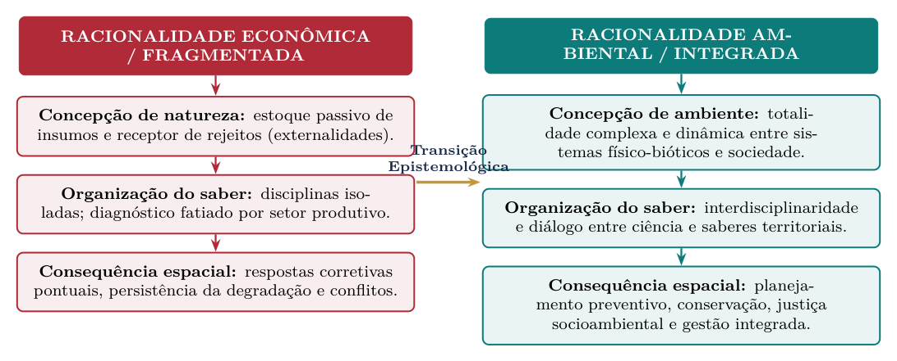
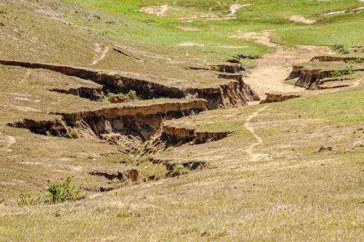

# A Questão Ambiental Contemporânea e o Papel da Geografia

A questão ambiental envolve as condições de reprodução da vida, a transformação dos sistemas naturais e a distribuição social de benefícios e danos. Uma análise geográfica começa pela identificação dos processos que conectam esses planos. A perda de solo em uma encosta, por exemplo, depende da chuva e das propriedades do terreno, enquanto a exposição da superfície também resulta de decisões sobre produção, infraestrutura e acesso à terra.

::: {.callout-note title="O que você vai aprender neste capítulo"}
A aprendizagem se concentra na construção de explicações que articulem processos ambientais e organização do território. Ao interpretar uma situação de degradação, o estudante deve reconhecer o problema, identificar os grupos envolvidos e justificar quais observações permitem sustentar a explicação proposta.
:::

::: {.callout-tip title="Revisando o que você precisa saber"}
A leitura exige familiaridade com o ciclo da água, as funções da cobertura vegetal e o conceito de espaço geográfico. A chuva fornece água e energia ao sistema, enquanto o uso da terra modifica a infiltração e o percurso do escoamento. A escala de observação define quais dessas relações podem ser reconhecidas nos dados.
:::

## Vocabulário Técnico e Conceitos-Chave do Capítulo

| **Termo / Conceito** | **Definição Operacional em Análise Ambiental** |
|:---|:---|
| **Questão ambiental** | Conjunto de tensões ecológicas, econômicas, políticas e culturais derivadas do modo como as sociedades contemporâneas se apropriam da natureza e distribuem benefícios e danos ambientais. |
| **Crise civilizatória** | Crise estrutural do modelo moderno-industrial de produção, consumo e organização do conhecimento, cujos limites ultrapassam falhas pontuais de engenharia ou gestão (Leff, 2001). |
| **Racionalidade econômica** | Lógica dominante voltada à maximização do crescimento, do lucro e da eficiência produtiva de curto prazo, frequentemente externalizando custos ecológicos e sociais. |
| **Racionalidade ambiental** | Racionalidade alternativa orientada pela articulação entre produtividade ecológica, equidade social, diversidade cultural e gestão democrática do território (Leff, 2001). |
| **Saber ambiental** | Campo emergente de conhecimentos que questiona a fragmentação científica tradicional e integra saberes disciplinares e locais em torno da complexidade socioambiental (Leff, 2001). |
| **Interdisciplinaridade** | Rearticulação conceitual e metodológica entre diferentes áreas do conhecimento para responder a problemas complexos, indo além da mera soma de relatórios isolados. |
| **Desenvolvimento sustentável** | Formulação institucional disseminada a partir do final do século XX que busca compatibilizar crescimento econômico, equidade social e conservação ambiental, frequentemente objeto de disputa política e crítica conceitual. |
| **Sustentabilidade** | Condição socioecológica de manutenção dos processos vitais, da integridade dos ecossistemas e da reprodução digna das coletividades humanas no longo prazo (Porto-Gonçalves, 2006). |
| **Planejamento ambiental** | Processo técnico, político e contínuo de diagnóstico, prognóstico, ordenamento de usos e definição de diretrizes voltadas à conservação, mitigação de impactos e recuperação de áreas degradadas. |

## A Questão Ambiental Contemporânea, Crise Civilizatória e de Racionalidade

Na linguagem cotidiana e em parte da mídia, a expressão “problema ambiental” costuma aparecer reduzida a episódios visíveis e pontuais, um vazamento de óleo, o acúmulo de resíduos em um riacho urbano ou um incêndio florestal em determinado município. Embora esses eventos sejam graves e exijam resposta técnica imediata, reduzi-los a falhas isoladas impede a compreensão de suas causas estruturais.

A partir da segunda metade do século XX, especialmente após a aceleração industrial do pós-guerra, a intensificação da urbanização e a expansão globalizada das fronteiras agropecuárias e extrativistas, tornou-se evidente que os danos aos ecossistemas não eram acidentes marginais, mas consequências sistemáticas do próprio modelo de desenvolvimento adotado. É nesse horizonte que se consolida a **questão ambiental contemporânea**, um campo de debates científicos, políticos e territoriais que põe em xeque a forma como a sociedade moderna produz, consome, ocupa o espaço e constrói conhecimento.

Em *Epistemologia ambiental* (2001, cap. 2, *Interdisciplinaridade, ambiente e desenvolvimento sustentável*), Enrique Leff demonstra que a crise ambiental não é apenas uma crise ecológica (isto é, uma perturbação restrita aos ciclos biogeoquímicos), mas uma **crise civilizatória e de racionalidade**. Segundo o autor, a modernidade consolidou uma **racionalidade econômica e instrumental** que trata a natureza como estoque inesgotável de matérias-primas e como depósito passivo de rejeitos. Nessa lógica, os danos gerados sobre o solo, a água, a biodiversidade e a saúde humana são tratados como “externalidades”, ficando de fora do cálculo econômico tradicional.

Ao mesmo tempo, essa racionalidade econômica apoiou-se na **fragmentação disciplinar do conhecimento científico**. Cada ciência especializou-se em recortar um fragmento da realidade, a agronomia focou a produtividade da cultura, a engenharia civil concentrou-se na resistência de estruturas, a economia modelou fluxos monetários e a sociologia examinou instituições humanas, muitas vezes sem diálogo efetivo entre si. Diante de fenômenos complexos como a desertificação, a degradação de bacias hidrográficas ou as mudanças climáticas, essa divisão estanque mostra-se insuficiente.

## Saber Ambiental e Interdisciplinaridade em Enrique Leff (2001)

Para Leff (2001), superar a crise ambiental exige construir uma **racionalidade ambiental** sustentada por um **saber ambiental**. Esse saber não substitui o rigor de cada ciência, mas transforma internamente as disciplinas ao confrontá-las com os limites ecológicos e com a dimensão cultural e política do território. A **interdisciplinaridade ambiental**, portanto, não consiste em reunir especialistas para escrever capítulos separados em um mesmo relatório; trata-se de construir perguntas comuns, categorias integradoras e métodos articulados capazes de apreender o ambiente como totalidade complexa.

A organização do conhecimento influencia a forma de reconhecer e enfrentar a degradação (@fig-racionalidades). A abordagem integrada relaciona componentes e escalas, permitindo que a proposta de intervenção responda aos processos e às consequências identificados.

{#fig-racionalidades fig-alt="Duas sequências com concepção de natureza, organização do conhecimento e consequências territoriais"}

Na prática da Análise Ambiental, é frequente confundir *multidisciplinaridade* com *interdisciplinaridade*. A Tabela (disciplinas cap1) apresenta os critérios operacionais que distinguem essas formas de organização do trabalho técnico e científico.

| **Dimensão** | **Disciplinaridade Isolada** | **Multidisciplinaridade** | **Interdisciplinaridade Ambiental** |
|:---|:---|:---|:---|
| **Formulação do problema** | Definida apenas nos limites de uma especialidade. | Cada área analisa o mesmo local sob sua própria ótica, em paralelo. | Problema construído conjuntamente, reconhecendo interações físico-bióticas e sociais. |
| **Relação entre métodos** | Método único e fechado. | Justaposição de laudos e mapas que raramente dialogam entre si. | Integração metodológica (por exemplo, cruzamento entre uso da terra, erosão e vulnerabilidade social). |
| **Produto típico** | Parecer setorial (por exemplo, apenas análise química da água). | Relatório “colcha de retalhos” com anexos desconectados. | Diagnóstico ambiental integrado com síntese causal e diretrizes coerentes de gestão. |
| **Limite ou ganho** | Alta profundidade local, mas cegueira para causas sistêmicas. | Amplia o volume de dados, porém sem explicar as interações. | Permite intervir sobre as causas da degradação, e não apenas sobre seus sintomas. |

**Tabela 1.1,** Comparação entre abordagens disciplinar, multidisciplinar e interdisciplinar na Análise Ambiental (elaborada com base em Leff, 2001; Tauk-Tornisielo, 1996).

## Degradação dos Solos, Escassez Hídrica e Mudanças no Uso da Terra

Para que o debate epistemológico não permaneça abstrato, é essencial observar como a crise ambiental se materializa na superfície terrestre. No Brasil, e de maneira particularmente aguda no Nordeste e no Semiárido Baiano, três processos interligados concentram grande parte dos desafios da Análise Ambiental, a **degradação dos solos**, a **escassez hídrica** e as **mudanças no uso e cobertura da terra**.

### Mudanças no Uso da Terra como Vetor Desencadeador

A cobertura vegetal nativa exerce funções hidrogeomorfológicas decisivas, intercepta a precipitação, dissipa a energia cinética das gotas de chuva, fornece matéria orgânica que estabiliza os agregados do solo e mantém canais radiculares que ampliam a infiltração da água. Quando áreas de Caatinga, Cerrado ou Mata Atlântica são suprimidas sem planejamento conservacionista para dar lugar a pastagens extensivas de alta lotação, monocultivos mecanizados, abertura desordenada de estradas rurais, mineração ou expansão urbana em encostas e fundos de vale, altera-se abruptamente o balanço entre infiltração e escoamento superficial.

Na Bahia, esse processo assume expressões regionais distintas,

**Semiárido Baiano (domínio da Caatinga).** Combina supressão da vegetação lenhosa para extração de lenha e carvão, sobrepastoreio caprino/bovino em áreas já frágeis, manejo inadequado de lavouras de sequeiro e implantação de grandes infraestruturas (estradas, linhas de transmissão, parques energéticos) que expõem solos rasos e pedregosos (como Neossolos Litólicos e Planossolos) a chuvas concentradas em poucos meses do ano. **Oeste Baiano (domínio do Cerrado).** Caracteriza-se pela rápida conversão de vegetação nativa em agricultura mecanizada de larga escala, intensificando a demanda por águas superficiais e subterrâneas e modificando a dinâmica de recarga em chapadões arenosos.

**Faixa litorânea, Recôncavo e centros urbanos regionais (como o entorno de Feira de Santana).** Evidencia impermeabilização acelerada do solo, supressão de áreas de preservação permanente (APPs) de nascentes, lagoas e riachos, lançamento de efluentes sem tratamento adequado e expansão de loteamentos sobre áreas sujeitas a alagamentos ou instabilidade de vertentes.

::: {layout-ncol=2}
{#fig-vetores-a}

{#fig-vetores-b}
:::

**Figura 1.1:** Vetores de mudança no uso da terra na Bahia. *O que observar:* no painel esquerdo, a perda de cobertura vegetal em áreas de pastoreio intensivo expõe o solo ao escoamento concentrado e desencadeia incisões erosivas escalonadas. No painel direito, os círculos escuros evidenciam a conversão em larga escala das chapadas do Oeste Baiano por agricultura irrigada mecanizada, elevando a pressão sobre a recarga hídrica. Fonte: Acervo didático CHF662 e INPE/Wikimedia Commons (CC BY-SA).

### Degradação dos Solos e Processos Erosivos

O solo não é um substrato inerte sobre o qual se constroem edificações ou se aplicam fertilizantes; trata-se de um corpo natural tridimensional, dinâmico e vivo, cuja formação (pedogênese) demanda séculos ou milênios. A degradação edáfica manifesta-se pela perda progressiva de suas funções físicas, químicas e biológicas, redução do teor de matéria orgânica, quebra dos agregados, selamento superficial, compactação pelo pisoteio animal ou tráfego de máquinas, salinização em perímetros irrigados mal drenados e remoção acelerada de partículas pela erosão hídrica e eólica.

Quando a taxa de remoção de solo supera amplamente a taxa natural de formação, a erosão evolui da forma *laminar* (lavagem difusa da camada superficial mais fértil) para a forma *linear* (sulcos, ravinas e voçorocas). Os sedimentos mobilizados das encostas não desaparecem, são transportados pela rede de drenagem e depositados em calhas fluviais, barreiros, cisternas rurais e açudes, reduzindo sua capacidade de armazenamento de água.

### Escassez Hídrica, Condição Climática versus Produção Socioambiental

Um dos equívocos mais persistentes sobre o Nordeste brasileiro é explicar a escassez hídrica exclusivamente pela baixa média pluviométrica. O clima semiárido apresenta, de fato, chuvas concentradas no tempo, elevada variabilidade interanual e altas taxas de evapotranspiração potencial, características naturais que definem a **semiaridez**. Contudo, a **escassez hídrica vivenciada pela população** é resultado direto da interação entre essa dinâmica climática e fatores socioespaciais, desmatamento das cabeceiras e matas ciliares, compactação do solo (que impede a recarga do lençol freático), assoreamento de reservatórios, contaminação de mananciais e distribuição desigual da infraestrutura de captação e acesso à água.

## Cadeia de Retroalimentação Solo-Água-Uso da Terra {#01-questao-ambiental-cadeia-de-retroalimentação-soloáguauso-da-terra}

Degradação dos solos, escassez hídrica e mudança no uso da terra não ocorrem como listas paralelas de problemas, elas formam um circuito retroalimentado. A supressão vegetal reduz a infiltração e intensifica o escoamento superficial; o escoamento acelerado remove o solo fértil e assoreia os corpos d’água; a perda de fertilidade e de disponibilidade hídrica pressiona os produtores a expandir o desmatamento sobre novas áreas frágeis, ampliando a vulnerabilidade socioambiental.

A conexão entre uso da terra, perda de solo e disponibilidade hídrica pode ampliar a pressão sobre novas áreas (@fig-solo-agua-uso). A análise deve localizar os pontos de entrada de uma medida de conservação e explicar como ela modifica esse circuito.

{#fig-solo-agua-uso fig-alt="Sequência de mudanças no uso da terra, degradação do solo, erosão e escassez, com uma ligação de retroalimentação"}

## O Debate Crítico, Desenvolvimento Sustentável versus Sustentabilidade

A partir da publicação do Relatório *Nosso Futuro Comum* (Relatório Brundtland, 1987) e da Conferência das Nações Unidas sobre Meio Ambiente e Desenvolvimento (Rio-92), a expressão **desenvolvimento sustentável** ganhou enorme visibilidade internacional, sendo definida como aquele capaz de atender às necessidades do presente sem comprometer a capacidade das gerações futuras de atenderem às suas próprias necessidades.

À primeira vista, a formulação parece consensual e inquestionável. Entretanto, autores como Carlos Walter Porto-Gonçalves (*Os (des)caminhos do meio ambiente*, 2006) e Enrique Leff (2001) demonstram que o conceito abriga contradições profundas. Porto-Gonçalves chama atenção para a estrutura política da expressão, ao acoplar o adjetivo “sustentável” ao substantivo “desenvolvimento”, o discurso institucional dominante preserva intacto o projeto desenvolvimentista baseado na expansão contínua da produção de mercadorias, no consumo crescente de energia e na subordinação de territórios periféricos ao mercado mundial.

Sob essa perspectiva crítica, a noção de desenvolvimento sustentável muitas vezes opera como mecanismo de *recodificação econômica da natureza*, a floresta, a água e o clima passam a ser valorados apenas como “capital natural” ou “serviços mercantilizáveis”, sem questionar quem detém o controle dos territórios, quem se beneficia dos ganhos econômicos e quem arca com a poluição, o deslocamento compulsório e a degradação do solo.

Em contraposição, o debate sobre **sustentabilidade** (ou sustentabilidade socioambiental) propõe deslocar o foco do crescimento econômico ilimitado para a manutenção da integridade ecológica, da diversidade cultural e da equidade territorial. A sustentabilidade, nesse sentido, não é um selo de marketing empresarial nem uma meta técnica universalmente imposta de cima para baixo, mas um projeto histórico e geográfico que reconhece os limites biofísicos dos ecossistemas e valoriza modos locais de convivência com o ambiente, como as estratégias de convivência com o Semiárido baseadas em conservação de solo, captação descentralizada de água de chuva e manejo sustentável da Caatinga.

| **Critério de Análise** | **Discurso Hegemônico de Desenvolvimento Sustentável** | **Perspectiva Crítica de Sustentabilidade Socioambiental** |
|:---|:---|:---|
| **Eixo central** | Conciliar crescimento econômico contínuo com eficiência tecnológica e controle de impactos. | Garantir integridade dos sistemas ecológicos, justiça socioambiental e reprodução digna da vida. |
| **Leitura da natureza** | Capital natural, estoque de recursos mensuráveis pelo mercado e ativos compensáveis. | Patrimônio socioecológico complexo, dotado de limites biofísicos e significados culturais plurais. |
| **Papel da técnica** | Solução principal para a crise (ecoeficiência, substituição de insumos, mercado verde). | Ferramenta necessária, mas subordinada a critérios éticos, ecológicos e democráticos de decisão. |
| **Relação com o território** | Tende a homogeneizar modelos produtivos e minimizar conflitos distributivos. | Reconhece conflitos territoriais, desigualdades de poder e diversidade de saberes locais. |
| **Referência-base** | Crítica formulada em Leff (2001, cap. 2) e Porto-Gonçalves (2006). | Proposta articulada em Leff (2001), Porto-Gonçalves (2006) e na Geografia Socioambiental. |

**Tabela 1.2,** Síntese comparativa entre o discurso convencional de desenvolvimento sustentável e a perspectiva crítica de sustentabilidade.

## Planejamento Ambiental e o Papel Integrador da Geografia

Diante de uma crise simultaneamente ecológica, econômica e territorial, o **planejamento ambiental** apresenta-se como instrumento fundamental de mediação entre a dinâmica da natureza e as demandas da sociedade. Planejar ambientalmente significa ir além de ações emergenciais pós-desastre, envolve levantar evidências empíricas sobre o meio físico, biótico e socioespacial (diagnóstico), projetar tendências de degradação ou recuperação sob diferentes cenários de uso da terra (prognóstico), estabelecer diretrizes de zoneamento, conservação e restauração (ordenamento) e acompanhar continuamente os resultados por meio de indicadores auditáveis (monitoramento).

É precisamente nesse terreno que a **Geografia** desempenha um papel integrador insubstituível frente à fragmentação disciplinar,

**Articulação físico-biótico-socioespacial.** A formação geográfica capacita o profissional a ler simultaneamente o relevo, os solos, a rede de drenagem e a cobertura vegetal juntamente com a estrutura fundiária, a urbanização, as redes de infraestrutura e os conflitos territoriais. **Domínio da espacialidade e da cartografia.** Problemas ambientais nunca são abstratos; eles têm localização, extensão, conectividade e padrões espaciais que podem ser mapeados, modelados e cruzados em Sistemas de Informação Geográfica (SIG) e trabalhos de campo.

**Leitura multiescalar.** O(a) geógrafo(a) conecta processos que ocorrem na escala da parcela de solo ou da vertente (erosão em sulcos) com a escala da bacia hidrográfica (assoreamento de mananciais), da região (políticas para o Semiárido) e das redes econômicas globais (demanda por energia e commodities). **Mediação interdisciplinar.** Por transitar entre as ciências da Terra e as ciências humanas, a Geografia atua como ponte entre engenheiros, biólogos, agrônomos, gestores públicos e comunidades locais na construção de diagnósticos ambientais coerentes.

## Conexão Direta com os Próximos Módulos e o Trabalho Prático Final

Tudo o que você estudará nos próximos capítulos de CHF662 desdobra os fundamentos apresentados aqui, no Módulo 2, a Avaliação de Impacto Ambiental (AIA) e a análise integrada; no Módulo 3, a bacia hidrográfica, a morfopedologia, os geossistemas e a fragilidade ambiental; no Módulo 4, os indicadores ambientais e de qualidade do solo (incluindo a viagem de campo no Semiárido Baiano); e no Módulo 5, a bioengenharia de água e solo, a legislação e o Diagnóstico Ambiental Aplicado (50% da nota final). Manter desde o Capítulo 1 o hábito de integrar processos naturais e decisões sociais evitará diagnósticos fragmentados na Prova Teórica e no Trabalho Final.

## Da observação do dano à explicação geográfica

Uma margem assoreada constitui um ponto de partida para a investigação. O sedimento pode ter sido produzido em lavouras, estradas ou canais erosivos situados a montante. A ligação entre a fonte e o local de deposição depende do caminho percorrido pela água e das oportunidades de retenção ao longo da bacia. Identificar essa ligação permite explicar por que uma intervenção localizada na margem pode produzir efeito limitado enquanto as fontes continuam ativas.

A interpretação ganha consistência quando explicita a sequência temporal. Fotografias antigas, relatos de moradores e mapas de cobertura da terra ajudam a verificar se a abertura de acessos antecedeu o aparecimento de incisões. A coincidência temporal orienta uma hipótese, cuja avaliação depende da distribuição espacial dos processos, das condições de chuva e da comparação com setores semelhantes.

O diagnóstico também precisa reconhecer quem utiliza a água e quem suporta a redução de sua qualidade. A mesma alteração pode afetar captação doméstica, irrigação e manutenção de habitats por caminhos distintos. A proposta de gestão deve relacionar cada medida ao processo que pretende modificar e ao grupo que depende do resultado. Essa articulação entre mecanismo físico e consequência social dá conteúdo operacional à abordagem socioambiental.

## Exemplos resolvidos

*Nota metodológica,* Os cenários numéricos e localidades estilizadas abaixo são **cenários didáticos ilustrativos**, construídos exclusivamente para treinar a aplicação rigorosa dos referenciais teóricos de Leff (2001) e Porto-Gonçalves (2006) a situações concretas da prática geográfica.

::: {.callout-tip appearance="simple"}
### Exemplo 1.1, Básico. Fragmentação Disciplinar em Projeto de Contenção de Erosão

**Situação analisada.** Em um município fictício do Semiárido Baiano *(cenário didático ilustrativo)*, uma prefeitura contratou uma empresa para conter o assoreamento de um açude comunitário. A equipe técnica elaborou apenas um projeto de dragagem mecânica do reservatório e construção de um muro de concreto próximo ao sangradouro, sem avaliar o uso do solo nas cabeceiras da microbacia nem ouvir os agricultores que utilizam a água. Dois anos após a obra, o açude voltou a apresentar acúmulo intenso de sedimentos.

**Dados disponíveis.** Intervenção exclusivamente estrutural/corretiva (dragagem e muro de concreto); ausência de diagnóstico da cobertura vegetal e dos solos nas vertentes a montante; ausência de participação dos usuários locais; retorno do assoreamento em 2 anos.

**Problema a resolver.** Diagnosticar a falha epistemológica e metodológica do projeto à luz de Enrique Leff (2001) e indicar como uma abordagem interdisciplinar geográfica reestruturaria a intervenção.

**Fundamento da análise.** Análise epistemológica baseada nos conceitos de *racionalidade econômica/instrumental*, *fragmentação disciplinar*, *saber ambiental* e *interdisciplinaridade* (Leff, 2001, cap. 2).

**Desenvolvimento.**

**Identificação do sintoma versus causa.** A dragagem atuou apenas sobre o sintoma final (sedimento acumulado no açude), ignorando a causa geradora nas vertentes a montante (solo exposto, erosão laminar e linear, retirada da vegetação ripária). **Diagnóstico epistemológico (Leff, 2001).** O projeto reproduziu a *fragmentação disciplinar* e a *racionalidade instrumental*, tratando um problema socioambiental complexo como mera questão pontual de engenharia civil. **Reestruturação interdisciplinar.** Uma equipe coordenada sob perspectiva geográfica integrada deveria, (a) delimitar a microbacia de contribuição do açude; (b) mapear áreas de solo exposto, sobrepastoreio e focos erosivos nas cabeceiras; (c) dialogar com os agricultores para identificar pressões de uso da terra e saberes locais de manejo; e (d) combinar medidas conservacionistas na vertente (recomposição vegetal, retenção de enxurrada, manejo do pastoreio) com ações de manutenção do reservatório.

**Interpretação do resultado.** O fracasso recorrente do projeto decorre da fragmentação disciplinar e da racionalidade instrumental, que trataram o assoreamento como falha pontual dissociada da dinâmica da microbacia e do uso social da terra. A solução exige abordagem interdisciplinar e planejamento integrado a montante e junto à comunidade.

**Condições de validade.** A análise é ambientalmente coerente, dragar um açude sem reduzir a produção de sedimentos nas encostas apenas reinicia o ciclo de assoreamento a cada estação chuvosa, desperdiçando recursos públicos e mantendo a vulnerabilidade hídrica.
:::

::: {.callout-tip appearance="simple"}
### Exemplo 1.2, Básico. Diferenciando Semiaridez Climática de Escassez Hídrica Socioambiental

**Situação analisada.** Duas microbacias rurais vizinhas no Semiárido Baiano *(cenário didático ilustrativo)* registram exatamente a mesma precipitação média anual de $580\text{ mm}$, concentrada entre novembro e março, sobre substrato geológico e relevo semelhantes. Na Microbacia A, $65\%$ da área mantém cobertura de Caatinga manejada, faixas de mata ciliar conservadas e práticas de retenção de água no solo; suas cacimbas permanecem com água na estação seca. Na Microbacia B, $78\%$ da área foi convertida em pastagem degradada com solo compactado e margens desmatadas; os reservatórios secam rapidamente após as chuvas e o solo apresenta sulcos erosivos.

**Dados disponíveis.** Precipitação idêntica ($580\text{ mm/ano}$) e substrato semelhante em ambas as microbacias. Microbacia A, $65\%$ de vegetação nativa, mata ciliar preservada, disponibilidade hídrica mantida na estiagem. Microbacia B, $78\%$ de pastagem degradada, solo compactado, margens desmatadas, rápida perda de água e erosão em sulcos.

**Problema a resolver.** Explicar por que o determinismo climático não explica a diferença observada entre as duas microbacias e demonstrar a relação causal entre uso da terra, solo e água.

**Fundamento da análise.** Análise comparativa controlada (mesmo clima, diferentes usos da terra) articulando processos hidrogeomorfológicos básicos e leitura socioambiental da escassez hídrica.

**Desenvolvimento.**

**Controle da variável climática.** Como ambas as microbacias recebem $580\text{ mm/ano}$ sob o mesmo regime de chuvas concentradas, a diferença na disponibilidade de água na estação seca não pode ser atribuída apenas à falta de chuva. **Dinâmica na Microbacia A.** A cobertura vegetal protege a superfície do solo contra o impacto das gotas de chuva, mantém porosidade elevada e favorece a infiltração, recarregando o solo e os reservatórios rasos (cacimbas) para o período seco.

**Dinâmica na Microbacia B.** A remoção da vegetação e a compactação reduzem a taxa de infiltração; assim, grande parcela dos $580\text{ mm}$ transforma-se rapidamente em escoamento superficial, gerando sulcos erosivos, arraste de sedimentos e baixa recarga hídrica subsuperficial. **Síntese conceitual.** A semiaridez é condição climática natural comum às duas áreas, mas a escassez hídrica severa na Microbacia B é agravada pelo modelo de uso e ocupação do solo.

**Interpretação do resultado.** A diferença decorre do manejo do uso da terra e das condições do solo, e não apenas do clima, a degradação vegetal e edáfica na Microbacia B converte a chuva em escoamento rápido e erosão, reduzindo a infiltração e produzindo escassez hídrica socioambiental.

**Condições de validade.** O raciocínio respeita o balanço hídrico elementar, para uma mesma entrada pluviométrica ($P = 580\text{ mm}$), quanto menor a infiltração em solos degradados, maior o escoamento superficial imediato e menor a água armazenada disponível durante a estiagem.
:::

{#fig-contraste_microbacias}

::: {.callout-tip appearance="simple"}
### Exemplo 1.3, Intermediário. Análise Crítica de um Discurso de “Desenvolvimento Sustentável”

**Situação analisada.** Um consórcio agroindustrial divulga um documento promocional anunciando a implantação de um polo de monocultura irrigada de exportação em uma bacia hidrográfica de transição Cerrado-Caatinga *(cenário didático ilustrativo)*. O texto classifica o empreendimento como exemplo de “desenvolvimento sustentável” porque utilizará pivôs com sensores digitais que economizam $15\%$ de água em comparação a sistemas antigos e compensará a supressão de vegetação nativa mediante a compra de créditos ambientais em outra região do país.

**Dados disponíveis.** Alegações do consórcio, ganho de $15\%$ na eficiência de irrigação por sensores; compensação ambiental fora da bacia impactada; expansão de monocultura intensiva com remoção de vegetação nativa local e aumento da captação hídrica total.

**Problema a resolver.** Avaliar criticamente o uso do termo “desenvolvimento sustentável” nesse documento à luz de Porto-Gonçalves (2006) e Leff (2001), apontando as limitações socioambientais ocultadas pela peça promocional.

**Fundamento da análise.** Análise crítica do discurso ambiental com base na distinção entre *desenvolvimento sustentável hegemônico* e *sustentabilidade socioambiental* (Porto-Gonçalves, 2006; Leff, 2001).

**Desenvolvimento.**

**Análise do ganho de ecoeficiência ($15\%$).** Economizar água por hectare em relação a técnicas antigas não garante redução do consumo total de água na bacia se a área irrigada se expandir de forma absoluta. A técnica melhora a eficiência produtiva sem questionar o limite hídrico regional. **Crítica à compensação desterritorializada.** Comprar créditos ambientais em outra região trata a natureza como mercadoria intercambiável (lógica da racionalidade econômica criticada por Leff, 2001). Contudo, a biodiversidade, a proteção do solo e a recarga hídrica perdidas na bacia local não são fisicamente repostas por uma área conservada a centenas de quilômetros.

**Ocultamento de dimensões sociais (Porto-Gonçalves, 2006).** O discurso adota o adjetivo “sustentável” para legitimar o modelo desenvolvimentista, omitindo questões centrais como quem perde acesso à água a jusante, como se alteram a estrutura fundiária e a segurança alimentar local e se as comunidades atingidas participaram da decisão.

**Interpretação do resultado.** O documento emprega “desenvolvimento sustentável” em sentido retórico e mercadológico, reduz a questão ambiental à eficiência tecnológica parcial e à compensação financeira fora do território, desconsiderando limites hídricos da bacia e impactos socioespaciais locais.

**Condições de validade.** A crítica é equilibrada e rigorosa, não nega a utilidade de sensores de irrigação, mas demonstra que eficiência técnica isolada não equivale à sustentabilidade ecológica e social em escala de bacia hidrográfica.
:::

::: {.callout-tip appearance="simple"}
### Exemplo 1.4, Intermediário. Quantificação Didática de Mudanças no Uso da Terra em Microbacia

**Situação analisada.** Durante um exercício de diagnóstico preliminar sobre uma microbacia fictícia de $1.200\text{ ha}$ no Semiárido Baiano *(cenário didático ilustrativo)*, uma turma de Geografia comparou o mapeamento de uso e cobertura da terra entre dois anos de referência ($t_0$ e $t_1$, com intervalo de 15 anos) e obteve a tabela abaixo,

**Dados disponíveis.** Área total da microbacia, $A_{\text{total}} = 1.200\text{ ha}$. Distribuição por classe,

Caatinga arbóreo-arbustiva densa, $660\text{ ha}$ em $t_0$ e $360\text{ ha}$ em $t_1$;. Pastagem manejada e agricultura familiar diversificada, $300\text{ ha}$ em $t_0$ e $270\text{ ha}$ em $t_1$;. Pastagem degradada com cobertura rala, $180\text{ ha}$ em $t_0$ e $390\text{ ha}$ em $t_1$;. Solo exposto / áreas com erosão visível, $60\text{ ha}$ em $t_0$ e $180\text{ ha}$ em $t_1$.

**Problema a resolver.** (a) Calcular a variação absoluta (em $\text{ha}$), a variação relativa percentual de cada classe e a participação percentual das classes degradadas (pastagem degradada + solo exposto) em $t_0$ e $t_1$; (b) interpretar geograficamente o significado ambiental dessa trajetória.

**Fundamento da análise.** Cálculo passo a passo de variações absolutas ($\Delta A = A_{t_1} - A_{t_0}$), relativas ($\Delta\% = \frac{A_{t_1} - A_{t_0}}{A_{t_0}} \times 100\%$) e proporções sobre a área total ($p = \frac{A}{A_{\text{total}}} \times 100\%$), seguido de interpretação integrada solo-água-uso da terra.

**Desenvolvimento.**

*Caatinga densa,* $\Delta A = 360 - 660 = -300\text{ ha}$; $\Delta\% = \frac{-300}{660} \times 100\% \approx -45,5\%$. *Pastagem manejada / agricultura familiar,* $\Delta A = 270 - 300 = -30\text{ ha}$; $\Delta\% = \frac{-30}{300} \times 100\% = -10,0\%$. *Pastagem degradada,* $\Delta A = 390 - 180 = +210\text{ ha}$; $\Delta\% = \frac{+210}{180} \times 100\% \approx +116,7\%$. *Solo exposto / erosão visível,* $\Delta A = 180 - 60 = +120\text{ ha}$; $\Delta\% = \frac{+120}{60} \times 100\% = +200,0\%$.

Em $t_0$, $A_{\text{deg},0} = 180 + 60 = 240\text{ ha} \implies p_0 = \frac{240}{1.200} \times 100\% = 20,0\%$. Em $t_1$, $A_{\text{deg},1} = 390 + 180 = 570\text{ ha} \implies p_1 = \frac{570}{1.200} \times 100\% = 47,5\%$. Acréscimo na participação degradada, $47,5\% - 20,0\% = +27,5\text{ pontos percentuais}$ (ou $+330\text{ ha}$).

**Conferência da área total,** Em $t_0$, $660 + 300 + 180 + 60 = 1.200\text{ ha}$. Em $t_1$, $360 + 270 + 390 + 180 = 1.200\text{ ha}$. (Conservação da área verificada.). **Variação absoluta ($\Delta A$) e relativa ($\Delta\%$) por classe,**. **Participação conjunta das classes degradadas sobre a área total,**. **Interpretação geográfica integrada.** Em 15 anos, a microbacia perdeu $45,5\%$ de sua cobertura nativa densa, enquanto a área de solo exposto triplicou ($+200\%$). Em $t_1$, quase metade da microbacia ($47,5\%$) encontra-se sob cobertura rala ou sem proteção vegetal, indicando elevada exposição à erosão hídrica, provável redução da infiltração, aceleração do escoamento superficial e risco crescente de assoreamento dos corpos d’água e queda de renda rural.

**Interpretação do resultado.** A Caatinga densa retraiu $-300\text{ ha}$ ($-45,5\%$), o solo exposto triplicou ($+120\text{ ha}$; $+200,0\%$) e as classes degradadas saltaram de $20,0\%$ para $47,5\%$ da microbacia, configurando um quadro crítico de degradação hidrogeomorfológica e perda de sustentabilidade territorial.

**Condições de validade.** Verificação aritmética e física, a soma das variações absolutas anula-se ($-300 - 30 + 210 + 120 = 0\text{ ha}$), confirmando consistência matemática; ambientalmente, o avanço de $27,5$ pontos percentuais de áreas degradadas justifica prioridade imediata de planejamento conservacionista e recuperação.
:::

::: {.callout-tip appearance="simple"}
### Exemplo 1.5, Avançado. Diretrizes de Planejamento Ambiental Integrado em Área de Múltiplas Pressões

**Situação analisada.** Na periferia de uma cidade média do interior da Bahia *(cenário didático ilustrativo)*, uma bacia hidrográfica de pequeno porte concentra quatro processos simultâneos, (i) expansão de loteamentos populares sem drenagem pluvial em encostas de declividade moderada a forte; (ii) supressão da vegetação ciliar de um riacho intermitente que abastece hortas periurbanas; (iii) extração irregular de areia no leito do riacho para a construção civil; e (iv) lançamento de esgoto doméstico sem tratamento. A administração municipal propôs apenas “multar os pequenos agricultores” e “canalizar o riacho com concreto”.

**Dados disponíveis.** Quatro vetores simultâneos de pressão (urbanização sem drenagem, desmatamento ciliar, mineração irregular de areia e esgoto doméstico) atuando na mesma microbacia; proposta municipal restrita a punição seletiva e canalização rígida.

**Problema a resolver.** Criticar a proposta municipal usando os conceitos de crise de racionalidade (Leff, 2001) e sustentabilidade crítica (Porto-Gonçalves, 2006) e formular quatro diretrizes integradas de planejamento ambiental lideradas por uma perspectiva geográfica.

**Fundamento da análise.** Integração dos referenciais epistemológicos do capítulo (Leff, 2001; Porto-Gonçalves, 2006) com os princípios do planejamento ambiental geográfico (diagnóstico multiescalar, interdisciplinaridade e participação social).

**Desenvolvimento.**

*Racionalidade instrumental,* canalizar o riacho com concreto transfere a velocidade do escoamento para jusante, agrava enchentes em outros trechos e elimina a função ecológica da calha natural, sem resolver o lançamento de esgoto nem a erosão das encostas. *Injustiça socioambiental,* responsabilizar apenas os pequenos agricultores ignora a ausência de políticas habitacionais e de saneamento básico, bem como a cadeia econômica da construção civil que demanda areia ilegal.

*Diretriz 1, Diagnóstico espacial integrado da microbacia,* mapear uso da terra, áreas de risco nas encostas, pontos de lançamento de efluentes, cavas de extração mineral e trechos de APP degradada. *Diretriz 2, Ordenamento territorial e saneamento,* disciplinar a expansão urbana, implantar drenagem sustentável (pavimentos permeáveis e bacias de retenção) e universalizar a coleta e o tratamento de esgoto. *Diretriz 3, Recuperação hidrogeomorfológica e controle da extração,* coibir a lavra ilegal de areia com fiscalização e alternativas regulamentadas, recompor a mata ciliar e adotar técnicas conservacionistas nas vertentes.

*Diretriz 4, Gestão participativa e apoio à agricultura periurbana,* instituir comitê ou fórum da microbacia envolvendo moradores, horticultores, técnicos e poder público, convertendo os agricultores em agentes de conservação em vez de bodes expiatórios.

**Crítica à proposta municipal,**. **Quatro diretrizes integradas de planejamento ambiental,**.

**Interpretação do resultado.** A proposta municipal fracassa por adotar solução tecnocrática e socialmente injusta; o planejamento ambiental geográfico exige diagnosticar os quatro vetores na escala da microbacia e articular ordenamento urbano, saneamento, recuperação ripária e gestão participativa.

**Condições de validade.** As quatro diretrizes atacam simultaneamente os processos físicos (escoamento, erosão, qualidade da água) e as causas socioespaciais (habitação precária, déficit de saneamento, cadeia da construção civil), refletindo a passagem da fragmentação para a racionalidade ambiental.
:::

## Erros comuns de interpretação

::: {.callout-warning appearance="simple"}
### Erro 1.1, Reduzir a Crise Ambiental à “Falta de Consciência Individual”

**Equívoco frequente.** Atribuir a degradação dos solos, a poluição hídrica ou o desmatamento exclusivamente à “falta de educação” ou a maus hábitos individuais dos cidadãos.

**Por que está incorreto.** Embora práticas educativas sejam relevantes, esse argumento oculta determinantes estruturais (modelo econômico, padrão de uso da terra, concentração fundiária, déficit de saneamento e decisões políticas) que Leff (2001) identifica como núcleo da crise civilizatória.

**Como evitar.** Analise sempre a articulação entre comportamentos locais, estruturas produtivas, políticas públicas e interesses econômicos em disputa no território.
:::

::: {.callout-warning appearance="simple"}
### Erro 1.2, Confundir Multidisciplinaridade com Interdisciplinaridade Ambiental

**Equívoco frequente.** Acreditar que um estudo ambiental torna-se interdisciplinar apenas por conter capítulos separados escritos por um geólogo, um biólogo e um sociólogo.

**Por que está incorreto.** A mera justaposição de textos especializados sem diálogo metodológico caracteriza *multidisciplinaridade*. Como mostra Leff (2001), a *interdisciplinaridade ambiental* exige construir problemas integrados e explicar como processos físicos, bióticos e sociais condicionam-se mutuamente.

**Como evitar.** Em seus relatórios e provas, explicite sempre as *conexões causais* entre as variáveis (por exemplo, como uma decisão econômica de uso da terra altera a infiltração e agrava o assoreamento).
:::

::: {.callout-warning appearance="simple"}
### Erro 1.3, Usar “Desenvolvimento Sustentável” como Sinônimo Neutro de “Sustentabilidade”

**Equívoco frequente.** Empregar ambos os termos indistintamente, assumindo que qualquer projeto rotulado como “desenvolvimento sustentável” é ecologicamente íntegro e socialmente justo.

**Por que está incorreto.** Conforme demonstra Porto-Gonçalves (2006), “desenvolvimento sustentável” é um conceito em disputa que frequentemente subordina a conservação ambiental à lógica do crescimento econômico contínuo e à mercantilização da natureza.

**Como evitar.** Ao analisar políticas ou projetos, pergunte sempre, *sustentável para quem, em qual escala espacial e com quais custos ecológicos e territoriais?*
:::

::: {.callout-warning appearance="simple"}
### Erro 1.4, Explicar a Degradação do Semiárido pelo Determinismo Climático

**Equívoco frequente.** Afirmar que a erosão dos solos e a escassez hídrica no Semiárido Baiano são “consequências inevitáveis da falta de chuva”.

**Por que está incorreto.** A semiaridez é uma condição climática natural à qual a Caatinga é evolutivamente adaptada. A degradação severa do solo e a vulnerabilidade hídrica resultam da combinação entre chuvas concentradas e práticas inadequadas de desmatamento, sobrepastoreio, compactação e desigualdade no acesso à água.

**Como evitar.** Separe claramente o que é *condicionante climático natural* do que é *processo agravado pelo manejo e pela organização socioespacial*.
:::

## Exercícios de fixação

#### Nível 1, Básicos (Compreensão Conceitual)

1. Explique, com base em Enrique Leff (2001), por que a crise ambiental contemporânea não pode ser compreendida apenas como uma crise ecológica ou tecnológica, mas como uma crise civilizatória e de racionalidade.

2. Diferencie *racionalidade econômica* de *racionalidade ambiental* segundo Leff (2001), indicando o papel das chamadas “externalidades” no primeiro caso.

3. Apresente duas diferenças fundamentais entre a abordagem *multidisciplinar* e a abordagem *interdisciplinar* na elaboração de diagnósticos ambientais.

4. Explique por que a supressão da vegetação nativa desencadeia simultaneamente processos de degradação do solo e alterações na disponibilidade hídrica de uma microbacia.

5. Sintetize a diferença entre *semiaridez climática* e *escassez hídrica socioambiental* no contexto do Semiárido Baiano.

    #### Nível 2, Intermediários (Análise Crítica e Aplicação)

6. Com base em Porto-Gonçalves (2006), analise criticamente a tensão existente entre o substantivo “desenvolvimento” e o adjetivo “sustentável” na expressão *desenvolvimento sustentável*.

7. Um município baiano pretende elaborar um plano de conservação de nascentes, mas contratou estudos isolados de geologia, botânica e economia que não se comunicam entre si. Identifique o limite metodológico desse procedimento e proponha como a Geografia pode exercer papel integrador nesse planejamento ambiental.

8. Em um cenário didático ilustrativo, uma microbacia de $800\text{ ha}$ no Semiárido passou, em 10 anos, de $520\text{ ha}$ para $320\text{ ha}$ de cobertura nativa de Caatinga, enquanto a área de solo exposto cresceu de $40\text{ ha}$ para $140\text{ ha}$. Calcule a variação absoluta (em $\text{ha}$) e percentual de ambas as classes e explique dois desdobramentos esperados sobre o escoamento superficial e o assoreamento local.

9. Compare brevemente os principais vetores contemporâneos de mudança no uso da terra no Semiárido Baiano e no Oeste Baiano (Cerrado), destacando como a escala regional orienta o diagnóstico geográfico.

10. Por que a adoção exclusiva de soluções de ecoeficiência (como redução pontual de consumo de insumos por unidade produzida) pode ser insuficiente para alcançar a sustentabilidade socioambiental de um território? Relacione sua resposta a Leff (2001).

    #### Nível 3, Aplicados e Objetivos (Múltipla Escolha)

11. Segundo Enrique Leff (2001, cap. 2), a construção do *saber ambiental* frente à crise contemporânea implica,

    (A) Substituir integralmente as ciências naturais por análises filosóficas, dispensando medições empíricas de solo e água.

    (B) Somar relatórios independentes de diferentes áreas técnicas sem alterar os pressupostos de cada disciplina.

    (C) Questionar a fragmentação do conhecimento e a racionalidade econômica hegemônica, rearticulando saberes disciplinares e locais sob uma racionalidade ambiental.

    (D) Transferir a resolução dos impactos ambientais exclusivamente aos mecanismos automáticos de precificação do mercado financeiro.

    (E) Restringir o debate ambiental à preservação de parques isolados, desvinculando-o do planejamento territorial e produtivo.

12. A respeito da cadeia de processos que conecta mudanças no uso da terra, degradação dos solos e escassez hídrica no Semiárido Baiano, assinale a alternativa **correta**,

    (A) A baixa infiltração de água no solo depende apenas da quantidade anual de chuvas, não sofrendo influência da cobertura vegetal ou da compactação.

    (B) A retirada da vegetação nativa e o sobrepastoreio ampliam a exposição do solo, reduzem a infiltração, aceleram o escoamento superficial e intensificam a erosão e o assoreamento de reservatórios.

    (C) A erosão laminar restringe-se a regiões tropicais úmidas de Mata Atlântica, não ocorrendo em áreas de Caatinga devido à baixa precipitação anual.

    (D) O assoreamento de açudes é um processo benéfico no Semiárido porque aumenta a profundidade útil dos reservatórios na estação seca.

    (E) A escassez hídrica nordestina decorre unicamente de anomalias climáticas naturais, sem relação com o desmatamento ciliar ou a gestão territorial.

13. Na leitura crítica proposta por Porto-Gonçalves (2006) sobre o conceito de *desenvolvimento sustentável*, destaca-se que,

    (A) A expressão representa um consenso científico definitivo e neutro, aceito sem tensões políticas por todos os grupos sociais.

    (B) O conceito rompe integralmente com a lógica de expansão contínua da produção de mercadorias adotada desde a Revolução Industrial.

    (C) O adjetivo “sustentável” muitas vezes funciona como verniz legitimador do modelo desenvolvimentista hegemônico, ocultando desigualdades territoriais e limites ecológicos.

    (D) A sustentabilidade só pode ser atingida mediante a homogeneização cultural e a substituição de saberes locais por pacotes tecnológicos globais.

    (E) O debate sobre sustentabilidade restringe-se à gestão de resíduos sólidos urbanos, não abrangendo conflitos agrários ou hídricos.

14. Qual atributo caracteriza mais adequadamente o papel integrador da Geografia no planejamento ambiental frente à fragmentação disciplinar?

    (A) A capacidade de articular componentes físico-bióticos e processos socioespaciais em múltiplas escalas, empregando leitura espacial, trabalho de campo e mediação interdisciplinar.

    (B) A exclusividade na realização de análises laboratoriais químicas de água e solo, dispensando a colaboração com outras áreas científicas.

    (C) O foco exclusivo na descrição de aspectos fisiográficos naturais, deixando os fatores econômicos e políticos fora do diagnóstico ambiental.

    (D) A padronização de soluções técnicas idênticas para qualquer região do país, independentemente das especificidades locais de relevo, clima e cultura.

    (E) A substituição do diagnóstico empírico prévio por intervenções emergenciais de engenharia após a ocorrência de desastres ambientais.

15. Considere um cenário didático ilustrativo em que uma área rural teve $300\text{ ha}$ de vegetação nativa suprimidos em uma microbacia de $1.000\text{ ha}$ que originalmente possuía $600\text{ ha}$ de vegetação nativa. Sobre essa mudança no uso da terra, é **correto** afirmar que,

    (A) A vegetação nativa sofreu redução relativa de $30\%$ em relação à sua área inicial.

    (B) A participação da vegetação nativa na microbacia passou de $60\%$ para $30\%$, representando perda relativa de $50\%$ da cobertura nativa original.

    (C) A participação da vegetação nativa passou de $50\%$ para $20\%$ da área total da microbacia.

    (D) A mudança no uso da terra não produz efeitos hidrológicos relevantes enquanto restar pelo menos $20\%$ de cobertura vegetal.

    (E) A redução relativa da vegetação nativa foi de $60\%$, correspondendo à mesma taxa de aumento do volume de água armazenado no solo.

## Questões de aplicação

16. **(Questão autoral, estilo ENADE / Concurso Ambiental)** Um relatório técnico estadual diagnosticou a degradação de uma bacia hidrográfica semiárida em três capítulos redigidos sem integração, o primeiro descreveu litologia e solos; o segundo listou espécies da flora; e o terceiro apresentou indicadores de renda municipal. Ao final, o documento atribuiu a escassez hídrica “exclusivamente ao baixo índice pluviométrico da região” e sugeriu a construção de barragens de concreto como única medida necessária. Com base nos fundamentos da Análise Ambiental (Leff, 2001; Porto-Gonçalves, 2006), avalie as afirmações a seguir,

    I.  O relatório exemplifica uma abordagem multidisciplinar fragmentada, e não uma análise interdisciplinar integrada.

    II.  A conclusão do relatório incorre em determinismo climático ao ignorar o papel do uso da terra, da cobertura vegetal e da desigualdade de acesso à água na produção da escassez hídrica.

    III.  A recomendação exclusiva de obras de concreto expressa uma racionalidade instrumental que desconsidera a dinâmica das vertentes e os saberes locais de convivência com o Semiárido.

    IV.  A separação estanque entre capítulos físicos e socioeconômicos é o procedimento ideal na Geografia por garantir neutralidade científica.

    É correto apenas o que se afirma em,

    (A) I e IV.

    (B) II e IV.

    (C) I, II e III.

    (D) II, III e IV.

    (E) I, II, III e IV.

17. **(Questão autoral, estilo ENADE / Concurso Ambiental)** Para o cargo de Analista Ambiental em órgão público de gestão territorial, exige-se domínio conceitual das diferenças entre crescimento econômico, desenvolvimento sustentável e sustentabilidade socioambiental. Considerando a abordagem crítica trabalhada na Geografia contemporânea (Leff, 2001; Porto-Gonçalves, 2006), assinale a alternativa que expressa corretamente uma diretriz coerente com a **racionalidade ambiental**,

    (A) Aceitar a degradação severa de cabeceiras de drenagem em regiões semiáridas desde que compensada pela compra de títulos financeiros ambientais em outros biomas.

    (B) Subordinar o zoneamento ambiental de uma bacia hidrográfica exclusivamente à taxa de retorno econômico de curto prazo dos empreendimentos licenciados.

    (C) Priorizar o planejamento ambiental integrado em escala de bacia, articulando conservação do solo e da água, limites biofísicos dos ecossistemas, equidade social e participação das populações locais.

    (D) Transferir a responsabilidade integral pela recuperação de áreas degradadas a campanhas pontuais de sensibilização individual, dispensando instrumentos de ordenamento territorial.

    (E) Adotar pacotes tecnológicos uniformes em todos os biomas brasileiros, desconsiderando a diversidade ecológica da Caatinga, do Cerrado e da Mata Atlântica.

18. **(Questão autoral, estilo ENADE / Concurso Ambiental)** Ao planejar o diagnóstico ambiental de uma microbacia sujeita à conversão acelerada de vegetação nativa em pastagens extensivas, um(a) geógrafo(a) propõe relacionar o mapeamento multitemporal de uso da terra com o levantamento de focos erosivos, a situação das matas ciliares e as condições socioeconômicas dos produtores rurais. Essa proposta metodológica reflete,

    (A) Uma postura estritamente naturalista, pois privilegia processos geomorfológicos em detrimento da organização espacial humana.

    (B) O papel integrador da Geografia na Análise Ambiental, ao articular variáveis físico-bióticas e socioespaciais para identificar causas sistêmicas da degradação e subsidiar o planejamento territorial.

    (C) Um procedimento disciplinar isolado, uma vez que o uso de mapas multitemporais dispensa o diálogo com outras ciências ambientais.

    (D) A aplicação direta da racionalidade econômica clássica, pois trata a perda de solo apenas como custo externo sem repercussão territorial.

    (E) Uma limitação de escala, pois a análise de microbacias impede compreender conexões com dinâmicas regionais ou políticas públicas de conservação.

### Orientações para o Estudo Orientado e a Prova Dissertativa (Semana 10)

A Avaliação Teórica de CHF662 (Semana 10) tem caráter predominantemente dissertativo. Para responder com excelência às questões sobre o Capítulo 1, estruture seus textos em três passos,

1. **Ancoragem conceitual explícita.** Cite e defina com precisão os autores e categorias da ementa, como *crise civilizatória*, *racionalidade ambiental* e *interdisciplinaridade* em Leff (2001); crítica ao *desenvolvimento sustentável* em Porto-Gonçalves (2006).

2. **Cadeia causal físico-social.** Demonstre como mudanças no uso da terra acionam degradação do solo e escassez hídrica, evitando respostas vagas ou deterministas.

3. **Contextualização geográfica.** Ilustre o argumento com realidades concretas da Bahia e do Semiárido, destacando a contribuição integradora da Geografia para o planejamento ambiental.

## Gabarito comentado {.unnumbered}

::: {.callout-tip collapse="true" title="Clique para abrir o Gabarito Comentado"}
### Resolução Comentada, Nível 1 (Questões 1 a 5)

1. **Crise civilizatória e de racionalidade (Leff, 2001),** Para Leff (2001), a crise ambiental revela os limites estruturais do projeto moderno-industrial de civilização. Ela decorre da forma como a sociedade organiza a produção (baseada no crescimento contínuo e na exploração ilimitada da natureza) e o próprio conhecimento (fragmentado em disciplinas isoladas). Por isso, ajustes puramente tecnológicos não bastam sem repensar a racionalidade que orienta a economia, a ciência e a relação com o ambiente.

2. **Racionalidade econômica vs. racionalidade ambiental,** A *racionalidade econômica* prioriza a maximização produtiva e financeira no curto prazo, tratando a degradação do solo, da água e da biodiversidade como “externalidades” fora do cálculo econômico. Já a *racionalidade ambiental* busca reorientar a produção e o conhecimento com base na produtividade ecológica, na equidade social, na diversidade cultural e na sustentabilidade de longo prazo.

3. **Multidisciplinaridade vs. interdisciplinaridade,** (i) Na *multidisciplinaridade*, cada disciplina analisa o ambiente separadamente e justapõe resultados sem diálogo conceitual; na *interdisciplinaridade*, o problema é formulado conjuntamente e os métodos são articulados para explicar interações causais. (ii) Enquanto a multidisciplinaridade tende a gerar diagnósticos fragmentados (“colchas de retalhos”), a interdisciplinaridade produz sínteses integradas capazes de orientar intervenções sobre as causas da degradação.

4. **Supressão vegetal, solo e água,** Sem a proteção do dossel e da serapilheira, as gotas de chuva atingem o solo diretamente, desagregando partículas e causando selamento superficial. Isso reduz a infiltração da água (diminuindo a recarga do solo e dos aquíferos) e aumenta o escoamento superficial, que arrasta a camada fértil do solo, abre sulcos e ravinas e assoreia corpos d’água a jusante.

5. **Semiaridez climática vs. escassez hídrica socioambiental,** A *semiaridez* é uma característica climática natural definida pela irregularidade das chuvas e pela alta evapotranspiração. A *escassez hídrica socioambiental*, por sua vez, é a falta de acesso seguro à água para consumo e produção, agravada pelo desmatamento de nascentes e matas ciliares, compactação dos solos, assoreamento de reservatórios e concentração desigual das infraestruturas hídricas.

### Resolução Comentada, Nível 2 (Questões 6 a 10)

6. **Tensão em “desenvolvimento sustentável” (Porto-Gonçalves, 2006),** O substantivo “desenvolvimento” carrega historicamente a lógica de expansão industrial, aumento do consumo energético e subordinação territorial ao mercado. Quando o adjetivo “sustentável” lhe é acrescentado sem alterar essa estrutura, o conceito tende a legitimar o mesmo modelo concentrador sob nova roupagem discursiva, ocultando conflitos sociais e limites biofísicos.

7. **Limite metodológico e papel da Geografia,** O procedimento do município é apenas *multidisciplinar* e fragmentado, incapaz de explicar como fatores geológicos, vegetais e econômicos interagem na degradação das nascentes. A Geografia integra esses elementos ao adotar recortes espaciais funcionais (como a microbacia hidrográfica), cruzar dados físico-bióticos e de uso da terra por meio de cartografia e campo, e articular o diagnóstico técnico às demandas das comunidades locais.

8. **Cálculo e interpretação do cenário didático ($800\text{ ha}$),**

    - *Caatinga nativa,* $\Delta A = 320 - 520 = -200\text{ ha}$; $\Delta\% = \frac{-200}{520} \times 100\% \approx -38,5\%$. (Em termos da área total, caiu de $65,0\%$ para $40,0\%$.)

    - *Solo exposto,* $\Delta A = 140 - 40 = +100\text{ ha}$; $\Delta\% = \frac{+100}{40} \times 100\% = +250,0\%$. (Em termos da área total, subiu de $5,0\%$ para $17,5\%$.)

    - *Desdobramentos esperados,* (1) elevação do escoamento superficial concentrado durante as chuvas intensas devido à menor infiltração nos $140\text{ ha}$ expostos; (2) maior transporte de sedimentos das vertentes para a rede de drenagem, acelerando o assoreamento de riachos e reservatórios locais.

9. **Vetores regionais na Bahia,** No *Semiárido Baiano* (Caatinga), predominam pressões ligadas à supressão de vegetação lenhosa (lenha/carvão), sobrepastoreio extensivo, manejo inadequado de áreas frágeis e implantação de grandes infraestruturas sobre solos rasos. No *Oeste Baiano* (Cerrado), sobressai a conversão mecanizada de grandes extensões de chapadões em monocultivos intensivos e irrigação em larga escala, pressionando a recarga hídrica regional. Reconhecer essa diferenciação regional evita diagnósticos genéricos e orienta estratégias adequadas a cada domínio.

10. **Limites da ecoeficiência isolada (Leff, 2001),** Melhorar a eficiência técnica por unidade produzida não impede o aumento absoluto do consumo de solo, água e energia quando a escala de produção continua crescendo indefinidamente. Além disso, a ecoeficiência não resolve desigualdades territoriais nem conflitos pelo acesso aos recursos naturais, razão pela qual Leff (2001) defende a transição para uma racionalidade ambiental abrangente.

### Resolução Comentada, Nível 3 e Questões de Provas/Concursos (Questões 11 a 18)

11. **Gabarito, (C).** Leff (2001, cap. 2) define o saber ambiental como um campo que questiona a fragmentação disciplinar e a racionalidade econômica dominante, propondo a interdisciplinaridade e o diálogo com saberes locais. *Incorretas,* (A) o saber ambiental não descarta medições empíricas das ciências naturais; (B) descreve multidisciplinaridade, não interdisciplinaridade; (D) o mercado não internaliza espontaneamente os limites ecológicos; (E) restringe a questão ambiental a áreas isoladas.

12. **Gabarito, (B).** A remoção da vegetação nativa e o sobrepastoreio desprotegem e compactam o solo, reduzindo a infiltração, ampliando o escoamento superficial e intensificando erosão e assoreamento. *Incorretas,* (A) a infiltração depende fortemente da vegetação e da estrutura do solo; (C) a erosão laminar é recorrente no Semiárido sob chuvas concentradas; (D) o assoreamento reduz, em vez de aumentar, a profundidade e o volume útil dos açudes; (E) reproduz o erro do determinismo climático.

13. **Gabarito, (C).** Porto-Gonçalves (2006) mostra que o adjetivo “sustentável” frequentemente legitima o projeto desenvolvimentista tradicional sem alterar suas bases concentradoras e predatórias. *Incorretas,* (A) trata-se de conceito em intensa disputa política; (B) o discurso convencional não rompe com a lógica de expansão contínua; (D) a sustentabilidade crítica valoriza a diversidade cultural e os saberes locais; (E) a temática abrange diretamente questões agrárias, hídricas e territoriais.

14. **Gabarito, (A).** A força integradora da Geografia reside em articular componentes físico-bióticos e socioespaciais em múltiplas escalas, unindo leitura espacial, campo e mediação interdisciplinar. *Incorretas,* (B) análises laboratoriais exigem diálogo multidisciplinar/interdisciplinar, não monopólio; (C) exclui a dimensão social; (D) ignora a heterogeneidade geográfica; (E) substitui planejamento preventivo por reação emergencial.

15. **Gabarito, (B).** Inicialmente, a vegetação nativa ocupava $\frac{600}{1.000} \times 100\% = 60\%$ da microbacia. Após a supressão de $300\text{ ha}$, restaram $600 - 300 = 300\text{ ha}$, o que equivale a $\frac{300}{1.000} \times 100\% = 30\%$ da área total. A perda relativa sobre a vegetação original é $\frac{300}{600} \times 100\% = 50\%$. *Incorretas,* (A) confunde redução sobre a área total ($30$ pontos percentuais) com redução relativa da classe ($50\%$); (C) e (E) apresentam cálculos equivocados; (D) a remoção de metade da vegetação nativa já altera substancialmente o regime hidrológico.

16. **Gabarito, (C).** As afirmativas I, II e III estão corretas, capítulos sem diálogo caracterizam multidisciplinaridade fragmentada (I); culpar exclusivamente a chuva reproduz determinismo climático (II); e restringir a intervenção a barragens de concreto expressa racionalidade instrumental alheia às vertentes e aos saberes locais (III). *Incorreta,* a afirmativa IV contradiz o princípio integrador da Análise Ambiental na Geografia, que busca superar a cisão físico-humano.

17. **Gabarito, (C).** Uma diretriz coerente com a racionalidade ambiental (Leff, 2001) e a sustentabilidade crítica (Porto-Gonçalves, 2006) integra planejamento em escala de bacia, conservação de solo e água, limites biofísicos, equidade e participação social. *Incorretas,* (A) reduz ecossistemas locais a ativos financeiros intercambiáveis; (B) subordina o ambiente ao lucro de curto prazo; (D) individualiza um problema estrutural; (E) ignora a diversidade socioecológica dos biomas brasileiros.

18. **Gabarito, (B).** Ao cruzar mapeamento multitemporal de uso da terra, erosão, estado das matas ciliares e condições socioeconômicas dos produtores, o(a) geógrafo(a) operacionaliza a análise ambiental integrada para identificar causas sistêmicas e fundamentar o planejamento. *Incorretas,* (A) a proposta inclui explicitamente fatores socioeconômicos; (C) não se trata de ação isolada nem dispensa diálogo técnico; (D) opõe-se à racionalidade econômica que externaliza danos; (E) a microbacia articula-se a escalas regionais e políticas públicas mais amplas.
:::

## Síntese conceitual {.unnumbered}

::: {.callout-important title="Síntese Conceitual do Capítulo"}
**Crise ambiental (Leff, 2001).** Não é mero acidente técnico ou ecológico, mas crise civilizatória, econômica e epistemológica originada na racionalidade instrumental e na fragmentação disciplinar. **Saber ambiental e interdisciplinaridade.** Exigir diálogo real entre disciplinas e saberes locais para formular problemas integrados e explicar conexões causais (superando a “colcha de retalhos” multidisciplinar). **Tríade uso da terra - solo - água.** No Brasil, no Nordeste e no Semiárido Baiano, a supressão vegetal e o manejo inadequado desencadeiam compactação, erosão, menor infiltração, assoreamento e agravamento da escassez hídrica socioambiental.

**Desenvolvimento sustentável vs. sustentabilidade (Porto-Gonçalves, 2006).** Enquanto o discurso hegemônico frequentemente preserva a expansão mercantil sob verniz ecológico, a sustentabilidade crítica prioriza integridade ecológica, diversidade cultural e justiça territorial. **Papel da Geografia no planejamento ambiental.** Articular dinâmicas físico-bióticas e socioespaciais em múltiplas escalas, combinando cartografia, campo e mediação interdisciplinar para diagnosticar, planejar, conservar e recuperar áreas degradadas.
:::

## Autoavaliação {.unnumbered}

::: {.callout-caution title="Autoavaliação e Checkpoint"}
Responda rapidamente sem consultar o texto e confira seu desempenho ao final. Julgue cada proposição como Verdadeira (**V**) ou Falsa (**F**),

1. () Para Enrique Leff (2001), a crise ambiental pode ser resolvida apenas por inovações tecnológicas isoladas, sem necessidade de transformar a racionalidade econômica nem a fragmentação disciplinar.

2. () No Semiárido Baiano, duas microbacias sob o mesmo regime pluviométrico podem apresentar níveis muito diferentes de disponibilidade hídrica e erosão em função da cobertura vegetal e do manejo do solo.

3. () Segundo Porto-Gonçalves (2006), a noção de “desenvolvimento sustentável” é politicamente disputada e pode servir para legitimar padrões predatórios de acumulação quando não questiona o modelo desenvolvimentista.

4. () A Geografia contribui para o planejamento ambiental por articular processos físico-bióticos e socioespaciais em múltiplas escalas, atuando como ponte interdisciplinar.

**Gabarito do verificação da aprendizagem,** 1. **F** \|. **V** \|. **V** \|. **V**

**Critério de domínio,** Acertou $\mathbf{\ge 3/4}$? Você assimilou os fundamentos do Capítulo 1 e está pronto(a) para avançar ao Capítulo 2 (base do EO1). Acertou $\mathbf{< 3/4}$? Releia a Etapa 3 (Tabelas 1.1 e 1.2) e os quadros da Etapa 5 antes de iniciar a próxima semana.
:::
