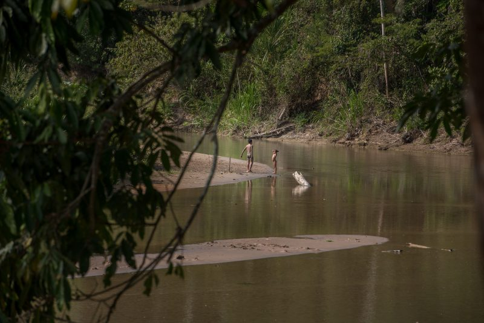
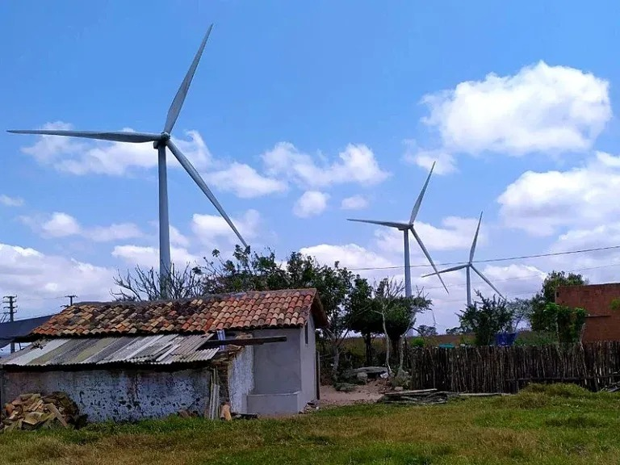

# A Modernidade, a Geografia e a Relação Sociedade-Natureza {#02-sociedade-natureza-a-modernidade-a-geografia-e-a-relação-sociedadenatureza}

A relação sociedade-natureza pode ser estudada pela forma como diferentes grupos conhecem, utilizam e transformam o ambiente. O conhecimento científico, as técnicas produtivas e as instituições participam dessa relação. A modernidade ampliou a capacidade de intervenção sobre o território e consolidou separações entre campos de conhecimento que continuam presentes em diagnósticos ambientais.

::: {.callout-note title="O que você vai aprender neste capítulo"}
O capítulo desenvolve a interpretação histórica das formas de apropriação da natureza e de seus efeitos territoriais. O estudante deve relacionar ideias sobre progresso, propriedade e domínio técnico às decisões de uso da terra, reconhecendo os interesses e os limites de cada interpretação.
:::

::: {.callout-tip title="Revisando o que você precisa saber"}
A discussão parte da formação do pensamento geográfico, da distinção entre processos naturais e relações sociais e do papel das técnicas na produção do espaço. Processos como infiltração, erosão e evapotranspiração mantêm propriedades físicas próprias e respondem às condições produzidas pelo manejo e pela infraestrutura.
:::

## Vocabulário Técnico e Conceitos-Chave do Capítulo

| **Termo / Conceito** | **Definição Operacional em Análise Ambiental** |
|:---|:---|
| **Modernidade** | Projeto histórico, filosófico, científico e econômico consolidado a partir dos séculos XVI-XVIII, marcado pela crença no progresso linear, na ciência mecanicista e no domínio técnico da natureza. |
| **Ruptura cartesiana** | Separação filosófica entre sujeito pensante (*res cogitans* / sociedade) e matéria externa (*res extensa* / natureza), convertendo o mundo natural em objeto passivo de controle. |
| **Natureza como construção social** | Compreensão de que, além de existir materialmente, a ideia do que seja “natureza” é cultural e historicamente instituída por cada sociedade (Porto-Gonçalves, 2006). |
| **Racionalidade instrumental** | Orientação da ciência e da técnica voltada ao cálculo de meios eficientes para maximizar controle e retorno econômico, subordinando valores éticos, sociais e ecológicos. |
| **Recurso natural** | Elemento ou processo da natureza que só adquire essa condição quando apropriado e valorizado por um sistema técnico, econômico e político historicamente determinado. |
| **Apropriação da natureza** | Processo social, técnico e jurídico pelo qual grupos humanos controlam, transformam e extraem valor de solos, águas, ventos, biota e subsolo. |
| **Conflito socioambiental** | Disputa territorial entre grupos sociais portadores de lógicas distintas de uso, apropriação, acesso e significação dos bens naturais e do espaço geográfico. |
| **Produção do espaço** | Processo contínuo de transformação material e simbólica da superfície terrestre pela ação social mediada pela técnica, pelo trabalho e pelas relações de poder. |
| **Abordagem socioambiental** | Perspectiva geográfica formulada por Mendonça (2001) que integra de modo indissociável a dinâmica físico-natural e a organização socioespacial, incorporando conflitos e vulnerabilidades. |

## Formação Histórica da Questão Ambiental na Modernidade

A forma como hoje falamos em “meio ambiente”, “recursos naturais” ou “impacto ambiental” não existiu sempre do mesmo modo. Ela é fruto de uma longa transformação histórica iniciada na transição da Idade Média para a **Modernidade** europeia, intensificada pela expansão marítimo-colonial a partir do final do século XV, pela Revolução Científica dos séculos XVI e XVII e pela Revolução Industrial a partir do século XVIII.

Durante esse processo, alterou-se profundamente tanto a base material da produção quanto a visão de mundo que legitimava a intervenção humana sobre o planeta. A expansão colonial incorporou vastos territórios das Américas, da África e da Ásia às rotas comerciais europeias, reorganizando ecossistemas inteiros em torno de produtos primários (açúcar, metais preciosos, madeira, algodão, café). Na etapa industrial, o uso massivo de combustíveis fósseis (inicialmente o carvão mineral e, depois, o petróleo) rompeu a dependência exclusiva da força muscular, animal e hidráulica local, multiplicando em escala sem precedentes a capacidade humana de alterar relevos, cursos d’água, solos e atmosfera.

### A Ruptura Cartesiana entre Sociedade e Natureza

Essa transformação material foi acompanhada e filosoficamente legitimada por uma mudança radical no modo de pensar. Filósofos e cientistas fundadores da ciência moderna, como Francis Bacon e René Descartes, consolidaram uma concepção mecanicista do mundo. Na formulação cartesiana, estabeleceu-se uma cisão ontológica entre o sujeito racional humano (*res cogitans*) e a matéria extensa (*res extensa*), isto é, a natureza externa.

A natureza deixou de ser percebida como um todo vivo do qual os seres humanos eram parte integrante e passou a ser comparada a uma grande máquina regida por leis matemáticas decifráveis. Conhecer a natureza passou a significar **dominá-la, controlá-la e submetê-la** aos desígnios humanos. Essa **ruptura moderna entre sociedade e natureza** produziu três consequências decisivas para a Análise Ambiental,

**Externalização da natureza.** O ser humano passou a conceber-se fora e acima do mundo natural, tratando rios, florestas e solos como objetos externos disponíveis à exploração. **Fragmentação científica.** O conhecimento dividiu-se em dois blocos separados, as ciências da natureza (dedicadas ao mundo físico-biológico) e as ciências humanas (dedicadas à cultura e à economia). **Dicotomia interna da Geografia.** Ao se institucionalizar como ciência moderna no século XIX, a própria Geografia absorveu essa fratura, dividindo-se frequentemente entre uma Geografia Física voltada às leis naturais e uma Geografia Humana focada na sociedade, com dificuldade histórica de integrá-las.

A separação entre sujeito e objeto influenciou a divisão do trabalho científico e a organização das interpretações ambientais (@fig-sociedade-natureza). O percurso esquemático ajuda a reconhecer como a abordagem socioambiental passa a articular processos naturais, organização social e conflitos territoriais.

{#fig-sociedade-natureza fig-alt="Três quadros conectados mostrando ruptura cartesiana, Geografia dicotômica e abordagem socioambiental"}

## A Natureza como Construção Social e Histórica (Porto-Gonçalves, 2006)

Nas páginas 8 a 36 de *Os (des)caminhos do meio ambiente* (2006), Carlos Walter Porto-Gonçalves desenvolve uma tese central para a formação em Geografia, **toda sociedade e toda cultura cria, inventa e institui uma determinada ideia do que seja a natureza**. Essa afirmação merece atenção rigorosa para não ser mal interpretada.

Dizer que a natureza é uma *construção social e histórica* não significa negar a existência material da chuva, das rochas, da gravidade ou dos processos biológicos. Significa reconhecer que o modo como os seres humanos percebem, classificam, valorizam e se relacionam com esses elementos varia profundamente ao longo da história e entre diferentes culturas. Na Grécia Antiga pré-socrática, por exemplo, a noção de *physis* integrava a dimensão física e a existência humana em um mesmo fluxo; na concepção indígena ou de muitas comunidades tradicionais brasileiras, rios, serras e matas são territórios de vida, memória e pertencimento coletivo; já na modernidade capitalista, a natureza é reduzida predominantemente a mercadoria ou a obstáculo técnico a ser removido.

Porto-Gonçalves (2006) chama atenção para um paradoxo revelador da modernidade, ao mesmo tempo em que o sistema urbano-industrial intensificou a devastação de ecossistemas para expandir a produção de mercadorias, construiu-se uma visão romantizada de “natureza intocada”, definida justamente pela ausência humana. Ambas as posturas (tanto a exploração predatória quanto o preservacionismo que expulsa populações tradicionais de seus territórios) compartilham a mesma raiz cartesiana, a ideia de que sociedade e natureza são polos excludentes.

::: {layout-ncol=2}
{#fig-cap2-potigua}

{#fig-cap2-minas}
:::

**Figura 2.0:** Construção social da natureza: territorialidade tradicional versus apropriação mercantil. *O que observar:* no painel esquerdo, comunidades indígenas e tradicionais articulam reprodução social, memória e conservação ambiental em um mesmo território vivido. No painel direito, a racionalidade instrumental separa sociedade e natureza, convertendo o relevo e o subsolo em frentes extrativas de alto impacto. Fonte: Acervo didático CHF662.

| **Matriz Histórico-Cultural** | **Ideia Instituída de Natureza** | **Relação Sociedade-Natureza** | **Expressão Espacial Típica** |
|:---|:---|:---|:---|
| **Visões pré-modernas e povos tradicionais** | Totalidade viva, sagrada ou território de reprodução comunitária. | Pertencimento mútuo; limites simbólicos e ecológicos ao uso. | Manejo adaptado a ciclos sazonais (por exemplo, áreas de uso comum no Semiárido). |
| **Modernidade cartesiana e industrial** | Máquina externa, matéria mensurável, estoque de recursos. | Separação sujeito-objeto; dominação técnica e exploração contínua. | Grandes obras, monoculturas, urbanização acelerada e degradação difusa. |
| **Preservacionismo excludente** | “Natureza intocada”, pura somente onde não há presença humana. | Oposição rígida, toda presença social é vista como ameaça uniforme. | Ilhas de proteção desconectadas do entorno e conflitos com comunidades locais. |
| **Perspectiva socioambiental crítica** | Realidade material e construção histórico-cultural inseparável da sociedade. | Coexistência conflituosa e dinâmica mediada por poder, técnica e cultura. | Planejamento integrado, conservação com justiça territorial e convivência regional. |

**Tabela 2.1,** Síntese histórica das concepções de natureza e suas implicações socioespaciais (elaborada com base em Porto-Gonçalves, 2006, p. 8 a 36).

## Apropriação dos Recursos Naturais e Racionalidade Instrumental

Sob a modernidade capitalista, os elementos biofísicos da superfície terrestre passam por um processo sistemático de conversão em **recursos naturais**. Esse detalhe conceitual é decisivo na Geografia, a água, o vento, o solo ou um mineral existem independentemente da economia, mas só se tornam “recursos” quando um grupo social dispõe de técnica, demanda econômica e respaldo jurídico-político para se apropriar deles.

Assim, a **apropriação dos recursos naturais** é sempre guiada por uma **racionalidade instrumental**, a técnica é mobilizada não apenas para satisfazer necessidades humanas básicas, mas para acelerar o giro do capital, ampliar a escala de extração e reduzir custos privados de produção. Disso decorre um descompasso estrutural entre duas temporalidades,

**Tempo do capital (rápido e linear).** Exige retorno financeiro em poucos anos, colheitas sucessivas, ampliação rápida de redes energéticas e expansão contínua sobre novas fronteiras de terra e água. **Tempo da natureza (lento e cíclico).** Envolve décadas para regeneração florestal da Caatinga e do Cerrado, séculos para formação de centímetros de solo fértil e ciclos plurianuais de recarga de aquíferos subterrâneos.

{#fig-temporalidades}

## Natureza, Recurso Natural e Mercadoria, Por que a Distinção Importa?

Ao redigir diagnósticos ambientais, o(a) geógrafo(a) deve distinguir três níveis, (1) o **elemento natural** em sua dinâmica biofísica (por exemplo, o regime de ventos nas serras do Semiárido ou a água infiltrada em um aquífero); (2) o **recurso natural**, quando incorporado por técnicas e finalidades sociais específicas (por exemplo, potencial eólico mapeado para geração elétrica ou água captada para irrigação); e (3) a **mercadoria**, quando esse recurso é apropriado privadamente e submetido à lógica de compra, venda e especulação. Grande parte dos conflitos socioambientais nasce exatamente quando um bem essencial à reprodução comunitária é transformado em mercadoria excludente.

## Conflitos Socioambientais e Produção do Espaço na Bahia e no Nordeste

A apropriação desigual dos recursos naturais nunca ocorre em um espaço vazio. Todo território já é ocupado, manejado e significado por diferentes grupos sociais (comunidades camponesas, quilombolas, indígenas, pescadores artesanais, agricultores familiares, moradores urbanos, empresas e Estado). Quando um empreendimento ou política altera a qualidade do solo, o regime das águas, o acesso à terra ou o modo de vida local em benefício de determinados agentes e em prejuízo de outros, emergem **conflitos socioambientais**.

Um conflito socioambiental não é um mero erro de comunicação nem um entrave burocrático, trata-se de uma disputa concreta pela **produção do espaço geográfico**, na qual diferentes atores defendem usos incompatíveis ou assimétricos para o mesmo território. No Nordeste brasileiro e, em especial, no estado da Bahia, quatro frentes exemplificam de maneira clara essa dinâmica,

**Expansão energética (parques eólicos no Semiárido Baiano).** A combinação entre ventos constantes nas serras e chapadas, topografia favorável e proximidade de linhas de transmissão transformou áreas da Caatinga baiana, como o eixo de Canudos e regiões serranas do interior (tema direto da Viagem de Campo da Semana 11), em polo de energia eólica. Embora frequentemente apresentada apenas como “energia limpa”, sua implantação territorial envolve abertura de acessos pesados, supressão vegetal, compactação e erosão na base das torres, ruído contínuo, interferência sobre a avifauna local e conflitos fundiários e contratuais com comunidades rurais (como áreas tradicionais de fundo de pasto).

::: {layout-ncol=2}
{#fig-conflito-a}

{#fig-conflito-b}

{#fig-conflito-c}

{#fig-conflito-d}
:::

**Figura 2.2:** Conflitos socioambientais e produção do espaço na Bahia e no Nordeste. *O que observar:* os painéis A, B e C exemplificam disputas territoriais envolvendo transição energética em áreas rurais, barramento hidrelétrico e expansão da fronteira agrícola irrigada. Em contrapartida, o painel D destaca tecnologias sociais descentralizadas de captação de água da chuva voltadas à autonomia hídrica comunitária. Fonte: Acervo didático CHF662 e Wikimedia Commons (CC BY/CC BY-SA).

**Barragens e grandes empreendimentos hídricos.** A construção de reservatórios de grande porte e projetos de regularização fluvial no Nordeste e na bacia do rio São Francisco reconfigurou profundamente vales inteiros. Ao lado da geração hidrelétrica e da oferta de água para polos irrigados, esses projetos frequentemente implicaram o alagamento de terras férteis de vazante, o deslocamento compulsório de populações ribeirinhas, a alteração do regime natural de cheias e vazantes e mudanças na dinâmica hidrossedimentológica a jusante (com impacto sobre a pesca artesanal e a erosão marginal).

**Fronteira agrícola (Oeste Baiano / domínio do Cerrado).** A expansão acelerada da agricultura mecanizada intensiva sobre os chapadões do Oeste Baiano reestruturou a economia regional, mas gerou forte pressão sobre a vegetação nativa de Cerrado, sobre áreas estratégicas de recarga hídrica (associadas ao sistema Aquífero Urucuia) e sobre vazões de rios afluentes. Esse avanço desencadeou disputas territoriais pelo uso da terra e da água envolvendo comunidades tradicionais geraizeiras e de fecho de pasto.

**Acesso desigual à água no Semiárido.** Historicamente, políticas centradas no “combate à seca” privilegiaram grandes açudes e obras concentradas em propriedades privadas ou voltadas a setores econômicos específicos, mantendo populações rurais dependentes de carros-pipa em períodos de estiagem. Em contraposição, movimentos sociais, universidades e instituições públicas vêm consolidando estratégias de **convivência com o Semiárido**, articulando tecnologias sociais descentralizadas (como cisternas de captação de água de chuva), manejo conservacionista do solo e democratização da gestão hídrica.

| **Frente Espacial (BA/NE)** | **Recurso Apropriado** | **Atores em Disputa** | **Impactos Físico-Bióticos Associados** | **Tensão Socioespacial Central** |
|:---|:---|:---|:---|:---|
| **Expansão eólica (Semiárido)** | Vento, serras e áreas de Caatinga. | Empresas de energia, proprietários, comunidades rurais e fundo de pasto. | Supressão vegetal, erosão na base das torres, compactação de acessos e impacto na avifauna. | Contratos de arrendamento assimétricos, ruído e restrição de usos comuns. |
| **Barragens e obras hídricas** | Vazão fluvial, vales aluviais e energia potencial. | Setor elétrico/irrigação, Estado e populações ribeirinhas/pescadores. | Submersão de várzeas, alteração do regime fluvial e retenção de sedimentos. | Deslocamento compulsório, perda de terras de vazante e desestruturação comunitária. |
| **Fronteira agrícola (Oeste Baiano)** | Solos planos de Cerrado e águas superficiais/subterrâneas. | Agronegócio mecanizado, Estado e comunidades geraizeiras/fecho de pasto. | Desmatamento de áreas de recarga, alta extração hídrica e exposição edáfica. | Cercamento de terras tradicionais e conflito pela disponibilidade hídrica. |
| **Acesso à água (Semiárido)** | Águas superficiais, nascentes e reservatórios. | Grandes usuários, poder público e agricultores familiares. | Assoreamento, degradação ciliar e sobre-exploração em estiagens. | Concentração hídrica (“combate à seca”) vs. democratização (“convivência”). |

**Tabela 2.2,** Matriz analítica de conflitos socioambientais representativos da Bahia e do Nordeste na perspectiva da produção do espaço geográfico.

## Introdução à Abordagem Socioambiental na Geografia (Mendonça, 2001)

Diante das limitações do dualismo cartesiano e da intensidade dos conflitos territoriais contemporâneos, a Geografia brasileira desenvolveu esforços consistentes para superar a separação entre o estudo da natureza e o estudo da sociedade. Um marco fundamental desse movimento é o artigo *Geografia socioambiental*, publicado por Francisco Mendonça na revista *Terra Livre* (n. 16, 2001, p. 139 a 158).

Mendonça (2001) questiona o uso genérico do termo “ambiental” quando este aparece reduzido exclusivamente à esfera natural (relevo, clima, fauna, flora), sem incorporar os sujeitos históricos, a desigualdade social e as relações de poder. Por isso, o autor defende a adoção deliberada do prefixo **“socio-”** na expressão **Geografia Socioambiental**, trata-se de afirmar, desde a própria denominação, que os problemas ambientais só podem ser compreendidos na interação dialética entre natureza e sociedade.

Essa introdução à abordagem socioambiental estabelece três princípios metodológicos que serão aprofundados no Capítulo 3,

**Superação da dicotomia físico-humano.** Não se trata de anular as especificidades da geomorfologia, da climatologia ou da geografia agrária, mas de articulá-las diante de problemas concretos em que processos naturais e sociais se co-produzem. **Centralidade da sociedade na problemática ambiental.** Enchentes urbanas, erosão acelerada, desertificação ou escassez hídrica não atingem todos os grupos sociais igualmente; sua gravidade depende da vulnerabilidade social e da organização desigual do espaço.

**Compromisso com o diagnóstico e a intervenção territorial.** A Geografia Socioambiental combina rigor teórico-metodológico com relevância social, orientando diagnósticos ambientais que subsidiem políticas públicas, licenciamento e recuperação de áreas degradadas.

## Ponte Direta para o Estudo Orientado 1 (EO1) e o Capítulo 3

O **Estudo Orientado 1 (EO1)** avalia sua capacidade de articular a leitura de Porto-Gonçalves (2006, p. 8 a 36) e a introdução a Mendonça (2001). Ao redigir seu texto, mostre com clareza, (1) como a modernidade separou sociedade e natureza; (2) por que a ideia de natureza é historicamente construída; (3) como a apropriação instrumental dos recursos produz conflitos socioambientais concretos; e (4) por que a abordagem socioambiental supera visões puramente naturalistas. No Capítulo 3, você aprofundará o texto de Mendonça (2001) junto ao modelo geográfico de Bertrand (2004).

## Conhecimento, apropriação e conflito no uso da água

Uma barragem modifica o armazenamento e a circulação da água, mas sua análise também envolve a definição das prioridades de uso. A cota de operação, os períodos de liberação e as regras de acesso aos pontos de captação resultam de decisões institucionais. Essas decisões alteram as condições de pesca, abastecimento, irrigação e produção de energia, com efeitos diferentes sobre grupos situados a montante e a jusante.

O estudo de um conflito exige reconstruir essas relações. A caracterização física deve informar o comportamento das vazões e os períodos de menor disponibilidade, enquanto a investigação social identifica os usuários, as formas de acesso e as instâncias de negociação. Entrevistas precisam registrar a posição e o período de observação de cada participante, permitindo distinguir experiência local, interpretação e informação documental.

A explicação final articula o funcionamento hídrico às regras que distribuem seu uso. Uma estiagem pode reduzir a oferta, enquanto desigualdades na infraestrutura e nas autorizações ampliam seus efeitos sobre determinados usuários. Essa relação permite formular intervenções mais precisas, como melhorar a captação, rever regras de alocação ou recuperar áreas que contribuem para a qualidade da água.

## Exemplos resolvidos

*Nota metodológica,* Os casos abaixo combinam processos espaciais reais da Bahia e do Nordeste com **cenários didáticos ilustrativos** (números, nomes de localidades e parâmetros estilizados) criados para exercitar a análise crítica baseada em Porto-Gonçalves (2006) e Mendonça (2001).

::: {.callout-tip appearance="simple"}
### Exemplo 2.1, Básico. Identificando o Dualismo Cartesiano em um Relatório Ambiental

**Situação analisada.** Para criar uma unidade de conservação de proteção integral em uma serra fictícia da Bahia *(cenário didático ilustrativo)*, uma consultoria entregou um relatório técnico dividido em duas partes sem conexão, o Volume 1 descreve a flora e as nascentes como “patrimônio natural puro”, e o Volume 2 recomenda a retirada imediata de 35 famílias que vivem há três gerações na área praticando extrativismo de baixa intensidade e manejo comunitário de pastagens, classificando qualquer presença humana como “fator de destruição da natureza”.

**Dados disponíveis.** Relatório dividido em dois volumes isolados; idealização da área como “natureza pura”; recomendação de remoção de 35 famílias tradicionais sem avaliar seus modos históricos de manejo.

**Problema a resolver.** Identificar qual concepção de natureza fundamenta o relatório à luz de Porto-Gonçalves (2006) e explicar por que essa postura reproduz o dualismo moderno.

**Fundamento da análise.** Análise epistemológica das concepções de natureza e do paradoxo preservacionista excludente em Porto-Gonçalves (2006, p. 8 a 36).

**Desenvolvimento.**

**Identificação da concepção subjacente.** O relatório adota o mito da “natureza intocada”, definindo o natural exclusivamente pela ausência de seres humanos. **Raiz cartesiana (Porto-Gonçalves, 2006).** Embora aparente opor-se à exploração predatória, essa visão parte da mesma ruptura moderna que separa rigidamente sociedade e natureza em polos excludentes. **Equívoco geográfico e social.** Ao tratar todas as formas de presença humana como igualmente destrutivas, a consultoria ignora que os modos de manejo tradicional dessas 35 famílias podem ter contribuído justamente para conservar a cobertura vegetal e as nascentes ao longo de gerações, gerando um conflito socioambiental desnecessário.

**Interpretação do resultado.** O relatório fundamenta-se na concepção dicotômica da “natureza intocada”, herdeira da ruptura cartesiana entre sociedade e natureza, ao opor automaticamente conservação ambiental e presença de populações tradicionais.

**Condições de validade.** A crítica é coerente com a Análise Ambiental contemporânea, conservar nascentes exige avaliar empiricamente o impacto real de cada prática de uso da terra, diferenciando manejo comunitário de baixo impacto de pressões predatórias externas.
:::

::: {.callout-tip appearance="simple"}
### Exemplo 2.2, Básico. Da Natureza ao Recurso Natural, o Vento nas Serras do Semiárido

**Situação analisada.** Durante décadas, os ventos intensos que sopram no topo de uma serra da Caatinga *(cenário didático ilustrativo)* eram percebidos pelos moradores locais apenas como parte do clima cotidiano, influenciando a secagem do solo e o manejo dos rebanhos em áreas de uso comum. Nos últimos cinco anos, após o avanço de turbinas de grande porte, o mapeamento anemométrico e a instalação de uma subestação elétrica próxima, o mesmo vento passou a atrair grandes investimentos e contratos de arrendamento de terras para implantação de um complexo eólico.

**Dados disponíveis.** Elemento biofísico preexistente, regime de ventos intensos na serra. Novos fatores históricos/técnicos, aerogeradores de grande porte, mapeamento de potencial eólico e proximidade de linhas de transmissão. Consequência, revalorização fundiária e contratos de arrendamento.

**Problema a resolver.** Explicar, com base na distinção entre *elemento natural* e *recurso natural*, por que o vento adquiriu valor econômico territorial apenas recentemente e quais tensões socioambientais podem emergir.

**Fundamento da análise.** Análise geográfica do processo de apropriação dos recursos naturais e da produção do espaço sob racionalidade instrumental.

**Desenvolvimento.**

**De elemento natural a recurso.** O vento sempre existiu fisicamente na serra, mas só se converteu em *recurso energético* quando condições técnicas (aerogeradores), infraestruturais (linhas de transmissão) e econômicas (mercado de energia) permitiram sua apropriação rentável. **Reconfiguração espacial.** A implantação das torres exige estradas de acesso largas, bases de concreto e faixas de servidão, o que altera a cobertura de Caatinga, expõe o solo à erosão na base das torres e interfere na avifauna.

**Tensões socioambientais emergentes.** O cercamento de áreas antes usadas coletivamente, a assimetria na negociação de contratos de arrendamento e o desconforto acústico próximo às moradias transformam um projeto de “energia renovável” em arena de conflito territorial se não houver planejamento socioambiental justo.

**Interpretação do resultado.** O vento tornou-se recurso natural apenas quando incorporado por um conjunto técnico, infraestrutural e econômico específico; sua apropriação reorganiza o território da serra e pode gerar impactos físicos e conflitos fundiários com comunidades locais.

**Condições de validade.** O exemplo demonstra uma lição-chave para a viagem de campo da Semana 11 (eixo de Canudos), ser fonte renovável não torna um empreendimento isento de impactos ambientais ou conflitos territoriais.
:::

::: {.callout-tip appearance="simple"}
### Exemplo 2.3, Intermediário. Balanço Hídrico Didático e Conflito Socioambiental em Açude Semiárido

**Situação analisada.** Em uma microbacia semiárida fictícia *(cenário didático ilustrativo)*, um açude público possui volume útil estimado de $120.000\text{ m}^3$ ao final da estação chuvosa, destinado a atender à demanda de 8 meses de estiagem (240 dias). O reservatório abastece 250 famílias de agricultores familiares (consumo médio estimado de $0,5\text{ m}^3/\text{dia}$ por família para usos domésticos e dessedentação de pequenos animais) e também passou a sofrer captação de um empreendimento privado de irrigação intensiva instalado a montante, que demanda $450\text{ m}^3/\text{dia}$. Desconsidere, neste exercício inicial, a evaporação direta para focar no balanço das demandas humanas.

**Dados disponíveis.** Volume útil disponível, $V_{\text{disp}} = 120.000\text{ m}^3$; período de estiagem, $T = 240\text{ dias}$; demanda comunitária, $250\text{ famílias} \times 0,5\text{ m}^3/(\text{família}\cdot\text{dia})$; demanda do empreendimento privado, $450\text{ m}^3/\text{dia}$.

**Problema a resolver.** (a) Calcular a demanda total de cada grupo nos 240 dias e verificar se o volume disponível suporta ambos os usos simultaneamente; (b) interpretar o resultado como um conflito socioambiental pelo acesso à água.

**Fundamento da análise.** Cálculo passo a passo de balanço volumétrico simples ($V = Q \times T$) articulado à análise geográfica de conflitos socioambientais e racionalidade instrumental.

**Desenvolvimento.**

**Demanda diária e total das 250 famílias comunitárias,**

$$

Q_{\text{fam}} = 250 \times 0{,}5 = 125\text{ m}^3/\text{dia}

$$

$$

V_{\text{fam}} = 125\text{ m}^3/\text{dia} \times 240\text{ dias} = 30.000\text{ m}^3

$$

. **Demanda total do empreendimento privado de irrigação,**

$$

V_{\text{priv}} = 450\text{ m}^3/\text{dia} \times 240\text{ dias} = 108.000\text{ m}^3

$$

. **Demanda conjunta e saldo hídrico,**

$$

V_{\text{total}} = V_{\text{fam}} + V_{\text{priv}} = 30.000 + 108.000 = 138.000\text{ m}^3

$$

$$

\text{Saldo} = V_{\text{disp}} - V_{\text{total}} = 120.000 - 138.000 = -18.000\text{ m}^3 \quad (\text{déficit de } 18.000\text{ m}^3)

$$

. **Participação percentual nas demandas,** As 250 famílias respondem por $\frac{30.000}{138.000} \times 100\% \approx 21,7\%$ da demanda total (e consumiriam apenas $25\%$ do volume útil do açude), enquanto o único empreendimento privado responde por $\frac{108.000}{138.000} \times 100\% \approx 78,3\%$ (exigindo sozinho $90\%$ de toda a água armazenada). **Interpretação socioambiental.** O déficit de $18.000\text{ m}^3$ não decorre de falta absoluta de água para a população local (o açude atenderia quatro vezes a necessidade básica das 250 famílias), mas da apropriação concentrada do recurso sob racionalidade instrumental. Como a evaporação real no Semiárido ainda reduziria o volume disponível, o colapso do abastecimento humano ocorreria ainda antes do fim dos 240 dias.

**Interpretação do resultado.** As demandas somam $138.000\text{ m}^3$ frente a $120.000\text{ m}^3$ disponíveis, gerando déficit de $18.000\text{ m}^3$. O empreendimento privado concentra $78,3\%$ da demanda, caracterizando um conflito socioambiental distributivo pelo uso da água.

**Condições de validade.** Verificação física e institucional, a soma $30.000 + 108.000 = 138.000\text{ m}^3$ confirma o déficit; além disso, pela Política Nacional de Recursos Hídricos (Lei nº 9.433/1997), em situações de escassez, o uso prioritário dos recursos hídricos é o consumo humano e a dessedentação de animais, o que reforça a ilegitimidade de sacrificar o abastecimento das 250 famílias.
:::

::: {.callout-tip appearance="simple"}
### Exemplo 2.4, Intermediário. Expansão da Fronteira Agrícola e Abordagem Socioambiental no Cerrado Baiano

**Situação analisada.** Em uma sub-bacia fictícia de chapadão no Oeste Baiano *(cenário didático ilustrativo)*, com área total de $40.000\text{ ha}$, o mapeamento de cobertura vegetal mostrou que, em 15 anos, a vegetação nativa de Cerrado reduziu-se de $32.000\text{ ha}$ para $14.000\text{ ha}$, substituída por lavouras mecanizadas irrigadas por pivôs centrais. Paralelamente, comunidades de fecho de pasto situadas nos vales a jusante relatam redução na vazão de veredas que utilizavam para cultivo de subsistência e criação extensiva.

**Dados disponíveis.** Área da sub-bacia, $40.000\text{ ha}$; Cerrado nativo caiu de $32.000\text{ ha}$ para $14.000\text{ ha}$ em 15 anos; expansão de pivôs centrais no topo do chapadão; redução de vazão em veredas usadas por comunidades de fecho de pasto a jusante.

**Problema a resolver.** (a) Calcular a área convertida e o percentual da sub-bacia que perdeu vegetação nativa nesse intervalo; (b) construir uma leitura integrada do caso segundo a Geografia Socioambiental de Mendonça (2001).

**Fundamento da análise.** Quantificação da conversão de cobertura vegetal seguida de análise dialética entre dinâmica físico-hidrológica (recarga no chapadão e descarga nas veredas) e conflito territorial (Mendonça, 2001).

**Desenvolvimento.**

**Quantificação da perda de Cerrado,**

$$

\Delta A = 14.000 - 32.000 = -18.000\text{ ha}

$$

 Percentual da sub-bacia convertido no período, $\frac{18.000}{40.000} \times 100\% = 45,0\%$ da área total. Percentual de perda sobre o Cerrado inicial, $\frac{18.000}{32.000} \times 100\% = 56,25\%$ da vegetação nativa existente no início do período. **Leitura físico-hidrológica integrada.** Os chapadões arenosos do Cerrado funcionam como áreas estratégicas de infiltração e recarga subterrânea que alimentam nascentes e veredas nos vales. A conversão de $45\%$ da sub-bacia associada à captação intensiva por pivôs centrais altera o balanço hídrico local e reduz a contribuição para os cursos d’água a jusante.

**Leitura socioambiental (Mendonça, 2001).** Uma análise puramente física mediria apenas a vazão das veredas, e uma análise puramente social descreveria apenas a disputa por terras sem compreender a conectividade hidrológica entre chapadão e vale. A Geografia Socioambiental une ambos os planos, demonstra que a produção do espaço pelo agronegócio intensivo no topo da bacia transfere custos hídricos e vulnerabilidade social para as comunidades tradicionais nos fundos de vale.

**Interpretação do resultado.** Foram convertidos $18.000\text{ ha}$ ($45,0\%$ da sub-bacia e $56,25\%$ do Cerrado inicial). Sob a Geografia Socioambiental (Mendonça, 2001), o rebaixamento das veredas evidencia a inseparabilidade entre conectividade hidrológica chapadão-vale e apropriação desigual do território.

**Condições de validade.** Os cálculos fecham ($32.000 - 18.000 = 14.000\text{ ha}$, restando $35\%$ da sub-bacia com Cerrado nativo), e a interpretação respeita a lógica de bacia hidrográfica ao conectar uso do solo em área de recarga com impactos socioespaciais a jusante.
:::

::: {.callout-tip appearance="simple"}
### Exemplo 2.5, Avançado. Barragem Fluvial, Descompasso de Temporalidades e Conflito Territorial

**Situação analisada.** A construção de uma barragem de médio porte em um vale fluvial nordestino *(cenário didático ilustrativo)* regularizou a vazão do rio para garantir geração elétrica e fornecimento constante a um perímetro agroindustrial. Cinco anos após o enchimento do reservatório, observam-se três efeitos encadeados, (i) comunidades ribeirinhas reassentadas em terrenos secos afastados do rio perderam a prática secular da agricultura de vazante; (ii) a retenção de sedimentos no reservatório reduziu a deposição natural de nutrientes nas várzeas a jusante e intensificou a erosão das margens; e (iii) a pesca artesanal declinou devido à barreira física à migração de peixes e à homogeneização do pulso de cheias.

**Dados disponíveis.** Obra de regularização fluvial voltada à geração elétrica e irrigação intensiva; três efeitos após 5 anos, perda da agricultura de vazante pós-reassentamento, retenção de sedimentos com erosão marginal a jusante e declínio da pesca artesanal.

**Problema a resolver.** Analisar o caso integrando, (a) a racionalidade instrumental e o descompasso entre tempo do capital e tempo ecológico; (b) a concepção de natureza subjacente à obra (Porto-Gonçalves, 2006); e (c) diretrizes de diagnóstico sob a ótica da Geografia Socioambiental (Mendonça, 2001).

**Fundamento da análise.** Síntese teórico-metodológica articulando Porto-Gonçalves (2006, p. 8 a 36), Mendonça (2001) e processos hidrossedimentológicos fluviais básicos.

**Desenvolvimento.**

**Racionalidade instrumental e temporalidades.** O projeto tratou o rio sob o tempo linear e contínuo da produção industrial (vazão regularizada o ano inteiro), suprimindo o pulso sazonal de cheias e vazantes que estruturava tanto o ecossistema aquático (reprodução de peixes e renovação sedimentar das várzeas) quanto o calendário agrícola das famílias ribeirinhas. **Concepção moderna de natureza (Porto-Gonçalves, 2006).** O rio foi concebido como mera tubulação hidráulica ou estoque de energia potencial a ser domado pela engenharia, ignorando que, para os ribeirinhos, ele constitui um território de vida historicamente construído. O reassentamento em terras secas pressupôs que “qualquer lote de terra substitui outro”, apagando a especificidade ecológica e cultural da várzea.

**Diretrizes de diagnóstico socioambiental (Mendonça, 2001).** Um diagnóstico rigoroso deve, (a) avaliar a bacia inteira (montante, reservatório e jusante), incorporando o balanço de sedimentos e a estabilidade das margens; (b) mapear territorialidades tradicionais e dependência direta dos pulsos hidrológicos antes da decisão de licenciamento; (c) propor regras de operação de vazões ambientais (hidrograma ecológico) e medidas reais de reparação territorial e participação comunitária na gestão do reservatório.

**Interpretação do resultado.** O caso evidencia como a racionalidade instrumental transforma um sistema fluvial vivo em infraestrutura setorial, rompendo simultaneamente processos hidrossedimentológicos e modos de vida ribeirinhos; a Geografia Socioambiental exige diagnosticar a bacia de forma integrada e reconhecer os sujeitos territoriais afetados.

**Condições de validade.** A análise confirma a interdependência entre físico e social, a retenção de sedimentos pela barragem (processo geomorfológico) não só gera erosão marginal a jusante, como empobrece várzeas e compromete a segurança alimentar e a renda das comunidades.
:::

## Erros comuns de interpretação

::: {.callout-warning appearance="simple"}
### Erro 2.1, Confundir “Natureza como Construção Social” com Negação da Materialidade Física

**Equívoco frequente.** Interpretar a tese de Porto-Gonçalves (2006) como se a erosão, as chuvas ou os processos geológicos fossem apenas “invenções da mente humana” sem realidade material.

**Por que está incorreto.** A materialidade biofísica existe objetivamente e obedece a leis físicas, químicas e biológicas. O que é social e historicamente construído é a *ideia* de natureza, o significado cultural que lhe atribuímos e as formas técnicas e econômicas pelas quais a apropriamos e transformamos.

**Como evitar.** Afirme sempre a dupla dimensão, os processos naturais possuem dinâmica material própria, mas sua apropriação, valoração e interpretação são mediadas pela história e pela sociedade.
:::

::: {.callout-warning appearance="simple"}
### Erro 2.2, Tratar Conflitos Socioambientais como “Falta de Diálogo” ou “Resistência ao Progresso”

**Equívoco frequente.** Explicar a oposição de comunidades rurais ou ribeirinhas a grandes obras (barragens, parques energéticos, fronteira agrícola) como “desinformação” ou “atraso cultural”.

**Por que está incorreto.** Conflitos socioambientais expressam disputas concretas e legítimas por água, solo, território, saúde e reprodução social. Rotular populações afetadas como “contra o progresso” oculta assimetrias de poder e a distribuição desigual de custos e benefícios.

**Como evitar.** Identifique em todo conflito os atores envolvidos, os recursos disputados, os impactos físico-bióticos diferenciados e os projetos de território em confronto.
:::

::: {.callout-warning appearance="simple"}
### Erro 2.3, Reproduzir o Mito da “Natureza Intocada” na Conservação Ambiental

**Equívoco frequente.** Supor que toda presença humana degrada o ambiente na mesma medida e que conservar significa necessariamente esvaziar territórios de seus habitantes tradicionais.

**Por que está incorreto.** Como aponta Porto-Gonçalves (2006), essa postura reproduz a cisão cartesiana entre humano e natural, equiparando sistemas comunitários de baixo impacto a empreendimentos industriais de alta degradação.

**Como evitar.** Analise empiricamente as práticas reais de uso da terra e reconheça que populações tradicionais frequentemente atuam como guardiãs da sociobiodiversidade.
:::

::: {.callout-warning appearance="simple"}
### Erro 2.4, Reduzir a Geografia Socioambiental à Justaposição de Física e Humana

**Equívoco frequente.** Acreditar que aplicar Mendonça (2001) consiste em escrever uma seção sobre clima e solo e outra seção independente sobre população e economia.

**Por que está incorreto.** Justapor capítulos paralelos mantém intacta a dicotomia clássica da Geografia. A abordagem socioambiental exige mostrar como processos naturais e dinâmicas sociais interagem e se modificam reciprocamente no mesmo espaço.

**Como evitar.** Formule suas análises a partir de nexos causais integrados (por exemplo, como o modelo de ocupação de uma encosta ou bacia altera processos erosivos e concentra riscos sobre grupos vulneráveis).
:::

## Exercícios de fixação

#### Nível 1, Básicos (Compreensão Conceitual)

1. Explique em que consiste a *ruptura cartesiana* entre sociedade e natureza na modernidade e aponte uma consequência direta dessa cisão para a organização da Geografia clássica.

2. Com base em Porto-Gonçalves (2006, p. 8 a 36), esclareça o significado da afirmação de que a natureza é uma *construção social e histórica*, cuidando para não negar a materialidade dos processos físicos.

3. Diferencie *elemento natural* de *recurso natural*, ilustrando com um exemplo concreto da realidade baiana ou nordestina.

4. Explique o descompasso entre o *tempo do capital* e o *tempo da natureza* no contexto da racionalidade instrumental moderna.

5. Segundo Francisco Mendonça (2001), qual é a justificativa teórica e metodológica para o uso do prefixo “socio-” na expressão *Geografia Socioambiental*?

    #### Nível 2, Intermediários (Análise Crítica e Aplicação)

6. Analise o paradoxo apontado por Porto-Gonçalves (2006) entre a exploração predatória da natureza como mercadoria e a defesa de uma “natureza intocada” sem presença humana. O que essas duas visões têm em comum?

7. Escolha uma das quatro frentes de conflito socioambiental discutidas no capítulo (expansão eólica no Semiárido, barragens fluviais, fronteira agrícola no Oeste Baiano ou acesso desigual à água) e identifique, (a) o recurso apropriado; (b) os principais atores em disputa; e (c) dois impactos físico-bióticos articulados a efeitos sociais.

8. Em um cenário didático ilustrativo, um reservatório comunitário no Semiárido dispõe de $90.000\text{ m}^3$ de volume útil para 200 dias de estiagem. Duas demandas disputam essa água, 150 famílias que consomem $0,6\text{ m}^3/\text{dia}$ cada e um empreendimento externo que solicita autorização para captar $400\text{ m}^3/\text{dia}$. Calcule a demanda total de cada parte no período, verifique se há déficit e analise o caso sob a ótica dos conflitos socioambientais.

9. Diferencie as políticas históricas de “combate à seca” das estratégias contemporâneas de “convivência com o Semiárido”, relacionando essa distinção à racionalidade instrumental e à justiça socioambiental.

10. Elabore um parágrafo analítico demonstrando como a abordagem socioambiental (Mendonça, 2001) supera tanto o naturalismo redutor quanto o sociologismo que ignora o suporte físico-biótico do território.

    #### Nível 3, Aplicados e Objetivos (Múltipla Escolha)

11. Na análise de Porto-Gonçalves (2006, p. 8 a 36) sobre a formação histórica da questão ambiental na modernidade, a separação entre sociedade e natureza,

    (A) É uma característica biológica universal presente de forma idêntica em todas as culturas humanas desde a pré-história.

    (B) Consolida-se historicamente com o pensamento moderno-cartesiano, instituindo a natureza como objeto externo e passivo a ser dominado pela ciência e pela técnica.

    (C) Foi completamente superada pela Revolução Industrial, que reintegrou o ritmo produtivo das fábricas aos ciclos lentos dos ecossistemas.

    (D) Refere-se exclusivamente à divisão administrativa entre zonas urbanas e zonas rurais nos municípios brasileiros.

    (E) Impediu o desenvolvimento das ciências da natureza, pois o mecanicismo cartesiano rejeitava qualquer estudo matemático do mundo físico.

12. Sobre o processo pelo qual um elemento biofísico passa a ser tratado como *recurso natural*, é **correto** afirmar que,

    (A) Todo elemento físico da crosta terrestre é automaticamente um recurso econômico, independentemente da técnica ou da organização social existente.

    (B) A transformação de elementos da natureza em recursos naturais depende de condições técnicas, econômicas, culturais e políticas historicamente situadas.

    (C) Recursos renováveis, como o vento e a energia solar, jamais geram impactos ambientais ou conflitos territoriais quando apropriados em larga escala.

    (D) A apropriação de recursos naturais sob racionalidade instrumental respeita integralmente o tempo geológico de formação dos solos e de recarga dos aquíferos.

    (E) A noção de recurso natural é neutra e alheia às disputas fundiárias ou à produção do espaço geográfico.

13. No contexto da Bahia e do Nordeste, a expansão de parques eólicos em áreas serranas da Caatinga exemplifica um conflito socioambiental porque,

    (A) A geração eólica produz grandes volumes de gases de efeito estufa diretamente na atmosfera do Semiárido durante a rotação das pás.

    (B) Embora utilize fonte renovável, a apropriação espacial das serras provoca supressão vegetal, erosão na base das torres, interferência na avifauna e tensões fundiárias com comunidades locais.

    (C) Os ventos do Semiárido são insuficientes para movimentar turbinas, tornando a região tecnicamente inviável para energia eólica.

    (D) As comunidades locais opõem-se por princípio a qualquer forma de energia elétrica, recusando-se a utilizar eletricidade em suas residências.

    (E) Os impactos físicos das obras restringem-se ao interior das subestações urbanas, sem atingir o relevo, os solos ou a vegetação da Caatinga.

14. De acordo com a proposta de *Geografia Socioambiental* formulada por Francisco Mendonça (2001),

    (A) O estudo ambiental deve restringir-se aos fenômenos climáticos e geomorfológicos naturais, evitando interferência de temas sociais e políticos.

    (B) A Geografia Física deve ser extinta dos cursos de graduação, pois apenas a análise econômica explica a degradação do espaço.

    (C) A incorporação do termo “socioambiental” busca superar a dicotomia físico-humano, compreendendo o ambiente a partir da interação indissociável entre natureza e sociedade.

    (D) Os desastres e a degradação ambiental atingem de maneira uniforme todas as classes sociais, independentemente da organização do território.

    (E) A abordagem socioambiental consiste em anexar um capítulo de demografia ao final de relatórios geomorfológicos sem estabelecer relações causais entre eles.

15. Em um cenário didático ilustrativo, uma comunidade tradicional de fundo de pasto e uma empresa agroindustrial disputam o uso das águas de um riacho que nasce em área de chapadão. A análise desse episódio como **conflito socioambiental** exige reconhecer que,

    (A) Trata-se apenas de um mal-entendido de comunicação que desaparece assim que a empresa apresentar seu catálogo comercial.

    (B) Existe confronto entre diferentes racionalidades, interesses e modos de apropriação do território e da água, com efeitos diretos sobre a dinâmica hidrológica e a reprodução social.

    (C) O conflito só tem relevância geográfica se houver alteração na precipitação média anual registrada na estação meteorológica mais próxima.

    (D) A solução técnica adequada consiste em transferir integralmente o controle da bacia ao agente de maior capacidade de investimento financeiro.

    (E) A análise deve desconsiderar o uso do solo na área de recarga do chapadão, pois a questão pertence exclusivamente ao direito privado.

## Questões de aplicação

16. **(Questão autoral, estilo ENADE / Concurso Ambiental)** Leia o excerto adaptado dos debates epistemológicos da Geografia contemporânea, *“Toda sociedade, toda cultura cria, inventa, institui uma determinada ideia do que seja a natureza. Nesse sentido, o conceito de natureza não é natural, sendo, na verdade, criado e instituído pelos homens.”* (em diálogo com Porto-Gonçalves, 2006). Com base nessa perspectiva e na formação histórica da questão ambiental na modernidade, assinale a alternativa **correta**,

    (A) A afirmação nega a existência física de processos geomorfológicos e hidrológicos, reduzindo o meio ambiente a uma ficção linguística sem base material.

    (B) A ideia moderna de natureza como objeto externo e dominável serviu de suporte ideológico à apropriação instrumental dos territórios e ao aprofundamento da crise ambiental.

    (C) A concepção cartesiana promoveu a reunificação harmoniosa entre cultura, religião, ecossistemas locais e economia industrial desde o século XVII.

    (D) O conceito de natureza permaneceu imutável desde a Antiguidade até o século XXI, alterando-se apenas a tecnologia empregada na agricultura.

    (E) A defesa de áreas naturais completamente isoladas da ação humana rompe definitivamente com a dicotomia moderna entre sociedade e natureza.

17. **(Questão autoral, estilo ENADE / Concurso Ambiental)** Considere a implantação de grandes barragens e a expansão da fronteira agrícola mecanizada em bacias hidrográficas do Nordeste brasileiro. Sob a perspectiva da produção do espaço geográfico e da Geografia Socioambiental (Mendonça, 2001), analise as proposições abaixo,

    I.  A regularização artificial de vazões por barragens pode alterar a dinâmica hidrossedimentológica a jusante e desestruturar modos de vida ribeirinhos baseados no pulso natural de cheias e vazantes.

    II.  A conversão acelerada de vegetação nativa em áreas de recarga hídrica conecta processos físico-hidrológicos a conflitos territoriais com comunidades situadas nos vales a jusante.

    III.  O descompasso entre o tempo acelerado de retorno do capital e o tempo lento de regeneração edáfica e hidrológica intensifica quadros de degradação e vulnerabilidade socioambiental.

    IV.  Por envolverem obras de infraestrutura autorizadas pelo Estado, grandes empreendimentos hídricos e agrícolas são tecnicamente neutros e não configuram conflitos socioambientais.

    Estão corretas apenas as proposições,

    (A) I e IV.

    (B) II e IV.

    (C) I, II e III.

    (D) II, III e IV.

    (E) I, III e IV.

18. **(Questão autoral, estilo ENADE / Concurso Ambiental)** Em um concurso para Geógrafo(a) de órgão ambiental estadual, solicitou-se a escolha da diretriz metodológica mais coerente com a abordagem socioambiental (Mendonça, 2001) para diagnosticar conflitos de uso da terra e escassez hídrica em uma bacia do Semiárido Baiano. A alternativa que atende rigorosamente a essa diretriz é,

    (A) Elaborar exclusivamente o mapeamento geomorfológico e climático da bacia, deixando as questões de acesso à água e posse da terra fora do escopo do relatório técnico.

    (B) Adotar o enfoque de “combate à seca” baseado unicamente em obras hidráulicas concentradas, dispensando o diagnóstico da cobertura vegetal e das práticas comunitárias.

    (C) Integrar o levantamento dos processos físico-bióticos (relevo, solos, vegetação e dinâmica hídrica) à análise das relações sociais, dos conflitos de uso dos recursos e das vulnerabilidades territoriais.

    (D) Substituir o levantamento de campo e os indicadores físicos por entrevistas de opinião, pois a abordagem socioambiental considera dispensáveis os dados da Geografia Física.

    (E) Aplicar o mesmo modelo produtivo mecanizado em toda a bacia para padronizar o uso do solo e eliminar diferenças culturais entre os moradores.

### Orientações para o Estudo Orientado 1 (EO1) e a Prova Dissertativa

O **EO1** (valor, $0,5$ ponto, entregue na Semana 2) exige leitura atenta de **Porto-Gonçalves (2006, p. 8 a 36)** e introdução a **Mendonça (2001)**. Para produzir uma resposta sólida no EO1 e na Prova Teórica (Semana 10),

1. **Evite resumos descritivos soltos.** Articule explicitamente a cadeia *modernidade $\rightarrow$ ruptura cartesiana $\rightarrow$ natureza como recurso/mercadoria $\rightarrow$ conflitos socioambientais $\rightarrow$ resposta da Geografia Socioambiental*.

2. **Dê concretude geográfica.** Sempre exemplifique conflitos socioambientais com processos reais da Bahia e do Nordeste (eólicas no Semiárido, barragens, Oeste Baiano ou acesso à água), sem inventar dados estatísticos.

3. **Use vocabulário preciso.** Distinga *elemento natural* de *recurso natural*, diferencie *construção social da ideia de natureza* de negação da materialidade física e justifique o papel do prefixo “socio-” em Mendonça (2001).

## Gabarito comentado {.unnumbered}

::: {.callout-tip collapse="true" title="Clique para abrir o Gabarito Comentado"}
### Resolução Comentada, Nível 1 (Questões 1 a 5)

1. **Ruptura cartesiana e Geografia clássica,** A ruptura cartesiana separou o sujeito racional humano (*res cogitans*, sociedade/cultura) da matéria externa (*res extensa*, natureza), concebendo a natureza como máquina passiva a ser dominada pela ciência e pela técnica. Na Geografia institucionalizada no século XIX, essa cisão manifestou-se na dicotomia entre uma Geografia Física voltada às leis naturais e uma Geografia Humana voltada à sociedade, muitas vezes desconectadas entre si.

2. **Natureza como construção social e histórica (Porto-Gonçalves, 2006),** Afirmar que a natureza é socialmente construída não significa negar a existência material de rios, rochas ou processos físicos, mas reconhecer que o modo como cada sociedade define, significa, valoriza e se relaciona com o mundo natural varia histórica e culturalmente, do pertencimento comunitário em povos tradicionais à mercantilização na modernidade capitalista.

3. **Elemento natural vs. recurso natural,** Um *elemento natural* existe pela dinâmica biofísica da Terra independentemente de sua exploração econômica (por exemplo, o regime de ventos nas serras da Caatinga ou as águas subterrâneas do Cerrado). Ele só se torna *recurso natural* quando um conjunto técnico, econômico e político o apropria e o valoriza para fins produtivos (por exemplo, instalação de parques eólicos com linhas de transmissão ou perfuração de poços para irrigação mecanizada).

4. **Tempo do capital vs. tempo da natureza,** Sob a racionalidade instrumental, o tempo econômico exige retorno rápido, intensificação contínua e expansão de fronteiras em poucos anos, ao passo que os processos ecológicos e pedogenéticos (formação do solo, regeneração da Caatinga, recarga de aquíferos) operam em escalas lentas de décadas ou séculos. Esse descompasso produz exaustão de solos, sobre-exploração hídrica e perda de resiliência ambiental.

5. **O prefixo “socio-” em Mendonça (2001),** Mendonça (2001) adota “Geografia Socioambiental” para enfatizar que a problemática ambiental não se reduz aos elementos físico-bióticos isolados, ela envolve indissociavelmente a sociedade, seus conflitos, suas desigualdades e o modo como o espaço é produzido e apropriado.

### Resolução Comentada, Nível 2 (Questões 6 a 10)

6. **Paradoxo da exploração predatória e da “natureza intocada” (Porto-Gonçalves, 2006),** Embora pareçam opostas, ambas as visões compartilham o mesmo fundamento cartesiano, separam rigidamente seres humanos e natureza. Enquanto o produtivismo exclui a natureza da esfera ética para explorá-la como mercadoria, o preservacionismo excludente exclui populações tradicionais da natureza ao presumir que qualquer presença humana é igualmente destrutiva.

7. **Análise de uma frente socioambiental (resposta-modelo, exemplo com expansão eólica no Semiárido),** (a) *Recurso apropriado,* regime de ventos e áreas serranas da Caatinga; (b) *Atores em disputa,* empresas geradoras de energia, proprietários de terra, Estado e comunidades rurais/de fundo de pasto; (c) *Impactos físico-bióticos articulados a efeitos sociais,* (1) abertura de acessos e supressão da Caatinga desencadeiam compactação e erosão na base das torres, degradando pastagens nativas usadas pelas famílias; (2) cercamento de áreas comuns e ruído contínuo restringem o uso comunitário do território e alteram a qualidade de vida local. *(Qualquer uma das outras três frentes da Tabela 2.2 é igualmente válida se apresentar os três itens com rigor.)*

8. **Cálculo e análise do cenário didático ($90.000\text{ m}^3$),**

    - *Demanda comunitária (150 famílias),* $Q_{\text{fam}} = 150 \times 0,6 = 90\text{ m}^3/\text{dia} \implies V_{\text{fam}} = 90 \times 200 = 18.000\text{ m}^3$ ($20\%$ do reservatório).

    - *Demanda do empreendimento externo,* $V_{\text{emp}} = 400 \times 200 = 80.000\text{ m}^3$ ($88,9\%$ do reservatório).

    - *Demanda total e saldo,* $V_{\text{total}} = 18.000 + 80.000 = 98.000\text{ m}^3$; $\text{Saldo} = 90.000 - 98.000 = -8.000\text{ m}^3$ (déficit de $8.000\text{ m}^3$, sem contar a evaporação).

    - *Análise socioambiental,* o reservatório supriria com folga cinco vezes a necessidade básica das 150 famílias; o déficit surge pela concentração de $81,6\%$ da demanda total ($\frac{80.000}{98.000}$) em um único agente externo, configurando conflito socioambiental distributivo pelo acesso à água.

9. **“Combate à seca” vs. “convivência com o Semiárido”,** O “combate à seca” apoia-se na racionalidade instrumental que tenta vencer o clima com grandes obras centralizadas, historicamente associadas à concentração fundiária e hídrica. A “convivência com o Semiárido” reconhece as características ecológicas da Caatinga e do regime pluviométrico, promovendo tecnologias sociais descentralizadas de captação, conservação do solo e democratização do acesso à água com justiça socioambiental.

10. **Superação do naturalismo e do sociologismo (Mendonça, 2001),** A Geografia Socioambiental recusa tanto o naturalismo que analisa relevo, clima e hidrografia como se não houvesse sociedade, economia e conflito, quanto o sociologismo que discute disputas sociais ignorando a materialidade do solo, da água e dos ecossistemas. Ao integrar os dois polos em nexos causais concretos, explica simultaneamente a dinâmica física da degradação e a distribuição social das vulnerabilidades.

### Resolução Comentada, Nível 3 e Questões de Provas/Concursos (Questões 11 a 18)

11. **Gabarito, (B).** Porto-Gonçalves (2006) demonstra que a separação sujeito-objeto consolidada na modernidade cartesiana instituiu a natureza como matéria externa e passiva a ser controlada pela técnica. *Incorretas,* (A) a visão de natureza varia historicamente entre culturas; (C) a Revolução Industrial aprofundou, em vez de superar, a ruptura com os ciclos ecológicos; (D) reduz um fenômeno epistemológico e histórico a limites administrativos; (E) o mecanicismo cartesiano impulsionou justamente a matematização da física.

12. **Gabarito, (B).** Um elemento natural só passa à condição de recurso natural quando incorporado por técnicas, demandas econômicas e arranjos políticos historicamente situados. *Incorretas,* (A) ignora a historicidade técnica e social do conceito; (C) fontes renováveis também produzem impactos físicos e conflitos territoriais; (D) a racionalidade instrumental frequentemente viola o tempo lento de regeneração natural; (E) o acesso aos recursos é objeto central de disputas espaciais.

13. **Gabarito, (B).** A geração eólica utiliza fonte renovável, mas sua materialização espacial na Caatinga envolve supressão vegetal, erosão na base das torres, interferência na avifauna e conflitos fundiários e contratuais com comunidades locais. *Incorretas,* (A) turbinas eólicas não emitem gases de efeito estufa em operação rotineira; (C) o Semiárido possui alto potencial eólico; (D) distorce as reivindicações territoriais das comunidades; (E) os impactos diretos ocorrem sobretudo nas serras e áreas rurais de implantação.

14. **Gabarito, (C).** Mendonça (2001) propõe a Geografia Socioambiental exatamente para superar a dicotomia físico-humano e analisar o ambiente como interação indissociável entre natureza e sociedade. *Incorretas,* (A) e (B) reproduzem reducionismos unilaterais; (D) a vulnerabilidade ambiental é socialmente desigual; (E) descreve mera justaposição sem integração causal.

15. **Gabarito, (B).** Um conflito socioambiental envolve disputa entre diferentes projetos, racionalidades e modos de uso do território e dos recursos hídricos, com impactos materiais sobre a bacia e a reprodução social. *Incorretas,* (A) banaliza um conflito estrutural como falha de comunicação; (C) conflitos hídricos ocorrem mesmo sem mudança na média pluviométrica; (D) subordina direitos territoriais ao poder econômico; (E) ignora a conectividade hidrológica entre área de recarga e curso d’água.

16. **Gabarito, (B).** A instituição moderna da natureza como objeto externo e passivo legitimou sua apropriação instrumental e a intensificação da degradação ambiental (Porto-Gonçalves, 2006). *Incorretas,* (A) reconhecer a historicidade do conceito não nega a materialidade física; (C) o cartesianismo promoveu a cisão, não a reunificação; (D) a ideia de natureza mudou radicalmente ao longo da história; (E) o mito da natureza intocada reafirma a cisão sociedade-natureza.

17. **Gabarito, (C).** As proposições I, II e III articulam corretamente a dinâmica física (sedimentos, recarga hídrica, tempo ecológico) e os conflitos territoriais (ribeirinhos, comunidades de vale, vulnerabilidade socioambiental). *Incorreta,* a proposição IV é falsa porque autorização estatal ou grande porte técnico não garantem neutralidade nem eliminam conflitos socioambientais.

18. **Gabarito, (C).** A diretriz coerente com Mendonça (2001) integra os processos físico-bióticos (relevo, solos, vegetação, água) à análise das relações sociais, conflitos de uso e vulnerabilidades territoriais. *Incorretas,* (A) incorre em naturalismo incompleto; (B) repete a racionalidade concentradora do “combate à seca”; (D) elimina os dados físicos essenciais à Geografia; (E) impõe homogeneização produtiva contrária à diversidade socioambiental do Semiárido.
:::

## Síntese conceitual {.unnumbered}

::: {.callout-important title="Síntese Conceitual do Capítulo"}
**Modernidade e ruptura cartesiana.** A ciência mecanicista moderna separou sujeito (sociedade) e objeto (natureza), legitimando a dominação técnica do mundo natural e influenciando a dicotomia histórica entre Geografia Física e Geografia Humana. **Natureza como construção social (Porto-Gonçalves, 2006, p. 8 a 36).** Sem negar a materialidade física dos processos naturais, cada sociedade institui historicamente o que entende por natureza, o que explica o paradoxo entre exploração mercantil e mito da “natureza intocada”.

**Apropriação instrumental.** Elementos biofísicos tornam-se “recursos naturais” e mercadorias sob técnicas e relações de poder específicas, opondo o tempo rápido do capital ao tempo lento dos ciclos ecológicos e pedogenéticos. **Conflitos socioambientais na Bahia e no Nordeste.** Disputas pela produção do espaço manifestam-se em frentes como expansão eólica no Semiárido, barragens fluviais, fronteira agrícola no Oeste Baiano e acesso desigual à água (“combate à seca” vs. “convivência com o Semiárido”). **Geografia Socioambiental (Mendonça, 2001).** Supera o naturalismo e o sociologismo isolados ao analisar o ambiente como interação dialética entre dinâmicas físico-bióticas, organização espacial e justiça socioambiental.
:::

## Autoavaliação {.unnumbered}

::: {.callout-caution title="Autoavaliação e Checkpoint"}
Responda sem consultar o capítulo e avalie sua preparação para o **Estudo Orientado 1 (EO1)**. Julgue cada item como Verdadeiro (**V**) ou Falso (**F**),

1. () A ruptura cartesiana contribuiu para que a natureza fosse concebida na modernidade como objeto externo, mensurável e passivo diante da dominação técnica.

2. () Segundo Porto-Gonçalves (2006), defender que a natureza é uma construção social significa negar que processos físicos como erosão e chuvas tenham existência material objetiva.

3. () A implantação de parques eólicos no Semiárido Baiano, embora baseada em fonte renovável, pode gerar impactos físico-bióticos e conflitos socioambientais em torno do uso da terra e da Caatinga.

4. () A Geografia Socioambiental proposta por Mendonça (2001) busca integrar a dinâmica físico-natural e a organização socioespacial, superando a dicotomia clássica entre Geografia Física e Geografia Humana.

**Gabarito do verificação da aprendizagem,** 1. **V** \|. **F** \|. **V** \|. **V**

**Critério de domínio,** Acertou $\mathbf{\ge 3/4}$? Você domina a base conceitual necessária para entregar o **EO1** com rigor e avançar ao Capítulo 3 (EO2). Acertou $\mathbf{< 3/4}$? Revise especialmente os Erros 2.1 e 2.4 (Etapa 5) e a Tabela 2.2 antes de redigir seu Estudo Orientado.
:::
