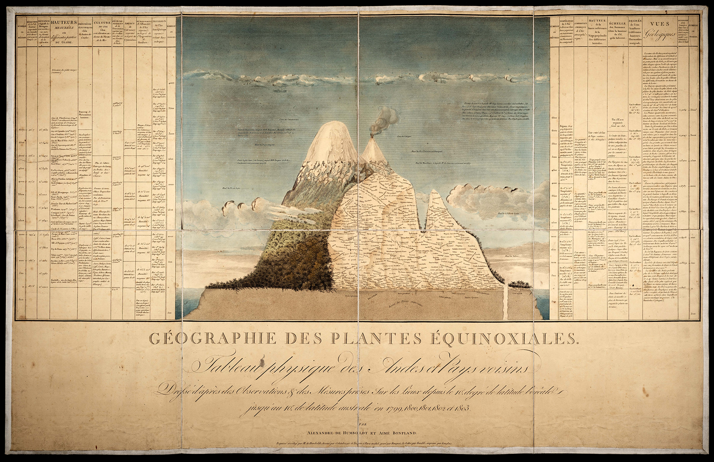
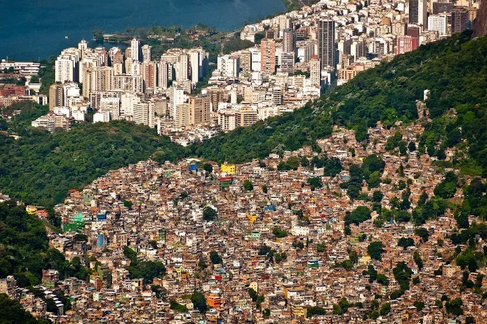
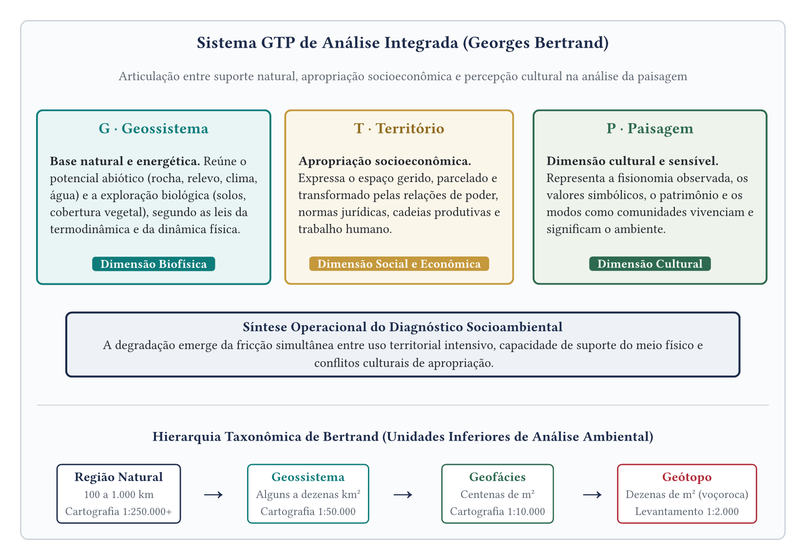

# Abordagens Ambientais no Pensamento Geográfico Moderno {#cap:abordagens-geografia}

As abordagens socioambientais integram o funcionamento dos sistemas naturais, as relações de poder e os significados atribuídos à paisagem. O sistema GTP organiza essas dimensões por meio de geossistema, território e paisagem. Sua aplicação depende da construção de relações entre as dimensões e da escolha de evidências adequadas para cada pergunta.

::: {.callout-note title="O que você vai aprender neste capítulo"}
O estudo desenvolve o uso articulado dos conceitos de ambiente, paisagem, território e geossistema, formando a base do **Estudo Orientado 2 (EO2)**. Ao concluir o capítulo, você será capaz de reconstituir a evolução das abordagens ambientais na Geografia moderna, explicar os fundamentos da Geografia Socioambiental (Mendonça, 2001), distinguir espaço geográfico, paisagem, território e ambiente, aplicar o Sistema Tripolar GTP e a taxonomia de Bertrand (2004) e diferenciar multidisciplinaridade, interdisciplinaridade e transdisciplinaridade.
:::

::: {.callout-tip title="Revisando o que você precisa saber"}
A leitura retoma os pilares dos Capítulos 1 e 2 sobre crise de racionalidade (Leff, 2001), natureza como construção histórica e conflitos socioambientais (Porto-Gonçalves, 2006). Uma unidade de solo caracteriza propriedades do terreno, um limite fundiário representa relações de propriedade e uma paisagem cultural expressa formas de reconhecimento do lugar, exigindo compatibilização escalar para explicar suas interações.
:::

Neste capítulo, a **dicotomia físico-humana** designa a separação teórico-metodológica entre o meio biofísico e as relações sociais, superada pela **Geografia Socioambiental** (Mendonça, 2001). Quatro categorias operam com recortes distintos na análise territorial, compreendendo o **espaço geográfico** (totalidade de sistemas de objetos e de ações), a **paisagem** (expressão material, perceptível e patrimonial), o **território** (espaço delimitado por poder, gestão e normas) e o **ambiente** (sistema de interações físico-químicas, bióticas e socioeconômicas). Para integrar essas dimensões, o **Sistema GTP** de Georges Bertrand (2004) articula **G**eossistema (fonte natural), **T**erritório (recurso e gestão) e **P**aisagem (identidade e patrimônio), cujo equilíbrio didático em diagnósticos é auditado pelo índice $I_{\text{GTP}}$.

## Evolução das Abordagens Ambientais no Pensamento Geográfico Moderno

A relação entre grupos humanos e o meio natural acompanhou a Geografia desde sua sistematização como ciência acadêmica no século XIX. Contudo, a forma de interpretar essa relação mudou profundamente ao longo das correntes do pensamento geográfico moderno. Compreender essa trajetória evita que o analista ambiental repita reducionismos históricos, sejam eles naturalistas (que ignoram desigualdades e decisões políticas) ou exclusivamente sociologizantes (que tratam o espaço como palco neutro, sem relevo, solo ou regime hidrológico).

Na **Geografia Clássica** (século XIX e primeira metade do século XX), a unidade entre natureza e humanidade figurava como um ideal disciplinar, ainda que sob enfoques distintos. **Alexander von Humboldt e Karl Ritter** conceberam a Terra como um todo orgânico e articulado, com Humboldt destacando a interdependência entre clima, relevo e vegetação em escalas zonais e altitudinais na sua *Naturgemälde* de 1805 e lançando bases para a análise integrada da paisagem (@fig-cap3-humboldt). Em outra vertente do século XIX, o **determinismo ambiental** associado a Friedrich Ratzel enfatizou a influência direta das condições naturais, como clima, solo e posição geográfica, sobre a organização dos povos e dos Estados, reduzindo a agência técnica, política e cultural em leituras que serviram para justificar projetos coloniais. Em reação ao determinismo, o **possibilismo** de Paul Vidal de La Blache (do final do século XIX até meados do século XX) argumentou que a natureza oferece possibilidades e limites, cabendo às sociedades selecionar e transformar o meio por meio da técnica, da cultura e do *gênero de vida*, ainda que mantivesse enfoque fortemente descritivo e baixa formalização de fluxos sistêmicos.

{#fig-cap3-humboldt fig-alt="Ilustração histórica Naturgemälde de Humboldt mostrando faixas de vegetação por altitude"}

A partir da segunda metade do século XX, a especialização científica e os debates epistemológicos aprofundaram a cisão interna da disciplina. A **Geografia Teorético-Quantitativa** (1950 a 1970) modelou a natureza como sistema aberto de fluxos de matéria e energia por meio da Teoria Geral dos Sistemas e da estatística, o que fortaleceu estudos morfométricos de bacias hidrográficas e de climatologia dinâmica, mas introduziu risco de tecnicismo neutro ao abstrair conflitos políticos e desigualdades territoriais. Em resposta a esse formalismo, a **Geografia Crítica Clássica** (1970 a 1980) trouxe o materialismo histórico, o conflito de classes e a produção capitalista do espaço para o centro da análise, desnaturalizando a pobreza e a segregação urbana. Todavia, como observa Francisco Mendonça (2001), durante quase duas décadas parte expressiva da Geografia Humana crítica secundarizou a materialidade físico-ecológica (o chamado “exílio da natureza”), enquanto setores da Geografia Física refugiaram-se em descrições estritamente naturalistas alheias à ação humana estruturante.

Somente a partir do final dos anos 1980 e desde a década de 1990, impulsionada pela crise ecológica global, pelas conferências ambientais (como a Rio-92) e pelo avanço das abordagens sistêmicas e socioambientais, a Geografia retomou o desafio de religar seus dois grandes ramos em bases metodológicas rigorosas. Situações concretas como a ocupação desigual de encostas e planícies urbanas (@fig-cap3-segregacao) ilustram por que a análise ambiental atual exige articular geomorfologia de vertentes e produção social do espaço mediante trabalho interdisciplinar, domínio de escalas e rigor de campo.

{#fig-cap3-segregacao fig-alt="Área urbana com ocupação densa em encosta contrastando com setores de planície"}

## A Superação da Dicotomia e a Geografia Socioambiental (Mendonça, 2001)

A divisão entre Geografia Física e Geografia Humana tornou-se um obstáculo operacional concreto para o geógrafo que atua em Análise Ambiental. Considere uma erosão em voçoroca que ameaça casas em um bairro periférico de Feira de Santana (BA) ou o assoreamento de um açude comunitário no Semiárido. Um diagnóstico restrito à erodibilidade do solo, à declividade da vertente e à intensidade das chuvas ignora a ausência de drenagem urbana, o loteamento irregular em Área de Preservação Permanente (APP) e a omissão do poder público. Inversamente, um diagnóstico limitado à especulação imobiliária e à segregação socioespacial deixa de medir declividade, textura do solo, vazão de pico e capacidade de infiltração, falhando ao dimensionar soluções para conter a voçoroca ou estabilizar o talude.

Diante dessa insuficiência bilateral, Francisco Mendonça (2001) sistematizou a proposta da **Geografia Socioambiental**. O autor demonstra que a palavra “ambiente” frequentemente era apropriada no Brasil por duas tradições incompletas, quais sejam a tradição naturalista, que a confundia com ecologia biológica sem seres humanos, e a tradição conservacionista pontual, desconectada dos conflitos territoriais. Na Geografia Socioambiental, o prefixo *socio* constitui um posicionamento científico explícito, reafirmando que os problemas ambientais contemporâneos decorrem da interação indissociável entre a dinâmica dos elementos naturais (clima, relevo, água, solo e vegetação) e a organização social (modo de produção, técnica, legislação, desigualdade e cultura). Todo fenômeno ambiental envolve simultaneamente processos biofísicos e sociais, pois a degradação atinge desigualmente grupos situados no território e toda intervenção técnica sobre o meio físico resulta de escolhas econômicas e políticas. Ao preservar as especialidades técnicas da geomorfologia, da pedologia, da climatologia e da geografia urbana ou agrária, essa abordagem combate o isolamento compartimentado ao formular o problema ambiental, desde a origem, como uma questão híbrida de mútua determinação. O Exemplo 3.1 ilustra como essa reformulação opera diante de enchentes urbanas.

::: {.callout-tip appearance="simple"}
### Exemplo 3.1 (Básico). Superando a Dicotomia Físico-Humana em Enchentes Urbanas

**Situação analisada.** Durante a estação chuvosa, bairros situados na cabeceira do Rio Subaé, em Feira de Santana (BA), sofrem alagamentos recorrentes. Dois consultores emitiram pareceres conflitantes, com o Parecer 1 atribuindo o problema exclusivamente a chuvas convectivas intensas e relevo plano mal drenado, e o Parecer 2 sustentando que se trata apenas de segregação urbana e descaso político, sem considerar a hidrografia local. Reformule o diagnóstico sob a ótica da Geografia Socioambiental.

**Dados disponíveis.** Cabeceira urbana do Rio Subaé (Feira de Santana, BA); Parecer 1 focado exclusivamente em pluviosidade e topografia; Parecer 2 focado exclusivamente em segregação urbana e gestão municipal; referencial de Mendonça (2001).

**Problema a resolver.** Identificar o viés epistemológico presente em cada parecer e propor uma formulação integrada que supere a dicotomia.

**Fundamento da análise.** Análise epistemológica pela Geografia Socioambiental (Mendonça, 2001), verificando como processos físico-hidrológicos e decisões socioespaciais se codeterminam.

**Desenvolvimento.** **Passo 1, Diagnóstico do Parecer 1.** Reproduz o reducionismo naturalista (Geografia Física isolada). Ao atribuir o alagamento apenas à chuva e ao relevo plano, naturaliza um evento que foi amplificado pela impermeabilização do solo, pelo aterramento de nascentes e lagoas e pela ocupação de planícies de inundação. **Passo 2, Diagnóstico do Parecer 2.** Reproduz o reducionismo sociologizante (Geografia Humana sem base material). Embora aponte corretamente a desigualdade urbana, ignora parâmetros físicos indispensáveis (capacidade de infiltração, cota de inundação e seção de escoamento), impedindo o dimensionamento de soluções drenantes. **Passo 3, Reformulação socioambiental integrada.** Articula os dois eixos em uma cadeia causal única, onde a expansão urbana sem planejamento impermeabilizou áreas de recarga e estreitou canais naturais (processo social e territorial), o que reduziu a infiltração e elevou o escoamento superficial em eventos de chuva intensa sobre relevo de baixa declividade (dinâmica físico-hidrológica), atingindo prioritariamente famílias de menor renda assentadas nas áreas de várzea (desigualdade socioespacial).

**Interpretação do resultado.** Ambos os pareceres são dicotômicos (naturalista no Parecer 1 e sociologizante no Parecer 2). A leitura socioambiental integra a dinâmica hidrológica da cabeceira (infiltração, relevo plano e chuvas intensas) à produção desigual do espaço urbano (impermeabilização, aterramento de lagoas e vulnerabilidade habitacional).

**Condições de validade.** A síntese faz sentido ambiental e técnico porque permite combinar ações estruturais (parques lineares, retenção de águas pluviais e desimpermeabilização) com ações territoriais e sociais (revisão do zoneamento urbano e regularização fundiária segura).
:::

Aplicar a abordagem de Mendonça (2001) exige ir além da simples reunião de capítulos temáticos independentes, erro metodológico destacado a seguir.

::: {.callout-warning appearance="simple"}
### Erro 1, Confundir Geografia Socioambiental com Soma Mecânica de Capítulos

**Equívoco frequente.** Acreditar que basta escrever uma seção de “aspectos físicos” (clima, relevo e solo) e outra seção separada de “aspectos humanos” (população e economia) para cumprir a abordagem socioambiental de Mendonça (2001).

**Por que está incorreto.** Justapor partes desconexas reproduz a dicotomia clássico-positivista sob aparência integrada (multidisciplinaridade fragmentada).

**Como evitar.** Explicite sempre as **relações causais e de retroalimentação** entre as dinâmicas naturais e sociais, mostrando como o manejo do solo intensifica a erosão e como essa erosão reduz a renda agrícola e agrava conflitos locais.
:::

## Distinção Rigorosa e Articulação, Espaço, Paisagem, Território e Ambiente

Um dos erros mais frequentes em provas universitárias, relatórios de licenciamento e estudos orientados consiste em empregar *espaço*, *paisagem*, *território* e *ambiente* como palavras intercambiáveis para evitar repetições textuais. Em Análise Ambiental, cada uma dessas quatro categorias recorta um ângulo analítico específico da realidade geográfica e ativa instrumentos distintos de diagnóstico.

Como categoria matriz e mais abrangente da Geografia, o **espaço geográfico** representa, conforme a formulação clássica de Milton Santos, um conjunto indissociável, solidário e contraditório de sistemas de objetos (naturais e técnicos) e sistemas de ações (sociais, econômicas e normativas). Respondendo a como o espaço é produzido e reorganizado historicamente, essa categoria abrange, no Semiárido Baiano, a expansão da infraestrutura energética e viária que integra o sertão à rede elétrica nacional.

Em recorte imediato da experiência sensível, a **paisagem** corresponde à dimensão visível, material e simbólica do espaço geográfico em determinado momento, interrogando o que se vê, como a forma se estrutura e que sentido ela possui para os grupos locais. Resulta da acumulação desigual de tempos da natureza (geológico, geomorfológico e ecológico) e tempos sociais (formas de cultivo, estradas, cidades e represas). Na análise ambiental, permite ler marcas concretas de estabilidade ou degradação e expressa o vínculo cultural com o lugar, a exemplo do mosaico de caatinga arbustiva, afloramentos graníticos, pastagens e torres eólicas visíveis nas serras sertanejas.

Quando o foco recai sobre quem controla, regula, usa e disputa determinada área, mobiliza-se a categoria **território**, definida por relações de poder, apropriação, delimitação jurídica e gestão. Um município, uma bacia hidrográfica sob comitê de gestão, uma Unidade de Conservação, um assentamento rural ou a poligonal de um parque eólico constituem territórios. Sem essa categoria, o diagnóstico deixa de identificar quem decide, quem lucra, quem arca com os custos da degradação e quais normas incidem sobre o local, como ocorre na sobreposição entre contratos de arrendamento eólico, terras de fundo de pasto e limites de APP.

De modo complementar, o **ambiente** expressa o sistema relacional formado pelas interações entre fatores abióticos (clima, água, solo e relevo), bióticos (flora, fauna e microrganismos) e antrópicos (tecnologia, uso da terra, infraestrutura e organização social). Orientado pela pergunta de como os fluxos ecológicos e sociais se afetam mutuamente, esse conceito pressupõe um sistema de referência com o qual os fatores físicos, bióticos e sociais interagem, permitindo avaliar como a supressão vegetal em vertente altera o escoamento superficial, a perda de solo e a fauna associada no Semiárido. O Exemplo 3.2 exercita essa distinção a partir de registros de campo na Lagoa Grande, em Feira de Santana.

::: {.callout-tip appearance="simple"}
### Exemplo 3.2 (Básico). Distinção Operacional entre Espaço, Paisagem, Território e Ambiente

**Situação analisada.** Uma equipe de estudantes de CHF662 realiza trabalho de campo no entorno da Lagoa Grande, em Feira de Santana (BA), área que passou por obras de urbanização, requalificação paisagística e controle de drenagem. Em seus cadernos de campo, os alunos registraram quatro observações distintas e precisam classificá-las corretamente segundo as quatro categorias geográficas estudadas.

**Dados disponíveis.** Observação I registra que as margens exibem espelho d’água cercado por macrófitas, pista de caminhada, vegetação arbustiva e bairros residenciais, sendo reconhecidas pela população como área de lazer e memória hídrica da cidade. Observação II registra que a fiscalização municipal e a legislação estadual de APP delimitam faixas não edificáveis e regulam o uso comercial no entorno. Observação III registra que o aporte de esgoto clandestino elevou a carga de nutrientes na água, reduzindo o oxigênio dissolvido e alterando a biota aquática. Observação IV registra que a requalificação insere a lagoa na rede viária e na valorização imobiliária da malha urbana de Feira de Santana, reorganizando objetos técnicos e fluxos da cidade.

**Problema a resolver.** Associar cada observação à categoria geográfica predominante (espaço geográfico, paisagem, território ou ambiente) e justificar tecnicamente cada enquadramento.

**Fundamento da análise.** Aplicação dos núcleos analíticos e perguntas-chave definidos na seção anterior.

**Desenvolvimento.** **Passo 1, Observação I.** Enfatiza a fisionomia visível (espelho d’água, vegetação, pista e bairros) e a percepção e memória afetiva da população, correspondendo à categoria **Paisagem**. **Passo 2, Observação II.** Enfatiza normas jurídicas (APP), fiscalização estatal, delimitação de faixas e controle de uso, tratando de relações de poder e gestão e correspondendo à categoria **Território**. **Passo 3, Observação III.** Descreve interações físico-químicas, bióticas e antrópicas (carga de nutrientes causando redução de oxigênio dissolvido e alteração da biota), correspondendo à categoria **Ambiente**. **Passo 4, Observação IV.** Aborda a totalidade da produção urbana (integração de sistemas de objetos viários e imobiliários e sistemas de ações econômicas na cidade), correspondendo à categoria **Espaço Geográfico**.

**Interpretação do resultado.** I corresponde a Paisagem; II corresponde a Território; III corresponde a Ambiente; IV corresponde a Espaço Geográfico.

**Condições de validade.** Cada categoria respondeu a uma pergunta diferente sobre o mesmo lugar (Lagoa Grande), comprovando que os quatro termos possuem núcleos analíticos próprios e se complementam na construção do diagnóstico.
:::

Empregar essas categorias como meros sinônimos estilísticos compromete a precisão jurídica e técnica de laudos ambientais, como adverte o Erro 2.

::: {.callout-warning appearance="simple"}
### Erro 2, Empregar Espaço, Paisagem, Território e Ambiente como Sinônimos

**Equívoco frequente.** Em textos acadêmicos e relatórios, o estudante escreve “território” em um parágrafo e “paisagem” ou “ambiente” no parágrafo seguinte apenas para evitar repetir a mesma palavra.

**Por que está incorreto.** Cada categoria define um recorte teórico e operacional distinto. Falar em “preservar a paisagem” quando o conflito envolve disputa fundiária ou poder de gestão (território) enfraquece a precisão técnica do argumento.

**Como evitar.** Antes de escolher o termo, verifique o foco da frase, utilizando *território* para poder, gestão e norma, *paisagem* para fisionomia, memória e percepção, *ambiente* para interação físico-biótico-social e *espaço geográfico* para a totalidade de objetos e ações.
:::

## O Esboço Metodológico da Paisagem e o Sistema Tripolar GTP (Bertrand, 2004)

O geógrafo francês Georges Bertrand exerceu influência decisiva sobre a Análise Ambiental brasileira. Em seu texto clássico de 1968 (*Paisagem e Geografia Física Global, esboço metodológico*), traduzido no Brasil em 1971 e republicado em 2004, Bertrand definiu a paisagem como o resultado da combinação dinâmica e instável de elementos físicos, biológicos e antrópicos que, reagindo dialeticamente uns sobre os outros, formam um conjunto único e indissociável em perpétua evolução. Naquela primeira formulação, Bertrand propôs uma taxonomia escalar centrada no conceito de **geossistema**, entendido como a interseção entre *potencial ecológico* (geomorfologia, clima e hidrologia), *exploração biológica* (vegetação, solo e fauna) e *ação antrópica*.

Posteriormente, reconhecendo que o conceito de geossistema mantinha forte peso naturalista e demandava maior integração com as dimensões políticas, econômicas e simbólicas dos problemas ambientais contemporâneos, Georges Bertrand (em conjunto com Claude Bertrand, em textos difundidos no Brasil a partir de 2004) reformulou sua proposta no **Sistema Tripolar GTP (Geossistema, Território e Paisagem)**. Em conjunto com a tríade socioambiental de Mendonça (2001), que situa a Análise Ambiental Integrada na interseção entre Meio Físico, Meio Biótico e Sociedade & Território (@fig-triade-gtp, Subfigura (a)), o modelo GTP estabelece três entradas metodológicas articuladas por setas bidirecionais (@fig-triade-gtp, Subfigura (b)).

{#fig-triade-gtp fig-alt="Diagrama com tríade socioambiental de Mendonça à esquerda e Sistema Tripolar GTP bidirecional de Bertrand à direita"}

Cada polo do Sistema GTP interroga o mesmo objeto socioambiental em uma temporalidade própria. O **Polo G, Geossistema** (a *fonte* ou *source*), analisa o funcionamento biofísico e ecológico do espaço e incorpora a antropização como força atuante nos fluxos de energia, água, sedimentos e nutrientes, operando principalmente no *tempo da natureza*. O **Polo T, Território** (o *recurso* ou *ressource*), examina a dimensão socioeconômica, jurídica e política, tratando dos modos de apropriação, uso produtivo da terra, regulação legal, gestão de bacias e distribuição desigual de benefícios e danos no *tempo social e institucional*. O **Polo P, Paisagem** (a *ressurgência*, identidade e patrimônio, ou *ressourcement*), investiga a dimensão cultural, simbólica, estética e perceptiva no *tempo da memória e da cultura*.

Na prática de diagnósticos socioambientais, a fricção simultânea entre o uso territorial intensivo, a capacidade de suporte do meio físico e os conflitos culturais de apropriação exige articular os três polos com a hierarquia taxonômica das unidades inferiores propostas por Bertrand, variando da escala regional da *Região Natural* ($100$ a $1.000\text{ km}$, cartografia $1:250.000$ ou menor) ao *Geossistema* (alguns a dezenas de $\text{km}^2$, escala $1:50.000$), ao *Geofácies* (centenas de $\text{m}^2$, escala $1:10.000$) e ao *Geótopo* (dezenas de $\text{m}^2$, como uma voçoroca, em levantamento $1:2.000$), conforme organizado na @fig-gtp-paisagem-taxonomia. As setas bidirecionais entre G, T e P indicam que uma decisão territorial (como liberar loteamentos em cabeceiras) altera o funcionamento do geossistema (elevando o escoamento e os picos de cheia) e transforma a paisagem, assim como a mobilização cultural por uma paisagem patrimonial (P) pode induzir a criação de uma Unidade de Conservação (T) que estabiliza o balanço hídrico (G).

{#fig-gtp-paisagem-taxonomia fig-alt="Esquema do Sistema GTP com os blocos Geossistema, Território e Paisagem e abaixo a hierarquia taxonômica de Região Natural a Geótopo"}

O Exemplo 3.3 aplica o Sistema Tripolar GTP e suas retroalimentações a um complexo eólico no Semiárido Baiano.

::: {.callout-tip appearance="simple"}
### Exemplo 3.3 (Intermediário). Aplicação do Sistema Tripolar GTP em Parque Eólico no Semiárido

**Situação analisada.** Na preparação para a atividade de campo de CHF662 no eixo energético do Semiárido Baiano (região de Canudos e Sertão), solicita-se estruturar um roteiro de análise integrada sobre a implantação de um complexo eólico em chapadas e tabuleiros de Caatinga, utilizando o Sistema Tripolar GTP de Georges Bertrand (2004).

**Dados disponíveis.** Elementos identificados em campo compreendem abertura de acessos e terraplanagem para bases de aerogeradores em solos arenosos e pedregosos de Caatinga com ravinamento incipiente nas bordas das plataformas (a); contratos de arrendamento de terras entre empresas energéticas e proprietários ou posseiros, além do licenciamento junto ao INEMA e disputas por áreas de pastoreio comunitário (b); e transformação visual das serras sertanejas pelas torres de grande porte, ruído aerodinâmico e ressignificação do lugar pelos moradores locais (c).

**Problema a resolver.** Enquadrar os elementos nos polos G, T e P e demonstrar duas retroalimentações (interações bidirecionais) entre os polos.

**Fundamento da análise.** Matriz tripolar GTP de Bertrand (2004), compreendendo Geossistema (fonte e biofísico), Território (recurso, gestão e poder) e Paisagem (identidade, percepção e patrimônio).

**Desenvolvimento.** **Passo 1, Enquadramento no Polo G (Geossistema).** Refere-se aos elementos (a), analisando a remoção da Caatinga, a exposição de solos frágeis ao impacto das chuvas concentradas do Semiárido, o escoamento concentrado nas estradas de serviço, a formação de ravinas nas bases das torres e os efeitos sobre a avifauna local. **Passo 2, Enquadramento no Polo T (Território).** Refere-se aos elementos (b), analisando a governança energética, os contratos de arrendamento, as condicionantes do licenciamento ambiental (INEMA), a reorganização fundiária e os conflitos de acesso a áreas tradicionais de fundo de pasto. **Passo 3, Enquadramento no Polo P (Paisagem).** Refere-se aos elementos (c), analisando a alteração da fisionomia das serras, a percepção sonora e visual do parque pelos moradores e o conflito entre o discurso da “energia limpa” e a memória territorial sertaneja.

**Passo 4, Interações bidirecionais.** Na interação $T \leftrightarrow G$, decisões contratuais e de traçado viário ($T$) determinam onde ocorrerá supressão vegetal e terraplanagem, desencadeando erosão em encostas ($G$), enquanto a erosão que desestabiliza estradas e taludes ($G$) impõe custos de manutenção e obrigações corretivas no licenciamento ($T$). Na interação $P \leftrightarrow T$, a percepção negativa de ruído e de descaracterização das serras ($P$) fortalece a mobilização comunitária por audiências públicas e revisão de distâncias mínimas das torres em relação às casas ($T$).

**Interpretação do resultado.** Polo G trata da dinâmica solo-água-vegetação-avifauna nas plataformas e acessos; Polo T trata de arrendamentos, licenciamento e conflitos fundiários; Polo P trata da reconfiguração visual e sonora e da identidade sertaneja. As conexões $T \leftrightarrow G$ e $P \leftrightarrow T$ evidenciam a indivisibilidade do sistema.

**Condições de validade.** O roteiro cobre todas as dimensões exigidas na viagem de campo da Semana 11, evitando reduzir a energia eólica a um debate exclusivamente técnico-elétrico ou exclusivamente paisagístico.
:::

Um equívoco frequente ao operar esse modelo consiste em supor que o Geossistema se restringe a ambientes sem presença humana, conforme destacado abaixo.

::: {.callout-warning appearance="simple"}
### Erro 3, Entender o Polo Geossistema (G) como “Natureza Intocada”

**Equívoco frequente.** Imaginar que, no Sistema GTP de Bertrand (2004), o Geossistema exclui qualquer ação humana e só existiria em florestas virgens ou parques sem moradores.

**Por que está incorreto.** Desde 1968, e de forma ainda mais clara no modelo GTP, Bertrand inclui a **antropização** como componente interno da dinâmica geossistêmica. Uma bacia rural cultivada ou uma várzea urbana continuam operando como geossistemas profundamente modificados pela sociedade.

**Como evitar.** Lembre que o polo G focaliza o *funcionamento biofísico e ecológico* (incluindo os efeitos físicos da ação humana), enquanto os polos T e P tratam da gestão e poder e da identidade e percepção.
:::

Para auditar se um relatório ambiental integra os três polos de Bertrand (2004) de modo equilibrado entre o meio físico e a dimensão social, adota-se em CHF662 uma métrica didática de treinamento baseada na média harmônica das notas de cobertura técnica de cada polo ($g, t, p \in [0, 10]$), conforme a equação abaixo.

$$
I_{\text{GTP}} = \frac{3\,g\,t\,p}{g\,t + g\,p + t\,p} \qquad (\text{para } g, t, p > 0; \quad I_{\text{GTP}} = 0 \text{ se } g = 0, \, t = 0 \text{ ou } p = 0)
$$

Diferentemente da média aritmética simples, a média harmônica penaliza fortemente o polo deficitário, refletindo o princípio sistêmico de que a integração é limitada pelo elo mais fraco. Nas aplicações de CHF662, valores de $I_{\text{GTP}} \ge 7{,}0$ indicam diagnóstico bem integrado nos três polos; o intervalo $4{,}0 \le I_{\text{GTP}} < 7{,}0$ indica integração parcial com polo subdesenvolvido; e $I_{\text{GTP}} < 4{,}0$ caracteriza diagnóstico fragmentado ou dicotômico. Esse índice funciona exclusivamente como recurso didático de treinamento e complementa o julgamento técnico sem substituir as evidências qualitativas e quantitativas que sustentam cada nota atribuída na rubrica de avaliação. O Exemplo 3.4 demonstra numericamente por que relatórios com a mesma média aritmética podem exibir níveis opostos de equilíbrio socioambiental quando avaliados pelo $I_{\text{GTP}}$.

::: {.callout-tip appearance="simple"}
### Exemplo 3.4 (Intermediário). Auditoria Quantitativa de Relatórios Ambientais com o Índice $I_{\text{GTP}}$

**Situação analisada.** Para subsidiar o plano de gestão de uma microbacia no Vale do Paraguaçu (BA), um órgão público avaliou dois diagnósticos preliminares elaborados por consultorias diferentes. A comissão avaliadora atribuiu notas de $0$ a $10$ para a consistência técnica em cada polo do sistema GTP. Verifique numericamente qual diagnóstico apresenta real integração socioambiental.

**Dados disponíveis.** Diagnóstico X com Geossistema $g_X = 10{,}0$, Território $t_X = 1{,}0$ e Paisagem $p_X = 1{,}0$. Diagnóstico Y com Geossistema $g_Y = 4{,}0$, Território $t_Y = 4{,}0$ e Paisagem $p_Y = 4{,}0$. Critério de referência $I_{\text{GTP}} = \frac{3\,g\,t\,p}{g\,t + g\,p + t\,p}$.

**Problema a resolver.** Calcular a média aritmética ($\text{MA}$) e o índice $I_{\text{GTP}}$ de ambos os diagnósticos e interpretar o significado metodológico da diferença encontrada.

**Fundamento da análise.** Cálculo passo a passo de $\text{MA}$ e $I_{\text{GTP}}$ conforme a fórmula apresentada na seção anterior.

**Desenvolvimento.** **Passo 1, Médias aritméticas.**

$$
\text{MA}_X = \frac{10{,}0 + 1{,}0 + 1{,}0}{3} = \frac{12{,}0}{3} = 4{,}00 \qquad\text{e}\qquad \text{MA}_Y = \frac{4{,}0 + 4{,}0 + 4{,}0}{3} = \frac{12{,}0}{3} = 4{,}00.
$$

Pela média aritmética simples, os dois relatórios pareceriam empatados. **Passo 2, Cálculo de $I_{\text{GTP}}$ para o Diagnóstico X.** O numerador resulta em $3 \times 10{,}0 \times 1{,}0 \times 1{,}0 = 30{,}0$, e o denominador soma $(10{,}0 \times 1{,}0) + (10{,}0 \times 1{,}0) + (1{,}0 \times 1{,}0) = 21{,}0$, resultando em $I_{\text{GTP}, X} = \frac{30{,}0}{21{,}0} = \frac{10}{7} \approx 1{,}43$ (diagnóstico fragmentado e dicotômico). **Passo 3, Cálculo de $I_{\text{GTP}}$ para o Diagnóstico Y.** O numerador alcança $3 \times 4{,}0 \times 4{,}0 \times 4{,}0 = 192{,}0$, e o denominador soma $(4{,}0 \times 4{,}0) + (4{,}0 \times 4{,}0) + (4{,}0 \times 4{,}0) = 48{,}0$, resultando em $I_{\text{GTP}, Y} = \frac{192{,}0}{48{,}0} = 4{,}00$ (integração parcial equilibrada). **Passo 4, Comparação percentual.** O Diagnóstico Y obtém $I_{\text{GTP}}$ superior ao de X em $\frac{4{,}00 - 1{,}43}{1{,}43} \times 100\% \approx 180\%$, apesar da mesma soma de notas ($12{,}0$).

**Interpretação do resultado.** $\text{MA}_X = \text{MA}_Y = 4{,}00$; contudo, $I_{\text{GTP}, X} \approx 1{,}43$ (fragmentado) e $I_{\text{GTP}, Y} = 4{,}00$ (integração parcial equilibrada). O Diagnóstico Y mostra maior coerência com a abordagem socioambiental, embora ambos precisem ser aprimorados para atingir o patamar integrado ($\ge 7{,}0$).

**Condições de validade.** O resultado respeita a desigualdade entre médias (a média harmônica é sempre menor ou igual à média aritmética, igualando-se apenas quando $g = t = p$) e a lógica ambiental, pois excelência isolada em mapeamento físico deixa sem resposta os conflitos territoriais e a percepção social.
:::

## Interdisciplinaridade e Análise Ambiental Integrada

Nenhuma disciplina isolada domina todos os métodos exigidos por um diagnóstico ambiental de alta complexidade. Entretanto, reunir diversos profissionais em uma mesma equipe raramente garante uma análise integrada, razão pela qual a epistemologia ambiental distingue três níveis de cooperação entre saberes. Na **multidisciplinaridade** (justaposição), especialistas como geólogo, biólogo, engenheiro, sociólogo e geógrafo elaboram capítulos separados sobre a mesma área, sem formular perguntas comuns nem cruzar variáveis, produzindo o “relatório em gavetas”, no qual o capítulo de solos permanece isolado do de uso da terra e do de saúde pública. Na **interdisciplinaridade** (integração metodológica), diferentes disciplinas definem conjuntamente o problema ambiental, compatibilizam escalas espaciais e temporais, trocam dados e constroem sínteses integradas, como mapas de fragilidade socioambiental, matrizes de impacto cruzado e zoneamentos participativos. Na **transdisciplinaridade** (diálogo com saberes locais), além de integrar disciplinas científicas, o estudo incorpora o conhecimento empírico e territorial das comunidades (agricultores familiares, pescadores, comunidades de fundo de pasto e quilombolas), indispensável para compreender o regime histórico de riachos intermitentes, manchas de solo fértil e usos tradicionais da biota. Nesse arranjo, pela formação voltada à espacialidade, à cartografia temática, às escalas e à interface natureza-sociedade, o geógrafo atua como um *articulador espacial*, capaz de traduzir dados setoriais em uma leitura territorial integrada e propositiva.

## Síntese Avançada, Desenho de Projeto Interdisciplinar em Microbacia

A passagem de diagnósticos fragmentados para projetos interdisciplinares e transdisciplinares exige compatibilizar escalas cartográficas, definir uma unidade espacial comum e formular perguntas articuladoras que conectem processos físicos, gestão territorial e experiência comunitária. O Exemplo 3.5 demonstra como reestruturar um termo de referência originalmente multidisciplinar em uma microbacia periurbana baiana.

::: {.callout-tip appearance="simple"}
### Exemplo 3.5 (Avançado). Desenho de Projeto Interdisciplinar em Microbacia Periurbana

**Situação analisada.** A prefeitura de um município da Região Metropolitana de Feira de Santana contratou um estudo ambiental para uma microbacia afluente do Rio Jacuípe que enfrenta desmatamento de mata ciliar, retirada irregular de areia e expansão de chácaras sem esgotamento sanitário. A proposta inicial da empresa previa cinco relatórios isolados (Geologia, Botânica, Hidrologia, Economia e Sociologia) entregues em anexos separados, em escalas cartográficas diferentes ($1:100.000$ na Geologia e $1:5.000$ no cadastro urbano). Reestruture a proposta para garantir interdisciplinaridade efetiva.

**Dados disponíveis.** Microbacia periurbana afluente do Rio Jacuípe (BA); problemas de supressão ripária, mineração irregular de areia e loteamento sem saneamento; proposta inicial com 5 anexos independentes em escalas incompatíveis ($1:100.000$ e $1:5.000$).

**Problema a resolver.** Diagnosticar a falha metodológica da proposta original e propor um protocolo interdisciplinar e transdisciplinar de trabalho.

**Fundamento da análise.** Distinção entre multidisciplinaridade, interdisciplinaridade e transdisciplinaridade articulada ao papel integrador do geógrafo e à compatibilização de escalas.

**Desenvolvimento.** **Passo 1, Diagnóstico da falha.** A proposta original caracteriza **multidisciplinaridade justaposta**. Além da ausência de problema comum, a incompatibilidade escalar impede o cruzamento espacial, pois uma base geológica $1:100.000$ carece de resolução para localizar processos erosivos de margem e relacioná-los aos lotes em escala $1:5.000$. **Passo 2, Recorte espacial e escala comum.** Adotar a **microbacia hidrográfica** como unidade física de integração, harmonizando todas as camadas temáticas (solos, declividade, cobertura vegetal, uso da terra, pontos de lançamento de efluentes e cavas de areia) na escala operacional de detalhe ($1:10.000$ ou $1:5.000$). **Passo 3, Pergunta interdisciplinar unificadora.** Substituir os cinco inventários soltos por uma questão articuladora voltada a investigar como a expansão de chácaras e a extração de areia alteram a conectividade hidrossedimentológica, a qualidade da água e os conflitos territoriais na microbacia. **Passo 4, Produtos integrados e transdisciplinaridade.** Gerar um mapa-síntese socioambiental (cruzando polos G, T e P) e realizar oficinas participativas com moradores e pequenos produtores para incorporar o histórico local de cheias, nascentes extintas e usos tradicionais da água (dimensão transdisciplinar).

**Interpretação do resultado.** A proposta original é meramente multidisciplinar e escalarmente incompatível. A reestruturação exige unidade espacial comum (microbacia em escala de detalhe $1:5.000$ a $1:10.000$), pergunta-problema compartilhada, matriz integradora GTP e oficinas participativas (transdisciplinaridade).

**Condições de validade.** A solução assegura que os dados físicos (erosão e qualidade hídrica) orientem diretamente o ordenamento territorial e a fiscalização ambiental, evitando relatórios desconexos que permanecem sem aplicação prática.
:::

## Armadilha Conceitual e Materiais Audiovisuais de Apoio

Mesmo quando o diagnóstico ambiental equilibra bem os dados físicos do geossistema e as normas do território, é frequente negligenciar o polo Paisagem por considerá-lo subjetivo ou secundário, erro que compromete a aceitação social e a eficácia das intervenções.

::: {.callout-warning appearance="simple"}
### Erro 4, Tratar a Paisagem (P) como Aspecto Meramente Decorativo ou Estético

**Equívoco frequente.** Desvalorizar o polo Paisagem do sistema GTP em diagnósticos ambientais, considerando-o “subjetivo demais” frente aos dados numéricos de solo e água.

**Por que está incorreto.** A paisagem expressa vínculos de pertencimento, memória coletiva e leitura histórica do espaço. Projetos de intervenção (como barragens, parques eólicos ou recuperação de lagoas urbanas) frequentemente fracassam ou geram forte resistência social quando ignoram o valor identitário e patrimonial que as comunidades atribuem à paisagem.

**Como evitar.** Integre levantamentos de percepção ambiental, história oral e patrimônio paisagístico ao diagnóstico físico e territorial.
:::

Para ampliar a compreensão sobre a síntese integrada da paisagem e os grandes domínios morfoclimáticos na Geografia brasileira, assista à videoaula recomendada na página da disciplina, [Domínios Morfoclimáticos do Brasil (Aziz Ab’Sáber)](https://www.youtube.com/watch?v=M9AaD1DZnnQ), que apresenta a articulação entre relevo, clima, solos e cobertura vegetal na leitura espacial brasileira.

## Exercícios de fixação

#### Nível Básico (Exercícios 1 a 5)

1. Explique, com suas próprias palavras, qual é a principal diferença entre a visão da relação sociedade-natureza no **determinismo ambiental** e no **possibilismo**.

2. Por que a Geografia Crítica das décadas de 1970 e 1980, apesar de seus avanços na compreensão da produção social do espaço, acabou reforçando indiretamente a dicotomia entre Geografia Física e Geografia Humana?

3. Segundo Mendonça (2001), por que a expressão **Geografia Socioambiental** utiliza o prefixo “socio”? Isso representa uma redundância conceitual? Justifique.

4. Indique os três polos do **Sistema Tripolar GTP** proposto por Georges Bertrand (2004), associando cada polo ao seu papel analítico principal (*fonte*, *recurso* ou *identidade e patrimônio*).

5. Diferencie **multidisciplinaridade** de **interdisciplinaridade** na elaboração de um diagnóstico ambiental de bacia hidrográfica.

#### Nível Intermediário (Exercícios 6 a 10)

6. Observe a @fig-triade-gtp (Subfigura (b)). Por que as setas que conectam Geossistema (G), Território (T) e Paisagem (P) são **bidirecionais** ($\leftrightarrow$), diferenciando-se de setas de sentido único ($\rightarrow$)? Dê um exemplo concreto no Semiárido baiano.

7. Em um município do Recôncavo Baiano, a expansão de loteamentos sobre áreas de manguezal provocou supressão vegetal, assoreamento de canais de maré, disputa judicial com marisqueiras e perda de referência cultural da comunidade pesqueira. Classifique esses quatro fenômenos segundo as categorias **ambiente**, **território** e **paisagem**, indicando como eles se articulam no **espaço geográfico**.

8. Dois grupos de estudantes apresentaram propostas de Diagnóstico Ambiental para uma microbacia de Feira de Santana (BA) e receberam as seguintes notas nos polos GTP,

    - **Grupo 1,** $g = 10{,}0$; $t = 2{,}0$; $p = 2{,}0$.

    - **Grupo 2,** $g = 6{,}0$; $t = 6{,}0$; $p = 6{,}0$.

    Calcule a média aritmética ($\text{MA}$) e o índice de equilíbrio $I_{\text{GTP}}$ de cada grupo, passo a passo, e classifique o nível de integração de ambos os trabalhos.

9. Um parecer técnico sobre desertificação no norte da Bahia descreve detalhadamente o déficit hídrico climático e o sobrepastejo caprino, mas omite completamente a estrutura fundiária, a ausência de assistência técnica rural e o modo como os sertanejos percebem o ressecamento das nascentes. Analise criticamente esse parecer à luz do Sistema GTP.

10. Explique como a **transdisciplinaridade** pode enriquecer um diagnóstico ambiental conduzido por geógrafos em comunidades rurais de fundo de pasto no Semiárido baiano, citando dois tipos de informações locais que raramente constam em bases cartográficas oficiais.

#### Nível Aplicado, Questões Objetivas (Exercícios 11 a 15)

11. Em relação à evolução das abordagens ambientais no pensamento geográfico moderno, assinale a alternativa correta,

    (A) A Geografia Clássica do século XIX recusava qualquer estudo sobre clima, relevo ou vegetação, concentrando-se apenas na economia urbana.

    (B) O determinismo ambiental defendia que a técnica humana supera integralmente os limites ecológicos de qualquer região.

    (C) A Geografia Socioambiental (Mendonça, 2001) propõe superar a separação entre Geografia Física e Geografia Humana integrando processos naturais e dinâmicas sociais.

    (D) A Geografia Teorético-Quantitativa eliminou o uso de modelos sistêmicos por considerá-los incompatíveis com a análise ambiental.

    (E) A Geografia Crítica dos anos 1970 priorizou o estudo da pedogênese e da geomorfologia de vertentes como eixo central de suas pesquisas.

12. No planejamento de uma Unidade de Conservação na Chapada Diamantina (BA), o analista precisa examinar as normas de uso do solo, o zoneamento do plano de manejo e os conflitos de competência entre órgãos municipais, estaduais e associações comunitárias. A categoria geográfica que expressa diretamente essa dimensão de poder e gestão é,

    (A) Geótopo.

    (B) Território.

    (C) Potencial ecológico.

    (D) Bioma.

    (E) Clímax edáfico.

13. No Sistema Tripolar GTP de Georges Bertrand (2004), a correspondência correta entre os polos e seus respectivos focos analíticos é,

    (A) Geossistema = identidade cultural; Território = fluxos hidrológicos; Paisagem = normas jurídicas.

    (B) Geossistema = recurso econômico; Território = tempo geológico; Paisagem = apenas estética de cartões-postais.

    (C) Geossistema = natureza intocada sem ação humana; Território = clima regional; Paisagem = bacia hidrográfica.

    (D) Geossistema = funcionamento biofísico e ecológico (fonte); Território = apropriação, gestão e poder (recurso); Paisagem = percepção, identidade e patrimônio (ressurgência).

    (E) Geossistema = modelo matemático urbano; Território = vegetação nativa; Paisagem = levantamento topográfico sem observador.

14. Um Estudo de Impacto Ambiental (EIA) reúne capítulos elaborados isoladamente por um geólogo, um biólogo e um sociólogo, sem cruzamento cartográfico, sem padronização de escala e sem discussão conjunta das causas dos impactos. Epistemologicamente, esse estudo caracteriza-se como,

    (A) Transdisciplinar, pois envolve especialistas de diferentes áreas técnicas.

    (B) Interdisciplinar, uma vez que contém tanto dados naturais quanto sociais no mesmo volume.

    (C) Multidisciplinar justaposto, pois soma descrições setoriais sem integração metodológica real.

    (D) Sistêmico tripolar, por apresentar exatamente três profissionais na equipe técnica.

    (E) Possibilista integrado, por respeitar a autonomia absoluta de cada disciplina.

15. Um relatório de diagnóstico ambiental obteve notas $g = 8{,}0$ em Geossistema, $t = 8{,}0$ em Território e $p = 0{,}0$ em Paisagem (ausência total de análise paisagística e perceptiva). Aplicando o critério didático do índice $I_{\text{GTP}}$, conclui-se que,

    (A) O relatório alcança integração plena, pois a média aritmética dos dois polos preenchidos é $8{,}0$.

    (B) $I_{\text{GTP}} = 0{,}0$, evidenciando ruptura da integração tripolar pela supressão completa do polo Paisagem.

    (C) $I_{\text{GTP}} = 5{,}33$, classificando o relatório como parcialmente integrado.

    (D) A ausência do polo Paisagem é irrelevante em diagnósticos ambientais, pois o polo P interfere pouco na gestão territorial.

    (E) O relatório deve ser considerado de viés exclusivamente sociologizante.

## Questões de aplicação

### Estratégia para o Estudo Orientado 2 (EO2) e para a Avaliação Teórica

No **EO2** (Semana 3, baseado em Mendonça, 2001, e Bertrand, 2004) e na **Prova Teórica** (Semana 10), as questões dissertativas e objetivas costumam cobrar três habilidades integradas,

1. Demonstrar por que a análise ambiental supera tanto a Geografia Física isolada quanto a Geografia Humana desconectada da base biofísica.

2. Aplicar corretamente as categorias *espaço, paisagem, território e ambiente* a um caso concreto, evitando definições decoradas sem exemplo.

3. Articular os três polos do **Sistema GTP** destacando as interações entre o tempo da natureza (G), o tempo da gestão e economia (T) e o tempo da cultura e memória (P).

<!-- -->

16. **(Questão autoral, estilo ENADE / Geografia)** A implantação de grandes projetos de irrigação no Vale do São Francisco reorganizou o uso da água, substituiu extensas áreas de Caatinga por monocultivos de fruticultura, redefiniu relações fundiárias e alterou profundamente o modo como populações ribeirinhas vivenciam e representam o rio. Analisando essa transformação à luz da Geografia Socioambiental (Mendonça, 2001) e do Sistema GTP (Bertrand, 2004), avalie as afirmações a seguir,

    I.  O polo Geossistema (G) permite investigar exclusivamente a vazão natural anterior à construção de barragens, devendo excluir os efeitos da irrigação sobre a salinização dos solos.

    II.  O polo Território (T) evidencia a apropriação diferencial dos recursos hídricos, o papel das políticas públicas de irrigação e os conflitos entre grandes empreendimentos e agricultores familiares.

    III.  O polo Paisagem (P) capta a reconfiguração fisionômica das margens e a transformação simbólica e identitária na relação das comunidades ribeirinhas com o rio.

    IV.  A articulação entre G, T e P supera a dicotomia clássico-positivista ao demonstrar que impactos hidrológicos e conflitos fundiários pertencem à mesma totalidade socioambiental.

    É correto apenas o que se afirma em,

    (A) I e II.

    (B) I e III.

    (C) II e IV.

    (D) II, III e IV.

    (E) I, II, III e IV.

17. **(Questão autoral, estilo Concurso Analista Ambiental / INEMA-IBAMA)** Em uma audiência pública para licenciamento de rodovia estadual que atravessa serras e comunidades tradicionais no interior da Bahia, a equipe consultora apresentou um relatório contendo mapas detalhados de litologia, declividade e remanescentes florestais, mas declarou que “os conflitos fundiários e o valor cultural atribuído às serras pelas comunidades locais fogem ao escopo ambiental por serem temas estritamente sociológicos”. À luz dos fundamentos da Análise Ambiental na Geografia moderna, essa justificativa é,

    (A) Correta, pois a análise ambiental restringe-se aos meios físico e biótico, deixando questões territoriais para o Poder Judiciário.

    (B) Correta, visto que o conceito de geossistema exclui variáveis culturais e institucionais de qualquer estudo de impacto.

    (C) Incorreta, pois reproduz a dicotomia natureza-sociedade e desconsidera que território e paisagem são dimensões constitutivas da análise ambiental integrada.

    (D) Incorreta apenas quanto aos conflitos fundiários, sendo correta quanto à exclusão do valor cultural das serras, que carece de relevância geográfica.

    (E) Parcialmente correta, pois a interdisciplinaridade exige que os temas sociais sejam analisados somente após a emissão da licença de operação.

18. **(Questão autoral, estilo Concurso Geógrafo / Planejamento Territorial)** Assinale a alternativa que estabelece corretamente a relação entre **escala**, **interdisciplinaridade** e **categorias geográficas** na condução de um diagnóstico ambiental aplicado em microbacias hidrográficas,

    (A) A justaposição de mapas em escalas incompatíveis ($1:250.000$ e $1:2.000$) é desejável porque amplia a diversidade de fontes no relatório multidisciplinar.

    (B) O geógrafo substitui integralmente biólogos, engenheiros e juristas na análise ambiental, dispensando a cooperação interdisciplinar.

    (C) A distinção entre espaço, paisagem, território e ambiente é irrelevante na prática técnica, servindo apenas para debates filosóficos sem repercussão cartográfica.

    (D) A análise ambiental integrada requer compatibilização de escalas espaciais e temporais, formulação interdisciplinar do problema e articulação das dinâmicas biofísicas (G) com a gestão territorial (T) e a leitura paisagística (P).

    (E) A transdisciplinaridade consiste em substituir medições de campo e dados hidrológicos exclusivamente por relatos informais de moradores locais.

## Gabarito comentado {.unnumbered}

::: {.callout-tip collapse="true" title="Clique para abrir o Gabarito Comentado"}
### Resolução, Nível Básico (Exercícios 1 a 5)

1. **Determinismo e Possibilismo.** No *determinismo ambiental* (associado a Ratzel e leituras deterministas posteriores), as condições naturais (clima, relevo e solo) determinam diretamente a organização e o desenvolvimento das sociedades. No *possibilismo* (Vidal de La Blache), a natureza oferece possibilidades e condicionantes, cabendo à sociedade escolher, adaptar-se e transformar o meio por intermédio da técnica, da cultura e do *gênero de vida*.

2. **Geografia Crítica e dicotomia.** Ao reagir ao formalismo quantitativo e priorizar o materialismo histórico e as relações sociais de produção, parte expressiva da Geografia Humana crítica dos anos 1970 a 1980 afastou-se do estudo dos processos naturais (relevo, solos, clima e hidrologia). Em paralelo, setores da Geografia Física mantiveram-se restritos a análises naturalistas, consolidando duas comunidades científicas com pouco diálogo.

3. **Prefixo “socio” em Mendonça (2001).** A escolha evita qualquer redundância. Ela marca explicitamente o rompimento com a tradição naturalista que igualava “ambiente” à natureza sem seres humanos. O termo *Geografia Socioambiental* afirma que a dinâmica natural e a organização social atuam de forma indissociável na produção e na resolução dos problemas ambientais.

4. **Sistema Tripolar GTP (Bertrand, 2004).** **Geossistema (G)** corresponde ao polo biofísico, entendido como *fonte* (*source*) e dinâmicas ecológicas; **Território (T)** corresponde ao polo socioeconômico, jurídico e político, entendido como *recurso* (*ressource*) e gestão; e **Paisagem (P)** corresponde ao polo cultural, identitário e perceptivo, entendido como *patrimônio e ressurgência* (*resourcement*).

5. **Multidisciplinaridade e Interdisciplinaridade.** Na *multidisciplinaridade*, especialistas produzem diagnósticos paralelos e isolados sobre a mesma bacia (capítulos justapostos sem diálogo). Na *interdisciplinaridade*, as áreas definem conjuntamente o problema, compatibilizam escalas, cruzam variáveis físicas, bióticas e sociais e constroem sínteses integradas.

### Resolução, Nível Intermediário (Exercícios 6 a 10)

6. **Setas bidirecionais na @fig-triade-gtp.** Indicam causalidade recíproca (retroalimentação) entre os três polos, sem hierarquia rígida de mão única. No Semiárido baiano, por exemplo, a implantação de perímetro irrigado ou parque eólico (decisão de gestão no polo T) remove a Caatinga e intensifica processos erosivos ou salinização (alteração no polo G), modificando a fisionomia e o vínculo comunitário com o lugar (polo P); por sua vez, a perda produtiva do solo (G) e a resistência cultural local (P) pressionam a revisão de licenças e normas territoriais (T).

7. **Manguezal no Recôncavo Baiano.** Em *Ambiente*, enquadram-se a supressão vegetal do manguezal e o assoreamento dos canais de maré (interação físico-biótica alterada por ação antrópica). Em *Território*, situam-se a expansão de loteamentos sobre área protegida e a disputa judicial com as marisqueiras pelo controle e acesso ao estuário. Em *Paisagem*, figuram a transformação visual do estuário e a perda de referência cultural e identitária da comunidade pesqueira. No *Espaço Geográfico*, articula-se a totalidade histórica envolvendo expansão imobiliária, infraestruturas urbanas, estuário e ações dos diferentes agentes sociais.

8. **Cálculo passo a passo de $\text{MA}$ e $I_{\text{GTP}}$.** Para o **Grupo 1** ($g = 10{,}0$; $t = 2{,}0$; $p = 2{,}0$), a média aritmética é $\text{MA}_1 = \frac{10{,}0 + 2{,}0 + 2{,}0}{3} = \frac{14{,}0}{3} \approx 4{,}67$; o numerador de $I_{\text{GTP}}$ resulta em $3 \times 10{,}0 \times 2{,}0 \times 2{,}0 = 120{,}0$ e o denominador soma $(10{,}0 \times 2{,}0) + (10{,}0 \times 2{,}0) + (2{,}0 \times 2{,}0) = 44{,}0$, gerando $I_{\text{GTP}, 1} = \frac{120{,}0}{44{,}0} = \frac{30}{11} \approx 2{,}73$ (**fragmentado e dicotômico**, pois $< 4{,}0$). Para o **Grupo 2** ($g = 6{,}0$; $t = 6{,}0$; $p = 6{,}0$), $\text{MA}_2 = \frac{6{,}0 + 6{,}0 + 6{,}0}{3} = 6{,}00$, com numerador $3 \times 6{,}0 \times 6{,}0 \times 6{,}0 = 648{,}0$ e denominador $(6{,}0 \times 6{,}0) \times 3 = 108{,}0$, resultando em $I_{\text{GTP}, 2} = \frac{648{,}0}{108{,}0} = 6{,}00$ (**integração parcial equilibrada**, faixa $4{,}0 \le I_{\text{GTP}} < 7{,}0$). Logo, o Grupo 2 alcança integração superior ($6{,}00$ contra $2{,}73$), evidenciando que o equilíbrio entre os três polos supera o desempenho unilateral.

9. **Crítica ao parecer sobre desertificação.** O parecer contempla parcialmente o polo **Geossistema (G)** (déficit hídrico e sobrepastejo), mas falha severamente nos polos **Território (T)** (ao omitir concentração fundiária, crédito e assistência técnica que condicionam a lotação animal) e **Paisagem (P)** (ao desconsiderar a percepção e a memória hídrica dos sertanejos), gerando recomendações limitadas ou culpabilizadoras do pequeno produtor.

10. **Transdisciplinaridade em comunidades de fundo de pasto.** Integra saberes científicos e conhecimentos tradicionais construídos por gerações, captando informações ausentes em bases oficiais, como o histórico de perenidade ou intermitência de olhos d’água e cacimbas ao longo de décadas e o reconhecimento empírico de manchas de solo mais produtivas, plantas indicadoras de salinidade ou compactação e rotas sazonais de pastoreio comunitário.

### Resolução, Nível Aplicado e Estilo ENADE/Concursos (Exercícios 11 a 18)

11. **Gabarito, (C).** Mendonça (2001) formula a Geografia Socioambiental exatamente para superar a fratura entre Geografia Física e Geografia Humana. As demais alternativas invertem a postura da Geografia Clássica, do determinismo, da Geografia Teorético-Quantitativa ou da Geografia Crítica dos anos 1970.

12. **Gabarito, (B).** Normas de uso do solo, zoneamento e conflitos de competência institucional definem relações de poder e gestão, núcleo analítico da categoria **Território**.

13. **Gabarito, (D).** Reproduz fielmente a estrutura tripolar de Bertrand (2004), associando G ao funcionamento biofísico e ecológico (fonte), T à gestão, apropriação e poder (recurso) e P à percepção, identidade e patrimônio (ressurgência).

14. **Gabarito, (C).** A simples soma de capítulos setoriais sem diálogo, sem problema comum e sem compatibilização de escala é a definição clássica de **multidisciplinaridade justaposta**.

15. **Gabarito, (B).** Pela definição do índice didático $I_{\text{GTP}}$, quando qualquer um dos três polos é nulo ($p = 0$), resulta $I_{\text{GTP}} = 0{,}0$, sinalizando ausência de integração tripolar porque a média harmônica impede compensar um polo zerado.

16. **Gabarito, (D).** A afirmação I é falsa porque o polo Geossistema (G) inclui a antropização (como os efeitos da irrigação e da salinização dos solos). As afirmações II, III e IV descrevem com exatidão os polos T, P e o caráter integrador do sistema GTP.

17. **Gabarito, (C).** A justificativa da consultoria reproduz a dicotomia clássica natureza-sociedade, ignorando que conflitos fundiários (Território) e valores culturais e patrimoniais das serras (Paisagem) integram a Análise Ambiental moderna e influenciam diretamente a viabilidade socioambiental do empreendimento.

18. **Gabarito, (D).** A análise integrada demanda escalas compatíveis, cooperação interdisciplinar em torno de perguntas comuns e articulação entre os polos G, T e P, preservando a cooperação com outros especialistas e as medições empíricas de campo.
:::

## Síntese conceitual {.unnumbered}

::: {.callout-important title="Síntese Conceitual do Capítulo"}
**Trajetória histórica.** A Geografia moderna passou pelo determinismo, possibilismo, revolução teorético-quantitativa e Geografia Crítica, acumulando uma dicotomia interna entre o físico e o humano que a análise ambiental contemporânea precisa superar. **Geografia Socioambiental (Mendonça, 2001).** Reafirma a indissociabilidade entre processos biofísicos e organização social; o prefixo *socio* recusa tanto o reducionismo naturalista quanto a análise social sem materialidade ecológica. **Quatro categorias não intercambiáveis,** compreendendo **Espaço geográfico** (totalidade de objetos e ações), **Paisagem** (fisionomia, memória e percepção), **Território** (poder, apropriação, normas e gestão) e **Ambiente** (interações físico-biótico-antrópicas).

**Sistema Tripolar GTP (Bertrand, 2004).** Integra três entradas complementares em interação bidirecional, articulando **G**eossistema (fonte e tempo da natureza, com antropização), **T**erritório (recurso e tempo social e jurídico) e **P**aisagem (identidade e patrimônio no tempo da cultura), em diálogo com a hierarquia taxonômica da paisagem. **Integração de saberes.** Superar a *multidisciplinaridade* (capítulos isolados) rumo à *interdisciplinaridade* (problema e escala comuns) e à *transdisciplinaridade* (diálogo com saberes locais).
:::

## Autoavaliação {.unnumbered}

::: {.callout-caution title="Autoavaliação e Checkpoint"}
Responda sem consultar as seções anteriores e confira o gabarito ao final.

1. (**V ou F**) No Sistema GTP de Bertrand (2004), o polo Geossistema exclui qualquer influência da ação humana, aplicando-se apenas a áreas de vegetação primária sem ocupação.

2. (**V ou F**) A Geografia Socioambiental (Mendonça, 2001) propõe extinguir a geomorfologia e a pedologia para substituí-las exclusivamente pela sociologia ambiental.

3. **Aplicação conceitual.** Um estudo sobre a criação de uma Área de Proteção Ambiental (APA) no Semiárido analisa a disputa entre mineradoras, prefeitura e associações comunitárias pelo zoneamento de uso. Qual categoria geográfica central (espaço, paisagem, território ou ambiente) e qual polo do GTP estão em foco principal?

4. **Cálculo rápido.** Um diagnóstico obteve notas $g = 6{,}0$, $t = 3{,}0$ e $p = 2{,}0$ nos polos GTP. Calcule $I_{\text{GTP}}$ e classifique o nível de integração.

**Gabarito da verificação da aprendizagem,** **1.** **F** (o geossistema incorpora a antropização como força atuante na dinâmica biofísica). **2.** **F** (valoriza as especialidades físicas e humanas, mas exige sua articulação integrada em problemas socioambientais). **3.** Categoria **Território**; Polo GTP **T (Território, recurso, gestão e poder)**. **4.** $I_{\text{GTP}} = \frac{3 \times 6{,}0 \times 3{,}0 \times 2{,}0}{(6{,}0\times 3{,}0)+(6{,}0\times 2{,}0)+(3{,}0\times 2{,}0)} = \frac{108{,}0}{18{,}0 + 12{,}0 + 6{,}0} = \frac{108{,}0}{36{,}0} = \mathbf{3{,}00}$ (**diagnóstico fragmentado e dicotômico**, pois $I_{\text{GTP}} < 4{,}0$).
:::
