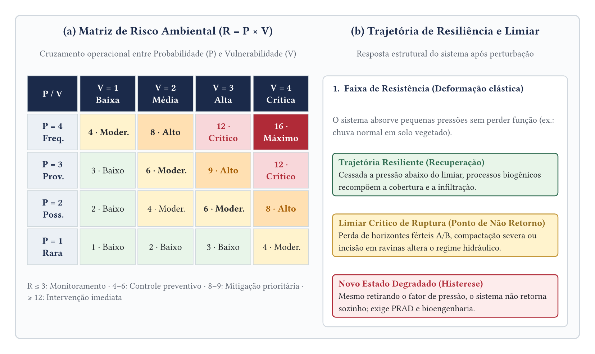

# Conceitos e Definições Operacionais da Análise Ambiental {#cap:conceitos-operacionais}

A análise ambiental depende de conceitos que estabeleçam relações observáveis entre atividades, alterações do meio e consequências. Aspecto, impacto, fragilidade, vulnerabilidade e risco respondem a perguntas diferentes. Sua distinção permite construir diagnósticos em que cada conclusão esteja ligada a uma evidência e a uma decisão de gestão.

::: {.callout-note title="O que você vai aprender neste capítulo"}
O capítulo desenvolve o emprego dos conceitos operacionais usados em laudos, licenciamentos e Planos de Recuperação de Áreas Degradadas, formando a base do **Estudo Orientado 3 (EO3)**. Ao concluir o estudo, você será capaz de definir ambiente e meio ambiente (PNMA e Sánchez, 2013), distinguir aspecto de impacto ambiental e classificar impactos, diferenciar poluição de degradação ambiental, calcular riscos matriciais ($R = P \times V$) separando perigo, vulnerabilidade e fragilidade, e escolher entre restauração, reabilitação e remediação frente à resiliência do sistema.
:::

::: {.callout-tip title="Revisando o que você precisa saber"}
A leitura retoma a relação entre processos naturais e uso da terra consolidada no Capítulo 3. Uma encosta suscetível à erosão possui condições físicas que favorecem a mobilização de partículas, enquanto a presença de uma estrada ou de uma população a jusante acrescenta elementos expostos às consequências dessa mobilização.
:::

O arcabouço normativo e técnico deste capítulo articula a **PNMA** (Política Nacional do Meio Ambiente, Lei nº 6.938/1981), as resoluções do **CONAMA** (como a Resolução nº 01/1986 sobre impacto ambiental), o **SNUC** (Lei nº 9.985/2000 sobre recuperação e restauração) e a norma **ISO 14001** (distinção entre aspecto e impacto). Na avaliação semiquantitativa de riscos, $P$ designa o perigo ou ameaça em escala ordinal de $1$ a $4$ (Baixo a Crítico), $V$ indica a vulnerabilidade socioambiental ou estrutural de $0$ a $4$ (Nula a Muito alta), $R = P \times V$ representa o índice de risco ambiental ($0$ a $16$) e $\Delta R\%$ mede sua variação percentual após medidas preventivas ou mitigadoras.

## Ambiente e Meio Ambiente, Enquadramento Legal e Científico

Na legislação brasileira, a Política Nacional do Meio Ambiente (Lei nº 6.938/1981, Art. 3º, inciso I) define **meio ambiente** como o “conjunto de condições, leis, influências e interações de ordem física, química e biológica, que permite, abriga e rege a vida em todas as suas formas”. Essa definição marcou um avanço histórico ao reconhecer o caráter sistêmico e interativo do ambiente, superando a lista estática de elementos isolados.

Na prática da Análise Ambiental contemporânea, conforme destacam Sánchez (2013, cap. 1) e Tauk-Tornisielo (1996), o conceito operacional de **ambiente** precisa ser lido de forma ampliada, abrangendo tanto o meio natural (físico e biótico) quanto o meio construído e as relações socioeconômicas e culturais. Essa ampliação é confirmada pela própria Resolução CONAMA nº 01/1986, que ao regulamentar a Avaliação de Impacto Ambiental exige o diagnóstico integrado de três meios, compreendendo o *meio físico* (subsolo, água, ar, clima, relevo e solos), o *meio biológico e ecossistemas naturais* (fauna, flora e interações ecológicas) e o *meio socioeconômico* (uso e ocupação do solo, infraestrutura, economia local, patrimônio histórico e cultural).

## Aspecto Ambiental, Impacto Ambiental e Classificação de Impactos

Um dos avanços conceituais mais importantes da gestão ambiental moderna, consolidado pela norma ABNT NBR ISO 14001 e sistematizado por Sánchez (2013), consiste na separação rigorosa entre **atividade**, **aspecto ambiental** e **impacto ambiental** em uma cadeia causal contínua (@fig-aspecto-risco, Subfigura (a)). A **atividade humana** funciona como causa geradora, englobando toda ação, obra, processo produtivo ou serviço executado pela sociedade, como a abertura de estrada em encosta, a operação de um laticínio, a terraplanagem de um parque eólico ou a implantação de uma estação de tratamento de esgoto. Dessa atividade deriva o **aspecto ambiental**, isto é, o mecanismo de interação pelo qual elementos das atividades, produtos ou serviços entram em contato com o meio ambiente, a exemplo da supressão da cobertura vegetal com exposição do solo à chuva, do lançamento de efluente líquido com carga orgânica, da emissão de poeira ou da captação de água subterrânea. Como consequência desse contato surge o **impacto ambiental**, definido pela Resolução CONAMA nº 01/1986 (Art. 1º) e por Sánchez (2013) como qualquer alteração das propriedades físicas, químicas e biológicas do meio ambiente resultante das atividades humanas que afete a saúde, a segurança, o bem-estar da população, as atividades sociais e econômicas, a biota, as condições estéticas e sanitárias ou a qualidade dos recursos ambientais.

Diferentemente do senso comum, no qual “impacto” costuma aparecer como sinônimo de prejuízo, na Análise Ambiental técnica o impacto corresponde a qualquer alteração da qualidade ambiental produzida por ação humana, podendo assumir caráter **adverso (negativo)**, quando degrada o meio, ou **benéfico (positivo)**, quando melhora condições ecológicas ou socioeconômicas, como na recomposição de mata ciliar ou na implantação de saneamento básico. A cadeia causal da atividade ao impacto articula-se diretamente com a matriz conceitual de risco ambiental (@fig-aspecto-risco), cuja estrutura $4 \times 4$ será detalhada na seção sobre risco.

{#fig-aspecto-risco fig-alt="Painel duplo com cadeia Atividade-Aspecto-Impacto à esquerda e Matriz de Risco 4x4 à direita"}

Para que os impactos identificados em um diagnóstico sejam comparáveis e subsidiem medidas mitigadoras proporcionais, a Análise Ambiental classifica cada impacto segundo sete atributos operacionais (Sánchez, 2013). Quanto à **natureza (valor)**, distingue-se o impacto adverso (como erosão em sulcos após desmatamento) do benéfico (como o aumento da infiltração após bioengenharia de talude). Quanto à **ordem causal**, separa-se o impacto direto ou primário (remoção da vegetação em margem) do indireto ou secundário (assoreamento a jusante reduzindo o volume útil de um reservatório). Pelo **prazo de manifestação**, diferencia-se o efeito imediato (ruído e poeira durante uma obra) daquele de médio ou longo prazo (salinização progressiva de solo irrigado no Semiárido). Quanto à **duração**, o impacto pode ser temporário (turbidez restrita à construção de um bueiro), permanente (submersão definitiva de um vale por barragem) ou cíclico. Quanto à **reversibilidade**, distinguem-se alterações reversíveis mediante manejo (compactação superficial) daquelas irreversíveis (extinção local de espécie endêmica ou perda total de horizonte orgânico em rocha exposta). Pela **abrangência espacial**, classifica-se o efeito em local ou pontual, regional (alteração hidrológica na bacia do Rio Paraguaçu) ou estratégico. Ademais, quanto à **interação e acumulação**, o impacto **cumulativo** resulta da soma de efeitos semelhantes ao longo do tempo ou de múltiplos empreendimentos (como dezenas de pequenos barramentos reduzindo a vazão total de um rio), enquanto o impacto **sinérgico** decorre da interação entre dois ou mais impactos distintos cujo efeito combinado supera a soma isolada das partes (como supressão de mata ciliar associada ao lançamento de esgoto doméstico elevando drasticamente a eutrofização e o assoreamento). O Exemplo 4.1 aplica essa cadeia causal e sua classificação a uma obra viária urbana.

::: {.callout-tip appearance="simple"}
### Exemplo 4.1 (Básico). Cadeia Atividade-Aspecto-Impacto e Classificação em Obra Urbana

**Situação analisada.** A prefeitura de Feira de Santana realiza uma obra de abertura de avenida marginal com drenagem pluvial ao longo de um córrego urbano. Durante a terraplanagem em período chuvoso, máquinas retiram a vegetação de barranco sem instalar barreiras de contenção de sedimentos, gerando enxurrada barrenta que atinge o córrego e assoreia um trecho de $400\text{ m}$ a jusante. Estruture a cadeia causal e classifique o impacto de assoreamento.

**Dados disponíveis.** Obra de abertura de avenida marginal; retirada de vegetação e exposição de solo sem contenção durante chuvas; carreamento de sedimentos e assoreamento de $400\text{ m}$ do córrego a jusante.

**Problema a resolver.** Separar atividade, aspecto ambiental e impacto ambiental (direto e indireto), classificando o assoreamento pelos critérios de Sánchez (2013).

**Fundamento da análise.** Cadeia causal da @fig-aspecto-risco (Sánchez, 2013) e os sete atributos operacionais de classificação de impactos.

**Desenvolvimento.** **Passo 1, Cadeia causal.** A **atividade humana** é a terraplanagem para abertura da avenida marginal. O **aspecto ambiental** consiste na supressão da cobertura vegetal com exposição do solo solto à ação erosiva da chuva e carreamento de partículas para a drenagem. O **impacto ambiental direto** corresponde à erosão acelerada no talude da obra e ao aumento imediato da turbidez da água, desencadeando o **impacto ambiental indireto** de assoreamento da calha do córrego ao longo de $400\text{ m}$ a jusante, com redução da seção de escoamento e maior risco de transbordamento.

**Passo 2, Classificação do impacto “assoreamento a jusante”.** O efeito apresenta natureza **adversa**, ordem causal **indireta** (decorrente da erosão no talude), prazo **imediato a médio prazo** (já nas primeiras chuvas intensas), duração **temporária a permanente** (enquanto faltarem desassoreamento e estabilização da margem), caráter **reversível** mediante manejo corretivo (contenção de taludes e remoção controlada de sedimentos), abrangência **local** ($400\text{ m}$ na microbacia urbana) e comportamento **cumulativo** ao somar-se a sedimentos de outros loteamentos na mesma bacia.

**Interpretação do resultado.** Atividade definida pela terraplanagem; Aspecto definido pela exposição de solo sem contenção; Impacto direto em erosão e turbidez; Impacto indireto em assoreamento a jusante (adverso, indireto, imediato a médio prazo, reversível mediante intervenção, local e potencialmente cumulativo).

**Condições de validade.** A separação clara entre aspecto e impacto permite atacar a causa (instalar barreiras de contenção, biomantas e drenagem provisória sobre o solo exposto) antes que o assoreamento se consolide.
:::

Trocar o mecanismo de interação (aspecto) pela alteração ambiental resultante (impacto) é uma das falhas mais comuns em matrizes de Avaliação de Impacto Ambiental, como aponta o Erro 1.

::: {.callout-warning appearance="simple"}
### Erro 1, Confundir Aspecto Ambiental com Impacto Ambiental

**Equívoco frequente.** Listar em uma matriz de AIA o “desmatamento” ou o “lançamento de esgoto” na coluna de *impactos ambientais*.

**Por que está incorreto.** Desmatamento (supressão vegetal) e lançamento de esgoto são **aspectos ambientais** (mecanismos pelos quais a atividade interage com o meio). Os **impactos** são as alterações resultantes na qualidade ambiental, como perda de habitat, erosão laminar, redução do oxigênio dissolvido ou mortandade de peixes.

**Como evitar.** Teste sempre a frase com o conector “provoca”, verificando que a *Atividade* gera o *Aspecto*, que **provoca** o *Impacto*.
:::

## Poluição versus Degradação Ambiental

A Lei nº 6.938/1981 (Art. 3º, incisos II e III) e Sánchez (2013) estabelecem uma relação lógica precisa de gênero e espécie entre degradação ambiental e poluição. A **degradação da qualidade ambiental** corresponde ao gênero, definido como a *alteração adversa* das características do meio ambiente por meio de processos físicos, químicos ou biológicos que reduzem a qualidade ecológica, a produtividade do solo, a estabilidade do relevo ou a funcionalidade dos ecossistemas. Dentro desse conjunto mais amplo situa-se a **poluição** como espécie particular, caracterizada pela degradação da qualidade ambiental resultante de atividades que prejudiquem a saúde, a segurança e o bem-estar da população, criem condições adversas às atividades sociais e econômicas, afetem desfavoravelmente a biota ou as condições estéticas e sanitárias do meio ambiente, ou *lancem matérias ou energia em desacordo com os padrões ambientais estabelecidos*.

Na prática pericial, **toda poluição causa degradação ambiental, enquanto a degradação ambiental também ocorre sem lançamento de poluentes**. Assim, o desmatamento ilegal de uma encosta de Caatinga seguido de sobrepastejo provoca compactação do solo, perda de biodiversidade e erosão em ravinas, configurando severa **degradação ambiental** mesmo na ausência de substâncias tóxicas ou poluentes químicos. Já o despejo de efluente industrial com metais pesados em um córrego acima dos padrões do CONAMA caracteriza simultaneamente **poluição** e **degradação ambiental**. O Exemplo 4.2 aplica essa distinção a duas propriedades rurais vizinhas.

::: {.callout-tip appearance="simple"}
### Exemplo 4.2 (Básico). Poluição vs. Degradação Ambiental em Duas Propriedades no Semiárido

**Situação analisada.** Durante fiscalização técnica em uma sub-bacia do Semiárido baiano, um analista avalia duas propriedades rurais vizinhas. Na Propriedade Alfa, o superpastejo contínuo removeu o estrato herbáceo, compactou o solo e desencadeou sulcos e ravinas profundas em encosta. Na Propriedade Beta, um pequeno laticínio lança soro de leite e água de lavagem sem tratamento diretamente em um riacho intermitente, elevando a Demanda Bioquímica de Oxigênio (DBO) muito acima dos limites do CONAMA e provocando mortandade de peixes nas poças remanescentes. Classifique cada situação quanto a degradação ambiental e poluição.

**Dados disponíveis.** Propriedade Alfa com superpastejo, solo compactado e erosão em ravinas sem lançamento de substâncias químicas ou efluentes. Propriedade Beta com lançamento de efluente orgânico fora dos padrões legais, elevação de DBO e mortandade de peixes.

**Problema a resolver.** Determinar, com base na Lei nº 6.938/1981 e em Sánchez (2013), se cada caso caracteriza degradação ambiental, poluição ou ambos.

**Fundamento da análise.** Aplicação dos incisos II e III do Art. 3º da PNMA (gênero dado pela degradação e espécie dada pela poluição).

**Desenvolvimento.** **Passo 1, Análise da Propriedade Alfa.** Ocorre alteração adversa severa das propriedades físicas e ecológicas do solo (compactação, perda de cobertura e erosão em ravinas), sem lançamento de substância poluente em desacordo com padrões de emissão. Caracteriza-se, portanto, **degradação ambiental** sem poluição em sentido estrito. **Passo 2, Análise da Propriedade Beta.** Ocorre lançamento de matéria orgânica em desacordo com os padrões ambientais vigentes, afetando desfavoravelmente a biota (mortandade de peixes) e as condições sanitárias da água. Como toda poluição constitui uma forma específica de degradação, o caso reúne simultaneamente **poluição hídrica** e **degradação ambiental**.

**Interpretação do resultado.** Propriedade Alfa apresenta degradação ambiental sem poluição. Propriedade Beta apresenta poluição hídrica e, consequentemente, degradação ambiental.

**Condições de validade.** O enquadramento jurídico e técnico está consistente com a relação de inclusão da PNMA ($\text{poluição} \subset \text{degradação}$), orientando respostas distintas, como manejo conservacionista do solo e pastagem em Alfa e estação de tratamento de efluentes com autuação por poluição em Beta.
:::

Igualar poluição e degradação ou negar a existência de impactos positivos gera enquadramentos jurídicos equivocados, como detalhado no Erro 2.

::: {.callout-warning appearance="simple"}
### Erro 2, Tratar Todo Impacto como Negativo e Igualar Poluição a Degradação

**Equívoco frequente.** Afirmar que “não há impacto ambiental em projetos de recuperação” ou dizer que “a erosão do solo por pastoreio é um caso de poluição”.

**Por que está incorreto.** Projetos de recuperação geram **impactos ambientais benéficos** (positivos); além disso, erosão sem lançamento de substâncias em desacordo com padrões legais constitui **degradação ambiental**, distinguindo-se de poluição.

**Como evitar.** Qualifique sempre o impacto (adverso ou benéfico) e verifique se houve lançamento de matéria ou energia ou alteração sanitária prevista no Art. 3º, III da PNMA antes de usar o termo poluição.
:::

## Perigo, Vulnerabilidade, Fragilidade Ambiental e Risco Ambiental

Quatro conceitos frequentemente confundidos em relatórios técnicos precisam ser rigorosamente separados para fundamentar mapas de risco, defesa civil e ordenamento territorial, cuja lógica matricial foi introduzida na Subfigura (b) da @fig-aspecto-risco. O **perigo ou ameaça ($P$)** designa o evento ou fenômeno físico, biológico ou tecnológico com potencial intrínseco de causar dano a pessoas, bens ou ecossistemas (como chuva extrema concentrada, escorregamento translacional em encosta, inundação brusca ou rompimento de barragem), referindo-se à *probabilidade e intensidade do evento potencialmente danoso*.

Diante dessa ameaça, a **vulnerabilidade ($V$)** mede o grau de exposição, suscetibilidade e incapacidade de proteção, resposta ou recuperação de uma população, edificação, infraestrutura ou atividade econômica. Trata-se de um atributo com forte componente socioespacial, pois famílias com moradias precárias em fundos de vale sem drenagem nem alerta precoce apresentam vulnerabilidade muito superior à de edificações estruturadas fora da cota de inundação diante da mesma chuva. Já a **fragilidade ambiental** expressa uma propriedade física e ecológica intrínseca de um ambiente ou unidade de paisagem de sofrer desestabilização frente a processos morfodinâmicos e intervenções humanas, em função da interação entre declividade, solo, litologia, clima e cobertura vegetal (conceito formalizado no Cap. 9 com a metodologia de Ross, 1994), subsistindo mesmo quando falta ocupação humana.

Dessa articulação emerge o **risco ambiental ($R$)**, entendido como a expectativa de perdas ou danos resultante da interseção entre um **perigo ($P$)** e um sistema **vulnerável ($V$)**. A distinção entre fragilidade física e risco socioambiental evidencia-se quando comparamos duas encostas com idêntica declividade de $38\%$ e solo raso (@fig-risco_vs_fragilidade). Enquanto a Vertente 1 permanece conservada e sem população exposta ($V = 0 \Rightarrow R = 0$), na Vertente 2 o desmatamento e a ocupação irregular na base elevam o perigo e a vulnerabilidade até o risco crítico ($R = 16$).

{#fig-risco_vs_fragilidade fig-alt="Comparação entre duas encostas de 38% de declividade mostrando risco nulo na vertente conservada sem moradores e risco crítico na vertente desmatada com casas na base"}

Na análise semiquantitativa de riscos socioambientais alinhada à matriz $4 \times 4$ da Subfigura (b) da @fig-aspecto-risco, o índice de risco ambiental $R$ resulta do produto entre o nível de perigo ($P$) e o nível de vulnerabilidade ($V$), servindo a redução relativa $\Delta R\%$ para medir o efeito de intervenções preventivas ou mitigadoras.

$$
R = P \times V \qquad\qquad \Delta R\% = \frac{R_{\text{final}} - R_{\text{inicial}}}{R_{\text{inicial}}} \times 100\%
$$

Nestas expressões, $P \in \{1, 2, 3, 4\}$ representa o nível de Perigo ($1 = \text{Baixo}$, $2 = \text{Médio}$, $3 = \text{Alto}$, $4 = \text{Crítico}$) e $V \in \{0, 1, 2, 3, 4\}$ indica a Vulnerabilidade ($0 = \text{Nula}$ por ausência de exposição, $1 = \text{Baixa}$, $2 = \text{Média}$, $3 = \text{Alta}$, $4 = \text{Muito alta}$). Os valores de $R$ ($0$ a $16$) agrupam-se nas classes **Baixo** ($1 \le R \le 3$), **Médio** ($4 \le R \le 6$), **Alto** ($8 \le R \le 9$) e **Crítico** ($R \ge 12$). Quando as variáveis são ordinais, o produto $R$ opera como convenção de priorização de gestão, orientando decisões conforme as faixas de risco sem representar probabilidade numérica direta de ocorrência. O Exemplo 4.3 demonstra o cálculo matricial do risco em três setores de encosta e quantifica a redução percentual alcançada após obras de drenagem, bioengenharia e realocação.

::: {.callout-tip appearance="simple"}
### Exemplo 4.3 (Intermediário). Cálculo Matricial e Redução Percentual de Risco Ambiental ($R = P \times V$)

**Situação analisada.** A Defesa Civil de um município do Recôncavo Baiano mapeou três setores de uma vertente sujeita a escorregamentos (Setores A, B e C) utilizando a matriz $4 \times 4$ da @fig-aspecto-risco. Posteriormente, no setor mais grave, a prefeitura executou obras de drenagem superficial, estabilização de talude com bioengenharia e realocação das casas mais precárias. Avalie o risco inicial de cada setor e quantifique o efeito percentual da intervenção.

**Dados disponíveis.** Cenário inicial com Setor A ($P = 4$, $V = 4$), Setor B ($P = 3$, $V = 3$) e Setor C ($P = 4$, $V = 1$). Cenário pós-intervenção no Setor A com perigo reduzido de $4$ para $3$ (drenagem e estabilização) e vulnerabilidade reduzida de $4$ para $2$ (realocação e reforço estrutural).

**Problema a resolver.** Calcular $R = P \times V$ e classificar os setores A, B e C antes da obra, determinando também o novo risco de A e a variação percentual $\Delta R\%$.

**Fundamento da análise.** Aplicação da equação $R = P \times V$, das faixas da @fig-aspecto-risco (1 a 3 Baixo; 4 a 6 Médio; 8 a 9 Alto; 12 a 16 Crítico) e de $\Delta R\% = \frac{R_1 - R_0}{R_0}\times 100\%$.

**Desenvolvimento.** **Passo 1, Cálculo inicial dos três setores.** No Setor A, $R_A = 4 \times 4 = 16$ (**Risco Crítico**); no Setor B, $R_B = 3 \times 3 = 9$ (**Risco Alto**); no Setor C, $R_C = 4 \times 1 = 4$ (**Risco Médio**). **Passo 2, Comparação crítica entre B e C.** Embora o Setor C possua perigo maior ($P = 4$) do que o Setor B ($P = 3$), seu risco ($R_C = 4$) corresponde a menos da metade do risco de B ($R_B = 9$) porque a vulnerabilidade em C é baixa ($V = 1$).

**Passo 3, Cenário pós-intervenção no Setor A ($P_1 = 3$, $V_1 = 2$).**

$$
R_{A,\text{final}} = 3 \times 2 = 6 \quad (\text{Risco Médio}).
$$

**Passo 4, Variação percentual do risco no Setor A.**

$$
\Delta R\% = \frac{6 - 16}{16} \times 100\% = \frac{-10}{16} \times 100\% = -0{,}625 \times 100\% = -62{,}50\%.
$$

**Interpretação do resultado.** Inicialmente, Setor A = $16$ (Crítico), Setor B = $9$ (Alto) e Setor C = $4$ (Médio). Após intervenção no Setor A, $R = 6$ (Médio), representando redução de $62{,}50\%$ no índice de risco.

**Condições de validade.** O resultado faz pleno sentido matemático ($6/16 = 37{,}5\%$ do risco original, logo queda de $62{,}5\%$) e operacional, demonstrando que atuar simultaneamente sobre o perigo (engenharia e bioengenharia) e sobre a vulnerabilidade (ordenamento e habitação) produz queda acentuada de risco.
:::

Rotular mapas puramente físicos de declividade ou erodibilidade como mapas de risco ignora a dimensão de exposição humana, equívoco alertado a seguir.

::: {.callout-warning appearance="simple"}
### Erro 3, Confundir Fragilidade Ambiental ou Perigo com Risco

**Equívoco frequente.** Chamar um mapa de declividade ou de erodibilidade de “mapa de risco ambiental” sem considerar a presença e a vulnerabilidade da população ou da infraestrutura.

**Por que está incorreto.** Declividade e erodibilidade expressam **fragilidade** ou **perigo físico ($P$)**. Sem vulnerabilidade ($V > 0$), falta exposição capaz de gerar risco socioambiental ($R = P \times V$).

**Como evitar.** Verifique se os dois fatores ($P$ e $V$) estão explicitamente presentes no diagnóstico antes de empregar a palavra risco.
:::

O Exemplo 4.4 consolida a separação entre fragilidade potencial, perigo, vulnerabilidade e risco em duas vertentes idênticas da Caatinga sob usos distintos do solo.

::: {.callout-tip appearance="simple"}
### Exemplo 4.4 (Intermediário). Fragilidade Ambiental vs. Perigo vs. Risco em Vertentes da Caatinga

**Situação analisada.** Considere duas vertentes geomorfologicamente idênticas no Semiárido baiano, ambas com $38\%$ de declividade, Neossolo Litólico raso e chuvas concentradas de alta erosividade. A Vertente 1 localiza-se no interior de um Parque Estadual preservado, sem estradas nem moradores. A Vertente 2 teve sua vegetação suprimida e recebeu um loteamento residencial irregular na base da encosta. Compare fragilidade ambiental, perigo, vulnerabilidade e risco nas duas vertentes.

**Dados disponíveis.** Vertente 1 com declividade $38\%$, solo raso, vegetação de Caatinga preservada e ausência de população ou bens expostos. Vertente 2 com mesma declividade e solo, vegetação suprimida e loteamento irregular na base.

**Problema a resolver.** Diferenciar conceitualmente a condição de cada vertente quanto a fragilidade potencial, perigo, vulnerabilidade e risco socioambiental.

**Fundamento da análise.** Distinção rigorosa entre fragilidade intrínseca do meio físico, ameaça física, exposição humana e risco conforme a seção anterior.

**Desenvolvimento.** **Passo 1, Fragilidade potencial (meio físico).** Ambas as vertentes apresentam **alta fragilidade natural potencial**, pois compartilham declividade elevada ($38\%$), solo raso e chuvas erosivas. Na Vertente 1, a cobertura vegetal conservada protege o solo (menor fragilidade emergente); na Vertente 2, a supressão vegetal eleva a instabilidade. **Passo 2, Perigo ou Ameaça ($P$).** Em ambas existe potencial físico de escoamento rápido e queda de material, acentuado na Vertente 2 pela retirada da vegetação e pelos cortes de talude do loteamento. **Passo 3, Vulnerabilidade ($V$).** Na Vertente 1, faltam pessoas, habitações ou infraestruturas expostas ($V = 0$ do ponto de vista socioambiental humano). Na Vertente 2, há moradias precárias diretamente na zona de impacto ($V$ alta ou muito alta). **Passo 4, Risco Socioambiental ($R$).** Na Vertente 1, apesar da alta fragilidade física, o risco de desastre humano é **nulo** ($R = P \times 0 = 0$). Na Vertente 2, a convergência entre alto perigo e alta vulnerabilidade gera **risco alto ou crítico**.

**Interpretação do resultado.** Ambas possuem alta fragilidade física potencial, porém apenas a Vertente 2 apresenta risco socioambiental humano elevado, em virtude da exposição de moradores vulneráveis e da desestabilização antrópica da cobertura vegetal.

**Condições de validade.** Esse contraste comprova por que mapas de fragilidade física exigem o cruzamento com dados de exposição e vulnerabilidade social antes de receberem o rótulo de “mapas de risco”.
:::

## Resiliência, Recuperação, Restauração, Reabilitação e Sustentabilidade

Quando um ambiente já sofreu degradação, o analista ambiental precisa avaliar sua capacidade de resposta espontânea e definir o objetivo técnico viável de intervenção, articulando os limiares de tolerância da matriz de risco às trajetórias de resiliência do sistema (@fig-matriz-risco-tolerancia). Enquanto níveis baixos de risco ($R \le 3$) demandam monitoramento e níveis médios ($4 \le R \le 6$) requerem controle preventivo, situações de risco alto ($8$ a $9$) exigem mitigação prioritária e riscos críticos ($\ge 12$) impõem intervenção imediata, pois o sistema aproxima-se do limiar de ruptura estrutural.

O ponto de partida dessa avaliação é a **resiliência**, entendida como a capacidade de um ecossistema ou sistema socioambiental absorver perturbações dentro da faixa de resistência elástica, reorganizar-se e retornar ao estado funcional quando cessa a pressão. Quando a perda de horizontes férteis A e B, a compactação severa ou a incisão em ravinas ultrapassam o **limiar crítico de ruptura** (ponto de não retorno), o sistema ingressa em um novo estado degradado marcado por **histerese** (@fig-matriz-risco-tolerancia), no qual a mera retirada do fator de pressão falha em recompor o ambiente espontaneamente, exigindo PRAD e bioengenharia.

{#fig-matriz-risco-tolerancia fig-alt="Painel duplo mostrando matriz de risco com níveis de tolerância à esquerda e trajetória de resiliência, limiar de ruptura e histerese à direita"}

Quando a intervenção humana se torna necessária, Sánchez (2013) e a Lei do SNUC (Lei nº 9.985/2000, Art. 2º, incisos XIII e XIV) diferenciam estratégias com metas técnicas precisas. A **recuperação ambiental** opera como conceito guarda-chuva técnico e legal adotado em PRAD e licenciamento, designando a restituição de um ecossistema degradado a uma *condição não degradada* que pode igualar-se ou diferir da condição original. Dentro desse espectro, a **restauração ecológica** representa o objetivo mais exigente, buscando restituir a estrutura, a composição de espécies nativas e as funções ecológicas o mais próximo possível da *condição original pré-distúrbio*, meta indicada para APPs, nascentes e Unidades de Conservação onde a resiliência e os remanescentes permitem recomposição nativa. Já a **reabilitação ambiental** conduz a área degradada a um estado estável, seguro e funcional voltado a um *novo uso predefinido* (produtivo, urbano, paisagístico ou de lazer) em locais muito alterados, como cavas urbanas ou antigas pedreiras em que o retorno ao estado original é inviável física ou economicamente. Em situações com passivos químicos por hidrocarbonetos, chorume, metais pesados ou agrotóxicos persistentes, aplica-se a **remediação** (Sánchez, 2013), voltada a remover, conter ou neutralizar contaminantes no solo e na água subterrânea.

Articulando essas escalas no longo prazo, a **sustentabilidade** atua como princípio orientador que mantém o uso dos recursos naturais dentro da capacidade de suporte e regeneração dos ecossistemas, integrando integridade ecológica, viabilidade econômica, justiça socioespacial e equidade intergeracional. Na literatura ambiental, distingue-se a *sustentabilidade fraca*, que admite substituir capital natural por capital financeiro ou tecnológico, da *sustentabilidade forte*, que reconhece funções ecológicas críticas insubstituíveis, como água doce, solos férteis e biodiversidade.

## Síntese Avançada, Resiliência, Sinergia e Escolha de Estratégia em PRAD

Passivos ambientais severos frequentemente combinam baixa resiliência física, ruptura topográfica irreversível e pressões difusas provenientes do entorno urbano ou agrícola. O Exemplo 4.5 integra os conceitos de resiliência, impacto sinérgico e escolha técnica entre restauração e reabilitação para fundamentar um Plano de Recuperação de Áreas Degradadas.

::: {.callout-tip appearance="simple"}
### Exemplo 4.5 (Avançado). Escolha entre Restauração e Reabilitação em Passivo Minerário

**Situação analisada.** Na planície fluvial do Rio Jacuípe (BA), uma área de $8\text{ ha}$ usada por 15 anos para extração irregular de areia deixou cavas com $4\text{ m}$ de profundidade que atingiram o lençol freático, margens instáveis em desmoronamento e perda completa do horizonte A do solo. A área está hoje cercada por expansão urbana e por pequenas lavouras que aplicam fertilizantes solúveis. O Ministério Público exigiu um PRAD. Discuta a resiliência local, o potencial impacto cumulativo e sinérgico com as lavouras vizinhas e justifique tecnicamente a escolha entre restauração ecológica integral e reabilitação ambiental.

**Dados disponíveis.** Passivo de $8\text{ ha}$ com cavas de $4\text{ m}$ atingindo o lençol freático, margens instáveis, ausência de solo superficial, entorno urbano e agrícola com fertilizantes e exigência legal de PRAD.

**Problema a resolver.** Avaliar a resiliência do sistema, a possibilidade de impacto sinérgico com o entorno e a estratégia mais adequada entre restauração e reabilitação.

**Fundamento da análise.** Critérios de resiliência, impactos cumulativos e sinérgicos e distinção entre recuperação, restauração e reabilitação segundo Sánchez (2013) e Lei do SNUC.

**Desenvolvimento.** **Passo 1, Avaliação da resiliência.** A resiliência natural está severamente comprometida (**muito baixa**). A remoção de $4\text{ m}$ de sedimento eliminou o horizonte superficial, a matéria orgânica e o banco de sementes, alterando irreversivelmente a topografia e expondo a água subterrânea em condição de histerese na qual a regeneração espontânea falha em restituir a floresta ciliar original. **Passo 2, Impacto sinérgico com as lavouras.** O escoamento superficial carregando nutrientes das lavouras vizinhas (aspecto agrícola) encontra o lençol freático exposto nas cavas estagnadas (aspecto minerário). A combinação desses dois processos distintos gera eutrofização acelerada e risco de contaminação do aquífero, efeito mais intenso do que cada atividade isolada (**impacto sinérgico**). **Passo 3, Escolha entre restauração e reabilitação.** A **restauração ecológica integral** (retorno exato à planície original pré-mineração) exigiria milhões de metros cúbicos de material de aterro externo, criando novas áreas degradadas de empréstimo e tornando-se ambiental e economicamente inviável. A estratégia tecnicamente recomendada é a **reabilitação ambiental** (inserida no guarda-chuva legal da recuperação), promovendo retaludamento e estabilização das margens das cavas com bioengenharia, implantação de faixa tampão de vegetação nativa ciliar para filtrar nutrientes das lavouras e conversão das lagoas estabilizadas em parque ecológico e área segura de amortecimento hídrico.

**Interpretação do resultado.** Resiliência muito baixa; risco de impacto sinérgico (eutrofização e contaminação do aquífero pela interação entre cava aberta e fertilizantes); a estratégia indicada é a **reabilitação ambiental** associada à faixa tampão vegetada nativa nas bordas, descartando a restauração topográfica integral por inviabilidade física e ecológica.

**Condições de validade.** A decisão respeita a legislação (o PRAD exige recuperação, que admite reabilitação quando o retorno ao estado original é impraticável) e neutraliza tanto a instabilidade geotécnica das margens quanto a vulnerabilidade do lençol freático.
:::

## Armadilha Conceitual e Materiais Audiovisuais de Apoio

Ao redigir planos de recuperação ou condicionar licenciamentos, um equívoco recorrente consiste em prometer metas tecnicamente inviáveis por confundir o significado jurídico de recuperação, restauração e reabilitação.

::: {.callout-warning appearance="simple"}
### Erro 4, Prometer “Restauração Integral” Onde Apenas a Reabilitação é Viável

**Equívoco frequente.** Redigir em um PRAD que uma cava profunda de mineração ou uma área urbana aterrada será “integralmente restaurada à sua condição original”.

**Por que está incorreto.** A restauração exige aproximação máxima da estrutura, composição e funções originais pré-distúrbio, o que frequentemente se torna impossível após alterações geomorfológicas irreversíveis. Promessas inexequíveis levam à rejeição do PRAD ou ao descumprimento de condicionantes.

**Como evitar.** Avalie a resiliência e o grau de alteração do relevo e do solo; adote a **restauração** apenas quando o retorno ao ecossistema de referência for factível, e a **reabilitação** quando o objetivo for um novo uso estável e seguro.
:::

Para aprofundar a compreensão integrada dos conceitos de degradação, vulnerabilidade, fragilidade e resiliência ambiental aplicados a estudos técnicos, assista à videoaula recomendada na página da disciplina, [Degradação Ambiental](https://www.youtube.com/watch?v=5EFxN7jGob8), que revisa esses conceitos operacionais e suas implicações para o planejamento e a recuperação de áreas degradadas.

## Exercícios de fixação

#### Nível Básico (Exercícios 1 a 5)

1. Apresente a definição legal de **meio ambiente** segundo a Lei nº 6.938/1981 (PNMA) e explique por que Sánchez (2013) recomenda incluir explicitamente o meio construído e as relações socioeconômicas na Análise Ambiental.

2. Para a atividade humana “operação de uma indústria cerâmica de pequeno porte”, cite um exemplo de **aspecto ambiental** e um exemplo do correspondente **impacto ambiental**.

3. Explique a diferença entre **impacto cumulativo** e **impacto sinérgico**, apresentando um exemplo prático para cada um em uma bacia hidrográfica.

4. Justifique a afirmação segundo a qual toda poluição provoca degradação ambiental, embora a degradação ambiental também ocorra sem poluição.

5. Defina **resiliência ambiental** e explique por que um solo decapado até a rocha apresenta resiliência muito menor do que uma pastagem abandonada cercada por fragmentos de mata nativa.

#### Nível Intermediário (Exercícios 6 a 10)

6. Uma encosta ocupada (Encosta X) foi avaliada inicialmente com Perigo Alto ($P_0 = 3$) e Vulnerabilidade Muito Alta ($V_0 = 4$). Após obras de retaludamento, drenagem pluvial e melhoria estrutural das moradias, os indicadores caíram para Perigo Médio ($P_1 = 2$) e Vulnerabilidade Média ($V_1 = 2$). Calcule passo a passo o risco inicial $R_0$ e sua classe, o risco final $R_1$ e sua classe, e a variação percentual $\Delta R\%$.

7. Compare duas margens de rio urbano usando a matriz $4 \times 4$ da @fig-aspecto-risco, considerando que a **Margem Y** tem $P = 4$ e $V = 3$, enquanto a **Margem Z** tem $P = 3$ e $V = 2$. Determine o índice e a classe de risco de cada margem e indique qual delas deve receber prioridade emergencial de intervenção, justificando.

8. A implantação de uma Estação de Tratamento de Esgoto (ETE) municipal gera ruído temporário durante os 8 meses de obras, mas, após entrar em operação, reduz em $85\%$ a carga orgânica lançada no rio local durante décadas. Classifique esses dois impactos segundo os critérios de **natureza**, **duração** e **reversibilidade**.

9. Diferencie **fragilidade ambiental**, **perigo** e **risco** no contexto de um paredão rochoso instável localizado em área desabitada de parque estadual e, em comparação, imediatamente acima de uma rodovia federal movimentada.

10. Uma pedreira de granito desativada na periferia de uma cidade média do Nordeste possui paredões verticais de $18\text{ m}$ e piso totalmente rochoso. Entre **restauração ecológica** e **reabilitação ambiental**, qual alternativa é tecnicamente mais adequada? Justifique sua escolha.

#### Nível Aplicado, Questões Objetivas (Exercícios 11 a 15)

11. Na cadeia causal apresentada por Sánchez (2013) e na @fig-aspecto-risco, ao analisar a atividade “aplicação de fertilizantes em área agrícola declivosa”, constitui um **aspecto ambiental** e o seu respectivo **impacto ambiental**, nessa ordem,

    (A) Eutrofização do açude; carreamento de nitrogênio e fósforo pela enxurrada.

    (B) Carreamento de nutrientes pela enxurrada para o corpo d’água; eutrofização do açude e proliferação de algas.

    (C) Aplicação de fertilizantes; compra de insumos agrícolas.

    (D) Proliferação de algas; abertura de estrada rural.

    (E) Redução do oxigênio dissolvido; emissão de licença ambiental.

12. Em uma bacia hidrográfica do Semiárido, cinco pequenas indústrias lançam efluentes tratados dentro do padrão individual, mas a soma das cargas ao longo do rio reduz gradualmente a qualidade da água na foz. Esse fenômeno caracteriza um impacto tipicamente,

    (A) Benéfico e pontual.

    (B) Irreversível e imediato apenas na fonte.

    (C) Cumulativo.

    (D) Natural e sem origem antrópica.

    (E) Estético sem alteração físico-química.

13. Segundo a Matriz Conceitual de Risco ($R = P \times V$, escala $1$ a $4$ da @fig-aspecto-risco), uma área classificada com Perigo Crítico ($P = 4$) e Vulnerabilidade Baixa ($V = 1$) apresenta,

    (A) $R = 16$ (Risco Crítico).

    (B) $R = 12$ (Risco Crítico).

    (C) $R = 8$ (Risco Alto).

    (D) $R = 4$ (Risco Médio).

    (E) $R = 2$ (Risco Baixo).

14. De acordo com a Lei do SNUC (Lei nº 9.985/2000) e com Sánchez (2013), a restituição de um ecossistema degradado a uma condição **o mais próximo possível da sua condição original** denomina-se,

    (A) Remediação.

    (B) Reabilitação.

    (C) Restauração.

    (D) Compensação financeira.

    (E) Mitigação preventiva.

15. Sobre o conceito de **sustentabilidade forte**, em contraste com a sustentabilidade fraca, é correto afirmar que,

    (A) Admite substituir integralmente ecossistemas críticos por capital financeiro ou infraestrutura artificial.

    (B) Reconhece que determinadas funções ecológicas e estoques naturais críticos (como água doce, solos férteis e biodiversidade) são insubstituíveis e impõem limites biofísicos ao crescimento econômico.

    (C) Aplica-se exclusivamente a unidades de conservação sem presença humana no entorno.

    (D) Desconsidera a justiça social e a dimensão intergeracional na gestão ambiental.

    (E) Equivale à compensação pecuniária automática de qualquer dano irreversível.

## Questões de aplicação

### Estratégia para o Estudo Orientado 3 (EO3) e para a Avaliação Teórica

No **EO3** (Semana 4, baseado em Sánchez, 2013, cap. 1, e Tauk-Tornisielo, 1996) e em concursos para Analista Ambiental (IBAMA, ICMBio e INEMA), há três pegadinhas recorrentes que você agora sabe desarmar,

1. **Aspecto $\neq$ Impacto,** identificando sempre se o enunciado descreve o mecanismo de interação (aspecto) ou a mudança no estado do meio (impacto).

2. **Degradação $\supset$ Poluição,** verificando se houve lançamento de poluente ou alteração sanitária prevista em lei ou apenas degradação física e ecológica (como erosão e desmatamento).

3. **Restauração $\neq$ Reabilitação $\neq$ Recuperação,** lembrando que *recuperação* é o termo geral (condição não degradada, igual ou diferente da original), enquanto *restauração* busca o estado original e *reabilitação* destina a área a um novo uso funcional estável.

<!-- -->

16. **(Questão autoral, estilo Concurso Analista Ambiental / IBAMA)** Com base na Política Nacional do Meio Ambiente (Lei nº 6.938/1981), na Resolução CONAMA nº 01/1986 e na obra de Sánchez (2013), julgue as proposições abaixo,

    I.  Um impacto ambiental é necessariamente negativo, razão pela qual programas de recuperação florestal deixam de produzir impactos ambientais.

    II.  A remoção da vegetação ciliar com consequente assoreamento de curso d’água constitui degradação ambiental mesmo na ausência de lançamento de efluentes químicos tóxicos.

    III.  A interação entre dois impactos distintos cujo efeito conjunto supera a soma de seus efeitos isolados define o caráter sinérgico do impacto.

    IV.  A exposição do solo decorrente da abertura de uma estrada é o aspecto ambiental, enquanto a perda de solo por erosão laminar e o aumento da turbidez no córrego são os impactos ambientais.

    Estão corretas apenas as proposições,

    (A) I e II.

    (B) I e III.

    (C) II e IV.

    (D) II, III e IV.

    (E) I, II, III e IV.

17. **(Questão autoral, estilo ENADE / Geografia)** Duas comunidades localizam-se na mesma bacia hidrográfica semiárida, submetidas a eventos de enxurrada súbita de igual intensidade (mesmo perigo físico $P = 3$). A Comunidade 1 possui sistema de drenagem pluvial, construções em alvenaria fora da cota máxima de cheia e plano de alerta comunitário ($V = 1$). A Comunidade 2 ocupa precariamente a planície de inundação, sem drenagem nem alerta ($V = 4$). À luz dos conceitos operacionais de perigo, vulnerabilidade e risco ($R = P \times V$), assinale a alternativa correta,

    (A) Ambas as comunidades possuem o mesmo risco ambiental, pois estão expostas à mesma intensidade pluviométrica ($P = 3$).

    (B) A Comunidade 1 apresenta risco baixo ($R = 3$) e a Comunidade 2 apresenta risco crítico ($R = 12$), demonstrando o peso determinante da vulnerabilidade socioespacial na produção de desastres.

    (C) A Comunidade 2 apresenta risco médio ($R = 7$), resultado da soma entre perigo ($3$) e vulnerabilidade ($4$).

    (D) A vulnerabilidade é uma propriedade estritamente geológica do terreno, independente da renda, da infraestrutura e da localização das moradias.

    (E) Para reduzir o risco da Comunidade 2, a única medida tecnicamente possível consiste em modificar o regime climático regional para eliminar a chuva intensa.

18. **(Questão autoral, estilo Concurso Perito Ambiental / INEMA)** Um empreendimento de extração de argila abandonou, há dez anos, uma área de $12\text{ ha}$ sem solo superficial, com cavas alagadas e taludes instáveis em periferia urbana. O laudo pericial constatou resiliência natural muito baixa e propôs estabilizar os taludes, revegetar as margens com espécies nativas e integrar o espelho d’água a um parque urbano de retenção de cheias, deixando claro que a reconstituição do relevo e da floresta originais mostra-se inviável. Conceitualmente, a intervenção proposta corresponde à,

    (A) Restauração ecológica integral, pois utiliza espécies nativas nas margens.

    (B) Remediação química, visto que a área estava abandonada há dez anos.

    (C) Reabilitação ambiental, modalidade de recuperação que destina a área degradada a um novo uso estável e funcional distinto da condição original.

    (D) Degradação controlada, uma vez que preserva a modificação topográfica prévia.

    (E) Sustentabilidade fraca ilegal, pois o SNUC proíbe qualquer intervenção que deixe de reconstituir integralmente o estado original.

## Gabarito comentado {.unnumbered}

::: {.callout-tip collapse="true" title="Clique para abrir o Gabarito Comentado"}
### Resolução, Nível Básico (Exercícios 1 a 5)

1. **Meio ambiente (PNMA e Sánchez, 2013).** Pela Lei nº 6.938/1981 (Art. 3º, I), meio ambiente é o conjunto de condições, leis, influências e interações de ordem física, química e biológica que permite, abriga e rege a vida em todas as suas formas. Sánchez (2013) destaca a inclusão do meio construído e das relações socioeconômicas porque as atividades humanas transformam continuamente os sistemas naturais e os impactos ambientais atingem diretamente a saúde, a economia, o patrimônio e o bem-estar social (como reconhece a Resolução CONAMA nº 01/1986).

2. **Indústria cerâmica (aspecto e impacto).** Um exemplo de *aspecto ambiental* é a emissão de fumaça e material particulado pela queima de lenha nos fornos (ou extração de argila em várzea), provocando o *impacto ambiental* de degradação da qualidade do ar e agravo a doenças respiratórias no entorno (ou desestabilização de margens e perda de vegetação ciliar).

3. **Cumulativo e Sinérgico.** O impacto *cumulativo* resulta da soma de impactos semelhantes ao longo do tempo ou de diversas fontes (como múltiplos barramentos rurais em uma bacia reduzindo progressivamente a vazão no exutório). O impacto *sinérgico* resulta da interação entre dois ou mais impactos distintos cujo efeito combinado supera a soma isolada das partes (como remoção de mata ciliar somada ao lançamento de esgoto doméstico, acelerando conjuntamente o assoreamento e a eutrofização severa do rio).

4. **Poluição $\subset$ Degradação.** Pela PNMA (Art. 3º, II e III), degradação é o gênero (qualquer alteração adversa do meio), enquanto poluição é uma espécie específica de degradação (ligada a prejuízos à saúde, biota ou bem-estar ou lançamento de matéria e energia fora dos padrões). Logo, toda poluição degrada o ambiente, ao passo que processos como desmatamento, compactação e erosão degradam o ambiente sem envolver poluição química.

5. **Resiliência.** Capacidade do sistema absorver perturbações e recuperar estrutura e funções essenciais. O solo decapado até a rocha perdeu horizonte orgânico, estrutura porosa, retenção hídrica e banco de sementes (resiliência muito baixa, próxima ao quadro de histerese); já a pastagem cercada por fragmentos nativos preserva solo e fonte próxima de propágulos (sementes e dispersores), conferindo resiliência muito mais alta.

### Resolução, Nível Intermediário (Exercícios 6 a 10)

6. **Cálculo passo a passo do risco na Encosta X.** O risco inicial é $R_0 = P_0 \times V_0 = 3 \times 4 = \mathbf{12}$ (**Risco Crítico**, pois $R \ge 12$). O risco final reduz-se a $R_1 = P_1 \times V_1 = 2 \times 2 = \mathbf{4}$ (**Risco Médio**, faixa $4 \le R \le 6$). A variação percentual resulta em

$$
\Delta R\% = \frac{R_1 - R_0}{R_0} \times 100\% = \frac{4 - 12}{12} \times 100\% = \frac{-8}{12} \times 100\% = -\frac{2}{3} \times 100\% \approx \mathbf{-66{,}67\%}.
$$

A intervenção reduziu o índice de risco em $66{,}67\%$, deslocando a encosta da classe Crítica para a classe Média.

7. **Comparação Margem Y e Margem Z.** A Margem Y alcança $R_Y = 4 \times 3 = \mathbf{12}$ (**Risco Crítico**), enquanto a Margem Z registra $R_Z = 3 \times 2 = \mathbf{6}$ (**Risco Médio**). A **Margem Y** deve receber intervenção emergencial prioritária, pois possui o dobro do índice de risco de Z e encontra-se na faixa crítica ($R = 12$).

8. **Classificação dos impactos da ETE.** O ruído durante 8 meses de obras apresenta natureza **adversa**, duração **temporária** e caráter **reversível** (cessando ao término da obra). A redução de $85\%$ da carga orgânica no rio apresenta natureza **benéfica**, duração **permanente** (enquanto a ETE operar adequadamente) e caráter **reversível** caso a estação deixe de receber manutenção.

9. **Paredão rochoso instável.** No parque desabitado, há alta **fragilidade** física e existência de **perigo** de queda de blocos ($P > 0$), porém faltam elementos humanos expostos ($V = 0$), resultando em **risco humano nulo**. Acima da rodovia movimentada, mantêm-se a mesma fragilidade e perigo físico, agora combinados com alta exposição de veículos e passageiros ($V > 0$), configurando **risco socioambiental elevado** que exige obras de contenção e monitoramento.

10. **Pedreira de granito desativada.** A estratégia tecnicamente adequada é a **reabilitação ambiental**. A remoção de $18\text{ m}$ de maciço rochoso alterou irreversivelmente a topografia e eliminou o solo original, tornando inviável a restauração ecológica à condição pré-mineração. A reabilitação permite estabilizar os paredões, drenar a cava e criar um uso seguro (como parque geológico, anfiteatro ou área de lazer com vegetação rupestre adaptada).

### Resolução, Nível Aplicado e Estilo ENADE/Concursos (Exercícios 11 a 18)

11. **Gabarito, (B).** O carreamento de nutrientes pela enxurrada é o mecanismo de interação com o meio (*aspecto*), enquanto a eutrofização e a proliferação de algas representam a alteração na qualidade da água (*impacto*). A alternativa (A) inverte causa e efeito.

12. **Gabarito, (C).** A soma de múltiplas contribuições semelhantes ao longo do rio que deteriora gradualmente a qualidade hídrica na foz define o **impacto cumulativo**.

13. **Gabarito, (D).** Pela fórmula $R = P \times V$, temos $R = 4 \times 1 = 4$. Na matriz $4 \times 4$ da @fig-aspecto-risco, valores entre $4$ e $6$ correspondem à classe **Risco Médio**.

14. **Gabarito, (C).** A Lei do SNUC (Art. 2º, XIV) define **restauração** exatamente como a restituição de um ecossistema ou população silvestre degradada o mais próximo possível de sua condição original.

15. **Gabarito, (B).** A **sustentabilidade forte** recusa a substituibilidade plena entre capital natural e capital financeiro, afirmando que funções ecológicas críticas (água, solo e biodiversidade) impõem limites biofísicos reais.

16. **Gabarito, (D).** A proposição I é falsa porque impactos ambientais podem ser benéficos (como em programas de recuperação florestal). As proposições II (degradação sem poluente químico), III (definição exata de sinergia) e IV (distinção correta entre aspecto e impacto) estão integralmente corretas.

17. **Gabarito, (B).** Comunidade 1 obtém $R_1 = 3 \times 1 = 3$ (Risco Baixo), e Comunidade 2 atinge $R_2 = 3 \times 4 = 12$ (Risco Crítico). Mesmo sob igual perigo ($P = 3$), a vulnerabilidade socioespacial quadruplicou o índice de risco. As demais alternativas usam soma como operação matricial, reduzem vulnerabilidade à geologia ou ignoram medidas de proteção social.

18. **Gabarito, (C).** Como a área será estabilizada e destinada a um novo uso funcional (parque de retenção de cheias) sem reconstituição da condição original, trata-se de **reabilitação ambiental**, uma modalidade legítima de recuperação prevista no escopo de um PRAD.
:::

## Síntese conceitual {.unnumbered}

::: {.callout-important title="Síntese Conceitual do Capítulo"}
**Ambiente.** Sistema de interações físico-químicas, bióticas e socioeconômicas (Lei nº 6.938/1981; CONAMA nº 01/1986; Sánchez, 2013). **Cadeia Causal.** A Atividade Humana (causa) gera o Aspecto Ambiental (mecanismo), que provoca o Impacto Ambiental (efeito adverso ou benéfico). **Atributos dos Impactos.** Natureza (adverso ou benéfico), ordem (direto ou indireto), prazo (imediato, médio ou longo), duração (temporário ou permanente), reversibilidade, abrangência espacial, cumulatividade e sinergia. **Poluição e Degradação.** Degradação é o gênero (toda alteração adversa); poluição é espécie (degradação associada a danos sanitários ou bióticos ou lançamento de matéria e energia fora dos padrões). **Fragilidade, Perigo, Vulnerabilidade e Risco.** Fragilidade é intrínseca ao sistema biofísico; risco exige interseção entre perigo ($P$) e vulnerabilidade ($V$), calculado na matriz $4 \times 4$ por $R = P \times V$ ($1$ a $3$ Baixo; $4$ a $6$ Médio; $8$ a $9$ Alto; $12$ a $16$ Crítico).

**Resiliência e Intervenção.** *Recuperação* (condição não degradada, termo geral) engloba *restauração* (próximo ao original) e *reabilitação* (novo uso funcional estável); *remediação* trata contaminantes químicos; *sustentabilidade forte* respeita limites ecológicos insubstituíveis e evita cruzar o limiar de histerese.
:::

## Autoavaliação {.unnumbered}

::: {.callout-caution title="Autoavaliação e Checkpoint"}
Responda sem consultar o texto e verifique o gabarito logo abaixo.

1. (**V ou F**) Na Resolução CONAMA nº 01/1986 e em Sánchez (2013), o conceito de impacto ambiental aplica-se exclusivamente a alterações negativas provocadas por atividades industriais.

2. (**V ou F**) A compactação do solo e a erosão em sulcos causadas por manejo inadequado de pastagem constituem degradação ambiental, mesmo na ausência de lançamento de poluentes químicos.

3. **Cálculo rápido.** Na matriz $R = P \times V$ ($1$ a $4$), uma área com $P = 3$ e $V = 3$ recebe qual valor e qual classe de risco? Se a vulnerabilidade for reduzida para $V = 2$ (mantendo $P = 3$), qual será o novo risco e sua classe?

4. **Enquadramento técnico.** Qual é a diferença central de objetivo entre **restauração** e **reabilitação** ambiental?

**Gabarito da verificação da aprendizagem,** **1.** **F** (impacto pode ser adverso ou benéfico e resultar de qualquer atividade humana, abrangendo também obras e serviços). **2.** **V** (degradação é o gênero amplo; poluição é espécie particular). **3.** Inicial $R = 3 \times 3 = \mathbf{9}$ (**Risco Alto**); final $R = 3 \times 2 = \mathbf{6}$ (**Risco Médio**). **4.** A **restauração** busca restituir o ecossistema o mais próximo possível de sua condição original pré-distúrbio; a **reabilitação** destina a área degradada a um novo uso estável e funcional diferente do original.
:::
