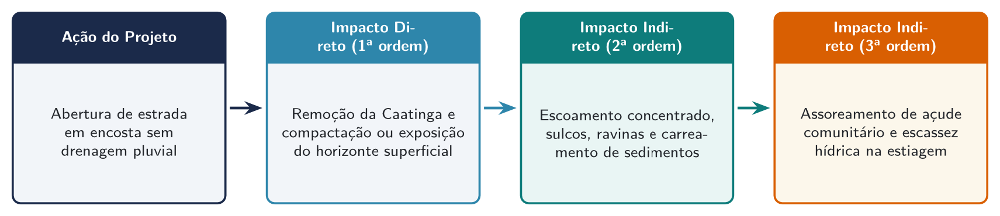

# Avaliação de Impacto Ambiental (AIA) e Planejamento Ambiental {#cap:aia}

A avaliação de impacto ambiental examina as consequências de uma intervenção enquanto alternativas ainda podem ser consideradas. O diagnóstico estabelece as condições de referência, o prognóstico explicita as mudanças esperadas e o monitoramento permite verificar a resposta do sistema após a decisão.

::: {.callout-note title="O que você vai aprender neste capítulo"}
O capítulo desenvolve o conceito preventivo da Avaliação de Impacto Ambiental (AIA), a sequência completa de suas etapas, a delimitação espacial de áreas de influência e os principais métodos de identificação e valoração de impactos. Ao longo do texto, figuras esquemáticas, fotografia de campo e exemplos resolvidos acompanham a aplicação da Matriz de Leopold Ponderada, da Hierarquia de Mitigação e da auditoria do Plano Básico Ambiental (PBA).
:::

::: {.callout-tip title="Revisando o que você precisa saber"}
A leitura retoma a distinção entre atividade geradora, aspecto ambiental e impacto (adverso ou benéfico), além das noções de degradação, vulnerabilidade e fragilidade construídas no Módulo 1. A delimitação espacial do estudo acompanha os processos físicos, bióticos e sociais examinados, incluindo deslocamento de sedimentos, conectividade de habitats e circulação regional.
:::

## Conceito, Natureza Preventiva e Papel da AIA no Planejamento

A **Avaliação de Impacto Ambiental (AIA)** opera como um instrumento de política e planejamento ambiental de caráter preventivo. Como sintetiza Sánchez (2013, cap. 7), avaliar impactos ambientais significa identificar, prever, interpretar e comunicar, *antes* que uma obra, atividade ou política seja implantada, as alterações que ela poderá provocar nos meios físico, biótico e socioeconômico, propondo medidas capazes de evitar ou reduzir danos e ampliar benefícios.

No Brasil, a AIA integra os instrumentos da Política Nacional do Meio Ambiente (Lei nº 6.938/1981) e articula-se diretamente ao licenciamento ambiental (Brasil/MMA, 2016; Vital et al., 2020). O **Estudo de Impacto Ambiental (EIA)**, documento técnico completo, acompanhado pelo **Relatório de Impacto Ambiental (RIMA)** em linguagem acessível à sociedade, representa a modalidade exigida para empreendimentos potencialmente causadores de significativa degradação ambiental conforme a Resolução CONAMA nº 001/1986. Além do EIA/RIMA, o processo de AIA abrange estudos simplificados (como o Relatório Ambiental Simplificado, o Plano de Controle Ambiental e o Estudo Ambiental Preliminar), o exame técnico pelo órgão licenciador, as audiências públicas e o acompanhamento posterior à licença.

Na leitura técnica das etapas e matrizes deste capítulo, o **Termo de Referência (TR)** fixa o escopo exigido pelo órgão ambiental, enquanto a **Área Diretamente Afetada (ADA)**, a **Área de Influência Direta (AID)** e a **Área de Influência Indireta (AII)** organizam a extensão espacial do diagnóstico. Na fase executiva, o **Plano Básico Ambiental (PBA)** detalha os programas de controle e monitoramento. Nas matrizes ponderadas adaptadas de Leopold, cada interação entre o fator $i$ e a ação $j$ recebe sinal ($s_{ij}$), magnitude ($M_{ij}$, de $1$ a $10$), importância ($I_{ij}$, de $1$ a $10$) e pontuação ponderada $P_{ij} = s_{ij} \cdot M_{ij} \cdot I_{ij}$, ao passo que a parcela inevitável remanescente após todas as intervenções de controle recebe o nome de **impacto residual**.

### A AIA como Instrumento do Planejamento Ambiental

Quando reduzida a um rito cartorial executado depois que todas as decisões de engenharia já estão fechadas, a AIA perde sua função preventiva e converte-se em justificativa documental tardia. Para cumprir seu papel no **planejamento ambiental**, o estudo precisa atuar desde a concepção do projeto, orientando três decisões estruturantes. No plano espacial, subsidia a comparação de **alternativas locacionais**, definindo onde instalar a infraestrutura para resguardar nascentes, Áreas de Preservação Permanente (APPs), solos suscetíveis à erosão e territórios de elevado valor sociocultural. De forma complementar, orienta a seleção de **alternativas tecnológicas**, contrastando métodos construtivos e processos produtivos para escolher aqueles que geram menor volume de rejeitos, menor supressão vegetal e menor demanda hídrica. Simultaneamente, exige a avaliação da **alternativa zero**, referente à manutenção do território sem a obra, verificando se o interesse público e o balanço socioambiental justificam a intervenção proposta.

A distinção entre o processo amplo de avaliação e suas peças documentais previne equívocos frequentes no licenciamento, conforme destacado a seguir.

::: {.callout-warning appearance="simple"}
### Erro 1. Confundir AIA com EIA/RIMA ou Tratar o Licenciamento como Burocracia

**Equívoco frequente.** Afirmar que “todo licenciamento exige EIA/RIMA” ou empregar AIA e EIA como sinônimos exatos.

**Correção técnica.** A AIA corresponde ao *processo amplo* de avaliação prévia de impactos (triagem, escopo, estudos, decisão e acompanhamento), enquanto o EIA/RIMA constitui uma de suas *modalidades documentais*, exigida quando há potencial de significativa degradação ambiental. Empreendimentos de menor porte ou potencial poluidor passam pela etapa de triagem e apresentam estudos simplificados, como o Relatório Ambiental Simplificado (RAS) ou o Plano de Controle Ambiental (PCA).
:::

## Etapas do Processo de Avaliação de Impacto Ambiental

A literatura internacional e os manuais brasileiros de referência (Sánchez, 2013; Brasil/MMA, 2016) organizam a AIA em um encadeamento lógico e iterativo de etapas no qual cada fase condiciona a consistência da etapa seguinte, como se observa no Painel (a) da @fig-aia_mitigacao.

{#fig-aia_mitigacao fig-alt="Diagrama com o fluxo sequencial da AIA no painel a e os quatro degraus da Hierarquia de Mitigação no painel b"}

### Triagem e Definição de Escopo (Termo de Referência)

A **triagem (*screening*)** abre o processo ao responder se o projeto requer EIA/RIMA completo, estudo ambiental simplificado ou dispensa de AIA. Essa decisão combina a tipologia da atividade (rodovias, parques eólicos, mineração ou barragens), o porte do empreendimento (área ocupada, potência instalada ou vazão captada) e a **sensibilidade ambiental do sítio**, avaliando a proximidade de Unidades de Conservação, terras indígenas, comunidades tradicionais, nascentes ou remanescentes de Caatinga conservada.

Confirmada a exigência de estudo ambiental, a **definição de escopo (*scoping*)** delimita os temas e processos que exigem investigação aprofundada, evitando relatórios extensos repletos de dados secundários desconexos e estudos omissos quanto aos riscos principais. O produto formal dessa etapa é o **Termo de Referência (TR)**, emitido pelo órgão ambiental competente (como o INEMA na Bahia ou o IBAMA na esfera federal) ou estruturado como proposta técnica pelo consultor para validação prévia.

Na prática profissional, uma proposta consistente de Termo de Referência encadeia cinco blocos integrados. O bloco inicial fixa a abrangência do estudo (EIA, RIMA e, quando houver risco químico ou tecnológico, Estudo de Análise de Risco) e exige levantamentos primários em campo articulados a bases oficiais recentes (IBGE, INEMA, ANA e universidades), com protocolos explícitos de amostragem. O bloco seguinte caracteriza o empreendimento por meio de cadastro técnico, histórico da área, mapa de localização em escala de detalhe (como $1:10.000$) inserido na bacia hidrográfica, mapa de restrições legais e descrição operacional de insumos, resíduos sólidos (ABNT NBR 10004 a 10007), efluentes, ruído e tráfego.

Em seguida, o TR especifica os parâmetros mínimos do diagnóstico na AID e na AII em escalas cartográficas compatíveis, usualmente $1:25.000$ para a AID e $1:50.000$ para a AII. Esse diagnóstico cobre geologia, geomorfologia, hidrografia e qualidade do ar no meio físico; inventários florísticos e faunísticos com curvas de suficiência amostral no meio biótico; e dinâmica demográfica, uso do solo, anuência do IPHAN para patrimônio arqueológico e levantamento específico de povos indígenas e comunidades quilombolas segundo registros da Fundação Cultural Palmares e do INCRA no meio socioeconômico. No bloco final, o documento define o método de valoração de impactos, os programas ambientais do PBA com cronograma e orçamento, as cartas temáticas sobre base planialtimétrica comum, as diretrizes de redação acessível do RIMA, as Anotações de Responsabilidade Técnica (ARTs) da equipe e os procedimentos de consulta pública.

### Diagnóstico Ambiental (Linha de Base) e Áreas de Influência

O diagnóstico constrói a **linha de base (*baseline*)**, retratando de modo qualiquantitativo as condições do ambiente antes da intervenção. No **meio físico**, levantam-se clima, geologia, geomorfologia, solos, recursos hídricos superficiais e subterrâneos, qualidade do ar e ruído de fundo para aferir a suscetibilidade do substrato à erosão e às alterações hidrológicas. No **meio biótico**, inventariam-se fitofisionomias, flora (com atenção a espécies endêmicas e ameaçadas), fauna terrestre e aquática e corredores ecológicos. No **meio socioeconômico**, analisam-se demografia, uso e ocupação da terra, estrutura produtiva, serviços públicos, comunidades quilombolas, indígenas e de fundo de pasto e patrimônio cultural, revelando como os grupos locais dependem dos recursos afetados.

Para espacializar esses levantamentos, o diagnóstico delimita três escalas geográficas fundamentadas em processos físicos, ecológicos e territoriais reais, superando o traçado arbitrário de círculos no mapa. A **Área Diretamente Afetada (ADA)** corresponde à superfície efetivamente ocupada pelas estruturas físicas do projeto, incluindo canteiros, estradas de acesso, jazidas e áreas de bota-fora, a exemplo da poligonal das bases de torres eólicas e das vias abertas na Caatinga. A **Área de Influência Direta (AID)** abrange o espaço submetido aos impactos primários de implantação e operação; no meio físico, acompanha os divisores topográficos da microbacia drenada pela ADA e a direção do escoamento superficial até o exutório afetado, enquanto nos meios biótico e socioeconômico acompanha manchas de ruído, dispersão de poeira, áreas de afugentamento de fauna e povoados lindeiros. A **Área de Influência Indireta (AII)** engloba o espaço atingido por desdobramentos secundários, como municípios receptores de tráfego pesado e arrecadação tributária ou a sub-bacia regional a jusante.

Traçar círculos concêntricos arbitrários ignora a direção natural da drenagem e deixa setores vulneráveis fora do monitoramento, erro contrastado com a delimitação hidrográfica correta na @fig-areas_influencia.

{#fig-areas_influencia fig-alt="Comparação entre delimitação circular arbitrária e delimitação por microbacia hidrográfica das áreas ADA, AID e AII"}

O Exemplo 5.1 quantifica a proporção espacial entre ADA, AID e AII em um empreendimento solar no Semiárido baiano.

::: {.callout-tip appearance="simple"}
### Exemplo 5.1 (Básico). Delimitação Quantitativa de ADA, AID e AII em Parque Solar no Semiárido

**Situação analisada.** Uma empresa propõe a instalação de uma usina solar fotovoltaica em área rural de transição semiárida na Bahia. O projeto prevê $45{,}0\text{ ha}$ ocupados pelos arranjos de painéis solares e $3{,}5\text{ ha}$ destinados à subestação, canteiro de obras e estradas internas de acesso. A microbacia hidrográfica que drena o empreendimento possui $620{,}0\text{ ha}$, e o município de inserção ocupa $48.500{,}0\text{ ha}$.

**Dados disponíveis.** Área dos painéis $= 45{,}0\text{ ha}$; áreas de apoio e acessos $= 3{,}5\text{ ha}$; área da microbacia (AID do meio físico) $= 620{,}0\text{ ha}$; área do município (AII socioeconômica) $= 48.500{,}0\text{ ha}$.

**Problema a resolver.** Calcular a Área Diretamente Afetada (ADA) total, determinar o percentual que a ADA representa em relação à AID e à AII, e justificar por que a AID do meio físico deve acompanhar os divisores da microbacia.

**Fundamento da análise.** Soma das superfícies de intervenção direta para obtenção da ADA e cálculo das razões percentuais ($\text{ADA}/\text{AID} \times 100\%$ e $\text{ADA}/\text{AII} \times 100\%$), segundo os critérios espaciais de Sánchez (2013).

**Desenvolvimento.** Somando as superfícies de supressão e ocupação direta, obtém-se a ADA total e suas proporções nas áreas de influência:

$$
\begin{aligned}
\text{ADA} &= 45{,}0 + 3{,}5 = 48{,}5\text{ ha} \\
\frac{\text{ADA}}{\text{AID}} \times 100\% &= \frac{48{,}5}{620{,}0} \times 100\% \approx 7{,}82\% \\
\frac{\text{ADA}}{\text{AII}} \times 100\% &= \frac{48{,}5}{48.500{,}0} \times 100\% = 0{,}10\%.
\end{aligned}
$$

Quanto ao critério físico, o escoamento superficial, o carreamento de sedimentos e eventuais vazamentos de transformadores seguem a gravidade e os divisores topográficos. Um círculo fixo de $1\text{ km}$ incluiria trechos de bacias vizinhas sem conexão hídrica com o parque e deixaria de fora o exutório a jusante que receberá os sedimentos.

**Interpretação do resultado.** $\text{ADA} = 48{,}5\text{ ha}$, correspondendo a $7{,}82\%$ da AID (microbacia) e $0{,}10\%$ da AII (município). A AID física deve coincidir com a microbacia porque os fluxos hidrossedimentológicos seguem a drenagem natural.

**Condições de validade.** A hierarquia espacial $\text{ADA} < \text{AID} < \text{AII}$ ($48{,}5 < 620{,}0 < 48.500{,}0\text{ ha}$) é coerente. Embora $0{,}10\%$ do município pareça pequeno na escala da AII, ocupar $7{,}82\%$ da microbacia local com superfícies compactadas altera o pico de escoamento superficial se faltarem drenagem e proteção do solo.
:::

### Identificação, Previsão e Valoração de Impactos

Nesta etapa, cruzam-se as ações do projeto (planejamento, implantação, operação e desativação) com os fatores ambientais descritos na linha de base. Cada impacto é caracterizado quanto à **natureza** (adverso ou benéfico), **incidência** (direto ou indireto), **abrangência** (local, regional ou estratégica), **temporalidade** (imediato, médio ou longo prazo), **duração** (temporário, permanente ou cíclico), **reversibilidade** (reversível ou irreversível) e **cumulatividade ou sinergia** com outros empreendimentos da bacia.

Quatro famílias metodológicas sustentam essa identificação e valoração conforme a complexidade do projeto. As **listagens de controle (*checklists*)** reúnem fatores ambientais e impactos potenciais por tipologia de obra em formato simples, descritivo ou escalar, oferecendo rapidez e padronização na triagem e no escopo, ainda que sejam estáticas e tenham dificuldade para explicitar encadeamentos indiretos. As **matrizes de interação**, com destaque para a Matriz de Leopold (Leopold et al., 1971) e suas versões ponderadas, cruzam em tabela bidimensional as ações do empreendimento (colunas) com os fatores ambientais (linhas), avaliando cada interação por sinal, magnitude e importância para hierarquizar prioridades.

Para rastrear cadeias causais complexas, empregam-se as **redes de interação (*networks*)**, estruturadas como grafos causa-efeito que encadeiam um impacto primário (direto) aos impactos secundários e terciários (indiretos). No Semiárido, a abertura de uma estrada sem sistema de drenagem desencadeia compactação e exposição do solo com concentração do escoamento superficial (1ª ordem), que evolui para sulcos erosivos, ravinas e carreamento de sedimentos ao riacho (2ª ordem) até assorear o açude comunitário e reduzir a oferta hídrica na estiagem (3ª ordem), encadeamento esquematizado na @fig-rede_interacao.

{#fig-rede_interacao fig-alt="Grafo causal em três ordens conectando abertura de estrada sem drenagem a sulcos, ravinas e assoreamento"}

Em campo, a transição da compactação inicial para o escoamento concentrado torna-se visível assim que as primeiras chuvas intensas incidem sobre a faixa exposta da via sem caixas secas ou saídas d'água, abrindo sulcos laterais que conduzem sedimentos para as drenagens próximas (@fig-foto-estrada-sulco).

{#fig-foto-estrada-sulco fig-alt="Estrada rural não pavimentada com sulco erosivo formado ao longo da margem pela concentração de enxurrada"}

Na quarta família metodológica, a **sobreposição de cartas (*overlay*) e Sistemas de Informação Geográfica (SIG)**, derivada do método de Ian McHarg (1969), cruza camadas georreferenciadas (declividade, solos, hidrografia, APPs, remanescentes florestais e áreas urbanas) por álgebra de mapas. Essa abordagem explicita a distribuição espacial exata dos conflitos e subsidia a comparação de alternativas locacionais, dependendo da qualidade e da escala da base cartográfica adotada, tema aprofundado no Capítulo 6. A tabela a seguir sintetiza a escolha prática entre os quatro métodos.

| **Método** | **Principal vantagem** | **Principal limitação** | **Uso ideal** |
|:---|:---|:---|:---|
| **Checklists** | Rapidez e padronização inicial. | Estrutura estática, sem cadeias causais. | Triagem e escopo. |
| **Matriz de Leopold** | Liga ações a fatores e prioriza ações críticas. | Pouca clareza para efeitos indiretos. | Síntese de EIAs e PCAs. |
| **Redes de Interação** | Evidencia impactos indiretos e cumulativos. | Visualmente complexa em grandes projetos. | Bacias, erosão e hidrologia. |
| **Sobreposição / SIG** | Localiza conflitos e compara traçados. | Depende da escala e qualidade dos mapas. | Traçados e zoneamentos. |

### Matriz de Leopold Ponderada, Magnitude, Importância e Balanço

Na adaptação ponderada da Matriz de Leopold (Leopold et al., 1971), cada célula $(i, j)$ com interação efetiva entre o **fator ambiental $i$** (linha) e a **ação $j$** (coluna) recebe três parâmetros. O **sinal ($s_{ij} \in \{-1, +1\}$)** assume $-1$ para impacto adverso e $+1$ para impacto benéfico, registrando-se $0$ quando a interação é inexistente. A **magnitude ($M_{ij} \in \{1, \dots, 10\}$)** mede a intensidade e extensão física da alteração sobre o fator, enquanto a **importância ($I_{ij} \in \{1, \dots, 10\}$)** expressa a relevância ecológica, funcional, social ou legal do receptor atingido, atingindo notas máximas em nascentes, espécies ameaçadas ou comunidades tradicionais.

$$
\begin{aligned}
P_{ij} &= s_{ij} \cdot \left(M_{ij} \times I_{ij}\right), \qquad P_{ij} \in [-100, +100] \\
T_j &= \sum_{i=1}^{m} P_{ij}, \qquad F_i = \sum_{j=1}^{n} P_{ij} \\
B &= \sum_{i=1}^{m}\sum_{j=1}^{n} P_{ij} = \sum_{j=1}^{n} T_j = \sum_{i=1}^{m} F_i \\
\Sigma^{-} &= \sum_{P_{ij}<0} P_{ij}, \qquad \Sigma^{+} = \sum_{P_{ij}>0} P_{ij}
\end{aligned}
$$

Nessas equações, $P_{ij}$ é a pontuação celular, $T_j$ mede o saldo da ação $j$ sobre os $m$ fatores, $F_i$ acumula a pressão das $n$ ações sobre o fator $i$, $B$ é o balanço líquido global, $\Sigma^{-}$ reúne a carga adversa total e $\Sigma^{+}$ soma a carga benéfica total.

Para acompanhar o cálculo em escala reduzida, considere uma mini-matriz com duas ações ($A_1$, supressão vegetal em encosta; $A_2$, contratação de mão de obra local) e dois fatores ($F_1$, solo e suscetibilidade erosiva; $F_2$, renda familiar). Na célula $(F_1, A_1)$, a supressão gera dano severo ($s=-1$, $M=8$, $I=9$), resultando em $P_{11} = -72$, enquanto em $(F_2, A_1)$ o pagamento temporário pela limpeza produz efeito positivo discreto ($s=+1$, $M=2$, $I=3$), com $P_{21} = +6$. A ação $A_2$ não altera fisicamente o solo ($P_{12} = 0$), mas eleva a renda local ($s=+1$, $M=6$, $I=7$), gerando $P_{22} = +42$. Somando colunas e linhas, tem-se $T_1 = -66$, $T_2 = +42$, $F_1 = -72$, $F_2 = +48$, carga adversa $\Sigma^{-} = -72$, carga benéfica $\Sigma^{+} = +48$ e balanço $B = -24$. A estrutura operacional dessa matriz em planilha eletrônica está representada na @fig-matriz_leopold_excel.

{#fig-matriz_leopold_excel fig-alt="Planilha de Matriz de Leopold Ponderada com células vermelhas negativas, verdes positivas e somas marginais"}

O Exemplo 5.2 aplica esse equacionamento completo à avaliação de um parque eólico na Caatinga baiana.

::: {.callout-tip appearance="simple"}
### Exemplo 5.2 (Básico e Intermediário). Matriz de Leopold Ponderada em Parque Eólico na Caatinga

**Situação analisada.** Durante a AIA de um parque eólico no Semiárido baiano, a equipe técnica estruturou uma matriz cruzando três ações ($A_1$, supressão vegetal e abertura de acessos; $A_2$, escavação e concretagem das fundações das torres; $A_3$, operação dos aerogeradores e contratação de serviços locais) com quatro fatores ambientais ($F_1$, solo e processos erosivos; $F_2$, fauna e avifauna; $F_3$, qualidade da água superficial; $F_4$, emprego e renda local).

**Dados disponíveis.** Avaliações $(s, M, I)$ atribuídas após vistorias de campo e linha de base: em $F_1$ (Solo/Erosão), $A_1 = (-, 8, 9)$, $A_2 = (-, 6, 8)$ e $A_3 = 0$; em $F_2$ (Fauna/Avifauna), $A_1 = (-, 7, 8)$, $A_2 = (-, 3, 5)$ e $A_3 = (-, 5, 9)$; em $F_3$ (Qualidade da água), $A_1 = (-, 5, 7)$, $A_2 = (-, 4, 7)$ e $A_3 = 0$; em $F_4$ (Emprego/Renda), $A_1 = (+, 3, 5)$, $A_2 = (+, 4, 5)$ e $A_3 = (+, 7, 8)$.

**Problema a resolver.** Calcular todas as pontuações celulares $P_{ij}$, os totais por ação ($T_j$), os totais por fator ($F_i$), a carga adversa ($\Sigma^{-}$), a carga benéfica ($\Sigma^{+}$) e o balanço líquido ($B$), identificando a ação mais crítica e o fator mais impactado.

**Fundamento da análise.** Aplicação das equações da Matriz de Leopold Ponderada ($P_{ij} = s_{ij} \cdot M_{ij} \cdot I_{ij}$), com verificação cruzada pela identidade $\sum T_j = \sum F_i = B$.

**Desenvolvimento.** Calculando cada célula por linha: em $F_1$, $P_{11} = -72$, $P_{12} = -48$ e $P_{13} = 0$; em $F_2$, $P_{21} = -56$, $P_{22} = -15$ e $P_{23} = -45$; em $F_3$, $P_{31} = -35$, $P_{32} = -28$ e $P_{33} = 0$; e em $F_4$, $P_{41} = +15$, $P_{42} = +20$ e $P_{43} = +56$. Os valores consolidam-se na matriz a seguir.

| **Fator Ambiental** | **$A_1$ (Acessos)** | **$A_2$ (Fundações)** | **$A_3$ (Operação)** | **Total $F_i$** |
|:---|---:|---:|---:|---:|
| $F_1$, Solo / Erosão | $-72$ | $-48$ | $0$ | **$-120$** |
| $F_2$, Fauna / Avifauna | $-56$ | $-15$ | $-45$ | **$-116$** |
| $F_3$, Qualidade da água | $-35$ | $-28$ | $0$ | **$-63$** |
| $F_4$, Emprego / Renda | $+15$ | $+20$ | $+56$ | **$+91$** |
| **Total da Ação ($T_j$)** | **$-148$** | **$-71$** | **$+11$** | **$B = -208$** |

Conferindo as somas marginais e separando as cargas adversa e benéfica:

$$
\begin{aligned}
\sum F_i &= (-120) + (-116) + (-63) + 91 = -208, \\
\sum T_j &= (-148) + (-71) + 11 = -208, \\
\Sigma^{-} &= -72 - 48 - 56 - 15 - 45 - 35 - 28 = -299, \\
\Sigma^{+} &= +15 + 20 + 56 = +91.
\end{aligned}
$$

**Interpretação do resultado.** A ação mais impactante negativamente é $A_1$ (supressão e acessos, $T_1 = -148$) e o fator mais vulnerável é $F_1$ (solo/erosão, $F_1 = -120$), seguido de $F_2$ (fauna/avifauna, $F_2 = -116$). A carga adversa vale $\Sigma^{-} = -299$, a benéfica vale $\Sigma^{+} = +91$ e o balanço líquido fecha em $B = -208$.

**Condições de validade.** A igualdade $\sum F_i = \sum T_j = \Sigma^{-} + \Sigma^{+} = -208$ confirma a exatidão aritmética. Mesmo com $T_3 = +11$ na operação, a célula $P_{23} = -45$ (colisão de avifauna, com importância $I = 9$) exige monitoramento e desligamento preventivo para espécies como a arara-azul-de-lear na região de Canudos, jamais sendo anulada pelos $+56$ pontos de renda.
:::

A interpretação isolada do saldo líquido $B$ costuma induzir erros graves na tomada de decisão, conforme detalhado no alerta a seguir.

::: {.callout-warning appearance="simple"}
### Erro 2. Somar Benefícios Econômicos com Danos Ecológicos na Matriz

**Equívoco frequente.** Concluir que um empreendimento é ambientalmente viável porque a soma algébrica $B = \Sigma^{+} + \Sigma^{-}$ ficou positiva ou próxima de zero (por exemplo, $+80$ em arrecadação contra $-75$ em destruição de nascente).

**Correção técnica.** A pontuação da Matriz de Leopold é semiquantitativa e reúne dimensões incomensuráveis. Empregos temporários não evitam o assoreamento de mananciais nem compensam a extinção local de fauna. Por isso, deve-se reportar $\Sigma^{-}$ e $\Sigma^{+}$ separadamente, destacando toda célula adversa de alta importância ($I \ge 8$) ou irreversível para vinculá-la a medidas concretas de mitigação.
:::

### Prognóstico Ambiental e Efeitos Cumulativos

O prognóstico projeta a evolução futura da qualidade ambiental por meio de dois cenários comparativos obrigatórios com o mesmo horizonte temporal. O **cenário sem projeto (alternativa zero)** retrata a trajetória provável da bacia na ausência da obra, incorporando tendências já em curso como expansão urbana, sobrepastejo, variações climáticas ou regeneração natural. O **cenário com projeto** projeta a trajetória com o empreendimento em dois estágios: primeiro sem medidas mitigadoras, para dimensionar o risco potencial, e em seguida com os controles propostos, revelando o impacto residual. O impacto real atribuível ao projeto corresponde à diferença dinâmica entre a trajetória futura com o projeto e a trajetória futura sem o projeto.

Essa projeção deve considerar também os **impactos cumulativos**, que emergem quando pressões de diferentes empreendimentos convergem sobre o mesmo receptor. Estradas de parques eólicos vizinhos podem direcionar enxurradas para o mesmo riacho, enquanto captações distintas afetam a disponibilidade hídrica do mesmo trecho fluvial, exigindo definir explicitamente o receptor, a área de acumulação e o período analisado. O Exemplo 5.3 mostra como comparar alternativas locacionais no prognóstico por meio de critérios ponderados.

::: {.callout-tip appearance="simple"}
### Exemplo 5.3 (Intermediário). Prognóstico e Seleção Multicritério de Alternativas Locacionais

**Situação analisada.** No estudo de duplicação de uma rodovia estadual na Bahia, o EIA comparou duas alternativas locacionais diante do cenário sem projeto: o **Traçado A** (mais curto, atravessando uma APP de nascente e um fragmento contínuo de Caatinga) e o **Traçado B** ($1{,}2\text{ km}$ mais extenso, contornando a APP por áreas já antropizadas de pastagem).

**Dados disponíveis.** Quatro critérios ponderados (soma dos pesos $= 1{,}00$) em escala de **severidade adversa** de $0$ (nenhum dano) a $10$ (dano máximo): $C_1$, supressão de APP e vegetação nativa ($w_1 = 0{,}35$; A $= 9$, B $= 3$); $C_2$, risco erosivo e assoreamento ($w_2 = 0{,}30$; A $= 8$, B $= 4$); $C_3$, fragmentação e atropelamento de fauna ($w_3 = 0{,}20$; A $= 8$, B $= 4$); $C_4$, custo e extensão adicional ($w_4 = 0{,}15$; A $= 4$, B $= 7$).

**Problema a resolver.** Calcular o Índice de Impacto Adverso Ponderado ($I_{\text{adv}}$) de cada alternativa, determinar a redução percentual do índice ao optar pelo melhor traçado e identificar o degrau da Hierarquia de Mitigação correspondente.

**Fundamento da análise.** Cálculo da média ponderada $I_{\text{adv}} = \sum_{k=1}^{4} w_k \cdot C_k$ e da variação relativa $(I_A - I_B)/I_A \times 100\%$.

**Desenvolvimento.** Os pesos somam $0{,}35 + 0{,}30 + 0{,}20 + 0{,}15 = 1{,}00$. Calculando os índices ponderados e a redução relativa de severidade:

$$
\begin{aligned}
I_A &= (0{,}35 \times 9) + (0{,}30 \times 8) + (0{,}20 \times 8) + (0{,}15 \times 4) \\
    &= 3{,}15 + 2{,}40 + 1{,}60 + 0{,}60 = 7{,}75 \\
I_B &= (0{,}35 \times 3) + (0{,}30 \times 4) + (0{,}20 \times 4) + (0{,}15 \times 7) \\
    &= 1{,}05 + 1{,}20 + 0{,}80 + 1{,}05 = 4{,}10 \\
\text{Redução} &= \frac{7{,}75 - 4{,}10}{7{,}75} \times 100\% = \frac{3{,}65}{7{,}75} \times 100\% \approx 47{,}10\%.
\end{aligned}
$$

**Interpretação do resultado.** O Traçado B é superior ($I_B = 4{,}10$ contra $I_A = 7{,}75$), reduzindo em $47{,}10\%$ a severidade adversa global. Essa escolha representa o 1º degrau da Hierarquia de Mitigação (**Evitar**), por alternativa locacional.

**Condições de validade.** Como a escala mede severidade adversa, o menor valor indica melhor desempenho. Apesar do maior custo inicial no critério $C_4$ ($7$ contra $4$), o Traçado B evita intervenções em APP, obras emergenciais contra erosão e passivos de compensação.
:::

### Hierarquia de Mitigação, Medidas Mitigadoras e Compensatórias

Diante de impactos adversos previstos, a tomada de decisão obedece a uma ordem estrita de prioridade técnica conhecida como **Hierarquia de Mitigação**, representada no Painel (b) da @fig-aia_mitigacao. No **1º degrau, Evitar (prevenção na origem)**, ajustam-se localização, traçado, cronograma ou tecnologia para impedir que o impacto ocorra, sendo o nível de maior eficácia ecológica. Quando a prevenção integral é inviável, aplica-se o **2º degrau, Minimizar**, utilizando controles de engenharia e manejo (como bacias de contenção de sedimentos, supressão seletiva e controle de poeira) para abater magnitude, duração ou extensão do dano.

Nas áreas afetadas temporariamente durante a obra, como canteiros, taludes de corte e áreas de empréstimo, atua-se no **3º degrau, Recuperar ou Reabilitar (*in situ*)**, restabelecendo as funções do solo, da drenagem e da cobertura vegetal mediante Plano de Recuperação de Áreas Degradadas (PRAD) e bioengenharia. Somente para o dano inevitável que persiste após esses três degraus, denominado **impacto residual**, recorre-se ao **4º degrau, Compensar**, por meio de apoio a Unidades de Conservação (art. 36 da Lei nº 9.985/2000, SNUC), reposição florestal equivalente ou superior e programas comunitários. De modo paralelo, impactos benéficos recebem **medidas potencializadoras**, como capacitação profissional prévia para ampliar a contratação de moradores locais.

O Exemplo 5.4 demonstra o abatimento sequencial (em cascata) ao longo dos quatro degraus da Hierarquia de Mitigação.

::: {.callout-tip appearance="simple"}
### Exemplo 5.4 (Intermediário e Avançado). Aplicação Sequencial da Hierarquia de Mitigação em Loteamento Periurbano

**Situação analisada.** O anteprojeto de um loteamento periurbano previa a supressão de $12{,}0\text{ ha}$ de vegetação nativa e um aporte de $480{,}0\text{ t/ano}$ de sedimentos para um riacho a jusante. Após revisão técnica, aplicaram-se sequencialmente os quatro degraus da Hierarquia de Mitigação.

**Dados disponíveis.** No degrau **Evitar**, a exclusão de quadras em encostas íngremes evita $45\%$ da supressão e $45\%$ do aporte de sedimentos. No degrau **Minimizar**, o corte seletivo poupa $1{,}6\text{ ha}$ e bacias de contenção retêm $60\%$ do sedimento restante. No degrau **Recuperar**, a bioengenharia recupera $2{,}0\text{ ha}$ temporários e retém $75\%$ do sedimento remanescente. No degrau **Compensar**, exige-se reposição na razão $2:1$ sobre a perda permanente residual.

**Problema a resolver.** Calcular o saldo remanescente de vegetação afetada e de sedimentos em cada degrau, o abatimento percentual acumulado de sedimentos e a área de compensação ecológica no 4º degrau.

**Fundamento da análise.** Abatimento em cascata sobre o saldo remanescente de cada etapa, evitando somar percentuais diretamente sobre a carga inicial.

**Desenvolvimento.** Para a trajetória da supressão vegetal (em $\text{ha}$) e do aporte de sedimentos (em $\text{t/ano}$), aplicam-se os abatimentos etapa a etapa:

$$
\begin{aligned}
\text{Vegetação após Evitar} &= 12{,}0 - (0{,}45 \times 12{,}0) = 12{,}0 - 5{,}4 = 6{,}6\text{ ha} \\
\text{após Minimizar} &= 6{,}6 - 1{,}6 = 5{,}0\text{ ha} \\
\text{após Recuperar (residual)} &= 5{,}0 - 2{,}0 = 3{,}0\text{ ha} \\
\text{Área a Compensar (}2:1\text{)} &= 2 \times 3{,}0 = 6{,}0\text{ ha}
\end{aligned}
$$

$$
\begin{aligned}
\text{Sedimentos após Evitar} &= 480{,}0 - (0{,}45 \times 480{,}0) = 264{,}0\text{ t/ano} \\
\text{após Minimizar} &= 264{,}0 - (0{,}60 \times 264{,}0) = 105{,}6\text{ t/ano} \\
\text{após Recuperar (residual)} &= 105{,}6 - (0{,}75 \times 105{,}6) = 26{,}4\text{ t/ano} \\
\text{Abatimento acumulado} &= \frac{480{,}0 - 26{,}4}{480{,}0} \times 100\% = 94{,}50\%.
\end{aligned}
$$

**Interpretação do resultado.** O impacto residual permanente reduz-se a $3{,}0\text{ ha}$ de vegetação (exigindo $6{,}0\text{ ha}$ de compensação na razão $2:1$) e a $26{,}4\text{ t/ano}$ de sedimentos (abatimento total de $94{,}50\%$).

**Condições de validade.** Pelo produto em cascata, $480{,}0 \times 0{,}55 \times 0{,}40 \times 0{,}25 = 26{,}4\text{ t/ano}$. Sem seguir a hierarquia, tentar compensar os $12{,}0\text{ ha}$ iniciais exigiria $24{,}0\text{ ha}$ de reposição e manteria o riacho assoreado com $480\text{ t/ano}$ de sedimentos.
:::

Propor compensação financeira antes de esgotar alternativas locacionais e medidas de engenharia viola diretamente a Hierarquia de Mitigação, como alerta o quadro a seguir.

::: {.callout-warning appearance="simple"}
### Erro 3. Inverter a Hierarquia de Mitigação ao Priorizar a Compensação

**Equívoco frequente.** Propor diretamente compensação financeira ou plantio em outro município para suprimir uma APP ou fragmento florestal sem avaliar alternativas de traçado ou tecnologia que evitassem a perda.

**Correção técnica.** A compensação ocupa o **4º e último degrau** da hierarquia, destinando-se exclusivamente ao impacto residual que permanece após esgotadas as etapas de evitar, minimizar e recuperar no local.
:::

### Plano Básico Ambiental (PBA) e Monitoramento Pós-Implantação

Na etapa decisória, o órgão ambiental emite parecer técnico pelo deferimento com condicionantes ou pelo indeferimento das licenças (Licença Prévia, Licença de Instalação e Licença de Operação). Os compromissos assumidos no EIA convertem-se em projetos executivos detalhados no **Plano Básico Ambiental (PBA)**, que estrutura programas de controle de erosão, monitoramento da qualidade da água, resgate de fauna, educação ambiental e PRAD. Cada programa necessita de condição inicial documentada, meta verificável, frequência de amostragem e responsável técnico.

O **monitoramento pós-implantação** fecha o ciclo da AIA ao confrontar os indicadores medidos em operação com os valores da linha de base e interpretar desvios junto aos registros de chuva e manutenção. Caso um indicador ultrapasse o limite da condicionante ambiental, aciona-se a **gestão adaptativa** para corrigir imediatamente os dispositivos de controle em campo.

## Aplicação Integrada, Auditoria de Monitoramento no PBA

A verificação quantitativa de desempenho durante a obra exige descontar a condição natural registrada na linha de base antes de calcular a eficiência das medidas de controle, evitando subestimar ou superestimar o abatimento real obtido em campo, como demonstrado no Exemplo 5.5.

::: {.callout-tip appearance="simple"}
### Exemplo 5.5 (Avançado). Auditoria de Eficiência no Monitoramento Pós-Implantação do PBA

**Situação analisada.** Durante a construção de uma barragem de regularização hídrica no rio Jacuípe (Bahia), a linha de base registrou turbidez média de $18{,}0\text{ NTU}$ a jusante em estiagem. Na terraplenagem inicial sem controle, a turbidez subiu para $112{,}0\text{ NTU}$. Após a instalação de cortinas de siltagem e diques do PBA, o monitoramento mediu $33{,}0\text{ NTU}$. A condicionante da Licença de Instalação fixava limite máximo de $40{,}0\text{ NTU}$.

**Dados disponíveis.** Linha de base $T_0 = 18{,}0\text{ NTU}$; turbidez sem mitigação $T_{\text{sem}} = 112{,}0\text{ NTU}$; turbidez com PBA $T_{\text{com}} = 33{,}0\text{ NTU}$; limite legal $T_{\max} = 40{,}0\text{ NTU}$.

**Problema a resolver.** Calcular o acréscimo de turbidez atribuível à obra sem mitigação, o acréscimo residual após o PBA, a eficiência percentual de abatimento da carga antrópica e emitir parecer técnico sobre o atendimento à condicionante.

**Fundamento da análise.** Cálculo da anomalia acima da linha de base ($\Delta T = T - T_0$) e da eficiência de abatimento incremental $E_f = \frac{\Delta T_{\text{sem}} - \Delta T_{\text{com}}}{\Delta T_{\text{sem}}} \times 100\%$.

**Desenvolvimento.** Descontando a turbidez natural $T_0$ da linha de base, calculam-se os acréscimos e a eficiência do PBA:

$$
\begin{aligned}
\Delta T_{\text{sem}} &= 112{,}0 - 18{,}0 = 94{,}0\text{ NTU} \\
\Delta T_{\text{com}} &= 33{,}0 - 18{,}0 = 15{,}0\text{ NTU} \\
\Delta T_{\text{abatida}} &= 94{,}0 - 15{,}0 = 79{,}0\text{ NTU} \\
E_f &= \frac{79{,}0}{94{,}0} \times 100\% \approx 84{,}04\%.
\end{aligned}
$$

Como $33{,}0\text{ NTU} \le 40{,}0\text{ NTU}$, a condicionante da Licença de Instalação está atendida com folga de $7{,}0\text{ NTU}$.

**Interpretação do resultado.** O acréscimo sem controle foi de $94{,}0\text{ NTU}$, reduzido para $15{,}0\text{ NTU}$ residuais com eficiência de abatimento de $84{,}04\%$. A condicionante de $40{,}0\text{ NTU}$ está atendida, mantendo-se o monitoramento contínuo na estação chuvosa.

**Condições de validade.** Descontar $T_0 = 18{,}0\text{ NTU}$ no denominador é indispensável porque o controle ambiental visa abater o acréscimo gerado pela obra sobre o fundo natural do rio; sem esse desconto, o cálculo subestimaria a eficiência real ($79/112 = 70{,}54\%$).
:::

## Armadilha Conceitual e Materiais Audiovisuais de Apoio

Mesmo quando um estudo adota equações corretas na matriz de impacto ou no monitoramento do PBA, uma delimitação espacial mal fundamentada compromete toda a amostragem dos meios físico, biótico e socioeconômico.

::: {.callout-warning appearance="simple"}
### Erro 4. Delimitar ADA, AID e AII como Círculos Concêntricos Arbitrários

**Equívoco frequente.** Traçar raios fixos de $500\text{ m}$ (AID) e $5\text{ km}$ (AII) no mapa sem considerar divisores de bacia, direção dos ventos, rotas de fauna ou malha viária.

**Correção técnica.** Processos ambientais propagam-se segundo fluxos físicos e sociais anisotrópicos. Um efluente lançado num riacho percorre quilômetros a jusante pelo talvegue, mas permanece ausente a $200\text{ m}$ além do divisor topográfico. Delimite a AID física pela microbacia drenada, a AID biótica pelos habitats conectados e a AII pela rede territorial e municipal afetada.
:::

Para consolidar o entendimento sobre degradação ambiental, papel preventivo da AIA e estruturação de EIA/RIMA, assista às videoaulas selecionadas na página da disciplina. O vídeo [O papel da Avaliação de Impacto Ambiental na gestão ambiental](https://www.youtube.com/watch?v=oDceh9hvPc8) apresenta o ciclo de diagnóstico, prognóstico e medidas mitigadoras; o vídeo [EIA-RIMA, Conceitos e Definições de Impactos Ambientais](https://www.youtube.com/watch?v=m8rg8SnhSfQ) detalha a estrutura do Estudo e do Relatório de Impacto Ambiental; e o vídeo [Degradação Ambiental](https://www.youtube.com/watch?v=5EFxN7jGob8) aprofunda os conceitos de degradação, vulnerabilidade, fragilidade e resiliência.

## Exercícios de fixação

#### Nível 1. Básico (Conceitos, Etapas e Cálculos Fundamentais)

1. Explique, com base em Sánchez (2013), qual é o papel preventivo da Avaliação de Impacto Ambiental (AIA) e por que sua inserção tardia, após a definição do projeto de engenharia, compromete sua eficácia no planejamento ambiental.

2. Em uma matriz de interação ponderada adaptada de Leopold, uma atividade de terraplenagem apresentou três interações relevantes: solo e erosão $(-, M=7, I=8)$; qualidade do ar por poeira $(-, M=4, I=6)$; e contratação temporária de operadores locais $(+, M=6, I=5)$. Calcule a pontuação $P_{ij}$ de cada célula, a carga adversa ($\Sigma^{-}$), a carga benéfica ($\Sigma^{+}$) e o total $T_j$ dessa ação.

3. Diferencie claramente as etapas de **triagem (*screening*)** e **definição de escopo (*scoping*)**, indicando qual documento oficial formaliza o resultado da definição de escopo no licenciamento ambiental brasileiro.

4. Defina **ADA**, **AID** e **AII** e dê um exemplo concreto de cada uma para a implantação de um aterro sanitário regional no interior da Bahia.

5. Compare as quatro famílias de métodos de identificação de impactos (*checklists*, Matriz de Leopold, redes de interação e sobreposição de cartas em SIG), indicando uma vantagem específica de cada método.

#### Nível 2. Intermediário (Aplicação Quantitativa e Análise Técnica)

6. Um empreendimento de extração de areia em planície fluvial foi avaliado por meio de uma matriz ponderada $3 \times 3$, com as ações $A_1$ (dragagem no leito), $A_2$ (abertura de pátio e estrada de acesso) e $A_3$ (comercialização e geração de empregos) e os fatores $F_1$ (estabilidade das margens e do leito), $F_2$ (turbidez e biota aquática) e $F_3$ (renda e arrecadação municipal):

    - $F_1$: $A_1=(-, 9, 9)$; $A_2=(-, 5, 7)$; $A_3=0$.

    - $F_2$: $A_1=(-, 8, 8)$; $A_2=(-, 4, 6)$; $A_3=0$.

    - $F_3$: $A_1=(+, 3, 4)$; $A_2=(+, 2, 4)$; $A_3=(+, 6, 6)$.

    Calcule todas as células $P_{ij}$, os totais $T_j$ e $F_i$, $\Sigma^{-}$, $\Sigma^{+}$ e o balanço $B$. Identifique a ação mais degradadora e o fator mais crítico.

7. Um projeto agroindustrial previa inicialmente suprimir $20{,}0\text{ ha}$ de vegetação nativa. Aplicando a Hierarquia de Mitigação, a realocação do galpão evitou $35\%$ da supressão inicial; o ajuste das vias internas minimizou $20\%$ da área restante; e a restauração de áreas temporárias recuperou $2{,}4\text{ ha}$. Sabendo que o órgão licenciador determinou compensação na razão $3:1$ sobre o impacto permanente residual, calcule a área remanescente em cada degrau e a área total a ser compensada.

8. Na escolha tecnológica para uma Estação de Tratamento de Efluentes (ETE), duas opções ($E_1$ e $E_2$) foram avaliadas em escala de **desempenho ambiental positivo** ($0$ = péssimo; $10$ = excelente) sob quatro critérios ponderados: eficiência de remoção de carga orgânica ($w_1 = 0{,}35$, $E_1=6$, $E_2=9$), controle de odores ($w_2 = 0{,}30$, $E_1=5$, $E_2=8$), possibilidade de reúso agrícola no Semiárido ($w_3 = 0{,}20$, $E_1=7$, $E_2=8$) e menor custo de implantação ($w_4 = 0{,}15$, $E_1=9$, $E_2=6$). Calcule a nota ponderada de cada alternativa e justifique a escolha técnica.

9. Desenhe ou descreva textualmente uma **rede de interação** de três níveis (impacto primário $\to$ secundário $\to$ terciário) desencadeada pela abertura de vias de acesso sem drenagem em encosta declivosa da Caatinga, associando ao menos uma medida preventiva e uma medida corretiva do PBA para interromper a cascata.

10. No monitoramento do PBA de uma obra rodoviária, a linha de base de Sólidos Suspensos Totais (SST) em um riacho era de $25{,}0\text{ mg/L}$. Durante a escavação sem bacias de decantação, o valor atingiu $145{,}0\text{ mg/L}$. Após a implantação das bacias previstas no PBA, a concentração caiu para $43{,}0\text{ mg/L}$. Calcule o acréscimo sem controle, o acréscimo residual e a eficiência percentual de abatimento da carga antrópica.

#### Nível 3. Questões Objetivas de Fixação (A a E) {#05-avaliacao-impacto-ambiental-nível-3-questões-objetivas-de-fixação-ae}

11. **\[Autoral, CHF662\]** No processo de Avaliação de Impacto Ambiental, o prognóstico compara o cenário com projeto ao cenário sem projeto (alternativa zero). Assinale a alternativa que interpreta corretamente o conceito de **cenário sem projeto**:

    (A) Representa a manutenção estática e imutável das condições atuais medidas na linha de base, sem qualquer variação futura.

    (B) Projeta a evolução futura provável do ambiente na ausência do empreendimento, incorporando tendências climáticas, ecológicas e de uso da terra já em curso.

    (C) Equivale ao cenário com projeto após a aplicação integral das medidas compensatórias previstas no PBA.

    (D) É exigido apenas quando o empreendedor decide abandonar a obra antes da emissão da Licença Prévia.

    (E) Dispensa a realização do diagnóstico ambiental da linha de base nos meios físico e biótico.

12. **\[Autoral, CHF662\]** Assinale a alternativa que apresenta na ordem correta, da maior para a menor prioridade técnica e ecológica, os degraus da **Hierarquia de Mitigação**:

    (A) Compensar $\to$ Recuperar $\to$ Minimizar $\to$ Evitar.

    (B) Minimizar $\to$ Evitar $\to$ Compensar $\to$ Recuperar.

    (C) Evitar $\to$ Recuperar $\to$ Minimizar $\to$ Compensar.

    (D) Evitar $\to$ Minimizar $\to$ Recuperar $\to$ Compensar.

    (E) Monitorar $\to$ Compensar $\to$ Evitar $\to$ Minimizar.

13. **\[Autoral, CHF662\]** Em uma Matriz de Leopold Ponderada ($P_{ij} = s_{ij} \cdot M_{ij} \cdot I_{ij}$), uma ação de instalação de canteiro de obras apresentou três células preenchidas: erosão laminar $(-, M=8, I=9)$, afugentamento de fauna $(-, M=6, I=7)$ e geração de empregos temporários $(+, M=5, I=4)$. Sobre o resultado dessa coluna, é correto afirmar que:

    (A) A pontuação líquida da ação é $T = -94$, com carga adversa $\Sigma^{-} = -114$, e os $+20$ pontos de emprego não eliminam a necessidade de controle erosivo.

    (B) A pontuação líquida da ação é $T = -134$, pois todas as células devem ser somadas em módulo negativo.

    (C) A pontuação líquida da ação é $T = -52$, obtida somando apenas magnitude e importância sem multiplicá-las.

    (D) Como existem $+20$ pontos benéficos, o impacto de erosão laminar cai automaticamente de $-72$ para $-52$.

    (E) A pontuação líquida da ação é $T = +114$, caracterizando a ação como ambientalmente neutra.

14. **\[Autoral, CHF662\]** Qual método de identificação e avaliação de impactos é o mais adequado para **explicitar visualmente o encadeamento entre impactos primários (diretos) e impactos secundários e terciários (indiretos)** em uma bacia hidrográfica?

    (A) Listagem de controle simples (*checklist* binário).

    (B) Rede de interação (grafo causa-efeito).

    (C) Inventário financeiro de compensação ambiental.

    (D) Formulário cadastral de triagem administrativa.

    (E) Tabela de coordenadas geográficas da ADA.

15. **\[Autoral, CHF662\]** Em relação ao **Plano Básico Ambiental (PBA)** e ao monitoramento pós-implantação, assinale a afirmação correta:

    (A) O PBA substitui o diagnóstico da linha de base, sendo entregue antes mesmo da definição de escopo.

    (B) O monitoramento pós-implantação tem caráter meramente decorativo, pois as previsões do EIA nunca apresentam incertezas.

    (C) O PBA detalha operacionalmente os programas de mitigação, controle, recuperação e monitoramento, cujos indicadores são comparados à linha de base para permitir gestão adaptativa.

    (D) O PBA aplica-se exclusivamente à compensação financeira prevista na Lei do SNUC, não contemplando controle de erosão nem qualidade da água.

    (E) O monitoramento só deve iniciar após a desativação definitiva do empreendimento.

## Questões de aplicação

16. **\[Autoral, Estilo ENADE / Geografia\]** A implantação de grandes empreendimentos energéticos e rodoviários no Semiárido brasileiro exige estudos ambientais rigorosos no âmbito da AIA. Considere as afirmações a seguir sobre o papel do geógrafo na AIA:

    I.  A delimitação das áreas de influência (ADA, AID e AII) deve respeitar a dinâmica espacial específica de cada meio, como divisores de microbacias no meio físico e redes de mobilidade e serviços no meio socioeconômico, descartando raios circulares arbitrários.

    II.  A sobreposição de cartas em SIG (inspirada no método de McHarg) permite integrar fragilidades do relevo, solos, APPs e uso da terra para subsidiar a escolha de alternativas locacionais que evitem impactos na origem.

    III.  Na fase de prognóstico, o diagnóstico da linha de base torna-se dispensável porque a compensação ambiental corrige automaticamente todos os impactos residuais.

    É correto o que se afirma apenas em:

    (A) I.

    (B) III.

    (C) I e II.

    (D) II e III.

    (E) I, II e III.

17. **\[Autoral, Estilo Concurso Analista Ambiental / IBAMA e INEMA\]** Uma consultoria apresentou ao órgão ambiental um EIA de uma ferrovia cujo traçado original cortava um trecho de mata ciliar e uma nascente perene. No capítulo de mitigação, o estudo manteve o traçado original e propôs, como única medida, o pagamento de compensação financeira para criação de parque em outra região do Estado. À luz da teoria da AIA (Sánchez, 2013) e da Hierarquia de Mitigação, o parecer técnico do analista ambiental deve:

    (A) Aprovar integralmente a proposta, pois a compensação financeira ocupa o topo da Hierarquia de Mitigação.

    (B) Exigir complementação do estudo com avaliação efetiva de alternativas locacionais (degrau *Evitar*) e de medidas de engenharia para redução de danos (degrau *Minimizar*), reservando a compensação estritamente a eventuais impactos residuais inevitáveis.

    (C) Dispensar a etapa de monitoramento no PBA, já que o recurso financeiro foi depositado previamente.

    (D) Substituir o EIA por uma listagem de controle simples, pois ferrovias não geram impactos indiretos.

    (E) Aprovar a obra desde que a soma algébrica da Matriz de Leopold seja positiva devido à geração de empregos.

18. **\[Autoral, Estilo Concurso Órgão Ambiental Estadual\]** Associe corretamente cada instrumento ou etapa da AIA à sua função principal:

    |  |  |
    |:---|:---|
    | (1) Termo de Referência (TR) | ( ) Execução operacional de programas de controle, recuperação e monitoramento na implantação e operação. |
    | (2) Diagnóstico (Linha de Base) | ( ) Definição do escopo, conteúdo técnico mínimo e profundidade exigida nos estudos ambientais. |
    | (3) Matriz de Leopold | ( ) Caracterização prévia dos meios físico, biótico e socioeconômico antes da intervenção. |
    | (4) Plano Básico Ambiental (PBA) | ( ) Cruzamento sistemático entre ações do projeto e fatores ambientais por magnitude e importância. |

    A sequência numérica correta, de cima para baixo, é:

    (A) 4 - 1 - 2 - 3.

    (B) 1 - 4 - 3 - 2.

    (C) 4 - 2 - 1 - 3.

    (D) 3 - 1 - 2 - 4.

    (E) 2 - 1 - 4 - 3.

### Conexão com o Estudo Orientado EO4 e o Trabalho Prático Final

No **Estudo Orientado EO4** (Semana 5), ao analisar o texto de Sánchez (2013, cap. 7) e o guia do MMA (2016), concentre sua argumentação na AIA como processo preventivo de decisão, na escolha justificada de métodos (matriz ponderada, rede de interação e SIG) e na aplicação rigorosa da Hierarquia de Mitigação. No **Trabalho Prático Final**, a mesma sequência entre linha de base, valoração de impactos e hierarquia de intervenção estruturará o plano de manejo da área de estudo.

## Gabarito comentado {.unnumbered}

::: {.callout-tip collapse="true" title="Clique para abrir o Gabarito Comentado"}
### Resoluções dos Exercícios 1 a 10 (Básicos e Intermediários)

1. **Papel preventivo da AIA.** A AIA antecipa consequências físicas, bióticas e socioeconômicas *antes* da decisão de autorizar um empreendimento, orientando alternativas locacionais, tecnológicas e a alternativa zero. Quando inserida tardiamente (com traçado e engenharia já fechados), resta apenas remediar danos ou compensar perdas que poderiam ter sido evitadas na origem, desvirtuando o planejamento ambiental.

2. **Cálculo de 3 células da Matriz de Leopold.** Solo e erosão: $P_1 = -1 \times (7 \times 8) = -56$. Qualidade do ar: $P_2 = -1 \times (4 \times 6) = -24$. Contratação local: $P_3 = +1 \times (6 \times 5) = +30$. Carga adversa: $\Sigma^{-} = -56 + (-24) = -80$; carga benéfica: $\Sigma^{+} = +30$; total da ação: $T = -80 + 30 = -50$.

3. **Triagem versus Definição de Escopo.** A *triagem* (*screening*) decide *se* o projeto precisa de AIA e qual o grau de complexidade do estudo (EIA/RIMA, estudo simplificado ou dispensa). A *definição de escopo* (*scoping*) estabelece *quais* temas, métodos, áreas e impactos críticos devem ser aprofundados. Seu produto oficial é o **Termo de Referência (TR)**.

4. **ADA, AID e AII para um aterro sanitário.** Na **ADA**, situa-se a poligonal das células de resíduos, lagoas de chorume, drenagem, balança e vias internas. Na **AID**, incluem-se a microbacia a jusante passível de sofrer alterações hídricas caso ocorra vazamento, a área de dispersão de odores e ruído e as propriedades vizinhas diretamente expostas. Na **AII**, abrangem-se os municípios consorciados que enviam resíduos ao aterro e a sub-bacia hidrográfica regional.

5. **Vantagem específica de cada método.** *Checklists* oferecem rapidez e padronização inicial; a Matriz de Leopold estabelece vínculo explícito entre cada ação e cada fator com priorização por magnitude e importância; as redes de interação rastreiam impactos indiretos (2ª e 3ª ordens) e efeitos em cascata; e a sobreposição de cartas em SIG explicita os conflitos espaciais para subsidiar alternativas locacionais.

6. **Matriz $3 \times 3$ completa (extração de areia).** Linha $F_1$ (Margens/leito): $P_{11} = -(9 \times 9) = -81$; $P_{12} = -(5 \times 7) = -35$; $P_{13} = 0 \implies F_1 = -81 - 35 = -116$. Linha $F_2$ (Turbidez/biota): $P_{21} = -(8 \times 8) = -64$; $P_{22} = -(4 \times 6) = -24$; $P_{23} = 0 \implies F_2 = -64 - 24 = -88$. Linha $F_3$ (Renda/arrecadação): $P_{31} = +(3 \times 4) = +12$; $P_{32} = +(2 \times 4) = +8$; $P_{33} = +(6 \times 6) = +36 \implies F_3 = +56$. Somas das colunas: $T_1 = -133$; $T_2 = -51$; $T_3 = +36$. Cargas e balanço: $\Sigma^{-} = -204$; $\Sigma^{+} = +56$; $B = -204 + 56 = -148$. A ação mais degradadora é $A_1$ (dragagem, $T_1 = -133$) e o fator mais crítico é $F_1$ (estabilidade de margens e leito, $F_1 = -116$).

7. **Hierarquia de Mitigação (projeto agroindustrial).** Partindo de $20{,}0\text{ ha}$, o degrau Evitar ($35\%$) poupa $7{,}0\text{ ha}$, restando $13{,}0\text{ ha}$. O degrau Minimizar ($20\%$ do saldo) reduz $2{,}6\text{ ha}$, restando $10{,}4\text{ ha}$. O degrau Recuperar restaura $2{,}4\text{ ha}$ temporários, deixando impacto permanente residual de $8{,}0\text{ ha}$. Na razão $3:1$, a área a compensar soma $3 \times 8{,}0 = \mathbf{24{,}0\text{ ha}}$.

8. **Seleção tecnológica da ETE (escala positiva, maior é melhor).** $E_1 = (0{,}35 \times 6) + (0{,}30 \times 5) + (0{,}20 \times 7) + (0{,}15 \times 9) = \mathbf{6{,}35}$ e $E_2 = (0{,}35 \times 9) + (0{,}30 \times 8) + (0{,}20 \times 8) + (0{,}15 \times 6) = \mathbf{8{,}05}$. A alternativa $E_2$ supera $E_1$ por $1{,}70$ ponto, sendo recomendada pela superioridade em remoção orgânica, controle de odores e reúso agrícola no Semiárido.

9. **Rede de interação (3 ordens) e interrupção da cascata.** A abertura de acesso sem drenagem em encosta provoca remoção da cobertura vegetal e compactação do leito da via (1ª ordem, direto), elevando o escoamento concentrado, a abertura de sulcos e ravinas e o transporte de sedimentos (2ª ordem, indireto), que culminam no assoreamento do reservatório ou riacho a jusante com perda de qualidade e oferta de água (3ª ordem, indireto). Como medida preventiva, adota-se traçado em nível com canaletas e bacias de retenção; como medida corretiva, estabilizam-se ravinas com paliçadas e bioengenharia associadas a desassoreamento controlado.

10. **Monitoramento de SST no PBA.** Acréscimo sem controle: $\Delta_{\text{sem}} = 145{,}0 - 25{,}0 = 120{,}0\text{ mg/L}$. Acréscimo residual após PBA: $\Delta_{\text{com}} = 43{,}0 - 25{,}0 = 18{,}0\text{ mg/L}$. Abatimento obtido: $120{,}0 - 18{,}0 = 102{,}0\text{ mg/L}$. Eficiência sobre a carga antrópica: $E_f = \frac{102{,}0}{120{,}0} \times 100\% = \mathbf{85{,}00\%}$.

### Gabarito Comentado das Questões Objetivas (11 a 18)

- **Questão 11, Gabarito (B).** O cenário sem projeto é dinâmico e projeta a evolução provável da área sem o empreendimento, incorporando tendências existentes. (A) erra ao congelar a linha de base; (C) confunde com pós-compensação; (D) e (E) distorcem sua função metodológica.

- **Questão 12, Gabarito (D).** A ordem universal de prioridade técnica e ecológica da Hierarquia de Mitigação é **Evitar $\to$ Minimizar $\to$ Recuperar $\to$ Compensar**.

- **Questão 13, Gabarito (A).** Calculando célula a célula: $-(8 \times 9) = -72$, $-(6 \times 7) = -42$ e $+(5 \times 4) = +20$. Logo, $\Sigma^{-} = -72 - 42 = -114$, $\Sigma^{+} = +20$ e $T = -114 + 20 = -94$. Os $+20$ pontos de emprego pertencem a dimensão socioeconômica distinta e não mitigam a erosão.

- **Questão 14, Gabarito (B).** As **redes de interação** foram concebidas justamente para explicitar graficamente cadeias de impactos de 1ª, 2ª e 3ª ordens (diretos e indiretos).

- **Questão 15, Gabarito (C).** O PBA traduz os compromissos da AIA em programas executivos auditáveis, confrontados continuamente com a linha de base para permitir gestão adaptativa.

- **Questão 16, Gabarito (C).** As afirmativas I e II estão rigorosamente corretas. A afirmativa III é falsa porque o diagnóstico da linha de base é indispensável para projetar cenários e auditar o monitoramento, e a compensação jamais substitui a prevenção ou corrige todos os impactos.

- **Questão 17, Gabarito (B).** Pular diretamente para a compensação financeira sem analisar alternativas locacionais (*Evitar*) e controles de engenharia (*Minimizar*) viola a Hierarquia de Mitigação; cabe ao órgão ambiental exigir complementação do estudo.

- **Questão 18, Gabarito (A).** A associação correta de cima para baixo é PBA (4), TR (1), Diagnóstico/Linha de Base (2) e Matriz de Leopold (3), resultando na sequência **4 - 1 - 2 - 3**.
:::

## Síntese conceitual {.unnumbered}

::: {.callout-important title="Síntese Conceitual do Capítulo"}
A **AIA** opera como processo preventivo anterior à implantação de projetos, integrando alternativas locacionais, tecnológicas e a alternativa zero (Sánchez, 2013; Brasil/MMA, 2016). Seu fluxo encadeia triagem (*screening*), escopo (Termo de Referência), linha de base nos três meios com delimitação física de ADA, AID e AII, identificação e valoração (checklists, Matriz de Leopold Ponderada separando $\Sigma^{-}$ e $\Sigma^{+}$, redes de interação e SIG), prognóstico comparativo, **Hierarquia de Mitigação** (**Evitar $\to$ Minimizar $\to$ Recuperar $\to$ Compensar** apenas o impacto residual), PBA e monitoramento pós-implantação com auditoria em relação à linha de base ($E_f = \frac{T_{\text{sem}} - T_{\text{com}}}{T_{\text{sem}} - T_0} \times 100\%$).
:::

## Autoavaliação {.unnumbered}

::: {.callout-caution title="Autoavaliação e Checkpoint"}
Marque Verdadeiro (**V**) ou Falso (**F**) para testar seu domínio antes de avançar ao Capítulo 6:

1. ( ) A AIA equivale exatamente ao EIA/RIMA, sendo dispensada para empreendimentos que apresentam apenas PCA ou RAS.

2. ( ) Na Matriz de Leopold Ponderada, um saldo líquido positivo ($B > 0$) não isenta o empreendedor de mitigar células adversas de alta importância ($I \ge 8$).

3. ( ) Na Hierarquia de Mitigação, a compensação ecológica deve ser aplicada somente ao impacto residual que permanece após esgotadas as etapas de evitar, minimizar e recuperar.

4. ( ) A delimitação da AID do meio físico deve acompanhar limites naturais dos processos afetados (como divisores de microbacia), descartando círculos arbitrários traçados no mapa.

**Gabarito da verificação da aprendizagem.** 1. **F** (o EIA/RIMA é uma modalidade dentro do processo mais amplo de AIA); 2. **V**; 3. **V**; 4. **V**.
:::
