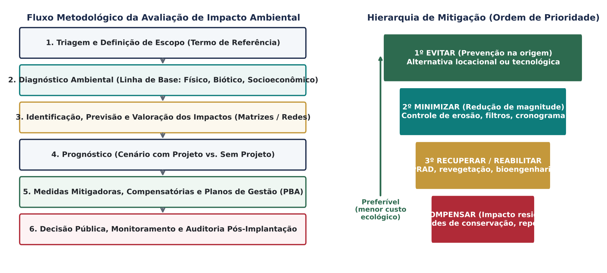

# 05 Avaliacao Impacto Ambiental

[leftmargin=1.5em, itemsep=3pt]
    \item **Capítulo 5 — Avaliação de Impacto Ambiental (AIA) e Planejamento Ambiental (Semana 5 $\bullet$ Base do EO4):** conceito e caráter preventivo da AIA; fluxo completo de etapas (triagem, escopo, diagnóstico, áreas de influência, métodos de identificação e previsão, prognóstico, hierarquia de mitigação, compensação, Plano Básico Ambiental e monitoramento pós-implantação), com demonstração numérica detalhada de matrizes ponderadas.
    \item **Capítulo 6 — Fundamentos da Análise Ambiental Integrada, Escalas e Ordenamento Territorial (Semana 6):** interações sistêmicas entre os meios físico, biótico e antrópico; acoplamento entre escalas espaciais e temporais e a falácia de escala; sistemas ambientais abertos, balanços de massa, limiares (*thresholds*) e retroalimentação; distinção técnica entre planejamento ambiental, planejamento territorial e ordenamento territorial, com foco no Zoneamento Ecológico-Econômico (ZEE).
    \item **Simulado e Revisão Integrada do Módulo 2:** 8 questões objetivas autorais no estilo ENADE e concursos ambientais, 2 questões dissertativas no formato da Avaliação Teórica da disciplina, gabarito integralmente comentado, espelho dissertativo e tabela de diagnóstico de revisão.
  \end{itemize}

# Avaliação de Impacto Ambiental (AIA) e Planejamento Ambiental

\noindent`PLANO CHF662 • PROVA TEÓRICA`\ `ESTUDO ORIENTADO 4`\ `TRABALHO PRÁTICO FINAL`

::: {.callout-note}
## Etapa 1 — O que você vai aprender neste capítulo

  Ao concluir este capítulo, você será capaz de:
  
- Explicar o conceito, a finalidade preventiva e o papel da Avaliação de Impacto Ambiental (AIA) no planejamento e no licenciamento ambiental, diferenciando AIA de EIA/RIMA.
- Descrever em sequência lógica todas as etapas do processo de AIA: triagem (*screening*), definição de escopo (*scoping* e Termo de Referência), diagnóstico ambiental, delimitação de áreas de influência (ADA, AID e AII), identificação e previsão de impactos, prognóstico, mitigação, compensação, Plano Básico Ambiental (PBA) e monitoramento pós-implantação.
- Aplicar e interpretar os principais métodos de identificação e valoração de impactos: listagens de controle (*checklists*), Matriz de Leopold e matrizes ponderadas (calculando magnitude, importância, pontuação celular e balanços), redes de interação e sobreposição de cartas em SIG.
- Empregar a Hierarquia de Mitigação (**Evitar $\to$ Minimizar $\to$ Recuperar $\to$ Compensar**) para hierarquizar decisões técnicas e distinguir medidas mitigadoras de compensatórias.
- Avaliar criticamente a efetividade de programas de monitoramento no PBA, utilizando indicadores quantitativos de linha de base e metas ambientais auditáveis.

:::

::: {.callout-tip}
## Etapa 2 — Revisando o que você precisa saber

  Antes de avançar para os instrumentos da AIA, retome quatro noções consolidadas no Módulo 1 (especialmente no Capítulo 4):
  
1. **Aspecto ambiental versus impacto ambiental:** o *aspecto* é a causa ligada à atividade humana (por exemplo, supressão de vegetação ou lançamento de efluente); o *impacto* é a consequência sobre a qualidade ambiental (por exemplo, perda de solo por erosão ou eutrofização). Impactos podem ser **adversos** (negativos) ou **benéficos** (positivos).
2. **Degradação ambiental:** alteração adversa dos processos, funções ou componentes ambientais que reduz a capacidade do sistema de sustentar a biodiversidade e os serviços ecossistêmicos. Todo processo de degradação resulta de impactos negativos, mas nem todo impacto configura degradação irreversível.
3. **Vulnerabilidade, fragilidade e risco:** a fragilidade refere-se à suscetibilidade intrínseca e emergente do meio físico-biótico; a vulnerabilidade expressa o grau de exposição e suscetibilidade social ou ecológica diante de um perigo; o risco combina perigo e vulnerabilidade.
4. **Política Nacional do Meio Ambiente (PNMA — Lei nº 6.938/1981):** consagrou a AIA como um de seus instrumentos centrais, posteriormente regulamentada no Brasil pelas Resoluções CONAMA nº 001/1986 e nº 237/1997.

:::

## Etapa 3: Explicação Teórica e Fundamentos Metodológicos

::: {.callout-note}
## Vocabulário Técnico e Siglas Essenciais da AIA

  
  \small
  

| l >{\raggedright\arraybackslash}X@{}} **Termo / Sigla** | **Significado operacional na Análise Ambiental** |
| --- | --- |
| **AIA** | Avaliação de Impacto Ambiental: processo sistemático e preventivo de exame das consequências futuras de uma ação proposta antes da tomada de decisão. |
| **EIA / RIMA** | Estudo de Impacto Ambiental (documento técnico completo) e Relatório de Impacto Ambiental (síntese em linguagem acessível à sociedade). |
| **TR** | Termo de Referência: documento emitido pelo órgão ambiental que define o escopo, o conteúdo mínimo e o nível de detalhe exigidos nos estudos. |
| **ADA / AID / AII** | Área Diretamente Afetada, Área de Influência Direta e Área de Influência Indireta do empreendimento, delimitadas para cada meio (físico, biótico e socioeconômico). |
| **PBA** | Plano Básico Ambiental: conjunto detalhado de programas de gestão, controle, mitigação, compensação e monitoramento executados durante a implantação e operação. |
| \textbf{$M_{ij}$, $I_{ij}$, $P_{ij}$} | Magnitude ($1$ a $10$), Importância ($1$ a $10$) e Pontuação Ponderada ($P_{ij} = s_{ij}\cdot M_{ij}\cdot I_{ij}$) da interação entre o fator ambiental $i$ e a ação $j$ numa matriz de Leopold adaptada. |
| **Impacto residual** | Parcela do impacto adverso que permanece mesmo após esgotadas as medidas de prevenção, minimização e recuperação, sendo o alvo legítimo da compensação. |

:::

## Conceito, Natureza Preventiva e Papel da AIA no Planejamento

A **Avaliação de Impacto Ambiental (AIA)** é um instrumento de política e planejamento ambiental de caráter essencialmente **preventivo**. Como sintetiza Sánchez (2013, cap. 7), avaliar impactos ambientais significa identificar, prever, interpretar e comunicar, *antes* que uma obra, atividade ou política seja implantada, as alterações que ela poderá provocar nos meios físico, biótico e socioeconômico, bem como propor alternativas e medidas capazes de evitar ou reduzir danos e potencializar benefícios.

No Brasil, a AIA constitui um dos instrumentos da Política Nacional do Meio Ambiente (Lei nº 6.938/1981) e articula-se diretamente ao licenciamento ambiental (Brasil/MMA, 2016; Vital et al., 2020). Embora o Estudo de Impacto Ambiental e seu respectivo Relatório (EIA/RIMA) representem a modalidade mais conhecida, destinada a atividades potencialmente causadoras de *significativa* degradação ambiental (Resolução CONAMA nº 001/1986), a AIA não se restringe ao EIA. O processo de AIA engloba também estudos simplificados (como o Relatório Ambiental Simplificado [RAS], o Plano de Controle Ambiental [PCA] e o Estudo Ambiental Preliminar [EAP]), a análise técnica pelo órgão licenciador, a participação pública (audiências públicas) e o acompanhamento posterior à licença.

::: {.callout-note}
## Por que a AIA pertence ao Planejamento Ambiental?

  Quando reduzida a um rito cartorial executado após todas as decisões de engenharia já estarem fechadas, a AIA perde sua função precípua e transforma-se em mera justificativa documental. Para cumprir seu papel no **planejamento ambiental**, a AIA deve operar desde a fase de concepção do projeto, orientando:
  
- a escolha entre **alternativas locacionais** (onde instalar o empreendimento, evitando nascentes, APPs, solos muito frágeis ou áreas de alto valor cultural);
- a escolha entre **alternativas tecnológicas** (qual técnica construtiva ou processo produtivo gera menor rejeito, menor supressão vegetal e menor demanda hídrica);
- a avaliação da **alternativa zero** (cenário de não realização do projeto), verificando se o interesse público e o balanço socioambiental efetivamente justificam a intervenção.

:::

## Etapas do Processo de Avaliação de Impacto Ambiental

A literatura internacional e os manuais brasileiros de referência (Sánchez, 2013; Brasil/MMA, 2016) organizam a AIA em um encadeamento lógico e iterativo de etapas, sintetizado no Painel A da Figura indicada acima. Cada etapa condiciona a qualidade da etapa seguinte.

### 1. Triagem (*Screening*)

A triagem responde à primeira pergunta decisória do processo: *este projeto requer uma AIA completa (EIA/RIMA), um estudo ambiental simplificado ou está dispensado de AIA?* Os critérios de triagem combinam a tipologia da atividade (rodovias, parques eólicos, mineração, barragens), o porte (área, potência, vazão) e, fundamentalmente, a **sensibilidade do local** de inserção (proximidade de Unidades de Conservação, terras indígenas, comunidades tradicionais, nascentes ou áreas de Caatinga bem conservada).

### 2. Definição de Escopo (*Scoping*) e Termo de Referência (TR)

Confirmada a necessidade de AIA, a definição de escopo delimita *o que realmente importa estudar*, evitando dois extremos prejudiciais: relatórios enciclopédicos cheios de dados irrelevantes ou estudos omissos em impactos críticos. O produto formal dessa etapa é o **Termo de Referência (TR)**, emitido pelo órgão ambiental (como o INEMA na Bahia ou o IBAMA na esfera federal), que especifica a profundidade do diagnóstico, as metodologias obrigatórias, o horizonte temporal e as questões levantadas em consultas preliminares.

### 3. Diagnóstico Ambiental (Linha de Base) e Áreas de Influência

O diagnóstico constrói a **linha de base (*baseline*)**, ou seja, o retrato qualiquantitativo do ambiente *antes* da implantação do projeto, estruturado em três meios interdependentes:

- **Meio físico:** clima, geologia, geomorfologia, solos, recursos hídricos superficiais e subterrâneos, qualidade do ar e ruído de fundo;
- **Meio biótico:** fitofisionomias, flora (espécies endêmicas ou ameaçadas), fauna terrestre e aquática, corredores ecológicos e áreas prioritárias para conservação;
- **Meio socioeconômico:** demografia, uso e ocupação da terra, estrutura produtiva, infraestrutura pública, comunidades quilombolas/indígenas/fundo de pasto e patrimônio arqueológico e cultural.

O diagnóstico exige a delimitação cartográfica rigorosa das três **Áreas de Influência**, que não são círculos arbitrários traçados com compasso, mas recortes baseados em processos físicos, ecológicos e sociais reais (microbacias, plumas de dispersão, limites municipais):

\small

| p{3.0cm} >{\raggedright\arraybackslash}X p{4.2cm}@{}} \bfseries Área | \bfseries Critério técnico de delimitação | \bfseries Exemplo no Semiárido baiano |
| --- | --- | --- |
| **ADA**   (Área Diretamente Afetada) | Superfície efetivamente ocupada pelas estruturas físicas do empreendimento, canteiros, estradas de acesso, jazidas e áreas de bota-fora. | Poligonal das bases das torres eólicas, subestação, linhas internas e vias de acesso abertas na Caatinga. |
| **AID**   (Área de Influência Direta) | Espaço que sofre impactos diretos (primários) decorrentes da implantação e operação, geralmente definido pela microbacia, mancha de ruído ou raio de dispersão de poeira/fauna. | Microbacia drenada pelos acessos do parque eólico, áreas de afugentamento de avifauna e povoados lindeiros sujeitos a poeira e ruído. |
| **AII**   (Área de Influência Indireta) | Espaço alcançado por impactos secundários ou indiretos (econômicos, demográficos, viários ou sobre a bacia hidrográfica regional). | Municípios afetados pelo aumento de arrecadação, demanda por serviços urbanos, tráfego pesado e sub-bacia regional. |

### 4. Identificação, Previsão e Valoração de Impactos

Nesta etapa, cruzam-se as ações do projeto (nas fases de planejamento, implantação, operação e desativação) com os fatores ambientais descritos no diagnóstico. Os impactos são classificados segundo atributos padronizados: **natureza** (adverso ou benéfico), **incidência** (direto ou indireto), **abrangência** (local, regional ou estratégica), **temporalidade** (imediato, médio ou longo prazo), **duração** (temporário, permanente ou cíclico), **reversibilidade** (reversível ou irreversível) e **cumulatividade/sinergia** (quando se soma ou se amplifica junto a outros projetos existentes na bacia).

Para executar essa etapa de modo transparente e auditável, a análise ambiental emprega quatro famílias principais de métodos:

1. **Listagens de controle (*Checklists*):** relações estruturadas de fatores ambientais e potenciais impactos organizados por tipologia de projeto. Podem ser *simples* (apenas verificam presença/ausência), *descritivas* (incluem orientações de medição) ou *escalares/ponderadas* (atribuem notas e pesos). São rápidas e úteis na triagem e no escopo, porém tendem a ser estáticas e não explicitam facilmente as relações diretas entre cada ação específica e cada efeito indireto.
2. **Matrizes de interação (Matriz de Leopold e matrizes ponderadas):** cruzam em tabela bidimensional as *ações do empreendimento* (colunas) com os *fatores ambientais* (linhas). Proposta originalmente por Leopold et al. (1971) com $100$ ações e $88$ fatores ($8\,800$ células possíveis), a matriz é hoje adaptada para cada projeto concreto, avaliando cada interação relevante por sinal, **magnitude** e **importância**.
3. **Redes de interação (*Networks*):** diagramas em grafo (fluxogramas causa-efeito) que rastreiam cadeias de impactos: uma ação inicial gera um *impacto primário* (direto), que desencadeia *impactos secundários* e *terciários* (indiretos). Exemplo clássico no Semiárido: abertura de estrada sem drenagem (ação) $\to$ exposição do solo e concentração do escoamento (1ª ordem) $\to$ sulcos, ravinas e carreamento de sedimentos para o riacho (2ª ordem) $\to$ assoreamento do açude comunitário e redução da disponibilidade hídrica na seca (3ª ordem).
4. **Sobreposição de cartas (*Overlay*) e SIG:** derivada do método clássico de Ian McHarg (1969) e hoje operada em Sistemas de Informação Geográfica (SIG), consiste em sobrepor camadas georreferenciadas (declividade, solos, hidrografia, APPs, remanescentes florestais, áreas urbanas) por meio de álgebra de mapas. É insubstituível para **comparar alternativas locacionais** e explicitar a distribuição espacial dos impactos, embora dependa diretamente da qualidade e da escala dos dados cartográficos (tema aprofundado no Capítulo 6).

\small

| p{2.7cm} >{\raggedright\arraybackslash}X >{\raggedright\arraybackslash}X p{2.7cm}@{}} \bfseries Método | \bfseries Principal vantagem | \bfseries Principal limitação | \bfseries Uso ideal |
| --- | --- | --- | --- |
| **Checklists** | Rapidez, memória técnica e padronização inicial. | Estáticos; não mostram encadeamento causa-efeito nem localização. | Triagem, escopo e auditorias iniciais. |
| **Matriz de Leopold / Ponderada** | Liga explicitamente cada ação a cada fator e permite hierarquizar prioridades. | Dificuldade em representar impactos indiretos (2ª/3ª ordem) e subjetividade se os critérios de nota não forem explícitos. | Síntese técnica de EIAs, PCAs e comparação de ações. |
| **Redes de Interação** | Evidencia impactos indiretos, cumulativos e efeitos em cascata nos sistemas naturais. | Pode tornar-se visualmente complexa em grandes projetos; não quantifica por si só a distribuição espacial. | Análise de bacias, erosão, hidrologia e cadeias tróficas. |
| **Sobreposição / SIG** | Explicita exatamente *onde* ocorrem os conflitos e orienta alternativas locacionais. | Exige base cartográfica compatível na escala de detalhe; não substitui a análise de processos sociais não mapeáveis. | Escolha de traçados, parques energéticos e zoneamentos. |

::: {.callout-tip}
## Matriz de Leopold Ponderada — Pontuação de Magnitude, Importância e Balanço

  Em uma matriz de interação ponderada adaptada de Leopold et al. (1971), cada célula $(i,j)$ onde há interação efetiva entre o **fator ambiental $i$** (linha) e a **ação do empreendimento $j$** (coluna) recebe três atributos explícitos:
  
- \textbf{Sinal ($s_{ij} \in \{-1, +1\}$):} $-1$ para impacto *adverso* (negativo) e $+1$ para impacto *benéfico* (positivo). Se não houver interação, registra-se $0$ (célula vazia).
- \textbf{Magnitude ($M_{ij} \in \{1, 2, \dots, 10\}$):} expressa a *extensão física, intensidade ou grau de alteração* provocada pela ação sobre o fator ($1$ = alteração mínima e pontual; $10$ = alteração máxima e extensa).
- \textbf{Importância ($I_{ij} \in \{1, 2, \dots, 10\}$):} expressa a *relevância ecológica, social, funcional ou legal* do fator afetado ($1$ = baixa relevância regional/funcional; $10$ = relevância crítica, como espécie ameaçada, manancial de abastecimento ou comunidade tradicional).

  **Equações de cálculo passo a passo:**
  
$$

    P_{ij} = s_{ij} \cdot \left(M_{ij} \times I_{ij}\right)   \text{com } P_{ij} \in [-100, +100]
  
$$

  
$$

    T_j = \sum_{i=1}^{m} P_{ij}   (\text{soma da coluna } j\text{: impacto total da ação } j\text{ sobre os } m \text{ fatores})
  
$$

  
$$

    F_i = \sum_{j=1}^{n} P_{ij}   (\text{soma da linha } i\text{: impacto acumulado das } n \text{ ações sobre o fator } i)
  
$$

  
$$

    B = \sum_{i=1}^{m}\sum_{j=1}^{n} P_{ij} = \sum_{j=1}^{n} T_j = \sum_{i=1}^{m} F_i,   \text{analisado em conjunto com } §igma^{-} = \sum_{P_{ij}<0} P_{ij} \text{ e } §igma^{+} = \sum_{P_{ij}>0} P_{ij}
  
$$

  **Demonstração numérica passo a passo (mini-matriz $2 \times 2$):** considere duas ações ($A_1$: supressão vegetal em encosta; $A_2$: contratação de mão de obra local) e dois fatores ($F_1$: solo e suscetibilidade erosiva; $F_2$: renda familiar).
  
1. Célula $(F_1, A_1)$: impacto adverso ($s=-1$), alta intensidade física ($M=8$) em solo frágil de encosta ($I=9$) $\implies P_{11} = -1 \times (8 \times 9) = -72$.
2. Célula $(F_2, A_1)$: pequeno efeito positivo temporário de pagamento pela limpeza ($s=+1$, $M=2$, $I=3$) $\implies P_{21} = +1 \times (2 \times 3) = +6$.
3. Célula $(F_1, A_2)$: a contratação em si não altera fisicamente o solo $\implies P_{12} = 0$.
4. Célula $(F_2, A_2)$: impacto benéfico relevante ($s=+1$, $M=6$, $I=7$) $\implies P_{22} = +1 \times (6 \times 7) = +42$.
5. **Somas das ações (colunas):** $T_1 = -72 + 6 = -66$ (ação fortemente adversa); $T_2 = 0 + 42 = +42$.
6. **Somas dos fatores (linhas):** $F_1 = -72 + 0 = -72$ (fator crítico que exige mitigação prioritária); $F_2 = +6 + 42 = +48$.
7. **Balanço e alerta metodológico:** $§igma^{-} = -72$, $§igma^{+} = +48$ e balanço líquido $B = -72 + 48 = -24$. *Atenção:* a soma positiva em renda ($+48$) **nunca** elimina fisicamente a erosão do solo ($-72$); por isso, a decisão técnica exige analisar sempre $§igma^{-}$, $§igma^{+}$ e as células críticas individuais, nunca apenas o saldo líquido $B$.

:::

### 5. Prognóstico Ambiental: Cenário com Projeto vs. Cenário sem Projeto

O prognóstico projeta a evolução futura da qualidade ambiental em dois cenários comparativos obrigatórios:

- **Cenário sem projeto (alternativa zero):** não significa um ambiente congelado no tempo! Mesmo sem o empreendimento, a área continua evoluindo segundo tendências já instaladas (expansão urbana, sobrepastejo, mudanças climáticas ou regeneração natural).
- **Cenário com projeto:** projeta a trajetória ambiental incorporando o empreendimento, primeiro *sem medidas mitigadoras* (para revelar a real magnitude potencial do risco) e depois *com as medidas mitigadoras e de controle propostas* (revelando o impacto residual).

O impacto verdadeiro atribuível ao projeto corresponde à **diferença entre a trajetória futura com o projeto e a trajetória futura sem o projeto**, e não simplesmente à diferença entre o "depois" e o "antes" estático.

### 6. Hierarquia de Mitigação, Medidas Mitigadoras e Compensatórias

Diante dos impactos adversos identificados, o planejador ambiental não pode escolher medidas aleatoriamente ou propor compensação financeira de imediato para danos que poderiam ser evitados. A prática internacional e a legislação ambiental impõem a **Hierarquia de Mitigação**, representada no Painel B da Figura indicada acima:

1. **1º — Evitar (prevenção na origem):** alterar a localização, o traçado, o cronograma ou a tecnologia do projeto para impedir que o impacto sequer ocorra. É o degrau de maior eficácia ecológica e, frequentemente, de menor custo global a longo prazo.
2. **2º — Minimizar (redução de magnitude, duração ou extensão):** quando o impacto não pode ser integralmente evitado, aplicam-se controles de engenharia e manejo para reduzir sua intensidade (filtros, bacias de contenção de sedimentos, supressão seletiva, limitação de horários de tráfego).
3. **3º — Recuperar / Reabilitar (restauração *in situ*):** após a intervenção temporária (como canteiros de obra, taludes de corte e áreas de empréstimo), restabelecem-se as funções do solo, da drenagem e da cobertura vegetal por meio de Plano de Recuperação de Áreas Degradadas (PRAD) e técnicas de bioengenharia.
4. **4º — Compensar (último recurso, apenas para o impacto residual):** aplica-se estritamente à fração de dano inevitável que permanece após esgotados os três degraus anteriores. Exemplos: apoio à criação ou consolidação de Unidades de Conservação (art. 36 da Lei nº 9.985/2000, Sistema Nacional de Unidades de Conservação da Natureza, SNUC), reposição florestal equivalente ou superior em área e qualidade ecológica (*offset* de biodiversidade) e programas de fortalecimento comunitário.

Para impactos **benéficos**, em vez de medidas mitigadoras, formulam-se **medidas potencializadoras** (por exemplo, capacitação profissional prévia de moradores locais para maximizar a absorção de mão de obra da AID).

### 7. Plano Básico Ambiental (PBA) e Monitoramento Pós-Implantação

Na etapa de decisão, o órgão ambiental emite parecer técnico e decide pelo deferimento (com condicionantes) ou indeferimento da licença (Licença Prévia [LP], seguida de Licença de Instalação [LI] e Licença de Operação [LO]). Os compromissos genéricos listados no EIA são então detalhados em projetos executivos no **Plano Básico Ambiental (PBA)**, que reúne programas operacionais como: Programa de Controle de Processos Erosivos, Programa de Monitoramento da Qualidade da Água, Programa de Resgate e Monitoramento de Fauna, Programa de Educação Ambiental e PRAD.

O **monitoramento pós-implantação** (acompanhamento) fecha o ciclo da AIA. Medindo periodicamente os mesmos indicadores levantados na linha de base (turbidez da água, taxa de erosão, ruído, sobrevivência de mudas), o monitoramento verifica se as previsões do estudo estavam corretas e se as medidas do PBA atingiram as metas estipuladas. Caso os indicadores ultrapassem os limites toleráveis, aciona-se a **gestão adaptativa**, com correção imediata dos controles em campo.

## Etapa 4: Estudos de Caso e Exemplos Resolvidos Passo a Passo

::: {.callout-tip}
## Estudo de Caso / Exemplo 5.1 — Delimitação Quantitativa de ADA, AID e AII em Parque Solar no Semiárido (Nível Básico)

  
**1. Situação-problema / Enunciado:** Uma empresa propõe a instalação de uma usina solar fotovoltaica em área rural de transição semiárida na Bahia. O projeto prevê $45{,}0\,\text{ha}$ ocupados pelos arranjos de painéis solares, mais $3{,}5\,\text{ha}$ destinados à subestação, canteiro de obras e estradas internas de acesso. A microbacia hidrográfica que drena o empreendimento possui $620{,}0\,\text{ha}$, e o município de inserção ocupa $48\,500{,}0\,\text{ha}$.
  
**2. Dados e informações fornecidas:** Área dos painéis $= 45{,}0\,\text{ha}$; áreas de apoio e acessos $= 3{,}5\,\text{ha}$; área da microbacia (AID do meio físico) $= 620{,}0\,\text{ha}$; área do município (AII socioeconômica) $= 48\,500{,}0\,\text{ha}$.
  
**3. O que a análise solicita:** Calcular a Área Diretamente Afetada (ADA) total, determinar o percentual que a ADA representa em relação à AID e à AII, e justificar por que a AID do meio físico deve acompanhar os divisores da microbacia e não um círculo arbitrário.
  
**4. Referencial e método adotado:** Soma das superfícies de intervenção direta para obtenção da ADA e cálculo de razão percentual ($\text{ADA}/\text{AID} \times 100%$ e $\text{ADA}/\text{AII} \times 100%$), articulados aos critérios físicos de delimitação de áreas de influência em AIA (Sánchez, 2013).
  
**5. Desenvolvimento passo a passo:**

    
1. **Cálculo da ADA:** somam-se todas as áreas com supressão ou ocupação direta pelas estruturas principais e auxiliares:
      
$$

        \text{ADA} = 45{,}0 + 3{,}5 = 48{,}5\,\text{ha}.
      
$$
2. **Proporção da ADA na AID (microbacia):**
      
$$

        \frac{\text{ADA}}{\text{AID}} \times 100% = \frac{48{,}5}{620{,}0} \times 100% = 0{,}078225\dots \times 100% \approx 7{,}82%.
      
$$
3. **Proporção da ADA na AII (município):**
      
$$

        \frac{\text{ADA}}{\text{AII}} \times 100% = \frac{48{,}5}{48\,500{,}0} \times 100% = 0{,}001 \times 100% = 0{,}10%.
      
$$
4. **Critério físico da AID:** o escoamento superficial, o carreamento de sedimentos e eventuais vazamentos de óleos de transformadores obedecem à gravidade e aos divisores topográficos. Um círculo fixo de $1\,\text{km}$ incluiria trechos de bacias vizinhas sem conexão hídrica com o parque e deixaria de fora o exutório a jusante que efetivamente receberá os sedimentos.

  }
  
**6. Síntese / Resposta:** $\text{ADA} = 48{,}5\,\text{ha}$, correspondendo a $7{,}82%$ da AID (microbacia) e $0{,}10%$ da AII (município). A AID física deve coincidir com a microbacia porque os fluxos hidrossedimentológicos seguem a drenagem natural.
  
**7. Verificação crítica:** O resultado é coerente: $\text{ADA} < \text{AID} < \text{AII}$ ($48{,}5 < 620{,}0 < 48\,500{,}0\,\text{ha}$). Note também um alerta importante de análise ambiental: embora $0{,}10%$ do município pareça desprezível na escala da AII, ocupar $7{,}82%$ da microbacia local com superfícies compactadas e painéis já é suficiente para alterar o pico de escoamento superficial local se não houver drenagem e proteção do solo adequadas.

:::

::: {.callout-tip}
## Estudo de Caso / Exemplo 5.2 — Matriz de Leopold Ponderada em Parque Eólico na Caatinga (Nível Básico–Intermediário)

  
**1. Situação-problema / Enunciado:** Durante a AIA de um parque eólico no Semiárido baiano, a equipe técnica construiu uma matriz simplificada cruzando três ações principais ($A_1$: supressão vegetal e abertura de acessos; $A_2$: escavação e concretagem das fundações das torres; $A_3$: operação dos aerogeradores e contratação de serviços locais) com quatro fatores ambientais ($F_1$: solo e processos erosivos; $F_2$: fauna e avifauna; $F_3$: qualidade da água superficial; $F_4$: emprego e renda local).
  
**2. Dados e informações fornecidas:** Avaliações $(s, M, I)$ atribuídas por célula após vistorias de campo e consulta à linha de base:
  
- $F_1$ (Solo/Erosão): $A_1 = (-, 8, 9)$; $A_2 = (-, 6, 8)$; $A_3 = 0$.
- $F_2$ (Fauna/Avifauna): $A_1 = (-, 7, 8)$; $A_2 = (-, 3, 5)$; $A_3 = (-, 5, 9)$.
- $F_3$ (Qualidade da água): $A_1 = (-, 5, 7)$; $A_2 = (-, 4, 7)$; $A_3 = 0$.
- $F_4$ (Emprego/Renda): $A_1 = (+, 3, 5)$; $A_2 = (+, 4, 5)$; $A_3 = (+, 7, 8)$.

**3. O que a análise solicita:** Calcular todas as pontuações celulares $P_{ij}$, os totais por ação ($T_j$), os totais por fator ($F_i$), a carga adversa ($§igma^{-}$), a carga benéfica ($§igma^{+}$) e o balanço líquido ($B$), identificando a ação mais crítica e o fator mais impactado.
  
**4. Referencial e método adotado:** Aplicação direta das equações da Matriz de Leopold Ponderada: $P_{ij} = s_{ij} \cdot (M_{ij} \times I_{ij})$, com verificação cruzada pela igualdade $\sum T_j = \sum F_i = B$.
  
**5. Desenvolvimento passo a passo:**

    
1. \textbf{Cálculo de cada célula $P_{ij}$:}
      

6. **Montagem da tabela e somas por linha ($F_i$) e por coluna ($T_j$):**
      
      
      \small
      

| X r r r r@{}} **Fator Ambiental** | **$A_1$ (Acessos)** | **$A_2$ (Fundações)** | **$A_3$ (Operação)** | **Total $F_i$** |
| --- | --- | --- | --- | --- |
| $F_1$ — Solo / Erosão | $-72$ | $-48$ | $0$ | $\mathbf{-120}$ |
| $F_2$ — Fauna / Avifauna | $-56$ | $-15$ | $-45$ | $\mathbf{-116}$ |
| $F_3$ — Qualidade da água | $-35$ | $-28$ | $0$ | $\mathbf{-63}$ |
| $F_4$ — Emprego / Renda | $+15$ | $+20$ | $+56$ | $\mathbf{+91}$ |
| **Total da Ação ($T_j$)** | $\mathbf{-148}$ | $\mathbf{-71}$ | $\mathbf{+11}$ | $\mathbf{B = -208}$ |

      
7. **Conferência das somas por linha e por coluna:**
      
$$
\begin{aligned}
        \sum F_i &= (-120) + (-116) + (-63) + 91 = -299 + 91 = -208, 

        \sum T_j &= (-148) + (-71) + 11 = -219 + 11 = -208.
      \end{aligned}
$$
8. **Separação de cargas adversa e benéfica:**
      
$$

        §igma^{-} = -72 - 48 - 56 - 15 - 45 - 35 - 28 = -299,   §igma^{+} = +15 + 20 + 56 = +91.
      
$$

  }
  
**6. Síntese / Resposta:** A ação mais impactante negativamente é $A_1$ (supressão e acessos, $T_1 = -148$) e o fator mais vulnerável é $F_1$ (solo/erosão, $F_1 = -120$), seguido de perto por $F_2$ (fauna/avifauna, $F_2 = -116$). A carga adversa total é $§igma^{-} = -299$, a carga benéfica é $§igma^{+} = +91$ e o balanço líquido é $B = -208$.
  
**7. Verificação crítica:** A igualdade $\sum F_i = \sum T_j = §igma^{-} + §igma^{+} = -208$ confirma a exatidão aritmética. Do ponto de vista ambiental, observe a célula $P_{23} = -45$ (colisão de avifauna na operação): mesmo com $T_3 = +11$ (saldo positivo na coluna $A_3$), o impacto sobre aves ameaçadas da Caatinga (como a arara-azul-de-lear na região de Canudos) tem importância $I = 9$ e exige monitoramento e sistemas de desligamento preventivo, nunca podendo ser mascarado pelos $+56$ pontos de renda.

:::

::: {.callout-tip}
## Estudo de Caso / Exemplo 5.3 — Prognóstico e Seleção Multicritério de Alternativas Locacionais (Nível Intermediário)

  
**1. Situação-problema / Enunciado:** No estudo de duplicação de uma rodovia estadual na Bahia, o EIA comparou duas alternativas locacionais diante do cenário sem projeto: o **Traçado A** (mais curto, porém atravessa uma APP de nascente e um fragmento contínuo de Caatinga) e o **Traçado B** ($1{,}2\,\text{km}$ mais extenso, contornando a APP por áreas já antropizadas de pastagem).
  
**2. Dados e informações fornecidas:** Quatro critérios ponderados (soma dos pesos $= 1{,}00$) avaliados em escala de **severidade adversa** de $0$ (nenhum dano) a $10$ (dano máximo):
  
- $C_1$ — Supressão de APP e vegetação nativa (peso $w_1 = 0{,}35$): Traçado A $= 9$; Traçado B $= 3$.
- $C_2$ — Risco erosivo e assoreamento de drenagem (peso $w_2 = 0{,}30$): Traçado A $= 8$; Traçado B $= 4$.
- $C_3$ — Fragmentação e atropelamento de fauna (peso $w_3 = 0{,}20$): Traçado A $= 8$; Traçado B $= 4$.
- $C_4$ — Custo financeiro e extensão adicional da obra (peso $w_4 = 0{,}15$): Traçado A $= 4$; Traçado B $= 7$.

**3. O que a análise solicita:** Calcular o Índice de Impacto Adverso Ponderado ($I_{\text{adv}}$) de cada alternativa, a redução percentual de impacto adverso ao optar pelo melhor traçado e explicar em qual degrau da Hierarquia de Mitigação essa escolha se enquadra.
  
**4. Referencial e método adotado:** Cálculo da média ponderada $I_{\text{adv}} = \sum_{k=1}^{4} w_k \cdot C_k$, seguida de variação percentual relativa $(I_A - I_B)/I_A \times 100%$.
  
**5. Desenvolvimento passo a passo:**

    
1. **Verificação dos pesos:** $0{,}35 + 0{,}30 + 0{,}20 + 0{,}15 = 1{,}00$ (normalização correta).
2. **Índice adverso do Traçado A ($I_A$):**
      
$$
\begin{aligned}
        I_A &= (0{,}35 \times 9) + (0{,}30 \times 8) + (0{,}20 \times 8) + (0{,}15 \times 4) 

            &= 3{,}15 + 2{,}40 + 1{,}60 + 0{,}60 = 7{,}75.
      \end{aligned}
$$
3. **Índice adverso do Traçado B ($I_B$):**
      
$$
\begin{aligned}
        I_B &= (0{,}35 \times 3) + (0{,}30 \times 4) + (0{,}20 \times 4) + (0{,}15 \times 7) 

            &= 1{,}05 + 1{,}20 + 0{,}80 + 1{,}05 = 4{,}10.
      \end{aligned}
$$
4. **Redução percentual da severidade adversa (A para B):**
      
$$

        \text{Redução} = \frac{7{,}75 - 4{,}10}{7{,}75} \times 100% = \frac{3{,}65}{7{,}75} \times 100% \approx 47{,}10%.
      
$$

  }
  
**6. Síntese / Resposta:** O Traçado B é tecnicamente superior ($I_B = 4{,}10$ contra $I_A = 7{,}75$), promovendo redução de $47{,}10%$ no índice de severidade adversa. Trata-se de uma medida do 1º degrau da Hierarquia de Mitigação (**Evitar**), via alternativa locacional.
  
**7. Verificação crítica:** Como a escala avalia severidade adversa, o menor valor indica o melhor desempenho. Apesar de o Traçado B ter nota pior no critério financeiro ($7$ contra $4$), o ganho ambiental em APP, erosão e fauna reduz quase pela metade o dano global e evita custos elevados com licenciamento em APP, obras emergenciais contra erosão e compensações futuras.

:::

::: {.callout-tip}
## Estudo de Caso / Exemplo 5.4 — Aplicação Sequencial da Hierarquia de Mitigação em Loteamento Periurbano (Nível Intermediário–Avançado)

  
**1. Situação-problema / Enunciado:** O anteprojeto de um loteamento periurbano previa inicialmente a supressão de $12{,}0\,\text{ha}$ de vegetação nativa e um aporte estimado de $480{,}0\,\text{t/ano}$ de sedimentos para um riacho a jusante. Após revisão pela equipe de Análise Ambiental, aplicaram-se sequencialmente os quatro degraus da Hierarquia de Mitigação.
  
**2. Dados e informações fornecidas:** 
    
- **1º Evitar:** revisão do desenho urbanístico (exclusão de quadras nas encostas mais declivosas) evita $45%$ da supressão vegetal inicial e $45%$ do aporte de sedimentos.
- **2º Minimizar:** técnicas de supressão seletiva poupam mais $1{,}6\,\text{ha}$ de mata; bacias de contenção e proteção provisória do solo retêm $60%$ do sedimento restante.
- **3º Recuperar:** revegetação e bioengenharia recuperam $2{,}0\,\text{ha}$ de áreas temporárias (canteiros e taludes) e reduzem em $75%$ o sedimento remanescente.
- **4º Compensar:** o órgão ambiental exige compensação ecológica na razão $2:1$ (dois hectares conservados ou restaurados para cada hectare de perda permanente residual).

  }
  
**3. O que a análise solicita:** Calcular, em cada degrau, a área de vegetação afetada remanescente, o aporte remanescente de sedimentos, o percentual total de abatimento de sedimentos e a área exata de compensação ecológica exigida no 4º degrau.
  
**4. Referencial e método adotado:** Abatimento sequencial (em cascata) sobre o saldo remanescente de cada degrau, sem somar percentuais diretamente sobre a base inicial quando aplicados a etapas sucessivas.
  
**5. Desenvolvimento passo a passo:**

    **A. Trajetória da supressão vegetal (ha):**
    
1. \textbf{Evitar ($45%$ de $12{,}0\,\text{ha}$):} área evitada $= 0{,}45 \times 12{,}0 = 5{,}4\,\text{ha}$. Saldo após degrau 1 $= 12{,}0 - 5{,}4 = 6{,}6\,\text{ha}$.
2. \textbf{Minimizar (corte seletivo de $1{,}6\,\text{ha}$):} saldo após degrau 2 $= 6{,}6 - 1{,}6 = 5{,}0\,\text{ha}$.
3. \textbf{Recuperar ($2{,}0\,\text{ha}$ temporários restaurados *in situ*):} perda permanente residual $= 5{,}0 - 2{,}0 = 3{,}0\,\text{ha}$.
4. **Compensar (razão $2:1$ sobre o impacto residual):** área a compensar $= 2 \times 3{,}0 = 6{,}0\,\text{ha}$.

    \textbf{B. Trajetória do aporte de sedimentos ($\text{t/ano}$):}
    
1. \textbf{Evitar ($45%$ de $480{,}0$):} evitados $= 0{,}45 \times 480{,}0 = 216{,}0\,\text{t/ano}$. Saldo 1 $= 480{,}0 - 216{,}0 = 264{,}0\,\text{t/ano}$.
2. **Minimizar ($60%$ do saldo 1):** retidos $= 0{,}60 \times 264{,}0 = 158{,}4\,\text{t/ano}$. Saldo 2 $= 264{,}0 - 158{,}4 = 105{,}6\,\text{t/ano}$.
3. **Recuperar ($75%$ do saldo 2):** retidos $= 0{,}75 \times 105{,}6 = 79{,}2\,\text{t/ano}$. Impacto residual $= 105{,}6 - 79{,}2 = 26{,}4\,\text{t/ano}$.
4. **Redução percentual acumulada de sedimentos:**
      
$$

        \text{Redução total} = \frac{480{,}0 - 26{,}4}{480{,}0} \times 100% = \frac{453{,}6}{480{,}0} \times 100% = 94{,}50%.
      
$$

  }
  
**6. Síntese / Resposta:** Após a aplicação da Hierarquia de Mitigação, o impacto residual permanente cai para $3{,}0\,\text{ha}$ de vegetação (exigindo $6{,}0\,\text{ha}$ de compensação na razão $2:1$) e para $26{,}4\,\text{t/ano}$ de sedimentos (abatimento total de $94{,}50%$).
  
**7. Verificação crítica:** Confere-se a multiplicação em cascata para sedimentos: $480{,}0 \times (1 - 0{,}45) \times (1 - 0{,}60) \times (1 - 0{,}75) = 480{,}0 \times 0{,}55 \times 0{,}40 \times 0{,}25 = 480{,}0 \times 0{,}055 = 26{,}4\,\text{t/ano}$. Sem a hierarquia, tentar "compensar" diretamente os $12{,}0\,\text{ha}$ exigiria $24{,}0\,\text{ha}$ de reposição e ainda deixaria o riacho assoreado com $480\,\text{t/ano}$ de sedimentos.

:::

::: {.callout-tip}
## Estudo de Caso / Exemplo 5.5 — Auditoria de Eficiência no Monitoramento Pós-Implantação do PBA (Nível Avançado)

  
**1. Situação-problema / Enunciado:** Durante a construção de uma barragem de regularização hídrica no rio Jacuípe (Bahia), o diagnóstico da linha de base registrou turbidez média de $18{,}0\,\text{NTU}$ a jusante do eixo barrável em período de estiagem. Nas primeiras semanas de terraplenagem sem controle, a turbidez saltou para $112{,}0\,\text{NTU}$. Acionado o Programa de Controle de Sedimentos do PBA (instalação de cortinas de siltagem e diques de contenção), o monitoramento subsequente mediu $33{,}0\,\text{NTU}$. A condicionante da Licença de Instalação estabelecia limite máximo operacional de $40{,}0\,\text{NTU}$.
  
**2. Dados e informações fornecidas:** Turbidez de linha de base $T_0 = 18{,}0\,\text{NTU}$; turbidez sem mitigação $T_{\text{sem}} = 112{,}0\,\text{NTU}$; turbidez monitorada com PBA $T_{\text{com}} = 33{,}0\,\text{NTU}$; limite da condicionante $T_{\max} = 40{,}0\,\text{NTU}$.
  
**3. O que a análise solicita:** Calcular o acréscimo de turbidez atribuível à obra sem mitigação, o acréscimo residual após o PBA, a eficiência percentual de abatimento do acréscimo antrópico e emitir parecer técnico sobre o atendimento à condicionante.
  
**4. Referencial e método adotado:** Cálculo da anomalia acima da linha de base ($\Delta T = T - T_0$) e da eficiência de mitigação sobre a carga incremental: $E_f = \frac{\Delta T_{\text{sem}} - \Delta T_{\text{com}}}{\Delta T_{\text{sem}}} \times 100% = \frac{T_{\text{sem}} - T_{\text{com}}}{T_{\text{sem}} - T_0} \times 100%$.
  
**5. Desenvolvimento passo a passo:**

    
1. **Acréscimo de turbidez sem mitigação (em relação à linha de base):**
      
$$

        \Delta T_{\text{sem}} = 112{,}0 - 18{,}0 = 94{,}0\,\text{NTU}.
      
$$
2. **Acréscimo residual após ativação do PBA:**
      
$$

        \Delta T_{\text{com}} = 33{,}0 - 18{,}0 = 15{,}0\,\text{NTU}.
      
$$
3. **Parcela efetivamente abatida pelas medidas do PBA:**
      
$$

        \Delta T_{\text{abatida}} = 94{,}0 - 15{,}0 = 79{,}0\,\text{NTU}   (\text{ou } 112{,}0 - 33{,}0 = 79{,}0\,\text{NTU}).
      
$$
4. **Eficiência percentual de abatimento da carga antrópica:**
      
$$

        E_f = \frac{79{,}0}{94{,}0} \times 100% = 0{,}840425\dots \times 100% \approx 84{,}04%.
      
$$
5. **Verificação da condicionante:** como $33{,}0\,\text{NTU} \le 40{,}0\,\text{NTU}$, a meta legal foi atendida com folga de $7{,}0\,\text{NTU}$.

  }
  
**6. Síntese / Resposta:** O acréscimo sem controle foi de $94{,}0\,\text{NTU}$, reduzido para um acréscimo residual de $15{,}0\,\text{NTU}$ com eficiência de abatimento de $84{,}04%$. A condicionante de $40{,}0\,\text{NTU}$ está atendida, mas o monitoramento deve prosseguir continuamente, sobretudo na estação chuvosa.
  
**7. Verificação crítica:** Por que descontar $T_0 = 18{,}0\,\text{NTU}$ no denominador? Porque o rio já apresentava turbidez natural de $18{,}0\,\text{NTU}$ antes da obra; uma medida de controle não visa "zerar" a turbidez natural do rio, mas abater o acréscimo provocado pela intervenção. Sem o desconto da linha de base, o cálculo subestimaria a eficiência real ($79/112 = 70{,}54%$).

:::

## Etapa 5: Erros Mais Comuns em Provas e Estudos de AIA

::: {.callout-warning}
## Erro 1 — Confundir AIA com EIA/RIMA ou tratar o licenciamento como mera burocracia

  **Equívoco frequente:** afirmar que "todo licenciamento exige EIA/RIMA" ou usar AIA e EIA como sinônimos exatos.
  

**Por que está incorreto:** a AIA é o *processo amplo* de avaliação prévia de impactos (triagem, escopo, estudos, decisão e monitoramento), enquanto o EIA/RIMA é apenas uma de suas *modalidades documentais*, exigida quando há potencial de **significativa degradação ambiental**. Projetos de menor potencial poluidor passam por triagem e apresentam estudos simplificados (como RAS ou PCA).
  

**Como evitar:** lembre sempre a relação todo--parte: o EIA/RIMA está contido na AIA, e a AIA integra o planejamento e o licenciamento ambiental.

:::

::: {.callout-warning}
## Erro 2 — Somar benefícios econômicos com danos ecológicos para "zerar" o impacto na Matriz

  **Equívoco frequente:** concluir que um empreendimento é ambientalmente viável apenas porque a soma algébrica $B = §igma^{+} + §igma^{-}$ ficou próxima de zero ou positiva (por exemplo, $+80$ em arrecadação contra $-75$ em destruição de nascente).
  

**Por que está incorreto:** a pontuação da Matriz de Leopold é ordinal/semiquantitativa e refere-se a dimensões **incomensuráveis**. Gerar empregos temporários não impede o assoreamento de um manancial nem ressuscita uma espécie endêmica perdida.
  

**Como evitar:** apresente sempre separadamente $§igma^{-}$, $§igma^{+}$ e o destaque das células críticas de alta importância ($I \ge 8$) ou irreversíveis, vinculando cada célula adversa a uma medida concreta da Hierarquia de Mitigação.

:::

::: {.callout-warning}
## Erro 3 — Inverter a Hierarquia de Mitigação usando a compensação como "licença para degradar"

  **Equívoco frequente:** propor diretamente compensação financeira ou plantio em outro município para suprimir uma APP ou um fragmento florestal sem antes avaliar se outro traçado ou tecnologia evitaria a perda.
  

**Por que está incorreto:** a compensação ocupa o **4º e último degrau** da hierarquia, restrita exclusivamente ao *impacto residual* que não pôde ser evitado, minimizado nem recuperado no local.
  

**Como evitar:** em qualquer diagnóstico ou prova, estruture suas propostas sempre na sequência obrigatória: **1º Evitar $\to$ 2º Minimizar $\to$ 3º Recuperar $\to$ 4º Compensar**.

:::

::: {.callout-warning}
## Erro 4 — Delimitar ADA, AID e AII como círculos concêntricos arbitrários sem base física

  **Equívoco frequente:** traçar raios fixos de $500\,\text{m}$ (AID) e $5\,\text{km}$ (AII) no mapa sem considerar divisores de bacia, direção dos ventos, rotas de fauna ou malha viária.
  

**Por que está incorreto:** processos ambientais não se propagam isotropicamente em círculos perfeitos. Um efluente lançado num riacho percorre quilômetros a jusante seguindo o talvegue, mas não afeta um ponto a $200\,\text{m}$ atrás do divisor topográfico.
  

**Como evitar:** delimite a AID do meio físico pela microbacia ou área de drenagem, a AID biótica pelos habitats e corredores ecológicos afetados e a AII socioeconômica pela rede de relações territoriais e municipais.

:::

## Etapa 6: Exercícios de Fixação

### Nível 1 — Básico (Conceitos, Etapas e Cálculos Fundamentais)

1. Explique, com base em Sánchez (2013), qual é o papel preventivo da Avaliação de Impacto Ambiental (AIA) e por que sua inserção tardia, após a definição do projeto de engenharia, compromete sua eficácia no planejamento ambiental.
  
*Espaço reservado para resolução na versão impressa.*
2. Em uma matriz de interação ponderada adaptada de Leopold, uma atividade de terraplenagem apresentou três interações relevantes: solo/erosão $(-, M=7, I=8)$; qualidade do ar por poeira $(-, M=4, I=6)$; e contratação temporária de operadores locais $(+, M=6, I=5)$. Calcule a pontuação $P_{ij}$ de cada célula, a carga adversa ($§igma^{-}$), a carga benéfica ($§igma^{+}$) e o total $T_j$ dessa ação.
  
*Espaço reservado para resolução na versão impressa.*
3. Diferencie claramente as etapas de **triagem (*screening*)** e **definição de escopo (*scoping*)**, indicando qual documento oficial materializa o resultado da definição de escopo no licenciamento ambiental brasileiro.
  
*Espaço reservado para resolução na versão impressa.*
4. Defina **ADA**, **AID** e **AII** e dê um exemplo concreto de cada uma para a implantação de um aterro sanitário regional no interior da Bahia.
  
*Espaço reservado para resolução na versão impressa.*
5. Compare as quatro famílias de métodos de identificação de impactos (*checklists*, Matriz de Leopold, redes de interação e sobreposição de cartas/SIG), indicando uma vantagem específica de cada método.
  
*Espaço reservado para resolução na versão impressa.*

### Nível 2 — Intermediário (Aplicação Quantitativa e Análise Técnica)

1. Um empreendimento de extração de areia em planície fluvial foi avaliado por meio de uma matriz ponderada $3 \times 3$, com as ações $A_1$ (dragagem no leito), $A_2$ (abertura de pátio e estrada de acesso) e $A_3$ (comercialização e geração de empregos) e os fatores $F_1$ (estabilidade das margens e do leito), $F_2$ (turbidez e biota aquática) e $F_3$ (renda e arrecadação municipal):
  

  Calcule todas as células $P_{ij}$, os totais $T_j$ e $F_i$, $§igma^{-}$, $§igma^{+}$ e o balanço $B$. Identifique a ação mais degradadora e o fator mais crítico.
  
*Espaço reservado para resolução na versão impressa.*
5. Um projeto agroindustrial previa inicialmente suprimir $20{,}0\,\text{ha}$ de vegetação nativa. Aplicando a Hierarquia de Mitigação: (i) a realocação do galpão evitou $35%$ da supressão inicial; (ii) o ajuste das vias internas minimizou $20%$ da área restante; (iii) a restauração de áreas temporárias recuperou $2{,}4\,\text{ha}$. Sabendo que o órgão licenciador determinou compensação na razão $3:1$ sobre o impacto permanente residual, calcule a área remanescente em cada degrau e a área total a ser compensada.
  
*Espaço reservado para resolução na versão impressa.*
6. Na escolha tecnológica para uma Estação de Tratamento de Efluentes (ETE), duas opções ($E_1$ e $E_2$) foram avaliadas em escala de **desempenho ambiental positivo** ($0$ = péssimo; $10$ = excelente) sob quatro critérios ponderados: eficiência de remoção de carga orgânica ($w_1 = 0{,}35$: $E_1=6$, $E_2=9$), controle de odores ($w_2 = 0{,}30$: $E_1=5$, $E_2=8$), possibilidade de reúso agrícola no Semiárido ($w_3 = 0{,}20$: $E_1=7$, $E_2=8$) e menor custo de implantação ($w_4 = 0{,}15$: $E_1=9$, $E_2=6$). Calcule a nota ponderada de cada alternativa e justifique a escolha técnica.
  
*Espaço reservado para resolução na versão impressa.*
7. Desenhe ou descreva textualmente uma **rede de interação** de três níveis (impacto primário $\to$ secundário $\to$ terciário) desencadeada pela abertura de vias de acesso sem drenagem em encosta declivosa da Caatinga, associando ao menos uma medida preventiva e uma medida corretiva do PBA para interromper a cascata.
  
*Espaço reservado para resolução na versão impressa.*
8. No monitoramento do PBA de uma obra rodoviária, a linha de base de Sólidos Suspensos Totais (SST) em um riacho era de $25{,}0\,\text{mg/L}$. Durante a escavação sem bacias de decantação, o valor atingiu $145{,}0\,\text{mg/L}$. Após a implantação das bacias previstas no PBA, a concentração caiu para $43{,}0\,\text{mg/L}$. Calcule o acréscimo sem controle, o acréscimo residual e a eficiência percentual de abatimento da carga antrópica.
  
*Espaço reservado para resolução na versão impressa.*

### Nível 3 — Questões Objetivas de Fixação (A–E)

1. **[Autoral — CHF662]** No processo de Avaliação de Impacto Ambiental, o prognóstico compara o cenário com projeto ao cenário sem projeto (alternativa zero). Assinale a alternativa que interpreta corretamente o conceito de **cenário sem projeto**:
  

  
*Espaço reservado para resolução na versão impressa.*
7. **[Autoral — CHF662]** Assinale a alternativa que apresenta na ordem correta, da maior para a menor prioridade técnica e ecológica, os degraus da **Hierarquia de Mitigação**:
  

  
*Espaço reservado para resolução na versão impressa.*
13. **[Autoral — CHF662]** Em uma Matriz de Leopold Ponderada ($P_{ij} = s_{ij} \cdot M_{ij} \cdot I_{ij}$), uma ação de instalação de canteiro de obras apresentou três células preenchidas: erosão laminar $(-, M=8, I=9)$, afugentamento de fauna $(-, M=6, I=7)$ e geração de empregos temporários $(+, M=5, I=4)$. Sobre o resultado dessa coluna, é correto afirmar que:
  

  
*Espaço reservado para resolução na versão impressa.*
19. **[Autoral — CHF662]** Qual método de identificação e avaliação de impactos é o mais adequado para **explicitar visualmente o encadeamento entre impactos primários (diretos) e impactos secundários e terciários (indiretos)** em uma bacia hidrográfica?
  

  
*Espaço reservado para resolução na versão impressa.*
25. **[Autoral — CHF662]** Em relação ao **Plano Básico Ambiental (PBA)** e ao monitoramento pós-implantação, assinale a afirmação correta:
  

  
*Espaço reservado para resolução na versão impressa.*

## Etapa 7: Questões no Estilo ENADE e Concursos Ambientais

1. **[Autoral — Estilo ENADE / Geografia]** A implantação de grandes empreendimentos energéticos e rodoviários no Semiárido brasileiro exige estudos ambientais rigorosos no âmbito da AIA. Considere as afirmações a seguir sobre o papel do geógrafo na AIA:
  
1. **[Autoral — Estilo Concurso Analista Ambiental / IBAMA--INEMA]** Uma consultoria apresentou ao órgão ambiental um EIA de uma ferrovia cujo traçado original cortava um trecho de mata ciliar e uma nascente perene. No capítulo de mitigação, o estudo manteve o traçado original e propôs, como única medida, o pagamento de compensação financeira para criação de parque em outra região do Estado. À luz da teoria da AIA (Sánchez, 2013) e da Hierarquia de Mitigação, o parecer técnico do analista ambiental deve:
  
- **(A)** Aprovar integralmente a proposta, pois a compensação financeira ocupa o topo da Hierarquia de Mitigação.
- **(B)** Exigir complementação do estudo com avaliação efetiva de alternativas locacionais (degrau *Evitar*) e de medidas de engenharia para redução de danos (degrau *Minimizar*), reservando a compensação estritamente a eventuais impactos residuais inevitáveis.
- **(C)** Dispensar a etapa de monitoramento no PBA, já que o recurso financeiro foi depositado previamente.
- **(D)** Substituir o EIA por uma listagem de controle simples, pois ferrovias não geram impactos indiretos.
- **(E)** Aprovar a obra desde que a soma algébrica da Matriz de Leopold seja positiva devido à geração de empregos.

  
*Espaço reservado para resolução na versão impressa.*
2. **[Autoral — Estilo Concurso Órgão Ambiental Estadual]** Associe corretamente cada instrumento ou etapa da AIA à sua função principal:
  
  \small
  

| l X@{}} (1) Termo de Referência (TR) | ( ) Execução operacional de programas de controle, recuperação e monitoramento na implantação/operação. |
| --- | --- |
| (2) Diagnóstico (Linha de Base) | ( ) Definição do escopo, conteúdo técnico mínimo e profundidade exigida nos estudos ambientais. |
| (3) Matriz de Leopold | ( ) Caracterização prévia dos meios físico, biótico e socioeconômico antes da intervenção. |
| (4) Plano Básico Ambiental (PBA) | ( ) Cruzamento sistemático entre ações do projeto e fatores ambientais por magnitude e importância. |

  
  A sequência numérica correta, de cima para baixo, é:
  
- **(A)** 4 -- 1 -- 2 -- 3.
- **(B)** 1 -- 4 -- 3 -- 2.
- **(C)** 4 -- 2 -- 1 -- 3.
- **(D)** 3 -- 1 -- 2 -- 4.
- **(E)** 2 -- 1 -- 4 -- 3.

  
*Espaço reservado para resolução na versão impressa.*

::: {.callout-tip}
## Conexão com o Estudo Orientado EO4 e o Trabalho Prático Final

  No **Estudo Orientado EO4** (Semana 5), ao analisar o texto de Sánchez (2013, cap. 7) e o guia do MMA (2016), concentre sua argumentação em três eixos avaliados na Prova Teórica: (1) a AIA como processo preventivo e não burocrático; (2) a escolha justificada de métodos (sabendo quando combinar matriz ponderada, rede de interação e SIG); e (3) a aplicação rigorosa da Hierarquia de Mitigação. No **Trabalho Prático Final**, você utilizará a mesma lógica de linha de base $\to$ matriz de impactos/indicadores $\to$ hierarquia de intervenção para a sua área de estudo.

:::

## Etapa 8: Gabarito Comentado e Resoluções Passo a Passo

::: {.callout-note collapse=\"true\"}
## Resoluções dos Exercícios 1 a 10 (Básicos e Intermediários)

  
1. **Papel preventivo da AIA:** a AIA antecipa consequências físicas, bióticas e socioeconômicas *antes* da decisão de autorizar um empreendimento, orientando alternativas locacionais, tecnológicas e a alternativa zero. Quando inserida tardiamente (com traçado e engenharia já fechados), resta apenas remediar danos ou compensar perdas que poderiam ter sido evitadas na origem, desvirtuando o planejamento ambiental.
2. **Cálculo de 3 células da Matriz de Leopold:**
    

7. **Triagem versus Definição de Escopo:** a *triagem* (*screening*) decide *se* o projeto precisa de AIA e qual o grau de complexidade do estudo (EIA/RIMA, estudo simplificado ou dispensa). A *definição de escopo* (*scoping*) estabelece *quais* temas, métodos, áreas e impactos críticos devem ser aprofundados. Seu produto oficial é o **Termo de Referência (TR)**.
8. **ADA, AID e AII para um aterro sanitário:**
    

12. **Vantagem específica de cada método:** *checklists* — rapidez e padronização inicial; Matriz de Leopold — vínculo explícito entre cada ação e cada fator com priorização por magnitude e importância; redes de interação — rastreamento de impactos indiretos (2ª e 3ª ordens) e efeitos em cascata; sobreposição de cartas/SIG — representação espacial exata dos conflitos e suporte a alternativas locacionais.
13. **Matriz $3 \times 3$ completa (extração de areia):**
    

20. **Hierarquia de Mitigação (projeto agroindustrial):**
    

26. **Seleção tecnológica da ETE (escala positiva — maior é melhor):**
    

30. **Rede de interação (3 ordens) e interrupção da cascata:**
    Ação: abertura de acesso sem drenagem em encosta $\to$ **1ª ordem (direto):** remoção da cobertura vegetal e compactação do leito da via $\to$ **2ª ordem (indireto):** aumento do escoamento concentrado, abertura de sulcos/ravinas e transporte de sedimentos $\to$ **3ª ordem (indireto):** assoreamento do reservatório/riacho a jusante e redução da qualidade e disponibilidade de água para a comunidade. *Medida preventiva:* traçado em curvas de nível e implantação prévia de canaletas e bacias de retenção (barraginhas). *Medida corretiva:* estabilização de ravinas com paliçadas/bioengenharia e desassoreamento controlado.
31. **Monitoramento de SST no PBA:**
    

:::

::: {.callout-note collapse=\"true\"}
## Gabarito Comentado das Questões Objetivas (11 a 18)

  
- **Questão 11 — Gabarito: (B).** O cenário sem projeto é dinâmico e projeta a evolução provável da área sem o empreendimento, incorporando tendências existentes. (A) erra ao congelar a linha de base; (C) confunde com pós-compensação; (D) e (E) distorcem sua função metodológica.
- **Questão 12 — Gabarito: (D).** A ordem universal de prioridade técnica e ecológica da Hierarquia de Mitigação é **Evitar $\to$ Minimizar $\to$ Recuperar $\to$ Compensar**.
- **Questão 13 — Gabarito: (A).** Calculando célula a célula: $-(8 \times 9) = -72$, $-(6 \times 7) = -42$ e $+(5 \times 4) = +20$. Logo, $§igma^{-} = -72 - 42 = -114$, $§igma^{+} = +20$ e $T = -114 + 20 = -94$. Os $+20$ pontos de emprego pertencem a dimensão socioeconômica distinta e não mitigam a erosão.
- **Questão 14 — Gabarito: (B).** As **redes de interação** foram concebidas justamente para explicitar graficamente cadeias de impactos de 1ª, 2ª e 3ª ordens (diretos e indiretos).
- **Questão 15 — Gabarito: (C).** O PBA traduz os compromissos da AIA em programas executivos auditáveis, confrontados continuamente com a linha de base para permitir gestão adaptativa.
- **Questão 16 — Gabarito: (C).** As afirmativas I e II estão rigorosamente corretas. A afirmativa III é falsa porque o diagnóstico da linha de base é indispensável para projetar cenários e auditar o monitoramento, e a compensação jamais substitui a prevenção ou corrige todos os impactos.
- **Questão 17 — Gabarito: (B).** Pular diretamente para a compensação financeira sem analisar alternativas locacionais (*Evitar*) e controles de engenharia (*Minimizar*) viola a Hierarquia de Mitigação; cabe ao órgão ambiental exigir complementação do estudo.
- **Questão 18 — Gabarito: (A).** A associação correta de cima para baixo é: PBA (4) — programas operacionais; TR (1) — escopo e conteúdo mínimo; Diagnóstico/Linha de Base (2) — caracterização prévia dos três meios; Matriz de Leopold (3) — cruzamento ações $\times$ fatores por magnitude e importância $\implies$ **4 -- 1 -- 2 -- 3**.

:::

::: {.callout-note}
## Etapa 9 — Resumo do capítulo e síntese conceitual

  
- **Essência da AIA:** processo **preventivo** que informa a tomada de decisão *antes* da implantação de projetos, integrando alternativas locacionais, tecnológicas e a alternativa zero (Sánchez, 2013; Brasil/MMA, 2016).
- **Fluxo das etapas:** Triagem (*screening*) $\to$ Escopo (*scoping* / TR) $\to$ Diagnóstico (linha de base nos meios físico, biótico e socioeconômico + ADA, AID, AII) $\to$ Identificação/Previsão/Valoração $\to$ Prognóstico (com vs. sem projeto) $\to$ Mitigação/Compensação e PBA $\to$ Decisão e Monitoramento pós-implantação.
- **Métodos complementares:** *Checklists* (rapidez inicial), Matriz de Leopold Ponderada ($P_{ij} = s_{ij} \cdot M_{ij} \cdot I_{ij}$, sempre separando $§igma^{-}$ e $§igma^{+}$), Redes de Interação (efeitos indiretos em cascata) e Sobreposição em SIG (localização e alternativas locacionais).
- **Hierarquia de Mitigação:** **1º Evitar $\to$ 2º Minimizar $\to$ 3º Recuperar $\to$ 4º Compensar** (apenas para o impacto residual inevitável).
- **Auditoria do PBA:** eficiência de abatimento sobre a carga antrópica calculada em relação à linha de base ($E_f = \frac{T_{\text{sem}} - T_{\text{com}}}{T_{\text{sem}} - T_0} \times 100%$), viabilizando gestão adaptativa.

:::

::: {.callout-important}
## Etapa 10 — Teste de aprendizagem (Checkpoint)

  Marque Verdadeiro (**V**) ou Falso (**F**) para testar seu domínio antes de avançar ao Capítulo 6:
  
1. ( ) A AIA equivale exatamente ao EIA/RIMA, sendo dispensada para empreendimentos que apresentam apenas PCA ou RAS.
2. ( ) Na Matriz de Leopold Ponderada, um saldo líquido positivo ($B > 0$) não isenta o empreendedor de mitigar células adversas de alta importância ($I \ge 8$).
3. ( ) Na Hierarquia de Mitigação, a compensação ecológica deve ser aplicada somente ao impacto residual que permanece após esgotadas as etapas de evitar, minimizar e recuperar.
4. ( ) A delimitação da AID do meio físico deve acompanhar limites naturais dos processos afetados (como divisores de microbacia), e não círculos arbitrários traçados no mapa.

  
  {\footnotesize**Gabarito do Checkpoint:** 1. **F**\ (o EIA/RIMA é uma modalidade dentro do processo mais amplo de AIA); 2. **V**; 3. **V**; 4. **V**.}

:::
