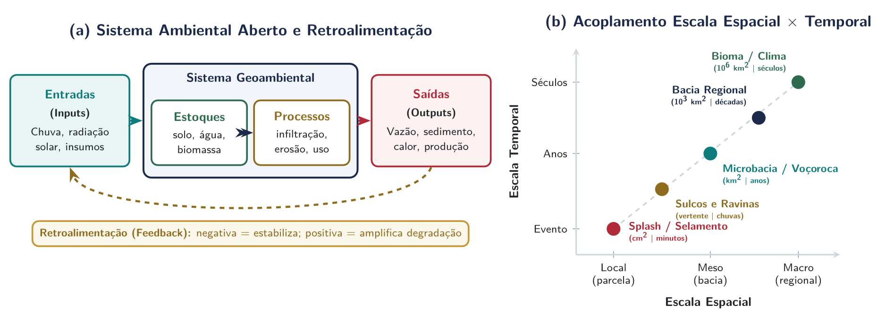
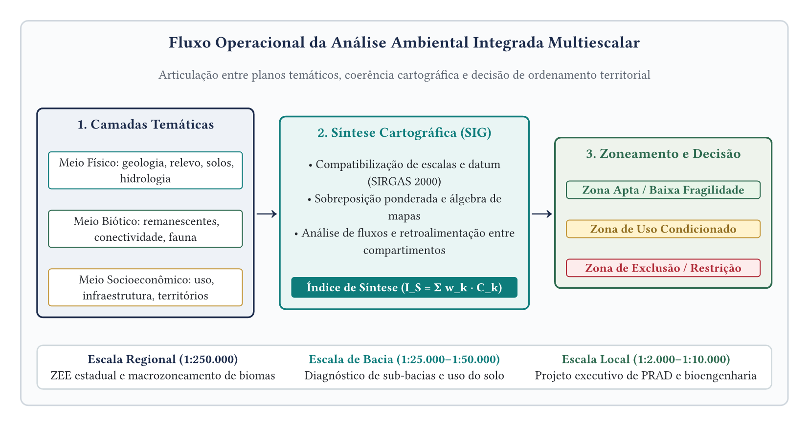

# Fundamentos da Análise Ambiental Integrada, Escalas e Ordenamento Territorial {#cap:analise_integrada}

A análise integrada procura explicar como mudanças em um componente ambiental se propagam pelos demais. Água, sedimentos, energia e decisões de uso atravessam limites administrativos e unidades de paisagem. A delimitação do sistema e do período de análise define quais dessas transferências entram no diagnóstico.

::: {.callout-note title="O que você vai aprender neste capítulo"}
O capítulo desenvolve a integração funcional entre os meios físico, biótico e antrópico, a formulação de balanços em sistemas ambientais abertos, o acoplamento entre escalas espaciais e temporais, os riscos da falácia de escala e a distinção entre planejamento ambiental, planejamento territorial e ordenamento territorial, com foco no Zoneamento Ecológico-Econômico (ZEE).
:::

::: {.callout-tip title="Revisando o que você precisa saber"}
A leitura retoma os conceitos de Geografia Socioambiental, resiliência, fragilidade e delimitação de áreas de influência (ADA, AID e AII). Uma redução de volume em um reservatório resulta da combinação entre entradas, saídas e variação do estoque interno, exigindo dados de período, escala e unidade compatíveis.
:::

## Elementos dos Meios Físico, Biótico e Antrópico e suas Interações

Um problema recorrente em relatórios ambientais consiste em tratar o diagnóstico como uma coleção de capítulos isolados sobre rochas, plantas e população, sem explicitar como esses compartimentos interagem na paisagem. A **Análise Ambiental Integrada** (Castro; Lemos, 2016; Drew, 1989) supera essa compartimentação ao investigar tanto os elementos constituintes quanto as **relações funcionais** que conectam os três subsistemas territoriais.

O **meio físico (abiótico)** engloba o substrato geológico, as formas de relevo e declividade, os tipos e propriedades dos solos, o regime climático (precipitação, radiação e evapotranspiração) e a dinâmica hidrológica superficial e subterrânea, fornecendo a matriz energética e material do sistema. Sobre essa base atua o **meio biótico**, formado pelas coberturas vegetais, fauna, microrganismos edáficos, teias tróficas e fluxos gênicos, que regula o meio físico ao interceptar gotas de chuva, elevar a rugosidade superficial, estruturar agregados com matéria orgânica e raízes e ciclar nutrientes. Por sua vez, o **meio antrópico (socioeconômico e cultural)** reúne uso e cobertura da terra, sistemas agropecuários, urbanização, infraestrutura viária e energética, estrutura fundiária e instituições, operando simultaneamente como agente transformador dos fluxos de matéria e energia e como receptor das alterações ambientais desencadeadas.

No Semiárido baiano, esse acoplamento manifesta-se com clareza em uma única encosta de Caatinga. A retirada da vegetação lenhosa (ação antrópica sobre o meio biótico) expõe um Neossolo ou Argissolo raso (meio físico) ao impacto direto de chuvas convectivas intensas, reduz a matéria orgânica e a infiltração, acelera o escoamento superficial, abre sulcos e ravinas, assoreia o barreiro ou açude comunitário e agrava a escassez hídrica na estiagem, gerando retorno direto sobre as condições produtivas do meio socioeconômico.

## Sistemas Ambientais Abertos, Limiares e Retroalimentação

A fundamentação sistêmica da Análise Ambiental apoia-se na Teoria Geral dos Sistemas (Bertalanffy, 2010) e na análise dos sistemas ambientais (Drew, 1989; Christofoletti, 1999). Paisagens, vertentes e bacias hidrográficas funcionam como **sistemas ambientais abertos**, recebendo fluxos externos de matéria e energia (**entradas** ou *inputs*, como radiação solar, chuva, insumos agrícolas e trabalho humano), transformando e armazenando parte desses fluxos em **estoques internos** (solo, água subterrânea, biomassa e nutrientes) por meio de **processos** (infiltração, intemperismo, fotossíntese e erosão) e exportando fluxos (**saídas** ou *outputs*, como vazão fluvial, sedimentos, evapotranspiração e produção agrícola), arquitetura sintetizada no Painel (a) da @fig-sistema_escalas.

{#fig-sistema_escalas fig-alt="Esquema em dois painéis mostrando fluxos de entrada, estoque, saída e feedback no painel a e relação escala espacial versus temporal no painel b"}

Em termos quantitativos, um balanço de água ou matéria relaciona entradas ($E$), saídas ($S_{\text{out}}$) e variação do armazenamento ($\Delta S$) durante um intervalo definido. Na comparação de fluxos hídricos, a precipitação medida em milímetros expressa uma lâmina vertical, enquanto a vazão em metros cúbicos por segundo indica volume por unidade de tempo, exigindo converter a lâmina em volume pela área da bacia e integrar a vazão ao longo do período analisado. Para o balanço hídrico anual de uma microbacia (em $\text{mm/ano}$), combinam-se precipitação ($P$), evapotranspiração real ($ET$), escoamento superficial direto ($Q_s$) e escoamento de base ($Q_b$):

$$
\begin{aligned}
\Delta S &= E - S_{\text{out}} \\
\Delta S &= P - \left(ET + Q_s + Q_b\right)
\end{aligned}
$$

Valores nulos ($\Delta S = 0$) apontam equilíbrio dinâmico, valores negativos ($\Delta S < 0$) indicam depleção do estoque do solo ou aquífero e valores positivos ($\Delta S > 0$) correspondem à recarga. O Exemplo 6.1 aplica esse balanço anual a uma microbacia experimental no domínio da Caatinga.

::: {.callout-tip appearance="simple"}
### Exemplo 6.1 (Básico). Balanço Hídrico em Sistema Ambiental Aberto no Semiárido

**Situação analisada.** Uma microbacia experimental inserida no domínio da Caatinga foi monitorada durante um ano hidrológico completo. Deseja-se avaliar se o sistema hídrico local operou em equilíbrio dinâmico, recarga ou depleção de estoque.

**Dados disponíveis.** Entrada anual de precipitação $P = 680\text{ mm/ano}$. Saídas anuais medidas: evapotranspiração real $ET = 545\text{ mm/ano}$; escoamento superficial direto $Q_s = 115\text{ mm/ano}$; escoamento de base e drenagem profunda $Q_b = 35\text{ mm/ano}$.

**Problema a resolver.** Calcular o total de saídas ($S_{\text{out}}$), a variação do estoque hídrico interno ($\Delta S$) e interpretar o estado funcional do sistema nesse ano hidrológico.

**Fundamento da análise.** Aplicação da equação de conservação de massa em sistema ambiental aberto, $\Delta S = P - (ET + Q_s + Q_b)$.

**Desenvolvimento.** Somando as parcelas de saída e subtraindo da entrada pluviométrica anual, obtém-se:

$$
\begin{aligned}
S_{\text{out}} &= ET + Q_s + Q_b = 545 + 115 + 35 = 695\text{ mm/ano} \\
\Delta S &= P - S_{\text{out}} = 680 - 695 = -15\text{ mm/ano}.
\end{aligned}
$$

O sinal negativo ($\Delta S = -15\text{ mm/ano}$) indica que as saídas superaram as entradas em $15\text{ mm}$, consumindo parte da água armazenada previamente no solo e nos reservatórios subterrâneos rasos.

**Interpretação do resultado.** Total de saídas $S_{\text{out}} = 695\text{ mm/ano}$ e variação do estoque $\Delta S = -15\text{ mm/ano}$, caracterizando depleção moderada do estoque hídrico interno nesse ano.

**Condições de validade.** O resultado é fisicamente coerente para o Semiárido baiano, onde a evapotranspiração consome cerca de $80{,}15\%$ da chuva ($545/680$), e déficits interanuais moderados compensam-se em anos mais chuvosos quando a cobertura vegetal preserva a infiltração.
:::

### Equilíbrio Dinâmico, Limiares e Retroalimentação

Em um sistema ambiental aberto, o **equilíbrio dinâmico (*steady state*)** manifesta-se quando entradas e saídas se compensam em média ao longo do tempo ($\Delta S \approx 0$), preservando os estoques mediante autorregulação contínua dos fluxos de água, energia e matéria. Essa estabilidade apoia-se na **retroalimentação negativa (*feedback* negativo)**, mecanismo estabilizador que amortece desvios iniciais e reconduz o sistema à condição de referência. Em uma vertente bem vegetada, um aumento moderado de chuva eleva a umidade do solo, estimula o crescimento herbáceo, amplia a interceptação e a infiltração e, por consequência, contém o escoamento erosivo.

Em sentido oposto, a **retroalimentação positiva (*feedback* positivo)** opera como circuito amplificador que reforça o desvio inicial e pode conduzir o sistema à degradação acelerada. Na dinâmica de desertificação ou erosão linear, o sobrepastejo reduz a cobertura vegetal, eleva o selamento e a compactação superficial, derruba a infiltração e amplia a enxurrada; esse fluxo superficial carreia matéria orgânica e sementes, dificulta a regeneração vegetal e acelera a abertura de ravinas e voçorocas.

A mudança entre regimes ocorre quando o sistema ultrapassa **limiares (*thresholds*)**, definidos como patamares críticos de ruptura. Os **limiares extrínsecos** são disparados por forçantes externas que excedem a resistência do meio, como uma chuva cuja intensidade ultrapassa a capacidade máxima de infiltração do solo ($I > f_c$). Já os **limiares intrínsecos** resultam do enfraquecimento interno gradual do próprio sistema ao longo do tempo, a exemplo da perda progressiva de coesão em um barranco fluvial até seu desmoronamento súbito. O Exemplo 6.3 contrasta os efeitos de um mesmo evento pluviométrico sobre duas vertentes em lados opostos desse limiar.

::: {.callout-tip appearance="simple"}
### Exemplo 6.3 (Intermediário). Limiar de Infiltração e Retroalimentação Positiva versus Negativa

**Situação analisada.** Duas vertentes vizinhas com mesma litologia e declividade no Semiárido baiano recebem a mesma chuva convectiva intensa de $I = 65{,}0\text{ mm/h}$ durante $1$ hora. A **Vertente 1** possui Caatinga conservada com serapilheira e capacidade de infiltração estável $f_{c1} = 78{,}0\text{ mm/h}$. A **Vertente 2** foi submetida a sobrepastejo contínuo, apresentando solo compactado com capacidade de infiltração reduzida para $f_{c2} = 22{,}0\text{ mm/h}$.

**Dados disponíveis.** Intensidade da chuva $I = 65{,}0\text{ mm/h}$; limiar de infiltração da Vertente 1, $f_{c1} = 78{,}0\text{ mm/h}$; limiar de infiltração da Vertente 2, $f_{c2} = 22{,}0\text{ mm/h}$.

**Problema a resolver.** Calcular o excesso de precipitação convertido em escoamento superficial ($R = \max(0, I - f_c)$) e o percentual da chuva que escoa superficialmente em cada vertente, identificando em qual delas o limiar extrínseco foi rompido e qual retroalimentação predomina.

**Fundamento da análise.** Comparação direta entre a entrada pluviométrica ($I$) e o limiar interno de infiltração ($f_c$), associada à leitura dos circuitos de retroalimentação.

**Desenvolvimento.** Na Vertente 1 (Caatinga conservada), como $I = 65{,}0\text{ mm/h} < f_{c1} = 78{,}0\text{ mm/h}$, o limiar permanece intacto ($R_1 = 0{,}0\text{ mm/h}$, ou $0\%$ de escoamento hortoniano), e toda a chuva infiltra sustentando a vegetação em retroalimentação negativa. Na Vertente 2 (pastagem compactada), $I = 65{,}0\text{ mm/h} > f_{c2} = 22{,}0\text{ mm/h}$ rompe o limiar de infiltração:

$$
\begin{aligned}
R_2 &= 65{,}0 - 22{,}0 = 43{,}0\text{ mm/h} \\
\frac{R_2}{I} \times 100\% &= \frac{43{,}0}{65{,}0} \times 100\% \approx 66{,}15\%.
\end{aligned}
$$

Mais de dois terços da chuva escoam rapidamente pela superfície, removendo solo fértil e sementes e reduzindo ainda mais $f_c$ nos eventos seguintes (retroalimentação positiva).

**Interpretação do resultado.** Vertente 1, $R_1 = 0{,}0\text{ mm/h}$ ($0\%$, abaixo do limiar, retroalimentação negativa). Vertente 2, $R_2 = 43{,}0\text{ mm/h}$ ($66{,}15\%$ da chuva transformada em enxurrada, limiar rompido, retroalimentação positiva degradativa).

**Condições de validade.** O contraste entre $0\text{ mm/h}$ e $43{,}0\text{ mm/h}$ sob idêntica chuva mostra que a degradação no Semiárido resulta da interação conjunta entre o evento climático (meio físico) e o manejo do solo e da vegetação (meios biótico e antrópico).
:::

Na terminologia sistêmica, o uso cotidiano das palavras “positivo” e “negativo” gera interpretações invertidas que devem ser evitadas nos diagnósticos.

::: {.callout-warning appearance="simple"}
### Erro 1. Confundir Retroalimentação Positiva com Algo Ambientalmente Desejável

**Equívoco frequente.** Interpretar “retroalimentação positiva” como processo ecologicamente benéfico e “retroalimentação negativa” como processo prejudicial.

**Correção técnica.** Na Teoria dos Sistemas, os adjetivos *positivo* e *negativo* possuem sentido matemático e cibernético, desligado de juízo moral. A retroalimentação **negativa** opõe-se ao desvio inicial e estabiliza o sistema, enquanto a retroalimentação **positiva** soma-se ao desvio inicial e o amplifica, impulsionando processos de ravinamento, voçorocamento e desertificação.
:::

## Escalas Espaciais, Escalas Temporais e a Falácia de Escala

Todo processo geoambiental manifesta-se em uma escala característica. Como ilustra o Painel (b) da @fig-sistema_escalas, existe um **acoplamento entre escala espacial e escala temporal**, no qual processos pontuais como o impacto de gotas de chuva ocorrem em minutos ou horas, ao passo que transformações em bacias regionais e biomas desdobram-se ao longo de décadas, séculos ou milênios.

| **Escala Espacial** | **Ordem de Área** | **Escala Temporal** | **Processos e Aplicações** |
|:---|:---|:---|:---|
| **Parcela** | $\text{cm}^2$ a $10^2\text{ m}^2$ | Minutos a horas | *Splash*, selamento e infiltração pontual. |
| **Vertente** | $10^2\text{ m}^2$ a $\text{ha}$ | Chuvas a ciclos sazonais | Sulcos, ravinas e estabilidade de taludes. |
| **Microbacia** | $1$ a $50\text{ km}^2$ | Meses a anos | Voçorocas, conectividade e PRAD. |
| **Bacia Regional** | $10^2$ a $10^5\text{ km}^2$ | Anos a décadas | Assoreamento de reservatórios e ZEE estadual. |
| **Bioma** | $> 10^5\text{ km}^2$ | Décadas a milênios | Desertificação, clima e políticas territoriais. |

Desconsiderar esse acoplamento escalar produz a **falácia de escala**, erro que opera em duas direções. Na **extrapolação ascendente indevida (micro para macro)**, multiplica-se linearmente uma taxa de perda de solo medida em parcela de $10\text{ m}^2$ pela área inteira de uma bacia de $1.000\text{ ha}$; na realidade, grande parte do solo erodido deposita-se em sopés côncavos, depressões, barreiras vegetais e planícies aluviais antes de alcançar o exutório, tornando a **Razão de Entrega de Sedimentos ($\text{SDR} = Y / E_b$)** menor que $1$. Na **inferência descendente indevida (macro para micro)**, utiliza-se uma carta regional de pequena escala ($1:250.000$) para localizar uma ravina de $4\text{ m}$ ou projetar uma paliçada. Em escala cartográfica $1:D$, considerando o erro gráfico mínimo de $0{,}2\text{ mm}$ no papel ($0{,}0002\text{ m}$), feições menores que $d_{\min} = 0{,}0002 \times D$ metros desaparecem da representação gráfica.

$$
\begin{aligned}
\text{SDR} &= \frac{Y}{E_b}, \qquad Y = E_b \times \text{SDR}, \qquad 0 < \text{SDR} \le 1 \\
\text{Erro (\%)} &= \frac{E_{b,\text{tot}} - Y_{\text{tot}}}{Y_{\text{tot}}} \times 100\% = \left(\frac{1}{\text{SDR}} - 1\right) \times 100\% \\
d_{\min}\,(\text{m}) &= 0{,}0002 \times D
\end{aligned}
$$

Nessas relações, $E_b$ é a erosão bruta nas vertentes ($\text{t/(ha}\cdot\text{ano)}$), $Y$ é a produção específica no exutório ($\text{t/(ha}\cdot\text{ano)}$), $E_{b,\text{tot}} = E_b \cdot A$ e $Y_{\text{tot}} = Y \cdot A$ são os totais anuais na bacia de área $A$ ($\text{ha}$), sendo $R_{\text{sed}} = (E_b - Y)\cdot A$ a massa retida internamente. Os Exemplos 6.2 e 6.4 demonstram numericamente como quantificar a falácia de escala tanto na transferência hidrossedimentológica quanto na escolha da escala cartográfica.

::: {.callout-tip appearance="simple"}
### Exemplo 6.2 (Básico e Intermediário). Quantificando a Falácia de Escala pela Razão de Entrega de Sedimentos (SDR)

**Situação analisada.** Em uma parcela experimental de $20\text{ m}^2$ de solo exposto em microbacia do Piemonte da Diamantina, mediu-se erosão bruta de $E_b = 24{,}0\text{ t/(ha}\cdot\text{ano)}$. Para estimar o assoreamento de um açude no exutório da bacia (área $A = 1.500\text{ ha}$), um técnico multiplicou a taxa da parcela pela área da bacia, mas o monitoramento no exutório registrou chegada efetiva de $Y_{\text{tot}} = 9.720\text{ t/ano}$.

**Dados disponíveis.** $E_b = 24{,}0\text{ t/(ha}\cdot\text{ano)}$; área da bacia $A = 1.500\text{ ha}$; produção medida no exutório $Y_{\text{tot}} = 9.720\text{ t/ano}$.

**Problema a resolver.** Calcular a erosão bruta total estimada pela extrapolação linear, a produção específica real $Y$, a Razão de Entrega de Sedimentos (SDR), a massa anual retida nas vertentes e planícies e o erro percentual da falácia de escala.

**Fundamento da análise.** Aplicação das relações de escala hidrossedimentológica, $E_{b,\text{tot}} = E_b \cdot A$, $Y = Y_{\text{tot}}/A$, $\text{SDR} = Y / E_b$, $R_{\text{sed}} = E_{b,\text{tot}} - Y_{\text{tot}}$ e $\text{Erro (\%)} = (E_{b,\text{tot}} - Y_{\text{tot}})/Y_{\text{tot}} \times 100\%$.

**Desenvolvimento.** Calculando sequencialmente a extrapolação bruta, o aporte real e o erro relativo cometido:

$$
\begin{aligned}
E_{b,\text{tot}} &= 24{,}0 \times 1.500 = 36.000\text{ t/ano} \\
Y &= \frac{9.720}{1.500} = 6{,}48\text{ t/(ha}\cdot\text{ano)} \\
\text{SDR} &= \frac{6{,}48}{24{,}0} = 0{,}27 \quad (27\%) \\
R_{\text{sed}} &= 36.000 - 9.720 = 26.280\text{ t/ano} \\
\text{Erro (\%)} &= \frac{36.000 - 9.720}{9.720} \times 100\% \approx 270{,}37\%.
\end{aligned}
$$

**Interpretação do resultado.** $E_{b,\text{tot}} = 36.000\text{ t/ano}$; $Y = 6{,}48\text{ t/(ha}\cdot\text{ano)}$; $\text{SDR} = 0{,}27$; sedimentos retidos $= 26.280\text{ t/ano}$; erro de superestimativa $= 270{,}37\%$.

**Condições de validade.** Pela expressão equivalente, $(1/0{,}27 - 1)\times 100\% \approx 270{,}37\%$. A retenção de $73\%$ dos sedimentos em sopés, depressões e matas ciliares explica por que taxas de parcela de $20\text{ m}^2$ não se transferem diretamente para uma bacia de $1.500\text{ ha}$.
:::

Na direção inversa do raciocínio escalar, o Exemplo 6.4 verifica qual base cartográfica possui resolução suficiente para mapear feições lineares locais sem omitir processos erosivos.

::: {.callout-tip appearance="simple"}
### Exemplo 6.4 (Intermediário e Avançado). Escolha de Escala Cartográfica e Erro Gráfico Mínimo em Diagnósticos

**Situação analisada.** Uma equipe de Geografia precisa mapear ravinas com largura média de $4{,}0\text{ m}$ e faixas de mata ciliar de $15{,}0\text{ m}$ em uma microbacia de $850\text{ ha}$ ($8{,}5\text{ km}^2$) próxima a Feira de Santana. Há três bases disponíveis: uma carta regional do ZEE ($1:250.000$), uma carta topográfica sistemática ($1:50.000$) e um ortomosaico detalhado ($1:10.000$).

**Dados disponíveis.** Erro gráfico mínimo no papel $= 0{,}2\text{ mm} = 0{,}0002\text{ m}$; denominadores de escala $D_1 = 250.000$, $D_2 = 50.000$ e $D_3 = 10.000$; larguras dos alvos, ravinas ($4{,}0\text{ m}$) e mata ciliar ($15{,}0\text{ m}$).

**Problema a resolver.** Calcular a menor feição representável no terreno ($d_{\min}$) em cada escala e determinar qual base atende ao mapeamento dos dois alvos.

**Fundamento da análise.** Aplicação da relação de resolução gráfica $d_{\min} = 0{,}0002 \times D$ e comparação com a largura real dos alvos.

**Desenvolvimento.** Calculando o limite mínimo de representação para cada denominador de escala:

$$
\begin{aligned}
d_{\min,1} &= 0{,}0002 \times 250.000 = 50{,}0\text{ m} \\
d_{\min,2} &= 0{,}0002 \times 50.000 = 10{,}0\text{ m} \\
d_{\min,3} &= 0{,}0002 \times 10.000 = 2{,}0\text{ m}.
\end{aligned}
$$

Na carta $1:250.000$, tanto a mata ciliar ($15{,}0\text{ m} < 50{,}0\text{ m}$) quanto as ravinas ($4{,}0\text{ m} < 50{,}0\text{ m}$) ficam abaixo do limite gráfico. Na carta $1:50.000$, a mata ciliar torna-se representável ($15{,}0\text{ m} > 10{,}0\text{ m}$), enquanto as ravinas continuam invisíveis ($4{,}0\text{ m} < 10{,}0\text{ m}$). Somente o ortomosaico $1:10.000$ ($2{,}0\text{ m}$) representa ambos os alvos.

**Interpretação do resultado.** As menores feições representáveis são $50{,}0\text{ m}$ ($1:250.000$), $10{,}0\text{ m}$ ($1:50.000$) e $2{,}0\text{ m}$ ($1:10.000$). Apenas a escala $1:10.000$ (ou maior detalhe, como $1:5.000$ por VANT) permite mapear simultaneamente ravinas de $4{,}0\text{ m}$ e mata ciliar de $15{,}0\text{ m}$.

**Condições de validade.** Concluir que não existem ravinas na microbacia após inspecionar uma carta $1:250.000$ constitui falácia de escala descendente, pois a ausência no mapa decorre da resolução cartográfica e da unidade mínima de mapeamento.
:::

A transição inadequada entre escalas de medição e bases cartográficas figura entre os desvios metodológicos mais recorrentes nos estudos de bacia, conforme sintetizado a seguir.

::: {.callout-warning appearance="simple"}
### Erro 2. Praticar a Falácia de Escala ao Extrapolar Parcelas ou Ampliar Cartas Regionais

**Equívoco frequente.** Multiplicar a perda de solo medida em parcela de $10\text{ m}^2$ pela área inteira de uma bacia de $5.000\text{ ha}$ supondo entrega integral ao rio, ou ampliar visualmente um mapa regional ($1:250.000$) para delimitar APPs e feições erosivas locais.

**Correção técnica.** A ampliação gráfica de uma carta regional não acrescenta detalhe espacial, e a transferência de parcelas para bacias exige considerar a deposição intermediária ($\text{SDR} < 1$). Explicite sempre a escala espacial, o período de coleta, o sistema de referência e a unidade mínima de mapeamento compatíveis com o fenômeno.
:::

### Compatibilidade Cartográfica e Síntese Multiescalar em SIG

Para superar diagnósticos fragmentados, a integração espacial exige coerência entre fontes, datas, sistemas geodésicos e resoluções das camadas temáticas antes de qualquer operação de álgebra de mapas. Em ambientes de Sistema de Informação Geográfica (SIG), a compatibilização no mesmo datum (como SIRGAS 2000) permite cruzar variáveis dos meios físico, biótico e socioeconômico por meio de índices de síntese ponderada ($I_S = \sum w_k \cdot C_k$), respeitando a correspondência entre escala regional (macrozoneamento), escala de bacia (planejamento hídrico e uso do solo) e escala local (projetos executivos de PRAD e bioengenharia), fluxo operacional esquematizado na @fig-matriz_integrada_escalas.

{#fig-matriz_integrada_escalas fig-alt="Fluxograma em três colunas mostrando camadas temáticas, síntese cartográfica em SIG com índice ponderado e zoneamento por faixas de escala"}

O registro sistemático da fonte, data, unidade e método de cada camada garante rastreabilidade ao diagnóstico, facilita a seleção de pontos para conferência em campo e impede que a análise ambiental se reduza a capítulos desconexos, erro destacado abaixo.

::: {.callout-warning appearance="simple"}
### Erro 3. Reduzir a Análise Ambiental Integrada à Soma de Relatórios Setoriais Desconexos

**Equívoco frequente.** Elaborar um diagnóstico com seções isoladas de geologia, vegetação e população que nunca dialogam entre si.

**Correção técnica.** Sem explicitar como a declividade e o solo respondem à supressão vegetal e como essa resposta repercute no escoamento, no assoreamento e na disponibilidade hídrica comunitária, o documento permanece um inventário descritivo fragmentado. Empregue verbos de processo e fluxo (infiltra, concentra, carreia, deposita, restringe) para articular os três subsistemas.
:::

## Planejamento Ambiental, Planejamento Territorial e Ordenamento Territorial

A compreensão da **dinâmica geoambiental**, entendida como o comportamento integrado das paisagens frente às pressões climáticas e socioeconômicas, fundamenta decisões públicas sobre o uso do espaço. Na literatura técnica e em exames profissionais, três conceitos correlatos exigem separação precisa: **planejamento ambiental**, **planejamento territorial** e **ordenamento territorial** (Arruda, 2013; IBGE, 2018), sintetizados na tabela comparativa a seguir.

| **Conceito** | **Foco central** | **Função operativa** | **Instrumentos** |
|:---|:---|:---|:---|
| **Planejamento Ambiental** | Ecossistemas, recursos naturais, fragilidades e riscos. | Diagnosticar, prognosticar e propor diretrizes de conservação e suporte. | AIA, Planos de Bacia, Planos de Manejo e PRAD. |
| **Planejamento Territorial** | Organização socioespacial, economia, infraestrutura e mobilidade. | Articular políticas setoriais, cenários e prioridades de investimento. | Planos Diretores e Planos Regionais. |
| **Ordenamento Territorial** | Regulação espacial da distribuição de usos e ocupação do solo. | Estabelecer normas cartográficas vinculantes para compatibilizar usos. | **ZEE**, macrozoneamento e zoneamento costeiro. |

Em síntese funcional, o **planejamento ambiental** estabelece os limites, potenciais e fragilidades dos sistemas naturais; o **planejamento territorial** compatibiliza esses condicionantes às demandas econômicas, sociais e de infraestrutura; e o **ordenamento territorial** converte essas diretrizes em normas espaciais e zoneamentos concretos para regulação do uso da terra.

## Zoneamento Ecológico-Econômico (ZEE) e Aplicação em Reservatório

Previsto na Política Nacional do Meio Ambiente (Lei nº 6.938/1981) e regulamentado pelo **Decreto Federal nº 4.297/2002**, o **Zoneamento Ecológico-Econômico (ZEE)** constitui o principal instrumento técnico-político de ordenamento territorial no Brasil. Como processo participativo e multidisciplinar, o ZEE integra a **potencialidade socioeconômica** com a **vulnerabilidade e fragilidade natural** dos sistemas geoambientais (IBGE, 2018; Arruda, 2013).

Desse cruzamento resultam **zonas homogêneas** com diretrizes próprias de uso, manejo e investimento público. As **Zonas de Consolidação Produtiva** reúnem áreas de elevada aptidão e baixa fragilidade natural onde atividades agropecuárias, industriais ou urbanas operam com práticas conservacionistas de solo e água. As **Zonas de Uso Restrito ou Manejo Sustentável** abrangem setores de fragilidade média a alta compatíveis com extrativismo sustentável, sistemas agroflorestais, ecoturismo e manejo da Caatinga. Em terras já degradadas por erosão acelerada, desertificação ou perda de mata ciliar, definem-se **Zonas de Recuperação Ambiental**, prioritárias para PRAD e bioengenharia. Por último, as **Zonas de Proteção e Conservação** resguardam áreas de altíssima fragilidade, mananciais, APPs, Unidades de Conservação e corredores ecológicos. Quando disponível em escala compatível, o ZEE agiliza e qualifica a triagem e a escolha de alternativas locacionais na AIA (Capítulo 5).

Essa mesma lógica de integração multivariável orienta o zoneamento de aptidão em corpos hídricos e reservatórios. No segmento II do reservatório da Usina Hidrelétrica de Xingó (Baixo São Francisco), Holanda et al. (2020) analisaram pistas de vento e processos erosivos marginais, abordagem posteriormente integrada por Santos, Holanda e Wanderley ao cruzamento de comprimento de *fetch*, altura significativa de onda ($H_s$), batimetria e restrições operacionais para mapear zonas ótimas, adequadas e de exclusão para implantação de sistemas fotovoltaicos flutuantes (@fig-xingo_zoneamento). A transposição desse modelo para outro reservatório, como Sobradinho, exige recalcular todas as variáveis hidrodinâmicas e batimétricas na escala local do novo corpo d'água.

{#fig-xingo_zoneamento fig-alt="Mapa de zoneamento de aptidão no reservatório de Xingó com zonas ótima, adequada e de exclusão e sítios R1 a R5"}

## Síntese Aplicada em Ordenamento Territorial (ZEE)

A tradução das diretrizes de integração sistêmica e escalar para a gestão municipal exige quantificar o fechamento territorial das zonas propostas e explicitar o papel articulado dos instrumentos de planejamento, como desenvolvido no Exemplo 6.5.

::: {.callout-tip appearance="simple"}
### Exemplo 6.5 (Avançado). Zoneamento Ecológico-Econômico (ZEE) e Articulação com o Ordenamento Territorial

**Situação analisada.** Após integrar levantamentos de solos, declividade, remanescentes de Caatinga, recursos hídricos e uso agropecuário, um município baiano de $1.200\text{ km}^2$ elaborou sua proposta de Zoneamento Ecológico-Econômico (ZEE), distribuindo o território em quatro zonas.

**Dados disponíveis.** Área total do município $= 1.200\text{ km}^2$: $Z_1$, Zona de Consolidação Produtiva ($420\text{ km}^2$); $Z_2$, Zona de Expansão com Manejo Sustentável ($330\text{ km}^2$); $Z_3$, Zona de Recuperação Ambiental ($210\text{ km}^2$); $Z_4$, Zona de Proteção e Conservação ($240\text{ km}^2$).

**Problema a resolver.** Verificar o fechamento territorial das áreas, calcular o percentual de cada zona, determinar o percentual conjunto destinado à conservação e recuperação ($Z_3 + Z_4$) e distinguir o papel do planejamento ambiental, do planejamento territorial e do ordenamento territorial nesse caso.

**Fundamento da análise.** Cálculo da participação percentual ($A_k / A_{\text{total}} \times 100\%$) e enquadramento conceitual segundo Arruda (2013) e IBGE (2018).

**Desenvolvimento.** A soma das áreas fecha exatamente em $420 + 330 + 210 + 240 = 1.200\text{ km}^2$ ($100{,}0\%$). Calculando a proporção de cada zona e o total de recuperação e proteção ($Z_3 + Z_4$):

$$
\begin{aligned}
\%Z_1 &= \frac{420}{1.200} \times 100\% = 35{,}0\%, & \%Z_2 &= \frac{330}{1.200} \times 100\% = 27{,}5\% \\
\%Z_3 &= \frac{210}{1.200} \times 100\% = 17{,}5\%, & \%Z_4 &= \frac{240}{1.200} \times 100\% = 20{,}0\% \\
A_{3+4} &= 210 + 240 = 450\text{ km}^2, & \%Z_{3+4} &= \frac{450}{1.200} \times 100\% = 37{,}5\%.
\end{aligned}
$$

Nessa articulação, o **planejamento ambiental** forneceu o diagnóstico de solos, nascentes, fragilidades e passivos ($Z_3$ e $Z_4$); o **planejamento territorial** integrou esses limites às metas produtivas, viárias e urbanas ($Z_1$ e $Z_2$); e o **ordenamento territorial** converteu o mapa do ZEE em norma vinculante para licenciamento, crédito rural e investimentos.

**Interpretação do resultado.** $Z_1 = 35{,}0\%$, $Z_2 = 27{,}5\%$, $Z_3 = 17{,}5\%$ e $Z_4 = 20{,}0\%$; conservação e recuperação somam $450\text{ km}^2$ ($37{,}5\%$ do município). O ZEE concretiza o ordenamento territorial apoiado pelos planejamentos ambiental e territorial.

**Condições de validade.** A soma percentual fecha em $100{,}0\%$, e a reserva de $37{,}5\%$ para proteção e recuperação aliada a $62{,}5\%$ para produção consolidada e manejo sustentável orienta o desenvolvimento econômico para áreas dotadas de capacidade de suporte adequada.
:::

## Armadilha Conceitual e Materiais Audiovisuais de Apoio

Mesmo quando um diagnóstico integra corretamente os compartimentos físico, biótico e antrópico na escala adequada, a confusão entre instrumentos diagnósticos, estratégicos e normativos compromete a validade jurídica das propostas territoriais.

::: {.callout-warning appearance="simple"}
### Erro 4. Tratar Planejamento Ambiental, Planejamento Territorial e Ordenamento Territorial como Sinônimos

**Equívoco frequente.** Empregar os três termos de modo intercambiável em provas ou reduzir o ZEE à criação de Unidades de Conservação.

**Correção técnica.** Cada conceito cumpre uma função distinta e complementar: o planejamento ambiental avalia processos, limites e potencialidades ecológicas; o planejamento territorial articula todas as dimensões socioespaciais e de infraestrutura; e o ordenamento territorial estabelece a regulação espacial normativa do uso da terra, tendo no ZEE um instrumento que integra zonas produtivas, de manejo, de recuperação e de proteção.
:::

Para aprofundar os vínculos entre degradação sistêmica, planejamento e ordenamento territorial no Brasil, assista às videoaulas selecionadas na página da disciplina. O vídeo [Degradação Ambiental](https://www.youtube.com/watch?v=5EFxN7jGob8) relaciona vulnerabilidade, fragilidade e resiliência em sistemas abertos, enquanto o vídeo [Ordenamento territorial do Brasil, potencialidades naturais e vulnerabilidades sociais](https://www.youtube.com/watch?v=hSqqiMt2CjI) discute o papel do planejamento e do zoneamento na gestão do território.

## Exercícios de fixação

#### Nível 1. Básico (Sistemas Abertos, Escalas e Ordenamento)

1. Explique por que uma bacia hidrográfica é classificada como um **sistema ambiental aberto**, exemplificando duas entradas, dois estoques internos, dois processos e duas saídas.

2. Diferencie **retroalimentação negativa** e **retroalimentação positiva** em sistemas ambientais, apresentando um exemplo concreto de cada mecanismo na dinâmica erosiva de uma encosta.

3. Um açude no Semiárido baiano recebeu em um ano $E = 12.500\text{ t/ano}$ de sedimentos transportados pelos riachos afluentes e exportou pelo vertedouro $S_{\text{out}} = 3.200\text{ t/ano}$. Calcule a variação do estoque de sedimentos retidos no reservatório ($\Delta S$) e a eficiência percentual de retenção de sedimentos do açude.

4. O que é **falácia de escala** na Análise Ambiental? Dê um exemplo de erro cometido ao passar da microescala para a macroescala e outro ao passar da macroescala para a microescala.

5. Estabeleça a diferença conceitual entre **planejamento ambiental**, **planejamento territorial** e **ordenamento territorial**, situando o papel do Zoneamento Ecológico-Econômico (ZEE).

#### Nível 2. Intermediário (Cálculos Sistêmicos, Escalas e ZEE)

6. Em uma microbacia de $800\text{ ha}$, a erosão bruta média das vertentes estimada por parcelas é $E_b = 18{,}0\text{ t/(ha}\cdot\text{ano)}$. Sabe-se que a Razão de Entrega de Sedimentos da microbacia é $\text{SDR} = 0{,}32$. Calcule a erosão bruta total ($E_{b,\text{tot}}$), a produção específica ($Y$) e total ($Y_{\text{tot}}$) de sedimentos no exutório, a massa anual retida nas vertentes e planícies e o erro percentual de superestimativa caso um analista assumisse $\text{SDR} = 1$.

7. Uma mesma microbacia recebeu precipitação anual de $P = 750\text{ mm/ano}$ em dois cenários de cobertura do solo:

    - **Cenário 1 (Vegetação nativa conservada):** $ET = 590\text{ mm}$, $Q_s = 90\text{ mm}$, $Q_b = 70\text{ mm}$.

    - **Cenário 2 (Após desmatamento e compactação):** $ET = 430\text{ mm}$, $Q_s = 340\text{ mm}$, $Q_b = 25\text{ mm}$.

    Calcule $\Delta S$ em ambos os cenários, determine que percentual da chuva virou escoamento superficial ($Q_s/P$) no Cenário 2 e interprete as consequências para a vazão na estiagem ($Q_b$) e para a erosão.

8. Utilizando o erro gráfico mínimo de $0{,}2\text{ mm}$ no papel ($d_{\min} = 0{,}0002 \times D$), calcule a menor feição representável no terreno para as escalas $1:100.000$, $1:25.000$ e $1:5.000$. Em seguida, informe quais dessas escalas conseguem representar uma faixa de mata ciliar de $15{,}0\text{ m}$ de largura e uma ravina incipiente de $1{,}5\text{ m}$ de largura.

9. Explique a diferença entre **limiar extrínseco** e **limiar intrínseco** na dinâmica geoambiental, ilustrando cada tipo com um processo real de instabilidade de encostas ou erosão no Brasil.

10. O ZEE de uma sub-bacia hidrográfica de $2.500\text{ km}^2$ definiu a seguinte repartição percentual: $40\%$ de Zona de Consolidação Produtiva, $26\%$ de Zona de Manejo Sustentável, $16\%$ de Zona de Recuperação Ambiental e $18\%$ de Zona de Proteção e Conservação. Calcule a área em $\text{km}^2$ de cada zona e verifique se o plano atende a uma diretriz estadual que exige no mínimo $30\%$ do território sob conservação ou recuperação.

#### Nível 3. Questões Objetivas de Fixação (A a E) {#06-analise-ambiental-integrada-nível-3-questões-objetivas-de-fixação-ae}

11. **\[Autoral, CHF662\]** Em uma vertente degradada do Semiárido, a remoção da Caatinga expõe o solo ao impacto das gotas de chuva, gerando crosta superficial, redução da infiltração, aumento da enxurrada e carreamento de matéria orgânica, o que impede a germinação de novas plantas e intensifica ainda mais a erosão. Na teoria dos sistemas ambientais, esse encadeamento caracteriza:

    (A) Sistema fechado em equilíbrio termodinâmico estático.

    (B) Retroalimentação negativa de autorregulação ecológica.

    (C) Retroalimentação positiva amplificadora da degradação.

    (D) Neutralidade escalar sem rompimento de limiar.

    (E) Ciclo biogeoquímico conservativo com ganho de estoque edáfico.

12. **\[Autoral, CHF662\]** Sobre o acoplamento entre escalas espaciais e temporais na Análise Ambiental Integrada, assinale a alternativa correta:

    (A) Processos como o impacto da gota de chuva (*splash*) e o selamento superficial atuam na macroescala continental ao longo de milênios.

    (B) A dinâmica de uma microbacia ou a evolução de voçorocas manifestam-se tipicamente na escala local a mesoescala, ao longo de meses e anos.

    (C) A escala temporal é independente da escala espacial, podendo qualquer processo ser monitorado em um único dia de campo.

    (D) Cartas na escala $1:1.000.000$ são ideais para medir a largura de sulcos erosivos em pequenas propriedades rurais.

    (E) O estudo de biomas prescinde de séries históricas pluridecadais por depender apenas de eventos horários isolados.

13. **\[Autoral, CHF662\]** Qual alternativa distingue corretamente **ordenamento territorial** de **planejamento ambiental**?

    (A) O ordenamento territorial restringe-se ao monitoramento químico da água, enquanto o planejamento ambiental define a malha rodoviária.

    (B) O planejamento ambiental diagnostica fragilidades, riscos e capacidades de suporte dos ecossistemas, ao passo que o ordenamento territorial traduz diretrizes socioespaciais e ambientais em regulação normativa e espacial dos usos da terra (como o ZEE).

    (C) O ordenamento territorial é facultativo e exclusivamente acadêmico, enquanto o planejamento ambiental dispensa mapas.

    (D) O planejamento ambiental proíbe qualquer atividade produtiva, enquanto o ordenamento territorial dispensa critérios ecológicos.

    (E) Ambos são sinônimos perfeitos de licenciamento ambiental de obras pontuais.

14. **\[Autoral, CHF662\]** Em uma bacia de $600\text{ ha}$, medições em parcela indicaram erosão bruta de $15{,}0\text{ t/(ha}\cdot\text{ano)}$. Sabendo que a Razão de Entrega de Sedimentos da bacia é $\text{SDR} = 0{,}40$, a produção anual de sedimentos que efetivamente chega ao exutório e a massa retida internamente nas vertentes e planícies são, respectivamente:

    (A) $9.000\text{ t/ano}$ e $0\text{ t/ano}$.

    (B) $5.400\text{ t/ano}$ e $3.600\text{ t/ano}$.

    (C) $3.600\text{ t/ano}$ e $5.400\text{ t/ano}$.

    (D) $2.400\text{ t/ano}$ e $6.600\text{ t/ano}$.

    (E) $6.000\text{ t/ano}$ e $3.000\text{ t/ano}$.

15. **\[Autoral, CHF662\]** De acordo com o Decreto Federal nº 4.297/2002 e os fundamentos do IBGE (2018), o **Zoneamento Ecológico-Econômico (ZEE)** caracteriza-se por:

    (A) Ser um mapa exclusivamente voltado à demarcação de parques nacionais, excluindo áreas agrícolas e urbanas.

    (B) Integrar potencialidades socioeconômicas e vulnerabilidades ou fragilidades geoambientais para dividir o território em zonas com diretrizes específicas de uso, manejo, recuperação e proteção.

    (C) Substituir a obrigatoriedade do Estudo de Impacto Ambiental (EIA) para grandes hidrelétricas e minerações.

    (D) Operar apenas na escala de parcela experimental ($1:500$), sendo inviável em estados ou bacias regionais.

    (E) Utilizar apenas variáveis climáticas, dispensando informações de solos, relevo e estrutura social.

## Questões de aplicação

16. **\[Autoral, Estilo ENADE / Geografia\]** A abordagem sistêmica aplicada à Análise Ambiental Integrada (Drew, 1989; Castro; Lemos, 2016) compreende a paisagem como resultado de interações dinâmicas entre fluxos de matéria, energia e decisões humanas. Avalie as asserções a seguir e a relação proposta entre elas:

    > **I.** A extrapolação linear de taxas de perda de solo obtidas em pequenas parcelas experimentais para grandes bacias hidrográficas costuma superestimar significativamente o aporte real de sedimentos no exutório.
    >
    > **PORQUE**
    >
    > **II.** Ao mudar da escala de parcela para a escala de bacia, emergem processos intermediários de desconectividade e deposição em sopés, depressões, barreiras vegetais e planícies aluviais, fazendo com que a Razão de Entrega de Sedimentos (SDR) seja inferior a $1$.

    A respeito dessas asserções, assinale a opção correta:

    (A) As asserções I e II são proposições verdadeiras, e a II é uma justificativa correta da I.

    (B) As asserções I e II são proposições verdadeiras, mas a II não é uma justificativa correta da I.

    (C) A asserção I é uma proposição verdadeira, e a II é uma proposição falsa.

    (D) A asserção I é uma proposição falsa, e a II é uma proposição verdadeira.

    (E) As asserções I e II são proposições falsas.

17. **\[Autoral, Estilo Concurso Geógrafo / Planejamento Territorial\]** Considere o balanço de um sistema ambiental aberto sujeito a intervenções humanas. Analise as proposições abaixo:

    I.  Quando a entrada de energia ou matéria ultrapassa um limiar (*threshold*) crítico do sistema, como uma chuva cuja intensidade excede a capacidade de infiltração de um solo compactado, ocorre mudança brusca no comportamento hidrológico da vertente.

    II.  No equilíbrio dinâmico (*steady state*), os fluxos de entrada e saída cessam completamente, impedindo qualquer troca com o entorno.

    III.  A substituição de vegetação nativa por superfícies impermeabilizadas tende a elevar o escoamento superficial direto ($Q_s$) e a reduzir a recarga subterrânea e o escoamento de base ($Q_b$).

    Está correto o que se afirma apenas em:

    (A) I.

    (B) II.

    (C) I e II.

    (D) I e III.

    (E) I, II e III.

18. **\[Autoral, Estilo Concurso Analista Ambiental / IBAMA e INEMA\]** Na gestão pública brasileira, um governo estadual contratou estudos integrados de relevo, solos, vegetação, clima, estrutura fundiária e cadeias produtivas para definir zonas de consolidação agropecuária, zonas de manejo sustentável da Caatinga, zonas prioritárias para recuperação de terras degradadas e zonas de proteção de mananciais, com força normativa para orientar licenciamentos e políticas públicas. O instrumento de ordenamento territorial descrito corresponde ao:

    (A) Relatório de Impacto Ambiental (RIMA) de obra linear.

    (B) Zoneamento Ecológico-Econômico (ZEE).

    (C) Inventário Florestal de Parcela Permanente.

    (D) Programa de Monitoramento de Ruído em Canteiro de Obras.

    (E) Termo de Referência simplificado de triagem.

### Ponte entre o Módulo 2 e o Módulo 3 (Bacias, Morfopedologia e Ross)

Os conceitos deste capítulo (sistema aberto, balanço de fluxos, escalas e interações entre os três meios) fornecem a base direta do **Módulo 3**. A partir da Semana 7, você aplicará essa abordagem sistêmica à **bacia hidrográfica** como unidade operacional (Cap. 7), à **morfopedologia de vertentes** (Cap. 8) e aos modelos de **geossistema, ecodinâmica de Tricart e fragilidade de Ross** (Cap. 9), avaliados na Prova Teórica da Semana 10.

## Gabarito comentado {.unnumbered}

::: {.callout-tip collapse="true" title="Clique para abrir o Gabarito Comentado"}
### Resoluções dos Exercícios 1 a 10 (Básicos e Intermediários)

1. **Bacia hidrográfica como sistema aberto.** Troca continuamente energia e matéria com o entorno. Como *entradas*, destacam-se precipitação e radiação solar; como *estoques internos*, água no solo/aquífero e biomassa; como *processos*, infiltração e erosão/intemperismo; e como *saídas*, vazão fluvial no exutório, sedimentos exportados e evapotranspiração.

2. **Retroalimentação negativa versus positiva.** A *negativa* amortece perturbações e devolve estabilidade (aumento da cobertura vegetal amplia a infiltração, reduz a enxurrada e conserva o solo). A *positiva* amplifica o desvio inicial (perda de cobertura vegetal amplia compactação e escoamento, remove nutrientes e sementes e acelera a abertura de ravinas e voçorocas).

3. **Balanço de sedimentos no açude.** Variação do estoque retido (assoreamento anual): $\Delta S = E - S_{\text{out}} = 12.500 - 3.200 = \mathbf{+9.300\text{ t/ano}}$. Eficiência de retenção do reservatório: $\frac{9.300}{12.500} \times 100\% = \mathbf{74{,}40\%}$. Quase três quartos do sedimento afluente depositam-se no fundo do açude, reduzindo sua capacidade de armazenamento.

4. **Falácia de escala.** Erro de transpor taxas, padrões ou conclusões entre escalas sem considerar mecanismos intermediários. De micro para macro, multiplicar a erosão de parcela de $10\text{ m}^2$ pela área de uma bacia inteira sem aplicar a SDR; de macro para micro, usar carta $1:250.000$ ($d_{\min} = 50\text{ m}$) para projetar intervenção em ravina de $4\text{ m}$.

5. **Distinção conceitual.** O *planejamento ambiental* analisa limites, fragilidades e serviços dos sistemas naturais; o *planejamento territorial* articula esses condicionantes com economia, infraestrutura e políticas socioespaciais; o *ordenamento territorial* normatiza espacialmente a distribuição dos usos do solo. O **ZEE** é o instrumento de ordenamento que espacializa potencialidades e fragilidades em zonas com diretrizes vinculantes.

6. **SDR e falácia de escala ($800\text{ ha}$).** Erosão bruta total: $E_{b,\text{tot}} = 18{,}0 \times 800 = \mathbf{14.400\text{ t/ano}}$. Produção específica: $Y = E_b \times \text{SDR} = 18{,}0 \times 0{,}32 = \mathbf{5{,}76\text{ t/(ha}\cdot\text{ano)}}$, com produção total no exutório $Y_{\text{tot}} = 5{,}76 \times 800 = \mathbf{4.608\text{ t/ano}}$. Massa retida internamente: $R_{\text{sed}} = 14.400 - 4.608 = \mathbf{9.792\text{ t/ano}}$ ($68\%$ do total). Erro percentual caso assumisse $\text{SDR} = 1$: $\frac{14.400 - 4.608}{4.608} \times 100\% = \mathbf{212{,}50\%}$ de superestimativa.

7. **Balanço hídrico nos dois cenários ($P = 750\text{ mm/ano}$).** No Cenário 1 (conservado), $S_{\text{out},1} = 590 + 90 + 70 = 750\text{ mm} \implies \Delta S_1 = \mathbf{0\text{ mm/ano}}$ (equilíbrio dinâmico). No Cenário 2 (desmatado/compactado), $S_{\text{out},2} = 430 + 340 + 25 = 795\text{ mm} \implies \Delta S_2 = \mathbf{-45\text{ mm/ano}}$ (depleção de estoque), com $\frac{340}{750} \times 100\% \approx \mathbf{45{,}33\%}$ da chuva convertida em escoamento superficial (contra $12{,}0\%$ no Cenário 1). A elevação do escoamento superficial intensifica cheias rápidas e erosão linear, enquanto a queda da recarga ($70 \to 25\text{ mm}$) reduz a vazão de estiagem.

8. **Resolução gráfica por escala ($d_{\min} = 0{,}0002 \times D$).** Na escala $1:100.000$, $d_{\min} = \mathbf{20{,}0\text{ m}}$; em $1:25.000$, $d_{\min} = \mathbf{5{,}0\text{ m}}$; e em $1:5.000$, $d_{\min} = \mathbf{1{,}0\text{ m}}$. A mata ciliar de $15{,}0\text{ m}$ é representável em $1:25.000$ e $1:5.000$ (invisível em $1:100.000$), enquanto a ravina de $1{,}5\text{ m}$ é representável somente em $1:5.000$.

9. **Limiar extrínseco versus intrínseco.** O *limiar extrínseco* decorre de uma força externa que excede a resistência do sistema (chuva convectiva extrema com $I > f_c$ deflagrando enxurrada e deslizamento). O *limiar intrínseco* resulta do enfraquecimento interno lento que reduz a estabilidade até o colapso sem evento externo extremo (intemperismo gradual e solapamento progressivo de barranco fluvial até seu desmoronamento).

10. **Distribuição de áreas no ZEE ($2.500\text{ km}^2$).** Consolidação Produtiva ($40\%$): $\mathbf{1.000\text{ km}^2}$; Manejo Sustentável ($26\%$): $\mathbf{650\text{ km}^2}$; Recuperação Ambiental ($16\%$): $\mathbf{400\text{ km}^2}$; Proteção e Conservação ($18\%$): $\mathbf{450\text{ km}^2}$ (soma $= 2.500\text{ km}^2$). A soma de Recuperação e Conservação atinge $16\% + 18\% = \mathbf{34\%}$ ($850\text{ km}^2$), **atendendo** à diretriz mínima de $30\%$ com folga de $4$ pontos percentuais ($100\text{ km}^2$).

### Gabarito Comentado das Questões Objetivas (11 a 18)

- **Questão 11, Gabarito (C).** Cada etapa amplifica o desvio inicial de degradação (menos cobertura, mais enxurrada, menos solo e menos cobertura), definindo **retroalimentação positiva**.

- **Questão 12, Gabarito (B).** Microbacias e voçorocas situam-se na escala local a mesoescala com evolução em meses e anos, refletindo o acoplamento espaço-temporal da @fig-sistema_escalas.

- **Questão 13, Gabarito (B).** O planejamento ambiental diagnostica limites e fragilidades ecológicas; o ordenamento territorial traduz as diretrizes territoriais e ambientais em normas espaciais vinculantes de uso do solo (como o ZEE).

- **Questão 14, Gabarito (C).** Erosão bruta total $= 15{,}0 \times 600 = 9.000\text{ t/ano}$. Com $\text{SDR} = 0{,}40$, chega ao exutório $Y_{\text{tot}} = 9.000 \times 0{,}40 = \mathbf{3.600\text{ t/ano}}$, ficando retidos internamente $9.000 - 3.600 = \mathbf{5.400\text{ t/ano}}$.

- **Questão 15, Gabarito (B).** O ZEE cruza potencialidades socioeconômicas e vulnerabilidades/fragilidades naturais para estruturar zonas produtivas, de manejo, de recuperação e de proteção (Decreto nº 4.297/2002; IBGE, 2018).

- **Questão 16, Gabarito (A).** Ambas as asserções são verdadeiras e a II justifica causalmente a I, pois a retenção intermediária ($\text{SDR} < 1$) impede a extrapolação linear direta de parcelas para grandes bacias.

- **Questão 17, Gabarito (D).** I e III estão corretas. II é falsa porque, no equilíbrio dinâmico (*steady state*), os fluxos de entrada e saída permanecem ativos e equivalentes ($\Delta S \approx 0$).

- **Questão 18, Gabarito (B).** A integração multidisciplinar de variáveis físico-bióticas e socioeconômicas para definir zonas normativas de uso produtivo, manejo, recuperação e conservação define o **Zoneamento Ecológico-Econômico (ZEE)**.
:::

## Síntese conceitual {.unnumbered}

::: {.callout-important title="Síntese Conceitual do Capítulo"}
A **Análise Ambiental Integrada** investiga as conexões funcionais entre os meios **físico**, **biótico** e **antrópico** (Castro; Lemos, 2016; Drew, 1989). Paisagens operam como **sistemas ambientais abertos** regidos pelo balanço $\Delta S = E - S_{\text{out}}$, nos quais a retroalimentação negativa estabiliza os fluxos, a positiva amplifica desvios e os limiares marcam rupturas de regime. O acoplamento entre escalas espaciais e temporais exige evitar a falácia de escala mediante a **Razão de Entrega de Sedimentos ($\text{SDR} = Y / E_b$)** e a compatibilidade cartográfica ($d_{\min} = 0{,}0002 \times D$). Na gestão do território, planejamento ambiental, planejamento territorial e ordenamento territorial articulam-se no **ZEE** e em zoneamentos integrados de aptidão, como o do reservatório de Xingó.
:::

## Autoavaliação {.unnumbered}

::: {.callout-caution title="Autoavaliação e Checkpoint"}
Assinale Verdadeiro (**V**) ou Falso (**F**) para confirmar o domínio do Capítulo 6 antes de iniciar o Simulado do Módulo 2:

1. ( ) Em um sistema ambiental aberto, equilíbrio dinâmico significa que as entradas igualam as saídas em média ($\Delta S \approx 0$), com circulação contínua de matéria e energia.

2. ( ) A retroalimentação positiva atua sempre na conservação ambiental, freando processos erosivos em encostas degradadas.

3. ( ) Em uma carta topográfica na escala $1:50.000$ (erro gráfico de $0{,}2\text{ mm}$), a menor feição representável no terreno é de $10{,}0\text{ m}$.

4. ( ) O Zoneamento Ecológico-Econômico (ZEE) é um instrumento de ordenamento territorial que articula zonas produtivas, de manejo sustentável, de recuperação e de proteção.

**Gabarito da verificação da aprendizagem.** 1. **V**; 2. **F** (retroalimentação positiva amplifica o desvio inicial, como na erosão acelerada; quem estabiliza é a negativa); 3. **V** ($0{,}0002 \times 50.000 = 10{,}0\text{ m}$); 4. **V**.
:::
