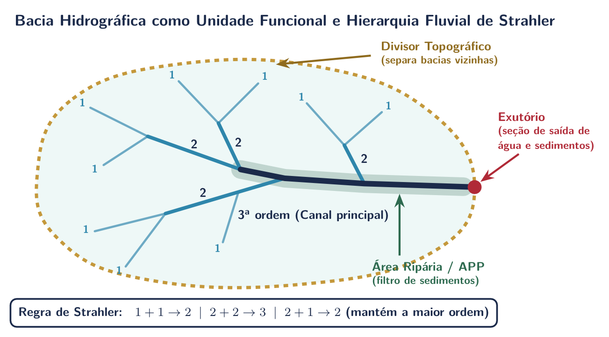
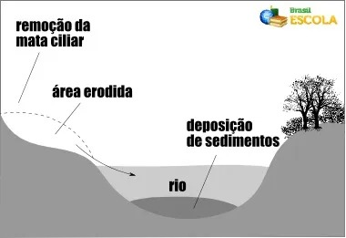
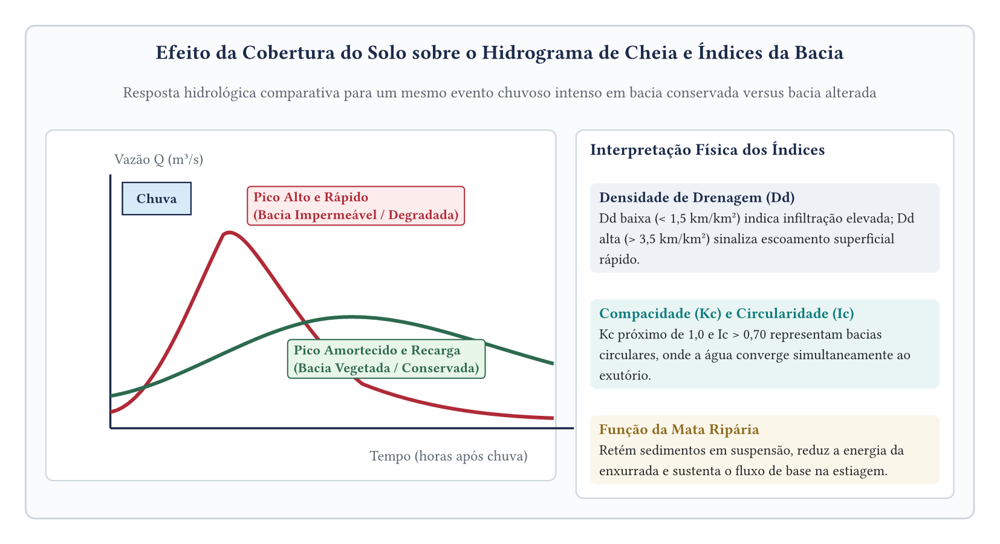

# Bacia Hidrográfica como Unidade de Análise Ambiental Integrada {#cap:bacia_hidrografica}

A bacia hidrográfica conecta áreas produtoras de escoamento e sedimentos a um ponto de saída. Sua morfometria descreve geometria e organização da drenagem, fornecendo elementos para interpretar a resposta do sistema às chuvas. Essa interpretação depende da combinação com solos, cobertura da terra e características dos eventos.

::: {.callout-note title="O que você vai aprender neste capítulo"}
O capítulo desenvolve a delimitação funcional de bacias e microbacias, a Hierarquia Fluvial de Strahler, o cálculo e a interpretação de índices morfométricos ($D_d$, $K_c$, $I_c$, $H_m$ e $R_r$), o papel das áreas ripárias e a análise da conectividade hidrossedimentológica diante de mudanças no uso da terra.
:::

::: {.callout-tip title="Revisando o que você precisa saber"}
A leitura utiliza os conceitos de sistema aberto, divisor, exutório, talvegue, área de drenagem, perímetro e escala cartográfica. Comprimento de canal, comprimento axial e extensão da vertente representam medidas distintas, exigindo conferência de unidades ($1\text{ km} = 1.000\text{ m}$; $1\text{ km}^2 = 100\text{ ha}$; $1\text{ mm}$ sobre $1\text{ m}^2 = 1\text{ L}$).
:::

## Conceito Espacial e Funcional de Bacia e Microbacia Hidrográfica

Na Geografia Física e na Análise Ambiental, a **bacia hidrográfica** constitui uma unidade natural de drenagem delimitada pela topografia e dotada de limites físicos verificáveis em campo. Segundo **Christofoletti (1981)**, trata-se de uma área drenada por um rio ou sistema fluvial que opera como sistema aberto, no qual a água precipitada converge das áreas elevadas (**divisores topográficos** ou interflúvios) para os fundos de vale (**talvegues**) sob ação da gravidade até deixar a unidade por uma única seção de saída, o **exutório** (seção de controle). Como a posição do exutório condiciona área ($A$), perímetro ($P$) e comprimento do canal principal ($L_p$), o registro de suas coordenadas geográficas e a conferência sobre o modelo digital de elevação garantem repetibilidade ao traçado.

**Botelho e Silva (2004)** destacam que a bacia hidrográfica opera como célula integradora da gestão ambiental porque articula as trocas entre atmosfera (chuva e evapotranspiração), litosfera e pedosfera (rochas, solos, infiltração e erosão), biosfera (cobertura vegetal e biota aquática) e antroposfera (cidades, estradas, agropecuária e reservatórios). Nessa perspectiva, **Guerra e Cunha (1996)** mostram que intervenções nas vertentes, como desmatamento, abertura de acessos rurais ou impermeabilização urbana, produzem reflexos diretos nos canais a jusante sob a forma de enxurradas, erosão marginal, assoreamento e queda na qualidade da água.

### Bacia, Sub-bacia e Microbacia na Gestão Territorial

Na prática técnica e na Política Nacional de Recursos Hídricos (Lei nº 9.433/1997), organiza-se o espaço hídrico em três níveis encaixados. Na escala regional, a **bacia hidrográfica** abrange grandes sistemas de drenagem com milhares de quilômetros quadrados, como as bacias do Rio Paraguaçu e do Rio São Francisco, geridos por Comitês de Bacia Hidrográfica. Em escala intermediária, a **sub-bacia** corresponde à área de captação de um tributário principal dentro de uma bacia maior, a exemplo do Rio Jacuípe (afluente do Paraguaçu) ou do Rio Subaé, na região de Feira de Santana (BA). Na escala local e operacional, a **microbacia** reúne unidades de pequena extensão (de poucos hectares a dezenas de quilômetros quadrados, geralmente de 1ª a 3ª ordem de Strahler) com resposta imediata a chuvas convectivas e mudanças de uso da terra, sendo a unidade preferencial para conservação do solo, recuperação de nascentes e bioengenharia.

Cabe distinguir o **divisor topográfico** (superficial), que acompanha a linha de cumeada e governa a enxurrada, do **divisor freático** (subterrâneo), que acompanha o topo do lençol freático segundo o mergulho de camadas geológicas e fraturas da rocha. Em terrenos cristalinos rasos do Semiárido baiano, ambos os divisores tendem a coincidir de modo aproximado; já em bacias sedimentares ou áreas cársticas (como o Oeste Baiano ou setores da Chapada Diamantina), o fluxo subterrâneo pode cruzar o divisor superficial e alimentar bacias vizinhas.

## Elementos Estruturais e Hierarquia Fluvial de Strahler

Os cursos d’água organizam-se em redes ramificadas das cabeceiras ao exutório. Para comparar bacias de tamanhos distintos e aferir o grau de dissecação do relevo, emprega-se a **Hierarquia Fluvial de Strahler (1952)**, simplificação operacional da proposta de Horton (1945) difundida por **Christofoletti (1981)**.

### Regras da Hierarquia Fluvial de Strahler

A ordenação de Strahler avança sempre de montante (cabeceiras) para jusante (exutório) segundo três regras fixas. Todo canal sem tributários, desde a nascente até a primeira confluência, recebe classificação de **1ª ordem**. Quando dois canais de mesma ordem se encontram ($n + n \to n + 1$), a hierarquia eleva-se em uma unidade, de modo que dois canais de 1ª ordem geram um segmento de 2ª ordem ($1 + 1 \to 2$) e dois de 2ª ordem formam um segmento de 3ª ordem ($2 + 2 \to 3$). Quando um canal de ordem inferior desemboca em um canal de ordem superior ($n + m \to \max(n, m)$), o canal receptor conserva a maior ordem ($2 + 1 \to 2$; $3 + 1 \to 3$; $3 + 2 \to 3$). Ao final do traçado, a **ordem da bacia hidrográfica** equivale à ordem do segmento principal no exutório.

O conjunto integrado de divisores, rede fluvial hierarquizada até a 3ª ordem, faixas ripárias (APPs) e seção de controle no exutório encontra-se representado na @fig-bacia_strahler.

{#fig-bacia_strahler fig-alt="Mapa esquemático de bacia hidrográfica com divisor, rede de canais numerados de 1ª a 3ª ordem, faixa ripária e exutório"}

Além da ordem numérica, a geometria em planta da rede, denominada **padrão de drenagem**, revela o controle litológico e estrutural do terreno. O padrão **dendrítico (arborescente)** assemelha-se a galhos de árvore e ocorre em rochas de resistência homogênea, como granitos pouco fraturados ou camadas sedimentares horizontais. O padrão **retangular ou em treliça**, com confluências próximas a $90^\circ$, denuncia forte controle por falhas, fraturas ou dobramentos, sendo comum em setores serranos da Chapada Diamantina. Em encostas íngremes e uniformes desenvolve-se o padrão **paralelo**, com canais alongados, enquanto em morros isolados, domos ou depressões fechadas surge o padrão **radial**, divergente a partir do topo ou convergente para o centro da depressão.

O Exemplo 7.1 aplica passo a passo as três regras de Strahler a uma microbacia tributária do Rio Jacuípe.

::: {.callout-tip appearance="simple"}
### Exemplo 7.1 (Básico). Hierarquia Fluvial de Strahler em uma Microbacia de Cabeceira

**Situação analisada.** Durante o mapeamento hidrográfico de uma microbacia afluente do Rio Jacuípe (BA), uma equipe identificou de montante para jusante sete córregos sem tributários ($C_1$ a $C_7$): $C_1$ e $C_2$ unem-se formando o trecho $T_1$; $C_3$ e $C_4$ unem-se formando $T_2$; $C_5$ desemboca em $T_2$, originando $T_3$; $T_1$ e $T_3$ encontram-se formando $T_4$; e $C_6$ e $C_7$ unem-se formando $T_5$, que desemboca em $T_4$ para gerar o canal principal $T_6$ até o exutório.

**Dados disponíveis.** Sete canais de cabeceira sem tributários ($C_1$ a $C_7$) e cinco confluências sequenciais até $T_6$.

**Problema a resolver.** Determinar a ordem de Strahler de cada trecho ($T_1$ a $T_6$) e a ordem final da microbacia.

**Fundamento da análise.** Aplicação sequencial das regras de Strahler (1952): nascentes $= 1$; encontro $n + n \to n + 1$; encontro $n + m \to \max(n, m)$.

**Desenvolvimento.** Todos os sete canais sem afluentes ($C_1$ a $C_7$) pertencem à **1ª ordem**. Seguindo de montante para jusante, $T_1$ resulta de $C_1 + C_2$ ($1 + 1 \to \text{2ª ordem}$) e $T_2$ resulta de $C_3 + C_4$ ($1 + 1 \to \text{2ª ordem}$). Quando $C_5$ (1ª) encontra $T_2$ (2ª), prevalece a maior ordem em $T_3$ ($2 + 1 \to \text{2ª ordem}$). Na junção entre $T_1$ (2ª) e $T_3$ (2ª), a ordem sobe para **3ª ordem** em $T_4$ ($2 + 2 \to 3$). Na confluência seguinte, $T_5$ forma-se por $C_6 + C_7$ ($1 + 1 \to \text{2ª ordem}$) e desemboca em $T_4$ (3ª), mantendo $T_6$ na **3ª ordem** ($3 + 2 \to 3$).

**Interpretação do resultado.** $T_1 = 2^{\text{a}}$, $T_2 = 2^{\text{a}}$, $T_3 = 2^{\text{a}}$, $T_4 = 3^{\text{a}}$, $T_5 = 2^{\text{a}}$ e $T_6 = 3^{\text{a}}$ ordem, caracterizando uma **microbacia de 3ª ordem**.

**Condições de validade.** Para surgir uma bacia de 4ª ordem seriam necessários ao menos dois canais de 3ª ordem confluindo entre si (exigindo no mínimo oito canais de 1ª ordem pareados); com sete canais de cabeceira, a 3ª ordem é o máximo possível.
:::

Na aplicação dessa ordenação em mapas, o equívoco mais frequente consiste em somar ordens desiguais na confluência.

::: {.callout-warning appearance="simple"}
### Erro 1. Somar Ordens Diferentes na Hierarquia de Strahler ($2 + 1 = 3$)

**Equívoco frequente.** Assumir que toda confluência eleva a ordem fluvial, registrando que um canal de 2ª ordem ao receber um tributário de 1ª ordem passa a ser de 3ª ordem.

**Correção técnica.** Na regra de Strahler, a ordem só sobe quando confluem dois segmentos de mesma hierarquia ($1+1 \to 2$; $2+2 \to 3$). No encontro de ordens distintas, o trecho a jusante preserva a maior ordem ($2+1 \to 2$).
:::

## Morfometria de Bacias Hidrográficas

A **análise morfométrica** traduz atributos geométricos, lineares, areais e hipsométricos da bacia em índices numéricos objetivos (Christofoletti, 1981; Villela; Mattos, 1975). Esses parâmetros permitem diagnosticar permeabilidade relativa do substrato, tempo de resposta às chuvas, suscetibilidade a enchentes e energia potencial para erosão.

### Densidade de Drenagem ($D_d$)

Proposta por Robert E. Horton (1945), a **Densidade de Drenagem ($D_d$)** expressa o comprimento médio de canais fluviais por unidade de área da bacia, refletindo o balanço entre permeabilidade de solos e rochas, declividade, cobertura vegetal e regime pluviométrico:

$$
D_d = \frac{L_t}{A}
$$

Nessa equação, $D_d$ é expressa em $\text{km}/\text{km}^2$ (ou $\text{km}^{-1}$), $L_t$ representa o somatório do comprimento de todos os cursos d’água mapeados ($\text{km}$) e $A$ indica a área total de drenagem ($\text{km}^2$). Em uma microbacia de $A = 25{,}0\text{ km}^2$ e $L_t = 45{,}0\text{ km}$, obtém-se $D_d = 45{,}0 / 25{,}0 = 1{,}80\text{ km}/\text{km}^2$, valor intermediário compatível com drenagem moderada.

Valores baixos ($D_d < 0{,}5\text{ km}/\text{km}^2$) ocorrem em substratos muito permeáveis (como arenitos profundos e Latossolos arenosos) com elevada infiltração, enquanto valores altos ($D_d > 2{,}0\text{ km}/\text{km}^2$) predominam em rochas cristalinas pouco permeáveis e solos rasos do Semiárido sob chuvas concentradas. Como o comprimento $L_t$ depende da escala cartográfica e do limiar de área de contribuição adotado na extração automática em SIG, comparações entre bacias exigem redes vetorizadas na mesma escala e sob o mesmo critério. O Exemplo 7.2 ilustra esse contraste litológico em escala padronizada.

::: {.callout-tip appearance="simple"}
### Exemplo 7.2 (Básico e Intermediário). Densidade de Drenagem e Contraste Litológico

**Situação analisada.** Em um diagnóstico comparativo na Bahia, analisaram-se duas microbacias rurais de mesma área, mapeadas na escala $1:25.000$: a **Microbacia A**, sobre embasamento cristalino (gnaisses) com solos rasos no Semiárido, e a **Microbacia B**, sobre bacia sedimentar arenosa com solos profundos e bem drenados.

**Dados disponíveis.** Microbacia A: $A_A = 16{,}0\text{ km}^2$ e $L_{tA} = 41{,}6\text{ km}$. Microbacia B: $A_B = 16{,}0\text{ km}^2$ e $L_{tB} = 12{,}8\text{ km}$.

**Problema a resolver.** Calcular a Densidade de Drenagem ($D_d$) de cada microbacia e explicar a relação entre os resultados, a permeabilidade do terreno e o escoamento superficial.

**Fundamento da análise.** Aplicação da equação de Horton ($D_d = L_t / A$) e razão comparativa $D_{dA}/D_{dB}$.

**Desenvolvimento.** Calculando $D_d$ para as duas microbacias e comparando os valores obtidos:

$$
\begin{aligned}
D_{dA} &= \frac{41{,}6\text{ km}}{16{,}0\text{ km}^2} = 2{,}60\text{ km}/\text{km}^2 \\
D_{dB} &= \frac{12{,}8\text{ km}}{16{,}0\text{ km}^2} = 0{,}80\text{ km}/\text{km}^2 \\
\frac{D_{dA}}{D_{dB}} &= \frac{2{,}60}{0{,}80} = 3{,}25.
\end{aligned}
$$

**Interpretação do resultado.** $D_{dA} = 2{,}60\text{ km}/\text{km}^2$ (drenagem alta) e $D_{dB} = 0{,}80\text{ km}/\text{km}^2$ (drenagem regular a baixa), sendo a densidade da Microbacia A $3{,}25$ vezes superior à da Microbacia B.

**Condições de validade.** Rochas cristalinas e solos rasos limitam a infiltração profunda e exigem uma rede mais densa de canais para escoar a enxurrada, ao passo que arenitos e solos profundos favorecem a recarga subterrânea. Como ambas usaram a escala $1:25.000$, a comparação é válida.
:::

### Índices de Forma, Coeficiente de Compacidade ($K_c$) e Índice de Circularidade ($I_c$)

A geometria em planta da bacia controla a simultaneidade de chegada das ondas de cheia ao exutório. Em bacias próximas de um círculo, tributários distribuídos ao redor percorrem distâncias semelhantes até a saída, concentrando os picos de vazão, ao passo que bacias alongadas escalonam os tempos de viagem e atenuam o pico máximo, resposta que também depende da distribuição da chuva e da capacidade dos canais.

O **Coeficiente de Compacidade ($K_c$, Índice de Gravelius)** divide o perímetro real da bacia ($P$) pelo perímetro do círculo de mesma área ($P_c = 2\sqrt{\pi A}$), usando na prática hidrológica a constante $0{,}28$ (aproximação de $1/(2\sqrt{\pi}) \approx 0{,}2821$, que produz pequena diferença perto de $1$). Como nenhuma figura plana tem perímetro menor que o círculo de mesma área, tem-se sempre $K_c \ge 1$. De modo inverso, o **Índice de Circularidade ($I_c$, Miller, 1953)** divide a área real ($A$) pela área do círculo de mesmo perímetro ($A_c = P^2 / (4\pi)$), variando em $0 < I_c \le 1$ com $I_c \approx 1 / K_c^2$:

$$
\begin{aligned}
K_c &= \frac{P}{2\sqrt{\pi A}} \approx 0{,}28 \cdot \frac{P}{\sqrt{A}}, \qquad K_c \ge 1 \\
I_c &= \frac{4\pi \cdot A}{P^2} \approx \frac{12{,}57 \cdot A}{P^2}, \qquad 0 < I_c \le 1
\end{aligned}
$$

Em ambos os índices adimensionais, emprega-se $A$ em $\text{km}^2$ e $P$ em $\text{km}$ (ou $A$ em $\text{m}^2$ e $P$ em $\text{m}$). Para a microbacia de $A = 25{,}0\text{ km}^2$ e $P = 24{,}0\text{ km}$, resultam $K_c = 0{,}28 \cdot (24{,}0 / 5{,}0) = 1{,}34$ e $I_c = (12{,}57 \times 25{,}0) / 576{,}0 \approx 0{,}55$, indicando contorno ovalado e suscetibilidade moderada a cheias. O Exemplo 7.3 aplica $K_c$ e $I_c$ à priorização de obras de macrodrenagem entre duas sub-bacias de mesma área.

::: {.callout-tip appearance="simple"}
### Exemplo 7.3 (Intermediário). Forma da Bacia ($K_c$ e $I_c$) e Suscetibilidade a Enchentes

**Situação analisada.** A prefeitura de um município baiano precisa priorizar obras de macrodrenagem entre duas sub-bacias periurbanas de mesma área ($36{,}0\text{ km}^2$): a **Bacia X**, mais arredondada, e a **Bacia Y**, estreita e alongada.

**Dados disponíveis.** Bacia X: $A_X = 36{,}0\text{ km}^2$ e $P_X = 24{,}0\text{ km}$. Bacia Y: $A_Y = 36{,}0\text{ km}^2$ e $P_Y = 36{,}0\text{ km}$.

**Problema a resolver.** Calcular $K_c$ e $I_c$ de ambas as bacias e indicar qual apresenta maior suscetibilidade natural a picos rápidos de cheia.

**Fundamento da análise.** Cálculo de $K_c = 0{,}28 \cdot (P/\sqrt{A})$ e $I_c = (12{,}57 \cdot A)/P^2$, com classificação pela @tbl-morfometria_interpretacao.

**Desenvolvimento.** Como $\sqrt{36{,}0} = 6{,}0\text{ km}$ em ambas as unidades, calculam-se os índices da Bacia X e da Bacia Y:

$$
\begin{aligned}
K_{cX} &= 0{,}28 \cdot \frac{24{,}0}{6{,}0} = 1{,}12, & I_{cX} &= \frac{12{,}57 \times 36{,}0}{24{,}0^2} \approx 0{,}79 \\
K_{cY} &= 0{,}28 \cdot \frac{36{,}0}{6{,}0} = 1{,}68, & I_{cY} &= \frac{12{,}57 \times 36{,}0}{36{,}0^2} \approx 0{,}35.
\end{aligned}
$$

**Interpretação do resultado.** Bacia X: $K_c = 1{,}12$ e $I_c = 0{,}79$ (contorno tendendo a circular, alta suscetibilidade a enchentes). Bacia Y: $K_c = 1{,}68$ e $I_c = 0{,}35$ (contorno alongado, baixa suscetibilidade a picos concentrados). A Bacia X deve receber prioridade.

**Condições de validade.** Confere-se a consistência $1 / K_{cX}^2 = 1 / 1{,}12^2 \approx 0{,}80 \approx I_{cX}$, respeitando $K_c \ge 1$ e $I_c \le 1$.
:::

Como $K_c$ e $I_c$ variam em direções opostas à medida que a bacia se alonga, confundir o sentido de leitura de ambos é erro comum em provas.

::: {.callout-warning appearance="simple"}
### Erro 2. Confundir o Sentido de Interpretação de $K_c$ e $I_c$

**Equívoco frequente.** Afirmar que “quanto maior o $K_c$, mais circular é a bacia e maior o risco de enchentes”, confundindo $K_c$ com $I_c$.

**Correção técnica.** Os dois índices variam em sentidos opostos. Quanto mais circular a bacia, **menor** é $K_c$ (próximo de $1{,}0$) e **maior** é $I_c$ (próximo de $1{,}0$). Em bacias alongadas, $K_c$ cresce ($> 1{,}50$) e $I_c$ diminui ($< 0{,}45$). Valores com $K_c < 1$ ou $I_c > 1$ indicam erro de medição ou de cálculo.
:::

### Índices de Relevo, Amplitude Altimétrica ($H_m$) e Relação de Relevo ($R_r$)

A energia potencial disponível para acelerar o escoamento e mobilizar sedimentos depende do desnível vertical combinado ao comprimento da bacia. A **Amplitude Altimétrica ($H_m$)** mede a diferença entre a cota máxima no divisor ($H_{\max}$, em $\text{m}$) e a cota mínima no exutório ($H_{\min}$, em $\text{m}$), enquanto a **Relação de Relevo ($R_r$)**, proposta por Stanley Schumm (1956), divide esse desnível pelo comprimento axial ($L$):

$$
\begin{aligned}
H_m &= H_{\max} - H_{\min} \\
R_r &= \frac{H_m}{L}
\end{aligned}
$$

Expressa-se $R_r$ em $\text{m}/\text{km}$ (quando $L$ está em $\text{km}$) ou de forma adimensional em $\text{m}/\text{m}$ (convertendo $L$ para metros). Na microbacia de referência com $H_{\max} = 420\text{ m}$, $H_{\min} = 220\text{ m}$ e $L = 8{,}0\text{ km}$, tem-se $H_m = 200\text{ m}$ e $R_r = 25{,}0\text{ m}/\text{km}$ ($0{,}025\text{ m}/\text{m}$ ou $2{,}5\%$). O Exemplo 7.4 compara duas cabeceiras baianas de mesmo comprimento axial e contrastante energia topográfica.

::: {.callout-tip appearance="simple"}
### Exemplo 7.4 (Intermediário). Amplitude Altimétrica ($H_m$) e Relação de Relevo ($R_r$) em Cabeceiras Contrastantes

**Situação analisada.** Para avaliar o potencial energético de erosão e transporte de sedimentos, comparam-se duas microbacias de mesmo comprimento axial ($L = 6{,}0\text{ km}$): uma nas cabeceiras serranas da **Chapada Diamantina** e outra em setor aplainado do **Planalto Sertanejo**.

**Dados disponíveis.** Chapada Diamantina: $H_{\max} = 960\text{ m}$, $H_{\min} = 480\text{ m}$, $L = 6{,}0\text{ km}$. Planalto Sertanejo: $H_{\max} = 360\text{ m}$, $H_{\min} = 240\text{ m}$, $L = 6{,}0\text{ km}$.

**Problema a resolver.** Calcular $H_m$ e $R_r$ (em $\text{m}/\text{km}$ e em $\text{m}/\text{m}$) para ambas as unidades e interpretar suas implicações geomorfológicas.

**Fundamento da análise.** Aplicação de $H_m = H_{\max} - H_{\min}$ e $R_r = H_m / L$, convertendo $6{,}0\text{ km} = 6.000\text{ m}$ para a forma adimensional.

**Desenvolvimento.** Calculando amplitude e relação de relevo para a Chapada Diamantina (1) e para o Planalto Sertanejo (2):

$$
\begin{aligned}
H_{m1} &= 960 - 480 = 480\text{ m}, & R_{r1} &= \frac{480}{6{,}0} = 80{,}0\text{ m}/\text{km} \quad \left(\frac{480}{6.000} = 0{,}080\text{ m}/\text{m}\right) \\
H_{m2} &= 360 - 240 = 120\text{ m}, & R_{r2} &= \frac{120}{6{,}0} = 20{,}0\text{ m}/\text{km} \quad \left(\frac{120}{6.000} = 0{,}020\text{ m}/\text{m}\right).
\end{aligned}
$$

**Interpretação do resultado.** Chapada Diamantina: $H_m = 480\text{ m}$ e $R_r = 80{,}0\text{ m}/\text{km}$ ($0{,}080\text{ m}/\text{m}$). Planalto Sertanejo: $H_m = 120\text{ m}$ e $R_r = 20{,}0\text{ m}/\text{km}$ ($0{,}020\text{ m}/\text{m}$). A microbacia serrana possui energia de relevo $4$ vezes maior.

**Condições de validade.** O mesmo comprimento axial acomoda um desnível quatro vezes superior na Chapada, elevando a velocidade do escoamento, a competência para transportar material grosseiro e a suscetibilidade a ravinas caso haja supressão vegetal.
:::

A compatibilidade de unidades no denominador de $R_r$ exige atenção constante para evitar discrepâncias de mil vezes no resultado numérico.

::: {.callout-warning appearance="simple"}
### Erro 3. Misturar Metros e Quilômetros no Cálculo da Relação de Relevo ($R_r$)

**Equívoco frequente.** Dividir $H_m = 200\text{ m}$ por $L = 8\text{ km}$, obter $25$ e registrar o valor como “$25\text{ m/m}$” ou “$25\%$”.

**Correção técnica.** Ao dividir metros por quilômetros, a unidade obrigatória é $\text{m}/\text{km}$ ($25\text{ m}/\text{km}$). Para obter $R_r$ adimensional ($\text{m}/\text{m}$) ou em porcentagem, converta $L$ para metros antes da divisão: $200\text{ m} / 8.000\text{ m} = 0{,}025\text{ m}/\text{m} = 2{,}5\%$.
:::

Para apoiar a leitura comparativa desses parâmetros em diagnósticos ambientais, a @tbl-morfometria_interpretacao reúne as faixas de referência usuais, que devem ser sempre interpretadas em conjunto com litologia, solos, cobertura e regime pluviométrico.

| **Índice** | **Faixa de Valores** | **Significado Hidrológico e Ambiental** |
|:---|:---|:---|
| **Densidade de Drenagem ($D_d$)** | $< 0{,}5\text{ km}/\text{km}^2$ | Drenagem pobre; substrato muito permeável e alta infiltração. |
| **Densidade de Drenagem ($D_d$)** | $0{,}5\text{ a } 2{,}0\text{ km}/\text{km}^2$ | Drenagem regular a média; equilíbrio intermediário. |
| **Densidade de Drenagem ($D_d$)** | $> 2{,}0\text{ km}/\text{km}^2$ | Drenagem alta; substrato pouco permeável e maior dissecação. |
| **Compacidade ($K_c$)** | $1{,}00\text{ a } 1{,}25$ | Contorno circular; alta propensão a picos rápidos de cheia. |
| **Compacidade ($K_c$)** | $1{,}25\text{ a } 1{,}50$ | Contorno ovalado; propensão moderada a cheias. |
| **Compacidade ($K_c$)** | $> 1{,}50$ | Contorno alongado; menor concentração simultânea de picos. |
| **Circularidade ($I_c$)** | $> 0{,}51$ | Tendência circular; convergência rápida ao exutório. |
| **Circularidade ($I_c$)** | $\le 0{,}51$ | Tendência alongada; escoamento distribuído no tempo. |
| **Relação de Relevo ($R_r$)** | $< 15\text{ m}/\text{km}$ | Relevo suave; menor velocidade e tendência à deposição. |
| **Relação de Relevo ($R_r$)** | $> 40\text{ m}/\text{km}$ | Relevo acidentado; alta energia erosiva e de transporte. |

: Síntese interpretativa dos principais índices morfométricos de bacias hidrográficas. {#tbl-morfometria_interpretacao}

## Áreas Ripárias, Conectividade Hidrossedimentológica e Uso da Terra

Os índices morfométricos descrevem a arquitetura física de evolução lenta da bacia, mas a resposta hidrológica real depende criticamente da cobertura vegetal nas vertentes e nas margens fluviais.

### Áreas Ripárias e Zonas Tampão

As **áreas ripárias** (matas ciliares, galerias e várzeas marginais, protegidas como Áreas de Preservação Permanente pelo Código Florestal, Lei nº 12.651/2012) constituem a interface entre a vertente e o canal fluvial. Quando a enxurrada desce a encosta e atravessa uma faixa ripária conservada, a serapilheira e os caules aumentam a rugosidade superficial, dissipam a energia cinética do fluxo e retêm sedimentos e agroquímicos antes que atinjam o rio. Simultaneamente, o entrelaçamento das raízes eleva a resistência ao cisalhamento dos barrancos e contém o solapamento das margens, enquanto o sombreamento regula a temperatura da água e os solos porosos mantêm a recarga que sustenta o fluxo de base nas estiagens.

Quando a vegetação ciliar é suprimida em uma das margens ou em ambas, perde-se essa zona tampão filtrante e estabilizadora: o solo exposto sofre desagregação rápida e os sedimentos carreados depositam-se no leito fluvial, reduzindo a profundidade da calha e ampliando o assoreamento (@fig-assoreamento_mata_ciliar).

{#fig-assoreamento_mata_ciliar fig-alt="Seção transversal esquemática de vale fluvial mostrando erosão na margem sem mata ciliar e deposição de sedimentos no fundo do rio"}

### Conectividade Hidrossedimentológica

Na geomorfologia fluvial, denomina-se **conectividade hidrossedimentológica** a eficiência com que água e sedimentos mobilizados nas vertentes alcançam a rede de canais e o exutório (Brierley; Fryirs, 2005). A **conectividade estrutural** diz respeito à continuidade física dos caminhos de fluxo no relevo (declividade, ravinas, estradas rurais mal drenadas ou galerias pluviais), enquanto a **conectividade funcional** expressa a ativação efetiva desses caminhos durante eventos chuvosos, como ocorre em canais efêmeros do Semiárido que permanecem secos na maior parte do ano e conectam-se apenas quando chuvas convectivas superam a infiltração do solo. Faixas ciliares conservadas, terraços em nível e paliçadas operam como **desconectores**, ao passo que estradas morro abaixo atuam como **conectores artificiais**.

### Impactos da Mudança de Uso da Terra, Impermeabilização e Desmatamento

A conversão de florestas ou Caatinga conservada em pastagens compactadas ou loteamentos urbanos impermeabilizados altera profundamente o balanço hídrico da microbacia. A perda de dossel e a selagem por asfalto, telhados e solos adensados derrubam a interceptação e a infiltração, elevando o **coeficiente de escoamento superficial ($C$)** de valores típicos entre $0{,}10$ e $0{,}20$ em coberturas florestais para $0{,}65$ a $0{,}90$ em áreas urbanas densas.

Como resultado, a água escoa mais rápido pela superfície, reduz o **tempo de concentração** e gera hidrogramas com picos de cheia mais elevados e precoces sob a mesma chuva (cenário recorrente em microbacias urbanizadas de Feira de Santana, como nas cabeceiras do Subaé e do Jacuípe), enquanto a redução da infiltração diminui a recarga dos aquíferos e deprime o fluxo de base na estiagem, dinâmica contrastada com a leitura física de $D_d$, $K_c$ e $I_c$ na @fig-hidrograma_impermeabilizacao.

{#fig-hidrograma_impermeabilizacao fig-alt="Gráfico comparativo de vazão versus tempo mostrando pico alto e rápido na bacia impermeável e pico amortecido na bacia vegetada, ao lado de quadro com interpretação dos índices"}

## Síntese Aplicada em Hidrologia de Microbacias

A comparação gráfica dos hidrogramas na @fig-hidrograma_impermeabilizacao traduz-se diretamente em volumes escoados durante uma tormenta. Multiplicar a lâmina precipitada pela área da microbacia e pelo coeficiente de escoamento superficial ($C$) permite quantificar o incremento de enxurrada gerado pela urbanização sem drenagem sustentável, como desenvolvido no Exemplo 7.5.

::: {.callout-tip appearance="simple"}
### Exemplo 7.5 (Avançado). Impacto Hidrológico da Impermeabilização Urbana em uma Microbacia

**Situação analisada.** Uma microbacia periurbana de $4{,}0\text{ km}^2$ na borda de expansão de Feira de Santana era originalmente coberta por vegetação nativa e áreas ripárias conservadas, com coeficiente médio de escoamento superficial $C_1 = 0{,}15$. Após loteamentos pavimentados, canalização de córregos e supressão da mata ciliar, o coeficiente subiu para $C_2 = 0{,}75$. Considere uma chuva intensa de $P_{\text{chuva}} = 60\text{ mm}$.

**Dados disponíveis.** $A = 4{,}0\text{ km}^2 = 4.000.000\text{ m}^2$; $P_{\text{chuva}} = 60\text{ mm} = 0{,}060\text{ m}$; $C_1 = 0{,}15$; $C_2 = 0{,}75$.

**Problema a resolver.** Calcular o volume total precipitado, o volume de escoamento superficial antes e depois da urbanização, a diferença absoluta e relativa e os reflexos sobre a conectividade hidrossedimentológica.

**Fundamento da análise.** Cálculo volumétrico do balanço superficial ($V_{\text{prec}} = P_{\text{chuva}} \cdot A$ e $V_{\text{esc}} = C \cdot V_{\text{prec}}$), seguido de análise hidrossedimentológica.

**Desenvolvimento.** Convertendo $A = 4.000.000\text{ m}^2$ e $P_{\text{chuva}} = 0{,}060\text{ m}$, obtêm-se os volumes precipitado, escoados e o incremento relativo:

$$
\begin{aligned}
V_{\text{prec}} &= 0{,}060\text{ m} \times 4.000.000\text{ m}^2 = 240.000\text{ m}^3 \\
V_{\text{esc},1} &= 0{,}15 \times 240.000\text{ m}^3 = 36.000\text{ m}^3 \\
V_{\text{esc},2} &= 0{,}75 \times 240.000\text{ m}^3 = 180.000\text{ m}^3 \\
\Delta V_{\text{esc}} &= 180.000 - 36.000 = 144.000\text{ m}^3 \qquad \left(\frac{180.000}{36.000} = 5\text{ vezes, ou }+400\%\right).
\end{aligned}
$$

No cenário conservado, os $204.000\text{ m}^3$ restantes ($85\%$) permaneciam retidos por interceptação, depressões e infiltração.

**Interpretação do resultado.** O escoamento superficial saltou de $36.000\text{ m}^3$ para $180.000\text{ m}^3$, um acréscimo de $144.000\text{ m}^3$ (cinco vezes o volume original) para a mesma chuva de $60\text{ mm}$.

**Condições de validade.** Esse acréscimo equivale a cerca de $58$ piscinas olímpicas ($2.500\text{ m}^3$ cada) lançadas abruptamente no canal em poucas horas. A supressão da mata ciliar e a canalização eliminam os desconectores naturais, amplificam a conectividade artificial e provocam alagamentos a jusante, erosão marginal e queda na recarga subterrânea.
:::

## Armadilha Conceitual e Materiais Audiovisuais de Apoio

Mesmo quando os índices morfométricos são calculados corretamente nas fórmulas de Horton, Gravelius e Miller, comparar bacias vetorizadas em escalas cartográficas incompatíveis invalida qualquer conclusão sobre permeabilidade e dissecação.

::: {.callout-warning appearance="simple"}
### Erro 4. Comparar Densidade de Drenagem ($D_d$) Obtida em Escalas Cartográficas Diferentes

**Equívoco frequente.** Calcular $D_d$ de uma bacia sobre base $1:10.000$ e compará-la com o $D_d$ de outra bacia extraído de carta $1:100.000$, concluindo que a primeira apresenta substrato muito menos permeável.

**Correção técnica.** Cartas de pequena escala ($1:100.000$) generalizam a rede hidrográfica e omitem grande parte dos canais de 1ª ordem, subestimando $L_t$ e $D_d$. Comparações morfométricas válidas exigem vetorização na mesma escala e sob o mesmo critério de extração de canais.
:::

Para aprofundar a compreensão da bacia hidrográfica como unidade de gestão e dos processos erosivos em rede de drenagem, assista às videoaulas selecionadas na página da disciplina. O vídeo [Gestão de Recursos Hídricos](https://www.youtube.com/watch?v=odVchJ9pmgY) aborda a bacia hidrográfica na análise ambiental integrada e na Lei das Águas, enquanto o vídeo [Processos Erosivos e Relevo](https://www.youtube.com/watch?v=G6Q0iU_n6xI) discute a dinâmica de escoamento e morfogênese nas vertentes e canais.

## Exercícios de fixação

#### Nível Básico (Exercícios 1 a 5)

1. Explique, com base em Botelho e Silva (2004) e Christofoletti (1981), por que a bacia hidrográfica é considerada a unidade espacial mais adequada para a análise e o planejamento ambiental, diferenciando **divisor topográfico**, **talvegue** e **exutório**.

2. Uma microbacia rural apresenta área de drenagem $A = 20{,}0\text{ km}^2$ e comprimento total de canais $L_t = 35{,}0\text{ km}$. Calcule sua Densidade de Drenagem ($D_d$) e classifique-a conforme a @tbl-morfometria_interpretacao.

3. Calcule o Coeficiente de Compacidade ($K_c$) de uma sub-bacia com área $A = 49{,}0\text{ km}^2$ e perímetro $P = 35{,}0\text{ km}$. Indique se sua forma tende à circular, ovalada ou alongada.

4. Uma microbacia possui área $A = 25{,}0\text{ km}^2$ e perímetro $P = 25{,}0\text{ km}$. Calcule seu Índice de Circularidade ($I_c$) e avalie sua propensão natural a picos concentrados de enchente.

5. Determine a Amplitude Altimétrica ($H_m$) e a Relação de Relevo ($R_r$), em $\text{m}/\text{km}$ e em $\text{m}/\text{m}$, para uma bacia com $H_{\max} = 640\text{ m}$, $H_{\min} = 280\text{ m}$ e comprimento axial $L = 9{,}0\text{ km}$.

#### Nível Intermediário (Exercícios 6 a 10)

6. Compare duas bacias hidrográficas mapeadas na mesma escala ($1:25.000$), ambas com área $A = 64{,}0\text{ km}^2$:

    - **Bacia M1:** $P = 32{,}0\text{ km}$, $L_t = 160{,}0\text{ km}$, $H_{\max} = 540\text{ m}$, $H_{\min} = 220\text{ m}$, $L = 8{,}0\text{ km}$.

    - **Bacia M2:** $P = 48{,}0\text{ km}$, $L_t = 51{,}2\text{ km}$, $H_{\max} = 380\text{ m}$, $H_{\min} = 220\text{ m}$, $L = 16{,}0\text{ km}$.

    Calcule $D_d$, $K_c$, $I_c$, $H_m$ e $R_r$ para ambas e justifique qual delas exige maior cuidado contra cheias rápidas e processos erosivos.

7. Em uma rede hidrográfica hipotética, quatro pares de canais de 1ª ordem formam quatro canais de 2ª ordem ($A, B, C, D$). Os canais $A$ e $B$ se unem formando o trecho $X$; o canal $C$ desemboca em $X$ formando o trecho $Y$; e o canal $D$ desemboca em $Y$ formando o canal final $Z$ no exutório. Determine a ordem de Strahler de $X$, $Y$ e $Z$ e explique por que a ordem final não chegou a 4ª ordem.

8. Uma microbacia de $5{,}0\text{ km}^2$ sofreu desmatamento e abertura de estradas compactadas, elevando seu coeficiente de escoamento superficial de $C_1 = 0{,}20$ para $C_2 = 0{,}70$. Para uma chuva de $50\text{ mm}$, calcule o volume escoado superficialmente (em $\text{m}^3$) nos dois cenários e o percentual de aumento do escoamento.

9. Explique a diferença entre **conectividade estrutural** e **conectividade funcional** em uma bacia hidrográfica do Semiárido baiano e dê um exemplo de elemento que atua como *conector* e outro que atua como *desconector* de sedimentos.

10. Por que a supressão de matas ciliares (áreas ripárias) em microbacias rurais provoca simultaneamente aumento da turbidez da água, assoreamento de reservatórios e instabilidade de margens?

#### Questões Objetivas (Exercícios 11 a 15)

11. Na Hierarquia Fluvial de Strahler, quando um curso d’água de 3ª ordem recebe um afluente de 2ª ordem e, mais a jusante, conflui com outro curso d’água de 3ª ordem, as ordens dos segmentos imediatamente após a primeira e a segunda confluência serão, respectivamente:

    (A) 4ª ordem e 5ª ordem.

    (B) 3ª ordem e 4ª ordem.

    (C) 3ª ordem e 3ª ordem.

    (D) 5ª ordem e 6ª ordem.

    (E) 2ª ordem e 4ª ordem.

12. Uma bacia hidrográfica apresenta $A = 100{,}0\text{ km}^2$, $P = 50{,}0\text{ km}$, $L_t = 220{,}0\text{ km}$, $H_{\max} = 750\text{ m}$, $H_{\min} = 250\text{ m}$ e $L = 20{,}0\text{ km}$. Os valores corretos de $D_d$, $K_c$ e $R_r$ (em $\text{m}/\text{km}$) são, respectivamente:

    (A) $2{,}20\text{ km}/\text{km}^2$; $1{,}40$; $25{,}0\text{ m}/\text{km}$.

    (B) $0{,}45\text{ km}/\text{km}^2$; $1{,}40$; $25{,}0\text{ m}/\text{km}$.

    (C) $2{,}20\text{ km}/\text{km}^2$; $0{,}71$; $50{,}0\text{ m}/\text{km}$.

    (D) $2{,}20\text{ km}/\text{km}^2$; $1{,}40$; $0{,}25\text{ m}/\text{km}$.

    (E) $4{,}40\text{ km}/\text{km}^2$; $2{,}80$; $25{,}0\text{ m}/\text{km}$.

13. Sobre o Coeficiente de Compacidade ($K_c$) e o Índice de Circularidade ($I_c$), assinale a alternativa tecnicamente correta:

    (A) Uma bacia perfeitamente circular apresenta $K_c = 0$ e $I_c = 1$.

    (B) Quanto maior o valor de $K_c$, maior a tendência da bacia à forma circular e maior o risco de cheias súbitas.

    (C) Valores de $K_c$ próximos de $1{,}0$ e de $I_c$ próximos de $1{,}0$ indicam bacia mais circular e maior suscetibilidade a picos concentrados de enchente.

    (D) O valor de $I_c$ pode assumir qualquer número real positivo superior a $1{,}0$ em bacias muito alongadas.

    (E) Os índices $K_c$ e $I_c$ dependem exclusivamente da altitude máxima e da extensão dos rios, independendo do perímetro.

14. Em relação às áreas ripárias em bacias hidrográficas, é **INCORRETO** afirmar que:

    (A) Atuam como zonas tampão que retêm parte dos sedimentos e nutrientes carreados das vertentes.

    (B) Contribuem para a estabilização das margens fluviais por meio do sistema radicular da vegetação.

    (C) Aumentam a rugosidade superficial, reduzindo a velocidade do escoamento que alcança o canal.

    (D) Sua remoção eleva a conectividade hidrossedimentológica entre encostas agrícolas e o leito fluvial.

    (E) Sua supressão aumenta a recarga dos aquíferos locais ao eliminar o consumo de água por evapotranspiração.

15. A urbanização intensa e sem drenagem sustentável em uma microbacia provoca, no hidrograma de cheia medido no exutório:

    (A) Aumento do tempo de concentração e diminuição do pico de vazão.

    (B) Redução do volume escoado superficialmente e elevação do fluxo de base na estiagem.

    (C) Redução do tempo de concentração e aumento acentuado da vazão de pico.

    (D) Manutenção inalterada da curva de cheia, pois a área da bacia permanece constante.

    (E) Eliminação da conectividade estrutural entre vertentes e canais.

## Questões de aplicação

16. **(Questão autoral, estilo ENADE / Licenciatura e Bacharelado em Geografia)** Um órgão estadual de meio ambiente avalia o pedido de supressão vegetal para expansão agropecuária em uma microbacia de cabeceira situada sobre embasamento cristalino no Nordeste brasileiro. O relatório técnico apresentou $D_d = 2{,}85\text{ km}/\text{km}^2$, $K_c = 1{,}14$ e $R_r = 55\text{ m}/\text{km}$. Com base na interpretação integrada desses indicadores morfométricos, conclui-se que a microbacia apresenta:

    (A) Substrato muito permeável, forma alongada e relevo plano, com baixíssima vulnerabilidade à erosão hídrica.

    (B) Elevada capacidade de infiltração profunda e lenta resposta hidrológica, dispensando faixas ripárias protetoras.

    (C) Baixa permeabilidade relativa, forma tendente à circular e elevada energia de relevo, indicando alta propensão natural a enxurradas rápidas e processos erosivos caso a vegetação seja suprimida.

    (D) Predomínio de deposição sedimentar em planície aluvial ampla, pois $K_c$ próximo de $1{,}0$ impede a concentração do escoamento no exutório.

    (E) Incompatibilidade matemática nos dados, visto que uma bacia com $D_d > 2{,}0$ não pode apresentar $K_c > 1{,}0$.

17. **(Questão autoral, estilo Concurso Analista Ambiental / INEMA-BA)** Em um estudo hidrológico para outorga e prevenção de inundações, uma sub-bacia foi caracterizada por $A = 81{,}0\text{ km}^2$, $P = 36{,}0\text{ km}$, $L_t = 202{,}5\text{ km}$, $H_{\max} = 680\text{ m}$, $H_{\min} = 230\text{ m}$ e $L = 15{,}0\text{ km}$. Assinale a alternativa que apresenta corretamente os valores de $D_d$, $K_c$, $I_c$ e $R_r$ (em $\text{m}/\text{m}$) dessa sub-bacia:

    (A) $D_d = 2{,}50\text{ km}/\text{km}^2$; $K_c = 1{,}12$; $I_c = 0{,}79$; $R_r = 0{,}030\text{ m}/\text{m}$.

    (B) $D_d = 2{,}50\text{ km}/\text{km}^2$; $K_c = 1{,}12$; $I_c = 0{,}79$; $R_r = 30{,}0\text{ m}/\text{m}$.

    (C) $D_d = 0{,}40\text{ km}/\text{km}^2$; $K_c = 1{,}12$; $I_c = 0{,}79$; $R_r = 0{,}030\text{ m}/\text{m}$.

    (D) $D_d = 2{,}50\text{ km}/\text{km}^2$; $K_c = 1{,}40$; $I_c = 0{,}50$; $R_r = 0{,}030\text{ m}/\text{m}$.

    (E) $D_d = 2{,}50\text{ km}/\text{km}^2$; $K_c = 0{,}89$; $I_c = 1{,}26$; $R_r = 0{,}030\text{ m}/\text{m}$.

18. **(Questão autoral, estilo Concurso IBAMA / Gestão de Bacias Hidrográficas)** Sobre o conceito de conectividade hidrossedimentológica aplicado à gestão de bacias hidrográficas, analise as afirmativas abaixo:

    I.  Estradas vicinais não pavimentadas construídas no sentido da declividade atuam como conectores estruturais, canalizando o escoamento das vertentes diretamente para os cursos d’água.

    II.  A recomposição de matas ciliares e a implantação de barreiras de retenção de sedimentos reduzem a conectividade entre áreas degradadas e o canal principal.

    III.  Em climas semiáridos, canais efêmeros podem exibir alta conectividade estrutural em mapa, mas conectividade funcional intermitente, ativada apenas em eventos pluviométricos que superam a capacidade de infiltração.

    Está correto o que se afirma em:

    (A) I, apenas.

    (B) II, apenas.

    (C) I e II, apenas.

    (D) II e III, apenas.

    (E) I, II e III.

### Conexão com a Avaliação Teórica e com o Trabalho Prático Final

Na **Prova Teórica da Semana 10**, os índices morfométricos exigem calcular ($D_d$, $K_c$, $I_c$ e $R_r$) e interpretar o comportamento físico de cada valor. No **Trabalho Prático Final**, extrair esses cinco índices em SIG (QGIS) para a microbacia escolhida, documentando a escala e o critério de extração da rede, confere precisão técnica à caracterização da área de estudo.

## Gabarito comentado {.unnumbered}

::: {.callout-tip collapse="true" title="Clique para abrir o Gabarito Comentado"}
### Resoluções e Justificativas, Capítulo 7

1. **Conceito e elementos.** A bacia hidrográfica é uma unidade espacial natural e sistêmica na qual todos os fluxos de água, sedimentos e poluentes das vertentes convergem para um único exutório, permitindo relacionar diretamente o uso da terra ao estado dos recursos hídricos (Botelho; Silva, 2004; Christofoletti, 1981). O *divisor topográfico* corresponde à linha de pontos mais altos que separa bacias adjacentes; o *talvegue* une os pontos mais baixos ao longo do vale onde se aloja o canal; e o *exutório* marca o ponto de menor cota do contorno por onde sai toda a drenagem superficial.

2. **Cálculo de $D_d$.** $D_d = L_t / A = 35{,}0 / 20{,}0 = \mathbf{1{,}75\text{ km}/\text{km}^2}$, indicando drenagem regular a média ($0{,}5$ a $2{,}0\text{ km}/\text{km}^2$).

3. **Cálculo de $K_c$.** Como $\sqrt{49{,}0} = 7{,}0\text{ km}$, tem-se $K_c = 0{,}28 \cdot (35{,}0 / 7{,}0) = 0{,}28 \cdot 5{,}0 = \mathbf{1{,}40}$, indicando forma ovalada ($1{,}25$ a $1{,}50$) e suscetibilidade moderada a cheias.

4. **Cálculo de $I_c$.** $I_c = \frac{12{,}57 \cdot 25{,}0}{(25{,}0)^2} = \frac{12{,}57}{25{,}0} = \mathbf{0{,}5028 \approx 0{,}50}$. Situado no limiar de $0{,}51$, indica forma intermediária com propensão moderada a cheias concentradas.

5. **Cálculo de $H_m$ e $R_r$.** $H_m = 640 - 280 = \mathbf{360\text{ m}}$. Em $\text{m}/\text{km}$, $R_r = 360 / 9{,}0 = \mathbf{40{,}0\text{ m}/\text{km}}$. Convertendo $L = 9.000\text{ m}$, obtém-se $R_r = 360 / 9.000 = \mathbf{0{,}040\text{ m}/\text{m}}$ ($4{,}0\%$).

6. **Comparação M1 vs. M2.** Como $\sqrt{64{,}0} = 8{,}0\text{ km}$, obtém-se para **M1** $D_d = \mathbf{2{,}50\text{ km}/\text{km}^2}$, $K_c = \mathbf{1{,}12}$, $I_c = \mathbf{0{,}79}$, $H_m = \mathbf{320\text{ m}}$ e $R_r = \mathbf{40{,}0\text{ m}/\text{km}}$ ($0{,}040\text{ m}/\text{m}$); e para **M2** $D_d = \mathbf{0{,}80\text{ km}/\text{km}^2}$, $K_c = \mathbf{1{,}68}$, $I_c = \mathbf{0{,}35}$, $H_m = \mathbf{160\text{ m}}$ e $R_r = \mathbf{10{,}0\text{ m}/\text{km}}$ ($0{,}010\text{ m}/\text{m}$). A **Bacia M1** exige maior cuidado contra cheias rápidas e erosão por combinar alta densidade de drenagem ($2{,}50$), contorno tendente ao circular ($K_c = 1{,}12$; $I_c = 0{,}79$) e energia de relevo quatro vezes superior ($40{,}0$ contra $10{,}0\text{ m}/\text{km}$).

7. **Hierarquia de Strahler.** $A$ (2ª) $+ B$ (2ª) $\to X$ (**3ª ordem**); $X$ (3ª) $+ C$ (2ª) $\to Y$ (**3ª ordem**); e $Y$ (3ª) $+ D$ (2ª) $\to Z$ (**3ª ordem**). A bacia permaneceu na 3ª ordem porque $C$ e $D$ desembocaram separadamente no canal de 3ª ordem; para surgir uma 4ª ordem, $C$ e $D$ precisariam ter confluído entre si formando um segundo canal de 3ª ordem antes de encontrar $X$.

8. **Balanço do escoamento.** Com $A = 5.000.000\text{ m}^2$ e $P_{\text{chuva}} = 0{,}050\text{ m}$, o volume precipitado é $V_{\text{prec}} = 250.000\text{ m}^3$. Antes ($C_1 = 0{,}20$), $V_1 = \mathbf{50.000\text{ m}^3}$; depois ($C_2 = 0{,}70$), $V_2 = \mathbf{175.000\text{ m}^3}$, gerando aumento absoluto de $125.000\text{ m}^3$ e elevação de $\mathbf{+250\%}$ ($3{,}5$ vezes o volume inicial).

9. **Conectividade.** A *estrutural* refere-se à continuidade física dos caminhos de fluxo no terreno (declividade, ravinas e drenagem), enquanto a *funcional* depende da ativação desses fluxos pela chuva. Como exemplo de *conector*, cita-se uma estrada rural sem caixas secas ligada diretamente ao córrego; como exemplo de *desconector*, uma faixa de mata ciliar conservada ou paliçada permeável retentora de sedimentos.

10. **Remoção de áreas ripárias.** Sem a cobertura vegetal marginal, o solo das vertentes não é filtrado antes de alcançar o rio (elevando turbidez e sedimentos em suspensão), o excesso de carga sólida deposita-se no leito e em reservatórios (assoreamento) e a perda das raízes reduz a coesão dos barrancos, acelerando o desmoronamento e solapamento das margens.

11. **Gabarito (B).** Primeiro encontro: $3 + 2 \to 3^{\text{a}}$ ordem (mantém a maior). Segundo encontro: $3 + 3 \to 4^{\text{a}}$ ordem (ordens iguais somam $+1$).

12. **Gabarito (A).** $D_d = 220{,}0 / 100{,}0 = 2{,}20\text{ km}/\text{km}^2$; $K_c = 0{,}28 \cdot (50{,}0 / \sqrt{100{,}0}) = 1{,}40$; $H_m = 750 - 250 = 500\text{ m} \Rightarrow R_r = 500 / 20{,}0 = 25{,}0\text{ m}/\text{km}$.

13. **Gabarito (C).** O círculo perfeito tem $K_c = 1{,}0$ e $I_c = 1{,}0$; bacias próximas desses valores concentram o escoamento mais rapidamente no exutório. (A) erra ao colocar $K_c = 0$; (B) inverte o significado de $K_c$; (D) viola o limite $I_c \le 1$; (E) ignora o papel central do perímetro $P$.

14. **Gabarito (E).** A afirmação (E) é incorreta porque a supressão de áreas ripárias promove compactação, selamento superficial e aceleração do escoamento, reduzindo a infiltração e a recarga dos aquíferos locais, o que prejudica a vazão de estiagem.

15. **Gabarito (C).** A impermeabilização acelera o escoamento superficial (menor tempo de concentração) e amplia o volume que chega rapidamente ao canal (maior vazão de pico).

16. **Gabarito (C).** $D_d = 2{,}85\text{ km}/\text{km}^2$ é alto (substrato pouco permeável/cristalino), $K_c = 1{,}14$ indica forma tendente à circular (alta propensão a cheias rápidas) e $R_r = 55\text{ m}/\text{km}$ revela elevada energia de relevo e potencial erosivo.

17. **Gabarito (A).** Contas passo a passo: $D_d = 202{,}5 / 81{,}0 = 2{,}50\text{ km}/\text{km}^2$; $\sqrt{81{,}0} = 9{,}0 \Rightarrow K_c = 0{,}28 \cdot (36{,}0 / 9{,}0) = 1{,}12$; $I_c = 12{,}57 \cdot 81{,}0 / 36{,}0^2 \approx 0{,}79$; $H_m = 680 - 230 = 450\text{ m}$ e $L = 15.000\text{ m} \Rightarrow R_r = 450 / 15.000 = 0{,}030\text{ m}/\text{m}$. Note que (B) erra a unidade de $R_r$ ($30{,}0$ seria em $\text{m}/\text{km}$, usando metros apenas no numerador).

18. **Gabarito (E).** Todas as três proposições descrevem corretamente a dinâmica da conectividade estrutural e funcional em bacias hidrográficas, inclusive no contexto intermitente do Semiárido.
:::

## Síntese conceitual {.unnumbered}

::: {.callout-important title="Síntese Conceitual do Capítulo"}
A **bacia hidrográfica** opera como sistema aberto delimitado por divisores topográficos que drena água e sedimentos até um único exutório. Na **Hierarquia Fluvial de Strahler**, $n + n \to n + 1$ e $n + m \to \max(n, m)$, sendo a ordem da bacia igual à do canal principal no exutório. O formulário morfométrico principal reúne:

$$
\begin{aligned}
D_d &= \frac{L_t}{A} \quad (\text{km}/\text{km}^2), & K_c &= 0{,}28 \cdot \frac{P}{\sqrt{A}} \ge 1, & I_c &= \frac{12{,}57 \cdot A}{P^2} \le 1 \\
H_m &= H_{\max} - H_{\min} \quad (\text{m}), & R_r &= \frac{H_m}{L} \quad (\text{m}/\text{km ou m}/\text{m}) & &
\end{aligned}
$$

Áreas ripárias atuam como desconectores de sedimentos e estabilizadores de margens, ao passo que desmatamento e impermeabilização elevam o coeficiente de escoamento ($C$), encurtam o tempo de concentração e amplificam cheias e processos erosivos.
:::

## Autoavaliação {.unnumbered}

::: {.callout-caution title="Autoavaliação e Checkpoint"}
Responda rapidamente (Verdadeiro [**V**] ou Falso [**F**]) sem consultar o texto e confira ao final:

1. ( ) Na Hierarquia de Strahler, o encontro de um canal de 3ª ordem com um canal de 1ª ordem produz um segmento de 4ª ordem.

2. ( ) Entre duas bacias de mesma área, aquela com menor valor de $K_c$ (mais próximo de $1{,}0$) e maior valor de $I_c$ possui contorno mais circular e maior suscetibilidade a picos concentrados de cheia.

3. ( ) Em uma bacia com $H_{\max} = 500\text{ m}$, $H_{\min} = 200\text{ m}$ e $L = 10\text{ km}$, a Relação de Relevo equivale a $30\text{ m}/\text{km}$ ou $0{,}030\text{ m}/\text{m}$.

4. ( ) A impermeabilização urbana aumenta o escoamento superficial e reduz o tempo de concentração das cheias, mesmo quando o total precipitado não se altera.

**Gabarito da verificação da aprendizagem.** 1. **F** (mantém 3ª ordem, pois $3 \neq 1$); 2. **V**; 3. **V** ($300\text{ m}/10\text{ km} = 30\text{ m}/\text{km} = 300/10.000 = 0{,}030\text{ m}/\text{m}$); 4. **V**.
:::
