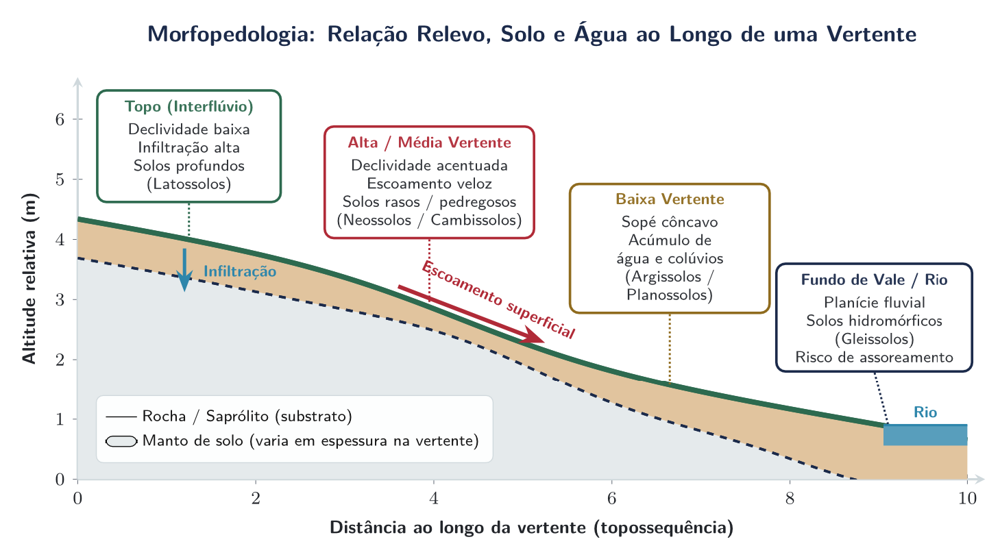
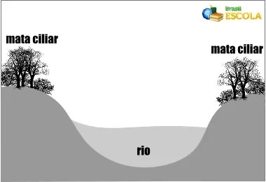

# Morfopedologia e Processos Interativos Relevo, Solo e Água {#cap:morfopedologia}

A morfopedologia interpreta as relações entre relevo, materiais, solos e circulação da água. Ao longo de uma vertente, mudanças na espessura e na organização dos horizontes alteram infiltração, fluxos laterais e estabilidade. A unidade de análise deve permitir reconhecer essas mudanças e suas conexões.

::: {.callout-note title="O que você vai aprender neste capítulo"}
O capítulo desenvolve a abordagem morfopedológica e a leitura de topossequências (catenas), o cálculo da declividade de vertentes em porcentagem e graus (em campo, em cartas topográficas e com correção de trena), o papel da cobertura vegetal e das descontinuidades hidráulicas e a diferenciação dos principais movimentos de massa em encostas.
:::

::: {.callout-tip title="Revisando o que você precisa saber"}
A leitura retoma os conceitos de vertente como subsistema da bacia hidrográfica, horizonte pedológico, textura, estrutura, porosidade, trigonometria do triângulo retângulo ($\tan\theta = \Delta h / d_h$ e $d_{\text{inc}}^2 = \Delta h^2 + d_h^2$) e conversão de escalas cartográficas ($1:E$).
:::

## A Abordagem Morfopedológica, Relevo, Solo e Água em Interação

Durante décadas, a Geomorfologia (ciência das formas de relevo) e a Pedologia (ciência dos solos) desenvolveram-se frequentemente em compartimentos separados. A **abordagem morfopedológica**, consolidada no Brasil por **Castro e Salomão (2000)**, **Casseti (2007)**, **Ross (2006)** e **Guerra (2018)** a partir das contribuições francesas de Tricart e Kilian, supera essa separação ao demonstrar que **relevo e solo evoluem simultaneamente sob a ação da água e da gravidade**.

Na Análise Ambiental aplicada, a morfopedologia parte de um princípio mecânico direto: a geometria da vertente governa o caminho da água, definindo se ela infiltra verticalmente ou escoa lateralmente, e esse regime hídrico governa a espessura, a textura, o grau de intemperismo e a estabilidade do perfil edáfico. De modo recíproco, as propriedades do solo (porosidade, coesão, profundidade e mudança textural entre horizontes) condicionam a resistência do terreno à erosão e aos deslizamentos, moldando de volta o perfil da vertente.

## Formas de Vertente e Distribuição de Solos (Topossequência)

Ao caminhar do divisor de águas até o leito do rio, o geógrafo atravessa cinco setores morfopedológicos geneticamente conectados, esquematizados na @fig-morfopedologia_vertente. No **topo plano ou suave (interflúvio)**, a baixa declividade reduz a energia do escoamento superficial e favorece ampla **infiltração vertical**; a água percola profundamente e sustenta o intemperismo químico intenso, originando solos profundos, porosos e bem drenados, como os **Latossolos** dos tabuleiros e chapadões baianos. Ao avançar para o **ombro convexo (alta vertente)**, a declividade cresce para jusante, o fluxo ganha velocidade e inicia o transporte seletivo de partículas finas por erosão laminar e rastejo, tornando os solos gradualmente menos espessos.

Na **meia encosta retilínea (média vertente)**, encontra-se o segmento mais inclinado, dominado pela transferência rápida de água e sedimentos. Como a remoção superficial aproxima-se ou supera a taxa de alteração da rocha, formam-se solos rasos, pedregosos e jovens, como **Neossolos Litólicos** e **Cambissolos**, com elevada suscetibilidade a sulcos, ravinas e escorregamentos. Ao alcançar o **sopé côncavo (baixa vertente ou pedimento)**, a declividade diminui, desacelerando os fluxos superficial e subsuperficial; a deposição de **colúvios** e a convergência de umidade favorecem **Argissolos** (com contraste textural entre os horizontes A e Bt) e **Planossolos**, frequentes nas depressões sertanejas. No **fundo de vale (planície fluvial ou várzea)**, o relevo plano junto ao canal e o lençol freático raso condicionam a deposição de aluviões, originando **Gleissolos** hidromórficos e **Neossolos Flúvicos**, compartimento sujeito a **assoreamento** quando as vertentes a montante perdem cobertura vegetal.

{#fig-morfopedologia_vertente fig-alt="Perfil esquemático de encosta do topo ao fundo de vale indicando Latossolos, Neossolos, Argissolos e Gleissolos"}

Essa organização contínua ao longo da rampa sintetiza-se também nos três terços funcionais da catena (modelo de Troeh) articulados ao balanço entre pedogênese e morfogênese de Tricart (@fig-catena_troeh). No terço superior ($0\text{ a }5\%$), a cobertura vegetal densa garante que a formação do solo supere a remoção mecânica ($P > M$), funcionando como zona prioritária de recarga hídrica. No terço médio ($12\text{ a }45\%$), o contraste hidráulico $A/Bt$ em Argissolos e a presença de Neossolos tornam a encosta vulnerável a estradas mal drenadas e cortes de talude que elevam a **poropressão ($u$)**. No terço inferior, a saturação do lençol e a deposição exigem preservação ripária e amortecimento de cheias.

{#fig-catena_troeh fig-alt="Quadro em três colunas para terço superior, médio e inferior da vertente e faixa inferior comparando regra de Tricart e ruptura por uso inadequado"}

A relação genética entre forma, declividade, dinâmica hídrica, classes pedológicas do SiBCS e fragilidade dominante consolida-se em seguida (@tbl-topossequencia).

| **Setor da Vertente** | **Forma / Declividade** | **Dinâmica Hídrica** | **Solos Típicos (SiBCS)** | **Fragilidade / Processo** |
|:---|:---|:---|:---|:---|
| Topo (interflúvio) | Plano a suave ($< 8\%$) | Infiltração vertical intensa | Latossolos (profundos) | Baixa erosão natural; sensível à compactação. |
| Ombro (alta vertente) | Convexo ($8\text{-}20\%$) | Aceleração do escoamento difuso | Latossolos e Argissolos | Erosão laminar e início de sulcos em solo exposto. |
| Meia encosta | Retilíneo íngreme ($> 20\%$) | Escoamento veloz e remoção ativa | Neossolos Litólicos e Cambissolos | Alta fragilidade, ravinas e movimentos de massa. |
| Sopé (baixa vertente) | Côncavo ($3\text{-}12\%$) | Convergência de fluxos e colúvio | Argissolos e Planossolos | Ravinas e voçorocas por fluxo subsuperficial. |
| Fundo de vale | Plano ($< 3\%$) | Saturação hídrica e inundação | Gleissolos e Neossolos Flúvicos | Assoreamento do canal e inundações sazonais. |

: Relação genética entre setores da vertente, dinâmica hídrica, classes de solos e suscetibilidade ambiental. {#tbl-topossequencia}

O Exemplo 8.1 aplica essa leitura integrada ao levantamento de campo de três segmentos sucessivos de uma vertente.

::: {.callout-tip appearance="simple"}
### Exemplo 8.1 (Básico). Declividade e Solos ao Longo de uma Topossequência

**Situação analisada.** Durante um trabalho de campo da disciplina CHF662, os estudantes levantaram três segmentos consecutivos de uma vertente: o **Topo** (desnível de $6\text{ m}$ em $300\text{ m}$ horizontais), a **Meia Encosta** (desnível de $54\text{ m}$ em $150\text{ m}$ horizontais) e o **Sopé** (desnível de $12\text{ m}$ em $200\text{ m}$ horizontais).

**Dados disponíveis.** Topo: $\Delta h = 6\text{ m}, d_h = 300\text{ m}$. Meia Encosta: $\Delta h = 54\text{ m}, d_h = 150\text{ m}$. Sopé: $\Delta h = 12\text{ m}, d_h = 200\text{ m}$.

**Problema a resolver.** Calcular a declividade em porcentagem ($S\%$) e em graus ($\theta$) de cada setor, classificá-los segundo EMBRAPA e Ross (1994) e indicar o solo esperado em cada posição.

**Fundamento da análise.** Aplicação de $S(\%) = (\Delta h / d_h)\times 100$ e $\theta = \arctan(\Delta h / d_h)$, com enquadramento pelas @tbl-topossequencia e @tbl-classes_declividade.

**Desenvolvimento.** Calculando a declividade em porcentagem e o ângulo de inclinação para cada compartimento:

$$
\begin{aligned}
S_1 &= \frac{6}{300} \times 100 = 2{,}0\%, & \theta_1 &= \arctan(0{,}02) \approx 1{,}15^\circ \quad (\text{Topo}) \\
S_2 &= \frac{54}{150} \times 100 = 36{,}0\%, & \theta_2 &= \arctan(0{,}36) \approx 19{,}80^\circ \quad (\text{Meia encosta}) \\
S_3 &= \frac{12}{200} \times 100 = 6{,}0\%, & \theta_3 &= \arctan(0{,}06) \approx 3{,}43^\circ \quad (\text{Sopé}).
\end{aligned}
$$

**Interpretação do resultado.** Topo: $2{,}0\%$ ($1{,}15^\circ$), Plano (EMBRAPA) e Classe 1 (Ross, Muito Fraca), com **Latossolos**. Meia Encosta: $36{,}0\%$ ($19{,}80^\circ$), Forte ondulado (EMBRAPA) e Classe 5 (Ross, Muito Forte, $>30\%$), com **Neossolos Litólicos / Cambissolos**. Sopé: $6{,}0\%$ ($3{,}43^\circ$), Suave ondulado (EMBRAPA) e Classe 2 (Ross, Fraca), com **Argissolos / Planossolos**.

**Condições de validade.** O perfil numérico reproduz o modelo da @fig-morfopedologia_vertente, combinando baixa declividade no topo (infiltração e solo profundo), salto abrupto na meia encosta (remoção e solo raso) e suavização coluvial no sopé.
:::

## Declividade da Vertente, Cálculo e Classificação (EMBRAPA e Ross)

A **declividade** quantifica a energia gravitacional atuante sobre a encosta: quanto maior a inclinação, maior a componente tangencial da gravidade que acelera o escoamento superficial e solicita o solo ao cisalhamento. Derivada da trigonometria do triângulo retângulo formado pela projeção horizontal ($d_h$) e pelo desnível vertical ($\Delta h$), a declividade fundamenta o mapeamento pedológico da EMBRAPA, a análise de fragilidade de Ross (1994) e a delimitação legal de APPs de encosta ($\theta > 45^\circ$ ou $S > 100\%$):

$$
\begin{aligned}
S(\%) &= \frac{\Delta h}{d_h} \times 100, \qquad \theta = \arctan\!\left(\frac{\Delta h}{d_h}\right) \\
d_h &= d_{\text{mapa}} \times E \quad (\text{em carta } 1:E), \qquad d_h = \sqrt{d_{\text{inc}}^2 - \Delta h^2} \quad (\text{trena inclinada}) \\
S(\%) &= 100 \cdot \tan\theta, \qquad \theta = \arctan\!\left(\frac{S}{100}\right)
\end{aligned}
$$

Nas expressões acima, $\Delta h$ e $d_h$ devem estar na mesma unidade de comprimento ($\text{m}$), $d_{\text{mapa}}$ é a distância medida na carta convertida para metros, $E$ é o denominador da escala cartográfica e $d_{\text{inc}}$ é o comprimento inclinado medido sobre a rampa. Em uma encosta que desce da cota $316\text{ m}$ para $280\text{ m}$ ao longo de $d_h = 200\text{ m}$, tem-se $\Delta h = 36\text{ m}$, $S(\%) = (36/200)\times 100 = 18{,}0\%$ e $\theta = \arctan(0{,}18) \approx 10{,}20^\circ$, correspondendo ao relevo **Ondulado** (EMBRAPA) e à **Classe 3, Média** (Ross, 1994). Um marco geométrico prático para evitar equívocos é que **uma declividade de $45^\circ$ equivale exatamente a $100\%$**, pois $\tan(45^\circ) = 1$ ($\Delta h = d_h$), razão pela qual rampas mais íngremes que $45^\circ$ ultrapassam $100\%$ (como $60^\circ \approx 173{,}2\%$).

::: {.callout-warning appearance="simple"}
### Erro 1. Achar que $100\%$ de Declividade Equivale a um Paredão Vertical de $90^\circ$

**Equívoco frequente.** Associar intuitivamente $100\%$ ao ângulo reto ($90^\circ$) e concluir que $45^\circ$ valeria $50\%$.

**Correção técnica.** Como $S(\%) = 100 \times \tan\theta$ e $\tan(45^\circ) = 1$, uma encosta de **$45^\circ$ possui exatamente $100\%$ de declividade** ($\Delta h = d_h$). Em um paredão vertical ($90^\circ$), a projeção horizontal $d_h$ tende a zero e a declividade tende ao infinito.
:::

Como os intervalos pedológicos da EMBRAPA e as classes de fragilidade de Ross (1994) adotam limiares próprios, a @tbl-classes_declividade reúne os dois enquadramentos lado a lado para consulta direta.

| **EMBRAPA ($S\%$)** | **Ângulo ($\theta^\circ$)** | **Classe EMBRAPA** | **Classe Ross (1994)** | **Implicações e Processos** |
|:---|:---|:---|:---|:---|
| $0\text{ a } 3\%$ | $0^\circ\text{ a } 1{,}7^\circ$ | Plano | $< 6\%$ ($\approx 3{,}4^\circ$): 1, Muito Fraca | Escoamento lento; predomina infiltração; risco de encharcamento. |
| $3\text{ a } 8\%$ | $1{,}7^\circ\text{ a } 4{,}6^\circ$ | Suave ondulado | $< 6\%$ (1, M. Fraca) e $6\text{ a } 12\%$ (2, Fraca) | Baixo potencial erosivo; apto à mecanização conservacionista. |
| $8\text{ a } 20\%$ | $4{,}6^\circ\text{ a } 11{,}3^\circ$ | Ondulado | $6\text{ a } 12\%$ (2, Fraca) e $12\text{ a } 20\%$ (3, Média) | Enxurrada ganha energia; exige plantio em nível e terraceamento. |
| $20\text{ a } 45\%$ | $11{,}3^\circ\text{ a } 24{,}2^\circ$ | Forte ondulado | $20\text{ a } 30\%$ (4, Forte) e $> 30\%$ (5, M. Forte) | Restrito à urbanização e culturas anuais; alta erosão linear. |
| $45\text{ a } 75\%$ | $24{,}2^\circ\text{ a } 36{,}9^\circ$ | Montanhoso | $> 30\%$: 5, Muito Forte | Preservação florestal; movimentos de massa se desmatado. |
| $> 75\%$ | $> 36{,}9^\circ$ | Escarpado | $> 30\%$: 5, Muito Forte | Escarpas abruptas; acima de $45^\circ$ ($100\%$) constitui APP legal. |

: Classes de declividade segundo a EMBRAPA e segundo Ross (1994), com correspondência em graus e processos dominantes. {#tbl-classes_declividade}

Os Exemplos 8.2 e 8.3 demonstram como obter $d_h$ e calcular a declividade tanto em cartas topográficas quanto em levantamentos de campo com trena sobre o terreno.

::: {.callout-tip appearance="simple"}
### Exemplo 8.2 (Básico e Intermediário). Cálculo de Declividade a partir de Carta Topográfica

**Situação analisada.** Em uma carta topográfica na escala $1:25.000$, duas curvas de nível de cotas $260\text{ m}$ e $320\text{ m}$ estão separadas, perpendicularmente às curvas, por uma distância na régua de $d_{\text{mapa}} = 1{,}2\text{ cm}$.

**Dados disponíveis.** Escala $1:25.000$ ($E = 25.000$); $H_1 = 260\text{ m}$; $H_2 = 320\text{ m}$; $d_{\text{mapa}} = 1{,}2\text{ cm}$.

**Problema a resolver.** Determinar a distância horizontal real ($d_h$), o desnível ($\Delta h$), a declividade em porcentagem ($S\%$) e em graus ($\theta$) e as classes segundo EMBRAPA e Ross.

**Fundamento da análise.** Conversão cartográfica ($d_h = d_{\text{mapa}} \times E$) e aplicação de $S(\%) = (\Delta h / d_h)\times 100$ e $\theta = \arctan(\Delta h / d_h)$.

**Desenvolvimento.** Convertendo a medida gráfica para metros e calculando o desnível e a declividade:

$$
\begin{aligned}
d_h &= \frac{1{,}2\text{ cm} \times 25.000}{100} = 300\text{ m} \\
\Delta h &= 320 - 260 = 60\text{ m} \\
S(\%) &= \frac{60}{300} \times 100 = 20{,}0\%, \qquad \theta = \arctan(0{,}20) \approx 11{,}31^\circ.
\end{aligned}
$$

**Interpretação do resultado.** $d_h = 300\text{ m}$, $\Delta h = 60\text{ m}$, $S = 20{,}0\%$ e $\theta \approx 11{,}31^\circ$, situando-se no limite superior de Ondulado (EMBRAPA) e início da Classe 4, Forte (Ross, 1994).

**Condições de validade.** Em escala $1:25.000$, cada $1\text{ cm}$ vale $250\text{ m}$; logo $1{,}2\text{ cm}$ equivale a $300\text{ m}$, confirmando a razão exata $60/300 = 0{,}20$ ($20\%$).
:::

Quando a medição ocorre diretamente com trena estendida sobre a rampa inclinada, torna-se obrigatório recuperar a projeção horizontal antes de dividir o desnível.

::: {.callout-tip appearance="simple"}
### Exemplo 8.3 (Intermediário). Correção de Distância Inclinada Medida com Trena em Campo

**Situação analisada.** Durante uma vistoria de encosta sem mapa detalhado, um técnico mediu com trena sobre a superfície do terreno uma rampa de comprimento inclinado $d_{\text{inc}} = 100\text{ m}$ e desnível vertical $\Delta h = 28\text{ m}$.

**Dados disponíveis.** $d_{\text{inc}} = 100\text{ m}$; $\Delta h = 28\text{ m}$.

**Problema a resolver.** Calcular a distância horizontal real ($d_h$), a declividade correta ($S\%$ e $\theta$) e o erro decorrente do uso indevido de $d_{\text{inc}}$ no lugar de $d_h$.

**Fundamento da análise.** Aplicação do Teorema de Pitágoras ($d_h = \sqrt{d_{\text{inc}}^2 - \Delta h^2}$) antes do cálculo de $S(\%)$ e $\theta$.

**Desenvolvimento.** Recuperando o cateto horizontal e calculando a declividade real:

$$
\begin{aligned}
d_h &= \sqrt{100^2 - 28^2} = \sqrt{10.000 - 784} = \sqrt{9.216} = 96{,}0\text{ m} \\
S(\%) &= \frac{28}{96} \times 100 \approx 29{,}17\%, \qquad \theta = \arctan\!\left(\frac{28}{96}\right) \approx 16{,}26^\circ.
\end{aligned}
$$

Se dividisse diretamente $28 / 100$, o técnico obteria $28{,}00\%$, subestimando a declividade em $1{,}17$ ponto percentual por calcular $\sin\theta$ em lugar de $\tan\theta$.

**Interpretação do resultado.** $d_h = 96{,}0\text{ m}$; declividade correta $S = 29{,}17\%$ e $\theta \approx 16{,}26^\circ$ (EMBRAPA Forte ondulado; Ross Classe 4, Forte, próxima ao limite da Classe 5).

**Condições de validade.** Como a hipotenusa ($d_{\text{inc}}$) supera sempre o cateto horizontal ($d_h$), omitir a correção de trena subestima sistematicamente a declividade real em encostas íngremes.
:::

::: {.callout-warning appearance="simple"}
### Erro 2. Usar a Distância Inclinada da Trena no Denominador de $S(\%)$

**Equívoco frequente.** Medir $50\text{ m}$ inclinados no terreno com trena e dividir $\Delta h$ diretamente por $50\text{ m}$.

**Correção técnica.** A definição geométrica de declividade exige a **distância horizontal ($d_h$)** no denominador ($\Delta h / d_h = \tan\theta$). Dispondo apenas da medida inclinada ($d_{\text{inc}}$), calcule $d_h = \sqrt{d_{\text{inc}}^2 - \Delta h^2}$ antes de aplicar a equação.
:::

## Cobertura Vegetal, Fluxos Subsuperficiais e Movimentos de Massa

### Papel da Cobertura Vegetal no Balanço Infiltração e Escoamento

A cobertura vegetal constitui a primeira barreira protetora da vertente contra a degradação. No estrato superior, o **dossel aéreo** intercepta parte da chuva e dissipa a energia cinética das gotas antes do impacto no terreno, evitando o salpicamento (*splash*) que quebra agregados e sela a superfície. No contato com o solo, a **serapilheira** eleva a rugosidade hidráulica e desacelera a enxurrada, ampliando o tempo de infiltração. Em subsuperfície, raízes e fauna edáfica criam **macroporosidade** contínua, enquanto a evapotranspiração reduz a poropressão ($u$) e a coesão radicular reforça o solo contra o cisalhamento.

Nos setores inferiores da vertente e nas margens dos canais, a presença contínua da mata ciliar estabiliza os taludes marginais com raízes profundas e filtra partículas vindas de montante antes que alcancem o curso d’água (@fig-mata_ciliar_protecao). Sem essa proteção, o escoamento concentrado evolui de erosão laminar para sulcos, ravinas e voçorocas (Cap. 12), exportando sedimentos que assoreiam o leito fluvial.

{#fig-mata_ciliar_protecao fig-alt="Seção transversal esquemática de rio com margens protegidas por mata ciliar preservada em ambos os lados"}

O Exemplo 8.4 quantifica a diferença nas lâminas infiltradas e escoadas sob uma mesma tormenta entre solo vegetado e solo exposto.

::: {.callout-tip appearance="simple"}
### Exemplo 8.4 (Intermediário). Efeito da Cobertura Vegetal no Balanço Infiltração vs. Escoamento

**Situação analisada.** Duas parcelas experimentais adjacentes em uma meia encosta ($S = 18\%$) receberam chuva de $80\text{ mm}$: a **Parcela 1** possui Caatinga arbóreo-arbustiva conservada com serapilheira ($85\%$ de infiltração e $15\%$ de escoamento superficial); a **Parcela 2** apresenta solo exposto após queimada e pisoteio ($25\%$ de infiltração e $75\%$ de escoamento superficial).

**Dados disponíveis.** Chuva $P = 80\text{ mm}$. Parcela 1: $85\%$ infiltração, $15\%$ escoamento. Parcela 2: $25\%$ infiltração, $75\%$ escoamento.

**Problema a resolver.** Calcular as lâminas infiltradas e escoadas (em $\text{mm}$ e em $\text{L/m}^2$), a razão entre os escoamentos e os reflexos morfopedológicos esperados.

**Fundamento da análise.** Cálculo proporcional das lâminas ($L_{\text{inf}}$ e $L_{\text{esc}}$) usando a equivalência $1\text{ mm} = 1\text{ L/m}^2$.

**Desenvolvimento.** Calculando as lâminas nas duas parcelas e a razão de escoamento:

$$
\begin{aligned}
L_{\text{inf},1} &= 0{,}85 \times 80 = 68{,}0\text{ mm} \;\; (68\text{ L/m}^2), & L_{\text{esc},1} &= 0{,}15 \times 80 = 12{,}0\text{ mm} \;\; (12\text{ L/m}^2) \\
L_{\text{inf},2} &= 0{,}25 \times 80 = 20{,}0\text{ mm} \;\; (20\text{ L/m}^2), & L_{\text{esc},2} &= 0{,}75 \times 80 = 60{,}0\text{ mm} \;\; (60\text{ L/m}^2) \\
\frac{L_{\text{esc},2}}{L_{\text{esc},1}} &= \frac{60{,}0}{12{,}0} = 5{,}0\text{ vezes}. & &
\end{aligned}
$$

**Interpretação do resultado.** Na parcela conservada infiltram $68\text{ L/m}^2$ e escoam $12\text{ L/m}^2$; no solo exposto infiltram $20\text{ L/m}^2$ e escoam $60\text{ L/m}^2$, volume superficial $5$ vezes maior.

**Condições de validade.** Em encosta de $18\%$, quintuplicar a enxurrada sem serapilheira desencadeia erosão laminar, sulcos e assoreamento no sopé, reduzindo em $70{,}6\%$ a água infiltrada para sustentar a vegetação na estiagem.
:::

### Circulação da Água e Descontinuidades na Vertente

Ao infiltrar, a água encontra horizontes pedológicos com condutividades hidráulicas distintas. Um horizonte subsuperficial mais adensado e argiloso (como o horizonte Bt em Argissolos e Planossolos) retarda a percolação vertical, gerando armazenamento temporário e **fluxo lateral subsuperficial** sobre o limite textural. Quando o relevo intercepta essa camada saturada na meia encosta ou no sopé, o fluxo aflora como surgência ou exfiltração, favorecendo erosão interna e solapamento.

A interpretação de campo exige registrar a posição do perfil na vertente e a continuidade dos horizontes por meio de cor, textura, estrutura, presença de raízes e mosqueados de redução do ferro, integrando sempre tais atributos ao material de origem. De modo paralelo, estradas vicinais abertas em encostas interceptam esse fluxo lateral e concentram a água em valetas e bueiros desprotegidos, elevando a descarga localizada muito acima da área topográfica natural original. O planejamento morfopedológico responde a esse percurso hídrico com conservação da cobertura, distribuição das descargas e proteção das saídas de drenagem, conferindo os caminhos preferenciais em campo após eventos de chuva.

### Movimentos de Massa e Fatores de Instabilidade em Encostas

Enquanto a erosão hídrica desloca partículas gradualmente pela água corrente, os **movimentos de massa** envolvem o deslocamento coletivo de elevados volumes de solo, saprólito ou rocha encosta abaixo sob ação direta da gravidade quando as tensões cisalhantes superam a resistência interna do maciço (Guerra, 2018; Varnes, 1978). Em encostas serranas e áreas urbanas declivosas da Bahia distinguem-se cinco tipos principais (@tbl-movimentos_massa).

| **Tipo de Movimento** | **Velocidade** | **Geometria / Mecanismo** | **Principais Gatilhos** | **Feições Diagnósticas** |
|:---|:---|:---|:---|:---|
| **Rastejo (*creep*)** | Muito lenta ($\text{mm}$ a $\text{cm}/\text{ano}$) | Deformação plástica contínua sem plano nítido | Ciclos de umedecimento/secagem e gravidade | Troncos encurvados na base, postes inclinados, trincas lentas. |
| **Escorregamento rotacional** | Moderada a rápida ($\text{m/h}$ a $\text{m/s}$) | Superfície de ruptura curva (em colher) | Chuvas prolongadas, poropressão, cortes no pé | Cicatriz em arco no topo, degrau de abatimento, lóbulo no pé. |
| **Escorregamento translacional** | Rápida a muito rápida ($\text{m/s}$) | Superfície de ruptura plana (contato solo/rocha) | Chuvas intensas em solos rasos de encosta íngreme | Cicatriz rasa e alongada expondo rocha ou saprólito. |
| **Corrida de lama / detritos** | Muito rápida a extrema | Fluxo viscoso saturado como fluido denso | Chuvas extremas canalizadas em vales íngremes | Canais escavados em U, blocos arrastados e leques no sopé. |
| **Queda de blocos** | Extremamente rápida | Desprendimento abrupto em paredões subverticais | Fraturamento, alívio de tensão, raízes e chuvas | Acúmulo de blocos angulosos (tálus) na base de escarpas. |

: Quadro comparativo dos principais tipos de movimentos de massa em encostas. {#tbl-movimentos_massa}

A instabilidade de uma vertente resulta da combinação entre **fatores condicionantes** (declividade elevada, solos rasos sobre rocha impermeável e fraturas inclinadas a favor do talude) e **fatores deflagradores** (chuvas intensas ou prolongadas). A ocupação urbana desordenada agrava esses fatores ao executar cortes verticais no pé da encosta que removem o apoio lateral do maciço, lançar aterros mal compactados e resíduos no topo elevando o peso solicitante, infiltrar águas servidas e fossas que elevam a poropressão ($u$) mesmo fora da estação chuvosa e suprimir a cobertura arbórea que fornecia coesão radicular.

::: {.callout-warning appearance="simple"}
### Erro 3. Confundir Escorregamento Rotacional com Escorregamento Translacional

**Equívoco frequente.** Chamar qualquer deslizamento genericamente de “desmoronamento” ou trocar os condicionantes geotécnicos de cada mecanismo.

**Correção técnica.** O **escorregamento rotacional** desenvolve superfície de ruptura curva (em colher) em mantos de solo espessos e homogêneos; o **escorregamento translacional (planar)** ocorre em solos rasos sobre substrato rochoso ou planos de fraqueza, deslizando como placa paralela à encosta.
:::

## Síntese Aplicada em Estabilidade de Encostas

A alteração artificial da geometria do talude somada ao aumento de poropressão por infiltração de águas servidas ilustra como intervenções urbanas convertem encostas estáveis em áreas de alto risco, mesmo sem atingir o limiar legal de $45^\circ$, como analisado no Exemplo 8.5.

::: {.callout-tip appearance="simple"}
### Exemplo 8.5 (Avançado). Instabilização de Encosta Urbana por Corte de Talude

**Situação analisada.** Uma encosta natural com solo argilo-arenoso espesso apresenta desnível $\Delta h = 27\text{ m}$ distribuído ao longo de $d_{h1} = 150\text{ m}$. Para implantar residências sem projeto geotécnico, executou-se um corte no sopé da vertente, concentrando os mesmos $27\text{ m}$ de desnível em $d_{h2} = 45\text{ m}$, acompanhado de lançamento de águas servidas a montante.

**Dados disponíveis.** $\Delta h = 27\text{ m}$; cenário natural $d_{h1} = 150\text{ m}$; cenário após corte $d_{h2} = 45\text{ m}$.

**Problema a resolver.** Calcular a declividade ($S\%$ e $\theta$) antes e depois do corte, verificar o limite de APP de $45^\circ$ ($100\%$) e identificar o movimento de massa mais provável.

**Fundamento da análise.** Cálculo comparativo de $S(\%)$ e $\theta$ e diagnóstico pela @tbl-movimentos_massa.

**Desenvolvimento.** Calculando as declividades natural e modificada:

$$
\begin{aligned}
S_1 &= \frac{27}{150} \times 100 = 18{,}0\%, & \theta_1 &= \arctan(0{,}18) \approx 10{,}20^\circ \quad (\text{natural}) \\
S_2 &= \frac{27}{45} \times 100 = 60{,}0\%, & \theta_2 &= \arctan(0{,}60) \approx 30{,}96^\circ \quad (\text{após corte}).
\end{aligned}
$$

Embora $30{,}96^\circ < 45^\circ$ ($60\% < 100\%$) fique abaixo do limite de APP de encosta, o talude saltou da Classe 3 de Ross (Média) para a **Classe 5 (Muito Forte, $>30\%$)** e de Ondulado para **Montanhoso (EMBRAPA)**.

**Interpretação do resultado.** A declividade mais que triplicou, passando de $18{,}0\%$ ($10{,}20^\circ$) para $60{,}0\%$ ($30{,}96^\circ$). Em solo argilo-arenoso espesso com corte no pé e saturação por águas servidas, o mecanismo mais provável é o **escorregamento rotacional**.

**Condições de validade.** Uma encosta alcança risco crítico muito abaixo de $45^\circ$ ($100\%$). O corte retira o contraforte basal do maciço enquanto as águas servidas elevam a poropressão e reduzem o atrito interno, favorecendo a ruptura curva sob chuvas prolongadas.
:::

## Armadilha Conceitual e Materiais Audiovisuais de Apoio

Mesmo dominando os cálculos de declividade e a tipologia dos movimentos de massa, um diagnóstico morfopedológico perde validade quando generaliza propriedades de um único setor para toda a vertente.

::: {.callout-warning appearance="simple"}
### Erro 4. Analisar Solo e Relevo de Forma Desarticulada no Diagnóstico

**Equívoco frequente.** Descrever o solo do topo da vertente (como um Latossolo profundo) e generalizar sua alta permeabilidade para toda a encosta, incluindo a meia vertente íngreme e o fundo de vale.

**Correção técnica.** Pela abordagem morfopedológica, variações de declividade e curvatura alteram a pedogênese e a circulação da água ao longo da topossequência. Cada compartimento (topo, ombro, meia encosta, sopé e várzea) exige caracterização e manejo próprios.
:::

Para aprofundar a relação entre intemperismo, dinâmica de vertentes e processos erosivos, assista às videoaulas selecionadas na página da disciplina. O vídeo [Geomorfologia, intemperismo e processos erosivos](https://www.youtube.com/watch?v=mEB6LE9Tjb8) articula relevo, solo e água na morfopedologia, enquanto o vídeo [Processos Erosivos e Relevo](https://www.youtube.com/watch?v=G6Q0iU_n6xI) aborda a evolução das formas de encosta e da erosão hídrica.

## Exercícios de fixação

#### Nível Básico (Exercícios 1 a 5)

1. Explique o que é uma **topossequência** na abordagem morfopedológica e descreva por que os solos do topo plano tendem a ser mais profundos do que os solos da meia encosta íngreme.

2. Uma vertente apresenta desnível vertical $\Delta h = 15\text{ m}$ em uma distância horizontal $d_h = 250\text{ m}$. Calcule sua declividade em porcentagem ($S\%$) e em graus ($\theta$) e classifique-a segundo EMBRAPA e Ross (1994).

3. Determine $S(\%)$ e $\theta$ para uma encosta com $\Delta h = 45\text{ m}$ e $d_h = 150\text{ m}$, indicando sua classe na EMBRAPA e em Ross (1994).

4. Demonstre matematicamente por que uma encosta com $\Delta h = 80\text{ m}$ e $d_h = 80\text{ m}$ corresponde ao limite legal de APP de encosta previsto no Código Florestal ($45^\circ$).

5. Em uma carta topográfica na escala $1:50.000$, duas curvas de nível separadas por um desnível $\Delta h = 40\text{ m}$ distam $0{,}8\text{ cm}$ no mapa. Calcule a distância horizontal real ($d_h$) e a declividade ($S\%$ e $\theta$).

#### Nível Intermediário (Exercícios 6 a 10)

6. Em campo, mediu-se com trena sobre a rampa uma distância inclinada $d_{\text{inc}} = 50\text{ m}$ correspondente a um desnível $\Delta h = 14\text{ m}$. Calcule a distância horizontal real ($d_h$) e a declividade correta em porcentagem e em graus.

7. Uma vertente foi dividida em três compartimentos para zoneamento agrícola:

    - **Setor A (topo):** $\Delta h = 10\text{ m}$, $d_h = 400\text{ m}$.

    - **Setor B (meia encosta):** $\Delta h = 64\text{ m}$, $d_h = 160\text{ m}$.

    - **Setor C (sopé):** $\Delta h = 20\text{ m}$, $d_h = 250\text{ m}$.

    Calcule $S(\%)$ e $\theta$ de cada setor, classifique-os segundo EMBRAPA e Ross e indique o uso mais adequado para cada compartimento.

8. Explique como a remoção da cobertura vegetal altera simultaneamente o efeito *splash*, a macroporosidade superficial e o risco de assoreamento no fundo de vale.

9. Diferencie **rastejo**, **escorregamento translacional** e **corrida de detritos** quanto à velocidade do deslocamento e às feições visíveis em campo.

10. Por que a infiltração de águas servidas (esgoto doméstico sem coleta) em encostas ocupadas pode deflagrar movimentos de massa mesmo após chuvas moderadas? Utilize o conceito de **poropressão** na sua explicação.

#### Questões Objetivas (Exercícios 11 a 15)

11. Ao longo de uma topossequência típica sobre relevo dissecado, espera-se encontrar, respectivamente, no topo plano, na meia encosta íngreme e no fundo de vale hidromórfico:

    (A) Gleissolos, Latossolos e Neossolos Litólicos.

    (B) Latossolos, Neossolos Litólicos/Cambissolos e Gleissolos.

    (C) Neossolos Litólicos, Gleissolos e Latossolos.

    (D) Planossolos, Latossolos e Neossolos Litólicos.

    (E) Cambissolos rasos, Latossolos muito profundos e Argissolos de topo.

12. Em uma carta na escala $1:25.000$, a distância medida entre a curva de nível de $210\text{ m}$ e a curva de $260\text{ m}$ é de $0{,}8\text{ cm}$. A declividade desse trecho em porcentagem e sua classe segundo a EMBRAPA são:

    (A) $12{,}5\%$, Ondulado.

    (B) $20{,}0\%$, Ondulado.

    (C) $25{,}0\%$, Forte ondulado.

    (D) $40{,}0\%$, Forte ondulado.

    (E) $50{,}0\%$, Montanhoso.

13. Em uma vistoria técnica de encosta urbana, observaram-se árvores com troncos encurvados na base, postes ligeiramente inclinados para jusante e pequenas trincas progressivas em muros ao longo de anos, sem cicatriz abrupta de ruptura. Esse conjunto de feições é diagnóstico de:

    (A) Queda de blocos.

    (B) Corrida de detritos.

    (C) Escorregamento translacional catastrófico.

    (D) Rastejo (*creep*).

    (E) Erosão por *splash*.

14. Assinale a alternativa correta sobre a relação entre declividade em graus e em porcentagem:

    (A) $45^\circ$ equivale a $50\%$, e $90^\circ$ equivale a $100\%$.

    (B) $45^\circ$ equivale a $100\%$, e encostas mais íngremes que $45^\circ$ possuem declividades maiores que $100\%$.

    (C) Nenhuma vertente natural pode ultrapassar $100\%$ de declividade.

    (D) A declividade em porcentagem é obtida multiplicando o valor em graus por $2$.

    (E) Quando $\Delta h = 0$, o ângulo é $45^\circ$.

15. Sobre os escorregamentos rotacionais e translacionais, assinale a afirmação correta:

    (A) O escorregamento rotacional apresenta superfície de ruptura curva e ocorre preferencialmente em mantos de solo espessos e homogêneos.

    (B) O escorregamento translacional ocorre apenas em terrenos perfeitamente planos ($< 3\%$).

    (C) Cortes verticais no pé de taludes estabilizam a encosta por aliviar o peso do solo.

    (D) A cobertura vegetal arbórea aumenta a poropressão positiva ao impedir a evapotranspiração.

    (E) O assoreamento do fundo de vale não possui relação com os processos erosivos das vertentes.

## Questões de aplicação

16. **(Questão autoral, estilo ENADE / Geografia)** A abordagem morfopedológica (Casseti, 2007; Ross, 2006; Guerra, 2018) supera a leitura fragmentada do meio físico ao adotar como unidade de análise a integração entre relevo, solo e água. Nessa perspectiva, a ocorrência de solos rasos e pedregosos (Neossolos Litólicos) na meia encosta retilínea e de solos profundos e bem drenados (Latossolos) no interflúvio aplainado explica-se porque:

    (A) A precipitação atmosférica incide apenas nos topos planos, não alcançando as encostas inclinadas.

    (B) No topo aplainado predomina a infiltração vertical e o intemperismo profundo (pedogênese), enquanto na meia encosta íngreme a energia do escoamento remove continuamente o manto de alteração (morfogênese).

    (C) Os Latossolos são transportados inteiros pela gravidade dos fundos de vale para os topos.

    (D) As rochas do fundo de vale são sempre mais resistentes ao intemperismo do que as do topo.

    (E) A declividade não influencia o balanço entre infiltração e escoamento superficial.

17. **(Questão autoral, estilo Concurso Perito / Analista Ambiental)** Durante um levantamento de fragilidade de encosta para licenciamento de um empreendimento linear, constatou-se que determinado trecho possui desnível vertical $\Delta h = 90\text{ m}$ em uma distância horizontal $d_h = 250\text{ m}$, com solo raso sobre substrato rochoso pouco permeável. Assinale a alternativa que apresenta corretamente a declividade ($S\%$ e $\theta$), a classificação de Ross (1994) e o movimento de massa de maior risco em caso de supressão vegetal e chuvas intensas:

    (A) $S = 36{,}0\%$; $\theta \approx 19{,}80^\circ$; Classe 5 de Ross (Muito Forte); escorregamento translacional (planar).

    (B) $S = 27{,}8\%$; $\theta \approx 15{,}50^\circ$; Classe 4 de Ross (Forte); queda livre de blocos em paredão vertical.

    (C) $S = 36{,}0\%$; $\theta \approx 19{,}80^\circ$; Classe 3 de Ross (Média); rastejo imperceptível sem risco imediato.

    (D) $S = 18{,}0\%$; $\theta \approx 10{,}20^\circ$; Classe 2 de Ross (Fraca); erosão eólica dominante.

    (E) $S = 90{,}0\%$; $\theta \approx 42{,}00^\circ$; Classe 5 de Ross (Muito Forte); subsidência cárstica.

18. **(Questão autoral, estilo Concurso Defesa Civil / Geologia e Geografia Ambiental)** Em áreas urbanas brasileiras construídas sobre encostas de declividade acentuada, a prevenção de desastres por movimentos de massa requer intervenções integradas. Entre as medidas abaixo, aquela que **REDUZ efetivamente** a instabilidade da encosta é:

    (A) Executar cortes subverticais na base da encosta para ampliar lotes residenciais.

    (B) Substituir a drenagem superficial por fossas negras infiltrando água diretamente no talude.

    (C) Implantar sistema eficiente de drenagem pluvial e coleta de esgoto, evitar cortes e aterros sem contenção e manter ou recompor cobertura vegetal adaptada com técnicas de bioengenharia.

    (D) Depositar entulho e solo solto sobre o ombro convexo da vertente para nivelar o terreno.

    (E) Remover toda a vegetação de raízes profundas e expor o solo mineral ao sol para acelerar o ressecamento.

### Articulação Direta com o Capítulo 9 e com o Diagnóstico Final

Os cinco patamares de declividade de Ross ($<6\%$, $6\text{-}12\%$, $12\text{-}20\%$, $20\text{-}30\%$ e $>30\%$) e o reconhecimento dos tipos de solo da topossequência estudados neste capítulo constituem os dois primeiros pilares da **Análise Empírica da Fragilidade Ambiental de Ross (1994)**, aplicada integralmente no Capítulo 9.

## Gabarito comentado {.unnumbered}

::: {.callout-tip collapse="true" title="Clique para abrir o Gabarito Comentado"}
### Resoluções e Justificativas, Capítulo 8

1. **Topossequência.** É a sucessão ordenada de solos que varia do topo ao fundo de vale em uma mesma vertente. No topo plano, a baixa declividade favorece a infiltração vertical e a permanência do manto de intemperismo (gerando solos profundos como Latossolos); na meia encosta íngreme, a alta velocidade do escoamento remove continuamente partículas superficiais, mantendo os solos rasos e jovens (Neossolos Litólicos/Cambissolos).

2. **Cálculo.** $S = (15 / 250) \times 100 = 0{,}06 \times 100 = \mathbf{6{,}0\%}$; $\theta = \arctan(0{,}06) \approx \mathbf{3{,}43^\circ}$. EMBRAPA: Suave ondulado ($3\text{-}8\%$); Ross: Classe 2, Fraca ($6\text{-}12\%$).

3. **Cálculo.** $S = (45 / 150) \times 100 = 0{,}30 \times 100 = \mathbf{30{,}0\%}$; $\theta = \arctan(0{,}30) \approx \mathbf{16{,}70^\circ}$. EMBRAPA: Forte ondulado ($20\text{-}45\%$); Ross: limite superior da Classe 4, Forte ($20\text{-}30\%$).

4. **Demonstração.** $S = (80 / 80) \times 100 = 1{,}0 \times 100 = \mathbf{100{,}0\%}$ e $\theta = \arctan(1{,}0) = \mathbf{45{,}0^\circ}$. Como a Lei nº 12.651/2012 define como APP as encostas ou partes destas com declividade superior a $45^\circ$ (equivalente a $100\%$ na linha de maior declive), esse valor representa exatamente o limiar legal.

5. **Carta $1:50.000$.** $d_h = 0{,}8\text{ cm} \times 50.000 = 40.000\text{ cm} = \mathbf{400\text{ m}}$. Declividade: $S = (40 / 400) \times 100 = \mathbf{10{,}0\%}$; $\theta = \arctan(0{,}10) \approx \mathbf{5{,}71^\circ}$ (EMBRAPA: Ondulado; Ross: Classe 2, Fraca).

6. **Correção de trena.** $d_h = \sqrt{50^2 - 14^2} = \sqrt{2.500 - 196} = \sqrt{2.304} = \mathbf{48{,}0\text{ m}}$. Declividade correta: $S = (14 / 48) \times 100 \approx \mathbf{29{,}17\%}$; $\theta = \arctan(14 / 48) \approx \mathbf{16{,}26^\circ}$.

7. **Zoneamento dos três setores.** No **Setor A**, $S = (10 / 400)\times 100 = \mathbf{2{,}5\%}$ ($\theta \approx 1{,}43^\circ$), Plano / Ross 1 (Muito Fraca), apto à agricultura mecanizada com manejo conservacionista. No **Setor B**, $S = (64 / 160)\times 100 = \mathbf{40{,}0\%}$ ($\theta \approx 21{,}80^\circ$), Forte ondulado / Ross 5 (Muito Forte), recomendado para conservação e preservação florestal. No **Setor C**, $S = (20 / 250)\times 100 = \mathbf{8{,}0\%}$ ($\theta \approx 4{,}57^\circ$), limite Suave ondulado / Ross 2 (Fraca), adequado ao uso agrícola ou pastagem manejada com curvas de nível e atenção à drenagem do sopé.

8. **Cobertura vegetal e assoreamento.** Sem o dossel e a serapilheira, as gotas de chuva impactam diretamente o solo (*splash*), quebram agregados e entopem os macroporos superficiais (selamento). A infiltração cai e o escoamento superficial cresce, removendo sedimentos que descem a vertente e se depositam no fundo de vale, assoreando o canal fluvial.

9. **Diferenciação.** *Rastejo* é muito lento ($\text{mm-cm/ano}$), evidenciado por troncos encurvados e cercas inclinadas; *escorregamento translacional* é rápido ($\text{m/s}$), formando cicatrizes planas e rasas paralelas à encosta; *corrida de detritos* é muito rápida a extremamente rápida, comportando-se como fluido denso que escava canais e forma espessos leques de lama e blocos no sopé.

10. **Águas servidas e poropressão.** O lançamento contínuo de esgoto e águas servidas mantém o solo do talude saturado ou próximo da saturação, elevando a **poropressão ($u$)**. Essa pressão da água nos poros empurra os grãos uns para longe dos outros, reduzindo a tensão efetiva e o atrito interno; assim, mesmo uma chuva moderada já é suficiente para romper o equilíbrio mecânico da encosta.

11. **Gabarito (B).** Sequência clássica da topossequência: Latossolos no topo aplainado, Neossolos Litólicos/Cambissolos na meia encosta íngreme e Gleissolos no fundo de vale hidromórfico.

12. **Gabarito (C).** $d_h = 0{,}8\text{ cm} \times 25.000 = 20.000\text{ cm} = 200\text{ m}$; $\Delta h = 260 - 210 = 50\text{ m}$; $S = (50 / 200)\times 100 = 25{,}0\%$ (EMBRAPA: Forte ondulado, faixa de $20\text{-}45\%$).

13. **Gabarito (D).** Deformação lenta e contínua com encurvamento da base de árvores e inclinação de postes e muros caracteriza classicamente o rastejo (*creep*).

14. **Gabarito (B).** Como $S(\%) = 100\cdot\tan\theta$, tem-se $45^\circ \leftrightarrow 100\%$, e para $\theta > 45^\circ$ resulta $S > 100\%$.

15. **Gabarito (A).** Superfície de ruptura curva em solos mais espessos define o escorregamento rotacional. As demais invertem princípios geotécnicos e hidrológicos básicos.

16. **Gabarito (B).** A abordagem morfopedológica demonstra que a baixa declividade no topo privilegia a infiltração e a pedogênese (solos profundos), enquanto a elevada declividade da meia encosta intensifica o escoamento e a morfogênese (solos rasos).

17. **Gabarito (A).** $S = (90 / 250)\times 100 = 36{,}0\%$; $\theta = \arctan(0{,}36) \approx 19{,}80^\circ$. Como $36{,}0\% > 30\%$, enquadra-se na Classe 5 de Ross (Muito Forte). Em solo raso sobre substrato rochoso pouco permeável sob alta declividade, o mecanismo típico de ruptura é o escorregamento translacional (planar) ao longo do contato entre solo e rocha.

18. **Gabarito (C).** Drenagem adequada controla a poropressão; evitar cortes e aterros preserva a geometria de equilíbrio; e a cobertura vegetal com bioengenharia acrescenta proteção superficial e coesão radicular.
:::

## Síntese conceitual {.unnumbered}

::: {.callout-important title="Síntese Conceitual do Capítulo"}
A **morfopedologia** integra formas de relevo, solos e dinâmica hídrica em **topossequências** (topo com Latossolos profundos, meia encosta com Neossolos e Cambissolos rasos, sopé coluvial com Argissolos e Planossolos, e fundo de vale com Gleissolos). A declividade calcula-se por:

$$
\begin{aligned}
S(\%) &= \frac{\Delta h}{d_h} \times 100, & \theta &= \arctan\!\left(\frac{\Delta h}{d_h}\right), & 45^\circ &\equiv 100\%
\end{aligned}
$$

Em cartas ($1:E$), $d_h = d_{\text{mapa}} \times E$; em medições de trena inclinada, $d_h = \sqrt{d_{\text{inc}}^2 - \Delta h^2}$. As classes de declividade de Ross variam de $<6\%$ (1) até $>30\%$ (5), enquanto os movimentos de massa abrangem rastejo, escorregamento rotacional, escorregamento translacional, corrida de detritos e queda de blocos.
:::

## Autoavaliação {.unnumbered}

::: {.callout-caution title="Autoavaliação e Checkpoint"}
Responda rapidamente (**V** ou **F**) e confira no gabarito abaixo:

1. ( ) Em uma topossequência típica, a meia encosta íngreme apresenta maior taxa de infiltração e solos mais profundos do que o topo plano.

2. ( ) Uma encosta com desnível $\Delta h = 30\text{ m}$ e distância horizontal $d_h = 100\text{ m}$ tem declividade de $30\%$ ($\approx 16{,}7^\circ$).

3. ( ) Uma rampa de $45^\circ$ corresponde a uma declividade de $100\%$, pois $\Delta h = d_h$.

4. ( ) A infiltração de águas servidas em encostas ocupadas eleva a poropressão e reduz a resistência ao cisalhamento do solo, favorecendo escorregamentos.

**Gabarito da verificação da aprendizagem.** 1-**F** (ocorre o inverso, topo plano tem mais infiltração e solos profundos); 2-**V**; 3-**V**; 4-**V**.
:::
