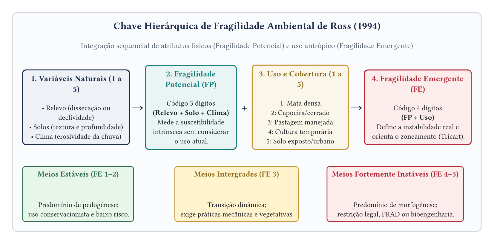

# Geossistemas, Ecodinâmica e Análise Empírica da Fragilidade Ambiental {#cap:geossistemas_fragilidade}

Geossistemas e ecodinâmica oferecem formas de interpretar a organização e a transformação das unidades ambientais. A análise de fragilidade acrescenta uma síntese das condições que favorecem processos degradacionais, dependendo da explicação dos critérios e da verificação dos processos no território.

::: {.callout-note title="O que você vai aprender neste capítulo"}
O capítulo desenvolve a interpretação dos meios ecodinâmicos, a taxonomia da paisagem de Bertrand e a construção de sínteses de fragilidade pelo método de Ross (1994). O estudante deve reconhecer a natureza ordinal das classes e justificar como relevo, solo, clima e cobertura influenciam a suscetibilidade observada.
:::

::: {.callout-tip title="Revisando o que você precisa saber"}
A leitura retoma formação do solo, mobilização de materiais, cobertura vegetal e dinâmica de vertentes. Pedogênese e morfogênese interagem durante períodos distintos, enquanto intervenções humanas podem modificar rapidamente as condições de proteção e circulação da água.
:::

## Vocabulário Técnico e Símbolos do Capítulo 9

Um **sistema (Bertalanffy, 2010)** corresponde a um conjunto de elementos interdependentes em interação dinâmica, organizado como totalidade funcional capaz de receber entradas (*inputs*), processá-las e emitir saídas (*outputs*). Na escala geográfica, o **geossistema (Bertrand, 2004)** designa uma unidade espacial homogênea resultante da combinação dinâmica entre potencial ecológico (clima, relevo, hidrologia), exploração biológica (vegetação, solo, fauna) e ação antrópica, subdividindo-se em **geofácies** (setor fisionomicamente homogêneo, como uma encosta de Caatinga conservada) e em **geótopo** (menor unidade espacial, como uma ravina ou afloramento rochoso).

Para diagnosticar o estado dinâmico dessas unidades, a **Ecodinâmica (Tricart, 1977)** avalia o balanço entre processos de remoção e erosão (**morfogênese**) e processos de formação de solo (**pedogênese**). Operacionalmente, a **Fragilidade Potencial ($FP$)** expressa a suscetibilidade natural intrínseca do ambiente à degradação e à erosão, determinada pelos fatores físicos ($D_R$, Relevo/Declividade; $D_S$, Solos; $D_C$, Clima/Pluviosidade), ao passo que a **Fragilidade Emergente ($FE$)** traduz a fragilidade real atual, obtida pelo cruzamento de $FP$ com o grau de proteção conferido pelo Uso da Terra e Cobertura Vegetal ($D_U$). Essa informação é sintetizada no **Código Numérico de Ross**, notação posicional formada pelos dígitos das classes de $1$ a $5$, com três dígitos para $FP$ ($D_R D_S D_C$) e quatro dígitos para $FE$ ($D_R D_S D_C D_U$), acompanhada da classe síntese ($1$ a $5$).

## Teoria Geral dos Sistemas (Bertalanffy, 2010) na Análise Ambiental

Até meados do século XX, grande parte das ciências naturais operava de modo analítico-reducionista, isolando o solo da rocha, a vegetação do clima e o rio das encostas. Ao formular a **Teoria Geral dos Sistemas (TGS)**, o biólogo **Ludwig von Bertalanffy (2010)** indicou que sistemas complexos exigem compreensão para além da soma de suas partes isoladas, pois suas propriedades estruturais emergem das **relações e interações** entre os componentes.

Na Análise Ambiental, a adoção da TGS traduz-se em quatro princípios operacionais articulados. Pelo princípio da **totalidade e interdependência**, alterar qualquer componente, como remover a cobertura vegetal de uma encosta, modifica imediatamente a infiltração, o escoamento superficial, a temperatura do solo, a erosão e o regime de sedimentos do rio a jusante. Paisagens e bacias hidrográficas operam como **sistemas abertos e de fluxos contínuos**, recebendo energia solar e precipitação (*inputs*), transformando esses fluxos internamente e exportando água, sedimentos, calor e nutrientes (*outputs*). Sob condições conservadas, esses sistemas mantêm um **equilíbrio dinâmico (homeostase)** próximo a um estado estacionário graças a mecanismos de autorregulação (*feedback* negativo), mas quando perturbações antrópicas ultrapassam a capacidade de suporte, instala-se a retroalimentação positiva e a degradação acelera-se. Dessa interação conjunta nasce a **propriedade emergente**, razão pela qual a **fragilidade ambiental** resulta da combinação simultânea entre os fatores físicos e o uso humano da terra.

## Geossistema, Taxonomia da Paisagem e Compartimentação Geoambiental

Inspirado na TGS e na escola russo-soviética (Sochava), o geógrafo francês **Georges Bertrand (2004)** propôs o conceito de **geossistema** como unidade analítica para a Geografia Física integrada. Enquanto o ecossistema privilegia as relações tróficas biológicas em escalas variáveis, o **geossistema constitui uma unidade territorial concreta**, situada em uma escala definida (da ordem de alguns quilômetros quadrados a centenas de quilômetros quadrados), onde interagem três conjuntos de forças. O **Potencial Ecológico** fornece a base abiótica formada por geologia, geomorfologia, clima e hidrologia; a **Exploração Biológica** reúne vegetação, solos e fauna que colonizam e protegem essa base; e a **Ação Antrópica** expressa a organização socioeconômica, o uso da terra e as intervenções técnicas que transformam ou conservam o conjunto.

Para evitar a confusão entre escalas regionais e locais (a falácia de escala examinada no Capítulo 6), Bertrand (2004) estruturou uma **taxonomia hierárquica da paisagem** em seis níveis, organizados das unidades superiores (zonais e estruturais) às unidades inferiores (dinâmicas e locais), permitindo situar com rigor desde grandes domínios morfoclimáticos até feições erosivas de detalhe (@tbl-taxonomia_bertrand).

| **Unidade** | **Ordem (Escala G)** | **Escala Cartográfica** | **Critério Definidor Principal** | **Exemplo no Brasil / Semiárido** |
|:---|:---|:---|:---|:---|
| 1. Zona (*Superior*) | $G\text{I}$ ($>10^7\text{ km}^2$) | $< 1:10.000.000$ | Grandes faixas climáticas planetárias | Zona Intertropical. |
| 2. Domínio (*Superior*) | $G\text{II}$ ($10^6\text{ km}^2$) | $1:5.000.000$ | Macroestrutura climática, relevo e bioma | Domínio das Caatingas / Depressões Sertanejas. |
| 3. Região Natural (*Superior*) | $G\text{III}$ a $G\text{IV}$ | $1:1.000.000$ | Compartimento geomorfológico e clima regional | Piemonte da Diamantina / Bacia do Rio Jacuípe. |
| 4. Geossistema (*Inferior*) | $G\text{V}$ ($10^1\text{-}10^2\text{ km}^2$) | $1:50.000$ a $1:100.000$ | Combinação potencial ecológico + exploração biológica + antrópica | Geossistema da Serra de São José (Feira de Santana/BA) ou Sub-bacia do Vaza-Barris. |
| 5. Geofácies (*Inferior*) | $G\text{VI}$ ($10^{-1}\text{-}10^0\text{ km}^2$) | $1:10.000$ a $1:25.000$ | Fisionomia homogênea de relevo, solo e cobertura vegetal | Meia encosta com Caatinga arbustiva raleada sobre Neossolo Litólico. |
| 6. Geótopo (*Inferior*) | $G\text{VII}$ ($<10^{-2}\text{ km}^2$) | $> 1:5.000$ | Microunidade de detalhe extremo e microclima próprio | Parede de voçoroca ativa, lajedo ou talude rodoviário. |

: Taxonomia hierárquica da paisagem segundo Bertrand (2004) e articulação escalar (Rodriguez; Silva; Cavalcanti, 2017). {#tbl-taxonomia_bertrand}

Na prática da Análise Ambiental no Brasil, **Rodriguez, Silva e Cavalcanti (2017)** avançam da taxonomia descritiva para a **compartimentação geoambiental**. Compartimentar significa delimitar sobre o mapa **unidades geoambientais** relativamente homogêneas quanto à sua gênese, morfologia, pedologia, drenagem e uso atual, de modo que cada compartimento receba diretrizes próprias de conservação, recuperação ou uso produtivo no ordenamento territorial. O Exemplo 9.1 mostra como enquadrar recortes territoriais de diferentes extensões na taxonomia de Bertrand.

::: {.callout-tip appearance="simple"}
### Exemplo 9.1 (Básico). Enquadramento na Taxonomia da Paisagem de Bertrand

**Situação analisada.** Uma equipe de Análise Ambiental da UEFS está diagnosticando processos erosivos em uma propriedade rural próxima a Feira de Santana (BA). Durante o trabalho, os estudantes precisam situar espacialmente quatro recortes distintos, correspondentes ao Domínio das Caatingas (I), à sub-bacia do Rio Jacuípe na escala $1:100.000$ (II), a uma vertente homogênea de pastagem sobre Argissolo em $1:15.000$ (III) e a uma voçoroca ativa com $40\,\text{m}$ de comprimento em $1:1.000$ (IV).

**Dados disponíveis.** Quatro recortes espaciais com escalas variando de continental e regional ($G\text{II}$) até o detalhe local ($G\text{VII}$).

**Problema a resolver.** Enquadrar corretamente cada recorte (I a IV) nas unidades taxonômicas de Bertrand (2004).

**Fundamento da análise.** Aplicação direta da @tbl-taxonomia_bertrand (unidades superiores e inferiores segundo ordem de grandeza e critério definidor).

**Desenvolvimento.** O **Recorte I** (Domínio das Caatingas) opera em escala regional e subcontinental ($G\text{II}$, $\sim 10^6\text{ km}^2$) definida por macroclima e bioma, correspondendo ao **Domínio**. O **Recorte II** (Sub-bacia em $1:100.000$) constitui unidade funcional concreta ($G\text{V}$, dezenas a centenas de $\text{km}^2$) que integra potencial ecológico, exploração biológica e ação antrópica, caracterizando um **Geossistema**. O **Recorte III** (Vertente homogênea em $1:15.000$) representa setor fisionomicamente uniforme dentro do geossistema ($G\text{VI}$), enquadrando-se como **Geofácies**. O **Recorte IV** (Voçoroca de $40\,\text{m}$ em $1:1.000$) define a menor unidade espacial de detalhe extremo ($G\text{VII}$), correspondendo a um **Geótopo**.

**Interpretação do resultado.** I = Domínio; II = Geossistema; III = Geofácies; IV = Geótopo.

**Condições de validade.** A sequência segue exatamente a ordem decrescente de grandeza espacial da taxonomia de Bertrand ($G\text{II} \to G\text{V} \to G\text{VI} \to G\text{VII}$), evitando misturar unidades regionais com feições pontuais de campo.
:::

## Ecodinâmica de Tricart (1977), Balanço Morfogênese vs. Pedogênese

Enquanto Bertrand organizou a paisagem em níveis espaciais, o geomorfólogo francês **Jean Tricart (1977)** propôs classificar os ambientes segundo o seu **grau de estabilidade dinâmica**. O critério central da **Ecodinâmica** reside no balanço energético entre dois processos opostos que atuam simultaneamente em qualquer vertente. De um lado, a **pedogênese** reúne os processos físicos, químicos e biológicos que promovem o intemperismo das rochas, a infiltração da água e a formação ou espessamento dos horizontes do solo; de outro, a **morfogênese** agrupa os processos erosivos, gravitacionais e de escoamento que removem partículas da superfície, rebaixam o manto de alteração e modelam o relevo.

A partir dessa competição contínua, Tricart (1977) estabelece **três grandes tipos de meios ecodinâmicos** (@tbl-ecodinamica_tricart). Nos **meios estáveis**, a cobertura vegetal densa e o relevo suave permitem que a infiltração domine o balanço hídrico, de modo que a pedogênese supera amplamente a morfogênese ($P \gg M$). Nos **meios intergrades (ou de transição)**, instala-se um equilíbrio dinâmico tenso ($P \approx M$), no qual a infiltração e o escoamento superficial competem continuamente, tornando o ambiente suscetível a desequilíbrios rápidos caso o manejo seja inadequado. Já nos **meios fortemente instáveis**, a combinação de declividades acentuadas, solos rasos ou expostos e chuvas concentradas faz a morfogênese predominar francamente sobre a pedogênese ($M \gg P$), disparando erosão linear e movimentos de massa.

| **Meio Ecodinâmico** | **Balanço Morfogênese vs. Pedogênese** | **Características Típicas** | **Manejo e Fragilidade** |
|:---|:---|:---|:---|
| **Meios Estáveis** | **Pedogênese supera amplamente a morfogênese** ($P \gg M$) | Cobertura vegetal densa e contínua; relevo suave ou plano; solos profundos (Latossolos); dissecação incipiente; ausência de erosão acelerada. | Baixa fragilidade natural. Suportam uso agrícola tecnificado com práticas conservacionistas preventivas; o desmatamento pode romper a estabilidade. |
| **Meios Intergrades (de Transição)** | **Equilíbrio dinâmico tenso** ($P \approx M$) | Interferência permanente entre infiltração/pedogênese e escoamento/morfogênese; vertentes moderadamente inclinadas ou áreas com vegetação rala ou alterada. | Suscetíveis a desequilíbrios rápidos se manejados sem critério. Exigem práticas rigorosas de conservação do solo (curvas de nível, cobertura morta, manejo de pastagem). |
| **Meios Fortemente Instáveis** | **Morfogênese predomina francamente** ($M \gg P$) | Declividades elevadas ($>20\text{-}30\%$); solos rasos (Neossolos Litólicos) ou expostos; clima agressivo/torrencial; ocorrência de ravinas, voçorocas ou movimentos de massa. | Máxima restrição ao uso intensivo. Prioridade absoluta para preservação, bioengenharia de solos, controle de drenagem e recuperação ambiental. |

: Classificação ecodinâmica dos ambientes segundo Tricart (1977) e implicações para o planejamento. {#tbl-ecodinamica_tricart}

Essa leitura qualitativa do balanço entre pedogênese e morfogênese fornece a base conceitual direta para a operacionalização cartográfica em classes hierárquicas (@fig-ecodinamica_ross). Enquanto o painel (a) expressa o contínuo dinâmico proposto por Tricart, o painel (b) mostra como a Matriz de Fragilidade Emergente de Ross cruza a suscetibilidade física com a proteção do uso da terra para classificar o risco real de degradação.

{#fig-ecodinamica_ross}

O Exemplo 9.2 aplica essa classificação ecodinâmica a três compartimentos contrastantes observados em uma sub-bacia do Piemonte da Chapada Diamantina.

::: {.callout-tip appearance="simple"}
### Exemplo 9.2 (Básico-Intermediário). Diagnóstico Ecodinâmico de Tricart em Três Setores de Sub-bacia {#09-geossistemas-ecodinamica-ross-exemplo-9.2.-diagnóstico-ecodinâmico-de-tricart-em-três-setores-de-sub-bacia-nível-básicointermediário}

**Situação analisada.** Ao percorrer uma sub-bacia do Piemonte da Chapada Diamantina, um geógrafo observou três compartimentos distintos. O **Setor X** compreende chapada plana com vegetação arbórea conservada, Latossolo profundo e ausência de sulcos; o **Setor Y** corresponde a rampa suave ($9\%$) com pastagem manejada, onde ocorrem infiltração moderada e leve escoamento laminar após chuvas fortes; e o **Setor Z** abrange encosta íngreme ($35\%$) desmatada, com Neossolo Litólico raso, ravinas profundas e blocos rolados.

**Dados disponíveis.** Setor X (plano, florestado, solo profundo); Setor Y ($S=9\%$, pastagem, erosão laminar leve); Setor Z ($S=35\%$, desmatado, solo raso, ravinas).

**Problema a resolver.** Classificar cada setor segundo a Ecodinâmica de Tricart (1977), explicando o balanço morfogênese versus pedogênese.

**Fundamento da análise.** Comparação dos processos dominantes com os critérios da @tbl-ecodinamica_tricart e do painel (a) da @fig-ecodinamica_ross.

**Desenvolvimento.** No **Setor X**, a cobertura arbórea e o relevo plano maximizam a infiltração e o intemperismo químico profundo, bloqueando a erosão superficial ($P \gg M$), o que caracteriza um **Meio Estável**. No **Setor Y**, há competição equilibrada entre infiltração sob pastagem e remoção laminar nas chuvas intensas ($P \approx M$), definindo um **Meio Intergrade (de Transição)**. No **Setor Z**, a alta declividade aliada à remoção da vegetação dispara erosão linear e perda acelerada de solo ($M \gg P$), enquadrando-o como **Meio Fortemente Instável**.

**Interpretação do resultado.** Setor X = Meio Estável; Setor Y = Meio Intergrade; Setor Z = Meio Fortemente Instável.

**Condições de validade.** O diagnóstico orienta diretamente a gestão, pois no Setor Z a prioridade recai sobre contenção erosiva e revegetação, enquanto no Setor Y o manejo conservacionista impede a migração do meio intergrade para a instabilidade forte.
:::

Na aplicação dessa tipologia, um equívoco recorrente consiste em supor que setores classificados como de transição encontram-se livres de degradação acelerada, conforme detalhado no alerta a seguir.

::: {.callout-warning appearance="simple"}
### Erro 1, Tratar “Meio Intergrade” como Sinônimo de “Meio Sem Risco”

**Equívoco frequente.** Concluir que ambientes intergrades de Tricart são estáveis e dispensam práticas de manejo.

**Correção técnica.** O meio intergrade constitui uma **zona de transição dinâmica** ($P \approx M$). Basta uma intervenção inadequada (queimada, sobrepastejo ou corte de talude) para que a morfogênese supere a pedogênese e o setor passe rapidamente a fortemente instável.
:::

## Análise Empírica da Fragilidade Ambiental (Ross, 1994)

Na década de 1990, o geógrafo brasileiro **Jurandyr Luciano Sanches Ross (1994)** operacionalizou os princípios dos Geossistemas e da Ecodinâmica de Tricart em uma metodologia cartográfica e quantitativa padronizada, denominada **Análise Empírica da Fragilidade dos Ambientes Naturais e Antropizados**. Para manter a coerência com Tricart, Ross adotou as categorias de **Unidades Ecodinâmicas Estáveis** e **Unidades Ecodinâmicas de Instabilidade Potencial ou Emergente**, classificadas em **cinco graus hierárquicos**,

$$
1 = \text{Muito Fraca} \quad;\quad 2 = \text{Fraca} \quad;\quad 3 = \text{Média} \quad;\quad 4 = \text{Forte} \quad;\quad 5 = \text{Muito Forte}.
$$

A metodologia separa analiticamente a base física natural do efeito modificador das atividades humanas (@fig-ross-hierarquia). Na primeira etapa, a **Fragilidade Potencial ($FP$)** expressa a suscetibilidade *natural e intrínseca* do terreno antes de considerar a vegetação atual, combinando exclusivamente os fatores do meio físico, isto é, **Relevo/Declividade ($D_R$)**, **Solos ($D_S$)** e **Clima/Pluviosidade ($D_C$)**. Essa métrica responde quão vulnerável o terreno seria caso perdesse sua cobertura vegetal. Na etapa seguinte, a **Fragilidade Emergente ($FE$)** traduz a suscetibilidade *real e atual* do ambiente, resultando do cruzamento entre a **Fragilidade Potencial ($FP$)** e o grau de proteção oferecido pelo **Uso da Terra e Cobertura Vegetal ($D_U$)**, permitindo vincular diretamente as classes obtidas aos meios estáveis ($FE$ 1-2), intergrades ($FE$ 3) e fortemente instáveis ($FE$ 4-5) de Tricart.

{#fig-ross-hierarquia fig-alt="Fluxograma horizontal em quatro blocos mostrando Variáveis Naturais (1 a 5), Fragilidade Potencial (FP), Uso e Cobertura (1 a 5) e Fragilidade Emergente (FE), conectados abaixo aos Meios Estáveis, Intergrades e Fortemente Instáveis"}

### Critérios das Cinco Classes Hierárquicas de Ross (1994)

Em estudos de detalhe (microbacias e municípios, escalas de $1:10.000$ a $1:50.000$), adota-se a **declividade ($S\%$)** como indicador do relevo, enquanto em estudos regionais (escalas menores que $1:100.000$) utilizam-se os índices de dissecação do relevo baseados no entalhamento de vales e na dimensão interfluvial. Esses critérios físicos para relevo e solos encontram-se sistematizados na @tbl-ross_relevo_solos.

| **Classe / Grau** | **Declividade ($D_R$)** | **Dissecação Regional ($D_R$)** | **Classes de Solos / Erodibilidade ($D_S$)** |
|:---|:---|:---|:---|
| **1, Muito Fraca** | $< 6\%$ | Muito fraca (vales muito rasos, interflúvios amplos) | Latossolos Roxos e Vermelho-Escuros de textura argilosa (muito profundos e bem estruturados). |
| **2, Fraca** | $6\text{ a } 12\%$ | Fraca (entalhamento e densidade baixos) | Latossolos Vermelho-Amarelos de textura média/argilosa; Nitossolos profundos. |
| **3, Média** | $12\text{ a } 20\%$ | Média (vertentes moderadamente dissecadas) | Latossolos Amarelos/Vermelho-Amarelos arenosos; Argissolos profundos; Cambissolos profundos. |
| **4, Forte** | $20\text{ a } 30\%$ | Forte (vales entalhados e interflúvios estreitos) | Argissolos com mudança textural abrupta; Planossolos (comuns no Semiárido); Cambissolos rasos/siltosos. |
| **5, Muito Forte** | $> 30\%$ | Muito forte (escarpas, vales muito profundos) | Neossolos Litólicos (solos rasos sobre rocha), Neossolos Quartzarênicos (areias quartzosas), Gleissolos e Organossolos em áreas instáveis. |

: Classes hierárquicas de fragilidade para Relevo/Declividade ($D_R$) e Solos ($D_S$) segundo Ross (1994). {#tbl-ross_relevo_solos}

Definidos os graus de vulnerabilidade intrínseca do relevo e dos solos na @tbl-ross_relevo_solos, o analista incorpora a agressividade climática (erosividade das chuvas) e o efeito protetor ou degradante da cobertura vegetal por meio dos critérios da @tbl-ross_clima_uso. Em todas as quatro variáveis, a escala numérica de $1$ a $5$ acompanha o sentido crescente da fragilidade, atribuindo grau $1$ às condições mais resistentes ou protegidas e grau $5$ às mais suscetíveis ou expostas.

| **Classe / Grau** | **Clima / Pluviosidade ($D_C$, Erosividade)** | **Uso da Terra / Cobertura Vegetal ($D_U$, Grau de Proteção)** |
|:---|:---|:---|
| **1, Muito Fraca** | Pluviosidade regular ao longo do ano, baixa intensidade horária, sem concentração extrema. | **Proteção Muito Alta.** Florestas naturais primárias, matas ciliares densas e Caatinga arbórea fechada. |
| **2, Fraca** | Precipitação moderada ($1.000\text{-}1.300\text{ mm/ano}$) com estação seca curta e chuvas pouco torrenciais. | **Proteção Alta.** Florestas secundárias avançadas (capoeirões), Caatinga arbustivo-arbórea densa, silvicultura bem manejada. |
| **3, Média** | Estação seca definida ($3\text{-}6$ meses) e chuvas concentradas no verão/outono com eventos erosivos moderados. | **Proteção Média.** Pastagens bem manejadas com boa cobertura, sistemas agroflorestais (SAFs), culturas perenes (café, cacau em cabruca). |
| **4, Forte** | Forte concentração pluviométrica sazonal (ou totais $>2.000\text{ mm/ano}$ com aguaceiros intensos). | **Proteção Baixa.** Culturas temporárias de ciclo curto (milho, feijão, mandioca), pastagens degradadas/raleadas e áreas de queimada antiga. |
| **5, Muito Forte** | Chuvas altamente concentradas e torrenciais (típico do Semiárido com aguaceiros sobre solo seco, ou áreas de extrema erosividade). | **Proteção Muito Baixa / Nula.** Solo exposto, áreas terraplanadas, mineração, queimada recente, área urbana sem drenagem. |

: Classes hierárquicas de fragilidade para Clima/Pluviosidade ($D_C$) e Uso da Terra / Cobertura Vegetal ($D_U$) segundo Ross (1994). {#tbl-ross_clima_uso}

### Cálculo e Leitura do Código Numérico de Ross ($FP$ e $FE$)

Na metodologia de Ross (1994), cada unidade geoambiental recebe um **código numérico posicional** que preserva a memória individual de cada variável, impedindo que a causa específica da instabilidade desapareça em uma média simples. O **Código da Fragilidade Potencial ($FP$)** é formado por **três dígitos** na ordem fixa $\mathbf{D_R\,D_S\,D_C}$ (Relevo, Solos e Clima), enquanto o **Código da Fragilidade Emergente ($FE$)** acrescenta o fator antrópico e passa a contar com **quatro dígitos** na ordem fixa $\mathbf{D_R\,D_S\,D_C\,D_U}$ (Relevo, Solos, Clima e Uso da Terra).

$$
\text{Código } FP = D_R\,D_S\,D_C \qquad\text{e}\qquad \text{Código } FE = D_R\,D_S\,D_C\,D_U
$$

$$
I_{FP} = \frac{D_R + D_S + D_C}{3} \quad \xrightarrow{\text{arredondamento}} \quad \text{Classe } FP \in \{1, 2, 3, 4, 5\}
$$

Nessas expressões, $D_R$, $D_S$, $D_C$ e $D_U$ assumem valores inteiros de $1$ (fragilidade muito fraca) a $5$ (fragilidade muito forte) obtidos nas Tabelas @tbl-ross_relevo_solos e @tbl-ross_clima_uso. Em empates de $0{,}5$ no cálculo de $I_{FP}$, adota-se o inteiro mais conservador ou o peso dominante do relevo ($D_R$).

Para determinar a **Classe Síntese de $FE$ (1 a 5)**, cruza-se a Classe $FP$ (linha) com o dígito do Uso da Terra $D_U$ (coluna) na adaptação didático-operacional da matriz de Ross (1994) e Spörl e Ross (2004), já representada visualmente no painel (b) da @fig-ecodinamica_ross e detalhada numericamente na @tbl-matriz_ross_fe. Nos casos em que $(FP + D_U)/2$ resulta em fração $0{,}5$, a matriz pondera o efeito protetor da cobertura vegetal densa ($D_U \le 2$, arredondando para baixo) em contraste com o agravamento imposto por usos antrópicos expostos ($D_U \ge 3$, arredondando para cima).

| **Fragilidade Potencial ($FP$)** $\backslash$ **Uso ($D_U$)** | **1 (M. Alta Prot.)** | **2 (Alta)** | **3 (Média)** | **4 (Baixa)** | **5 (Nula)** |
|:---|:---|:---|:---|:---|:---|
| **1, Muito Fraca** | 1 (M. Fraca) | 1 (M. Fraca) | 2 (Fraca) | 2 (Fraca) | 3 (Média) |
| **2, Fraca** | 1 (M. Fraca) | 2 (Fraca) | 2 (Fraca) | 3 (Média) | 4 (Forte) |
| **3, Média** | 2 (Fraca) | 2 (Fraca) | 3 (Média) | 4 (Forte) | 4 (Forte) |
| **4, Forte** | 2 (Fraca) | 3 (Média) | 4 (Forte) | 4 (Forte) | 5 (M. Forte) |
| **5, Muito Forte** | 3 (Média) | 4 (Forte) | 4 (Forte) | 5 (M. Forte) | 5 (M. Forte) |

: Matriz operacional de cruzamento entre Fragilidade Potencial ($FP$) e Uso da Terra ($D_U$) para obtenção da Fragilidade Emergente ($FE$). {#tbl-matriz_ross_fe}

Considere, por exemplo, uma encosta com declividade $S = 22\%$ ($D_R = 4$), Argissolo profundo ($D_S = 3$), clima semiárido com chuvas torrenciais concentradas ($D_C = 4$) e pastagem degradada ($D_U = 4$). O Código $FP$ resulta em $\mathbf{434}$, cuja média $I_{FP} = (4 + 3 + 4)/3 = 11/3 \approx 3{,}67$ conduz à Classe $FP = 4$ (Forte). Incorporando o uso atual, obtém-se o Código $FE$ igual a $\mathbf{4344}$, e o cruzamento de $FP = 4$ com $D_U = 4$ na @tbl-matriz_ross_fe confirma a Classe $FE = 4$ (Forte). Na leitura técnica do código $4344$, o primeiro dígito ($4$) alerta que a declividade ($20\text{-}30\%$) atua como o principal motor físico da instabilidade, o terceiro dígito ($4$) indica forte erosividade climática e o quarto dígito ($4$) revela que a pastagem degradada deixa o solo desprotegido. O Exemplo 9.3 detalha passo a passo essa operação para uma unidade sob cultivo agrícola temporário.

::: {.callout-tip appearance="simple"}
### Exemplo 9.3 (Intermediário). Cálculo Passo a Passo da Fragilidade Potencial e Emergente

**Situação analisada.** Uma unidade geoambiental utilizada para estudo de planejamento municipal apresenta declividade média de $S = 15\%$, solo classificado como Argissolo profundo de textura média e argilosa, clima tropical semiárido com chuvas concentradas e torrenciais ($D_C = 4$) e uso atual por cultura temporária de mandioca em solo parcialmente descoberto.

**Dados disponíveis.** $S = 15\%$; Argissolo profundo; $D_C = 4$; uso por cultura temporária de ciclo curto.

**Problema a resolver.** Determinar os dígitos $D_R$, $D_S$, $D_C$ e $D_U$, montar os códigos numéricos de $FP$ e $FE$ e obter as classes síntese de Fragilidade Potencial e Emergente.

**Fundamento da análise.** Enquadramento pelas Tabelas @tbl-ross_relevo_solos e @tbl-ross_clima_uso e aplicação do roteiro de cálculo de Ross (1994).

**Desenvolvimento.** Para o relevo ($S = 15\%$, faixa $12\text{-}20\%$), obtém-se $D_R = 3$ (Média); para o solo (Argissolo profundo), $D_S = 3$ (Média); o clima foi fornecido como $D_C = 4$ (Forte); e o uso da terra por cultura temporária de ciclo curto enquadra-se em $D_U = 4$ (Proteção Baixa / Fragilidade Forte). Na **Fragilidade Potencial ($FP$)**, monta-se o código posicional $\mathbf{334}$ e calcula-se a média física,

$$
I_{FP} = \frac{3 + 3 + 4}{3} = \frac{10}{3} \approx 3{,}33 \implies \text{Classe } FP = \mathbf{3\text{ (Média)}}.
$$

Na **Fragilidade Emergente ($FE$)**, acrescentando o dígito de uso, obtém-se o código posicional $\mathbf{3344}$. Cruzando $FP = 3$ com $D_U = 4$ na Matriz de Ross (@tbl-matriz_ross_fe), chega-se à **Classe $FE = 4$ (Forte)**.

**Interpretação do resultado.** Código $FP = 334$ (Classe 3, Média); Código $FE = 3344$ (Classe 4, Forte).

**Condições de validade.** O uso agrícola anual ($D_U = 4$) agrava a instabilidade do setor, pois a unidade possui fragilidade natural média ($3$), mas o cultivo temporário com baixa proteção eleva a fragilidade real emergente para forte ($4$), exigindo plantio em nível e cobertura morta.
:::

A distinção rigorosa entre o estado físico intrínseco ($FP$) e a condição atual sob uso ($FE$) evita um dos erros de interpretação mais comuns em laudos ambientais.

::: {.callout-warning appearance="simple"}
### Erro 2, Confundir Fragilidade Potencial ($FP$) com Fragilidade Emergente ($FE$)

**Equívoco frequente.** Incluir o uso da terra ($D_U$) no cálculo da Fragilidade Potencial, ou afirmar que uma encosta íngreme florestada tem “baixa fragilidade potencial”.

**Correção técnica.** A **Fragilidade Potencial ($FP$)** depende exclusivamente dos fatores físicos naturais ($D_R, D_S, D_C$). Uma encosta de $35\%$ com solo raso continua tendo **FP Muito Forte ($5$)** mesmo sob mata primária; o que a floresta reduz é a **Fragilidade Emergente ($FE$)**, que passa a depender do uso atual ($D_U$).
:::

Quando se comparam dois tipos de uso sobre uma mesma base física, torna-se evidente o efeito amortecedor da cobertura florestal densa frente à vulnerabilidade extrema gerada pela exposição do solo (Exemplo 9.4).

::: {.callout-tip appearance="simple"}
### Exemplo 9.4 (Intermediário-Avançado). Efeito Amortecedor da Vegetação na Matriz de Ross {#09-geossistemas-ecodinamica-ross-exemplo-9.4.-efeito-amortecedor-da-vegetação-na-matriz-de-ross-nível-intermediárioavançado}

**Situação analisada.** Considere uma encosta íngreme de $S = 24\%$ ($D_R = 4$) com Planossolo/Argissolo abrúptico ($D_S = 4$) sob regime de chuvas intensas sazonais ($D_C = 4$). Compare dois cenários de uso sobre essa mesma base física, opondo uma área mantida com mata nativa primária densa (Cenário 1) a uma área totalmente desmatada e terraplanada com solo exposto para loteamento sem drenagem (Cenário 2).

**Dados disponíveis.** $D_R = 4$, $D_S = 4$, $D_C = 4$. Cenário 1 com mata primária densa; Cenário 2 com solo exposto por terraplanagem.

**Problema a resolver.** Calcular $FP$ e $FE$ para ambos os cenários e explicar tecnicamente a diferença obtida.

**Fundamento da análise.** Cálculo do código $FP$, identificação de $D_U$ pela @tbl-ross_clima_uso e leitura da Matriz de Fragilidade Emergente (@tbl-matriz_ross_fe).

**Desenvolvimento.** A **Fragilidade Potencial ($FP$)** é idêntica nos dois cenários, com código $\mathbf{444}$ e média $I_{FP} = (4+4+4)/3 = 4{,}0$, correspondendo à **Classe $FP = 4$ (Forte)**. No **Cenário 1 (mata nativa densa, $D_U = 1$)**, forma-se o código $FE = \mathbf{4441}$; na @tbl-matriz_ross_fe, o cruzamento $FP = 4 \times D_U = 1$ resulta em **Classe $FE = 2$ (Fraca)**. No **Cenário 2 (solo exposto, $D_U = 5$)**, forma-se o código $FE = \mathbf{4445}$; na @tbl-matriz_ross_fe, o cruzamento $FP = 4 \times D_U = 5$ eleva o resultado para **Classe $FE = 5$ (Muito Forte)**.

**Interpretação do resultado.** Ambos têm $FP = 444$ (Classe 4, Forte). No Cenário 1, $FE = 4441$ (Classe 2, Fraca); no Cenário 2, $FE = 4445$ (Classe 5, Muito Forte).

**Condições de validade.** O resultado indica quantitativamente o princípio de Ross e Tricart, mostrando que a floresta densa reduz em dois graus a fragilidade emergente ($4 \to 2$) ao preservar o equilíbrio pedogenético, enquanto a exposição do solo libera a energia potencial da encosta e eleva a fragilidade ao patamar máximo ($5$).
:::

Como as classes numéricas de Ross variam sempre no sentido crescente da instabilidade ambiental, inverter o significado do dígito $D_U$ compromete todo o zoneamento subsequente.

::: {.callout-warning appearance="simple"}
### Erro 3, Inverter a Escala de Proteção do Uso da Terra ($D_U$) em Ross (1994)

**Equívoco frequente.** Atribuir classe $5$ para floresta densa (por associar $5$ ao “máximo de vegetação”) e classe $1$ para solo exposto.

**Correção técnica.** Na metodologia de Ross, **todas as variáveis seguem o sentido da fragilidade** ($1$ equivale à menor fragilidade e $5$ à maior fragilidade). Portanto, a floresta densa, por oferecer máxima proteção contra a erosão, recebe **classe $1$**, enquanto o solo exposto recebe **classe $5$**.
:::

### Limitações Escalares, Regras de Combinação e Verificação em Campo

Classes de $1$ a $5$ organizam níveis ordinais de suscetibilidade segundo uma convenção cartográfica. A distância entre duas classes consecutivas não representa necessariamente o mesmo incremento físico de perda de solo, razão pela qual o cruzamento de classes precisa ser apresentado junto à regra de combinação e às condições que justificam sua utilização. As médias, matrizes e regras de arredondamento empregadas nesta apostila constituem adaptações didáticas operacionais, de modo que sua aplicação em laudos exige explicitar os pesos adotados e realizar análise de sensibilidade quando os parâmetros mudam.

A cobertura vegetal reduz o impacto direto das gotas de chuva e protege a superfície contra o salpicamento, enquanto processos de ruptura profundos dependem também de propriedades geotécnicas dos materiais, poropressão e geometria da encosta. Assim, uma classe emergente mais baixa por efeito da cobertura deve ser interpretada conforme o processo erosivo analisado, sem substituir investigações de estabilidade geotécnica. A conferência em campo confronta o mapa com incisões ativas, surgências de água, depósitos recentes e alterações da drenagem, permitindo revisar o modelo sempre que a escala cartográfica ocultar uma condição local relevante.

## Síntese Aplicada, Compartimentação Geoambiental e Zoneamento de Microbacia

A integração final entre a taxonomia de Bertrand, o balanço ecodinâmico de Tricart e os códigos de Ross consolida-se na compartimentação de microbacias em Unidades Geoambientais homogêneas. O Exemplo 9.5 mostra como essa síntese fundamenta diretrizes objetivas de ordenamento territorial para o Trabalho Prático Final.

::: {.callout-tip appearance="simple"}
### Exemplo 9.5 (Avançado). Compartimentação Geoambiental e Zoneamento de Microbacia

**Situação analisada.** Para elaborar o diagnóstico físico-ambiental do Trabalho Prático Final, uma microbacia do Semiárido baiano ($D_C = 4$ em toda a área) foi compartimentada em três Unidades Geoambientais (UGs). A **UG1 (Topo de Tabuleiro)** apresenta $S = 3\%$, Latossolo Vermelho-Escuro argiloso e Caatinga arbustivo-arbórea densa; a **UG2 (Meia Encosta Dissecada)** exibe $S = 35\%$, Neossolo Litólico e pastagem degradada; e a **UG3 (Sopé Coluvial)** reúne $S = 9\%$, Planossolo e sistema agroflorestal (SAF) manejado.

**Dados disponíveis.** UG1 ($S=3\%$, Latossolo argiloso, Caatinga densa); UG2 ($S=35\%$, Neossolo Litólico, pastagem degradada); UG3 ($S=9\%$, Planossolo, SAF manejado); $D_C = 4$ em toda a microbacia.

**Problema a resolver.** Calcular o código $FP$, a classe $FP$, o código $FE$, a classe $FE$ e o meio ecodinâmico de Tricart para cada UG, propondo diretrizes de ordenamento.

**Fundamento da análise.** Integração das Tabelas @tbl-ecodinamica_tricart, @tbl-ross_relevo_solos, @tbl-ross_clima_uso e @tbl-matriz_ross_fe.

**Desenvolvimento.** Na **UG1 (Topo)**, atribuem-se $D_R=1$, $D_S=1$, $D_C=4$ e $D_U=2$; o código $FP$ resulta em $\mathbf{114}$, com $I_{FP} = (1+1+4)/3 = 2{,}0$, indicando $FP = \mathbf{2}$ (Fraca), enquanto o código $FE$ é $\mathbf{1142}$ e o cruzamento $FP=2 \times D_U=2$ resulta em $FE = \mathbf{2}$ (Fraca), caracterizando um Meio **Estável**. Na **UG2 (Meia Encosta)**, atribuem-se $D_R=5$, $D_S=5$, $D_C=4$ e $D_U=4$; o código $FP$ resulta em $\mathbf{554}$, com $I_{FP} = (5+5+4)/3 = 14/3 \approx 4{,}67$, conduzindo a $FP = \mathbf{5}$ (Muito Forte), enquanto o código $FE$ é $\mathbf{5544}$ e o cruzamento $FP=5 \times D_U=4$ mantém $FE = \mathbf{5}$ (Muito Forte), caracterizando um Meio **Fortemente Instável**. Na **UG3 (Sopé)**, atribuem-se $D_R=2$, $D_S=4$, $D_C=4$ e $D_U=3$; o código $FP$ resulta em $\mathbf{244}$, com $I_{FP} = (2+4+4)/3 = 10/3 \approx 3{,}33$, conduzindo a $FP = \mathbf{3}$ (Média), enquanto o código $FE$ é $\mathbf{2443}$ e o cruzamento $FP=3 \times D_U=3$ resulta em $FE = \mathbf{3}$ (Média), caracterizando um Meio **Intergrade**.

**Interpretação do resultado.** UG1, $FP=114$ (2), $FE=1142$ (2, Fraca, Estável); UG2, $FP=554$ (5), $FE=5544$ (5, Muito Forte, Fortemente Instável); UG3, $FP=244$ (3), $FE=2443$ (3, Média, Intergrade).

**Condições de validade.** O zoneamento resultante orienta decisões territoriais coerentes, pois a UG1 comporta uso sustentável controlado, a UG3 exige manejo conservacionista com manutenção do SAF e drenagem do Planossolo, e a UG2 deve ser destinada à preservação e recuperação mediante exclusão do gado e bioengenharia para conter ravinas.
:::

## Armadilha Conceitual e Materiais Audiovisuais de Apoio

Mesmo quando um estudo combina corretamente as classes de Tricart e Ross, imprecisões na definição de escala espacial costumam comprometer a delimitação das unidades geoambientais, conforme alertado a seguir.

::: {.callout-warning appearance="simple"}
### Erro 4, Usar Geossistema e Ecossistema como Termos Idênticos sem Critério Escalar

**Equívoco frequente.** Chamar qualquer parcela de $10\text{ m}^2$ ou um bioma continental inteiro de “geossistema”.

**Correção técnica.** Na taxonomia de Bertrand (2004), o geossistema ocupa a ordem $G\text{V}$ (escala de dezenas a centenas de $\text{km}^2$, cartas de $1:50.000$ a $1:100.000$). Unidades continentais pertencem à Zona ou ao Domínio ($G\text{I}$ a $G\text{II}$), e unidades pontuais de campo pertencem ao Geótopo ($G\text{VII}$).
:::

Para aprofundar a compreensão sobre o balanço ecodinâmico e a análise geossistêmica da paisagem, assista às videoaulas selecionadas na página da disciplina, iniciando por [Ecodinâmica de Tricart: Avaliação Integrada (Cap. 4)](https://www.youtube.com/watch?v=phwn5sMUHx8), que articula morfodinâmica e funções de gestão territorial, e prosseguindo com [Análise Geossistêmica e Estudos Integrados da Paisagem - Parte 1](https://www.youtube.com/watch?v=9h5kdKYc2OM), dedicada aos fundamentos aplicados da teoria dos geossistemas.

## Exercícios de fixação

#### Nível Básico (Exercícios 1 a 5)

1. Explique, com base na Teoria Geral dos Sistemas (Bertalanffy, 2010), por que a fragilidade ambiental é considerada uma **propriedade emergente** da paisagem e não uma característica isolada de um único elemento físico.

2. Liste em ordem decrescente de escala espacial as seis unidades taxonômicas da paisagem propostas por Bertrand (2004), separando as unidades superiores das unidades inferiores.

3. Defina **morfogênese** e **pedogênese** segundo Tricart (1977) e indique qual processo predomina nos meios estáveis e nos meios fortemente instáveis.

4. Um terreno possui $D_R = 2$ (declividade $8\%$), $D_S = 2$ (Latossolo Vermelho-Amarelo argiloso) e $D_C = 2$. Calcule o código numérico e a classe da **Fragilidade Potencial ($FP$)**.

5. Por que a floresta primária densa recebe dígito $D_U = 1$ e o solo exposto recebe dígito $D_U = 5$ na tabela de Ross (1994)?

#### Nível Intermediário (Exercícios 6 a 10)

6. Uma unidade geoambiental apresenta $S = 25\%$, Planossolo ($D_S = 4$), clima semiárido com chuvas torrenciais ($D_C = 4$) e uso atual com pastagem bem manejada ($D_U = 3$). Determine os códigos numéricos e as classes de $FP$ e $FE$.

7. Considere duas áreas vizinhas com mesma Fragilidade Potencial ($FP = 343$, Classe 3, Média), a Área A possui Caatinga arbórea densa ($D_U = 1$) e a Área B sofreu corte raso e queimada recente ($D_U = 5$). Calcule $FE$ para ambas e interprete a diferença à luz da Ecodinâmica de Tricart.

8. Explique a diferença conceitual e prática entre **Geossistema**, **Geofácies** e **Geótopo**, dando um exemplo de cada um em uma bacia hidrográfica do Semiárido baiano.

9. Uma encosta com $S = 14\%$, Neossolo Litólico ($D_S = 5$) e $D_C = 3$ é utilizada para cultivo temporário de milho ($D_U = 4$). Determine $FP$ e $FE$ e explique por que o dígito $5$ do solo exige atenção especial mesmo quando a média $I_{FP}$ é intermediária.

10. Como a **compartimentação geoambiental** (Rodriguez; Silva; Cavalcanti, 2017) transforma a análise teórica de geossistemas em instrumento prático para o Zoneamento Ecológico-Econômico (ZEE)?

#### Questões Objetivas (Exercícios 11 a 15)

11. Na taxonomia da paisagem de Bertrand (2004), uma unidade territorial de escala $1:50.000$ definida pela interação dinâmica entre potencial ecológico, exploração biológica e ação antrópica denomina-se,

    (A) Zona.

    (B) Domínio.

    (C) Geossistema.

    (D) Geótopo.

    (E) Bioma zonal.

12. Segundo a Ecodinâmica de Tricart (1977), um ambiente com vegetação densa, relevo suave, solos profundos e predomínio nítido da infiltração e formação de solo sobre a erosão classifica-se como,

    (A) Meio fortemente instável.

    (B) Meio estável.

    (C) Meio degradado irreversível.

    (D) Meio estritamente morfogenético.

    (E) Meio abiótico residual.

13. Na metodologia de Ross (1994), uma unidade com declividade de $22\%$ ($D_R = 4$), Argissolo abrúptico ($D_S = 4$), clima com chuvas concentradas ($D_C = 4$) e cobertura florestal primária ($D_U = 1$) possui,

    (A) Código $FP = 444$ (Classe 4, Forte) e código $FE = 4441$ (Classe 2, Fraca).

    (B) Código $FP = 111$ (Classe 1, Muito Fraca) e código $FE = 1114$ (Classe 4, Forte).

    (C) Código $FP = 444$ (Classe 4, Forte) e código $FE = 4441$ (Classe 5, Muito Forte).

    (D) Código $FP = 441$ (Classe 3, Média) e código $FE = 4411$ (Classe 1, Muito Fraca).

    (E) Código $FP = 555$ (Classe 5, Muito Forte) e código $FE = 5555$ (Classe 5, Muito Forte).

14. Sobre as cinco classes de Uso da Terra e Cobertura Vegetal ($D_U$) propostas por Ross (1994), é correto afirmar que,

    (A) Quanto maior a densidade e a proteção da cobertura vegetal, maior é o número atribuído à classe ($5$ para floresta).

    (B) Culturas temporárias de ciclo curto e solo exposto recebem classes baixas ($1$ e $2$) por terem menor biomassa.

    (C) A classe $1$ corresponde à proteção muito alta (florestas densas) e a classe $5$ corresponde à proteção muito baixa ou nula (solo exposto).

    (D) O uso da terra entra exclusivamente no cálculo da Fragilidade Potencial ($FP$).

    (E) Pastagens degradadas conferem proteção superior à das florestas primárias.

15. O código numérico posicional adotado por Ross (1994), como $5545$, é preferível a uma nota média única sem código porque,

    (A) Permite identificar qual fator específico (relevo, solo, clima ou uso) é o principal responsável pela fragilidade da unidade.

    (B) Dispensa qualquer mapeamento de declividade ou de solos em SIG.

    (C) Garante que todas as unidades tenham sempre o mesmo valor de fragilidade.

    (D) Substitui a legislação ambiental e o licenciamento de obras.

    (E) Elimina a necessidade de trabalho de campo na Análise Ambiental.

## Questões de aplicação

16. **(Questão autoral, estilo ENADE / Geografia)** A concepção sistêmica aplicada à análise da paisagem (Bertalanffy, 2010; Bertrand, 2004) superou a abordagem setorial clássica da Geografia Física. Nessa perspectiva integrada, o conceito de **geossistema** destaca-se metodologicamente porque,

    (A) Analisa apenas a geologia estrutural, desconsiderando a cobertura vegetal e a ação humana.

    (B) Integra o potencial ecológico (meio físico), a exploração biológica (solos e biota) e a ação antrópica em uma unidade espacial concreta e cartografável.

    (C) Aplica-se exclusivamente a ambientes polares e desérticos sem ocupação humana.

    (D) Reduz a dinâmica ambiental a fenômenos puramente econômicos, sem base geomorfológica.

    (E) Confunde-se com o geótopo por possuir área inferior a alguns metros quadrados.

17. **(Questão autoral, estilo Concurso Analista Ambiental / Planejamento Territorial)** Em um estudo de Fragilidade Ambiental segundo Ross (1994), um município identificou duas áreas de mesma **Fragilidade Potencial Forte ($FP = 4$)**. A Área 1 permanece coberta por mata nativa conservada ($D_U = 1$), enquanto a Área 2 foi convertida em solo exposto para extração mineral irregular ($D_U = 5$). Comparando os dois casos na Matriz de Ross, conclui-se corretamente que,

    (A) A Área 1 apresenta Fragilidade Emergente Fraca ($FE = 2$) devido ao efeito protetor da floresta, enquanto a Área 2 atinge Fragilidade Emergente Muito Forte ($FE = 5$).

    (B) A Área 1 apresenta $FE = 5$ por ter maior biomassa, enquanto a Área 2 tem $FE = 1$.

    (C) Ambas possuem $FE = 4$, pois o uso da terra não altera a fragilidade emergente.

    (D) A Área 1 perdeu sua fragilidade potencial natural ao ser protegida por lei.

    (E) O código numérico da Área 2 deve ser invertido para priorizar a mineração.

18. **(Questão autoral, estilo Concurso Perito Ambiental / Ecodinâmica)** Durante uma perícia em encosta rural ocupada por pecuária extensiva sobre Neossolos Litólicos ($S = 28\%$), verificou-se remoção intensa do horizonte superficial, ravinamento ativo e exposição de fragmentos rochosos, com perda quase total da capacidade de formação de novo solo. À luz de Tricart (1977), essa área encontra-se em,

    (A) Meio estável, com amplo predomínio da pedogênese sobre a morfogênese.

    (B) Meio fortemente instável, com nítido predomínio da morfogênese sobre a pedogênese.

    (C) Equilíbrio climático estático, sem risco de perda produtiva ou assoreamento.

    (D) Estágio de pedogênese acelerada favorável ao pisoteio bovino intensivo.

    (E) Unidade zonal de escala $G\text{I}$ imune a intervenções locais de manejo.

### Conexão Direta com a Avaliação Teórica (Semana 10) e com o Trabalho Prático Final

Você completou o **Módulo 3**! Na Semana 10, a Avaliação Teórica cobrará exatamente a articulação entre os fundamentos socioambientais (Módulo 1), a AIA e os sistemas abertos (Módulo 2) e o tripé técnico-geográfico **Bacias + Morfopedologia + Geossistemas/Tricart/Ross** (Módulo 3). Use o **Simulado Preparatório** logo após este capítulo como treino integral em condições reais de prova!

## Gabarito comentado {.unnumbered}

::: {.callout-tip collapse="true" title="Clique para abrir o Gabarito Comentado"}
### Resoluções e Justificativas, Capítulo 9

1. **Propriedade emergente (TGS).** A fragilidade ambiental resulta da interação simultânea entre relevo, solo, clima e cobertura vegetal/uso da terra. Nenhum elemento isolado define o risco final; uma declividade alta pode ser estabilizada por floresta densa, enquanto um solo frágil em clima torrencial degrada-se ao perder a vegetação.

2. **Taxonomia de Bertrand (2004),** *Unidades superiores,* (1) Zona, (2) Domínio, (3) Região Natural. *Unidades inferiores,* (4) Geossistema, (5) Geofácies, (6) Geótopo.

3. **Tricart (1977),** *pedogênese* é o conjunto de processos que formam e aprofundam o solo; *morfogênese* engloba os processos erosivos e de remoção que modelam o relevo. Nos **meios estáveis** predomina a pedogênese ($P \gg M$); nos **meios fortemente instáveis** predomina a morfogênese ($M \gg P$).

4. **Cálculo de $FP$.** Código $FP = \mathbf{222}$. Média $I_{FP} = (2+2+2)/3 = 2{,}0 \implies$ **Classe $FP = 2$ (Fraca)**.

5. **Sentido da escala de Ross.** Em Ross (1994), a escala numérica de $1$ a $5$ mede sempre o **grau de fragilidade** (de Muito Fraca a Muito Forte). Como a floresta densa protege maximamente o solo contra o impacto da chuva e o escoamento, ela gera a menor fragilidade ($D_U = 1$); o solo exposto oferece proteção nula, gerando a maior fragilidade ($D_U = 5$).

6. **Cálculo completo ($S=25\%$, Planossolo, $D_C=4$, pastagem manejada),** $D_R=4$ ($20\text{-}30\%$), $D_S=4$, $D_C=4$, $D_U=3$. Código $FP = \mathbf{444}$, $I_{FP} = (4+4+4)/3 = 4{,}0 \implies$ **Classe $FP = 4$ (Forte)**. Código $FE = \mathbf{4443}$; cruzando $FP=4 \times D_U=3$ na Matriz de Ross $\implies$ **Classe $FE = 4$ (Forte)**.

7. **Comparação Área A vs. Área B ($FP = 343$, Classe 3),**

    - **Área A ($D_U=1$),** $FE = \mathbf{3431} \implies$ cruzando $FP=3 \times D_U=1$ na matriz resulta **Classe $FE = 2$ (Fraca)**, comportamento próximo ao meio estável ou intergrade protegido.

    - **Área B ($D_U=5$),** $FE = \mathbf{3435} \implies$ cruzando $FP=3 \times D_U=5$ na matriz resulta **Classe $FE = 4$ (Forte)**, ruptura do equilíbrio dinâmico, migrando para forte instabilidade morfogenética.

8. **Diferenciação escalar no Semiárido,** *Geossistema* ($1:50.000$ a $1:100.000$), uma sub-bacia do Semiárido com suas serras, depressões e usos rurais; *Geofácies* ($1:10.000$ a $1:25.000$), uma meia encosta homogênea com Caatinga arbustiva sobre Neossolo; *Geótopo* ($>1:5.000$), uma voçoroca ativa ou lajedo específico dentro dessa encosta.

9. **Cálculo ($S=14\%$, Neossolo Litólico, $D_C=3$, milho),** $D_R=3$, $D_S=5$, $D_C=3$, $D_U=4$. Código $FP = \mathbf{353}$, $I_{FP} = (3+5+3)/3 = 11/3 \approx 3{,}67 \implies$ **Classe $FP = 4$ (Forte)**. Código $FE = \mathbf{3534}$; cruzando $FP=4 \times D_U=4 \implies$ **Classe $FE = 4$ (Forte)**. O dígito $5$ em $D_S$ alerta que o solo é muito raso (Neossolo Litólico), logo qualquer perda erosiva expõe rapidamente a rocha.

10. **Compartimentação e ZEE.** Ao delimitar unidades geoambientais homogêneas (em termos de relevo, solo, clima, ecodinâmica e uso), a compartimentação fornece a base cartográfica direta para definir zonas de preservação, recuperação ou uso produtivo sustentável no ZEE.

11. **Gabarito, (C).** O Geossistema corresponde à unidade de ordem $G\text{V}$ (escala $1:50.000$ a $1:100.000$) que sintetiza potencial ecológico, exploração biológica e ação antrópica.

12. **Gabarito, (B).** Predomínio da pedogênese sobre a morfogênese sob vegetação densa e relevo suave define o Meio Estável de Tricart (1977).

13. **Gabarito, (A).** $D_R=4, D_S=4, D_C=4 \implies FP = 444$ (Classe 4, Forte). Com mata primária ($D_U=1$), $FE = 4441$ e o cruzamento $4 \times 1$ na Matriz de Ross resulta em Classe 2, Fraca.

14. **Gabarito, (C).** Em Ross (1994), $1$ indica menor fragilidade (proteção muito alta da floresta) e $5$ indica maior fragilidade (proteção nula do solo exposto).

15. **Gabarito, (A).** A notação posicional mantém visível a contribuição individual de cada fator ($D_R, D_S, D_C, D_U$), orientando ações corretivas específicas.

16. **Gabarito, (B).** Bertrand (2004) concebe o geossistema como unidade territorial concreta e cartografável resultante da interação entre fatores abióticos, bióticos e antrópicos.

17. **Gabarito, (A).** Na Matriz de Fragilidade Emergente de Ross (@tbl-matriz_ross_fe), $FP=4 \times D_U=1 \implies FE=2$ (Fraca), enquanto $FP=4 \times D_U=5 \implies FE=5$ (Muito Forte).

18. **Gabarito, (B).** Declividade acentuada ($28\%$), solo raso (Neossolo Litólico), ravinamento ativo e perda de solo caracterizam amplo predomínio da morfogênese sobre a pedogênese (Meio Fortemente Instável).
:::

## Síntese conceitual {.unnumbered}

::: {.callout-important title="Síntese Conceitual do Capítulo"}
**TGS (Bertalanffy, 2010).** Paisagens são sistemas abertos interdependentes; a fragilidade ambiental é uma propriedade emergente da interação entre componentes físicos e uso humano. **Taxonomia de Bertrand (2004),** Unidades Superiores (Zona $\to$ Domínio $\to$ Região Natural) e Unidades Inferiores (Geossistema $\to$ Geofácies $\to$ Geótopo). **Ecodinâmica (Tricart, 1977),** Meios Estáveis ($P \gg M$), Meios Intergrades ($P \approx M$) e Meios Fortemente Instáveis ($M \gg P$). **Fragilidade Ambiental (Ross, 1994).** Classes de $1$ (Muito Fraca) a $5$ (Muito Forte) para $D_R$, $D_S$, $D_C$ e $D_U$.

**Códigos de Ross,** Fragilidade Potencial ($FP = D_R D_S D_C$, média física) e Fragilidade Emergente ($FE = D_R D_S D_C D_U$, cruzamento de $FP \times D_U$ na Matriz de Ross).
:::

## Autoavaliação {.unnumbered}

::: {.callout-caution title="Autoavaliação e Checkpoint"}
Responda rapidamente (**V** ou **F**) e confira no gabarito abaixo,

1. () Na metodologia de Ross (1994), a Fragilidade Potencial ($FP$) inclui o grau de proteção da cobertura vegetal e do uso atual da terra.

2. () Em Ross (1994), uma floresta primária densa recebe dígito $D_U = 1$ (proteção muito alta / fragilidade muito fraca), enquanto solo exposto recebe $D_U = 5$.

3. () Nos Meios Estáveis de Tricart (1977), a pedogênese supera amplamente a morfogênese.

4. () Na taxonomia de Bertrand (2004), o Geótopo representa a menor unidade espacial, de detalhe extremo (como uma voçoroca ou afloramento).

**Gabarito da verificação da aprendizagem,** 1-**F** ($FP$ considera apenas $D_R, D_S, D_C$; o uso $D_U$ entra apenas na Fragilidade Emergente $FE$); 2-**V**; 3-**V**; 4-**V**.
:::
