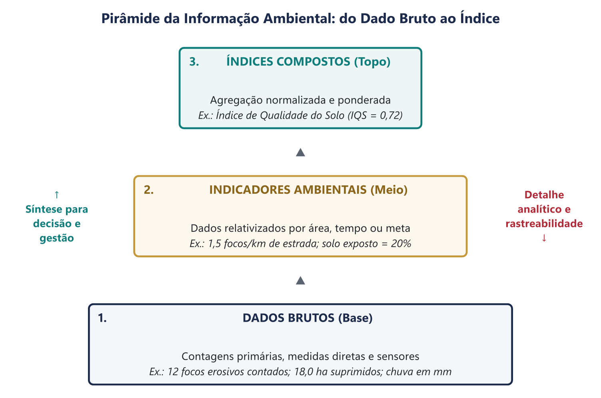
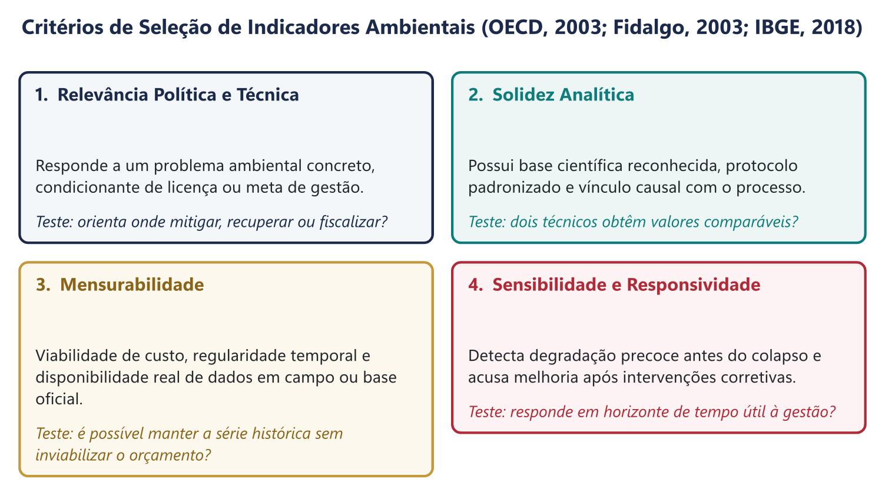
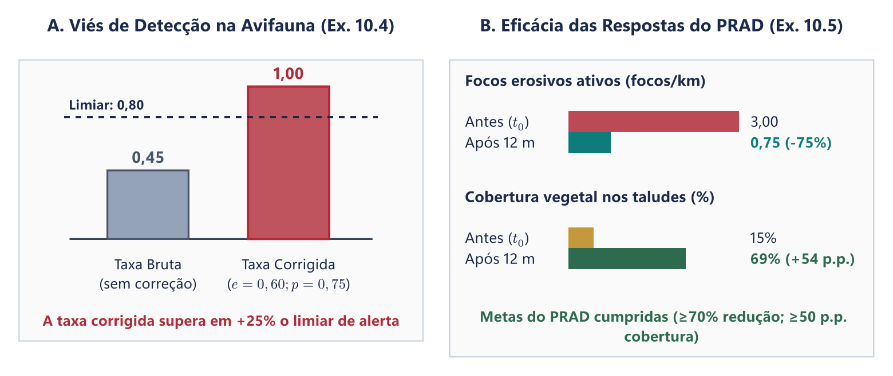
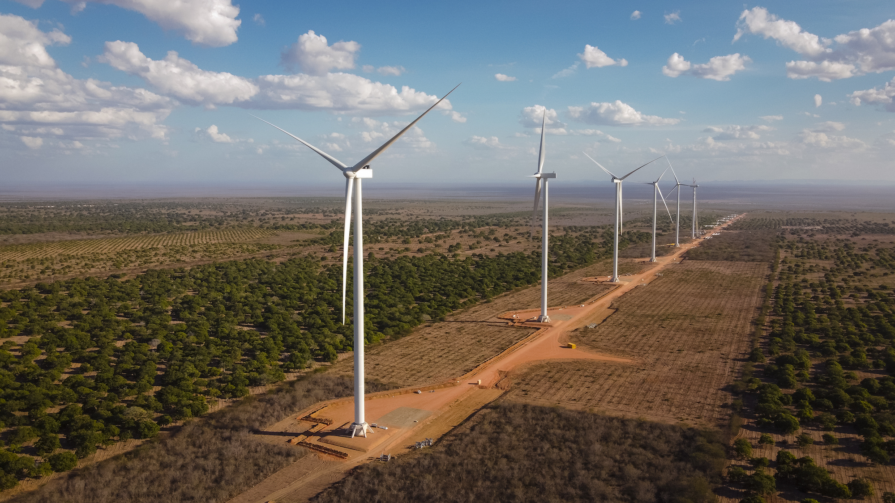
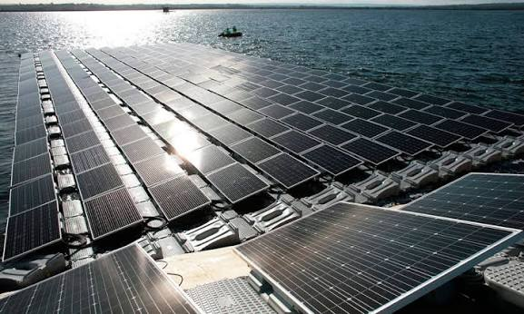
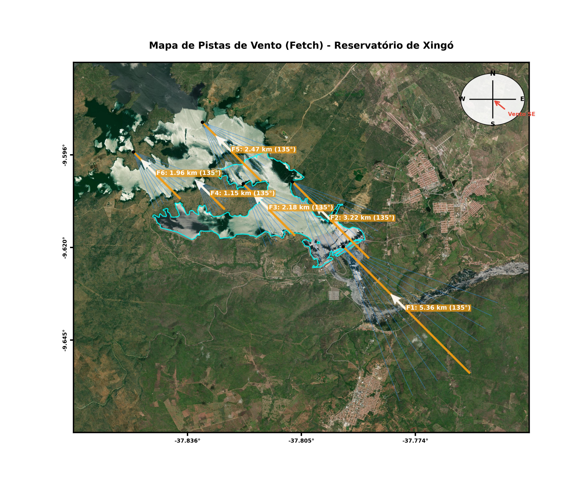
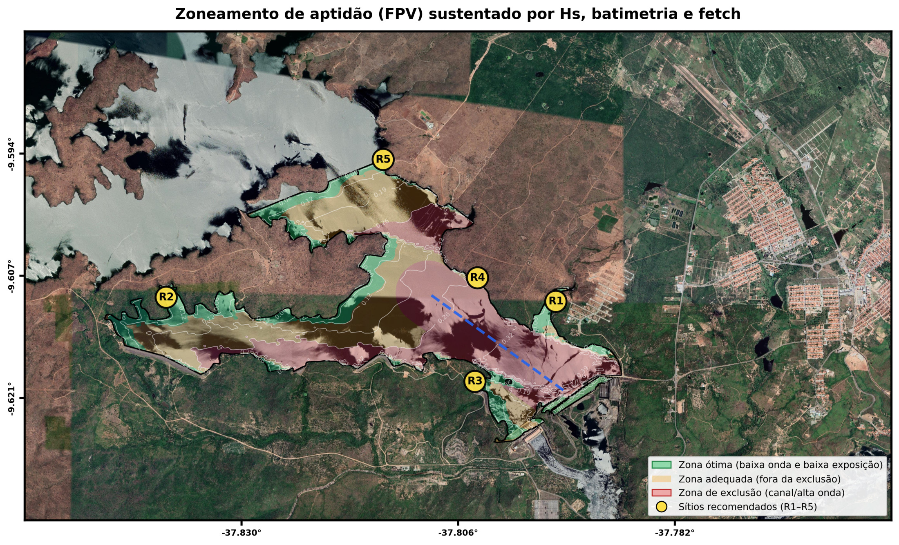

# Indicadores Ambientais, Monitoramento e Análise de Campo no Semiárido Baiano {#cap:indicadores_peir_semiarido}

Indicadores ambientais conectam uma pergunta de gestão a observações que podem ser repetidas ao longo do tempo. A seleção começa pelo processo físico ou socioambiental que se pretende acompanhar e pela decisão prática que o resultado irá orientar. Um número ganha significado técnico apenas quando sua unidade de medida, área de referência, período de coleta e método de obtenção estão documentados.

::: {.callout-note title="O que você vai aprender neste capítulo"}
O capítulo desenvolve a passagem do dado bruto ao índice ambiental, os critérios de seleção de indicadores e a construção de matrizes segundo os modelos PER e PEIR. Ao longo do texto, figuras explicativas, fotografias de campo e exemplos resolvidos acompanham cada conceito, aplicados ao eixo energético do Semiárido Baiano.
:::

::: {.callout-tip title="Revisando o que você precisa saber"}
A leitura retoma a distinção entre atividade geradora, alteração do ambiente e consequência ecológica ou social, além dos conceitos de bacia hidrográfica e área de influência. Uma estrada de acesso pode atravessar diferentes unidades de drenagem, enquanto efeitos sobre a fauna dependem também das rotas de deslocamento e dos horários de atividade das espécies.
:::

## Dados, indicadores, índices e a Pirâmide da Informação Ambiental

Na prática de campo, o técnico coleta inicialmente **dados brutos**, que são observações ou contagens isoladas sem tratamento comparativo, como registrar $12$ focos erosivos em uma estrada ou medir $18{,}0\text{ ha}$ de vegetação removida em uma imagem de satélite. Embora indispensáveis como registro primário, dados isolados raramente respondem a uma pergunta de gestão porque dependem do tamanho da área ou da extensão percorrida. Encontrar $12$ focos em $2\text{ km}$ de estrada revela uma degradação muito mais severa do que encontrar os mesmos $12$ focos distribuídos ao longo de $40\text{ km}$.

O **indicador ambiental** resolve essa limitação ao relacionar o dado bruto a uma base espacial, temporal ou populacional definida. Quando dividimos o número de focos pelo comprimento vistoriado, obtemos a densidade de focos por quilômetro ($\text{focos}\cdot\text{km}^{-1}$); quando dividimos a área suprimida pela área total do empreendimento, obtemos a taxa percentual de supressão ($T_{\text{sup}}$). Essa relativização permite comparar glebas de tamanhos diferentes e acompanhar a evolução de uma mesma área antes e depois de uma obra.

No degrau superior da informação situam-se os **índices ambientais**, que agregam vários indicadores normalizados em um único número sintético por meio de média simples ou ponderada, como ocorre no Índice de Qualidade do Solo ou no Índice de Qualidade da Água. Essa síntese facilita a comunicação rápida com gestores e conselhos de bacia, mas exige transparência: a pontuação final precisa vir acompanhada dos valores individuais que a compõem, pois duas áreas podem atingir o mesmo índice apresentando limitações ambientais distintas (@fig-piramide-informacao).

{#fig-piramide-informacao fig-alt="Pirâmide em três níveis mostrando Dados Brutos na base, Indicadores Ambientais no meio e Índices Compostos no topo"}

Nesta leitura, $A_{\text{sup}}$ representa a área suprimida em hectares e $T_{\text{sup}}$ sua proporção percentual. A densidade viária $D_v$ relaciona o comprimento dos acessos à área analisada, expressa em quilômetros por quilômetro quadrado. A mortalidade estimada $M_{\text{est}}$ incorpora as probabilidades de detecção e persistência das carcaças, representadas por $e$ e $p$.

## Conceito, Funções e Critérios de Seleção de Indicadores Ambientais

Um relatório técnico repleto de tabelas desconexas pouco auxilia a tomada de decisão se as variáveis medidas não responderem a perguntas ambientais claras. Segundo a Organização para a Cooperação e Desenvolvimento Econômico (OECD, 2003), um indicador é um parâmetro, ou valor derivado de parâmetros, que descreve o estado de um fenômeno ou de uma área com significado que ultrapassa o valor isolado da grandeza medida. No Brasil, o IBGE (2018) e Fidalgo (2003) destacam que os indicadores sintetizam processos complexos em grandezas comparáveis, preservam a rastreabilidade documental da fonte e do método de coleta, e comunicam de forma direta a relação entre a medida observada e a intervenção necessária.

Para evitar a escolha arbitrária de variáveis caras ou pouco informativas, OECD (2003), Fidalgo (2003) e IBGE (2018) consolidam quatro critérios de seleção que todo indicador deve satisfazer antes de integrar um programa de monitoramento (@fig-criterios-ocde). A **relevância política e técnica** garante vínculo direto com um problema concreto ou exigência legal; a **solidez analítica** assegura base científica e protocolo repetível por diferentes técnicos; a **mensurabilidade** verifica se o levantamento cabe no orçamento e mantém regularidade temporal; e a **sensibilidade** avalia se o indicador acusa degradação precoce e responde às ações corretivas em prazo útil.

{#fig-criterios-ocde fig-alt="Quadro visual em quatro blocos com Relevância Política e Técnica, Solidez Analítica, Mensurabilidade e Sensibilidade"}

Para observar como esses quatro critérios operam na prática, o Exemplo 10.1 analisa a triagem de quatro propostas para monitorar um parque eólico na Caatinga e executa o cálculo completo das variáveis aprovadas antes e depois de obras de recuperação.

::: {.callout-tip appearance="simple"}
### Exemplo 10.1 (Básico/Intermediário). Triagem de Indicadores e Cálculo de Monitoramento

**Situação e orçamento.** Uma equipe técnica da UEFS dispõe de R\$ 8.000 por campanha para monitorar exposição do solo e erosão em cortes, plataformas e acessos de um complexo eólico em Canudos (BA). Foram propostos quatro candidatos (valores didáticos): **I**, percentual de solo exposto em poligonal fixa com conferência em campo (custo conjunto de R\$ 5.000/campanha); **II**, percepção genérica de beleza da paisagem sem questionário nem amostra definidos; **III**, densidade de focos erosivos ativos por $\text{km}$ em trechos fixos com ficha padrão (incluída nos R\$ 5.000); e **IV**, sequenciamento genômico semanal do solo em 80 pontos (R\$ 80.000/rodada, sem vínculo com decisão sobre erosão).

**Triagem pelos critérios da OCDE.** Os candidatos **I e III** atendem aos quatro critérios e são selecionados porque medem diretamente proteção superficial e erosão linear com protocolo repetível e custo compatível. O candidato **II** falha em solidez analítica e mensurabilidade replicável, exigindo reformulação metodológica com questionário validado. O candidato **IV** falha em mensurabilidade operacional e financeira para a pergunta proposta.

**Cálculo antes e depois da intervenção.** Na campanha inicial, a poligonal mede $12{,}0\text{ ha}$ com $3{,}6\text{ ha}$ de solo exposto, e a vistoria de $6{,}0\text{ km}$ registrou $18$ focos ativos:

$$
T_{\mathrm{exp},1} = \frac{3{,}6\text{ ha}}{12{,}0\text{ ha}} \times 100 = 30{,}0\% \qquad\qquad D_{\mathrm{eros},1} = \frac{18\text{ focos}}{6{,}0\text{ km}} = 3{,}0\text{ focos}\cdot\text{km}^{-1}
$$

Após drenagem e revegetação, a segunda campanha encontrou $2{,}4\text{ ha}$ de solo exposto na mesma poligonal de $12{,}0\text{ ha}$ e $9$ focos ativos nos mesmos $6{,}0\text{ km}$:

$$
T_{\mathrm{exp},2} = \frac{2{,}4}{12{,}0} \times 100 = 20{,}0\% \qquad\qquad D_{\mathrm{eros},2} = \frac{9}{6{,}0} = 1{,}5\text{ focos}\cdot\text{km}^{-1}
$$

**Leitura dos resultados.** A exposição caiu de $30{,}0\%$ para $20{,}0\%$ (redução de $10{,}0$ pontos percentuais e redução relativa de $\frac{30{,}0 - 20{,}0}{30{,}0} \times 100 \approx 33{,}3\%$), enquanto a densidade de focos caiu $50{,}0\%$. A interpretação final considera ainda o volume de chuvas entre campanhas e eventuais alterações de profundidade nos focos remanescentes.
:::

Para consolidar o raciocínio de seleção e cálculo de variação desenvolvido no Exemplo 10.1, resolva a atividade autônoma a seguir antes de avançar para os modelos causais.

### Atividade 10.1A, Seleção e cálculo para resolução autônoma

Uma equipe precisa acompanhar a recuperação de acessos de outro empreendimento no Semiárido, dispondo de R\$ 6.000 por campanha e medições antes e depois das intervenções (valores didáticos). As quatro propostas avaliadas são: **A**, percentual de solo exposto em poligonal fixa com imagens comparáveis e conferência em campo (R\$ 4.500/campanha); **B**, satisfação dos moradores com acessos e drenagem mediante questionário padronizado e amostra justificada; **C**, densidade de focos erosivos ativos por quilômetro em trechos fixos georreferenciados; e **D**, análise química diária completa em 100 pontos (R\$ 48.000/rodada).

| Dado observado | Campanha inicial | Campanha posterior |
|:--|--:|--:|
| Área total da poligonal acompanhada | 9,0 ha | 9,0 ha |
| Área classificada como solo exposto | 1,80 ha | 1,08 ha |
| Comprimento efetivamente vistoriado | 4,8 km | 4,8 km |
| Focos erosivos ativos | 12 | 7 |

Classifique os quatro candidatos segundo os critérios da OCDE e justifique as decisões. Calcule a taxa de solo exposto e a densidade de focos em cada campanha (fórmula, substituição e unidades), determinando a mudança em pontos percentuais e a redução relativa de cada indicador. Redija uma interpretação técnica relacionando os valores à chuva entre campanhas, à manutenção e à necessidade de medir também dimensões das feições remanescentes. A atividade deve ser entregue com desenvolvimento próprio e sem gabarito nesta apostila.

## Modelos PER e PEIR, Arquitetura Causal e Construção de Matrizes

Um conjunto de indicadores ganha força interpretativa quando organizado em uma cadeia lógica que separa causa, alteração do meio, dano e solução. O modelo **PER (Pressão, Estado e Resposta)**, estruturado por Anthony Friend e David Rapport e difundido pela OCDE (OECD, 2003), parte de uma lógica de retroalimentação: atividades humanas exercem *pressões* sobre o ambiente, modificando o *estado* dos recursos naturais, ao que a sociedade reage com *respostas* técnicas ou políticas para conter as pressões ou recuperar o meio.

Posteriormente, o Programa das Nações Unidas para o Meio Ambiente (PNUMA/UNEP) aprimorou essa estrutura para o modelo **PEIR (Pressão, Estado, Impacto e Resposta)**, amplamente adotado pelo IBGE e por órgãos estaduais brasileiros. A inclusão do compartimento **Impacto (I)** separa com clareza a alteração mensurada no meio físico (*Estado*, como solo exposto ou rebaixamento de nível d’água) de suas consequências sobre ecossistemas e comunidades (*Impacto*, como formação de ravinas, perda de pesca artesanal ou colisão de avifauna), facilitando a ligação direta com a Avaliação de Impacto Ambiental (Capítulo 5). Em estudos regionais de maior escala, o modelo **DPSIR** acrescenta ainda o bloco **Força Motriz (D)** antes da Pressão para explicitar vetores estruturais como metas nacionais de transição energética ou expansão agropecuária (@fig-modelo_peir_semiarido).

{#fig-modelo_peir_semiarido}

A leitura da @fig-modelo_peir_semiarido mostra que o modelo PEIR opera como um **ciclo contínuo de retroalimentação**. A **Pressão (P)** reúne ações humanas que perturbam o ambiente (abertura de acessos, terraplenagem, operação de barramentos). O **Estado (E)** retrata a condição observável dos compartimentos (percentual de solo exposto, densidade do solo, nível do reservatório). O **Impacto (I)** expressa os efeitos resultantes sobre funções ecológicas e grupos sociais (erosão linear, perda de habitat, conflito hídrico). A **Resposta (R)** agrupa medidas de controle, drenagem, PRAD e regulação, que devem ser acompanhadas tanto por indicadores de execução (metros de canaleta construídos) quanto por indicadores de resultado (redução efetiva de focos erosivos).

O Exemplo 10.3 mostra como estruturar uma matriz PEIR comparando complexos eólicos e hidrelétricas ao longo do Submédio São Francisco.

::: {.callout-tip appearance="simple"}
### Exemplo 10.3 (Intermediário). Construção de Matriz PEIR para o Eixo Energético do Submédio São Francisco

**Situação analisada.** A partir das observações entre Sobradinho, Casa Nova, Juazeiro, Rodelas e Paulo Afonso, estruture uma matriz PEIR integrando complexos eólicos em bordas de chapada e regularização hidrelétrica de vazões no Rio São Francisco.

| **Vetor** | **Pressão (P)** | **Estado (E)** | **Impacto (I)** | **Resposta (R)** |
|:---|:---|:---|:---|:---|
| **Eólicas na Caatinga** | Abertura de acessos e platôs ($\text{ha}$ suprimidos; $D_v$ em $\text{km}\cdot\text{km}^{-2}$). | Solo exposto ($\%$), compactação ($D_s$) e fragmentação vegetal. | Erosão na base de torres (focos/km) e colisão de avifauna (aves/torre/ano). | Drenagem pluvial, PRAD/bioengenharia e zonas de exclusão para rotas de aves. |
| **Hidrelétricas (São Francisco)** | Operação de reservatórios com redução de vazão defluente ($\text{m}^3\cdot\text{s}^{-1}$). | Alteração do pulso hidrológico, redução de lâmina d’água e bancos arenosos. | Perda de agricultura de vazante, conflitos com irrigação e degradação ripária. | Alocação negociada no CBHSF, vazão ecológica mínima e recomposição de APPs. |

**Interpretação.** Cada coluna separa causas (P), condições biofísicas (E), danos ecológicos ou sociais (I) e instrumentos de gestão (R), garantindo que medidas corretivas e efeitos observados permaneçam em compartimentos distintos.
:::

Ao montar uma matriz PEIR pela primeira vez, é comum confundir a atividade geradora com o dano ou registrar uma medida corretiva na coluna de estado ambiental, erro detalhado abaixo.

::: {.callout-warning appearance="simple"}
### Erro 1, Confundir Dado Bruto, Pressão e Impacto na Matriz PEIR

**Equívoco frequente.** Listar “abertura de $18\text{ km}$ de estradas” na coluna de Impacto (I) ou registrar “execução de PRAD” na coluna de Estado (E).

**Correção técnica.** A abertura de estradas é a ação humana geradora de perturbação, logo pertence à **Pressão (P)**. A execução do PRAD é uma intervenção corretiva da sociedade, portanto é **Resposta (R)**. O **Estado (E)** retrata a condição biofísica resultante (percentual de solo exposto), enquanto o **Impacto (I)** expressa o dano ou consequência (ravinamento em taludes, perda de biodiversidade e assoreamento).
:::

## Métricas de campo, ficha do indicador e interpretação das unidades

Para transformar observações de campo em indicadores auditáveis na matriz PEIR, cada métrica exige uma **ficha técnica padronizada** que registre fonte dos dados, unidade de medida, período ou frequência de coleta, método de levantamento e área de referência. Sem esses metadados, não é possível auditar resultados nem comparar campanhas ao longo do tempo ou entre setores distintos. Além disso, um trecho sem vistoria constitui informação ausente, jamais valor zero, pois lançar zero onde não houve inspeção reduz artificialmente a média calculada e oculta focos críticos de degradação.

Em estudos ambientais, calcular corretamente indicadores exige também atenção às unidades de entrada. A **taxa de supressão ($T_{\mathrm{sup}}$)** relaciona a área removida ($A_{\mathrm{sup}}$) à área total da poligonal ($A_{\mathrm{pol}}$), ambas na mesma unidade (em geral hectares, lembrando que $1\text{ ha} = 10.000\text{ m}^2$), multiplicando a razão por $100$ para obter porcentagem. Já a **densidade viária ($D_v$)** divide a extensão total de acessos ($L_{\mathrm{acessos}}$, em $\text{km}$) pela área da poligonal em quilômetros quadrados ($A_{\mathrm{ref}}$, lembrando que $1\ \mathrm{km^2}=100\ \mathrm{ha}$), fornecendo o resultado em $\mathrm{km\,km^{-2}}$:

$$
T_{\mathrm{sup}} = \frac{A_{\mathrm{sup}}}{A_{\mathrm{pol}}} \times 100 \qquad\qquad D_v = \frac{L_{\mathrm{acessos}}}{A_{\mathrm{ref}}}
$$

O Exemplo 10.2 aplica essas duas expressões a um parque eólico no Semiárido Baiano e revela por que um percentual baixo de supressão pode ocultar alta densidade de estradas.

::: {.callout-tip appearance="simple"}
### Exemplo 10.2 (Intermediário). Cálculo de Supressão Vegetal e Densidade Viária em Parque Eólico

**Situação e dados.** No EIA de um parque eólico em chapada no eixo Canudos-Sento Sé ($A_{\text{pol}} = 1.600\text{ ha}$), há $25$ aerogeradores com platô de $0{,}45\text{ ha}$ cada, $18{,}0\text{ km}$ de estradas internas com $10\text{ m}$ de largura média e $2{,}75\text{ ha}$ de subestação e canteiro.

**Cálculo passo a passo.** Área dos platôs: $A_{\text{platôs}} = 25 \times 0{,}45 = 11{,}25\text{ ha}$. Área dos acessos (convertendo $18{,}0\text{ km} = 18.000\text{ m}$):

$$
A_{\text{acessos}} = \frac{18.000\text{ m} \times 10\text{ m}}{10.000\text{ m}^2\cdot\text{ha}^{-1}} = 18{,}00\text{ ha}
$$

Somando os componentes, $A_{\text{sup}} = 11{,}25 + 18{,}00 + 2{,}75 = 32{,}00\text{ ha}$, o que resulta em $T_{\mathrm{sup}} = \frac{32{,}00}{1.600} \times 100\% = \mathbf{2{,}00\%}$. Convertendo a área para $\text{km}^2$ ($1.600 / 100 = 16{,}0\text{ km}^2$), obtemos $D_v = \frac{18{,}0\text{ km}}{16{,}0\text{ km}^2} = \mathbf{1{,}125\text{ km}\cdot\text{km}^{-2}}$.

**Interpretação.** Embora $T_{\text{sup}} = 2{,}00\%$ pareça reduzido, $56{,}25\%$ da área suprimida ($18{,}0\text{ ha}$) distribui-se em corredores lineares com densidade superior a $1\text{ km}\cdot\text{km}^{-2}$, ampliando o efeito de borda e concentrando enxurradas.
:::

A leitura isolada da taxa de supressão sem o apoio de métricas lineares gera um dos erros mais frequentes na análise de empreendimentos extensivos na Caatinga.

::: {.callout-warning appearance="simple"}
### Erro 2, Subestimar a Fragmentação ao Olhar Apenas o Percentual Total de Supressão

**Equívoco frequente.** Concluir que uma taxa de supressão de $2\%$ em um parque eólico é ecologicamente irrelevante.

**Correção técnica.** Um pequeno percentual distribuído em malha viária extensa e linhas de transmissão cria centenas de metros de borda exposta, interrompe o deslocamento de fauna terrestre e concentra o escoamento superficial das chuvas convectivas do Semiárido. Por isso, deve-se sempre complementar $T_{\text{sup}}$ com métricas espaciais como a densidade viária ($D_v$).
:::

No monitoramento de colisões de avifauna, contar apenas as carcaças visíveis subestima a mortalidade real porque os observadores deixam de localizar parte das carcaças na vegetação ($e < 1$) e animais necrófagos removem outras antes da vistoria ($p < 1$). A correção amostral divide a contagem bruta $N_{\mathrm{obs}}$ pelo produto $e \cdot p$. De modo complementar, para acompanhar a evolução temporal de qualquer indicador ($X_i$ inicial e $X_f$ final, com $X_i \ne 0$), calcula-se a variação relativa $\Delta_{\%}$, distinguindo-a sempre da diferença absoluta em **pontos percentuais**:

$$
M_{\mathrm{est}} = \frac{N_{\mathrm{obs}}}{e\,p} \qquad\qquad \Delta_{\%} = \frac{X_f-X_i}{X_i} \times 100
$$

Além das fórmulas, todo programa sério exige uma **ficha do indicador** documentando unidade, fonte, período e critério de campo. Um trecho sem vistoria constitui **informação ausente**, jamais valor zero, pois lançar zero onde ninguém inspecionou rebaixa artificialmente a média calculada e oculta setores degradados. Da mesma forma, sem padronizar esforço amostral e corrigir o viés de detecção, relatórios de fauna mascaram violações ambientais graves, como ilustra a @fig-mortalidade-eficacia (Painel A) e o cálculo do Exemplo 10.4.

{#fig-mortalidade-eficacia fig-alt="Dois gráficos em painel: A compara barras de mortalidade bruta 0,45 e corrigida 1,00 contra limiar 0,80; B mostra redução de 75% nos focos erosivos e aumento da cobertura vegetal de 15% para 69%"}

::: {.callout-tip appearance="simple"}
### Exemplo 10.4 (Avançado). Indicador Corrigido de Mortalidade de Avifauna em Parque Eólico

**Situação e dados.** Em $12$ meses de vistorias sob $40$ aerogeradores na Caatinga baiana, registraram-se $18$ carcaças de aves. Ensaios de campo indicaram eficiência de busca $e = 0{,}60$ e persistência de carcaças $p = 0{,}75$. O limiar de alerta no licenciamento é $0{,}80\text{ ave}\cdot\text{torre}^{-1}\cdot\text{ano}^{-1}$.

**Cálculo passo a passo.** A taxa bruta sem correção seria $T_{\text{bruta}} = 18 / 40 = 0{,}45\text{ ave}\cdot\text{torre}^{-1}\cdot\text{ano}^{-1}$. Como o produto de detecção é $e \cdot p = 0{,}60 \times 0{,}75 = 0{,}45$ (apenas $45\%$ das colisões reais são registradas), a mortalidade estimada corrigida e a taxa por torre são:

$$
M_{\text{est}} = \frac{18}{0{,}45} = 40{,}0\text{ aves}\cdot\text{ano}^{-1} \qquad\qquad T_{\text{corr}} = \frac{40{,}0}{40} = 1{,}00\text{ ave}\cdot\text{torre}^{-1}\cdot\text{ano}^{-1}
$$

**Interpretação.** Conforme observado no Painel A da @fig-mortalidade-eficacia, a taxa corrigida ($1{,}00$) supera o limiar de alerta ($0{,}80$) em $25\%$, exigindo medidas mitigadoras imediatas que permaneceriam invisíveis na contagem bruta ($0{,}45$).
:::

A omissão do esforço amostral e da eficiência de busca invalida comparações entre campanhas sucessivas ou entre empreendimentos vizinhos.

::: {.callout-warning appearance="simple"}
### Erro 3, Comparar Contagens Brutas de Fauna ou Erosão sem Padronização Amostral

**Equívoco frequente.** Relatar apenas o número absoluto de carcaças de aves ou focos erosivos sem considerar esforço amostral, número de torres, extensão vistoriada ou eficiência de detecção.

**Correção técnica.** Sem relativização (por torre/ano ou por $\text{km}$ de estrada) e sem correção de viés de detecção ($e \cdot p$ no monitoramento faunístico), os números perdem comparabilidade entre campanhas, comprometendo a solidez analítica exigida pela OCDE (2003).
:::

## Estudo de Caso Integrado, Viagem de Campo no Semiárido Baiano

A atividade de campo prevista na Semana 11 do Plano CHF662 percorre a região de **Canudos** e o eixo energético do **Rio São Francisco**, com referência a **Paulo Afonso, Rodelas, Sobradinho, Casa Nova, Sento Sé e Juazeiro**. A leitura desse território articula a Caatinga, as formas de relevo, os usos múltiplos da água e as infraestruturas de geração e transmissão, exigindo que cada parada distinga o que foi observado diretamente, o que consta em documentos técnicos e o que permanece como hipótese de análise.

### Fatores Locacionais e Leitura das Infraestruturas em Campo

A concentração de parques eólicos em Canudos, Casa Nova, Sento Sé e entorno de Sobradinho resulta da convergência entre o **regime de ventos alísios de sudeste e leste** (velocidades médias frequentemente entre $7{,}5$ e $9{,}5\text{ m}\cdot\text{s}^{-1}$ a $100\text{ m}$ no [Atlas Eólico da Bahia](https://www.ba.gov.br/secti/20/atlas-eolico-da-bahia), com pico no segundo semestre seco e complementaridade sazonal à geração hidrelétrica), o **relevo de chapadas e serras residuais** que acelera o escoamento atmosférico por efeito topográfico, a **proximidade de linhas de transmissão do SIN** estruturadas historicamente a partir de Paulo Afonso e Sobradinho, e a **estrutura fundiária** marcada por grandes imóveis e áreas de fundo de pasto.

Os acessos e as plataformas dos aerogeradores conectam a implantação elétrica à dinâmica da vertente (@fig-canudos-acessos). A superfície exposta recebe o impacto direto das gotas de chuva, enquanto valetas e bueiros modificam a direção e a concentração do escoamento superficial, exigindo localizar saídas de drenagem e proteção de taludes durante a vistoria.

{#fig-canudos-acessos fig-alt="Vista aérea de aerogeradores interligados por acessos de solo exposto em área de Caatinga"}

Quando a implantação linear atravessa divisores e unidades de drenagem, a continuidade dos corredores de solo exposto aproxima o escoamento concentrado dos canais intermitentes e amplia a fragmentação de habitats (@fig-canudos-linear).

{#fig-canudos-linear fig-alt="Aerogeradores alinhados ao longo de uma estrada sobre superfície de solo exposto"}

No eixo fluvial do Submédio São Francisco, o armazenamento hidrelétrico em Sobradinho modifica o regime de cheias e vazantes e conecta a geração elétrica ao abastecimento urbano, à irrigação e à pesca artesanal (@fig-sobradinho-usina).

, licença [CC BY 2.0](https://creativecommons.org/licenses/by/2.0/).](../img/sobradinho_usina_glauco_umbelino.jpg){#fig-sobradinho-usina fig-alt="Vista da estrutura da Usina Hidrelétrica de Sobradinho"}

Arranjos fotovoltaicos flutuantes acrescentam novas interfaces entre módulos, flutuadores, amarrações e espelho d’água (@fig-fpv-detalhe). Variação de nível, vento e ondas modificam as solicitações mecânicas sobre a estrutura, demandando também avaliar sombreamento, circulação da água e faixas de manutenção.

{#fig-fpv-detalhe fig-alt="Módulos fotovoltaicos sobre flutuadores junto à superfície de um reservatório"}

A configuração completa do arranjo deve ser examinada junto ao espaço ocupado no reservatório e às áreas de navegação (@fig-fpv-arranjo), mantendo explícita a escala hidrodinâmica analisada.

{#fig-fpv-arranjo fig-alt="Conjunto de módulos solares flutuantes formando uma plataforma sobre a água"}

### Evidência publicada e seleção de sítios em Xingó

As pistas de vento e os focos erosivos foram examinados por Holanda e colaboradores (2020) na *Revista Brasileira de Geografia Física* (@fig-xingo-publicado-2020), relacionando a geometria do reservatório no segmento II da UHE Xingó (Baixo São Francisco) à localização dos focos erosivos nas margens.

, licença [CC BY 4.0](https://creativecommons.org/licenses/by/4.0/).](../img/artigo_publicado_xingo_fetch_2020.jpeg){#fig-xingo-publicado-2020 fig-alt="Mapa publicado de Xingó com três pistas de vento no segmento II e focos erosivos identificados por códigos FE"}

O estudo de Santos, Holanda e Wanderley sobre ondas e fotovoltaica flutuante em Xingó conecta geometria do reservatório, pistas de vento (*fetch*, distância de atuação do vento sobre a água) e altura significativa de onda ($H_s$) para selecionar áreas menos expostas (@fig-xingo-fetch).

{#fig-xingo-fetch fig-alt="Mapa de Xingó com pistas de vento, orientação de sudeste e comprimentos de fetch em diferentes setores"}

Cruzando exposição às ondas com batimetria e restrições de uso, obtém-se o zoneamento de aptidão para implantação flutuante (@fig-xingo-zoneamento), evidenciando como o uso em outro reservatório como Sobradinho exige recalcular todas as variáveis locais.

{#fig-xingo-zoneamento fig-alt="Mapa de zoneamento de Xingó com classes de exposição e sítios R1 a R5"}

### Convivência com a Caatinga, Roteiro de Campo e Avaliação de Respostas

Embora a geração eólica emita poucos gases de efeito estufa durante a operação, a fase de implantação impõe impactos territoriais relevantes, entre eles a supressão linear da Caatinga para platôs e estradas largas de transporte de pás ($60$ a $80\text{ m}$), a erosão na base das torres sobre solos rasos sob chuvas convectivas e os conflitos por usos múltiplos da água diante da regularização de vazões no Submédio São Francisco.

No componente faunístico, a instalação de aerogeradores e linhas de transmissão ao longo de rotas de deslocamento cria risco de colisão e efeito barreira para a arara-azul-de-lear (*Anodorhynchus leari*), espécie endêmica que transita diariamente entre os paredões areníticos do Raso da Catarina e os agrupamentos de licurizeiros (*Syagrus coronata*) no território de Canudos (@fig-arara-azul-lear). O mapeamento telemétrico e a manutenção de corredores livres de obstáculos tornam-se medidas indispensáveis no licenciamento regional.

{#fig-arara-azul-lear fig-alt="Duas araras-azuis-de-lear em voo diante de paredão arenítico no Raso da Catarina"}

Durante o roteiro prático em campo, a equipe discente registra evidências georreferenciadas integrando quatro eixos: relevo e substrato (posição das torres, solos rasos e declividade), processos erosivos e drenagem (selamento, sulcos e saídas pluviais), cobertura da Caatinga e fauna (fisionomia vegetal, licurizeiros e efeito de borda) e dinâmica hídrica e socioambiental (nível dos reservatórios, irrigação e comunidades de fundo de pasto).

::: {.callout-warning appearance="simple"}
### Erro 4, Assumir que Energia Eólica Equivale a Impacto Ambiental Nulo

**Equívoco frequente.** Afirmar em diagnósticos que parques eólicos na Caatinga não causam degradação por serem fontes renováveis de baixa emissão de carbono.

**Correção técnica.** Toda fonte energética possui pegada territorial. No Semiárido Baiano, a implantação eólica envolve terraplenagem pesada, supressão linear da Caatinga, erosão em solos rasos de chapadas, riscos à avifauna (como a arara-azul-de-lear em Canudos) e conflitos fundiários e sonoros que exigem licenciamento rigoroso e monitoramento contínuo.
:::

Para fechar o ciclo PEIR, toda resposta de gestão precisa separar indicadores de **execução** (metros de drenagem construídos) de indicadores de **resultado** (redução efetiva de focos erosivos e ganho de cobertura vegetal), como ilustrado no Painel B da @fig-mortalidade-eficacia e detalhado no Exemplo 10.5.

::: {.callout-tip appearance="simple"}
### Exemplo 10.5 (Avançado). Avaliação Quantitativa de Eficácia de Resposta Mitigadora no Ciclo PEIR

**Situação e metas.** Após vistoria apontar erosão em acessos de um complexo eólico, o empreendedor implantou canaletas revestidas, dissipadores em pedra rachão, paliçadas permeáveis e semeadura de espécies nativas. Antes das obras, havia $36$ focos ativos em $12\text{ km}$ de estradas e cobertura vegetal média de $15\%$. Doze meses depois, registraram-se $9$ focos ativos e cobertura de $69\%$. A meta contratual do PRAD exigia redução mínima de $70\%$ nos focos e ganho mínimo de $50$ pontos percentuais na cobertura.

**Cálculo passo a passo.** A densidade caiu de $D_{f,0} = \frac{36}{12} = 3{,}00$ para $D_{f,1} = \frac{9}{12} = 0{,}75\text{ foco}\cdot\text{km}^{-1}$, gerando redução de $\Delta F_{\%} = \frac{9 - 36}{36} \times 100\% = -75{,}0\%$. Na cobertura vegetal, o ganho absoluto foi $\Delta C_{\text{pp}} = 69\% - 15\% = +54\text{ p.p.}$ e o ganho relativo atingiu $\Delta C_{\text{rel}} = \frac{69 - 15}{15} \times 100\% = +360{,}0\%$.

**Interpretação.** Conforme mostrado no Painel B da @fig-mortalidade-eficacia, ambas as metas do PRAD foram cumpridas ($75{,}0\% \ge 70\%$ e $54\text{ p.p.} \ge 50\text{ p.p.}$). Distinguir *pontos percentuais* de *variação relativa* evita ambiguidades em auditorias, enquanto os $9$ focos remanescentes orientam manutenção pontual.
:::

## Materiais Audiovisuais de Apoio

Para ampliar a compreensão sobre indicadores simples, índices compostos e comunicação em relatórios ambientais, assista aos vídeos selecionados na disciplina: o vídeo [Indicadores e relatórios de sustentabilidade](https://www.youtube.com/watch?v=xk-Y_YivFpU) discute a construção e o uso de indicadores no monitoramento territorial, e o vídeo [Você sabe o que é o Índice de Qualidade da Água (IQA)?](https://www.youtube.com/watch?v=J2HRZjnC03w) apresenta de forma acessível a lógica de agregação e interpretação de índices compostos.

## Exercícios de fixação

#### Nível Básico (Conceitos, Critérios e Modelo PEIR)

1. Explique, com um exemplo concreto ligado ao Semiárido Baiano, a diferença entre **dado bruto**, **indicador ambiental** e **índice ambiental**.

2. Cite os quatro critérios principais de seleção de indicadores ambientais propostos por OECD (2003), Fidalgo (2003) e IBGE (2018), explicando o risco técnico de ignorar o critério da *mensurabilidade*.

3. Qual é a principal diferença conceitual entre o modelo **PER** (OCDE) e o modelo **PEIR** (PNUMA/GEO)? Por que essa distinção favorece a articulação com a Avaliação de Impacto Ambiental?

4. Classifique cada item abaixo como **Pressão (P)**, **Estado (E)**, **Impacto (I)** ou **Resposta (R)** em um parque eólico na Caatinga, (a) abertura de $14\text{ km}$ de estradas de acesso; (b) ravina ativa de $1{,}8\text{ m}$ de profundidade na saída de bueiro; (c) percentual de solo exposto de $42\%$ no talude; (d) instalação de dissipadores de energia e revegetação com espécies nativas.

5. Liste três fatores locacionais geográficos que explicam a intensa concentração de parques eólicos na região de Canudos e no eixo do Submédio São Francisco (Casa Nova, Sento Sé e entorno de Sobradinho).

#### Nível Intermediário (Cálculos de Monitoramento e Interpretação Regional)

6. Um projeto eólico em uma poligonal de $1.200\text{ ha}$ na Bahia prevê $30$ aerogeradores com platôs de $0{,}40\text{ ha}$ cada, $12\text{ km}$ de acessos internos com $8\text{ m}$ de largura média e $2{,}4\text{ ha}$ destinados à subestação. Calcule a área total suprimida ($A_{\text{sup}}$) e a taxa percentual de supressão ($T_{\text{sup}}$).

7. Em um período de estiagem prolongada no Submédio São Francisco, a vazão defluente média da Usina Hidrelétrica de Sobradinho foi reduzida de $1.300\text{ m}^3\cdot\text{s}^{-1}$ para $800\text{ m}^3\cdot\text{s}^{-1}$. Calcule a variação percentual dessa vazão e cite dois impactos socioambientais diretos dessa redução ao longo do eixo Juazeiro-Rodelas-Paulo Afonso.

8. No monitoramento anual de avifauna de um complexo eólico com $50$ torres, registraram-se $24$ carcaças de aves. Ensaios de campo indicaram eficiência de busca $e = 0{,}80$ e persistência de carcaças $p = 0{,}60$. Calcule a mortalidade total estimada ($M_{\text{est}}$) e a taxa corrigida de mortalidade em aves por torre por ano.

9. Uma poligonal de empreendimento energético abrange $1.500\text{ ha}$ e contém $27\text{ km}$ de estradas internas não pavimentadas. Determine a densidade viária interna ($D_v$) em $\text{km}\cdot\text{km}^{-2}$ e discuta como esse indicador se relaciona com a erosão linear na Caatinga.

10. Após obras de drenagem superficial e bioengenharia nos taludes de um parque eólico, o número de focos erosivos ativos reduziu-se de $28$ para $7$ em um ano. Calcule a redução percentual obtida e classifique esse indicador dentro do modelo PEIR.

#### Nível Aplicado (Questões Objetivas A-E) {#10-indicadores-ambientais-peir-nível-aplicado-questões-objetivas-ae}

11. Sobre os critérios de seleção de indicadores ambientais (OECD, 2003; IBGE, 2018), assinale a alternativa correta,

    (A) Um indicador de alta qualidade deve dispensar qualquer protocolo padronizado, permitindo interpretações subjetivas de cada analista.

    (B) A sensibilidade indica a capacidade do indicador de detectar mudanças ambientais precoces e responder às medidas de manejo em prazo útil.

    (C) Indicadores compostos (índices) sempre substituem integralmente os indicadores individuais, tornando desnecessário reportar as variáveis de origem.

    (D) A relevância técnica exige que o indicador utilize equipamentos laboratoriais de alto custo, independentemente da viabilidade de monitoramento contínuo.

    (E) A mensurabilidade refere-se exclusivamente à possibilidade de converter variáveis qualitativas em médias aritméticas sem base amostral.

12. Na matriz PEIR aplicada ao eixo energético do Submédio São Francisco, a “implantação de um programa de monitoramento telemétrico da arara-azul-de-lear e readequação do traçado de linhas de transmissão” corresponde ao componente,

    (A) Pressão (P), pois altera o cronograma financeiro do empreendimento.

    (B) Estado (E), pois descreve a abundância natural da espécie na Caatinga.

    (C) Impacto (I), pois representa o dano causado pelas torres ao habitat.

    (D) Resposta (R), pois consiste em ação técnica e de gestão destinada a prevenir ou mitigar impactos sobre a fauna.

    (E) Fator abiótico de base, externo ao ciclo PEIR.

13. Um parque eólico localizado em área de $2.000\text{ ha}$ suprimiu $0{,}50\text{ ha}$ por platô em $20$ torres e abriu $15\text{ km}$ de acessos com $10\text{ m}$ de largura. Sem outras áreas suprimidas, a taxa percentual de supressão ($T_{\text{sup}}$) da poligonal é igual a,

    (A) $0{,}50\%$.

    (B) $0{,}75\%$.

    (C) $1{,}25\%$.

    (D) $2{,}50\%$.

    (E) $5{,}00\%$.

14. Em relação aos processos físicos observados em parques eólicos implantados em chapadas e serras residuais do Semiárido Baiano, é correto afirmar que,

    (A) A baixa pluviosidade anual do Semiárido impede completamente a ocorrência de erosão hídrica linear na base das torres.

    (B) O terraplenamento de platôs e o escoamento concentrado em estradas compactadas sobre solos rasos potencializam sulcos, ravinas e assoreamento de drenagens intermitentes.

    (C) A substituição da Caatinga por solo exposto em taludes de corte reduz a energia cinética do escoamento superficial.

    (D) A instalação de aerogeradores elimina a necessidade de medidas de drenagem pluvial e PRAD por se tratar de energia renovável.

    (E) Os ventos alísios de sudeste são os únicos responsáveis pelo transporte de sedimentos grosseiros nos bueiros das estradas de acesso.

15. Em um programa de monitoramento de colisão de avifauna com $25$ torres eólicas durante um ano, foram encontradas $15$ carcaças. Sabendo que a eficiência de busca foi $e = 0{,}50$ e a persistência de carcaças foi $p = 0{,}60$, a taxa anual corrigida de mortalidade por torre é,

    (A) $0{,}60\text{ ave}\cdot\text{torre}^{-1}\cdot\text{ano}^{-1}$.

    (B) $1{,}20\text{ aves}\cdot\text{torre}^{-1}\cdot\text{ano}^{-1}$.

    (C) $1{,}50\text{ aves}\cdot\text{torre}^{-1}\cdot\text{ano}^{-1}$.

    (D) $2{,}00\text{ aves}\cdot\text{torre}^{-1}\cdot\text{ano}^{-1}$.

    (E) $2{,}50\text{ aves}\cdot\text{torre}^{-1}\cdot\text{ano}^{-1}$.

## Questões de aplicação

### Foco de Provas, ENADE e Concursos (IBAMA / INEMA)

Exames de Geografia e concursos para Analista Ambiental frequentemente combinam leitura crítica de matrizes PEIR com dilemas concretos da transição energética no Nordeste brasileiro. Evite respostas binárias (“energia limpa = sem impacto” ou “toda obra é inviável”) e demonstre domínio da diferenciação entre Pressão, Estado, Impacto e Resposta com métricas verificáveis.

16. **\[Questão Autoral, Estilo ENADE / Geografia\]** A expansão da energia eólica no Semiárido Baiano, especialmente em municípios como Canudos, Sento Sé e Casa Nova, tem ampliado a participação de fontes renováveis na matriz elétrica nacional. Contudo, levantamentos de campo apontam conflitos socioambientais envolvendo fragmentação da Caatinga, erosão em estradas de acesso, ruído próximo a comunidades rurais e risco de colisão para espécies ameaçadas como a arara-azul-de-lear (*Anodorhynchus leari*). À luz da Análise Ambiental integrada, avalie as afirmações a seguir,

    > **I.** A viabilidade climática da energia eólica não dispensa o planejamento locacional em escala regional para evitar corredores ecológicos críticos e áreas de uso comunal.\
    > **II.** O modelo PEIR permite distinguir claramente a abertura de acessos (Pressão), a exposição do solo (Estado), o ravinamento em taludes (Impacto) e as obras de drenagem e PRAD (Resposta).\
    > **III.** Como a área diretamente ocupada pelas fundações das torres representa pequena fração do terreno, a fragmentação gerada pela malha viária não altera a conectividade da Caatinga.

    É correto o que se afirma em,

    (A) I, apenas.

    (B) III, apenas.

    (C) I e II, apenas.

    (D) II e III, apenas.

    (E) I, II e III.

17. **\[Questão Autoral, Estilo Concurso Analista Ambiental / INEMA-BA\]** No Submédio São Francisco (trecho Sobradinho-Juazeiro-Rodelas-Paulo Afonso), a gestão ambiental enfrenta pressões simultâneas decorrentes da regularização de vazões hidrelétricas, da captação para perímetros irrigados e da expansão de infraestrutura energética. Para compor um painel estadual de monitoramento baseado no modelo PEIR, um técnico deve escolher o conjunto mais coerente de indicadores. Assinale a alternativa em que os quatro elementos correspondem, respectivamente, a **Pressão, Estado, Impacto e Resposta**,

    (A) Assoreamento de bancos de areia; vazão defluente reduzida; plano de bacia; perda de área de vazante.

    (B) Volume captado para irrigação e operação de barramentos; nível fluviométrico e percentual de vegetação ripária; conflito por usos múltiplos da água e redução da pesca artesanal; alocação negociada de água no comitê de bacia e recomposição de APPs.

    (C) Recomposição de APPs; conflito por uso da água; operação de barramentos; nível fluviométrico.

    (D) Nível fluviométrico; volume captado para irrigação; recomposição de APPs; redução da pesca artesanal.

    (E) Conflito por uso da água; plano de bacia; volume captado; percentual de vegetação ripária.

18. **\[Questão Autoral, Estilo Concurso Analista Ambiental / IBAMA\]** Um órgão licenciador exigiu que um empreendimento eólico substituísse indicadores genéricos de seu Programa de Monitoramento por variáveis aderentes aos critérios da OCDE (2003). Qual proposta abaixo atende simultaneamente aos critérios de **relevância técnica, solidez analítica, mensurabilidade e sensibilidade** para monitorar processos erosivos em estradas de acesso?

    (A) Registro fotográfico esporádico sem coordenadas geográficas e sem escala métrica, realizado apenas quando houver reclamação de moradores.

    (B) Quantificação semestral da densidade de sulcos e ravinas ativos por quilômetro de acesso ($\text{focos}\cdot\text{km}^{-1}$) e da profundidade média das incisões em seções fixas georreferenciadas, acompanhada do percentual de cobertura vegetal nos taludes.

    (C) Entrevista informal anual com motoristas do parque sobre se a estrada “parece boa ou ruim” após as chuvas.

    (D) Análise mineralógica por difração de raios X realizada semanalmente em todos os bueiros do empreendimento.

    (E) Contabilização apenas da geração elétrica anual em megawatts-hora (MWh), por ser o dado de maior precisão disponível na subestação.

## Gabarito comentado {.unnumbered}

::: {.callout-tip collapse="true" title="Clique para abrir o Gabarito Comentado"}
### Resoluções Completas, Exercícios de Fixação (1 a 15)

1. **Dado bruto** é a medição isolada sem tratamento interpretativo (por exemplo, $12\text{ focos}$ erosivos contados em uma estrada). **Indicador** é a variável relativizada e ligada a um objetivo de gestão (por exemplo, $1{,}5\text{ focos erosivos}\cdot\text{km}^{-1}$ de acesso, comparado a uma meta de controle). **Índice** é a agregação matemática de múltiplos indicadores normalizados em um número sintético único (por exemplo, Índice de Qualidade do Solo combinando matéria orgânica, porosidade, infiltração e densidade).

2. Os quatro critérios são **relevância política/técnica**, **solidez analítica**, **mensurabilidade** e **sensibilidade**. Ignorar a mensurabilidade resulta em planos de monitoramento inexequíveis na prática (custos proibitivos, ausência de dados históricos ou incapacidade de repetição temporal), gerando relatórios incompletos ou descontinuados.

3. O modelo **PER** reúne alterações físicas do meio e suas consequências sob o guarda-chuva amplo de *Estado*, ao passo que o **PEIR** desdobra o compartimento **Impacto (I)** de modo explícito. Essa separação facilita a AIA porque conecta diretamente a alteração biofísica mensurada (Estado) ao dano ecológico ou socioeconômico que exige mitigação ou compensação (Impacto).

4. (a) **Pressão (P)**, ação antrópica geradora de perturbação; (b) **Impacto (I)**, dano erosivo linear resultante; (c) **Estado (E)**, condição atual da superfície do talude; (d) **Resposta (R)**, intervenção técnica corretiva.

5. Três fatores principais: regime de ventos alísios de sudeste/leste constantes e intensos, complementares à sazonalidade hídrica; relevo de chapadas, patamares elevados e serras residuais que amplificam a velocidade do vento acima da rugosidade da Depressão Sertaneja; e proximidade da infraestrutura de transmissão de alta tensão do Sistema Interligado Nacional estruturada historicamente a partir das hidrelétricas de Paulo Afonso e Sobradinho.

6. **Passo a passo,** Platôs, $30 \times 0{,}40\text{ ha} = 12{,}00\text{ ha}$. Acessos, $12.000\text{ m} \times 8\text{ m} = 96.000\text{ m}^2 = 9{,}60\text{ ha}$. Subestação, $2{,}40\text{ ha}$. Área total suprimida, $A_{\text{sup}} = 12{,}00 + 9{,}60 + 2{,}40 = \mathbf{24{,}00\text{ ha}}$. Taxa de supressão, $T_{\text{sup}} = (24{,}00 / 1.200) \times 100\% = \mathbf{2{,}00\%}$.

7. **Passo a passo,** $\Delta_{\%} = \frac{800 - 1.300}{1.300} \times 100\% = \frac{-500}{1.300} \times 100\% \approx \mathbf{-38{,}46\%}$ (redução de $38{,}46\%$). Impactos diretos, restrição à agricultura de vazante e pesca artesanal, exposição de bancos arenosos com maior dificuldade de captação ribeirinha e acirramento de conflitos entre geração elétrica, perímetros irrigados e abastecimento humano.

8. **Passo a passo,** Fator de detecção combinado, $e \cdot p = 0{,}80 \times 0{,}60 = 0{,}48$. Mortalidade total estimada, $M_{\text{est}} = 24 / 0{,}48 = \mathbf{50{,}0\text{ aves}\cdot\text{ano}^{-1}}$. Taxa corrigida por torre, $50{,}0 / 50 = \mathbf{1{,}00\text{ ave}\cdot\text{torre}^{-1}\cdot\text{ano}^{-1}}$.

9. **Passo a passo,** Convertemos $1.500\text{ ha}$ para quilômetros quadrados, $A_{\text{km}^2} = 1.500 / 100 = 15{,}0\text{ km}^2$. Densidade viária, $D_v = 27 / 15{,}0 = \mathbf{1{,}80\text{ km}\cdot\text{km}^{-2}}$. Uma malha densa de estradas compactadas intercepta o escoamento superficial natural, reduz a infiltração e concentra enxurradas nas saídas de drenagem, desencadeando sulcos e ravinas nos solos rasos da Caatinga.

10. **Passo a passo,** $\Delta F_{\%} = \frac{7 - 28}{28} \times 100\% = \frac{-21}{28} \times 100\% = \mathbf{-75{,}0\%}$ (redução de $75{,}0\%$). O indicador de focos erosivos ativos expressa um **Impacto (I)**, enquanto sua redução monitorada após as obras permite aferir a eficácia da **Resposta (R)** aplicada.

11. **Gabarito, (B).** Sensibilidade e responsividade designam exatamente a capacidade de detectar alterações precoces e responder às medidas de manejo. (A) contradiz solidez analítica; (C) é falsa porque índices não substituem o reporte das variáveis de base; (D) confunde rigor com custo proibitivo; (E) distorce mensurabilidade.

12. **Gabarito, (D).** Programas de monitoramento faunístico e readequação de traçado são ações de gestão voltadas a prevenir ou mitigar danos, caracterizando **Resposta (R)**.

13. **Gabarito, (C).** Platôs, $20 \times 0{,}50 = 10{,}0\text{ ha}$. Acessos, $15.000\text{ m} \times 10\text{ m} = 150.000\text{ m}^2 = 15{,}0\text{ ha}$. Total, $25{,}0\text{ ha}$. Taxa, $(25{,}0 / 2.000) \times 100\% = \mathbf{1{,}25\%}$.

14. **Gabarito, (B).** Mesmo com menor total pluviométrico anual, o Semiárido apresenta chuvas convectivas concentradas de alta erosividade; combinadas a solos rasos, terraplenagem e compactação de estradas, elas geram erosão linear intensa e assoreamento.

15. **Gabarito, (D).** Produto $e \cdot p = 0{,}50 \times 0{,}60 = 0{,}30$. Mortalidade total estimada, $M_{\text{est}} = 15 / 0{,}30 = 50$ aves/ano. Dividindo por $25$ torres, $50 / 25 = \mathbf{2{,}00\text{ aves}\cdot\text{torre}^{-1}\cdot\text{ano}^{-1}}$.

### Resoluções Completas, Questões ENADE e Concursos (16 a 18)

16. **Gabarito, (C).** As afirmações I e II são tecnicamente corretas e articulam o planejamento locacional ao ciclo PEIR. A afirmação III está incorreta porque estruturas lineares (estradas e linhas de transmissão) fragmentam a Caatinga e ampliam o efeito de borda mesmo quando a área suprimida percentual parece pequena.

17. **Gabarito, (B).** Apenas (B) respeita a sequência causal exata, captação/operação de barramentos (**P**) $\rightarrow$ nível fluviométrico e vegetação ripária (**E**) $\rightarrow$ conflitos hídricos e queda na pesca (**I**) $\rightarrow$ alocação negociada no CBHSF e recomposição de APPs (**R**).

18. **Gabarito, (B).** A densidade semestral de incisões por km, profundidade em seções fixas georreferenciadas e cobertura vegetal de taludes cumpre todos os quatro critérios da OCDE, relevância direta à erosão, protocolo padronizado, viabilidade operacional e alta sensibilidade a medidas de drenagem e revegetação.
:::

## Síntese conceitual {.unnumbered}

::: {.callout-important title="Síntese Conceitual do Capítulo"}
**Indicador vs. Dado vs. Índice.** Dados brutos alimentam indicadores (variáveis relativizadas com significado de gestão), que podem ser agregados em índices compostos sem descartar a leitura individual. **Critérios de seleção (OECD, 2003; Fidalgo, 2003; IBGE, 2018).** Relevância política/técnica, solidez analítica, mensurabilidade e sensibilidade. **Ciclo PEIR,** Pressão (vetores antrópicos) $\rightarrow$ Estado (condição biofísica) $\rightarrow$ Impacto (consequências ecológicas e sociais) $\rightarrow$ Resposta (mitigação, PRAD, ordenamento) $\rightarrow$ retroalimentação sobre P e E. **Campo no Semiárido Baiano (Canudos e Submédio São Francisco).** A inserção eólica e hidrelétrica exige monitoramento conjunto de supressão e fragmentação da Caatinga ($T_{\text{sup}}$ e $D_v$), erosão na base de torres e acessos, mortalidade corrigida de avifauna ($M_{\text{est}} = N_{\text{obs}}/(e\cdot p)$) e governança de vazões no Rio São Francisco.
:::

## Autoavaliação {.unnumbered}

::: {.callout-caution title="Autoavaliação e Checkpoint"}
Avalie cada afirmação com **V** (Verdadeiro) ou **F** (Falso) antes de conferir o gabarito abaixo,

1. ( ) No modelo PEIR, a abertura de estradas de acesso e a terraplenagem de platôs eólicos são classificadas como *Pressão*, enquanto a formação de ravinas nos taludes configura um *Impacto*.

2. ( ) Na avaliação de mortalidade de avifauna em parques eólicos, o número bruto de carcaças encontradas é suficiente, pois a eficiência de busca e a ação de necrófagos não afetam a estimativa real.

3. ( ) A complementaridade entre o regime de ventos alísios no segundo semestre e a sazonalidade hídrica do Rio São Francisco é um dos fatores locacionais estratégicos da expansão eólica no Semiárido Baiano.

4. ( ) Uma baixa taxa percentual de supressão vegetal ($2\%$) garante, por si só, ausência de fragmentação de habitats e de concentração de escoamento superficial na Caatinga.

**Gabarito da verificação da aprendizagem,** 1-**V** | 2-**F** (sem corrigir $e \cdot p$, a mortalidade real é subestimada) | 3-**V** | 4-**F** (acessos lineares geram fragmentação e concentração de enxurrada mesmo com baixo percentual de área).
:::
