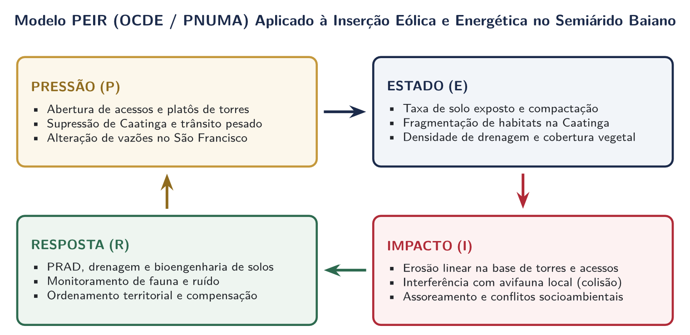
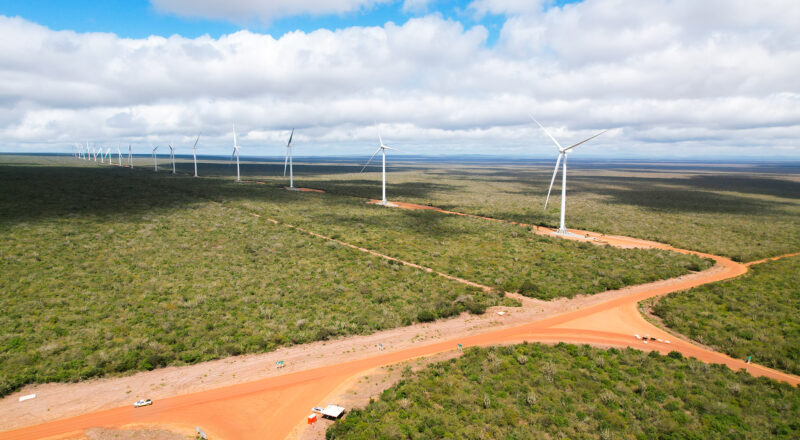
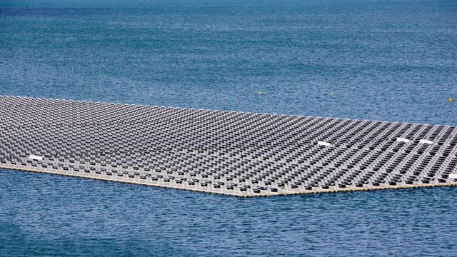

# Indicadores Ambientais, Monitoramento e Análise de Campo no Semiárido Baiano {#cap:indicadores_peir_semiarido}

Indicadores ambientais conectam uma pergunta de gestão a observações que podem ser repetidas. A seleção começa pelo processo e pela decisão que se pretende acompanhar. Um número ganha significado quando sua unidade, área de referência, período e método de obtenção estão definidos.

## Etapa 1 - Objetivos de aprendizagem

O capítulo desenvolve a seleção de indicadores e a construção de relações entre pressão, estado, impacto e resposta. O estudante deve justificar a posição de cada variável no modelo e explicar como os dados serão interpretados durante o monitoramento.

## Etapa 2 - Conhecimentos necessários

A leitura utiliza as distinções entre atividade, alteração do ambiente e consequência, além dos conceitos de bacia e área de influência. Uma estrada pode atravessar diferentes unidades de drenagem, enquanto efeitos sobre a fauna dependem também das rotas e dos períodos de atividade das espécies.

## Etapa 3 - Fundamentação teórica

### Dados, indicadores e índices

Um dado bruto corresponde a uma observação obtida por um procedimento definido, como a área de vegetação removida em uma imagem de determinada data. O indicador relaciona essa informação a uma pergunta de análise. A taxa de supressão, por exemplo, divide a área removida pela área de referência e permite comparar poligonais de tamanhos diferentes, desde que o período e o critério de mapeamento sejam compatíveis.

Um índice agrega indicadores segundo uma regra de normalização e combinação. Essa síntese pode facilitar a comparação, enquanto a apresentação dos valores individuais permite reconhecer qual componente explica a pontuação. A seleção dos pesos e dos limites de referência precisa acompanhar o resultado para que sua interpretação possa ser conferida.

Nesta leitura, $A_{\text{sup}}$ representa a área suprimida em hectares e $T_{\text{sup}}$ sua proporção percentual. A densidade viária $D_v$ relaciona o comprimento dos acessos à área analisada, expressa em quilômetros por quilômetro quadrado. A mortalidade estimada $M_{\text{est}}$ incorpora, no exercício didático, as probabilidades de detecção e persistência das carcaças, representadas por $e$ e $p$.

### Conceito, Funções e Critérios de Seleção de Indicadores Ambientais

No trabalho geográfico e na gestão ambiental, a abundância de dados não equivale automaticamente à qualidade do diagnóstico. Um relatório técnico com dezenas de tabelas desconexas pouco informa ao tomador de decisão se as variáveis não estiverem articuladas a perguntas ambientais precisas. É exatamente essa ponte entre medição e decisão que os **indicadores ambientais** estabelecem.

Segundo a Organização para a Cooperação e Desenvolvimento Econômico (OECD, 2003), um indicador é um parâmetro, ou um valor derivado de parâmetros, que aponta, fornece informações ou descreve o estado de um fenômeno, do ambiente ou de uma área, com significado que ultrapassa aquele diretamente associado ao valor isolado da grandeza medida. No Brasil, o Instituto Brasileiro de Geografia e Estatística (IBGE, 2018), em sua discussão sobre análise ambiental e gestão do território, e Fidalgo (2003), no contexto da conservação de solos e planejamento territorial, destacam que os indicadores cumprem três funções operacionais indispensáveis,

Os indicadores sintetizam processos complexos por meio de grandezas comparáveis e de métodos documentados. Essa síntese deve preservar a ligação com os dados que sustentam o diagnóstico. O registro de fonte, unidade, período e método permite verificar o resultado e reconhecer suas limitações.

A comunicação do indicador precisa explicar a relação entre a medida e a decisão. Uma mudança na cobertura do solo pode orientar uma vistoria, enquanto sua interpretação depende da estação do ano e das intervenções realizadas. Comunidades, conselhos de bacia e órgãos ambientais utilizam essa informação com finalidades diferentes, o que exige explicitar o significado do valor apresentado.

### Pirâmide da Informação Ambiental, do Dado ao Índice

A informação ambiental passa por níveis de tratamento. Registros de chuva, medidas de largura de acessos e contagens de feições constituem dados primários. Sua transformação em taxas e densidades exige definir o suporte espacial e temporal, permitindo relacionar a medida a uma pergunta de análise.

Índices compostos agregam indicadores normalizados e ampliam a capacidade de síntese. A apresentação dos componentes individuais permanece necessária para identificar quais condições explicam a pontuação. Esse registro permite reconhecer situações em que uma média semelhante corresponde a limitações ambientais distintas.

Para evitar a escolha arbitrária de variáveis, OECD (2003), Fidalgo (2003) e IBGE (2018) consolidam quatro critérios principais de seleção que todo indicador deve satisfazer antes de ingressar em uma matriz de monitoramento,

| **Critério** | **Significado Metodológico** | **Pergunta de Auditoria no Diagnóstico** |
|:---|:---|:---|
| **Relevância política e técnica** | O indicador responde diretamente a um problema ambiental concreto, a uma exigência legal ou a uma meta de gestão territorial. | Esse dado ajuda efetivamente a decidir onde mitigar, recuperar ou fiscalizar? |
| **Solidez analítica** | Possui base científica reconhecida, protocolo padronizado de coleta e vínculo causal claro com o processo analisado. | Dois técnicos independentes obteriam valores comparáveis seguindo o mesmo método? |
| **Mensurabilidade** | Pode ser obtido com custo compatível, regularidade temporal e disponibilidade real de dados em campo, laboratório ou bases oficiais. | É possível medir ou atualizar a série histórica sem inviabilizar financeiramente o monitoramento? |
| **Sensibilidade e responsividade** | Detecta alterações precoces do ambiente e responde às intervenções de manejo em horizonte de tempo útil à correção. | O indicador acusa degradação antes do colapso e registra melhoria após ações de controle? |

### Modelos PER e PEIR, Arquitetura Causal e Construção de Matrizes

Um conjunto de indicadores só ganha força interpretativa quando organizado dentro de uma estrutura lógica que explicite causa, consequência e intervenção. O modelo **PER (Pressão, Estado e Resposta)**, formulado inicialmente por Anthony Friend e David Rapport no Canadá e difundido internacionalmente pela OCDE (OECD, 2003), parte de uma lógica de retroalimentação, atividades humanas exercem *pressões* sobre o meio; essas pressões modificam o *estado* (qualidade e quantidade) dos recursos naturais; e a sociedade reage com *respostas* políticas, econômicas ou técnicas voltadas a reduzir as pressões ou recuperar o estado ambiental.

Posteriormente, o Programa das Nações Unidas para o Meio Ambiente (PNUMA/UNEP), nos relatórios *Global Environment Outlook* (GEO), refinou essa estrutura para o modelo **PEIR (Pressão, Estado, Impacto e Resposta)**, amplamente adotado no Brasil pelo IBGE, MMA e estudos ambientais estaduais. A inclusão do compartimento **Impacto (I)** separa com nitidez a alteração biofísica do meio (*Estado*) de suas consequências ecológicas, produtivas e socioambientais (*Impacto*), facilitando a articulação direta com a Avaliação de Impacto Ambiental vista no Capítulo 5.

{#fig-modelo_peir_semiarido}

A leitura da @fig-modelo_peir_semiarido evidencia que o modelo PEIR não é uma lista linear estática, mas um **ciclo de retroalimentação**. Cada componente responde a uma pergunta específica,

A pressão representa ações que participam da transformação do ambiente, como abertura de acessos, supressão vegetal e alteração operacional de vazões. O estado descreve condições observáveis dos compartimentos, como cobertura, densidade do solo e qualidade da água. A escolha do indicador deve declarar qual dessas relações pretende acompanhar.

O impacto corresponde às consequências que a alteração produz sobre funções ambientais e grupos sociais. A perda de capacidade de uma captação ou o comprometimento de um habitat exige relacionar a condição biofísica ao receptor afetado. O mesmo processo pode ser representado por indicadores distintos quando a pergunta de análise muda, desde que a posição adotada no modelo seja justificada.

A resposta reúne medidas de gestão e intervenção, incluindo controle de drenagem, recuperação da cobertura, manutenção e revisão de regras operacionais. Indicadores de execução permitem acompanhar as medidas implantadas. Indicadores de resultado verificam a resposta do ambiente e sustentam a revisão da intervenção.

### Métricas de campo e interpretação das unidades

A taxa de supressão relaciona a área removida à área total da poligonal. As duas áreas devem ser expressas na mesma unidade. A multiplicação da proporção por 100 fornece seu valor percentual.

$$
T_{\mathrm{sup}} = \frac{A_{\mathrm{sup}}}{A_{\mathrm{pol}}} \times 100
$$

O símbolo $A_{\mathrm{sup}}$ representa a área de vegetação suprimida e $A_{\mathrm{pol}}$ a área total de referência, ambas em hectares ou em outra unidade comum. O resultado é informado em porcentagem. A área de referência e a data precisam acompanhar o valor, pois sua mudança altera a comparação.

A densidade viária divide o comprimento dos acessos pela área analisada. Para obter quilômetros de acesso por quilômetro quadrado, a extensão deve estar em quilômetros e a área em quilômetros quadrados.

$$
D_v = \frac{L_{\mathrm{acessos}}}{A_{\mathrm{ref}}}
$$

O comprimento total é representado por $L_{\mathrm{acessos}}$ e a área de referência por $A_{\mathrm{ref}}$. A unidade do resultado é $\mathrm{km\,km^{-2}}$. Quando a área foi fornecida em hectares, sua conversão utiliza a relação $1\ \mathrm{km^2}=100\ \mathrm{ha}$. A densidade informa a extensão relativa da rede, cuja interpretação ambiental depende também de sua posição na drenagem e na cobertura vegetal.

A correção simplificada da mortalidade de aves utiliza a contagem observada e as probabilidades de detecção e persistência. O exemplo assume busca integral da área considerada e define o período da contagem.

$$
M_{\mathrm{est}} = \frac{N_{\mathrm{obs}}}{e\,p}
$$

O número observado de carcaças é $N_{\mathrm{obs}}$. A eficiência da busca é representada por $e$ e a persistência entre campanhas por $p$, com valores maiores que zero e até 1. O resultado corresponde ao período acompanhado e deve ser normalizado por torre e por tempo quando essa for a finalidade. A fórmula é um recurso didático simplificado, cuja utilização operacional depende do desenho e das correções apropriadas ao levantamento.

A variação relativa de um indicador compara a diferença com seu valor inicial. A convenção abaixo produz valores positivos para aumento e negativos para redução.

$$
\Delta_{\%} = \frac{X_f-X_i}{X_i} \times 100
$$

Os símbolos $X_i$ e $X_f$ representam valores inicial e final obtidos em condições comparáveis. O cálculo exige $X_i\ne0$. Quando o valor inicial é zero, a mudança deve ser descrita por diferença absoluta e pelas condições observadas. Para indicadores já expressos em porcentagem, a diferença entre percentuais é informada em pontos percentuais, enquanto a divisão pela condição inicial produz uma variação relativa.

### Estudo de Caso Integrado, Viagem de Campo no Semiárido Baiano

A atividade de campo prevista na Semana 11 do Plano CHF662 examina a região de **Canudos** e o eixo energético do **Rio São Francisco**, com referência a **Paulo Afonso, Rodelas, Sobradinho, Casa Nova, Sento Sé e Juazeiro**. A leitura desse território relaciona a Caatinga, as formas do relevo, os usos da água e as infraestruturas de geração e transmissão. A observação deve registrar as condições de cada parada, distinguindo o que foi visto, o que foi informado por documentos e o que permanece como hipótese de análise.

### Leitura das infraestruturas durante o campo

Os acessos e as plataformas dos aerogeradores conectam a implantação elétrica à dinâmica da vertente (@fig-canudos-acessos). A superfície exposta pode receber o impacto direto das gotas, enquanto valetas e bueiros modificam a direção e a concentração do escoamento. O registro de campo deve localizar saídas de drenagem, proteção dos taludes e eventuais caminhos que alcancem a rede hidrográfica. A fotografia permite reconhecer o arranjo, enquanto a avaliação de impacto depende de medições e de observação temporal.

{#fig-canudos-acessos fig-alt="Vista aérea de aerogeradores interligados por acessos de solo exposto em área de Caatinga"}

A implantação linear pode atravessar unidades de drenagem e aproximar áreas de solo exposto dos canais (@fig-canudos-linear). A análise deve confrontar a rede de acessos com divisores, declividades e trechos de concentração de fluxo. A proporção de área suprimida informa a extensão da intervenção, enquanto a posição e a continuidade dos corredores ajudam a explicar sua conexão com erosão e fragmentação.

{#fig-canudos-linear fig-alt="Aerogeradores alinhados ao longo de uma estrada sobre superfície de solo exposto"}

O armazenamento hidrelétrico modifica o regime de circulação da água e conecta geração a abastecimento, irrigação e manutenção de habitats (@fig-sobradinho-usina). A observação da estrutura deve ser acompanhada de dados de nível, vazão e operação, com referência à data. Uma fotografia registra a condição visível de um momento e precisa ser situada na série temporal para apoiar a interpretação do funcionamento do reservatório.

, licença [CC BY 2.0](https://creativecommons.org/licenses/by/2.0/).](../img/sobradinho_usina_glauco_umbelino.jpg){#fig-sobradinho-usina fig-alt="Vista da estrutura da Usina Hidrelétrica de Sobradinho"}

Arranjos fotovoltaicos flutuantes acrescentam interfaces entre módulos, flutuadores, amarrações e superfície da água (@fig-fpv-detalhe). Variação de nível, vento e ondas modificam as solicitações sobre o conjunto. A avaliação ambiental também precisa considerar sombreamento, circulação da água, manutenção, navegação e acessos, com critérios adequados à escala da implantação.

{#fig-fpv-detalhe fig-alt="Módulos fotovoltaicos sobre flutuadores junto à superfície de um reservatório"}

A configuração do conjunto deve ser examinada junto ao espaço ocupado e às faixas necessárias para circulação e manutenção (@fig-fpv-arranjo). Comparações entre alternativas exigem informar a área analisada, as restrições de uso e a condição hidrodinâmica considerada. As fotografias fornecidas ilustram soluções construtivas e não constituem, por si, comprovação da viabilidade de implantação em um local específico.

{#fig-fpv-arranjo fig-alt="Conjunto de módulos solares flutuantes formando uma plataforma sobre a água"}

### Evidência publicada sobre pistas de vento e erosão em Xingó

As pistas de vento e os focos erosivos foram examinados por Holanda e colaboradores no artigo publicado em 2020 na *Revista Brasileira de Geografia Física* (@fig-xingo-publicado-2020). O mapa do segmento II relaciona a geometria do reservatório à localização dos focos identificados. Essa representação permite formular perguntas sobre exposição das margens e direcionar o levantamento de materiais e processos.

, licença [CC BY 4.0](https://creativecommons.org/licenses/by/4.0/).](../img/artigo_publicado_xingo_fetch_2020.jpeg){#fig-xingo-publicado-2020 fig-alt="Mapa publicado de Xingó com três pistas de vento no segmento II e focos erosivos identificados por códigos FE"}

A associação espacial orienta uma hipótese sobre a ação das ondas, cuja avaliação também depende da resistência dos materiais, da variação do nível e de outras fontes de solicitação. A comparação com mapas de um estudo posterior deve conferir a convenção de azimute, a definição de fetch e a data da geometria utilizada. As representações são mantidas com seus critérios de origem para que diferenças entre procedimentos possam ser examinadas.

### Convergência com o estudo de ondas e seleção de sítios em Xingó

O estudo de Santos, Holanda e Wanderley sobre ondas e fotovoltaica flutuante em Xingó permite discutir a ligação entre geometria, vento e escolha de sítios (@fig-xingo-fetch). O material consultado corresponde ao manuscrito e ao conjunto de dados disponibilizados pelo autor. Xingó é utilizado como estudo comparativo no **Baixo São Francisco, entre Alagoas e Sergipe**, enquanto o roteiro de campo descrito anteriormente se refere ao eixo baiano. Essa distinção situa corretamente a comparação territorial.

{#fig-xingo-fetch fig-alt="Mapa de Xingó com pistas de vento, orientação de sudeste e comprimentos de fetch em diferentes setores"}

O fetch corresponde à distância de atuação do vento sobre a água em uma direção considerada. Sua extensão depende da geometria do reservatório e da posição do ponto analisado. O fetch efetivo combina pistas direcionais segundo a formulação adotada. A altura significativa de onda, representada por $H_s$, pode ser observada por instrumentação ou estimada por modelo, devendo essa origem acompanhar cada resultado.

A seleção de sítios relaciona esses resultados à batimetria e às restrições de ocupação (@fig-xingo-zoneamento). As classes de aptidão do mapa pertencem às condições e aos critérios do estudo de origem. Sua aplicação em Sobradinho ou em outro reservatório exige recalcular as variáveis com geometria, nível, vento e usos locais. A coerência física de uma relação calculada pelo próprio modelo deve ser distinguida da validação com medições independentes.

{#fig-xingo-zoneamento fig-alt="Mapa de zoneamento de Xingó com classes de exposição e sítios R1 a R5"}

| Informação | Relação com o diagnóstico | Conferência necessária para a integração |
|:--|:--|:--|
| Geometria e nível do reservatório | Definem o espelho de água e condicionam as pistas de vento. | Data, referência de nível, sistema de coordenadas e resolução da base. |
| Velocidade e direção do vento | Descrevem a forçante utilizada na análise de ondas. | Altura de medição, intervalo de agregação, falhas e representatividade espacial. |
| Fetch e altura significativa de onda | Relacionam geometria e resposta hidrodinâmica. | Formulação, hipóteses e distinção entre resultados calculados e observados. |
| Focos erosivos e materiais das margens | Situam os receptores da ação hidrodinâmica. | Método de levantamento, evolução temporal e resistência dos materiais. |
| Navegação, captação e habitat | Identificam usos e funções que precisam ser considerados na localização. | Fontes documentais, verificação em campo e critérios de restrição. |

O cruzamento entre focos de erosão, pistas de vento e margens permite formular hipóteses sobre exposição e resposta. A associação espacial deve ser examinada junto à variação do nível, às propriedades do material e às ondas geradas por embarcações. No arquivo de focos consultado, os campos de coordenadas precisam ter sua ordem e seu sistema de referência conferidos antes do uso em SIG. Essa conferência evita deslocar pontos e produzir convergências aparentes entre camadas incompatíveis.

#### Fatores Locacionais de Viabilidade da Matriz Eólica no Semiárido

A concentração de parques eólicos em Canudos, Casa Nova, Sento Sé e no entorno do Lago de Sobradinho não é aleatória. Ela resulta da convergência de quatro condicionantes geográficos e infraestruturais,

A avaliação do recurso eólico deve utilizar séries e mapas com altura, período e método identificados. O [Atlas Eólico da Bahia](https://www.ba.gov.br/secti/20/atlas-eolico-da-bahia) oferece uma referência institucional para examinar a distribuição regional. A faixa de 7,5 a 9,5 metros por segundo a 100 metros de altura, utilizada como cenário de interpretação nesta apostila, precisa ser verificada com dados do local antes de caracterizar um empreendimento.

**Relevo de chapadas, patamares elevados e serras residuais.** Cristas, serrotes e chapadas elevadas acima da Depressão Sertaneja aceleram o escoamento atmosférico por efeito topográfico (efeito Venturi e compressão de fluxo em cristas), posicionando os aerogeradores acima da camada de maior rugosidade superficial.

**Proximidade de linhas de transmissão e subestações do SIN.** O eixo histórico de geração hidrelétrica de Paulo Afonso (complexo CHESF) e Sobradinho já estruturava redes de transmissão de alta tensão conectadas ao Sistema Interligado Nacional (SIN), reduzindo custos de escoamento da energia eólica e solar recém-implantada. **Estrutura fundiária e baixo preço relativo da terra.** Grandes imóveis rurais e áreas de uso comunal (como fundos de pasto) no Semiárido permitiram contratos de arrendamento extensivos, ainda que frequentemente acompanhados de assimetrias informacionais e conflitos territoriais.

#### Convivência com a Caatinga e Diagnóstico dos Principais Impactos Ambientais

Embora a energia eólica apresente baixas emissões de gases de efeito estufa na fase de operação, classificá-la de forma acrítica como “energia de impacto zero” constitui um erro metodológico grave em Análise Ambiental. A avaliação em campo no eixo Canudos-Submédio São Francisco demonstra que os impactos concentram-se na fase de implantação e na reorganização territorial, exigindo diagnóstico rigoroso,

**Supressão de vegetação e fragmentação da Caatinga.** A instalação de cada aerogerador demanda um platô nivelado para fundação e operação de guindastes de grande porte, além de acessos largos com baixa declividade longitudinal para transporte de pás (que ultrapassam $60$ a $80\text{ m}$ de comprimento), valas de cabeamento subterrâneo, subestações e faixas de servidão de linhas de transmissão. Ainda que a fração suprimida aparente ser pequena em relação à poligonal total do parque, a abertura linear de estradas fragmenta habitats, amplia o efeito de borda e facilita a entrada de espécies invasoras, caça ilegal e retirada de lenha.

**Erosão na base das torres, cortes de estrada e drenagem desordenada.** Nos pedimentos e bordas de chapadas de Canudos e Sento Sé, predominam solos rasos, arenosos ou pedregosos, com baixa coesão natural e chuvas convectivas concentradas de alta intensidade. O terraplenamento dos platôs e o escoamento concentrado ao longo das estradas compactadas (sem caixas de contenção ou dissipadores adequados) desencadeiam sulcos e ravinas na borda dos taludes, expondo fundações, soterrando vegetação a jusante e assoreando riachos intermitentes e barreiros comunitários.

**Interferência com a avifauna e quiropterofauna local.** A região de Canudos abriga populações críticas de aves endêmicas e ameaçadas, com destaque emblemático para a arara-azul-de-lear (*Anodorhynchus leari*), que realiza deslocamentos diários entre áreas de dormitório em paredões areníticos (como o Raso da Catarina e a Estação Biológica de Canudos) e áreas de alimentação com licurizeiros (*Syagrus coronata*). A implantação de aerogeradores e linhas de transmissão em rotas de voo implica risco de colisão, efeito barreira (desvio energético oneroso) e perda de áreas de forrageamento, exigindo estudos prévios de telemetria, zonas de exclusão e monitoramento sistemático.

**Regularização de vazões e conflitos por usos múltiplos da água no Submédio São Francisco.** Ao longo do eixo Sobradinho-Casa Nova-Juazeiro-Rodelas-Paulo Afonso, a operação em cascata das usinas hidrelétricas alterou profundamente o pulso natural de cheias e vazantes do Rio São Francisco. A redução de vazões defluentes em períodos de crise hídrica acentua a salinização no baixo curso, favorece a proliferação de bancos de areia e macrófitas, restringe a agricultura de vazante e intensifica disputas entre geração hidrelétrica, irrigação de fruticultura (polo Petrolina-Juazeiro), abastecimento urbano e comunidades ribeirinhas e quilombolas.

### Roteiro Prático de Observação em Campo (DCHF/UEFS)

Durante o percurso técnico em Canudos e no Submédio São Francisco, a equipe discente deve registrar evidências georreferenciadas em quatro eixos integrados, (i) **relevo e substrato** (posição geomorfológica das torres, presença de solos rasos ou afloramentos, declividade dos acessos); (ii) **processos erosivos e drenagem** (selamento, sulcos em borda de platô, saídas de drenagem pluvial e assoreamento de drenagens efêmeras); (iii) **cobertura da Caatinga e fauna** (fisionomia vegetal, presença de licurizeiros, efeito de borda e sinalização de monitoramento faunístico); e (iv) **dinâmica hídrica e socioambiental** (nível de operação dos reservatórios, áreas de irrigação, comunidades de fundo de pasto e percepção local sobre benefícios e incômodos dos empreendimentos).

### Ficha do indicador e tratamento de dados ausentes

A ficha de um indicador define o fenômeno acompanhado, a forma de cálculo e o suporte espacial. Para densidade de focos erosivos em acessos, por exemplo, é necessário registrar o comprimento efetivamente inspecionado, o critério de reconhecimento de um foco e o tratamento dado às feições conectadas. A repetição da campanha exige manter esses critérios.

Um trecho sem vistoria representa informação ausente. A atribuição de zero a esse trecho reduziria artificialmente a densidade calculada. O relatório deve apresentar a extensão observada e a proporção coberta pela campanha, permitindo avaliar a representatividade do resultado. A mesma lógica vale para falhas em sensores, imagens encobertas por nuvens e coletas laboratoriais perdidas.

No acompanhamento de aves, a contagem de carcaças depende da área efetivamente pesquisada, do intervalo entre buscas, da remoção por necrófagos e da capacidade de detecção. A correção simples utilizada nos exercícios ilustra parte dessas relações. Uma estimativa operacional exige protocolo apropriado e avaliação das incertezas de cada componente.

Uma resposta de gestão também precisa separar execução e desempenho. Comprimento de drenagem construído informa execução, enquanto redução de incisões ou manutenção da cobertura informa resultados ambientais. O monitoramento deve acompanhar ambos, pois uma obra concluída pode exigir manutenção ou revisão do seu funcionamento.

## Etapa 4 - Exemplos resolvidos

### Exemplo 10.1 - Seleção de indicadores e interpretação do monitoramento

#### Situação e condições do exercício

Uma equipe técnica da UEFS precisa propor indicadores para acompanhar a conservação da Caatinga no entorno de um complexo eólico em Canudos, Bahia. O problema é reconhecer a evolução da exposição do solo e das feições erosivas associadas a cortes, plataformas e acessos. O monitoramento deve permitir comparar campanhas e identificar onde uma medida de drenagem ou revegetação precisa ser revista.

Quatro candidatos foram apresentados. O quadro registra sua formulação inicial, que precisa ser examinada antes de aceitar o indicador.

| Candidato | Informação proposta | Condição do levantamento |
|:--|:--|:--|
| I | Percentual de área com solo exposto em cortes e plataformas. | Imagens comparáveis, poligonal definida e critério de classificação conferido em campo. |
| II | Percepção genérica de beleza da paisagem. | Opiniões registradas sem questionário padronizado ou desenho amostral. |
| III | Densidade de focos erosivos ativos por quilômetro de acesso. | Vistoria georreferenciada em trechos fixos e ficha de reconhecimento das feições. |
| IV | Sequenciamento genômico semanal de todos os micro-organismos do solo em 80 pontos. | Programa sem protocolo que traduza os resultados em decisão sobre o problema acompanhado. |

Os dados numéricos apresentados a seguir são **hipotéticos e destinados ao exercício**. A equipe dispõe de R$ 8.000 por campanha. O levantamento de imagens e a vistoria conjunta custam R$ 5.000 por campanha, enquanto a proposta laboratorial foi estimada em R$ 80.000 por rodada semanal. Esses valores ilustram uma restrição de orçamento e não representam preços de mercado.

#### Entendimento dos critérios de seleção

A relevância expressa a relação entre a informação e a decisão de gestão. Um indicador de solo exposto é relevante porque permite acompanhar a proteção superficial da área analisada. A solidez analítica depende de um procedimento capaz de produzir valores comparáveis, com definição de área, feição e forma de medição.

A mensurabilidade envolve acesso aos dados, custo e capacidade de repetir o levantamento durante o período necessário. A sensibilidade corresponde à capacidade de registrar alterações do fenômeno em um intervalo útil. Um protocolo pode ser executável e, ainda assim, exigir outro calendário para detectar a resposta esperada.

Nesta triagem, a letra **A** indica atendimento nas condições descritas, **P** indica atendimento parcial e **N** indica ausência de uma condição necessária. As letras representam julgamentos fundamentados. A decisão utiliza a justificativa de cada critério, sem converter automaticamente essas categorias em uma soma de pontos.

#### Aplicação dos critérios aos candidatos

O candidato I responde ao problema de proteção superficial e possui uma unidade de comparação definida. A classificação de solo exposto exige manter a mesma poligonal e um protocolo consistente entre imagens. A verificação em campo deve distinguir superfície mineral descoberta, cobertura vegetal seca e sombra, pois confusões entre essas classes alteram o resultado. Com essas condições atendidas, o indicador pode registrar a evolução após a revegetação.

O candidato II aborda uma dimensão social pertinente, mas sua formulação atual reúne opiniões produzidas em condições diferentes. A percepção da paisagem pode ser investigada com pergunta definida, amostra justificada e procedimento de aplicação. A reformulação permitiria estudar essa dimensão de maneira comparável e complementar o monitoramento físico.

O candidato III relaciona feições ativas ao comprimento efetivamente observado. A ficha deve definir o reconhecimento de um foco, a forma de registrar feições conectadas e os sinais utilizados para reconhecer atividade. A repetição nos mesmos trechos permite comparar campanhas, especialmente quando as condições de chuva e manutenção são documentadas.

O candidato IV ultrapassa o orçamento informado e não apresenta uma ligação operacional entre os resultados e a decisão acompanhada. O estudo da comunidade microbiana pode ser pertinente a outras perguntas e escalas de pesquisa. Para esta proposta, a frequência, o número de pontos e a finalidade analítica precisariam ser reformulados.

| Candidato | Relevância | Solidez analítica | Mensurabilidade | Sensibilidade | Decisão justificada |
|:--|:--:|:--:|:--:|:--:|:--|
| I | A | A | A | A | Selecionar com classificação e verificação padronizadas. |
| II | P | N | N | P | Reformular o protocolo antes da utilização. |
| III | A | A | A | A | Selecionar com trechos fixos e definição de foco ativo. |
| IV | P | P | N | P | Reformular o programa e sua relação com a decisão. |

#### Cálculo do percentual de solo exposto

Na campanha inicial, a poligonal de cortes e plataformas mede 12,0 ha, dos quais 3,6 ha foram classificados como solo exposto. A área de referência é a poligonal efetivamente acompanhada. O numerador e o denominador devem utilizar a mesma unidade.

$$
T_{\mathrm{exp}} = \frac{A_{\mathrm{exp}}}{A_{\mathrm{ref}}} \times 100
$$

O símbolo $A_{\mathrm{exp}}$ representa a área com solo exposto e $A_{\mathrm{ref}}$ a área total de referência. A divisão produz uma proporção adimensional e a multiplicação por 100 expressa o resultado em porcentagem.

$$
T_{\mathrm{exp},1} = \frac{3{,}6\ \mathrm{ha}}{12{,}0\ \mathrm{ha}} \times 100 = 30{,}0\%
$$

O resultado informa que 30,0% da poligonal acompanhada apresentava solo exposto. A área medida deve permanecer disponível junto à porcentagem, pois ela permite verificar o cálculo e comparar a magnitude absoluta da exposição.

#### Cálculo da densidade de focos erosivos

A vistoria inicial cobriu 6,0 km de acessos e identificou 18 focos ativos segundo o protocolo do exercício. A densidade relaciona o número observado ao comprimento inspecionado.

$$
D_{\mathrm{eros}} = \frac{N_{\mathrm{focos}}}{L_{\mathrm{vist}}}
$$

O símbolo $N_{\mathrm{focos}}$ representa a contagem de focos ativos e $L_{\mathrm{vist}}$ o comprimento de acesso efetivamente vistoriado. Trechos sem inspeção precisam ser registrados como informação ausente.

$$
D_{\mathrm{eros},1} = \frac{18\ \mathrm{focos}}{6{,}0\ \mathrm{km}} = 3{,}0\ \mathrm{focos\,km^{-1}}
$$

Essa densidade descreve a frequência espacial das feições reconhecidas. A gravidade precisa ser avaliada com informações complementares, como dimensões, atividade, conexão com canais e elementos expostos a jusante.

#### Comparação após a intervenção

Após ações de drenagem e revegetação, a segunda campanha encontrou 2,4 ha de solo exposto na mesma poligonal de 12,0 ha. A vistoria percorreu novamente os 6,0 km e registrou 9 focos ativos. Os métodos e critérios foram mantidos.

$$
T_{\mathrm{exp},2} = \frac{2{,}4}{12{,}0} \times 100 = 20{,}0\%
$$

$$
D_{\mathrm{eros},2} = \frac{9}{6{,}0} = 1{,}5\ \mathrm{focos\,km^{-1}}
$$

A exposição diminuiu de 30,0% para 20,0%, correspondendo a uma redução de **10,0 pontos percentuais**. A redução relativa utiliza o valor inicial como referência.

$$
r_{\mathrm{exp}} = \frac{30{,}0 - 20{,}0}{30{,}0} \times 100 \approx 33{,}3\%
$$

A densidade passou de 3,0 para 1,5 focos por quilômetro. Mantido o mesmo suporte espacial, a redução relativa corresponde a 50,0%.

$$
r_{\mathrm{eros}} = \frac{3{,}0 - 1{,}5}{3{,}0} \times 100 = 50{,}0\%
$$

#### Interpretação e conferência da resposta

Os resultados indicam melhora dos indicadores nas condições observadas. A interpretação deve considerar a chuva entre campanhas, a sazonalidade da vegetação, a manutenção e a possibilidade de mudança no comportamento dos focos remanescentes. Uma redução na contagem pode coexistir com aumento de tamanho de determinadas feições, o que justifica manter registros de dimensões e fotografias em posições repetidas.

A conclusão do exercício seleciona os candidatos I e III para o monitoramento proposto, recomenda reformular II e IV e relaciona cada decisão aos critérios. O relatório mantém os valores medidos, o suporte espacial e o método de cálculo. Os resultados posteriores à intervenção sustentam a comparação temporal, cuja atribuição causal exige examinar as condições ambientais e operacionais do período.

### Atividade 10.1A - Seleção e cálculo para resolução autônoma

Uma equipe precisa acompanhar a recuperação de acessos de outro empreendimento no Semiárido. O programa dispõe de R$ 6.000 por campanha e prevê medições antes e depois das intervenções. Todos os valores desta atividade são didáticos.

| Candidato | Proposta de monitoramento | Informação sobre o protocolo |
|:--|:--|:--|
| A | Percentual de solo exposto em uma poligonal fixa. | Imagens comparáveis e verificação em campo; custo conjunto com a vistoria de R$ 4.500 por campanha. |
| B | Satisfação dos moradores com os acessos e a drenagem. | Questionário padronizado, amostra justificada e aplicação nas mesmas comunidades. |
| C | Densidade de focos erosivos ativos por quilômetro. | Trechos fixos, ficha georreferenciada e definição prévia de atividade da feição. |
| D | Análise laboratorial diária de todos os atributos químicos do solo em 100 pontos. | Custo estimado de R$ 48.000 por rodada e ausência de justificativa para a frequência diária. |

| Dado observado | Campanha inicial | Campanha posterior |
|:--|--:|--:|
| Área total da poligonal acompanhada | 9,0 ha | 9,0 ha |
| Área classificada como solo exposto | 1,80 ha | 1,08 ha |
| Comprimento efetivamente vistoriado | 4,8 km | 4,8 km |
| Focos erosivos ativos | 12 | 7 |

Construa uma matriz de triagem com os quatro critérios utilizados no exemplo resolvido. Justifique as classificações e as decisões considerando as condições fornecidas, inclusive a possibilidade de acompanhar dimensões sociais com um protocolo adequado.

Calcule a taxa de solo exposto e a densidade de focos em cada campanha. Apresente a fórmula, a substituição, as unidades e a interpretação. Determine a mudança da taxa em pontos percentuais e a redução relativa de cada indicador, mantendo precisão durante o cálculo e arredondando os resultados finais de maneira informada.

Redija uma interpretação técnica que relacione a comparação às condições de chuva, manutenção e representatividade do levantamento. Indique quais dados adicionais permitiriam examinar se as feições remanescentes aumentaram de tamanho. A atividade deve ser entregue com seu próprio desenvolvimento e não apresenta gabarito nesta apostila.

### Exemplo 10.2 (Intermediário). Cálculo de Supressão Vegetal e Densidade Viária em Parque Eólico

**Situação analisada.** Durante a análise do Estudo de Impacto Ambiental (EIA) de um parque eólico situado em uma chapada no eixo Canudos-Sento Sé, você precisa quantificar dois indicadores de Pressão, a taxa percentual de supressão da Caatinga e a densidade de acessos internos dentro da poligonal do empreendimento.

**Dados disponíveis.** Área total da poligonal do empreendimento, $A_{\text{pol}} = 1.600\text{ ha}$. Número de aerogeradores, $25$ torres, cada qual exigindo um platô de montagem de $0{,}45\text{ ha}$. Rede de estradas internas de acesso, extensão total $L_{\text{acessos}} = 18{,}0\text{ km}$ com largura média da faixa suprimida de $10\text{ m}$. Área conjunta de subestação e canteiro de obras, $2{,}75\text{ ha}$.

**Problema a resolver.** Calcular (a) a área total suprimida $A_{\text{sup}}$ em hectares; (b) a taxa percentual de supressão $T_{\text{sup}}$; e (c) a densidade viária interna $D_v$ em $\text{km}\cdot\text{km}^{-2}$.

**Fundamento da análise.** Conversão homogênea de unidades métricas para hectares ($1\text{ ha} = 10.000\text{ m}^2$) e quilômetros quadrados ($1\text{ km}^2 = 100\text{ ha}$), seguida da aplicação das fórmulas de $T_{\text{sup}}$ e $D_v$.

**Desenvolvimento.** **Etapa 1, Área dos platôs das torres,**

$$
A_{\text{platôs}} = 25 \times 0{,}45\text{ ha} = 11{,}25\text{ ha}
$$

 **Etapa 2, Área das estradas de acesso.** Convertemos $18{,}0\text{ km}$ para metros ($18.000\text{ m}$), multiplicamos pela largura de $10\text{ m}$ e dividimos por $10.000\text{ m}^2\cdot\text{ha}^{-1}$,

$$
A_{\text{acessos}} = \frac{18.000\text{ m} \times 10\text{ m}}{10.000\text{ m}^2\cdot\text{ha}^{-1}} = \frac{180.000}{10.000} = 18{,}00\text{ ha}
$$

 **Etapa 3, Área total suprimida e taxa percentual,**

$$
A_{\text{sup}} = 11{,}25 + 18{,}00 + 2{,}75 = 32{,}00\text{ ha}
$$

$$
T_{\text{sup}} = \frac{32{,}00}{1.600} \times 100\% = 0{,}02 \times 100\% = 2{,}00\%
$$

 **Etapa 4, Densidade viária interna.** Convertemos a área da poligonal para $\text{km}^2$, $A_{\text{km}^2} = 1.600 / 100 = 16{,}0\text{ km}^2$.

$$
D_v = \frac{18{,}0\text{ km}}{16{,}0\text{ km}^2} = 1{,}125\text{ km}\cdot\text{km}^{-2}
$$

**Interpretação do resultado.** Área total suprimida de $32{,}00\text{ ha}$, equivalente a uma taxa de supressão de $2{,}00\%$ da poligonal, e densidade viária interna de $1{,}125\text{ km}\cdot\text{km}^{-2}$.

**Condições de validade.** Note um ponto crítico de interpretação geográfica, embora $2{,}00\%$ pareça um percentual reduzido em termos de área absoluta, a maior parcela da supressão ($18{,}0\text{ ha}$, ou $56{,}25\%$ do total) corresponde a corredores lineares (estradas), gerando uma densidade viária superior a $1\text{ km}\cdot\text{km}^{-2}$. Esse arranjo linear potencializa a fragmentação da Caatinga e a concentração de escoamento pluvial.

### Exemplo 10.3 (Intermediário). Construção de Matriz PEIR para o Eixo Energético do Submédio São Francisco

**Situação analisada.** A partir das observações da viagem de campo entre Sobradinho, Casa Nova, Juazeiro, Rodelas e Paulo Afonso, estruture uma matriz PEIR que integre simultaneamente dois vetores territoriais presentes nesse eixo, (1) implantação de complexos eólicos em bordas de chapada e (2) regularização hidrelétrica de vazões no Rio São Francisco.

**Dados disponíveis.** Roteiro de campo DCHF/UEFS e evidências registradas em reservatórios, calha fluvial e parques eólicos instalados sobre Caatinga hiperxerófila.

**Problema a resolver.** Preencher uma matriz PEIR coerente contendo Pressão, Estado, Impacto e Resposta com indicadores mensuráveis para cada vetor.

**Fundamento da análise.** Separação rigorosa entre atividade antrópica (P), alteração física ou biótica do compartimento (E), consequência socioambiental (I) e instrumento de gestão ou mitigação (R).

**Desenvolvimento.** Organizamos os vínculos causais na tabela padronizada abaixo,

| **Vetor** | **Pressão (P)** | **Estado (E)** | **Impacto (I)** | **Resposta (R)** |
|:---|:---|:---|:---|:---|
| **Eólicas na Caatinga** | Abertura de acessos e platôs ($\text{ha}$ suprimidos; $D_v$ em $\text{km}\cdot\text{km}^{-2}$). | Solo exposto ($\%$), compactação ($D_s$) e fragmentação vegetal. | Erosão na base de torres (focos/km) e colisão de avifauna (aves/torre/ano). | Drenagem pluvial, PRAD/bioengenharia e zonas de exclusão para rotas de aves. |
| **Hidrelétricas (São Francisco)** | Operação de reservatórios com redução de vazão defluente ($\text{m}^3\cdot\text{s}^{-1}$). | Alteração do pulso hidrológico, redução de lâmina d’água e bancos arenosos. | Perda de agricultura de vazante, conflitos com irrigação e degradação ripária. | Alocação negociada no CBHSF, vazão ecológica mínima e recomposição de APPs. |

**Interpretação do resultado.** A matriz PEIR articulada permite acompanhar separadamente as causas (P), as mudanças mensuráveis do meio (E), os danos ecológicos e sociais (I) e a efetividade das ações corretivas (R) nos dois eixos energéticos.

**Condições de validade.** Cada coluna apresenta grandezas verificáveis e evita a confusão frequente de classificar uma atividade (pressão) como impacto ou um programa de monitoramento (resposta) como estado ambiental.

### Exemplo 10.4 (Avançado). Indicador Corrigido de Mortalidade de Avifauna em Parque Eólico

**Situação analisada.** O monitoramento de avifauna em um parque eólico com $40$ aerogeradores próximo a corredores ecológicos da Caatinga baiana registrou, ao longo de 12 meses de vistorias padronizadas sob as torres, $18$ carcaças de aves associadas à colisão. Testes experimentais de controle de campo indicaram que a equipe encontra em média $60\%$ das carcaças presentes ($e = 0{,}60$) e que $75\%$ das carcaças permanecem no terreno até o momento da vistoria sem serem removidas por animais necrófagos ($p = 0{,}75$).

**Dados disponíveis.** $N_{\text{obs}} = 18$ aves/ano; número de torres monitoradas $N_t = 40$; eficiência de busca $e = 0{,}60$; taxa de persistência de carcaças $p = 0{,}75$. Limiar operacional de alerta adotado no condicionante ambiental, $0{,}80\text{ ave}\cdot\text{torre}^{-1}\cdot\text{ano}^{-1}$.

**Problema a resolver.** Calcular (a) a taxa bruta não corrigida por torre; (b) a mortalidade anual estimada corrigida $M_{\text{est}}$; e (c) a taxa corrigida por torre/ano, comparando-a ao limiar de alerta.

**Fundamento da análise.** Aplicação do fator de correção amostral $M_{\text{est}} = N_{\text{obs}} / (e \cdot p)$ e relativização pelo número de aerogeradores.

**Desenvolvimento.** **Etapa 1, Taxa bruta (sem correção de viés de detecção),**

$$
T_{\text{bruta}} = \frac{18}{40} = 0{,}45\text{ ave}\cdot\text{torre}^{-1}\cdot\text{ano}^{-1}
$$

 **Etapa 2, Produto dos fatores de detecção,**

$$
e \cdot p = 0{,}60 \times 0{,}75 = 0{,}45
$$

 Isso significa que apenas $45\%$ das colisões reais são efetivamente detectadas nas buscas de campo.

**Etapa 3, Mortalidade total corrigida e taxa por torre,**

$$
M_{\text{est}} = \frac{18}{0{,}45} = 40{,}0\text{ aves}\cdot\text{ano}^{-1}
$$

$$
T_{\text{corr}} = \frac{40{,}0}{40} = 1{,}00\text{ ave}\cdot\text{torre}^{-1}\cdot\text{ano}^{-1}
$$

 **Etapa 4, Comparação com o limiar de alerta ($0{,}80\text{ ave}\cdot\text{torre}^{-1}\cdot\text{ano}^{-1}$),** Como $1{,}00 > 0{,}80$, o limiar de alerta foi ultrapassado em $25\%$ ($\frac{1{,}00 - 0{,}80}{0{,}80}\times 100\% = 25\%$).

**Interpretação do resultado.** A taxa bruta era de $0{,}45\text{ ave}\cdot\text{torre}^{-1}\cdot\text{ano}^{-1}$, mas a taxa corrigida atinge $1{,}00\text{ ave}\cdot\text{torre}^{-1}\cdot\text{ano}^{-1}$ ($M_{\text{est}} = 40$ aves/ano), superando o limiar de alerta e exigindo resposta mitigadora imediata.

**Condições de validade.** O exemplo ilustra por que relatórios sem correção de eficiência de busca e remoção por necrófagos subestimam impactos reais, pela taxa bruta ($0{,}45$), o parque pareceria abaixo do limiar de alerta, ocultando um risco significativo à avifauna da Caatinga.

### Exemplo 10.5 (Avançado). Avaliação Quantitativa de Eficácia de Resposta Mitigadora no Ciclo PEIR

**Situação analisada.** Após vistoria de campo apontar erosão acelerada nos acessos de um complexo eólico no Semiárido, o empreendedor executou um programa de resposta (R) combinando canaletas revestidas, dissipadores de energia em pedra rachão, paliçadas permeáveis e semeadura de espécies nativas da Caatinga nos taludes. Antes das obras, havia $36$ focos erosivos ativos ao longo de $12\text{ km}$ de estradas e cobertura vegetal média nos taludes de $15\%$. Doze meses após as intervenções, nova vistoria registrou $9$ focos ativos e cobertura vegetal média de $69\%$.

**Dados disponíveis.** Antes, $F_0 = 36$ focos em $12\text{ km}$; cobertura $C_0 = 15\%$. Depois (12 meses), $F_1 = 9$ focos em $12\text{ km}$; cobertura $C_1 = 69\%$. Meta contratual do PRAD, redução mínima de $70\%$ nos focos erosivos e incremento mínimo de $50$ pontos percentuais na cobertura vegetal.

**Problema a resolver.** Calcular a densidade inicial e final de focos erosivos, a redução percentual dos focos, o ganho absoluto (pontos percentuais) e relativo na cobertura vegetal, verificando o cumprimento das metas.

**Fundamento da análise.** Cálculo das razões por quilômetro de acesso e das variações absoluta e percentual entre os tempos $t_0$ e $t_1$.

**Desenvolvimento.** **Etapa 1, Densidade de focos erosivos por quilômetro de acesso,**

$$
D_{f,0} = \frac{36}{12} = 3{,}00\text{ focos}\cdot\text{km}^{-1} \qquad \text{e} \qquad D_{f,1} = \frac{9}{12} = 0{,}75\text{ foco}\cdot\text{km}^{-1}
$$

 **Etapa 2, Redução percentual dos focos erosivos,**

$$
\Delta F_{\%} = \frac{9 - 36}{36} \times 100\% = \frac{-27}{36} \times 100\% = -75{,}0\% \quad (\text{redução de } 75{,}0\%)
$$

 **Etapa 3, Ganho de cobertura vegetal (pontos percentuais e aumento relativo),**

$$
\Delta C_{\text{pp}} = 69\% - 15\% = +54\text{ pontos percentuais (p.p.)}
$$

$$
\Delta C_{\text{rel}} = \frac{69 - 15}{15} \times 100\% = \frac{54}{15} \times 100\% = +360{,}0\%
$$

 **Etapa 4, Conferência frente às metas do PRAD,** Redução de focos, $75{,}0\% \ge 70\%$ (meta cumprida). Ganho de cobertura, $54\text{ p.p.} \ge 50\text{ p.p.}$ (meta cumprida).

**Interpretação do resultado.** A densidade de focos caiu de $3{,}00$ para $0{,}75\text{ foco}\cdot\text{km}^{-1}$ (redução de $75{,}0\%$) e a cobertura vegetal avançou $+54$ pontos percentuais ($+360{,}0\%$ relativos), cumprindo ambas as metas do PRAD.

**Condições de validade.** Distinguir *pontos percentuais* (diferença direta entre duas taxas, $69\% - 15\% = 54\text{ p.p.}$) de *variação relativa* ($+360\%$) evita ambiguidades graves em relatórios de auditoria ambiental. Além disso, a permanência de $9$ focos ativos indica necessidade de manutenção pontual no segundo ano.

## Etapa 5 - Erros de interpretação

### Erro 1, Confundir Dado Bruto, Pressão e Impacto na Matriz PEIR

**Equívoco frequente,** Listar “abertura de $18\text{ km}$ de estradas” na coluna de Impacto (I) ou registrar “execução de PRAD” na coluna de Estado (E).

**Correção técnica,** A abertura de estradas é a ação humana geradora de perturbação, logo pertence à **Pressão (P)**. A execução do PRAD é uma intervenção corretiva da sociedade, portanto é **Resposta (R)**. O **Estado (E)** retrata a condição biofísica resultante (percentual de solo exposto), enquanto o **Impacto (I)** expressa o dano ou consequência (ravinamento em taludes, perda de biodiversidade, assoreamento).

### Erro 2, Assumir que Energia Eólica Equivale a Impacto Ambiental Nulo

**Equívoco frequente,** Afirmar em diagnósticos que parques eólicos na Caatinga não causam degradação por serem fontes renováveis de baixa emissão de carbono.

**Correção técnica,** Toda fonte energética possui pegada territorial. No Semiárido Baiano, a implantação eólica envolve terraplenagem pesada, supressão linear da Caatinga, erosão em solos rasos de chapadas, riscos à avifauna (como a arara-azul-de-lear em Canudos) e conflitos fundiários e sonoros que exigem licenciamento rigoroso e monitoramento contínuo.

### Erro 3, Subestimar a Fragmentação ao Olhar Apenas o Percentual Total de Supressão

**Equívoco frequente,** Concluir que uma taxa de supressão de $2\%$ em um parque eólico é ecologicamente irrelevante.

**Correção técnica,** Um pequeno percentual distribuído em forma de malha viária extensa e linhas de transmissão cria centenas de metros de borda exposta, interrompe o deslocamento de fauna terrestre e concentra o escoamento superficial das chuvas torrenciais do Semiárido. Por isso, deve-se sempre complementar $T_{\text{sup}}$ com métricas espaciais como a densidade viária ($D_v$) e o índice de fragmentação.

### Erro 4, Comparar Contagens Brutas de Fauna ou Erosão sem Padronização Amostral

**Equívoco frequente,** Relatar apenas o número absoluto de carcaças de aves ou focos erosivos sem considerar esforço amostral, número de torres, extensão vistoriada ou eficiência de detecção.

**Correção técnica,** Sem relativização (por torre/ano ou por km de estrada) e sem correção de viés de detecção ($e \cdot p$ no monitoramento faunístico), os números não são comparáveis entre campanhas nem entre empreendimentos, comprometendo a solidez analítica exigida pela OCDE (2003).

## Etapa 6 - Exercícios de fixação

#### Nível Básico (Conceitos, Critérios e Modelo PEIR)

1. Explique, com um exemplo concreto ligado ao Semiárido Baiano, a diferença entre **dado bruto**, **indicador ambiental** e **índice ambiental**.

2. Cite os quatro critérios principais de seleção de indicadores ambientais propostos por OECD (2003), Fidalgo (2003) e IBGE (2018), explicando o risco técnico de ignorar o critério da *mensurabilidade*.

3. Qual é a principal diferença conceitual entre o modelo **PER** (OCDE) e o modelo **PEIR** (PNUMA/GEO)? Por que essa distinção favorece a articulação com a Avaliação de Impacto Ambiental?

4. Classifique cada item abaixo como **Pressão (P)**, **Estado (E)**, **Impacto (I)** ou **Resposta (R)** em um parque eólico na Caatinga, (a) abertura de $14\text{ km}$ de estradas de acesso; (b) ravina ativa de $1{,}8\text{ m}$ de profundidade na saída de bueiro; (c) percentual de solo exposto de $42\%$ no talude; (d) instalação de dissipadores de energia e revegetação com espécies nativas.

5. Liste três fatores locacionais geográficos que explicam a intensa concentração de parques eólicos na região de Canudos e no eixo do Submédio São Francisco (Casa Nova, Sento Sé e entorno de Sobradinho).

#### Nível Intermediário (Cálculos de Monitoramento e Interpretação Regional)

6. Um projeto eólico em uma poligonal de $1.200\text{ ha}$ na Bahia prevê $30$ aerogeradores com platôs de $0{,}40\text{ ha}$ cada, $12\text{ km}$ de acessos internos com $8\text{ m}$ de largura média e $2{,}4\text{ ha}$ destinados à subestação. Calcule a área total suprimida ($A_{\text{sup}}$) e a taxa percentual de supressão ($T_{\text{sup}}$).

7. Em um período de estiagem prolongada no Submédio São Francisco, a vazão defluente média da Usina Hidrelétrica de Sobradinho foi reduzida de $1.300\text{ m}^3\cdot\text{s}^{-1}$ para $800\text{ m}^3\cdot\text{s}^{-1}$. Calcule a variação percentual dessa vazão e cite dois impactos socioambientais diretos dessa redução ao longo do eixo Juazeiro-Rodelas-Paulo Afonso.

8. No monitoramento anual de avifauna de um complexo eólico com $50$ torres, registraram-se $24$ carcaças de aves. Ensaios de campo indicaram eficiência de busca $e = 0{,}80$ e persistência de carcaças $p = 0{,}60$. Calcule a mortalidade total estimada ($M_{\text{est}}$) e a taxa corrigida de mortalidade em aves por torre por ano.

9. Uma poligonal de empreendimento energético abrange $1.500\text{ ha}$ e contém $27\text{ km}$ de estradas internas não pavimentadas. Determine a densidade viária interna ($D_v$) em $\text{km}\cdot\text{km}^{-2}$ e discuta como esse indicador se relaciona com a erosão linear na Caatinga.

10. Após obras de drenagem superficial e bioengenharia nos taludes de um parque eólico, o número de focos erosivos ativos reduziu-se de $28$ para $7$ em um ano. Calcule a redução percentual obtida e classifique esse indicador dentro do modelo PEIR.

#### Nível Aplicado (Questões Objetivas A-E) {#10-indicadores-ambientais-peir-nível-aplicado-questões-objetivas-ae}

11. Sobre os critérios de seleção de indicadores ambientais (OECD, 2003; IBGE, 2018), assinale a alternativa correta,

    (A) Um indicador de alta qualidade deve dispensar qualquer protocolo padronizado, permitindo interpretações subjetivas de cada analista.

    (B) A sensibilidade indica a capacidade do indicador de detectar mudanças ambientais precoces e responder às medidas de manejo em prazo útil.

    (C) Indicadores compostos (índices) sempre substituem integralmente os indicadores individuais, tornando desnecessário reportar as variáveis de origem.

    (D) A relevância técnica exige que o indicador utilize equipamentos laboratoriais de alto custo, independentemente da viabilidade de monitoramento contínuo.

    (E) A mensurabilidade refere-se exclusivamente à possibilidade de converter variáveis qualitativas em médias aritméticas sem base amostral.

12. Na matriz PEIR aplicada ao eixo energético do Submédio São Francisco, a “implantação de um programa de monitoramento telemétrico da arara-azul-de-lear e readequação do traçado de linhas de transmissão” corresponde ao componente,

    (A) Pressão (P), pois altera o cronograma financeiro do empreendimento.

    (B) Estado (E), pois descreve a abundância natural da espécie na Caatinga.

    (C) Impacto (I), pois representa o dano causado pelas torres ao habitat.

    (D) Resposta (R), pois consiste em ação técnica e de gestão destinada a prevenir ou mitigar impactos sobre a fauna.

    (E) Fator abiótico de base, externo ao ciclo PEIR.

13. Um parque eólico localizado em área de $2.000\text{ ha}$ suprimiu $0{,}50\text{ ha}$ por platô em $20$ torres e abriu $15\text{ km}$ de acessos com $10\text{ m}$ de largura. Sem outras áreas suprimidas, a taxa percentual de supressão ($T_{\text{sup}}$) da poligonal é igual a,

    (A) $0{,}50\%$.

    (B) $0{,}75\%$.

    (C) $1{,}25\%$.

    (D) $2{,}50\%$.

    (E) $5{,}00\%$.

14. Em relação aos processos físicos observados em parques eólicos implantados em chapadas e serras residuais do Semiárido Baiano, é correto afirmar que,

    (A) A baixa pluviosidade anual do Semiárido impede completamente a ocorrência de erosão hídrica linear na base das torres.

    (B) O terraplenamento de platôs e o escoamento concentrado em estradas compactadas sobre solos rasos potencializam sulcos, ravinas e assoreamento de drenagens intermitentes.

    (C) A substituição da Caatinga por solo exposto em taludes de corte reduz a energia cinética do escoamento superficial.

    (D) A instalação de aerogeradores elimina a necessidade de medidas de drenagem pluvial e PRAD por se tratar de energia renovável.

    (E) Os ventos alísios de sudeste são os únicos responsáveis pelo transporte de sedimentos grosseiros nos bueiros das estradas de acesso.

15. Em um programa de monitoramento de colisão de avifauna com $25$ torres eólicas durante um ano, foram encontradas $15$ carcaças. Sabendo que a eficiência de busca foi $e = 0{,}50$ e a persistência de carcaças foi $p = 0{,}60$, a taxa anual corrigida de mortalidade por torre é,

    (A) $0{,}60\text{ ave}\cdot\text{torre}^{-1}\cdot\text{ano}^{-1}$.

    (B) $1{,}20\text{ aves}\cdot\text{torre}^{-1}\cdot\text{ano}^{-1}$.

    (C) $1{,}50\text{ aves}\cdot\text{torre}^{-1}\cdot\text{ano}^{-1}$.

    (D) $2{,}00\text{ aves}\cdot\text{torre}^{-1}\cdot\text{ano}^{-1}$.

    (E) $2{,}50\text{ aves}\cdot\text{torre}^{-1}\cdot\text{ano}^{-1}$.

## Etapa 7 - Questões de aplicação

### Foco de Provas, ENADE e Concursos (IBAMA / INEMA)

Exames de Geografia e concursos para Analista Ambiental frequentemente combinam leitura crítica de matrizes PEIR com dilemas concretos da transição energética no Nordeste brasileiro. Evite respostas binárias (“energia limpa = sem impacto” ou “toda obra é inviável”) e demonstre domínio da diferenciação entre Pressão, Estado, Impacto e Resposta com métricas verificáveis.

16. **\[Questão Autoral, Estilo ENADE / Geografia\]** A expansão da energia eólica no Semiárido Baiano, especialmente em municípios como Canudos, Sento Sé e Casa Nova, tem ampliado a participação de fontes renováveis na matriz elétrica nacional. Contudo, levantamentos de campo apontam conflitos socioambientais envolvendo fragmentação da Caatinga, erosão em estradas de acesso, ruído próximo a comunidades rurais e risco de colisão para espécies ameaçadas como a arara-azul-de-lear (*Anodorhynchus leari*). À luz da Análise Ambiental integrada, avalie as afirmações a seguir,

    - A viabilidade climática da energia eólica não dispensa o planejamento locacional em escala regional para evitar corredores ecológicos críticos e áreas de uso comunal.

    - O modelo PEIR permite distinguir claramente a abertura de acessos (Pressão), a exposição do solo (Estado), o ravinamento em taludes (Impacto) e as obras de drenagem e PRAD (Resposta).

    - Como a área diretamente ocupada pelas fundações das torres representa pequena fração do terreno, a fragmentação gerada pela malha viária não altera a conectividade da Caatinga.

    É correto o que se afirma em,

    (A) I, apenas.

    (B) III, apenas.

    (C) I e II, apenas.

    (D) II e III, apenas.

    (E) I, II e III.

17. **\[Questão Autoral, Estilo Concurso Analista Ambiental / INEMA-BA\]** No Submédio São Francisco (trecho Sobradinho-Juazeiro-Rodelas-Paulo Afonso), a gestão ambiental enfrenta pressões simultâneas decorrentes da regularização de vazões hidrelétricas, da captação para perímetros irrigados e da expansão de infraestrutura energética. Para compor um painel estadual de monitoramento baseado no modelo PEIR, um técnico deve escolher o conjunto mais coerente de indicadores. Assinale a alternativa em que os quatro elementos correspondem, respectivamente, a **Pressão, Estado, Impacto e Resposta**,

    (A) Assoreamento de bancos de areia; vazão defluente reduzida; plano de bacia; perda de área de vazante.

    (B) Volume captado para irrigação e operação de barramentos; nível fluviométrico e percentual de vegetação ripária; conflito por usos múltiplos da água e redução da pesca artesanal; alocação negociada de água no comitê de bacia e recomposição de APPs.

    (C) Recomposição de APPs; conflito por uso da água; operação de barramentos; nível fluviométrico.

    (D) Nível fluviométrico; volume captado para irrigação; recomposição de APPs; redução da pesca artesanal.

    (E) Conflito por uso da água; plano de bacia; volume captado; percentual de vegetação ripária.

18. **\[Questão Autoral, Estilo Concurso Analista Ambiental / IBAMA\]** Um órgão licenciador exigiu que um empreendimento eólico substituísse indicadores genéricos de seu Programa de Monitoramento por variáveis aderentes aos critérios da OCDE (2003). Qual proposta abaixo atende simultaneamente aos critérios de **relevância técnica, solidez analítica, mensurabilidade e sensibilidade** para monitorar processos erosivos em estradas de acesso?

    (A) Registro fotográfico esporádico sem coordenadas geográficas e sem escala métrica, realizado apenas quando houver reclamação de moradores.

    (B) Quantificação semestral da densidade de sulcos e ravinas ativos por quilômetro de acesso ($\text{focos}\cdot\text{km}^{-1}$) e da profundidade média das incisões em seções fixas georreferenciadas, acompanhada do percentual de cobertura vegetal nos taludes.

    (C) Entrevista informal anual com motoristas do parque sobre se a estrada “parece boa ou ruim” após as chuvas.

    (D) Análise mineralógica por difração de raios X realizada semanalmente em todos os bueiros do empreendimento.

    (E) Contabilização apenas da geração elétrica anual em megawatts-hora (MWh), por ser o dado de maior precisão disponível na subestação.

## Etapa 8 - Gabarito comentado

### Resoluções Completas, Exercícios de Fixação (1 a 15)

1. **Dado bruto** é a medição isolada sem tratamento interpretativo (por exemplo, $12\text{ focos}$ erosivos contados em uma estrada). **Indicador** é a variável relativizada e ligada a um objetivo de gestão (por exemplo, $1{,}5\text{ focos erosivos}\cdot\text{km}^{-1}$ de acesso, comparado a uma meta de controle). **Índice** é a agregação matemática de múltiplos indicadores normalizados em um número sintético único (por exemplo, Índice de Qualidade do Solo combinando matéria orgânica, porosidade, infiltração e densidade).

2. Os quatro critérios são, **relevância política/técnica**, **solidez analítica**, **mensurabilidade** e **sensibilidade**. Ignorar a mensurabilidade resulta em planos de monitoramento inexequíveis na prática (custos proibitivos, ausência de dados históricos ou incapacidade de repetição temporal), gerando relatórios incompletos ou descontinuados.

3. O modelo **PER** reúne alterações físicas do meio e suas consequências sob o guarda-chuva amplo de *Estado*, ao passo que o **PEIR** desdobra o compartimento **Impacto (I)** de modo explícito. Essa separação facilita a AIA porque conecta diretamente a alteração biofísica mensurada (Estado) ao dano ecológico ou socioeconômico que exige mitigação ou compensação (Impacto).

4. \(a\) **Pressão (P)**, ação antrópica geradora de perturbação; (b) **Impacto (I)**, dano erosivo linear resultante; (c) **Estado (E)**, condição atual da superfície do talude; (d) **Resposta (R)**, intervenção técnica corretiva.

5. Três fatores principais, (1) regime de ventos alísios de sudeste/leste constantes e intensos, complementares à sazonalidade hídrica; (2) relevo de chapadas, patamares elevados e serras residuais que amplificam a velocidade do vento acima da rugosidade da Depressão Sertaneja; (3) proximidade da infraestrutura de transmissão de alta tensão do Sistema Interligado Nacional estruturada historicamente a partir das hidrelétricas de Paulo Afonso e Sobradinho.

6. **Passo a passo,** Platôs, $30 \times 0{,}40\text{ ha} = 12{,}00\text{ ha}$. Acessos, $12.000\text{ m} \times 8\text{ m} = 96.000\text{ m}^2 = 9{,}60\text{ ha}$. Subestação, $2{,}40\text{ ha}$. Área total suprimida, $A_{\text{sup}} = 12{,}00 + 9{,}60 + 2{,}40 = \mathbf{24{,}00\text{ ha}}$. Taxa de supressão, $T_{\text{sup}} = (24{,}00 / 1.200) \times 100\% = \mathbf{2{,}00\%}$.

7. **Passo a passo,** $\Delta_{\%} = \frac{800 - 1.300}{1.300} \times 100\% = \frac{-500}{1.300} \times 100\% \approx \mathbf{-38{,}46\%}$ (redução de $38{,}46\%$). Impactos diretos, restrição à agricultura de vazante e pesca artesanal, exposição de bancos arenosos com maior dificuldade de captação ribeirinha e acirramento de conflitos entre geração elétrica, perímetros irrigados e abastecimento humano.

8. **Passo a passo,** Fator de detecção combinado, $e \cdot p = 0{,}80 \times 0{,}60 = 0{,}48$. Mortalidade total estimada, $M_{\text{est}} = 24 / 0{,}48 = \mathbf{50{,}0\text{ aves}\cdot\text{ano}^{-1}}$. Taxa corrigida por torre, $50{,}0 / 50 = \mathbf{1{,}00\text{ ave}\cdot\text{torre}^{-1}\cdot\text{ano}^{-1}}$.

9. **Passo a passo,** Convertemos $1.500\text{ ha}$ para quilômetros quadrados, $A_{\text{km}^2} = 1.500 / 100 = 15{,}0\text{ km}^2$. Densidade viária, $D_v = 27 / 15{,}0 = \mathbf{1{,}80\text{ km}\cdot\text{km}^{-2}}$. Uma malha densa de estradas compactadas intercepta o escoamento superficial natural, reduz a infiltração e concentra enxurradas nas saídas de drenagem, desencadeando sulcos e ravinas nos solos rasos da Caatinga.

10. **Passo a passo,** $\Delta F_{\%} = \frac{7 - 28}{28} \times 100\% = \frac{-21}{28} \times 100\% = \mathbf{-75{,}0\%}$ (redução de $75{,}0\%$). O indicador de focos erosivos ativos expressa um **Impacto (I)**, enquanto sua redução monitorada após as obras permite aferir a eficácia da **Resposta (R)** aplicada.

11. **Gabarito, (B).** Sensibilidade e responsividade designam exatamente a capacidade de detectar alterações precoces e responder às medidas de manejo. (A) contradiz solidez analítica; (C) é falsa porque índices não substituem o reporte das variáveis de base; (D) confunde rigor com custo proibitivo; (E) distorce mensurabilidade.

12. **Gabarito, (D).** Programas de monitoramento faunístico e readequação de traçado são ações de gestão voltadas a prevenir ou mitigar danos, caracterizando **Resposta (R)**.

13. **Gabarito, (C).** Platôs, $20 \times 0{,}50 = 10{,}0\text{ ha}$. Acessos, $15.000\text{ m} \times 10\text{ m} = 150.000\text{ m}^2 = 15{,}0\text{ ha}$. Total, $25{,}0\text{ ha}$. Taxa, $(25{,}0 / 2.000) \times 100\% = \mathbf{1{,}25\%}$.

14. **Gabarito, (B).** Mesmo com menor total pluviométrico anual, o Semiárido apresenta chuvas convectivas concentradas de alta erosividade; combinadas a solos rasos, terraplenagem e compactação de estradas, elas geram erosão linear intensa e assoreamento.

15. **Gabarito, (D).** Produto $e \cdot p = 0{,}50 \times 0{,}60 = 0{,}30$. Mortalidade total estimada, $M_{\text{est}} = 15 / 0{,}30 = 50$ aves/ano. Dividindo por $25$ torres, $50 / 25 = \mathbf{2{,}00\text{ aves}\cdot\text{torre}^{-1}\cdot\text{ano}^{-1}}$.

### Resoluções Completas, Questões ENADE e Concursos (16 a 18)

16. **Gabarito, (C).** As afirmações I e II são tecnicamente corretas e articulam o planejamento locacional ao ciclo PEIR. A afirmação III está incorreta porque estruturas lineares (estradas e linhas de transmissão) fragmentam a Caatinga e ampliam o efeito de borda mesmo quando a área suprimida percentual parece pequena.

17. **Gabarito, (B).** Apenas (B) respeita a sequência causal exata, captação/operação de barramentos (**P**) $\rightarrow$ nível fluviométrico e vegetação ripária (**E**) $\rightarrow$ conflitos hídricos e queda na pesca (**I**) $\rightarrow$ alocação negociada no CBHSF e recomposição de APPs (**R**).

18. **Gabarito, (B).** A densidade semestral de incisões por km, profundidade em seções fixas georreferenciadas e cobertura vegetal de taludes cumpre todos os quatro critérios da OCDE, relevância direta à erosão, protocolo padronizado, viabilidade operacional e alta sensibilidade a medidas de drenagem e revegetação.

## Etapa 9 - Síntese conceitual

**Indicador vs. Dado vs. Índice.** Dados brutos alimentam indicadores (variáveis relativizadas com significado de gestão), que podem ser agregados em índices compostos sem descartar a leitura individual. **Critérios de seleção (OECD, 2003; Fidalgo, 2003; IBGE, 2018).** Relevância política/técnica, solidez analítica, mensurabilidade e sensibilidade. **Ciclo PEIR,** Pressão (vetores antrópicos) $\rightarrow$ Estado (condição biofísica) $\rightarrow$ Impacto (consequências ecológicas e sociais) $\rightarrow$ Resposta (mitigação, PRAD, ordenamento) $\rightarrow$ retroalimentação sobre P e E. **Campo no Semiárido Baiano (Canudos e Submédio São Francisco).** A inserção eólica e hidrelétrica exige monitoramento conjunto de supressão e fragmentação da Caatinga ($T_{\text{sup}}$ e $D_v$), erosão na base de torres e acessos, mortalidade corrigida de avifauna ($M_{\text{est}} = N_{\text{obs}}/(e\cdot p)$) e governança de vazões no Rio São Francisco.

## Etapa 10 - Verificação da aprendizagem

Avalie cada afirmação com **V** (Verdadeiro) ou **F** (Falso) antes de conferir o gabarito abaixo,

1. ( ) No modelo PEIR, a abertura de estradas de acesso e a terraplenagem de platôs eólicos são classificadas como *Pressão*, enquanto a formação de ravinas nos taludes configura um *Impacto*.

2. ( ) Na avaliação de mortalidade de avifauna em parques eólicos, o número bruto de carcaças encontradas é suficiente, pois a eficiência de busca e a ação de necrófagos não afetam a estimativa real.

3. ( ) A complementaridade entre o regime de ventos alísios no segundo semestre e a sazonalidade hídrica do Rio São Francisco é um dos fatores locacionais estratégicos da expansão eólica no Semiárido Baiano.

4. ( ) Uma baixa taxa percentual de supressão vegetal ($2\%$) garante, por si só, ausência de fragmentação de habitats e de concentração de escoamento superficial na Caatinga.

**Gabarito do verificação da aprendizagem,** 1-**V** \|-**F** (sem corrigir $e \cdot p$, a mortalidade real é subestimada) \|-**V** \|-**F** (acessos lineares geram fragmentação e concentração de enxurrada mesmo com baixo percentual de área).
