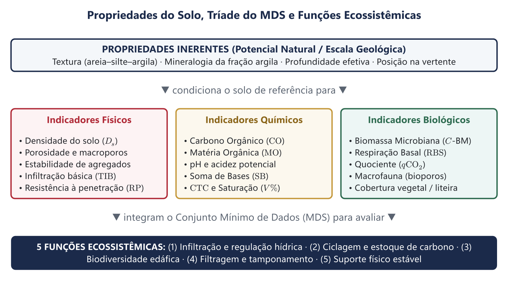
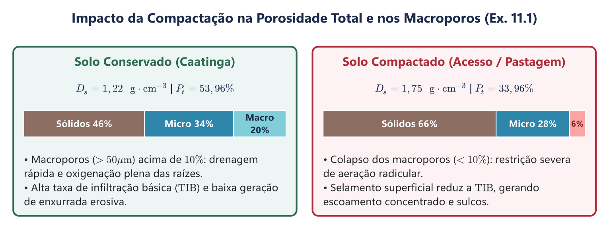
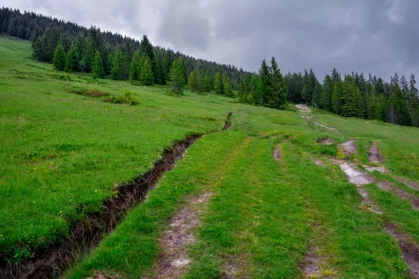
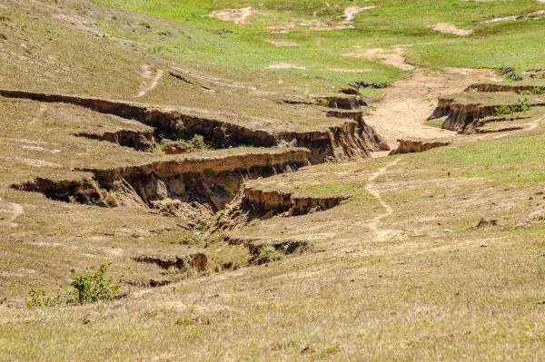
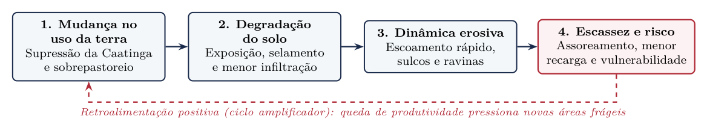
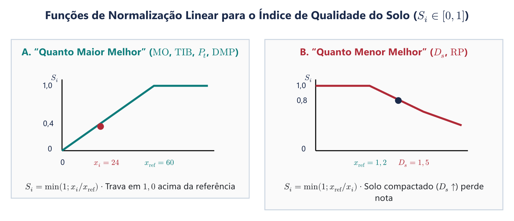
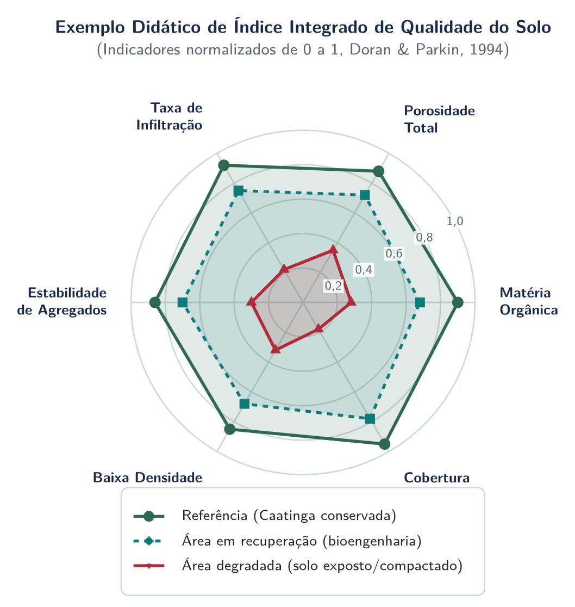

# Indicadores de Qualidade do Solo e Funcionalidade Edáfica {#cap:qualidade_solo}

Qualidade do solo expressa a capacidade de um solo específico funcionar, dentro dos limites de seu ecossistema e de seu uso, para regular o fluxo de água, ciclar nutrientes, estocar carbono e sustentar a atividade biológica. Um solo quimicamente adubado pode continuar degradado se estiver compactado, sem cobertura vegetal e incapaz de absorver a água da chuva. Por isso, a avaliação ambiental integra atributos físicos, químicos e biológicos, sempre comparados a uma área de referência na mesma classe de solo, profundidade e época de amostragem.

::: {.callout-note title="O que você vai aprender neste capítulo"}
O capítulo desenvolve a interpretação de indicadores físicos, químicos e biológicos e a construção de índices de qualidade do solo (IQS). Ao longo da leitura, diagramas explicativos, fotografias de campo, gráficos e exemplos resolvidos acompanham cada conceito passo a passo.
:::

::: {.callout-tip title="Revisando o que você precisa saber"}
A leitura retoma massa, volume, porosidade e matéria orgânica. Uma amostra indeformada preserva a organização natural dos poros necessária à determinação da densidade do solo, enquanto as análises químicas dependem do registro exato das unidades do laudo ($CO$ ou $MO$) e dos critérios de preparo.
:::

## Vocabulário Técnico e Símbolos do Capítulo 11

**Qualidade do Solo (QS).** Capacidade de um solo funcionar, dentro dos limites do ecossistema natural ou manejado, para sustentar a produtividade biológica, manter a qualidade da água e do ar e suportar a saúde dos habitats (Karlen et al., 1997). **MDS (*Minimum Data Set*),** conjunto mínimo e não redundante de atributos físicos, químicos e biológicos capaz de representar a funcionalidade do solo com viabilidade analítica.

$D_s$ e $D_p$, densidade do solo (massa de solo seco dividida pelo volume total do anel, em $\text{g}\cdot\text{cm}^{-3}$) e densidade de partículas (massa de sólidos dividida apenas pelo volume das partículas minerais e orgânicas, usualmente $2{,}65\text{ g}\cdot\text{cm}^{-3}$ para solos minerais quartzosos). $P_t$, $P_{\text{macro}}$ e $P_{\text{micro}}$, porosidade total, macroporosidade e microporosidade ($\%$ em volume). $MO$ e $CO$, matéria orgânica do solo e carbono orgânico total ($\text{g}\cdot\text{kg}^{-1}$ ou $\%$), relacionados pelo fator de van Bemmelen ($1{,}724$). $SB$, $CTC$ e $V\%$, soma de bases trocáveis ($\text{cmol}_c\cdot\text{dm}^{-3}$), capacidade de troca catiônica a pH $7{,}0$ ($\text{cmol}_c\cdot\text{dm}^{-3}$) e saturação por bases ($\%$).

$TIB$ e $RP$, taxa de infiltração básica ($\text{mm}\cdot\text{h}^{-1}$) e resistência do solo à penetração ($\text{MPa}$). $S_i$, $w_i$ e $\text{IQS}$, pontuação normalizada ($0$ a $1$) do indicador $i$, peso atribuído ao indicador ($\sum w_i = 1$) e Índice de Qualidade do Solo ($0$ a $1$).

## Conceito de Qualidade do Solo, Propriedades Inerentes e Tríade do MDS

Durante décadas, a ciência do solo concentrou-se na fertilidade química voltada à resposta imediata de lavouras a fertilizantes minerais. Na Análise Ambiental, essa abordagem isolada mostra-se insuficiente porque um solo rico em fósforo e potássio pode sofrer compactação severa sob tráfego de máquinas ou pisoteio, perdendo sua rede de poros maiores. Quando isso ocorre, a água da chuva encontra resistência na superfície, forma enxurrada erosiva, arrasta sedimentos para os rios e reduz a recarga do lençol freático.

A partir da década de 1990, Doran e Parkin (1994) e Karlen et al. (1997) consolidaram o conceito moderno de **Qualidade do Solo**, centrado em cinco funções ecossistêmicas interdependentes. O solo regula e particiona o fluxo de água (controlando infiltração, armazenamento e drenagem), sustenta a biodiversidade e a atividade microbiana, filtra e tampona poluentes orgânicos e inorgânicos, cicla nutrientes enquanto estoca carbono orgânico, e oferece suporte físico estável às raízes e às obras humanas. No Brasil, Vezzani e Mielniczuk (2009) destacam que essa qualidade emerge da interação contínua entre a arquitetura física dos agregados, a dinâmica da matéria orgânica e os organismos vivos, exigindo comparação direta com um **solo de referência** sob vegetação nativa na mesma classe pedológica e condição climática.

Para diagnosticar se um solo perdeu funcionalidade por ação humana ou se determinada característica é natural daquele ambiente, distingue-se o potencial natural herdado da condição dinâmica atual (@fig-triade-mds-funcoes). As **propriedades inerentes** (textura areia-silte-argila, mineralogia da fração argila, profundidade efetiva e posição na vertente) mudam apenas em escalas geológicas e determinam qual solo de referência deve ser adotado. Já as **propriedades dinâmicas** (densidade, porosidade, matéria orgânica, infiltração e atividade microbiana) alteram-se em meses ou poucos anos conforme o manejo, formando o **Conjunto Mínimo de Dados (MDS)** dividido entre indicadores físicos, químicos e biológicos.

{#fig-triade-mds-funcoes fig-alt="Diagrama mostrando propriedades inerentes no topo, três blocos de indicadores físicos, químicos e biológicos no centro e cinco funções ecossistêmicas na base"}

## Indicadores Físicos (Arquitetura Porosa e Fluxo Hídrico)

Os atributos físicos governam a circulação de água, ar e raízes no perfil edáfico e respondem rapidamente à degradação mecânica observada em pastagens sobrepastoreadas, áreas agrícolas convencionais e acessos de obras civis ou parques eólicos.

A **densidade do solo ($D_s$)** mede a massa de solo seco contida em um volume conhecido de solo estruturado. Para preservar os poros originais sem esmagá-los, coleta-se uma amostra indeformada cravando um cilindro metálico de volume conhecido $V_t$ (anel de Kopecky) no perfil, levando-o à estufa a $105\,^\circ\text{C}$ até massa constante ($m_s$). Quanto maior a compactação imposta pelo tráfego ou pisoteio, mais partículas sólidas são comprimidas no mesmo volume e maior fica $D_s$. Solos minerais conservados exibem tipicamente valores entre $1{,}00$ e $1{,}35\text{ g}\cdot\text{cm}^{-3}$ (menores em solos argilosos estruturados e ligeiramente maiores em solos arenosos); valores acima de $1{,}55$–$1{,}65\text{ g}\cdot\text{cm}^{-3}$ em solos de textura média a argilosa costumam impor restrição severa ao crescimento radicular.

Para compreender o efeito real dessa compactação sobre a água e o ar, analisa-se a **porosidade total ($P_t$)** em conjunto com a separação entre **macroporosidade e microporosidade** (@fig-porosidade-compactacao). Em laboratório, a mesa de tensão aplica uma sucção de $6\text{ kPa}$ ao anel saturado para separar duas famílias funcionais de poros: os **macroporos** ($> 50\,\mu\text{m}$, drenados a $6\text{ kPa}$) garantem a aeração das raízes e a infiltração rápida durante chuvas intensas, enquanto os **microporos** ($< 50\,\mu\text{m}$, que retêm água após $6\text{ kPa}$) armazenam umidade disponível às plantas. Sob pressão mecânica, os macroporos colapsam primeiro; quando a macroporosidade cai abaixo de $10\%$ do volume total do solo, a oxigenação radicular torna-se crítica.

{#fig-porosidade-compactacao fig-alt="Barras proporcionais comparando solo conservado com 46% sólidos, 34% microporos e 20% macroporos frente a solo compactado com 66% sólidos, 28% microporos e 6% macroporos"}

A integridade dessa arquitetura porosa depende da **estabilidade de agregados em água**, medida pelo Diâmetro Médio Ponderado (DMP) em peneiramento úmido, que indica a resistência dos torrões ao impacto das gotas de chuva (*splash*), prevenindo o selamento superficial. Quando o selamento ocorre ou os macroporos diminuem, cai abruptamente a **Taxa de Infiltração Básica ($TIB$)**, medida em campo com infiltrômetro de anéis concêntricos ($\text{mm}\cdot\text{h}^{-1}$), convertendo chuvas moderadas em escoamento superficial concentrado e sulcos erosivos (@fig-solo-compactado-sulco). Complementando essa leitura, a **Resistência do solo à penetração ($RP$)**, medida com penetrômetro ($\text{MPa}$), quantifica o esforço mecânico enfrentado pelas raízes; na capacidade de campo, valores acima de $2{,}0$–$2{,}5\text{ MPa}$ impõem impedimento físico severo.

{#fig-solo-compactado-sulco fig-alt="Estrada de terra compactada apresentando sulco erosivo profundo escavado pelo escoamento superficial concentrado"}

As equações físicas abaixo permitem calcular a densidade do solo, a porosidade total e as frações de macro e microporos a partir das pesagens do anel volumétrico saturado ($m_{\text{sat}}$), drenado a $6\text{ kPa}$ ($m_{6\text{kPa}}$) e seco em estufa ($m_s$), adotando $\rho_{\text{água}} = 1{,}0\text{ g}\cdot\text{cm}^{-3}$:

$$
D_s = \frac{m_s}{V_t} \quad (\text{g}\cdot\text{cm}^{-3}) \qquad\qquad P_t = \left(1 - \frac{D_s}{D_p}\right) \times 100\%
$$

$$
P_{\text{micro}} = \frac{m_{6\text{kPa}} - m_s}{\rho_{\text{água}} \cdot V_t}\times 100\% \qquad\qquad P_{\text{macro}} = \frac{m_{\text{sat}} - m_{6\text{kPa}}}{\rho_{\text{água}} \cdot V_t}\times 100\%
$$

O Exemplo 11.1 aplica diretamente essas expressões aos dados representados na @fig-porosidade-compactacao.

::: {.callout-tip appearance="simple"}
### Exemplo 11.1 (Básico). Cálculo de Densidade do Solo e Porosidade Total em Anel Volumétrico

**Situação e dados.** Durante campanha da disciplina CHF662 na camada $0$–$10\text{ cm}$ ($V_t = 100\text{ cm}^3$; $D_p = 2{,}65\text{ g}\cdot\text{cm}^{-3}$), uma amostra sob Caatinga conservada apresentou massa seca $m_{s,1} = 122\text{ g}$ e outra na borda compactada de um acesso eólico apresentou $m_{s,2} = 175\text{ g}$.

**Cálculo passo a passo.** Para a Caatinga conservada, $D_{s,1} = \frac{122}{100} = 1{,}22\text{ g}\cdot\text{cm}^{-3}$ e $P_{t,1} = \left(1 - \frac{1{,}22}{2{,}65}\right)\times 100\% = 53{,}96\%$. Para o acesso compactado, $D_{s,2} = \frac{175}{100} = 1{,}75\text{ g}\cdot\text{cm}^{-3}$ e $P_{t,2} = \left(1 - \frac{1{,}75}{2{,}65}\right)\times 100\% = 33{,}96\%$.

**Interpretação.** A compactação elevou $D_s$ em $0{,}53\text{ g}\cdot\text{cm}^{-3}$ e eliminou exatamente $20{,}00$ pontos percentuais de porosidade ($37{,}1\%$ de perda relativa), colapsando prioritariamente os macroporos de drenagem rápida.
:::

Quando o diagnóstico físico inclui medições em mesa de tensão, quantifica-se separadamente quanto dessa porosidade total permanece disponível para aeração radicular, conforme detalhado no Exemplo 11.4.

::: {.callout-tip appearance="simple"}
### Exemplo 11.4 (Avançado). Separação de Macro e Microporosidade em Mesa de Tensão

**Situação e dados.** Uma amostra indeformada ($V_t = 100\text{ cm}^3$; $\rho_{\text{água}} = 1{,}0\text{ g}\cdot\text{cm}^{-3}$) em área sob bioengenharia registrou massa saturada $m_{\text{sat}} = 174\text{ g}$, massa após equilíbrio a $6\text{ kPa}$ de $m_{6\text{kPa}} = 158\text{ g}$ e massa seca $m_s = 128\text{ g}$.

**Cálculo passo a passo.** Como cada $1\text{ g}$ de água ocupa $1\text{ cm}^3$ de poro:

$$
P_t^{\text{sat}} = \frac{174 - 128}{100}\times 100\% = 46{,}0\% \qquad P_{\text{micro}} = \frac{158 - 128}{100}\times 100\% = 30{,}0\% \qquad P_{\text{macro}} = \frac{174 - 158}{100}\times 100\% = 16{,}0\%
$$

**Interpretação.** A soma confere ($30{,}0\% + 16{,}0\% = 46{,}0\%$), e a macroporosidade de $16{,}0\%$ supera o limiar crítico de $10\%$, indicando boa aeração radicular aliada à retenção hídrica.
:::

Na leitura de campo dos indicadores físicos, dois erros frequentes comprometem os laudos ambientais: comparar solos de texturas diferentes sem referência local e medir resistência à penetração sem registrar a umidade.

::: {.callout-warning appearance="simple"}
### Erro 1, Comparar Áreas em Solos de Texturas Distintas Sem Referência Local

**Equívoco frequente.** Classificar um Neossolo Quartzarênico arenoso ($D_s = 1{,}45\text{ g}\cdot\text{cm}^{-3}$) como degradado comparando-o a um Latossolo argiloso conservado ($D_s = 1{,}05\text{ g}\cdot\text{cm}^{-3}$).

**Correção técnica.** Solos arenosos possuem naturalmente maior densidade e menor $CTC$ do que solos argilosos bem estruturados. A área de referência sob vegetação nativa deve pertencer à **mesma classe de solo, textura e posição geomorfológica** da área diagnosticada.
:::

No Semiárido, a sazonalidade hídrica amplia drasticamente a coesão aparente do solo seco, exigindo cuidado adicional nas leituras de penetrômetro.

::: {.callout-warning appearance="simple"}
### Erro 2, Avaliar Resistência à Penetração ($RP$) Sem Registrar a Umidade do Solo

**Equívoco frequente.** Medir $RP$ na estação seca no Semiárido, obter valores acima de $4{,}0\text{ MPa}$ e diagnosticar compactação antrópica irreversível.

**Correção técnica.** A resistência mecânica à penetração aumenta exponencialmente à medida que o solo seca, devido à coesão entre partículas e à sucção matricial. Leituras de penetrômetro são comparáveis apenas quando obtidas sob umidade controlada (próxima à capacidade de campo) ou acompanhadas do teor gravimétrico de umidade.
:::

## Indicadores Químicos (Matéria Orgânica, Acidez e Troca Catiônica)

Os atributos químicos determinam a disponibilidade de nutrientes, o poder tampão e a estabilidade coloidal do solo. A **Matéria Orgânica ($MO$)** e o **Carbono Orgânico Total ($CO$)** integram física, química e biologia porque cimentam agregados, elevam a retenção de água e fornecem a maior parte das cargas negativas da $CTC$ em solos tropicais intemperizados. Como os métodos laboratoriais (Walkley-Black ou combustão seca) quantificam diretamente o carbono orgânico ($CO$), estima-se a matéria orgânica multiplicando $CO$ pelo **fator de van Bemmelen ($1{,}724$)**, baseado na convenção clássica de que a matéria orgânica humificada contém aproximadamente $58\%$ de carbono em massa ($1 / 0{,}58 \approx 1{,}724$). As expressões abaixo relacionam $CO$, $MO$ e o estoque de carbono ($EC$, em $\text{Mg C}\cdot\text{ha}^{-1}$) na camada de espessura $h_{\text{m}}$ (adotando $1\text{ g}\cdot\text{cm}^{-3} = 1\text{ Mg}\cdot\text{m}^{-3}$):

$$
CO = \frac{MO}{1{,}724} \quad \Longleftrightarrow \quad MO = CO \times 1{,}724 \qquad\qquad EC = \left(\frac{CO_{\text{g/kg}}}{1000}\right) \cdot D_s \cdot (10.000 \cdot h_{\text{m}})
$$

O Exemplo 11.2 demonstra como padronizar laudos expressos em grandezas distintas e quantificar a perda de carbono por hectare.

::: {.callout-tip appearance="simple"}
### Exemplo 11.2 (Básico/Intermediário). Fator de van Bemmelen e Estoque de Carbono na Camada 0 a 20 cm

**Situação e dados.** Na camada $h = 0{,}20\text{ m}$, um laudo reportou $CO_A = 18{,}0\text{ g}\cdot\text{kg}^{-1}$ sob Caatinga preservada ($D_{s,A} = 1{,}25\text{ g}\cdot\text{cm}^{-3}$), enquanto outro laboratório reportou $MO_B = 12{,}068\text{ g}\cdot\text{kg}^{-1}$ em pastagem degradada adjacente ($D_{s,B} = 1{,}60\text{ g}\cdot\text{cm}^{-3}$).

**Cálculo passo a passo.** Pelo fator de van Bemmelen, $MO_A = 18{,}0 \times 1{,}724 = 31{,}032\text{ g}\cdot\text{kg}^{-1}$ e $CO_B = 12{,}068 / 1{,}724 = 7{,}00\text{ g}\cdot\text{kg}^{-1}$. Em $1\text{ ha}$, o volume da camada é $V_{\text{ha}} = 10.000 \times 0{,}20 = 2.000\text{ m}^3\cdot\text{ha}^{-1}$. Na Área A, a massa de solo é $2.000 \times 1{,}25 = 2.500\text{ Mg}\cdot\text{ha}^{-1}$ e $EC_A = 2.500 \times 0{,}018 = 45{,}00\text{ Mg C}\cdot\text{ha}^{-1}$. Na Área B, a massa é $2.000 \times 1{,}60 = 3.200\text{ Mg}\cdot\text{ha}^{-1}$ e $EC_B = 3.200 \times 0{,}007 = 22{,}40\text{ Mg C}\cdot\text{ha}^{-1}$, indicando perda de $22{,}60\text{ Mg C}\cdot\text{ha}^{-1}$ ($-50{,}2\%$).

**Interpretação.** Mesmo com maior massa de solo em $20\text{ cm}$ na Área B devido à compactação ($3.200$ vs. $2.500\text{ Mg}$), a degradação já eliminou metade do estoque original de carbono.
:::

Na leitura comparativa de análises laboratoriais, trocar carbono orgânico por matéria orgânica sem conversão prévia distorce qualquer diagnóstico ambiental.

::: {.callout-warning appearance="simple"}
### Erro 3, Confundir Carbono Orgânico ($CO$) com Matéria Orgânica ($MO$)

**Equívoco frequente.** Comparar diretamente um laudo expresso em $CO$ ($\text{g}\cdot\text{kg}^{-1}$) com outro expresso em $MO$ ($\text{g}\cdot\text{kg}^{-1}$) sem conversão prévia.

**Correção técnica.** A matéria orgânica contém carbono, oxigênio, hidrogênio e nitrogênio; portanto, $MO$ é sempre numericamente maior que $CO$ ($MO = 1{,}724 \times CO$). Padronize todas as amostras na mesma grandeza antes de comparar resultados ou calcular estoques de carbono.
:::

O **potencial hidrogeniônico (pH)** controla a solubilidade de nutrientes e a toxicidade do alumínio trocável ($Al^{3+}$) abaixo de pH $5{,}5$. No Semiárido Baiano, Luvissolos e Neossolos pouco intemperizados tendem a apresentar pH levemente ácido a neutro ($6{,}0$–$7{,}2$), enquanto Latossolos profundos de tabuleiros costumam ser mais ácidos ($4{,}5$–$5{,}5$). Associando a **Soma de Bases ($SB$)** à acidez potencial ($H^+ + Al^{3+}$), obtém-se a $CTC$ a pH $7{,}0$ e a **Saturação por Bases ($V\%$)**. Solos com $V\% \ge 50\%$ são **eutróficos** (alta fertilidade natural), enquanto solos com $V\% < 50\%$ são **distróficos** (baixa fertilidade natural):

$$
SB = Ca^{2+} + Mg^{2+} + K^+ + Na^+ \qquad CTC = SB + (H^+ + Al^{3+}) \qquad V\% = \frac{SB}{CTC}\times 100\%
$$

O Exemplo 11.3 contrasta essas duas condições pedológicas na Bahia.

::: {.callout-tip appearance="simple"}
### Exemplo 11.3 (Intermediário). Diagnóstico Químico, Soma de Bases, CTC e Saturação por Bases ($V\%$)

**Situação e dados.** Compare dois laudos ($0$–$20\text{ cm}$, valores em $\text{cmol}_c\cdot\text{dm}^{-3}$): **Solo 1** (Luvissolo Crômico sob Caatinga no Semiárido: $Ca^{2+}=5{,}40$; $Mg^{2+}=2{,}60$; $K^+=0{,}45$; $Na^+=0{,}15$; $H^++Al^{3+}=2{,}40$) e **Solo 2** (Latossolo Amarelo sob pastagem degradada nos Tabuleiros Costeiros: $Ca^{2+}=1{,}20$; $Mg^{2+}=0{,}60$; $K^+=0{,}15$; $Na^+=0{,}05$; $H^++Al^{3+}=4{,}00$).

**Cálculo passo a passo.** Para o Solo 1, $SB_1 = 8{,}60$, $CTC_1 = 11{,}00\text{ cmol}_c\cdot\text{dm}^{-3}$ e $V\%_1 = (8{,}60/11{,}00)\times 100\% = \mathbf{78{,}18\%}$ (**eutrófico**). Para o Solo 2, $SB_2 = 2{,}00$, $CTC_2 = 6{,}00\text{ cmol}_c\cdot\text{dm}^{-3}$ e $V\%_2 = (2{,}00/6{,}00)\times 100\% = \mathbf{33{,}33\%}$ (**distrófico**).

**Interpretação.** O resultado reflete a pedogênese regional: a menor lixiviação no Semiárido preserva bases trocáveis, enquanto nos tabuleiros úmidos a lixiviação intensa e a perda de matéria orgânica reduzem $SB$, $CTC$ e $V\%$.
:::

## Indicadores Biológicos e Dinâmica Degradada em Campo

Os indicadores biológicos costumam responder às perturbações iniciais e às ações de recuperação antes que os estoques totais de carbono ou a densidade exibam mudanças mensuráveis. O **Carbono da Biomassa Microbiana ($C\text{-BM}$)** representa a fração viva da matéria orgânica (fungos, bactérias e actinomicetos, geralmente $1\%$ a $4\%$ do $CO$ total) e reage em poucos meses ao manejo. Analisada junto à **Respiração Basal do Solo ($RBS$)**, que mede a liberação de $\text{CO}_2$ pelo metabolismo microbiano, a razão $q\text{CO}_2 = RBS / C\text{-BM}$ (quociente metabólico) funciona como termômetro de estresse ecológico: valores elevados revelam que os microrganismos gastam mais energia para sobreviver do que para formar nova biomassa.

Completam esse eixo biológico a riqueza de **macrofauna edáfica** (minhocas, térmitas e formigas que constroem bioporos) e a **cobertura vegetal com serapilheira**. Quando uma pastagem perde cobertura viva e proteção superficial, a temperatura do solo sobe, a biota entra em colapso e o solo descoberto evolui rapidamente para ravinas (@fig-pastagem-ravinas).

{#fig-pastagem-ravinas fig-alt="Encosta com pastagem rala e solo exposto apresentando ravinas erosivas ramificadas"}

Essa perda progressiva de cobertura e agregação acelera o ciclo de degradação física e hídrica da bacia (@fig-ciclo-solo-agua-uso).

{#fig-ciclo-solo-agua-uso fig-alt="Fluxograma em quatro etapas ligando mudança no uso da terra, degradação do solo, erosão e escassez hídrica com seta de retroalimentação"}

## Normalização Linear, Cálculo do IQS e Visualização Multivariada

Como cada indicador possui unidade própria ($\text{g}\cdot\text{kg}^{-1}$, $\text{mm}\cdot\text{h}^{-1}$, $\text{g}\cdot\text{cm}^{-3}$), não é possível somá-los diretamente. A normalização linear converte cada valor bruto $x_i$ em uma nota adimensional $S_i$ entre $0$ e $1$, respeitando o sentido ecológico do atributo (@fig-curvas-normalizacao). Para atributos do tipo **“quanto maior melhor”** ($MO$, $P_t$, $TIB$, $DMP$), aplica-se $S_i = \min(1;\; x_i / x_{\text{ref}})$, travando a nota máxima em $1{,}0$. Para atributos do tipo **“quanto menor melhor”** ($D_s$ e $RP$), inverte-se a razão, $S_i = \min(1;\; x_{\text{ref}} / x_i)$, de modo que solos mais compactados recebam notas menores.

{#fig-curvas-normalizacao fig-alt="Dois gráficos cartesianos mostrando a reta crescente até platô 1,0 no painel A e o platô 1,0 seguido de queda hiperbólica no painel B"}

Agregando as pontuações normalizadas $S_i$, calcula-se o Índice de Qualidade do Solo simples ou ponderado:

$$
\text{IQS}_{\text{simples}} = \frac{1}{n}\sum_{i=1}^{n} S_i \qquad \text{ou} \qquad \text{IQS}_{\text{ponderado}} = \sum_{i=1}^{n} w_i \, S_i \quad \left(\text{com } \sum_{i=1}^{n} w_i = 1\right)
$$

A integração dessas notas em um **gráfico radar** preserva simultaneamente a visão global (área do polígono proporcional ao IQS) e o diagnóstico individual de cada gargalo nos eixos recolhidos próximo ao centro (@fig-qualidade_solo_radar).

{#fig-qualidade_solo_radar}

Observando os três cenários plotados (@fig-qualidade_solo_radar), a **Caatinga conservada (referência)** apresenta escores entre $0{,}85$ e $0{,}95$, resultando em $\text{IQS} = (0{,}90+0{,}88+0{,}92+0{,}86+0{,}85+0{,}95)/6 = \mathbf{0{,}893}$ (qualidade muito alta). A **área em recuperação com bioengenharia** alcança escores entre $0{,}68$ e $0{,}78$, com $\text{IQS} = \mathbf{0{,}718}$ (trajetória ascendente, com matéria orgânica e densidade ainda em consolidação). Já a **área degradada** exibe escores colapsados entre $0{,}18$ (cobertura vegetal) e $0{,}35$ (porosidade total), produzindo $\text{IQS} = \mathbf{0{,}275}$ (qualidade crítica, exigindo cobertura superficial e descompactação biológica).

O Exemplo 11.5 executa passo a passo as duas fórmulas de normalização e o cálculo completo do IQS.

::: {.callout-tip appearance="simple"}
### Exemplo 11.5 (Avançado). Normalização Linear e Cálculo Completo do Índice de Qualidade do Solo (IQS)

**Situação e dados.** Para avaliar uma encosta em recuperação ambiental frente a uma mata de referência, um grupo utilizou quatro indicadores: $MO$ (avaliada $= 16{,}0$; referência $= 32{,}0\text{ g}\cdot\text{kg}^{-1}$; $w_1 = 0{,}30$), $TIB$ (avaliada $= 24{,}0$; referência $= 60{,}0\text{ mm}\cdot\text{h}^{-1}$; $w_2 = 0{,}30$), $D_s$ (avaliada $= 1{,}50$; referência $= 1{,}20\text{ g}\cdot\text{cm}^{-3}$; $w_3 = 0{,}20$) e $DMP$ (avaliada $= 1{,}25$; referência $= 2{,}50\text{ mm}$; $w_4 = 0{,}20$).

**Cálculo passo a passo.** Normalização individual (escala $0$ a $1$):

$$
S_{MO} = \frac{16{,}0}{32{,}0} = 0{,}50 \qquad S_{TIB} = \frac{24{,}0}{60{,}0} = 0{,}40 \qquad S_{D_s} = \frac{1{,}20}{1{,}50} = 0{,}80 \quad (\text{razão invertida}) \qquad S_{DMP} = \frac{1{,}25}{2{,}50} = 0{,}50
$$

Agregação simples e ponderada:

$$
\text{IQS}_{\text{simples}} = \frac{0{,}50 + 0{,}40 + 0{,}80 + 0{,}50}{4} = 0{,}550 \qquad \text{IQS}_{\text{ponderado}} = (0{,}30 \times 0{,}50) + (0{,}30 \times 0{,}40) + (0{,}20 \times 0{,}80) + (0{,}20 \times 0{,}50) = 0{,}530
$$

**Interpretação.** O $\text{IQS}_{\text{ponderado}}$ ($0{,}530$) ficou abaixo do simples ($0{,}550$) porque os maiores pesos ($0{,}30$) recaíram sobre infiltração e matéria orgânica, apontando a infiltração básica ($S_{TIB} = 0{,}40$) como gargalo prioritário para manejo.
:::

Ao executar a normalização em planilhas, um erro comum é aplicar a razão direta em indicadores onde valores maiores representam degradação física.

::: {.callout-warning appearance="simple"}
### Erro 4, Usar a Fórmula “Quanto Maior Melhor” para Densidade do Solo ($D_s$)

**Equívoco frequente.** Normalizar $D_s$ dividindo o valor da área degradada ($1{,}75$) pelo da referência ($1{,}20$), obtendo escore superior a $1{,}0$ e premiando um solo severamente compactado.

**Correção técnica.** Para densidade do solo e resistência à penetração, valores maiores indicam pior qualidade física. Aplica-se obrigatoriamente a função **“quanto menor melhor”**, $S_{D_s} = \min(1;\; D_{s,\text{ref}} / D_{s,\text{avaliado}})$.
:::

## Amostragem, Referência e Materiais Audiovisuais de Apoio

A comparação entre área manejada e referência exige condições pedológicas e topográficas compatíveis, separando faixas compactadas por tráfego de entrelinhas vegetadas. Amostras compostas atendem bem a certas análises químicas de rotina, ao passo que propriedades físicas ($D_s$ e macroporosidade) exigem preservação de unidades indeformadas com réplicas, seguindo protocolos como o [Manual de métodos de análise de solo da Embrapa](https://www.infoteca.cnptia.embrapa.br/handle/doc/1085209).

Para consolidar a visualização desses indicadores em campo e laboratório, recomenda-se assistir aos vídeos selecionados na disciplina: o vídeo [Análise da Saúde do Solo (~7 min)](https://www.youtube.com/watch?v=D8jI-ltuzVI) sintetiza matéria orgânica, densidade, porosidade e biologia edáfica; o vídeo [Saúde do Solo: Qualidade Biológica](https://www.youtube.com/watch?v=WHh50dAM4as) aprofunda os indicadores biológicos tropicais; e o vídeo [Degradação dos Solos (~17 min)](https://www.youtube.com/watch?v=QujBcIOl3qQ) ilustra processos de lixiviação, erosão, laterização e salinização.

## Exercícios de fixação

#### Nível Básico (Conceitos de Funcionalidade Edáfica e MDS)

1. Explique por que o conceito contemporâneo de **Qualidade do Solo** (Doran; Parkin, 1994; Karlen et al., 1997) é mais abrangente do que a noção tradicional de fertilidade química agrícola.

2. Diferencie **propriedades inerentes** de **propriedades dinâmicas** do solo, citando dois exemplos de cada grupo.

3. Qual é o significado físico e matemático do **fator de van Bemmelen ($1{,}724$)** na conversão entre carbono orgânico total ($CO$) e matéria orgânica ($MO$)?

4. Por que a **macroporosidade** é mais sensível à compactação do solo do que a porosidade total ($P_t$), e qual é o seu limiar crítico de aeração radicular?

5. Explique por que o **Carbono da Biomassa Microbiana ($C\text{-BM}$)** e o quociente metabólico ($q\text{CO}_2$) são indicadores precoces valiosos no monitoramento de áreas degradadas em recuperação.

#### Nível Intermediário (Cálculos Físicos, Químicos e IQS)

6. Uma amostra indeformada coletada em anel volumétrico de $100\text{ cm}^3$ apresentou massa de solo seco em estufa de $159\text{ g}$. Considerando densidade de partículas $D_p = 2{,}65\text{ g}\cdot\text{cm}^{-3}$, calcule a densidade do solo ($D_s$) e a porosidade total ($P_t$).

7. Um solo sob Caatinga em regeneração apresentou teor de matéria orgânica $MO = 25{,}86\text{ g}\cdot\text{kg}^{-1}$ e densidade do solo $D_s = 1{,}30\text{ g}\cdot\text{cm}^{-3}$ na camada $0$–$20\text{ cm}$. Calcule o teor de carbono orgânico total ($CO$, em $\text{g}\cdot\text{kg}^{-1}$) usando o fator de van Bemmelen e o estoque de carbono ($EC$, em $\text{Mg C}\cdot\text{ha}^{-1}$) nessa camada.

8. Um laudo químico forneceu os seguintes valores (em $\text{cmol}_c\cdot\text{dm}^{-3}$), $Ca^{2+} = 4{,}20$; $Mg^{2+} = 1{,}80$; $K^+ = 0{,}30$; $Na^+ = 0{,}10$; e $H^+ + Al^{3+} = 3{,}60$. Calcule $SB$, $CTC$ e $V\%$, classificando o solo como eutrófico ou distrófico.

9. Em ensaio de mesa de tensão com anel de $100\text{ cm}^3$ ($\rho_{\text{água}} = 1{,}0\text{ g}\cdot\text{cm}^{-3}$), obtiveram-se as massas (sem a tara do anel), $m_{\text{sat}} = 165\text{ g}$, $m_{6\text{kPa}} = 157\text{ g}$ e $m_s = 130\text{ g}$. Calcule $P_t^{\text{sat}}$, $P_{\text{micro}}$ e $P_{\text{macro}}$, indicando se há risco físico à aeração das raízes.

10. Calcule o $\text{IQS}_{\text{simples}}$ de uma parcela degradada a partir dos três indicadores abaixo e identifique o indicador de menor desempenho,

    - $MO$ (maior melhor), parcela $= 20\text{ g}\cdot\text{kg}^{-1}$; referência $= 40\text{ g}\cdot\text{kg}^{-1}$.

    - $TIB$ (maior melhor), parcela $= 36\text{ mm}\cdot\text{h}^{-1}$; referência $= 60\text{ mm}\cdot\text{h}^{-1}$.

    - $D_s$ (menor melhor), parcela $= 1{,}60\text{ g}\cdot\text{cm}^{-3}$; referência $= 1{,}20\text{ g}\cdot\text{cm}^{-3}$.

#### Nível Aplicado (Questões Objetivas A-E) {#11-qualidade-solo-iqs-nível-aplicado-questões-objetivas-ae}

11. A respeito do Conjunto Mínimo de Dados (MDS) para avaliação da qualidade do solo (Doran; Parkin, 1994; Vezzani; Mielniczuk, 2009), assinale a alternativa correta,

    (A) Deve conter apenas variáveis químicas de rotina, pois atributos físicos e biológicos não se alteram com o manejo da terra.

    (B) Deve integrar um número enxuto e representativo de indicadores físicos, químicos e biológicos sensíveis às mudanças de uso da terra.

    (C) Exige a medição simultânea de todos os 50 atributos laboratoriais existentes, independentemente de redundância ou custo.

    (D) Dispensa a adoção de áreas de referência sob vegetação nativa por utilizar valores absolutos idênticos para qualquer textura de solo.

    (E) Restringe-se ao estudo de solos hidromórficos de várzea.

12. Um solo mineral com densidade de partículas $D_p = 2{,}65\text{ g}\cdot\text{cm}^{-3}$ e densidade do solo $D_s = 1{,}325\text{ g}\cdot\text{cm}^{-3}$ apresenta porosidade total ($P_t$) exatamente igual a,

    (A) $25{,}0\%$.

    (B) $40{,}0\%$.

    (C) $45{,}0\%$.

    (D) $50{,}0\%$.

    (E) $60{,}0\%$.

13. Sobre a normalização de indicadores no cálculo do Índice de Qualidade do Solo (IQS), é correto afirmar que,

    (A) Indicadores como taxa de infiltração básica e matéria orgânica seguem a função “quanto menor melhor”.

    (B) A normalização converte grandezas com unidades diferentes para uma escala adimensional comum (como $0$ a $1$), possibilitando a agregação matemática.

    (C) A densidade do solo deve ser normalizada pela razão $D_{s,\text{avaliado}} / D_{s,\text{referência}}$ para que solos mais compactados recebam notas maiores.

    (D) O uso de pesos diferenciados ($w_i$) é proibido em índices de qualidade ambiental.

    (E) Um IQS igual a $0{,}25$ indica funcionalidade edáfica superior à da área de referência.

14. Se uma amostra de solo apresenta teor de carbono orgânico total $CO = 10{,}0\text{ g}\cdot\text{kg}^{-1}$, o teor estimado de matéria orgânica ($MO$) pelo fator de van Bemmelen ($1{,}724$) é,

    (A) $5{,}80\text{ g}\cdot\text{kg}^{-1}$.

    (B) $10{,}00\text{ g}\cdot\text{kg}^{-1}$.

    (C) $15{,}80\text{ g}\cdot\text{kg}^{-1}$.

    (D) $17{,}24\text{ g}\cdot\text{kg}^{-1}$.

    (E) $27{,}24\text{ g}\cdot\text{kg}^{-1}$.

15. Na interpretação do gráfico radar de qualidade do solo (@fig-qualidade_solo_radar), uma área degradada que apresenta valores normalizados muito baixos em *cobertura vegetal* ($0{,}18$) e *taxa de infiltração* ($0{,}22$) sinaliza prioritariamente,

    (A) Alta resiliência física da superfície do solo frente a chuvas intensas.

    (B) Predomínio de drenagem profunda com risco nulo de escoamento superficial.

    (C) Forte vulnerabilidade ao impacto da gota de chuva, selamento superficial e geração de enxurrada erosiva.

    (D) Excesso de matéria orgânica humificada na camada superficial.

    (E) Equivalência funcional plena em relação à Caatinga conservada.

## Questões de aplicação

### Atenção às Armadilhas em Questões de Solos

Em provas de Geografia e concursos ambientais, dois detalhes costumam decidir questões, verificar se a tabela fornece **Carbono Orgânico ($CO$)** ou **Matéria Orgânica ($MO$)** antes de multiplicar ou dividir por $1{,}724$, e observar o sentido da normalização (“maior melhor” vs. “menor melhor”) em indicadores como $D_s$ e $RP$.

16. **\[Questão Autoral, Estilo ENADE / Geografia\]** Dois talhões localizados sobre a mesma classe de solo no Semiárido Baiano foram avaliados quanto à funcionalidade edáfica. O Talhão X (Caatinga conservada) exibiu $D_s = 1{,}20\text{ g}\cdot\text{cm}^{-3}$, $P_{\text{macro}} = 18\%$, $MO = 30\text{ g}\cdot\text{kg}^{-1}$ e $TIB = 65\text{ mm}\cdot\text{h}^{-1}$. O Talhão Y (área de empréstimo de terra após obra viária) apresentou $D_s = 1{,}72\text{ g}\cdot\text{cm}^{-3}$, $P_{\text{macro}} = 6\%$, $MO = 7\text{ g}\cdot\text{kg}^{-1}$ e $TIB = 9\text{ mm}\cdot\text{h}^{-1}$. Com base nesses resultados, analise as asserções,

    > **I.** O Talhão Y encontra-se fisicamente degradado e sob elevada suscetibilidade ao escoamento superficial concentrado e à erosão hídrica.\
    > **PORQUE**\
    > **II.** A perda de matéria orgânica e o colapso da macroporosidade abaixo de $10\%$ comprometem a estabilidade dos agregados e reduzem drasticamente a taxa de infiltração básica do solo.

    A respeito dessas asserções, assinale a opção correta,

    (A) As asserções I e II são proposições verdadeiras, e a II é uma justificativa correta da I.

    (B) As asserções I e II são proposições verdadeiras, mas a II não é uma justificativa correta da I.

    (C) A asserção I é uma proposição verdadeira, e a II é uma proposição falsa.

    (D) A asserção I é uma proposição falsa, e a II é uma proposição verdadeira.

    (E) As asserções I e II são proposições falsas.

17. **\[Questão Autoral, Estilo Concurso Analista Ambiental\]** Em um diagnóstico pedológico para elaboração de PRAD, a análise química da camada superficial de uma área degradada revelou Soma de Bases $SB = 3{,}20\text{ cmol}_c\cdot\text{dm}^{-3}$ e Capacidade de Troca Catiônica a pH $7{,}0$ de $CTC = 8{,}00\text{ cmol}_c\cdot\text{dm}^{-3}$. Com base nesses valores, a saturação por bases ($V\%$) e a classificação química do solo são, respectivamente,

    (A) $25{,}0\%$, eutrófico.

    (B) $40{,}0\%$, distrófico.

    (C) $40{,}0\%$, eutrófico.

    (D) $60{,}0\%$, distrófico.

    (E) $60{,}0\%$, eutrófico.

18. **\[Questão Autoral, Estilo Concurso Perito / Geógrafo Ambiental\]** Sobre a escolha e o uso de indicadores biológicos na avaliação da qualidade do solo (Vezzani; Mielniczuk, 2009; Karlen et al., 1997), assinale a alternativa **INCORRETA**,

    (A) A fauna edáfica (como minhocas, formigas e térmitas) contribui para a formação de bioporos que aumentam a infiltração de água e a aeração do perfil.

    (B) O carbono da biomassa microbiana tende a responder mais rapidamente a mudanças de uso da terra do que o estoque total de carbono orgânico.

    (C) Valores muito elevados de quociente metabólico ($q\text{CO}_2$) em áreas degradadas podem indicar estresse sobre a comunidade microbiana, que despende maior proporção de carbono em respiração de manutenção.

    (D) A cobertura vegetal e a serapilheira modulam a temperatura e a umidade do solo, favorecendo a atividade biológica em ambientes tropicais e semiáridos.

    (E) Indicadores biológicos dispensam totalmente a avaliação de densidade do solo e infiltração, pois a presença de micro-organismos elimina a compactação mecânica em poucos dias.

## Gabarito comentado {.unnumbered}

::: {.callout-tip collapse="true" title="Clique para abrir o Gabarito Comentado"}
### Resoluções Completas, Exercícios de Fixação (1 a 15)

1. A fertilidade química clássica foca na disponibilidade imediata de nutrientes para produção vegetal. Já a **Qualidade do Solo** avalia o conjunto das funções ecossistêmicas (regulação hídrica, filtragem de poluentes, estocagem de carbono, sustentação da biodiversidade e resistência à erosão), exigindo integração de atributos físicos, químicos e biológicos.

2. **Propriedades inerentes.** Dependem dos fatores de formação e variam pouco em escala humana (por exemplo, textura do solo e mineralogia da fração argila). **Propriedades dinâmicas.** Respondem em curto e médio prazo ao manejo e à degradação (por exemplo, densidade do solo, matéria orgânica, estabilidade de agregados e taxa de infiltração básica).

3. O fator $1{,}724$ deriva da premissa clássica de que a matéria orgânica do solo contém aproximadamente $58\%$ de carbono em sua composição mássica ($1 / 0{,}58 = 1{,}7241\dots$). Assim, $MO = 1{,}724 \times CO$ e $CO = MO / 1{,}724$.

4. Sob pressão mecânica (máquinas, pisoteio), os poros maiores (macroporos, $>50\,\mu\text{m}$) são os primeiros a colapsar, muitas vezes transformando-se em microporos; logo, $P_{\text{macro}}$ cai muito mais intensamente do que $P_t$. O limiar crítico clássico para aeração adequada das raízes é de $\mathbf{10\%}$ do volume do solo.

5. O $C\text{-BM}$ representa a fração viva e ativa do carbono do solo, reagindo em poucos meses ao manejo antes que alterações sejam mensuráveis no $CO$ total. O $q\text{CO}_2$ ($RBS / C\text{-BM}$) complementa essa leitura ao revelar se a biota está em equilíbrio eficiente ou sob estresse energético.

6. **Passo a passo,** $D_s = 159\text{ g} / 100\text{ cm}^3 = \mathbf{1{,}59\text{ g}\cdot\text{cm}^{-3}}$. $P_t = (1 - 1{,}59 / 2{,}65)\times 100\% = (1 - 0{,}60)\times 100\% = \mathbf{40{,}0\%}$.

7. **Passo a passo,** $CO = 25{,}86 / 1{,}724 = \mathbf{15{,}00\text{ g}\cdot\text{kg}^{-1}}$ (ou $0{,}015\text{ kg C}\cdot\text{kg}^{-1}$ solo). Volume de solo na camada $0$–$20\text{ cm}$ em $1\text{ ha}$, $10.000\text{ m}^2 \times 0{,}20\text{ m} = 2.000\text{ m}^3$. Massa de solo, $2.000\text{ m}^3 \times 1{,}30\text{ Mg}\cdot\text{m}^{-3} = 2.600\text{ Mg}\cdot\text{ha}^{-1}$. Estoque de carbono, $EC = 2.600 \times 0{,}015 = \mathbf{39{,}00\text{ Mg C}\cdot\text{ha}^{-1}}$.

8. **Passo a passo,** $SB = 4{,}20 + 1{,}80 + 0{,}30 + 0{,}10 = \mathbf{6{,}40\text{ cmol}_c\cdot\text{dm}^{-3}}$. $CTC = 6{,}40 + 3{,}60 = \mathbf{10{,}00\text{ cmol}_c\cdot\text{dm}^{-3}}$. $V\% = (6{,}40 / 10{,}00)\times 100\% = \mathbf{64{,}0\%}$. Como $V\% \ge 50\%$, o solo é classificado como **eutrófico**.

9. **Passo a passo,** $P_t^{\text{sat}} = (165 - 130)/100 \times 100\% = \mathbf{35{,}0\%}$. $P_{\text{micro}} = (157 - 130)/100 \times 100\% = \mathbf{27{,}0\%}$. $P_{\text{macro}} = (165 - 157)/100 \times 100\% = \mathbf{8{,}0\%}$. Como $P_{\text{macro}} = 8{,}0\% < 10\%$, há **risco físico de restrição à aeração radicular** e à drenagem rápida.

10. **Passo a passo,** $S_{MO} = 20 / 40 = 0{,}50$ (maior melhor); $S_{TIB} = 36 / 60 = 0{,}60$ (maior melhor); $S_{D_s} = 1{,}20 / 1{,}60 = 0{,}75$ (menor melhor). $\text{IQS}_{\text{simples}} = (0{,}50 + 0{,}60 + 0{,}75) / 3 = 1{,}85 / 3 \approx \mathbf{0{,}617}$. O indicador de menor desempenho é a **matéria orgânica ($S_{MO} = 0{,}50$)**.

11. **Gabarito, (B).** O MDS seleciona um conjunto enxuto, sensível e multidisciplinar (físico, químico e biológico), sempre calibrado em relação a um solo de referência local.

12. **Gabarito, (D).** $P_t = (1 - 1{,}325 / 2{,}65)\times 100\% = (1 - 0{,}50)\times 100\% = \mathbf{50{,}0\%}$.

13. **Gabarito, (B).** A normalização coloca indicadores heterogêneos na mesma escala adimensional ($0$ a $1$). (A) inverte o sentido de $TIB$ e $MO$; (C) inverte o sentido de $D_s$; (D) é falsa pois índices ponderados são amplamente usados; (E) é falsa pois $0{,}25$ representa qualidade muito baixa.

14. **Gabarito, (D).** $MO = 10{,}0 \times 1{,}724 = \mathbf{17{,}24\text{ g}\cdot\text{kg}^{-1}}$.

15. **Gabarito, (C).** Cobertura vegetal mínima ($0{,}18$) expõe o solo ao impacto direto das gotas, agravando o selamento e derrubando a infiltração ($0{,}22$), o que amplifica o escoamento superficial erosivo.

### Resoluções Completas, Questões ENADE e Concursos (16 a 18)

16. **Gabarito, (A).** Ambas as asserções são verdadeiras e mantêm nexo causal rigoroso, a elevação da densidade ($1{,}72\text{ g}\cdot\text{cm}^{-3}$), o colapso da macroporosidade ($6\% < 10\%$) e a queda acentuada da matéria orgânica reduzem drasticamente a infiltração ($9\text{ mm}\cdot\text{h}^{-1}$), tornando o Talhão Y altamente suscetível ao escoamento superficial erosivo.

17. **Gabarito, (B).** $V\% = (3{,}20 / 8{,}00)\times 100\% = \mathbf{40{,}0\%}$. Como $V\% < 50\%$, o solo é **distrófico**.

18. **Gabarito, (E).** A alternativa (E) é incorreta porque a recuperação biológica da estrutura física do solo compactado ocorre gradualmente (meses a anos) e requer diagnóstico conjunto com indicadores físicos ($D_s$, $P_{\text{macro}}$, $TIB$ e $RP$).
:::

## Síntese conceitual {.unnumbered}

::: {.callout-important title="Síntese Conceitual do Capítulo"}
**Funcionalidade edáfica.** A qualidade do solo mede sua capacidade de infiltrar água, ciclar nutrientes, estocar carbono e sustentar vida, avaliada sempre contra um solo de referência da mesma classe pedológica. **Tríade do MDS.** Indicadores **físicos** ($D_s$, $P_t$, $P_{\text{macro}}$, $DMP$, $TIB$, $RP$), **químicos** ($CO$, $MO = 1{,}724 \cdot CO$, pH, $SB$, $CTC$, $V\%$) e **biológicos** ($C\text{-BM}$, $RBS$, $q\text{CO}_2$, fauna e cobertura vegetal). **Cálculo do IQS.** Padronize cada atributo entre $0$ e $1$ respeitando a direção (“maior melhor” $= x_i/x_{\text{ref}}$; “menor melhor” $= x_{\text{ref}}/x_i$) e agregue via média simples ou ponderada, mantendo o gráfico radar para evidenciar gargalos individuais.
:::

## Autoavaliação {.unnumbered}

::: {.callout-caution title="Autoavaliação e Checkpoint"}
Marque **V** (Verdadeiro) ou **F** (Falso) e confira o gabarito,

1. ( ) Quanto maior a densidade do solo ($D_s$) para uma mesma densidade de partículas ($D_p$), menor será a porosidade total ($P_t$).

2. ( ) Pelo fator de van Bemmelen ($1{,}724$), um solo com $17{,}24\text{ g}\cdot\text{kg}^{-1}$ de matéria orgânica possui aproximadamente $10{,}0\text{ g}\cdot\text{kg}^{-1}$ de carbono orgânico total.

3. ( ) Um solo com saturação por bases $V\% = 72\%$ é classificado como distrófico devido à predominância de alumínio trocável.

4. ( ) No cálculo do IQS, a densidade do solo ($D_s$) segue a função “quanto menor melhor”, enquanto a taxa de infiltração básica ($TIB$) segue “quanto maior melhor”.

**Gabarito da verificação da aprendizagem,** 1-**V** | 2-**V** | 3-**F** ($V\% \ge 50\%$ caracteriza solo eutrófico) | 4-**V**.
:::
