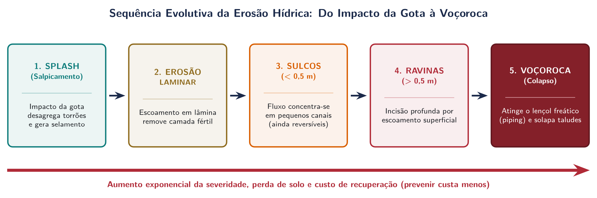

# Diagnóstico de Processos de Degradação Ambiental e Erosão Linear {#cap:degradacao_erosao_linear}

A degradação por erosão resulta da interação entre disponibilidade de material, energia do escoamento e caminhos de transporte. Reconhecer a forma erosiva ajuda a selecionar o método de avaliação, enquanto a interpretação do mecanismo exige observar drenagem, materiais e evolução temporal.

::: {.callout-note title="O que você vai aprender neste capítulo"}
A aprendizagem envolve diferenciar processos erosivos, aplicar estimativas de perda de solo e interpretar medições repetidas. O estudante deve reconhecer a escala de validade de cada método e explicar como os resultados se relacionam ao transporte e à deposição de sedimentos.
:::

::: {.callout-tip title="Revisando o que você precisa saber"}
A leitura retoma balanço de massa, densidade do solo, área e volume. Taxa de perda em toneladas por hectare e por ano, volume erodido em uma feição e carga sólida transportada no canal representam grandezas distintas e exigem procedimentos próprios.
:::

## Vocabulário Técnico e Símbolos do Capítulo 12

***Splash* (salpicamento),** desagregação de partículas do solo pelo impacto cinético direto das gotas de chuva, gerando crosta de selamento superficial. ***Piping* (erosão em túneis ou tubular),** remoção interna de partículas finas do solo por fluxos subsuperficiais concentrados, criando dutos que colapsam e aceleram o avanço de voçorocas. **USLE ($A = R \cdot K \cdot L \cdot S \cdot C \cdot P$).** Modelo empírico que estima a perda média anual de solo por erosão laminar e em sulcos ($\text{t}\cdot\text{ha}^{-1}\cdot\text{ano}^{-1}$).

$T$, limite de tolerância de perda de solo ($\text{t}\cdot\text{ha}^{-1}\cdot\text{ano}^{-1}$), correspondente à taxa máxima de erosão compatível com a renovação pedogenética e manutenção da funcionalidade do perfil. $h$, taxa de rebaixamento da superfície do solo ($\text{mm}\cdot\text{ano}^{-1}$), vinculada à perda de massa pela densidade do solo ($D_s$). $\Delta \bar{h}$, variação média de exposição em uma malha de pinos de erosão ($\text{mm}$); valores positivos indicam erosão (rebaixamento) e negativos indicam deposição (soterramento).

$SDR$, Razão de Aporte de Sedimentos (*Sediment Delivery Ratio*, adimensional entre $0$ e $1$), fração do solo erodido nas vertentes que efetivamente alcança o exutório ou reservatório da bacia.

## Mecânica e Sequência Evolutiva da Erosão Hídrica

A erosão hídrica acelerada resulta do desequilíbrio entre a **erosividade** (capacidade da chuva e do escoamento de desprender e transportar partículas) e a **resistência do sistema solo-vegetação** (cobertura, agregação, rugosidade e infiltração). Conforme sintetizam Guerra e Cunha (1996), Ross (1994) e Cavalcanti (2006), o processo evolui em estágios progressivos de severidade física e de custo exponencial de recuperação (@fig-evolucao_erosao_linear).

{#fig-evolucao_erosao_linear}

Cada estágio possui diagnóstico morfológico e mecânico próprio,

**Impacto da gota (*splash*) e selamento superficial,** quando o solo perde cobertura vegetal e serapilheira, as gotas de chuva atingem diretamente os agregados superficiais, rompendo-os e lançando partículas finas (argila e silte) em suspensão. Essas partículas obstruem os poros superficiais, formando uma crosta delgada (**selamento superficial**) que reduz drasticamente a taxa de infiltração básica. **Erosão laminar (entressulcos).** Com a infiltração bloqueada pelo selamento ou pela compactação, a água acumula-se e escoa em lâmina difusa sobre a vertente, removendo silenciosamente a camada mais fértil do horizonte A (matéria orgânica, sementes e nutrientes). Por não abrir grandes cicatrizes visíveis no início, costuma passar despercebida até que aflorem raízes, cascalhos ou horizontes subsuperficiais mais claros.

**Sulcos erosivos ($< 0{,}5\text{ m}$ de profundidade).** Irregularidades microtopográficas, marcas de pneus ou linhas de plantio morro abaixo concentram a lâmina d’água em filetes de maior velocidade e tensão cisalhante. Os canais rasos assim abertos são denominados sulcos e, em geral, ainda podem ser corrigidos por práticas conservacionistas e manejo superficial do solo. **Ravinas ($> 0{,}5\text{ m}$ de profundidade, sem atingir o lençol freático).** Se o escoamento superficial concentrado não for dissipado, os sulcos aprofundam-se e alargam-se, tornando-se incisões permanentes que não são eliminadas por preparo comum do solo. O agente dominante na ravina ainda é o **escoamento superficial concentrado**, que excava o leito e expande o canal remontantemente (de jusante para montante).

**Voçorocas (estágio de colapso integrado).** Representam a forma mais avançada e destrutiva da erosão linear. Diferenciam-se das ravinas não apenas pelas dimensões métricas, mas sobretudo pelo **processo hidrogeomorfológico**, a incisão atinge o **lençol freático** (ou zonas de fluxo subsuperficial saturado). Passam então a atuar simultaneamente o escoamento superficial, a erosão subsuperficial em túneis (***piping***) e a exfiltração na base das paredes, provocando **solapamento** e escorregamentos sucessivos dos taludes laterais e da cabeceira, mesmo em períodos sem chuva intensa.

## Instabilidade de Margens Fluviais, Degradação Ripária e Assoreamento

Na escala da bacia hidrográfica, a erosão das vertentes articula-se diretamente à dinâmica dos canais fluviais e das Áreas de Preservação Permanente (APPs) marginais,

**Degradação ripária e colapso de margens.** A supressão da mata ciliar elimina a malha radicular que confere coesão mecânica aos barrancos (tema aprofundado na bioengenharia do Capítulo 13) e expõe a margem ao impacto direto da corrente fluvial. A erosão na base do talude marginal (*undercutting*) gera quedas em bloco e alargamento desordenado da calha. **Assoreamento de canais, açudes e reservatórios.** Quando o aporte de sedimentos oriundo das vertentes e margens excede a capacidade de transporte do curso d’água, ocorre deposição no leito. No Semiárido Baiano, o assoreamento reduz rapidamente o volume útil de açudes, barreiros e pequenos barramentos comunitários, agrava a vulnerabilidade hídrica nas estiagens e eleva a turbidez da água.

## Equação Universal de Perda de Solo (USLE)

Desenvolvida por Wischmeier e Smith (1978) a partir de milhares de parcelas experimentais e amplamente calibrada para condições tropicais e brasileiras, a **Equação Universal de Perda de Solo (USLE)** estima a perda média anual de solo por erosão laminar e em sulcos a partir do produto de seis fatores físicos e de manejo.

## Equação Universal de Perda de Solo (USLE) e Conversão para Rebaixamento

$$

A = R \cdot K \cdot L \cdot S \cdot C \cdot P

$$

$A$, perda média anual estimada de solo ($\text{t}\cdot\text{ha}^{-1}\cdot\text{ano}^{-1}$). $R$, fator de **erosividade da chuva** ($\text{MJ}\cdot\text{mm}\cdot\text{ha}^{-1}\cdot\text{h}^{-1}\cdot\text{ano}^{-1}$); expressa a energia cinética e intensidade máxima das precipitações ao longo do ano. $K$, fator de **erodibilidade do solo** ($\text{t}\cdot\text{ha}\cdot\text{h}\cdot\text{ha}^{-1}\cdot\text{MJ}^{-1}\cdot\text{mm}^{-1}$); reflete a suscetibilidade intrínseca do solo à erosão (textura, matéria orgânica, estrutura e permeabilidade). $L$ e $S$, fatores topográficos de **comprimento de rampa ($L$)** e **declividade ($S$)** (adimensionais, frequentemente agrupados como fator $LS$). Quanto maior e mais íngreme a vertente, maior o valor de $LS$.

$C$, fator de **uso, manejo e cobertura vegetal** (adimensional, entre $\approx 0{,}001$ em floresta densa e $1{,}00$ em solo continuamente descoberto e mobilizado). $P$, fator de **práticas conservacionistas** (adimensional, de $1{,}00$ em plantio morro abaixo até $\approx 0{,}50$ em plantio em contorno ou $0{,}20$-$0{,}40$ com terraceamento e cordões vegetados).

**Relação entre Perda de Massa ($A$) e Rebaixamento Superficial ($h$),** Como $1\text{ ha} = 10.000\text{ m}^2$, uma lâmina de $1\text{ mm}$ ($0{,}001\text{ m}$) de solo em $1\text{ ha}$ possui volume de $10\text{ m}^3$. Multiplicando pela densidade do solo ($D_s$ em $\text{t}\cdot\text{m}^{-3} = \text{g}\cdot\text{cm}^{-3}$), cada $1\text{ mm}$ corresponde a $10 \cdot D_s$ toneladas por hectare,

$$

h\,(\text{mm}\cdot\text{ano}^{-1}) = \frac{A\,(\text{t}\cdot\text{ha}^{-1}\cdot\text{ano}^{-1})}{10 \cdot D_s} \qquad \Longleftrightarrow \qquad A = 10 \cdot D_s \cdot h

$$

É fundamental destacar duas características essenciais da USLE, (1) o produto $R \cdot K \cdot L \cdot S$ representa o **potencial natural de erosão** (o solo completamente descoberto e sem práticas conservacionistas); e (2) os fatores $C$ e $P$ são os elementos sobre os quais a gestão territorial e o manejo atuam diretamente, podendo reduzir as perdas em mais de $95\%$, conforme ilustrado na @fig-usle_sensibilidade. Além disso, a USLE **não modela erosão em ravinas profundas, voçorocas ou margens fluviais**, nem quantifica diretamente a deposição na base da vertente. Para estimar o sedimento que chega a um reservatório, associa-se a USLE à Razão de Aporte de Sedimentos ($SDR$).

{#fig-usle_sensibilidade}

## Protocolos Quantitativos de Diagnóstico e Monitoramento em Campo

Modelos como a USLE fornecem estimativas de planejamento, mas o diagnóstico rigoroso de processos ativos em campo requer medições diretas e rastreáveis,

**Método dos Pinos de Erosão.** Consiste na cravação vertical de vergalhões metálicos ou pinos rígidos (tipicamente de $30$ a $50\text{ cm}$ de comprimento) dispostos em malha ou transectos ao longo da vertente ou talude, deixando uma altura inicial exposta padronizada (por exemplo, $150\text{ mm}$) marcada com anilha ou pintura. Após cada evento chuvoso ou ciclo anual, mede-se novamente a altura exposta com paquímetro ou régua milimetrada, aumento na altura exposta ($\Delta h > 0$) registra **rebaixamento erosivo**; diminuição ($\Delta h < 0$) indica **deposição local de sedimentos**.

**Estacas de Monitoramento de Recuo de Cabeceira e Bordas.** Em ravinas e voçorocas ativas, instalam-se estacas fixas externas a distâncias conhecidas (por exemplo, $2{,}0$ a $5{,}0\text{ m}$ além da borda instável) em alinhamentos radiais. Medições periódicas da distância entre cada estaca e a borda do talude permitem calcular a taxa de avanço remontante ($\text{m}\cdot\text{ano}^{-1}$). **Perfis Transversais de Ravinas e Voçorocas.** Em seções fixas espaçadas regularmente pela distância $L_{\text{seg}}$ ao longo do canal erosivo, mede-se a largura superior ($B$), a largura de fundo ($b$) e a profundidade vertical média ($h_{\text{rav}}$) a partir de uma linha de referência nivelada (trena esticada entre estacas), estimando a área da seção trapezoidal por $A = \frac{B + b}{2}\cdot h_{\text{rav}}$. Integrando as áreas transversais ($A_1, A_2, \dots$) pelo método da média das áreas, obtém-se o volume de solo mobilizado ($V = \frac{A_1 + A_2}{2}\cdot L_{\text{seg}}$) e sua massa ($M = V \cdot D_s$).

**Fichas Padronizadas de Avaliação Visual.** Complementam as medições métricas registrando coordenadas geográficas, posição na vertente, cobertura vegetal estimada, presença de selamento, exfiltração subsuperficial (surgências na parede da voçoroca), conectividade com cursos d’água e registro fotográfico com escala métrica.

## Produção de sedimentos, aporte e evolução das feições

A perda estimada na vertente representa material mobilizado sob as condições do modelo. Parte desse material pode ser depositada antes de alcançar o canal. A carga no exutório depende da conexão entre fontes e drenagem, da capacidade de transporte e do armazenamento temporário. A conversão de perda de solo em assoreamento requer explicitar essas etapas.

As equações da família USLE e RUSLE são usadas para estimar erosão entre sulcos e em sulcos nas condições em que foram desenvolvidas. O [USDA descreve o alcance da RUSLE2](https://www.nrcs.usda.gov/resources/tech-tools/water-erosion-rusle2) nesse contexto. A erosão de canais concentrados e o recuo de uma voçoroca exigem medições ou modelos apropriados à geometria e aos processos da feição.

Perfis transversais repetidos devem conservar posição, orientação e referência altimétrica. A diferença entre campanhas permite estimar mudanças de seção, enquanto a integração entre seções permite aproximar a variação de volume. A conversão para massa depende de uma densidade representativa do material mobilizado e da informação sobre sua variabilidade.

A distinção entre ravina e voçoroca deve registrar o critério adotado. Dimensões, persistência, erosão interna, surgências e instabilidade das paredes ajudam a caracterizar o funcionamento. A interceptação do lençol freático pode ser relevante em alguns casos, mas seu uso como condição universal excluiria feições profundas mantidas predominantemente por escoamento superficial.

## Exemplos resolvidos

::: {.callout-tip appearance="simple"}
### Exemplo 12.1 (Básico). Aplicação da USLE e Comparação de Cenários de Manejo (@fig-usle_sensibilidade) {#12-degradacao-erosao-usle-exemplo-12.1-básico.-aplicação-da-usle-e-comparação-de-cenários-de-manejo-figura-figusle_sensibilidade}

**Situação analisada.** Uma vertente no Semiárido Baiano apresenta os seguintes fatores físicos naturais, erosividade da chuva $R = 6.000\text{ MJ}\cdot\text{mm}\cdot\text{ha}^{-1}\cdot\text{h}^{-1}\cdot\text{ano}^{-1}$, erodibilidade do solo $K = 0{,}03\text{ t}\cdot\text{ha}\cdot\text{h}\cdot\text{ha}^{-1}\cdot\text{MJ}^{-1}\cdot\text{mm}^{-1}$ e fator topográfico combinado $LS = 1{,}5$. O limite ilustrativo de tolerância de perda de solo adotado para o local é $T = 12{,}0\text{ t}\cdot\text{ha}^{-1}\cdot\text{ano}^{-1}$.

**Dados disponíveis.** Cinco cenários de uso e manejo, (1) solo exposto ($C = 1{,}00$; $P = 1{,}00$); (2) cultivo morro abaixo ($C = 0{,}40$; $P = 1{,}00$); (3) pastagem degradada ($C = 0{,}15$; $P = 1{,}00$); (4) manejo conservacionista em contorno ($C = 0{,}05$; $P = 0{,}50$); e (5) Caatinga densa preservada ($C = 0{,}005$; $P = 1{,}00$).

**Problema a resolver.** Calcular a perda anual estimada ($A$) em cada cenário, verificar quais atendem ao limite de tolerância ($A \le 12{,}0$) e calcular a redução percentual promovida pelo manejo conservacionista em relação ao cultivo morro abaixo.

**Fundamento da análise.** Cálculo prévio do potencial natural de erosão ($PNE = R \cdot K \cdot LS$) seguido da multiplicação pelos fatores $C$ e $P$ de cada cenário.

**Desenvolvimento.** **Etapa 1, Potencial Natural de Erosão ($PNE$),**

$$

PNE = R \cdot K \cdot LS = 6.000 \times 0{,}03 \times 1{,}5 = 180 \times 1{,}5 = 270{,}0\text{ t}\cdot\text{ha}^{-1}\cdot\text{ano}^{-1}

$$

 Note que as unidades de $\text{MJ}$, $\text{mm}$, $\text{h}$ e um fator $\text{ha}$ cancelam-se rigorosamente entre $R$ e $K$, restando $\text{t}\cdot\text{ha}^{-1}\cdot\text{ano}^{-1}$.

**Etapa 2, Perda de solo ($A$) nos cinco cenários,**

$$

\begin{aligned}
A_1\; (\text{solo exposto}) &= 270{,}0 \times 1{,}00 \times 1{,}00 = 270{,}0\text{ t}\cdot\text{ha}^{-1}\cdot\text{ano}^{-1} \quad (> 12\text{, crítico}) \\
A_2\; (\text{cultivo morro abaixo}) &= 270{,}0 \times 0{,}40 \times 1{,}00 = 108{,}0\text{ t}\cdot\text{ha}^{-1}\cdot\text{ano}^{-1} \quad (> 12\text{, insustentável}) \\
A_3\; (\text{pastagem degradada}) &= 270{,}0 \times 0{,}15 \times 1{,}00 = 40{,}5\text{ t}\cdot\text{ha}^{-1}\cdot\text{ano}^{-1} \quad (> 12\text{, acima do limite}) \\
A_4\; (\text{manejo conservacionista}) &= 270{,}0 \times 0{,}05 \times 0{,}50 = 6{,}75\text{ t}\cdot\text{ha}^{-1}\cdot\text{ano}^{-1} \quad (\le 12\text{, sustentável}) \\
A_5\; (\text{Caatinga densa}) &= 270{,}0 \times 0{,}005 \times 1{,}00 = 1{,}35\text{ t}\cdot\text{ha}^{-1}\cdot\text{ano}^{-1} \quad (\le 12\text{, referência})
\end{aligned}

$$

 **Etapa 3, Redução do manejo conservacionista ($A_4$) frente ao cultivo morro abaixo ($A_2$),**

$$

\text{Redução} = \frac{108{,}0 - 6{,}75}{108{,}0}\times 100\% = \frac{101{,}25}{108{,}0}\times 100\% = 93{,}75\%

$$

**Interpretação do resultado.** Perdas, $270{,}0$ (solo exposto), $108{,}0$ (morro abaixo), $40{,}5$ (pastagem degradada), $6{,}75$ (manejo conservacionista) e $1{,}35\text{ t}\cdot\text{ha}^{-1}\cdot\text{ano}^{-1}$ (Caatinga). Apenas os cenários 4 e 5 atendem ao limite $T = 12\text{ t}\cdot\text{ha}^{-1}\cdot\text{ano}^{-1}$; o manejo conservacionista reduz a erosão em $93{,}75\%$.

**Condições de validade.** Os valores coincidem integralmente com as barras da @fig-usle_sensibilidade (onde $6{,}75$ e $1{,}35$ aparecem arredondados para uma casa decimal, $6{,}8$ e $1{,}4$) e demonstram que a cobertura do solo ($C$) exerce impacto decisivo no controle da erosão.
:::

::: {.callout-tip appearance="simple"}
### Exemplo 12.2 (Intermediário). Conversão de Perda de Solo (USLE) em Espessura de Rebaixamento Superficial

**Situação analisada.** Para comunicar a agricultores e gestores o significado físico da perda de solo obtida no cenário de cultivo morro abaixo do Exemplo 12.1 ($A = 108{,}0\text{ t}\cdot\text{ha}^{-1}\cdot\text{ano}^{-1}$), converta essa taxa em espessura anual de solo removido e estime quanto do horizonte A será perdido em $25$ anos.

**Dados disponíveis.** $A = 108{,}0\text{ t}\cdot\text{ha}^{-1}\cdot\text{ano}^{-1}$; densidade do solo da camada superficial $D_s = 1{,}35\text{ g}\cdot\text{cm}^{-3} = 1{,}35\text{ t}\cdot\text{m}^{-3}$; horizonte temporal de análise $= 25\text{ anos}$.

**Problema a resolver.** Calcular a taxa anual de rebaixamento $h$ ($\text{mm}\cdot\text{ano}^{-1}$) e a espessura acumulada removida em $25$ anos (em $\text{cm}$).

**Fundamento da análise.** Aplicação da relação geométrica $h = A / (10 \cdot D_s)$ e multiplicação pelo horizonte de $25$ anos.

**Desenvolvimento.** **Etapa 1, Massa correspondente a $1\text{ mm}$ de solo em $1\text{ ha}$,**

$$

M_{1\text{mm}} = 10 \cdot D_s = 10 \times 1{,}35 = 13{,}5\text{ t}\cdot\text{ha}^{-1}\cdot\text{mm}^{-1}

$$

 **Etapa 2, Rebaixamento anual,**

$$

h = \frac{108{,}0}{13{,}5} = 8{,}00\text{ mm}\cdot\text{ano}^{-1}

$$

 **Etapa 3, Rebaixamento acumulado em $25$ anos,**

$$

H_{25} = 8{,}00\text{ mm}\cdot\text{ano}^{-1} \times 25\text{ anos} = 200{,}0\text{ mm} = 20{,}0\text{ cm}

$$

**Interpretação do resultado.** Taxa de rebaixamento de $8{,}00\text{ mm}\cdot\text{ano}^{-1}$, removendo $20{,}0\text{ cm}$ de solo superficial em apenas $25$ anos.

**Condições de validade.** Em solos rasos do Semiárido Baiano (como Neossolos Litólicos e Luvissolos com horizonte A entre $15$ e $25\text{ cm}$), perder $20\text{ cm}$ em um quarto de século significa eliminar completamente a camada biologicamente ativa e expor o horizonte B ou a rocha alterada, processo clássico de desertificação edáfica.
:::

::: {.callout-tip appearance="simple"}
### Exemplo 12.3 (Intermediário). Monitoramento de Talude pelo Método dos Pinos de Erosão

**Situação analisada.** Cinco pinos de erosão foram instalados ao longo de um perfil de talude exposto próximo à estrada de acesso de um empreendimento, todos com altura inicial exposta padronizada de $150\text{ mm}$. Após um ciclo hidrológico de $12$ meses, novas leituras foram coletadas com paquímetro.

**Dados disponíveis.** Altura inicial exposta em todos os pinos, $h_0 = 150\text{ mm}$. Leituras após $12$ meses (do topo à base do talude), Pino 1 $= 168\text{ mm}$; Pino 2 $= 174\text{ mm}$; Pino 3 $= 162\text{ mm}$; Pino 4 $= 156\text{ mm}$; Pino 5 (sopé do talude) $= 140\text{ mm}$. Densidade do solo local, $D_s = 1{,}40\text{ g}\cdot\text{cm}^{-3}$.

**Problema a resolver.** Calcular a variação $\Delta h_i$ em cada pino, o balanço líquido médio de rebaixamento ($\Delta \bar{h}$) e a perda líquida equivalente de solo em $\text{t}\cdot\text{ha}^{-1}\cdot\text{ano}^{-1}$.

**Fundamento da análise.** Cálculo individual $\Delta h_i = h_{1,i} - h_0$ (respeitando sinais positivos para erosão e negativos para deposição), média aritmética e conversão via $A = 10 \cdot D_s \cdot \Delta \bar{h}$.

**Desenvolvimento.** **Etapa 1, Variação em cada pino,**

$$

\begin{aligned}
\Delta h_1 &= 168 - 150 = +18\text{ mm} \quad (\text{erosão}) \\
\Delta h_2 &= 174 - 150 = +24\text{ mm} \quad (\text{erosão máxima no terço médio}) \\
\Delta h_3 &= 162 - 150 = +12\text{ mm} \quad (\text{erosão}) \\
\Delta h_4 &= 156 - 150 = +6\text{ mm} \quad (\text{erosão moderada}) \\
\Delta h_5 &= 140 - 150 = -10\text{ mm} \quad (\text{deposição no sopé})
\end{aligned}

$$

 **Etapa 2, Balanço líquido médio ($\Delta \bar{h}$),**

$$

\Delta \bar{h} = \frac{18 + 24 + 12 + 6 + (-10)}{5} = \frac{50}{5} = +10{,}0\text{ mm}\cdot\text{ano}^{-1}

$$

 **Etapa 3, Perda líquida equivalente de solo,**

$$

A_{\text{pinos}} = 10 \times 1{,}40 \times 10{,}0 = 140{,}0\text{ t}\cdot\text{ha}^{-1}\cdot\text{ano}^{-1}

$$

**Interpretação do resultado.** Rebaixamento líquido médio de $10{,}0\text{ mm}\cdot\text{ano}^{-1}$, correspondente a uma perda líquida equivalente de $140{,}0\text{ t}\cdot\text{ha}^{-1}\cdot\text{ano}^{-1}$.

**Condições de validade.** O sinal negativo no Pino 5 ($-10\text{ mm}$) é fisicamente esperado em encostas, parte do sedimento removido dos segmentos superiores e médios deposita-se no sopé com a redução da declividade. Desconsiderar o sinal negativo superestimaria o balanço líquido da encosta.
:::

::: {.callout-tip appearance="simple"}
### Exemplo 12.4 (Avançado). Cubagem de Solo Mobilizado em Ravina por Perfis Transversais

**Situação analisada.** Para dimensionar estruturas de contenção em uma ravina ativa com $40{,}0\text{ m}$ de extensão, uma equipe levantou duas seções transversais representativas (Seção 1 a montante e Seção 2 a jusante), ambas aproximadas por geometria trapezoidal.

**Dados disponíveis.** Comprimento do trecho entre seções, $L = 40{,}0\text{ m}$. Seção 1, largura de topo $B_1 = 3{,}2\text{ m}$, largura de fundo $b_1 = 1{,}2\text{ m}$, profundidade $h_1 = 1{,}5\text{ m}$. Seção 2, $B_2 = 4{,}0\text{ m}$, $b_2 = 1{,}6\text{ m}$, profundidade $h_2 = 2{,}0\text{ m}$. Densidade média do solo do perfil, $D_s = 1{,}45\text{ t}\cdot\text{m}^{-3}$.

**Problema a resolver.** Calcular a área de cada seção ($A_1$ e $A_2$), o volume total de solo escavado ($V$) pelo método da média das áreas e a massa total mobilizada ($M$).

**Fundamento da análise.** Área do trapézio $A = \frac{B + b}{2}\cdot h$, volume prismoidal simplificado $V = \frac{A_1 + A_2}{2}\cdot L$ e conversão para massa $M = V \cdot D_s$.

**Desenvolvimento.** **Etapa 1, Área das seções transversais,**

$$

A_1 = \frac{3{,}2 + 1{,}2}{2}\times 1{,}5 = \frac{4{,}4}{2}\times 1{,}5 = 2{,}2 \times 1{,}5 = 3{,}30\text{ m}^2

$$

$$

A_2 = \frac{4{,}0 + 1{,}6}{2}\times 2{,}0 = \frac{5{,}6}{2}\times 2{,}0 = 2{,}8 \times 2{,}0 = 5{,}60\text{ m}^2

$$

 **Etapa 2, Volume total mobilizado no trecho de $40\text{ m}$,**

$$

V = \frac{3{,}30 + 5{,}60}{2}\times 40{,}0 = \frac{8{,}90}{2}\times 40{,}0 = 4{,}45 \times 40{,}0 = 178{,}0\text{ m}^3

$$

 **Etapa 3, Massa total de solo mobilizada,**

$$

M = 178{,}0\text{ m}^3 \times 1{,}45\text{ t}\cdot\text{m}^{-3} = 258{,}1\text{ t}

$$

**Interpretação do resultado.** $A_1 = 3{,}30\text{ m}^2$, $A_2 = 5{,}60\text{ m}^2$, volume escavado $V = 178{,}0\text{ m}^3$ e massa mobilizada de $258{,}1\text{ toneladas}$ de solo.

**Condições de validade.** Para visualizar a magnitude do impacto, $178\text{ m}^3$ equivalem a aproximadamente $15$ a $18$ caminhões basculantes convencionais carregados de solo removidos de uma única ravina de $40\text{ m}$, grande parte dos quais segue diretamente para drenagens e açudes a jusante.
:::

::: {.callout-tip appearance="simple"}
### Exemplo 12.5 (Avançado). Estimativa de Assoreamento de Reservatório por USLE e Razão de Aporte ($SDR$)

**Situação analisada.** Uma microbacia rural de $250\text{ ha}$ no Semiárido Baiano drena para um açude comunitário com capacidade inicial de armazenamento de $160.000\text{ m}^3$. Estudos anteriores estimaram perda média de solo pela USLE de $A = 32{,}0\text{ t}\cdot\text{ha}^{-1}\cdot\text{ano}^{-1}$ na microbacia e Razão de Aporte de Sedimentos $SDR = 0{,}25$ (isto é, $25\%$ do solo erodido nas vertentes atinge o reservatório).

**Dados disponíveis.** Área da microbacia, $250\text{ ha}$; perda média USLE, $A = 32{,}0\text{ t}\cdot\text{ha}^{-1}\cdot\text{ano}^{-1}$; $SDR = 0{,}25$; densidade aparente do sedimento depositado no fundo do açude, $\rho_{\text{sed}} = 1{,}25\text{ t}\cdot\text{m}^{-3}$; capacidade útil inicial, $V_0 = 160.000\text{ m}^3$.

**Problema a resolver.** Calcular (a) a produção anual de sedimentos que chega ao açude ($Y$, em $\text{t}\cdot\text{ano}^{-1}$); (b) o volume assoreado por ano ($V_{\text{sed}}$); e (c) o percentual da capacidade inicial perdido em $20$ anos caso não haja conservação na microbacia.

**Fundamento da análise.** Cálculo do aporte de sedimentos $Y = A \cdot \text{Área} \cdot SDR$, conversão para volume ($V_{\text{sed}} = Y / \rho_{\text{sed}}$) e projeção linear de $20$ anos frente ao volume inicial.

**Desenvolvimento.** **Etapa 1, Aporte anual de sedimentos no reservatório ($Y$),**

$$

Y = 32{,}0\text{ t}\cdot\text{ha}^{-1}\cdot\text{ano}^{-1} \times 250\text{ ha} \times 0{,}25 = 8.000 \times 0{,}25 = 2.000{,}0\text{ t}\cdot\text{ano}^{-1}

$$

 **Etapa 2, Volume anual de assoreamento ($V_{\text{sed}}$),**

$$

V_{\text{sed}} = \frac{2.000{,}0\text{ t}\cdot\text{ano}^{-1}}{1{,}25\text{ t}\cdot\text{m}^{-3}} = 1.600{,}0\text{ m}^3\cdot\text{ano}^{-1}

$$

 **Etapa 3, Volume assoreado em $20$ anos e perda percentual de capacidade,**

$$

V_{20} = 1.600{,}0 \times 20 = 32.000{,}0\text{ m}^3

$$

$$

\text{Perda percentual} = \frac{32.000{,}0}{160.000{,}0}\times 100\% = 20{,}0\%

$$

**Interpretação do resultado.** Aporte anual de $2.000{,}0\text{ t}\cdot\text{ano}^{-1}$ ($1.600{,}0\text{ m}^3\cdot\text{ano}^{-1}$), provocando perda de $20{,}0\%$ da capacidade de armazenamento do açude em $20$ anos.

**Condições de validade.** O resultado demonstra a conexão indissociável entre manejo de solos nas vertentes e segurança hídrica no Semiárido, sem controle erosivo na microbacia (redução de $C$ e $P$ e recomposição ripária), um quinto do volume do reservatório desaparece em duas décadas.
:::

## Erros comuns de interpretação

::: {.callout-warning appearance="simple"}
### Erro 1, Chamar Qualquer Canal Erosivo Profundo de Voçoroca

**Equívoco frequente,** Classificar qualquer incisão com mais de $1\text{ m}$ de profundidade automaticamente como voçoroca sem investigar a presença de água subsuperficial.

**Correção técnica,** A distinção geomorfológica entre **ravina** e **voçoroca** baseia-se no mecanismo dominante, ravinas são escavadas exclusivamente por escoamento superficial concentrado; voçorocas interceptam o lençol freático ou fluxos subsuperficiais concentrados, apresentando *piping*, surgências de água e solapamento de taludes. Esse diagnóstico muda radicalmente o projeto de recuperação (voçorocas exigem drenagem subsuperficial além do desvio de águas superficiais).
:::

::: {.callout-warning appearance="simple"}
### Erro 2, Aplicar a USLE para Estimar Erosão em Voçorocas ou Margens Fluviais

**Equívoco frequente,** Usar $A = R \cdot K \cdot L \cdot S \cdot C \cdot P$ como se o resultado englobasse toda a produção de sedimentos de uma bacia com voçorocas ativas e desmoronamento de margens.

**Correção técnica,** A USLE foi calibrada exclusivamente para **erosão laminar e em sulcos** nas vertentes. Processos lineares profundos (ravinas e voçorocas) e erosão marginal devem ser quantificados separadamente por perfis transversais, estacas de recuo, levantamento topográfico ou fotogrametria com drone.
:::

::: {.callout-warning appearance="simple"}
### Erro 3, Misturar Unidades Métricas e Inglesas nos Fatores $R$ e $K$ da USLE

**Equívoco frequente,** Multiplicar um fator $R$ no Sistema Internacional ($\text{MJ}\cdot\text{mm}\cdot\text{ha}^{-1}\cdot\text{h}^{-1}\cdot\text{ano}^{-1}$) por um fator $K$ retirado de tabelas antigas em unidades norte-americanas sem conversão.

**Correção técnica,** Confira sempre a análise dimensional de $R \cdot K$, no Sistema Internacional, o produto $R \cdot K$ deve resultar diretamente em $\text{t}\cdot\text{ha}^{-1}\cdot\text{ano}^{-1}$. Divergências de ordem de grandeza ($10\times$ ou $100\times$) quase sempre denunciam incompatibilidade de unidades entre $R$ e $K$.
:::

::: {.callout-warning appearance="simple"}
### Erro 4, Ignorar Pinos com Valores Negativos (Deposição) no Balanço de Vertente

**Equívoco frequente,** Descartar ou tomar em módulo as leituras de pinos parcialmente soterrados na base de uma encosta.

**Correção técnica,** Pinos com $\Delta h < 0$ registram redistribuição interna de sedimentos (deposição). Para estimar o balanço líquido da vertente, preserva-se o sinal algébrico na média; para analisar separadamente a zona de perda máxima, reportam-se ambos os valores (erosão bruta nos segmentos de perda e balanço líquido total).
:::

## Exercícios de fixação

#### Nível Básico (Processos Erosivos, Morfologia e Conceitos)

1. Descreva o papel do **impacto da gota de chuva (*splash*)** na formação do selamento superficial e explique como esse fenômeno acelera o surgimento da erosão laminar.

2. Estabeleça a diferença técnica entre **sulco**, **ravina** e **voçoroca** quanto aos processos hidrológicos atuantes e à reversibilidade por manejo convencional.

3. O que é ***piping*** e por que sua identificação em campo é decisiva antes de propor obras de estabilização em uma encosta?

4. Explique o significado físico de cada um dos seis fatores da Equação Universal de Perda de Solo ($A = R \cdot K \cdot L \cdot S \cdot C \cdot P$) e indique quais dois fatores podem ser diretamente modificados pelo manejo conservacionista.

5. Explique como a degradação de áreas ripárias (matas ciliares) contribui simultaneamente para a instabilidade de margens fluviais e para o assoreamento de reservatórios.

#### Nível Intermediário (Cálculos de USLE, Pinos, Perfis e Assoreamento)

6. Uma área agrícola apresenta $R = 5.000\text{ MJ}\cdot\text{mm}\cdot\text{ha}^{-1}\cdot\text{h}^{-1}\cdot\text{ano}^{-1}$, $K = 0{,}025\text{ t}\cdot\text{ha}\cdot\text{h}\cdot\text{ha}^{-1}\cdot\text{MJ}^{-1}\cdot\text{mm}^{-1}$, $LS = 2{,}0$ e fator de manejo $C = 0{,}20$. Calcule a perda anual de solo ($A$) sob plantio morro abaixo ($P = 1{,}00$) e sob plantio em contorno ($P = 0{,}50$).

7. Uma vertente submetida a uso intensivo registra perda anual estimada de $A = 70{,}0\text{ t}\cdot\text{ha}^{-1}\cdot\text{ano}^{-1}$ em um solo com densidade $D_s = 1{,}40\text{ g}\cdot\text{cm}^{-3}$. Calcule o rebaixamento anual da superfície ($h$, em $\text{mm}\cdot\text{ano}^{-1}$) e a espessura acumulada perdida em $20$ anos (em $\text{cm}$).

8. Quatro pinos de erosão instalados em uma encosta registraram, após um ano, as seguintes variações de altura exposta ($\Delta h$), $+14\text{ mm}$, $+18\text{ mm}$, $+10\text{ mm}$ e $-2\text{ mm}$. Sabendo que a densidade do solo é $D_s = 1{,}30\text{ g}\cdot\text{cm}^{-3}$, calcule o rebaixamento líquido médio ($\Delta \bar{h}$) e a perda líquida equivalente em $\text{t}\cdot\text{ha}^{-1}\cdot\text{ano}^{-1}$.

9. Uma ravina com $30{,}0\text{ m}$ de extensão teve duas seções transversais trapezoidais medidas, Seção 1 ($B_1 = 2{,}4\text{ m}$; $b_1 = 0{,}8\text{ m}$; $h_1 = 1{,}0\text{ m}$) e Seção 2 ($B_2 = 3{,}6\text{ m}$; $b_2 = 1{,}2\text{ m}$; $h_2 = 1{,}5\text{ m}$). Considerando $D_s = 1{,}50\text{ t}\cdot\text{m}^{-3}$, calcule o volume total ($V$) e a massa ($M$) de solo mobilizado.

10. Uma microbacia de $400\text{ ha}$ apresenta perda média de solo $A = 25{,}0\text{ t}\cdot\text{ha}^{-1}\cdot\text{ano}^{-1}$ e $SDR = 0{,}20$, drenando para um açude de $80.000\text{ m}^3$ de capacidade útil inicial. Adotando $\rho_{\text{sed}} = 1{,}25\text{ t}\cdot\text{m}^{-3}$, calcule o volume anual assoreado e o percentual de capacidade perdido em $10$ anos.

#### Nível Aplicado (Questões Objetivas A-E) {#12-degradacao-erosao-usle-nível-aplicado-questões-objetivas-ae}

11. Na sequência evolutiva da erosão hídrica (Guerra; Cunha, 1996), a transição de uma ravina para uma voçoroca caracteriza-se fundamentalmente por,

    (A) Interrupção completa do escoamento superficial durante os eventos de chuva.

    (B) Interseção da incisão com o lençol freático ou fluxos subsuperficiais concentrados, desencadeando *piping* e solapamento de taludes.

    (C) Reversibilidade imediata por uma única operação de aração rasa do solo.

    (D) Deposição contínua de matéria orgânica que fecha naturalmente o canal em poucos meses.

    (E) Ausência de recuo remontante na cabeceira da feição erosiva.

12. A respeito das limitações metodológicas da Equação Universal de Perda de Solo (USLE), assinale a alternativa correta,

    (A) A USLE quantifica diretamente o volume escavado em grandes voçorocas causadas por *piping*.

    (B) O fator $K$ representa a energia cinética das chuvas e depende exclusivamente do regime climático regional.

    (C) A USLE estima a perda média anual por erosão laminar e em sulcos nas vertentes, não computando diretamente erosão em voçorocas, margens fluviais nem deposição ao longo do trajeto sem o uso do $SDR$.

    (D) A redução do fator $C$ por meio de cobertura vegetal aumenta proporcionalmente a perda de solo $A$.

    (E) O produto $C \cdot P$ representa o potencial natural de erosão de uma bacia independente da ação humana.

13. Uma parcela experimental apresenta $R = 4.000\text{ MJ}\cdot\text{mm}\cdot\text{ha}^{-1}\cdot\text{h}^{-1}\cdot\text{ano}^{-1}$, $K = 0{,}04\text{ t}\cdot\text{ha}\cdot\text{h}\cdot\text{ha}^{-1}\cdot\text{MJ}^{-1}\cdot\text{mm}^{-1}$, $LS = 1{,}5$, $C = 0{,}10$ e $P = 0{,}50$. A perda média anual de solo ($A$) estimada pela USLE é,

    (A) $6{,}0\text{ t}\cdot\text{ha}^{-1}\cdot\text{ano}^{-1}$.

    (B) $12{,}0\text{ t}\cdot\text{ha}^{-1}\cdot\text{ano}^{-1}$.

    (C) $24{,}0\text{ t}\cdot\text{ha}^{-1}\cdot\text{ano}^{-1}$.

    (D) $48{,}0\text{ t}\cdot\text{ha}^{-1}\cdot\text{ano}^{-1}$.

    (E) $240{,}0\text{ t}\cdot\text{ha}^{-1}\cdot\text{ano}^{-1}$.

14. No monitoramento de processos erosivos em campo, o método mais adequado para mensurar a taxa anual de recuo remontante da cabeceira de uma voçoroca ativa é,

    (A) Determinação de pH e saturação por bases em laboratório.

    (B) Instalação de estacas fixas de referência externas à borda instável com medições periódicas de distância até a escarpa.

    (C) Uso isolado de infiltrômetro de anel dentro do leito alagado do rio principal.

    (D) Cálculo exclusivo do fator $R$ a partir da precipitação média mensal.

    (E) Estimativa visual sem marco fixo nem registro de data.

15. Em uma parcela monitorada com quatro pinos de erosão durante $12$ meses, as variações de altura exposta foram $+12\text{ mm}$, $+8\text{ mm}$, $+16\text{ mm}$ e $+4\text{ mm}$. Adotando $D_s = 1{,}25\text{ g}\cdot\text{cm}^{-3}$, a perda de solo equivalente no período é,

    (A) $10{,}0\text{ t}\cdot\text{ha}^{-1}\cdot\text{ano}^{-1}$.

    (B) $50{,}0\text{ t}\cdot\text{ha}^{-1}\cdot\text{ano}^{-1}$.

    (C) $100{,}0\text{ t}\cdot\text{ha}^{-1}\cdot\text{ano}^{-1}$.

    (D) $125{,}0\text{ t}\cdot\text{ha}^{-1}\cdot\text{ano}^{-1}$.

    (E) $150{,}0\text{ t}\cdot\text{ha}^{-1}\cdot\text{ano}^{-1}$.

## Questões de aplicação

### Integração entre Diagnóstico (Módulo 4) e Intervenção (Módulo 5)

Em concursos e no ENADE, o diagnóstico da forma erosiva (laminar, sulco, ravina ou voçoroca) aparece quase sempre acoplado à escolha da técnica de controle. Lembre a regra de ouro, prevenir com cobertura ($C$) e conservação ($P$) custa uma fração mínima do custo necessário para estabilizar uma voçoroca instalada.

16. **\[Questão Autoral, Estilo ENADE / Geografia\]** Durante o diagnóstico ambiental de uma microbacia rural no interior baiano, observou-se uma grande incisão linear com $4{,}2\text{ m}$ de profundidade, paredes subverticais com marcas de escorregamento rotacional, dutos subterrâneos drenando água na base do talude mesmo após $20$ dias sem chuva e forte assoreamento de um riacho a jusante. Com base na geomorfologia da erosão linear, conclui-se que a feição corresponde a,

    (A) Erosão laminar incipiente, controlável apenas com adubação química superficial.

    (B) Sulco raso efêmero, gerado exclusivamente por impacto direto da gota (*splash*).

    (C) Ravina rasa desconectada do sistema hidrogeológico local.

    (D) Voçoroca ativa com atuação combinada de fluxo superficial, exfiltração do lençol freático, *piping* e solapamento de taludes, demandando drenagem superficial e subsuperficial associada à estabilização de taludes.

    (E) Processo natural de equilíbrio ecodinâmico estável segundo Tricart (1977), sem necessidade de intervenção.

17. **\[Questão Autoral, Estilo Concurso Analista Ambiental\]** Um gestor público dispõe de recursos limitados para reduzir o assoreamento de um açude abastecedor no Semiárido. Simulações com a USLE indicaram que duas sub-bacias possuem igual área e igual clima ($R$), porém a Sub-bacia 1 possui solo exposto ($C = 0{,}80$; $P = 1{,}00$) sobre vertentes íngremes ($LS = 2{,}5$), enquanto a Sub-bacia 2 possui Caatinga conservada ($C = 0{,}01$; $P = 1{,}00$) em relevo suave ($LS = 0{,}5$). Considerando igual erodibilidade $K$, a razão entre a perda de solo estimada na Sub-bacia 1 e na Sub-bacia 2 ($A_1 / A_2$) é igual a,

    (A) $4$ vezes maior.

    (B) $40$ vezes maior.

    (C) $80$ vezes maior.

    (D) $200$ vezes maior.

    (E) $400$ vezes maior.

18. **\[Questão Autoral, Estilo Concurso Geógrafo / Órgão Estadual de Meio Ambiente\]** Ao elaborar o diagnóstico de áreas degradadas para um Relatório Ambiental, qual combinação de ferramentas garante simultaneamente avaliação da erosão difusa nas vertentes, monitoramento direto de rebaixamento em taludes e quantificação do volume de solo mobilizado em ravinas?

    (A) Apenas entrevista com moradores locais e consulta à precipitação média anual.

    (B) USLE aplicada às vertentes, malha de pinos de erosão em taludes expostos e levantamento de perfis transversais georreferenciados nas ravinas.

    (C) Apenas análise química de $V\%$ e pH no fundo do reservatório assoreado.

    (D) Cálculo isolado do fator $R$ sem considerar uso da terra nem declividade.

    (E) Medição única da densidade de partículas ($D_p$) em laboratório.

## Gabarito comentado {.unnumbered}

::: {.callout-tip collapse="true" title="Clique para abrir o Gabarito Comentado"}
### Resoluções Completas, Exercícios de Fixação (1 a 15)

1. O impacto direto das gotas de chuva (*splash*) sobre solo desprotegido desagrega torrões e libera argila e silte em suspensão. Essas partículas finas entopem os poros da superfície, criando uma crosta de baixa permeabilidade (**selamento superficial**). Com a infiltração drasticamente reduzida, a água acumula-se na superfície e escoa em lâmina difusa, iniciando a erosão laminar.

2. **Sulco.** Incisão rasa ($<0{,}5\text{ m}$) gerada por concentração inicial do escoamento superficial, ainda reversível por manejo e práticas conservacionistas. **Ravina.** Incisão profunda ($>0{,}5\text{ m}$) permanente, dominada por escoamento superficial concentrado, que não pode ser eliminada por preparo comum. **Voçoroca.** Estágio de colapso em que a incisão atinge o lençol freático ou fluxos subsuperficiais, combinando escoamento superficial, *piping* e solapamento de taludes.

3. ***Piping*** é a erosão subsuperficial tubular produzida pelo carreamento interno de partículas finas pela água em percolação concentrada. Sua identificação é crucial porque obras apenas superficiais (sem drenagem profunda adequada) falham quando o solo continua sendo escavado por baixo, causando desabamento das estruturas.

4. $R$, erosividade da chuva; $K$, erodibilidade intrínseca do solo; $L$, comprimento de rampa; $S$, declividade da vertente; $C$, uso, manejo e cobertura vegetal; $P$, práticas conservacionistas de suporte. Os fatores diretamente modificáveis pelo manejo são **$C$** (cobertura vegetal, plantio direto, revegetação) e **$P$** (plantio em contorno, terraceamento, cordões vegetados).

5. A remoção da vegetação ripária elimina o reforço mecânico das raízes nos barrancos (favorecendo solapamento e queda de margens) e destrói o filtro físico que retinha sedimentos oriundos das vertentes, aumentando a carga sólida transportada até canais e reservatórios (assoreamento).

6. **Passo a passo,** $PNE = 5.000 \times 0{,}025 \times 2{,}0 = 250{,}0\text{ t}\cdot\text{ha}^{-1}\cdot\text{ano}^{-1}$. Morro abaixo ($C = 0{,}20$, $P = 1{,}00$), $A_1 = 250{,}0 \times 0{,}20 \times 1{,}00 = \mathbf{50{,}0\text{ t}\cdot\text{ha}^{-1}\cdot\text{ano}^{-1}}$. Em contorno ($C = 0{,}20$, $P = 0{,}50$), $A_2 = 250{,}0 \times 0{,}20 \times 0{,}50 = \mathbf{25{,}0\text{ t}\cdot\text{ha}^{-1}\cdot\text{ano}^{-1}}$.

7. **Passo a passo,** $h = \frac{A}{10 \cdot D_s} = \frac{70{,}0}{10 \times 1{,}40} = \frac{70{,}0}{14{,}0} = \mathbf{5{,}00\text{ mm}\cdot\text{ano}^{-1}}$. Em $20$ anos, $5{,}00 \times 20 = 100{,}0\text{ mm} = \mathbf{10{,}0\text{ cm}}$.

8. **Passo a passo,** $\Delta \bar{h} = \frac{14 + 18 + 10 + (-2)}{4} = \frac{40}{4} = \mathbf{+10{,}0\text{ mm}\cdot\text{ano}^{-1}}$. Perda equivalente, $A = 10 \times 1{,}30 \times 10{,}0 = \mathbf{130{,}0\text{ t}\cdot\text{ha}^{-1}\cdot\text{ano}^{-1}}$.

9. **Passo a passo,** $A_1 = \frac{2{,}4 + 0{,}8}{2}\times 1{,}0 = 1{,}60\text{ m}^2$. $A_2 = \frac{3{,}6 + 1{,}2}{2}\times 1{,}5 = 3{,}60\text{ m}^2$. Volume, $V = \frac{1{,}60 + 3{,}60}{2}\times 30{,}0 = 2{,}60 \times 30{,}0 = \mathbf{78{,}0\text{ m}^3}$. Massa, $M = 78{,}0 \times 1{,}50 = \mathbf{117{,}0\text{ t}}$.

10. **Passo a passo,** Aporte anual, $Y = 400 \times 25{,}0 \times 0{,}20 = 2.000{,}0\text{ t}\cdot\text{ano}^{-1}$. Volume assoreado anual, $V_{\text{sed}} = 2.000{,}0 / 1{,}25 = \mathbf{1.600{,}0\text{ m}^3\cdot\text{ano}^{-1}}$. Em $10$ anos, $16.000{,}0\text{ m}^3$. Perda percentual, $(16.000 / 80.000)\times 100\% = \mathbf{20{,}0\%}$.

11. **Gabarito, (B).** O critério geomorfológico central da passagem de ravina para voçoroca é a interseção com o lençol freático ou fluxos subsuperficiais, ativando *piping* e solapamento dos taludes.

12. **Gabarito, (C).** A USLE estima erosão laminar e em sulcos nas vertentes; para aportes em bacias, requer $SDR$, e processos lineares profundos ou marginais exigem medições específicas.

13. **Gabarito, (B).** $A = 4.000 \times 0{,}04 \times 1{,}5 \times 0{,}10 \times 0{,}50 = 160 \times 1{,}5 \times 0{,}05 = 240 \times 0{,}05 = \mathbf{12{,}0\text{ t}\cdot\text{ha}^{-1}\cdot\text{ano}^{-1}}$.

14. **Gabarito, (B).** Estacas fixas externas posicionadas fora da zona de ruptura fornecem referência estável para medir com trena o recuo anual da cabeceira da voçoroca.

15. **Gabarito, (D).** Média dos pinos, $(12 + 8 + 16 + 4)/4 = 40/4 = 10{,}0\text{ mm}\cdot\text{ano}^{-1}$. Conversão, $A = 10 \times 1{,}25 \times 10{,}0 = \mathbf{125{,}0\text{ t}\cdot\text{ha}^{-1}\cdot\text{ano}^{-1}}$.

### Resoluções Completas, Questões ENADE e Concursos (16 a 18)

16. **Gabarito, (D).** A presença de água emergindo em dutos na base do talude mesmo após $20$ dias sem chuva comprova interceptação do lençol freático e *piping*, definindo inequivocamente uma **voçoroca ativa**.

17. **Gabarito, (E).** Como $R$, $K$ e $P$ são idênticos, a razão simplifica-se para,

$$

\frac{A_1}{A_2} = \frac{LS_1 \cdot C_1}{LS_2 \cdot C_2} = \frac{2{,}5 \times 0{,}80}{0{,}5 \times 0{,}01} = \frac{2{,}00}{0{,}005} = \mathbf{400}\text{ vezes maior.}

$$

18. **Gabarito, (B).** Apenas a combinação de USLE (erosão laminar e em sulcos), pinos de erosão (rebaixamento direto em taludes) e perfis transversais (cubagem de ravinas) cobre integralmente os três processos citados.
:::

## Síntese conceitual {.unnumbered}

::: {.callout-important title="Síntese Conceitual do Capítulo"}
**Sequência evolutiva,** *splash* + selamento $\rightarrow$ erosão laminar $\rightarrow$ sulcos ($<0{,}5\text{ m}$) $\rightarrow$ ravinas ($>0{,}5\text{ m}$, fluxo superficial) $\rightarrow$ voçorocas (lençol freático, *piping* e solapamento). **USLE ($A = R \cdot K \cdot L \cdot S \cdot C \cdot P$).** Separa o potencial natural ($R\cdot K\cdot LS$) do efeito protetor do manejo ($C\cdot P$). Conversão de massa para espessura, $h\,(\text{mm}\cdot\text{ano}^{-1}) = A / (10 \cdot D_s)$. **Monitoramento em campo.** Pinos de erosão (balanço líquido $\Delta \bar{h}$), estacas externas (recuo de cabeceira), perfis transversais ($V = \frac{A_1+A_2}{2}\cdot L$) e aporte a reservatórios ($Y = A \cdot \text{Área} \cdot SDR$).
:::

## Autoavaliação {.unnumbered}

::: {.callout-caution title="Autoavaliação e Checkpoint"}
Responda com **V** (Verdadeiro) ou **F** (Falso) e confira abaixo,

1. ( ) O selamento superficial causado pelo impacto direto das gotas de chuva (*splash*) reduz a taxa de infiltração e intensifica o escoamento superficial.

2. ( ) A USLE inclui em seu resultado o volume total de solo escavado por *piping* em voçorocas profundas.

3. ( ) Em uma malha de pinos de erosão, uma leitura final de altura exposta menor que a leitura inicial ($\Delta h < 0$) indica deposição local de sedimentos.

4. ( ) Para uma mesma taxa de perda de solo $A = 140\text{ t}\cdot\text{ha}^{-1}\cdot\text{ano}^{-1}$ e densidade $D_s = 1{,}40\text{ g}\cdot\text{cm}^{-3}$, a superfície do terreno sofre rebaixamento médio de $10\text{ mm}\cdot\text{ano}^{-1}$.

**Gabarito do verificação da aprendizagem,** 1-**V** \|-**F** (a USLE modela apenas erosão laminar e em sulcos) \|-**V** \|-**V** ($140 / (10 \times 1{,}40) = 10\text{ mm}\cdot\text{ano}^{-1}$).
:::
