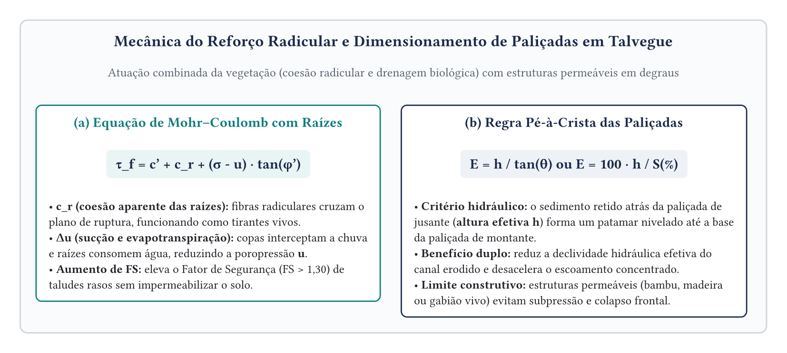
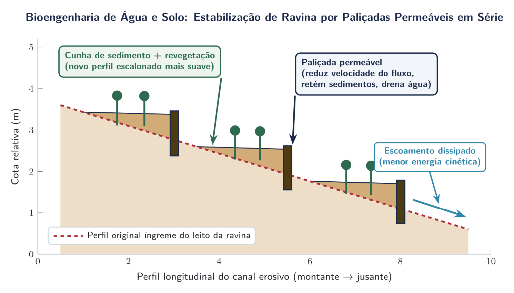
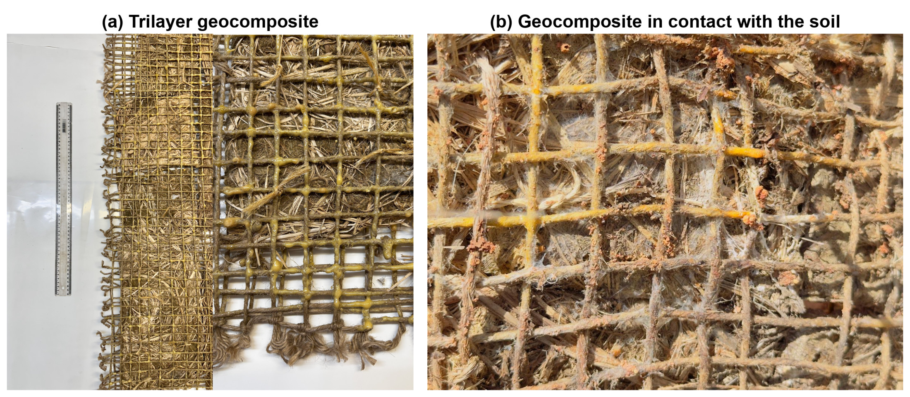

# Bioengenharia de Água e Solo Aplicada à Recuperação Ambiental {#cap:bioengenharia_agua_solo}

A bioengenharia utiliza plantas e materiais associados para modificar processos de erosão e estabilização. O funcionamento de uma intervenção depende da energia da água, das propriedades do terreno, da capacidade de estabelecimento da vegetação e da manutenção, exigindo que a escolha da técnica parta do mecanismo que se pretende controlar.

::: {.callout-note title="O que você vai aprender neste capítulo"}
O capítulo desenvolve a seleção de técnicas vegetativas, paliçadas permeáveis e biomantas, bem como a interpretação de seus efeitos hidráulicos, superficiais e radiculares. O estudante deve justificar a compatibilidade entre processo, material e condição do local e definir como o desempenho será acompanhado.
:::

::: {.callout-tip title="Revisando o que você precisa saber"}
A leitura utiliza os conceitos de escoamento concentrado, tensão de cisalhamento, poropressão e resistência dos materiais. A proteção superficial atua durante o estabelecimento da vegetação, enquanto o reforço radicular depende do desenvolvimento das raízes e de sua interação com o solo.
:::

## Vocabulário Técnico e Símbolos do Capítulo 13

A **Bioengenharia de Solos (Engenharia Natural)** designa a disciplina técnica que emprega plantas vivas, isoladas ou associadas a materiais inertes como madeira, fibras vegetais e rocha, atuando como elementos estruturais vivos na estabilização de taludes, no controle erosivo e na recuperação de margens. Na mecânica dos solos vegetados, a resistência ao cisalhamento no plano potencial de ruptura é representada por $\tau$ ($\text{kPa}$), resultando da combinação entre a coesão efetiva intrínseca do solo $c'$ ($\text{kPa}$), a coesão aparente adicional conferida pela malha de raízes sob tração $c_r$ ou $\Delta c_r$ ($\text{kPa}$), a tensão normal efetiva $\sigma'$ ($\text{kPa}$) e o ângulo de atrito interno efetivo do solo $\phi'$ (em graus).

No dimensionamento hidráulico e geométrico de estruturas lineares de contenção em ravinas e voçorocas, $E$ indica o espaçamento longitudinal entre paliçadas consecutivas ($\text{m}$), $h$ representa a altura útil da paliçada acima do leito ($\text{m}$) e $S$ expressa a declividade longitudinal do canal ou ravina ($\text{m}\cdot\text{m}^{-1}$). Associam-se a esses parâmetros o comprimento da cunha de sedimentos acumulada a montante da paliçada $L_m$ ($\text{m}$), a largura média do canal $b$ ($\text{m}$) e o volume retido $V$ ($\text{m}^3$).

## Princípios da Bioengenharia de Solos e Engenharia Natural

A estabilização duradoura de taludes rodoviários, margens de cursos d’água, áreas mineradas e platôs terraplenados demanda a integração entre suporte físico imediato e regeneração biológica contínua. Quando a erosão já superou a capacidade de recuperação espontânea da paisagem, o solo exposto perde umidade, nutrientes e propágulos a cada evento chuvoso, dificultando o estabelecimento de plântulas sem proteção prévia. Na fronteira entre a engenharia geotécnica, a hidrologia de encostas e a ecologia aplicada, a **Bioengenharia de Solos** (também denominada **Engenharia Natural**) oferece soluções que conciliam estabilidade mecânica e funcionalidade ecossistêmica (GRAY; SOTIR, 1996; SCHIECHTL; STERN, 1996; DURLO; SUTILI, 2005).

O princípio construtivo dessas intervenções baseia-se na transição gradual de funções ao longo do tempo. Na etapa inicial, estruturas leves ou materiais biodegradáveis, como biomantas de fibra vegetal, paliçadas de madeira e fascinas, assumem a proteção física imediata contra o impacto das gotas de chuva e o arraste pela enxurrada. À medida que esses elementos inertes se decompõem gradualmente e incorporam matéria orgânica ao substrato, o sistema radicular e a parte aérea das plantas crescem, consolidam os agregados e assumem em definitivo a função estabilizadora, tornando a obra autossustentável e integrada à dinâmica hidrológica da vertente.

Segundo Durlo e Sutili (2005) e Gray e Sotir (1996), projetos consistentes de Bioengenharia apoiam-se em quatro pilares operacionais integrados que orientam desde o preparo do terreno até o estabelecimento da vegetação. A **proteção superficial imediata** intercepta o impacto direto das gotas de chuva (*splash*) desde o primeiro dia pós-obra por meio de coberturas mortas, biomantas ou geotêxteis naturais, preservando a porosidade superficial. Em paralelo, a **dissipação da energia hidráulica** reduz a velocidade e a tensão cisalhante do escoamento concentrado mediante barreiras permeáveis escalonadas, como paliçadas, retentores e fascinas, que mantêm a permeabilidade do leito. Essa proteção inicial viabiliza o **reforço vivo crescente**, alcançado pela seleção de espécies rústicas, nativas ou adaptadas ao bioma local, como arbustos da Caatinga e gramíneas cespitosas de enraizamento profundo, cuja resistência mecânica amplia-se com o tempo. De modo complementar, o emprego de insumos regionais de baixa pegada energética estimula a **sucessão ecológica e o baixo impacto ambiental**, favorecendo o retorno da fauna edáfica, a infiltração hídrica e a recomposição da vegetação ciliar ou de encosta.

## Efeitos Mecânicos e Hidrológicos da Vegetação na Estabilidade

A vegetação atua simultaneamente sobre os dois lados do equilíbrio geotécnico de um talude ou margem fluvial, elevando a **resistência mecânica** da massa de solo e atenuando as **solicitações hidrológicas** que desencadeiam escorregamentos e incisões erosivas. Enquanto solos desnudos sofrem selamento superficial, saturação rápida e escoamento acelerado, solos vegetados conservam uma matriz porosa estruturada e armada por fibras biológicas vivas (@fig-efeitos_raizes_solo).

{#fig-efeitos_raizes_solo}

No plano mecânico, conforme sistematizam Gray e Sotir (1996), as raízes estabilizam o solo por três mecanismos físicos complementares (@fig-efeitos_raizes_solo). Embora o solo possua elevada resistência à compressão, sua resistência à tração é reduzida; nesse contexto, as raízes finas e médias funcionam como fibras flexíveis de alta resistência à tração distribuídas na matriz terrosa, de modo que, quando uma zona potencial de cisalhamento tende a se deslocar, as raízes que atravessam esse plano são tensionadas e transferem parte do esforço para porções adjacentes estáveis, gerando o **reforço por tração radicular ($\Delta c_r$)**. Ao mesmo tempo, raízes pivotantes profundas atravessam horizontes superficiais mais friáveis e penetram em camadas subsuperficiais mais coesas ou fraturas do saprolito, promovendo **ancoragem em horizontes firmes** de modo análogo a microestacas naturais. Ademais, sistemas radiculares densos de árvores e arbustos distribuídos na vertente formam núcleos de maior rigidez que redistribuem as tensões laterais por **efeito de arqueamento**, restringindo o deslocamento de cunhas de solo entre os troncos.

No plano hidrológico, a cobertura vegetal protege o talude por uma sequência integrada de processos hidráulicos e edáficos. Inicialmente, as copas e a camada de serapilheira promovem a **interceptação** da chuva, amortecendo a energia cinética das gotas antes do contato com os agregados do solo e evitando a desagregação por salpicamento. Em seguida, os colmos, touceiras e detritos orgânicos aumentam a **rugosidade superficial** do terreno (elevando o coeficiente de rugosidade de Manning $n$), o que reduz a velocidade média do escoamento laminar e concentrado e diminui sua capacidade de arraste sólido. Ao longo do perfil, os bioporos abertos por raízes senescentes e pela fauna edáfica estimulam a **infiltração** e a recarga subsuperficial, ao passo que a **evapotranspiração** consome água da zona radicular entre eventos chuvosos, rebaixando o grau de saturação e a poropressão positiva ($u$) no interior do maciço.

### Critério de Mohr-Coulomb com Reforço Radicular ($\Delta c_r$) {#13-bioengenharia-agua-solo-critério-de-mohrcoulomb-com-reforço-radicular-delta-c_r}

$$
\tau = (c' + c_r) + \sigma' \tan\phi' \qquad \text{com} \quad \sigma' = \sigma - u \qquad\qquad FS = \frac{\tau}{\tau_{\text{sol}}}
$$

Nessa expressão, $\tau$ representa a resistência ao cisalhamento disponível no plano potencial de ruptura ($\text{kPa}$), $c'$ é a coesão efetiva intrínseca do solo ($\text{kPa}$, próxima de zero em solos arenosos puros), $c_r$ ($\Delta c_r$) traduz o reforço adicional conferido pelas raízes tracionadas ($\text{kPa}$), $\sigma'$ indica a tensão normal efetiva resultante da diferença entre a tensão total $\sigma$ e a pressão da água nos poros $u$ ($\text{kPa}$), e $\phi'$ expressa o ângulo de atrito interno efetivo (em graus). A razão $FS$ define o Fator de Segurança simplificado frente à tensão cisalhante solicitante $\tau_{\text{sol}}$.

Em projetos aplicados de controle erosivo, o reforço geotécnico das raízes na vertente e nos taludes articula-se diretamente ao disciplinamento hidráulico do talvegue (@fig-mohr-coulomb-palicadas). Enquanto a vegetação eleva a resistência ao cisalhamento $\tau_f$ ao acrescentar $c_r$ e reduzir a poropressão $u$ por sucção e evapotranspiração (Painel a), alcançando patamares de segurança superiores a $FS > 1{,}30$ sem impermeabilizar o terreno, as paliçadas permeáveis escalonadas pela regra pé-à-crista reduzem a declividade hidráulica efetiva do canal erodido e desaceleram o escoamento concentrado (Painel b).

{#fig-mohr-coulomb-palicadas fig-alt="Diagrama em dois painéis: (a) equação de Mohr-Coulomb com coesão radicular c_r e redução de poropressão u; (b) regra pé-à-crista E = h/tan(theta) para paliçadas"}

O Exemplo 13.1 quantifica exatamente como um incremento de coesão radicular $c_r$ altera o Fator de Segurança de um talude de corte exposto no Semiárido Baiano.

::: {.callout-tip appearance="simple"}
### Exemplo 13.1 (Básico). Reforço Radicular na Equação de Mohr-Coulomb em Talude Degradado {#13-bioengenharia-agua-solo-exemplo-1.-reforço-radicular-na-equação-de-mohrcoulomb-em-talude-degradado}

**Situação analisada.** Durante o diagnóstico de um talude de corte em solo argilo-arenoso ao longo de uma estrada de acesso no Semiárido Baiano, avalia-se o ganho de estabilidade proporcionado pela implantação de vegetação de enraizamento denso em comparação ao solo exposto.

**Dados disponíveis.** Coesão efetiva do solo $c' = 8{,}0\text{ kPa}$; ângulo de atrito efetivo $\phi' = 28^\circ$ ($\tan 28^\circ \approx 0{,}5317$); tensão normal efetiva no plano potencial de ruptura $\sigma' = 25{,}0\text{ kPa}$; reforço radicular medido para a espécie implantada $c_r = 6{,}5\text{ kPa}$; tensão cisalhante solicitante durante chuva intensa $\tau_{\text{sol}} = 23{,}0\text{ kPa}$.

**Problema a resolver.** Calcule a resistência ao cisalhamento sem vegetação ($\tau_0$) e com vegetação ($\tau_1$), o ganho percentual de resistência e o Fator de Segurança ($FS = \tau / \tau_{\text{sol}}$) nos dois cenários.

**Fundamento da análise.** Aplicação direta do critério de Mohr-Coulomb modificado pelo reforço radicular (Gray; Sotir, 1996), $\tau = (c' + c_r) + \sigma'\tan\phi'$.

**Desenvolvimento.** Na **Etapa 1 (Atrito interno e resistência sem raízes)**, $\sigma' \tan\phi' = 25{,}0 \times 0{,}5317 = 13{,}29\text{ kPa}$ e $\tau_0 = 8{,}0 + 13{,}29 = 21{,}29\text{ kPa}$. Na **Etapa 2 (Resistência com reforço radicular e ganho relativo)**,

$$
\tau_1 = (8{,}0 + 6{,}5) + 13{,}29 = 27{,}79\text{ kPa} \qquad\qquad \Delta_{\%} = \frac{27{,}79 - 21{,}29}{21{,}29} \times 100\% \approx 30{,}53\%
$$

Na **Etapa 3 (Fator de Segurança $FS$)**,

$$
FS_0 = \frac{21{,}29}{23{,}0} \approx 0{,}93 \quad (\text{instável, } FS < 1{,}0) \qquad\qquad FS_1 = \frac{27{,}79}{23{,}0} \approx 1{,}21 \quad (\text{estável, } FS > 1{,}0)
$$

**Interpretação do resultado.** Sem vegetação, $\tau_0 = 21{,}29\text{ kPa}$ ($FS_0 = 0{,}93$); com reforço radicular, $\tau_1 = 27{,}79\text{ kPa}$ ($FS_1 = 1{,}21$), representando ganho de $30{,}53\%$ na resistência ao cisalhamento.

**Condições de validade.** O resultado é coerente com a física do solo, pois um incremento modesto de coesão radicular ($6{,}5\text{ kPa}$) converte um talude superficialmente instável ($FS < 1{,}0$) em estável ($FS > 1{,}2$) sob condição chuvosa crítica.
:::

## Técnicas Vegetativas, Paliçadas Permeáveis e Biomantas Biodegradáveis

A seleção das técnicas de bioengenharia depende da declividade da vertente, da presença de fluxo concentrado, da profundidade da incisão erosiva e das condições climáticas regionais. Em ambientes semiáridos, como a área de estudo da disciplina CHF662 na Bahia, o projeto deve considerar chuvas convectivas de alta intensidade seguidas por longos períodos de déficit hídrico, exigindo espécies e materiais capazes de resistir ao estresse hídrico inicial.

### Técnicas vegetativas lineares e de cobertura, estacas vivas, fascinas e trançados

Entre as soluções que utilizam diretamente propágulos vegetativos lenhosos, as **estacas vivas (*live stakes*)** consistem em segmentos lenhosos ou semilenhosos de espécies com elevada capacidade de brotação, como gliricídia, sabiá, salgueiro em áreas úmidas ou espécies nativas propagáveis por estaquia, cravados perpendicularmente à superfície do talude ou levemente inclinados para jusante. Essas estacas funcionam como pinos biológicos que drenam o excesso de umidade superficial e ancoram mecanicamente os primeiros $0{,}4\text{ m}$ a $0{,}8\text{ m}$ de solo.

Quando há necessidade de barrar o transporte sólido ao longo da rampa, empregam-se **fascinas vivas (*live fascines*)**, formadas por feixes cilíndricos alongados de ramos vivos amarrados com arame ou corda de sisal e enterrados parcialmente em valas abertas em curva de nível na encosta ou na base de margens fluviais. Dispostas transversalmente ao escoamento, as fascinas atuam como pequenos terraços permeáveis contínuos que fragmentam o comprimento de rampa, retêm sedimentos finos e emitem raízes e brotos ao longo de todo o feixe. Em vertentes mais instáveis ou com maior mobilização superficial de solo, recorre-se aos **trançados vivos (*wattle fences*)**, que são cercas baixas construídas com estacas cravadas verticalmente e ramos flexíveis entrelaçados horizontalmente em curvas de nível, retendo o material erodido a montante e formando patamares de menor declividade favoráveis ao estabelecimento de mudas. O Exemplo 13.4 ilustra o dimensionamento integrado de estacas vivas e fascinas em um trecho de margem fluvial degradada.

::: {.callout-tip appearance="simple"}
### Exemplo 13.4 (Intermediário). Dimensionamento de Estacas Vivas e Fascinas em Margem Fluvial

**Situação analisada.** Um trecho de margem fluvial degradada apresenta solapamento na base e exposição do talude marginal. O projeto de recuperação combina fascinas vivas na zona de variação do nível d’água com plantio de estacas vivas na rampa superior.

**Dados disponíveis.** Extensão da margem $L = 180\text{ m}$; largura da faixa de rampa tratada com estacas vivas $w = 4{,}0\text{ m}$ (área $= 720\text{ m}^2$); espaçamento das estacas na rampa igual a $0{,}80\text{ m} \times 0{,}80\text{ m}$ ($0{,}64\text{ m}^2$ por estaca); $3$ linhas contínuas de fascinas na base ($3 \times 180 = 540\text{ m}$ lineares), fixadas por $1$ estaca a cada $0{,}75\text{ m}$; taxa média de pegamento esperada em campo igual a $75\%$.

**Problema a resolver.** Calcule o número de estacas na rampa, o número de estacas de fixação das fascinas, o total de estacas necessárias e a quantidade estimada de plantas vivas estabelecidas após o primeiro ciclo chuvoso.

**Fundamento da análise.** Razão entre área ou comprimento e espaçamento unitário, seguida da aplicação da taxa de sobrevivência.

**Desenvolvimento.** Na **Etapa 1 (Estacas na rampa e nas fascinas)**, obtêm-se $N_{\text{rampa}} = 720 / 0{,}64 = 1.125\text{ estacas}$ e $N_{\text{fasc}} = 540 / 0{,}75 = 720\text{ estacas}$. Na **Etapa 2 (Total e estimativa de sobrevivência a $75\%$)**,

$$
N_{\text{total}} = 1.125 + 720 = 1.845\text{ estacas} \qquad\qquad N_{\text{vivas}} = 1.845 \times 0{,}75 = 1.383{,}75 \approx 1.384\text{ plantas vivas}
$$

**Interpretação do resultado.** São necessárias $1.125$ estacas na rampa e $720$ nas fascinas (total de $1.845$ estacas), resultando em aproximadamente $1.384$ plantas vivas estabelecidas.

**Condições de validade.** Mesmo com $25\%$ de mortalidade inicial, permanecem cerca de $1{,}17\text{ planta}\cdot\text{m}^{-2}$ na rampa ($844/720$) e $3{,}0\text{ estacas}\cdot\text{m}^{-1}$ nas fascinas ao longo da margem ($540/180$), densidades adequadas para formar cobertura contínua na zona crítica.
:::

Na escolha do material propagativo para essas técnicas vivas, a seleção botânica deve respeitar a ecologia da bacia hidrográfica e as exigências normativas de restauração.

::: {.callout-warning appearance="simple"}
### Erro 1, Usar Espécies Exóticas Invasoras por Facilidade de Pegamento

Fechar os taludes com espécies exóticas agressivas (como leucena ou gramíneas africanas invasoras) apenas pelo crescimento rápido compromete a sucessão ecológica nativa e viola diretrizes de PRAD em Áreas de Preservação Permanente. A escolha deve priorizar espécies nativas regionais ou coberturas anuais que cedam espaço às nativas.
:::

### Paliçadas e barragens permeáveis no controle de ravinas e voçorocas

Quando a erosão já escavou sulcos profundos, ravinas ou voçorocas, coberturas superficiais isoladas perdem eficiência diante da energia cinética do fluxo concentrado. Nessa condição, implantam-se **paliçadas** (ou pequenas **barragens permeáveis** construídas com madeira, bambu, estacas vivas ou sacaria biodegradável preenchida com solo local), cuja disposição escalonada em série encontra-se representada na @fig-bioengenharia_palicada_talude. Ao permitir a passagem controlada da água pelos interstícios da estrutura enquanto retém as partículas sólidas transportadas por arraste e saltação, a paliçada reduz o empuxo hidrostático a montante e previne o colapso por pressão de água observado em barreiras impermeáveis.

{#fig-bioengenharia_palicada_talude}

O acúmulo progressivo de sedimentos a montante de cada paliçada (@fig-bioengenharia_palicada_talude) reduz a declividade efetiva do leito da ravina, originando patamares estabilizados em forma de degraus vegetados que diminuem a velocidade da enxurrada e viabilizam a colonização vegetal no interior da antiga incisão, enquanto os taludes laterais recebem proteção complementar com biomanta e estacas vivas. Em solos muito friáveis ou trechos de curvas sinuosas, recomenda-se reduzir o espaçamento teórico em $15\%$ a $20\%$ como margem de segurança construtiva, verificando também a fundação e o engastamento lateral nas margens.

$$
E = \frac{h}{S} \qquad\qquad V = \frac{1}{2} \cdot L_m \cdot h \cdot b \qquad\qquad M = V \cdot \rho_s
$$

Nessa formulação, $E$ expressa o espaçamento longitudinal entre paliçadas consecutivas ($\text{m}$) sob o critério pé-à-crista, $h$ é a altura útil da paliçada acima do leito ($\text{m}$) e $S$ indica a declividade longitudinal do canal em razão decimal ($\text{m}\cdot\text{m}^{-1}$, equivalente a $S(\%)/100$). Para o prisma triangular de sedimentos retidos a montante, $V$ representa o volume máximo retido por estrutura ($\text{m}^3$), $L_m$ indica o comprimento da cunha ($L_m = E$ no nivelamento teórico), $b$ é a largura média do canal ($\text{m}$), $\rho_s$ expressa a densidade aparente seca do sedimento ($\text{t}\cdot\text{m}^{-3}$) e $M$ fornece a massa de solo retida ($\text{t}$).

O Exemplo 13.2 demonstra o dimensionamento completo de uma série de paliçadas em uma ravina instalada a jusante de um bueiro rodoviário.

::: {.callout-tip appearance="simple"}
### Exemplo 13.2 (Intermediário). Dimensionamento de Paliçadas Permeáveis e Volume de Sedimentos Retidos

**Situação analisada.** Uma ravina ativa formada a jusante de um bueiro rodoviário apresenta risco de evoluir para voçoroca e assorear um riacho intermitente. A equipe técnica propõe instalar paliçadas de madeira e bambu em série ao longo do trecho mais íngreme.

**Dados disponíveis.** Comprimento total do trecho a tratar $L_t = 45{,}0\text{ m}$; declividade longitudinal média do leito da ravina $S = 8\%$ ($0{,}08\text{ m}\cdot\text{m}^{-1}$); altura útil adotada para cada paliçada $h = 0{,}60\text{ m}$; largura média da seção da ravina $b = 2{,}50\text{ m}$; densidade aparente do sedimento retido $\rho_s = 1{,}35\text{ t}\cdot\text{m}^{-3}$.

**Problema a resolver.** Determine o espaçamento teórico entre paliçadas ($E$), a quantidade de estruturas necessárias no trecho ($n$), o volume da cunha de sedimentos retido por paliçada ($V_1$), o volume total ($V_{\text{total}}$) e a massa total de sedimentos retida ($M$).

**Fundamento da análise.** Cálculo geométrico de perfil nivelado em degraus ($E = h/S$) e volume prismático triangular de cunha sedimentar ($V = \frac{1}{2}\cdot L_m \cdot h \cdot b$, com $L_m = E$).

**Desenvolvimento.** Na **Etapa 1 (Espaçamento longitudinal $E$ e número de paliçadas $n$)**,

$$
E = \frac{h}{S} = \frac{0{,}60}{0{,}08} = 7{,}50\text{ m} \qquad\qquad n = \frac{L_t}{E} = \frac{45{,}0}{7{,}50} = 6\text{ paliçadas}
$$

Na **Etapa 2 (Volume por paliçada, volume total e massa retida)**,

$$
V_1 = \frac{1}{2} \cdot 7{,}50 \cdot 0{,}60 \cdot 2{,}50 = 5{,}625\text{ m}^3 \qquad V_{\text{total}} = 6 \times 5{,}625 = 33{,}75\text{ m}^3 \qquad M = 33{,}75 \times 1{,}35 = 45{,}56\text{ t}
$$

**Interpretação do resultado.** Espaçamento $E = 7{,}50\text{ m}$; $n = 6$ paliçadas; $V_1 = 5{,}625\text{ m}^3$ por estrutura; volume total retido $V_{\text{total}} = 33{,}75\text{ m}^3$, equivalente a $45{,}56\text{ t}$ de sedimentos.

**Condições de validade.** Seis estruturas de $0{,}60\text{ m}$ de altura acumulam um desnível total de $6 \times 0{,}60 = 3{,}60\text{ m}$, igual ao desnível natural do trecho de $45{,}0\text{ m}$ a $8\%$ ($45{,}0 \times 0{,}08 = 3{,}60\text{ m}$), fechando geometricamente o escalonamento.
:::

Na implantação em campo, um dos erros executivos mais destrutivos consiste em vedar completamente a seção da paliçada, convertendo-a em uma barreira estanque sujeita a transbordamento lateral.

::: {.callout-warning appearance="simple"}
### Erro 2, Construir Paliçadas Impermeáveis Sem Dissipação de Energia

Fechar totalmente a seção da ravina com chapas rígidas, alvenaria sem drenos ou lonas plásticas cria empuxo hidrostático excessivo a montante e transbordamento concentrado pelas laterais, provocando erosão regressiva nas ombreiras e destruição da obra logo na primeira enxurrada intensa. Paliçadas devem ser **permeáveis** e devidamente engastadas nas paredes laterais da ravina.
:::

### Biomantas, geotêxteis biodegradáveis e evidências experimentais de campo

Em taludes recém-conformados, platôs de obras lineares ou áreas submetidas a hidrossemeadura, as **biomantas** e os **geotêxteis biodegradáveis** oferecem proteção imediata ao solo exposto por meio de mantas tecidas ou costuradas com fibras vegetais naturais. Na realidade produtiva do Nordeste brasileiro, a **fibra de sisal (*Agave sisalana*)**, amplamente disponível na Bahia, destaca-se pela boa resistência mecânica inicial e decomposição moderada entre $12$ e $24$ meses, integrando a bioengenharia à economia regional do Semiárido. Em taludes mais íngremes e margens submetidas a fluxos intermitentes mais energéticos, recomenda-se a **fibra de coco (*Cocos nucifera*)**, cuja elevada proporção de lignina assegura longevidade funcional entre $24$ e $48$ meses. Já as mantas de **fibra de taboa (*Typha domingensis*) e juta** constituem materiais leves e altamente higroscópicos, indicados para reter umidade na camada superficial em climas secos e proteger encostas de baixa a média declividade até a germinação do estrato herbáceo. Associam-se às biomantas os **retentores de sedimentos** (biorretentores cilíndricos preenchidos com palha, fibra de coco ou casca de arroz, dispostos em curvas de nível ou na base de taludes) e a **revegetação estratificada**, combinando gramíneas de cobertura rápida, leguminosas fixadoras de nitrogênio e espécies arbustivo-arbóreas nativas.

A eficácia desses geomateriais depende diretamente da arquitetura das fibras e da continuidade do contato com o substrato mineral (@fig-geocomposito-estrutura). Em um geocompósito trilayer de fibras naturais estudado experimentalmente por Santos e colaboradores, a trama estruturada estabiliza o núcleo fibroso e mantém contato íntimo com os agregados do solo, evitando o escoamento concentrado sob a manta e os descolamentos durante a degradação em campo.

{#fig-geocomposito-estrutura fig-alt="Painel com a organização das camadas de fibras do geocompósito trilayer e detalhe do material em contato com o solo"}

Quando associados ao estabelecimento de gramíneas cespitosas de enraizamento profundo, como o capim-vetiver em parcelas experimentais delimitadas com coletores de enxurrada e sedimentos na base do talude (@fig-geocomposito-campo), esses sistemas permitem quantificar conjuntamente a integridade do geomaterial, a taxa de sobrevivência vegetal e a redução de carga sólida frente a eventos reais de precipitação.

{#fig-geocomposito-campo fig-alt="Quatro fotografias de parcelas em talude, vegetação de vetiver, geomateriais e coletores na base das parcelas"}

O Exemplo 13.3 mostra como dimensionar a aquisição de rolos de biomanta de sisal e estimar a massa anual de solo retida em um talude de corte no Semiárido.

::: {.callout-tip appearance="simple"}
### Exemplo 13.3 (Intermediário). Proteção Superficial com Biomanta de Sisal e Redução de Perda de Solo

**Situação analisada.** Um talude de corte recém-terraplenado em um empreendimento eólico no Semiárido apresenta perda de solo acentuada nos primeiros meses chuvosos. Para conter a erosão laminar e viabilizar o estabelecimento de gramíneas e leguminosas, prescreve-se a aplicação de biomanta de fibra de sisal associada à hidrossemeadura.

**Dados disponíveis.** Área do talude $A = 1.200\text{ m}^2$ ($0{,}12\text{ ha}$); taxa de perda de solo sem proteção medida por pinos de erosão igual a $45{,}0\text{ t}\cdot\text{ha}^{-1}\cdot\text{ano}^{-1}$; eficiência de redução da perda de solo pela biomanta de sisal igual a $85\%$; dimensões comerciais do rolo de biomanta iguais a $2{,}0\text{ m} \times 25{,}0\text{ m}$ ($50{,}0\text{ m}^2$ por rolo), exigindo $10\%$ de acréscimo de área para sobreposição das emendas.

**Problema a resolver.** Calcule a perda anual de solo sem proteção e com biomanta (em $\text{t}\cdot\text{ano}^{-1}$), a massa de solo retida anualmente na encosta e o número mínimo inteiro de rolos de biomanta a adquirir.

**Fundamento da análise.** Conversão de área para hectares, aplicação do fator de atenuação erosiva ($1 - 0{,}85 = 0{,}15$) e dimensionamento de cobertura com sobreposição.

**Desenvolvimento.** Na **Etapa 1 (Perda sem proteção $P_0$, perda residual $P_1$ e massa retida $\Delta P$)**,

$$
P_0 = 0{,}12 \times 45{,}0 = 5{,}40\text{ t}\cdot\text{ano}^{-1} \qquad P_1 = 5{,}40 \times 0{,}15 = 0{,}81\text{ t}\cdot\text{ano}^{-1} \qquad \Delta P = 5{,}40 - 0{,}81 = 4{,}59\text{ t}\cdot\text{ano}^{-1}
$$

Na **Etapa 2 (Área efetiva com $10\%$ de sobreposição e quantidade de rolos)**,

$$
A_{\text{ef}} = 1.200 \times 1{,}10 = 1.320\text{ m}^2 \qquad\qquad N_{\text{rolos}} = \frac{1.320}{50{,}0} = 26{,}4 \rightarrow \mathbf{27\text{ rolos}}
$$

**Interpretação do resultado.** A perda cai de $5{,}40\text{ t}\cdot\text{ano}^{-1}$ para $0{,}81\text{ t}\cdot\text{ano}^{-1}$ (retenção de $4{,}59\text{ t}\cdot\text{ano}^{-1}$); devem ser adquiridos $27$ rolos de biomanta de sisal.

**Condições de validade.** O arredondamento para cima ($27$ rolos) garante que não falte material nas bordas de ancoragem em valas de coroamento e pé de talude, prática obrigatória em especificações executivas.
:::

Na instalação dessas coberturas em taludes, o desempenho medido em experimentos só se repete em obras reais quando o substrato é previamente regularizado e grampeado de forma contínua.

::: {.callout-warning appearance="simple"}
### Erro 3, Aplicar Biomanta Sem Contato Íntimo com o Solo Preparado

Estender biomantas sobre superfície irregular cheia de torrões, pedras soltas ou sulcos não regularizados deixa bolsões de ar sob a manta. A água da chuva escoa por baixo da biomanta, escava o solo invisivelmente e impede que as raízes das sementes germinadas alcancem o substrato mineral. O preparo, a regularização e o grampeamento firme ao solo são obrigatórios.
:::

## Comparação Técnica e Econômica com Obras Cinzas Rígidas

A escolha entre soluções baseadas na natureza e obras convencionais de engenharia civil pauta-se por critérios técnicos, geotécnicos e econômicos objetivos. Em encostas com risco geotécnico imediato sobre edificações críticas ou em gargantas fluviais submetidas a velocidades hidráulicas extremas, estruturas rígidas de concreto ou alvenaria mostram-se indispensáveis. Entretanto, na maior parte das áreas degradadas rurais, faixas de domínio e margens fluviais, a bioengenharia apresenta vantagens estruturais e ecológicas consistentes ao longo do ciclo de vida do projeto.

No que toca à **evolução do desempenho e à interação hidrológica**, soluções de bioengenharia exibem resistência crescente com o tempo, pois o desenvolvimento radicular amplia $\Delta c_r$ e a cobertura aérea amortece o salpicamento, enquanto estruturas rígidas sofrem fadiga, fissuração e solapamento progressivo sem capacidade de autorreparação. Além disso, sistemas vegetados mantêm a permeabilidade do substrato, favorecem a infiltração, aliviam poropressões ($u$) e atenuam picos de cheia a jusante, ao passo que revestimentos impermeáveis exigem redes complexas de drenos e tendem a transferir energia cinética erosiva para trechos inferiores.

Sob a perspectiva de **custo, manutenção e conformidade legal**, obras de bioengenharia reduzem em $30\%$ a $75\%$ o investimento inicial em taludes e ravinas por mobilizarem mão de obra e insumos vegetais locais, dispensando escavações profundas, aço e concreto. Embora demandem maior atenção nos primeiros $12$ a $24$ meses para irrigação de pegamento, replantio e controle de formigas cortadeiras, sua longevidade restaura funções ecossistêmicas, conectividade ripária e metas legais de PRAD em APPs. O acompanhamento pós-obra deve registrar sobrevivência, cobertura vegetal, integridade dos materiais e alteração das seções em referências fixas após eventos de chuva, distinguindo deposição temporária de estabilização definitiva.

## Síntese Aplicada, Análise Comparativa de Custo e Desempenho

Para fechar a avaliação de viabilidade de um projeto de recuperação, o analista ambiental confronta o orçamento de implantação e manutenção das alternativas frente aos benefícios hidrológicos e ecológicos esperados na área de intervenção, como exemplificado a seguir.

::: {.callout-tip appearance="simple"}
### Exemplo 13.5 (Avançado). Análise Comparativa de Custo e Desempenho, Bioengenharia vs. Obra Cinza

**Situação analisada.** A prefeitura de um município baiano precisa estabilizar $100\text{ m}$ de talude marginal de uma estrada vicinal que dá acesso a uma área de captação de água, evitando o assoreamento do manancial.

**Dados disponíveis.** Extensão do trecho $L = 100\text{ m}$; altura do talude $h = 3{,}0\text{ m}$. Alternativa A (obra cinza rígida em muro de concreto ou gabião argamassado) com custo unitário de $\text{R\$ }1.850{,}00\cdot\text{m}^{-1}$. Alternativa B (bioengenharia com retentores de sedimentos na base, biomanta de coco e estacas vivas nativas) com custo de implantação de $\text{R\$ }420{,}00\cdot\text{m}^{-1}$ mais plano de manutenção de $2$ anos orçado em $\text{R\$ }8.000{,}00$ no total.

**Problema a resolver.** Calcule o custo total de cada alternativa, a economia financeira absoluta e percentual proporcionada pela bioengenharia e justifique a escolha sob a ótica hidrogeomorfológica.

**Fundamento da análise.** Orçamentação linear direta e comparação relativa de custos associada à análise de serviços ecossistêmicos.

**Desenvolvimento.** Na **Etapa 1 (Custo total das alternativas)**, obtêm-se $C_A = 100 \times 1.850{,}00 = \text{R\$ }185.000{,}00$ e $C_B = (100 \times 420{,}00) + 8.000{,}00 = \text{R\$ }50.000{,}00$. Na **Etapa 2 (Economia absoluta e percentual)**,

$$
\Delta C = 185.000{,}00 - 50.000{,}00 = \text{R\$ }135.000{,}00 \qquad\qquad \Delta C_{\%} = \frac{135.000{,}00}{185.000{,}00} \times 100\% \approx 72{,}97\%
$$

**Interpretação do resultado.** Alternativa A de $\text{R\$ }185.000{,}00$ e Alternativa B de $\text{R\$ }50.000{,}00$. A bioengenharia gera economia de $\text{R\$ }135.000{,}00$ ($72{,}97\%$), além de preservar a infiltração na zona de recarga do manancial.

**Condições de validade.** A economia de $72{,}97\%$ é compatível com a literatura de Engenharia Natural para taludes de média altura ($3{,}0\text{ m}$) sem cargas estruturais de edificações no coroamento.
:::

## Armadilha Conceitual e Materiais Audiovisuais de Apoio

Mesmo quando o dimensionamento geotécnico e hidráulico está correto, a descontinuidade nos tratos culturais iniciais pode comprometer todo o estabelecimento vegetal em regiões sujeitas a veranicos prolongados.

::: {.callout-warning appearance="simple"}
### Erro 4, Ignorar o Esforço de Manutenção Pós-Plantio no Semiárido

Em regiões de baixa pluviosidade irregular, abandonar estacas, mudas ou biomantas sem controle de formigas cortadeiras, proteção contra pisoteio de rebanhos e irrigação de salvamento nos primeiros meses leva a taxas de mortalidade superiores a $80\%$, anulando o investimento inicial antes que o reforço radicular $c_r$ se estabeleça.
:::

Para aprofundar o estudo das práticas vegetativas, estruturas permeáveis e Soluções Baseadas na Natureza, assista às videoaulas selecionadas na página da disciplina, iniciando por [Erosão Hídrica e Processos da Erosão](https://www.youtube.com/watch?v=6cjHYL6yuzE), [Práticas para o controle da erosão hídrica - Parte 1](https://www.youtube.com/watch?v=vsKm_cG8KkI) e [Uso do Solo, Erosão e Técnicas de Conservação](https://www.youtube.com/watch?v=0w_ZhulcorU), e complementando com [Soluções Baseadas na Natureza (SbN)](https://www.youtube.com/watch?v=Cvd2roRDY40) e [Medidas Estruturais de Baixo Impacto: Soluções Baseadas na Natureza](https://www.youtube.com/watch?v=vQtOYoXyNOI).

## Exercícios de fixação

#### Bloco A, Questões Conceituais Básicas (1 a 5)

1. Explique o princípio da substituição gradual de funções entre materiais inertes biodegradáveis e elementos vivos na Bioengenharia de Solos.

2. Diferencie o papel mecânico do reforço por tração radicular ($c_r$) do mecanismo de ancoragem profunda das raízes em uma encosta inclinada.

3. Descreva três efeitos hidrológicos da vegetação que contribuem para aumentar a estabilidade de um talude e reduzir o escoamento superficial.

4. Compare as finalidades construtivas de estacas vivas, fascinas e trançados vivos na recuperação de vertentes degradadas.

5. Cite três vantagens ambientais e econômicas das biomantas de fibra de sisal ou coco em comparação com o revestimento rígido em concreto projetado.

#### Bloco B, Questões Intermediárias e Quantitativas (6 a 10)

6. Um solo apresenta coesão efetiva $c' = 6{,}0\text{ kPa}$, tensão normal efetiva $\sigma' = 20{,}0\text{ kPa}$ e $\tan\phi' = 0{,}50$. Calcule a resistência ao cisalhamento sem vegetação ($\tau_0$) e com reforço radicular $c_r = 5{,}0\text{ kPa}$ ($\tau_1$), indicando o ganho percentual obtido.

7. Uma ravina com declividade longitudinal $S = 0{,}10\text{ m}\cdot\text{m}^{-1}$ ($10\%$) será estabilizada com paliçadas de madeira de altura útil $h = 0{,}50\text{ m}$ e largura média $b = 2{,}00\text{ m}$. Calcule o espaçamento teórico $E$ entre as paliçadas e o volume de sedimentos retido na cunha de uma paliçada ($L_m = E$).

8. Em um trecho de $36{,}0\text{ m}$ de uma voçoroca com declividade $S = 0{,}05\text{ m}\cdot\text{m}^{-1}$, deseja-se instalar paliçadas com altura útil $h = 0{,}45\text{ m}$ e largura média $b = 1{,}80\text{ m}$. Determine o espaçamento $E$, o número de paliçadas necessárias e a massa total de sedimentos retida considerando $\rho_s = 1{,}40\text{ t}\cdot\text{m}^{-3}$.

9. Um talude de $2.500\text{ m}^2$ será protegido com biomanta de fibra de coco vendida em rolos de $2{,}0\text{ m} \times 30{,}0\text{ m}$ ($60\text{ m}^2$ por rolo), prevendo-se $8\%$ de perda por sobreposição de emendas e ancoragem em valas. Calcule a quantidade mínima inteira de rolos necessários.

10. Uma faixa de margem fluvial de $120\text{ m}$ de extensão e $5{,}0\text{ m}$ de largura ($600\text{ m}^2$) receberá estacas vivas no espaçamento de $1{,}0\text{ m} \times 0{,}60\text{ m}$ ($0{,}60\text{ m}^2$ por estaca). Sabendo que a sobrevivência esperada é de $80\%$, quantas estacas devem ser plantadas e quantas plantas vivas deverão permanecer estabelecidas?

#### Bloco C, Questões Objetivas de Múltipla Escolha (11 a 15)

11. Na equação de Mohr-Coulomb modificada para solos vegetados, $\tau = (c' + c_r) + \sigma'\tan\phi'$, o termo $c_r$ representa,

    (A) A pressão neutra da água acumulada nos poros do solo durante a chuva.

    (B) A redução do ângulo de atrito interno causada pelo crescimento radicular.

    (C) A coesão aparente adicional conferida pela resistência à tração das raízes que cruzam o plano de ruptura.

    (D) O peso próprio da copa das árvores atuando como sobrecarga vertical.

    (E) A impermeabilização superficial gerada pela serapilheira em decomposição.

12. Uma ravina com declividade $S = 12\%$ ($0{,}12$) será tratada com paliçadas permeáveis de altura útil $h = 0{,}60\text{ m}$. O espaçamento teórico $E$ entre duas paliçadas consecutivas é,

    (A) $2{,}00\text{ m}$.

    (B) $3{,}60\text{ m}$.

    (C) $5{,}00\text{ m}$.

    (D) $7{,}20\text{ m}$.

    (E) $12{,}00\text{ m}$.

13. Considerando uma paliçada com altura útil $h = 0{,}50\text{ m}$, largura do canal $b = 2{,}40\text{ m}$ e comprimento da cunha retida a montante $L_m = 6{,}00\text{ m}$, o volume máximo de sedimentos retido por essa estrutura é,

    (A) $1{,}80\text{ m}^3$.

    (B) $3{,}60\text{ m}^3$.

    (C) $5{,}40\text{ m}^3$.

    (D) $7{,}20\text{ m}^3$.

    (E) $14{,}40\text{ m}^3$.

14. Sobre as fibras vegetais empregadas em biomantas e geotêxteis biodegradáveis no Brasil, assinale a alternativa correta,

    (A) A fibra de coco possui menor teor de lignina que a palha de arroz e degrada-se em menos de 30 dias.

    (B) O sisal (*Agave sisalana*) é uma fibra regionalmente estratégica no Semiárido Baiano e protege o solo contra o impacto das gotas até o estabelecimento da vegetação.

    (C) As biomantas dispensam qualquer contato com o solo, devendo permanecer suspensas a $20\text{ cm}$ da superfície.

    (D) Geotêxteis biodegradáveis impedem totalmente a infiltração da água pluvial, comportando-se como lonas de polietileno.

    (E) A aplicação de biomantas é tecnicamente incompatível com hidrossemeadura ou plantio de mudas.

15. Em comparação com muros rígidos de concreto armado utilizados na contenção de margens fluviais rurais, uma solução de bioengenharia com fascinas vivas e estacas vivas caracteriza-se por,

    (A) Apresentar resistência estrutural decrescente desde o primeiro mês após a implantação.

    (B) Impedir a troca de água entre o canal fluvial e o lençol freático marginal.

    (C) Exigir maior consumo de cimento e aço por metro linear de margem protegida.

    (D) Aumentar progressivamente a estabilidade com o enraizamento, manter a permeabilidade da margem e restaurar o habitat ripário.

    (E) Eliminar a necessidade de qualquer cuidado com espécies invasoras ou formigas cortadeiras nos primeiros meses.

## Questões de aplicação

### Foco de Provas, ENADE e Concursos Ambientais

Bancas como CESPE/Cebraspe, FGV e o exame do ENADE valorizam a integração entre processo físico (erosão, cisalhamento, poropressão) e escolha da técnica de recuperação. Ao analisar estudos de caso, verifique se a técnica proposta atua sobre a causa hidrológica e mecânica do processo.

16. **\[Questão Autoral, Estilo ENADE / Geografia\]** Após a implantação de um parque eólico em área de chapada semiárida, verificou-se a abertura de ravinas em taludes de corte de estradas de acesso, com carreamento de sedimentos para um riacho intermitente. Como solução, um técnico propôs substituir um projeto de canaletas e muros de concreto por um arranjo de bioengenharia combinando biomantas de sisal nos taludes, retentores de sedimentos no pé das rampas e paliçadas permeáveis escalonadas nas incisões. Considerando os princípios da Engenharia Natural, avalie as asserções,

    - A biomanta de sisal reduz imediatamente a energia cinética do salpicamento (*splash*) e mantém a umidade superficial necessária à germinação de sementes nativas.

    - As paliçadas permeáveis dissipam a energia do fluxo concentrado sem gerar empuxo hidrostático excessivo e formam patamares de sedimentos favoráveis à revegetação interna da ravina.

    - A substituição de obras cinzas por bioengenharia elimina completamente a necessidade de drenagem de águas pluviais oriundas da pista compactada da estrada.

    É correto o que se afirma em,

    (A) I, apenas.

    (B) III, apenas.

    (C) I e II, apenas.

    (D) II e III, apenas.

    (E) I, II e III.

17. **\[Questão Autoral, Estilo Concurso Analista Ambiental / INEMA-BA\]** Em um projeto de recuperação de área degradada (PRAD) em margem fluvial de bacia hidrográfica baiana, deseja-se aumentar a estabilidade do talude marginal contra escorregamentos rasos durante cheias sazonais. À luz da equação $\tau = (c' + c_r) + (\sigma - u)\tan\phi'$, qual combinação de mecanismos explica corretamente o efeito benéfico da vegetação ripária estabelecida?

    (A) As raízes anulam a coesão efetiva $c'$ e elevam a poropressão $u$, reduzindo o atrito interno $\phi'$.

    (B) O reforço radicular acrescenta coesão aparente $c_r$ por resistência à tração das fibras no plano de corte, enquanto a evapotranspiração e a drenagem radicular contribuem para reduzir a poropressão $u$ e elevar a tensão normal efetiva $\sigma'$.

    (C) A copa das árvores aumenta o impacto direto da gota de chuva sobre o solo nu, compactando a camada superficial.

    (D) O peso das árvores sempre reduz o ângulo de atrito $\phi'$ para zero, substituindo o atrito pelo peso da água nos poros.

    (E) A vegetação impede a infiltração e transforma todo o escoamento subsuperficial em enxurrada laminar acelerada.

18. **\[Questão Autoral, Estilo Concurso Analista Ambiental / IBAMA\]** Uma equipe de campo precisa estabilizar um trecho de $60{,}0\text{ m}$ de uma ravina com declividade média de $10\%$ ($S = 0{,}10\text{ m}\cdot\text{m}^{-1}$) e largura média de $2{,}0\text{ m}$, utilizando paliçadas permeáveis com altura útil $h = 0{,}60\text{ m}$. Adotando o critério geométrico $E = h/S$ e $V = \frac{1}{2}\cdot L_m \cdot h \cdot b$ (com $L_m = E$), a quantidade de paliçadas e o volume total teórico de sedimentos retidos pelo conjunto são, respectivamente,

    (A) $6$ paliçadas e $18{,}0\text{ m}^3$.

    (B) $10$ paliçadas e $36{,}0\text{ m}^3$.

    (C) $10$ paliçadas e $72{,}0\text{ m}^3$.

    (D) $12$ paliçadas e $36{,}0\text{ m}^3$.

    (E) $15$ paliçadas e $45{,}0\text{ m}^3$.

## Gabarito comentado {.unnumbered}

::: {.callout-tip collapse="true" title="Clique para abrir o Gabarito Comentado"}
### Resoluções Completas, Exercícios de Fixação (1 a 15)

1. Na Bioengenharia de Solos, materiais inertes biodegradáveis (biomantas, madeira, fibras) fornecem proteção mecânica e hidráulica imediata logo após a obra, quando as plantas ainda são pequenas. À medida que esses materiais se decompõem, o sistema radicular e a cobertura vegetal crescem e assumem permanentemente a função de ancoragem e controle erosivo.

2. O **reforço por tração radicular ($c_r$)** resulta da rede densa de raízes finas e médias que cruzam a zona de cisalhamento e trabalham tracionadas como fibras na matriz do solo. A **ancoragem** ocorre quando raízes pivotantes profundas atravessam o solo superficial instável e se fixam em horizontes mais coesos ou fraturas rochosas subjacentes.

3. Três efeitos hidrológicos principais, (1) **interceptação** da chuva pela copa e serapilheira, reduzindo o salpicamento; (2) aumento da **rugosidade superficial**, desacelerando a enxurrada; (3) **evapotranspiração** e abertura de bioporos, drenando o solo e reduzindo a poropressão positiva ($u$) no interior do talude.

4. **Estacas vivas.** Peças lenhosas cravadas isoladamente em malha para atuar como pinos biológicos de drenagem e ancoragem superficial. **Fascinas.** Feixes cilíndricos enterrados em valas em curva de nível que quebram o comprimento de rampa e retêm umidade. **Trançados vivos.** Pequenas cercas entrelaçadas em degraus que retêm sedimentos mobilizados a montante.

5. Três vantagens, (1) permitem infiltração de água e trocas gasosas no solo; (2) incorporam matéria orgânica e favorecem a sucessão vegetal nativa; (3) apresentam custo de implantação e pegada de carbono muito inferiores ao concreto projetado, além de valorizarem cadeias produtivas regionais como a do sisal na Bahia.

6. **Desenvolvimento,** $\sigma'\tan\phi' = 20{,}0 \times 0{,}50 = 10{,}0\text{ kPa}$. Sem vegetação, $\tau_0 = 6{,}0 + 10{,}0 = \mathbf{16{,}0\text{ kPa}}$. Com reforço radicular, $\tau_1 = (6{,}0 + 5{,}0) + 10{,}0 = \mathbf{21{,}0\text{ kPa}}$. Ganho percentual, $(21{,}0 - 16{,}0)/16{,}0 \times 100\% = 5{,}0/16{,}0 \times 100\% = \mathbf{31{,}25\%}$.

7. **Desenvolvimento,** Espaçamento, $E = h / S = 0{,}50 / 0{,}10 = \mathbf{5{,}00\text{ m}}$. Volume retido por paliçada ($L_m = E = 5{,}00\text{ m}$), $V = 0{,}5 \times 5{,}00 \times 0{,}50 \times 2{,}00 = \mathbf{2{,}50\text{ m}^3}$.

8. **Desenvolvimento,** Espaçamento, $E = 0{,}45 / 0{,}05 = \mathbf{9{,}00\text{ m}}$. Número de paliçadas, $n = 36{,}0 / 9{,}00 = \mathbf{4\text{ paliçadas}}$. Volume por paliçada, $V_1 = 0{,}5 \times 9{,}00 \times 0{,}45 \times 1{,}80 = 3{,}645\text{ m}^3$. Volume total, $V_{\text{total}} = 4 \times 3{,}645 = 14{,}58\text{ m}^3$. Massa retida, $M = 14{,}58 \times 1{,}40 = \mathbf{20{,}412\text{ t}}$ ($\approx 20{,}41\text{ t}$).

9. **Desenvolvimento,** Área com $8\%$ de sobreposição, $A_{\text{ef}} = 2.500 \times 1{,}08 = 2.700\text{ m}^2$. Rolos necessários, $2.700 / 60 = \mathbf{45\text{ rolos}}$.

10. **Desenvolvimento,** Estacas plantadas, $600 / 0{,}60 = \mathbf{1.000\text{ estacas}}$. Plantas estabelecidas ($80\%$ de sobrevivência), $1.000 \times 0{,}80 = \mathbf{800\text{ plantas vivas}}$.

11. **Gabarito, (C).** O termo $c_r$ expressa a coesão aparente adicional conferida pela resistência à tração das raízes que cruzam o plano de cisalhamento.

12. **Gabarito, (C).** $E = h / S = 0{,}60 / 0{,}12 = \mathbf{5{,}00\text{ m}}$.

13. **Gabarito, (B).** $V = \frac{1}{2} \cdot 6{,}00 \cdot 0{,}50 \cdot 2{,}40 = \mathbf{3{,}60\text{ m}^3}$.

14. **Gabarito, (B).** O sisal é cultura tradicional no Semiárido Baiano, possui resistência adequada para proteção contra o salpicamento e permite a germinação e o desenvolvimento vegetal através de sua trama aberta.

15. **Gabarito, (D).** Soluções de bioengenharia aumentam sua resistência ao longo do tempo com o desenvolvimento radicular, preservam a permeabilidade hidráulica e reconstituem a função ecológica da margem.

### Resoluções Completas, Questões ENADE e Concursos (16 a 18)

16. **Gabarito, (C).** As afirmações I e II descrevem corretamente os mecanismos protetores de biomantas e paliçadas permeáveis. A afirmação III é incorreta porque obras de bioengenharia devem ser integradas a dispositivos de drenagem disciplinada da pista (valetas, bacias de contenção ou descidas d’água), mantendo o controle conjunto do escoamento.

17. **Gabarito, (B).** A vegetação ripária eleva a resistência ao cisalhamento por dois caminhos simultâneos previstos na equação, aumenta a parcela coesiva via reforço radicular ($c_r$) e reduz a poropressão ($u$) via evapotranspiração e melhoria da estrutura drenante, elevando $\sigma' = \sigma - u$.

18. **Gabarito, (B).** Espaçamento, $E = 0{,}60 / 0{,}10 = 6{,}0\text{ m}$. Número de paliçadas, $n = 60{,}0 / 6{,}0 = \mathbf{10}$. Volume por paliçada, $V_1 = 0{,}5 \times 6{,}0 \times 0{,}60 \times 2{,}0 = 3{,}6\text{ m}^3$. Volume total, $10 \times 3{,}6 = \mathbf{36{,}0\text{ m}^3}$.
:::

## Síntese conceitual {.unnumbered}

::: {.callout-important title="Síntese Conceitual do Capítulo"}
**Princípio da Bioengenharia (Gray; Sotir, 1996; Durlo; Sutili, 2005).** Integrar materiais inertes biodegradáveis (proteção imediata) e plantas vivas (reforço estrutural crescente e autossustentável). **Equação de Mohr-Coulomb vegetada,** $\tau = (c' + c_r) + \sigma'\tan\phi'$, somando o reforço por tração radicular ($c_r$) aos efeitos hidrológicos de interceptação, rugosidade, infiltração e evapotranspiração. **Paliçadas permeáveis.** Dissipam energia sem impermeabilizar o leito; dimensionadas por $E = h/S$ e $V = \frac{1}{2}\cdot L_m \cdot h \cdot b$. **Coberturas e comparação técnica.** Biomantas de sisal, coco, taboa e juta protegem contra o salpicamento e retêm umidade; frente às obras cinzas rígidas, a bioengenharia apresenta menor custo, maior permeabilidade e integração ecológica direta a PRADs.
:::

## Autoavaliação {.unnumbered}

::: {.callout-caution title="Autoavaliação e Checkpoint"}
Avalie cada afirmação com **V** (Verdadeiro) ou **F** (Falso) antes de conferir o gabarito abaixo,

1. ( ) Na equação $\tau = (c' + c_r) + \sigma'\tan\phi'$, o reforço radicular $c_r$ eleva a resistência ao cisalhamento do solo superficial ao atuar sob tração no plano de ruptura.

2. ( ) Paliçadas permeáveis devem ser construídas com paredes totalmente estanques e sem frestas, de modo a impedir qualquer passagem de água para jusante.

3. ( ) Quanto maior a declividade longitudinal $S$ da ravina para uma mesma altura útil $h$, menor deve ser o espaçamento $E$ entre paliçadas consecutivas.

4. ( ) A fibra de coco decompõe-se lentamente devido ao alto teor de lignina, sendo indicada para taludes que exigem proteção prolongada até a consolidação da vegetação.

**Gabarito da verificação da aprendizagem,** 1-**V** | 2-**F** (a permeabilidade é indispensável para aliviar o empuxo hidrostático e reter apenas os sedimentos) | 3-**V** (como $E = h/S$, maior $S$ resulta em menor $E$) | 4-**V**.
:::
