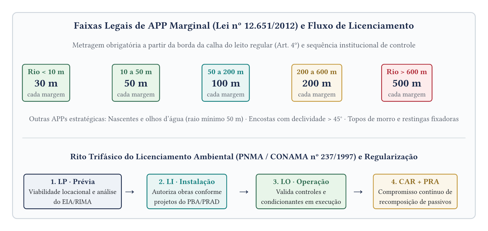
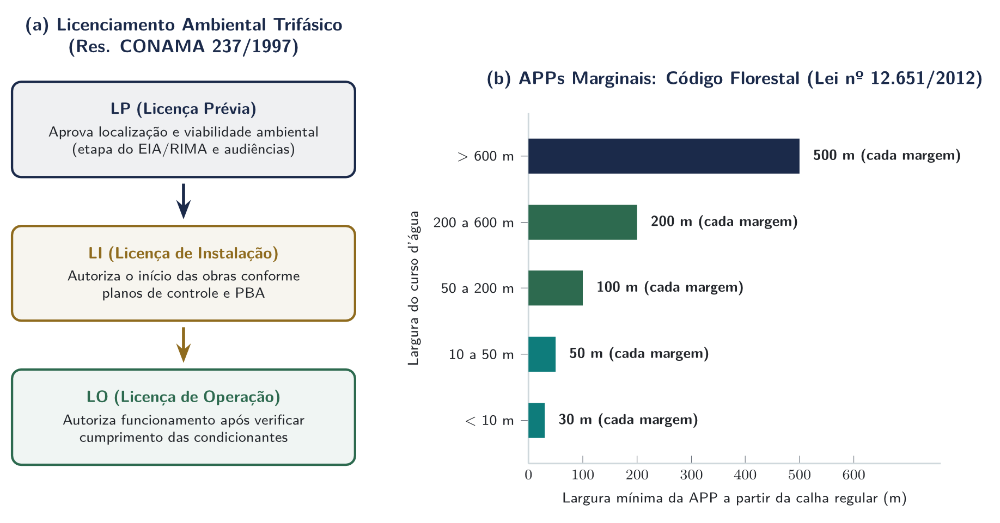

# Legislação Ambiental, APPs, Licenciamento, PRAD e Instrumentos de Gestão {#cap:legislacao_apps_licenciamento_prad}

A legislação ambiental estabelece instrumentos de proteção, competências e procedimentos que condicionam o uso do território. Sua aplicação exige relacionar o dispositivo legal às características da área e ao tipo de atividade, integrando a identificação da norma, de sua versão atualizada e do órgão competente ao trabalho técnico.

::: {.callout-note title="O que você vai aprender neste capítulo"}
O capítulo desenvolve a interpretação de áreas protegidas (APPs e Reserva Legal), licenciamento ambiental trifásico, Tríplice Responsabilidade e planos de recuperação ambiental. O estudante deve identificar o enquadramento da situação estudada, distinguir instrumentos e justificar as informações necessárias à elaboração de um PRAD.
:::

::: {.callout-tip title="Revisando o que você precisa saber"}
A leitura retoma bacia hidrográfica, curso de água, nascente, declividade e uso da terra. A delimitação cartográfica de uma feição depende de seu reconhecimento em campo e de dados cuja escala seja compatível com o critério legal utilizado.
:::

## Vocabulário Técnico e Símbolos do Capítulo 14

Na base jurídica da gestão ambiental brasileira, a sigla **PNMA** refere-se à Política Nacional do Meio Ambiente (Lei nº 6.938/1981), operacionalizada pelo Sistema Nacional do Meio Ambiente (**SISNAMA**). No rito ordinário de licenciamento, **LP**, **LI** e **LO** designam respectivamente a Licença Prévia, a Licença de Instalação e a Licença de Operação. No ordenamento territorial florestal, **APP** identifica a Área de Preservação Permanente (de função ambiental rígida na proteção hídrica, edáfica e ecológica) e **RL** indica a Reserva Legal (percentual mínimo de cobertura nativa no imóvel rural), registradas no Cadastro Ambiental Rural (**CAR**) e regularizadas por meio do Programa de Regularização Ambiental (**PRA**). Para reabilitação ecológica e geomorfológica de áreas impactadas, elabora-se o Plano de Recuperação de Áreas Degradadas (**PRAD**). Nos cálculos espaciais deste capítulo, $A_{\text{APP}}$ e $A_{\text{RL}}$ representam a área total de APP e a área mínima exigida de Reserva Legal (em $\text{ha}$), enquanto $L$, $w$ e $r$ expressam a extensão do curso d’água dentro do imóvel ($\text{m}$), a largura da faixa marginal de APP ($\text{m}$) e o raio de proteção ao redor de nascente ($\text{m}$).

## Política Nacional do Meio Ambiente (Lei nº 6.938/1981) e SISNAMA

A **Lei nº 6.938, de 31 de agosto de 1981**, instituiu a **Política Nacional do Meio Ambiente (PNMA)**, marco fundador da gestão ambiental moderna no Brasil e posteriormente recepcionada pelo artigo 225 da Constituição Federal de 1988. Seu objetivo central visa à preservação, melhoria e recuperação da qualidade ambiental propícia à vida, assegurando condições ao desenvolvimento socioeconômico, aos interesses da segurança nacional e à proteção da dignidade da vida humana (Art. 2º).

Entre seus princípios estruturantes figuram a ação governamental na manutenção do equilíbrio ecológico, a racionalização do uso do solo, do subsolo, da água e do ar, o planejamento e a fiscalização do uso dos recursos ambientais, a proteção dos ecossistemas e o controle de atividades potencial ou efetivamente poluidoras. Para operacionalizar esses objetivos em escala nacional, a lei estruturou o **Sistema Nacional do Meio Ambiente (SISNAMA)**, concebido como uma rede federativa integrada por órgãos e entidades da União, dos Estados, do Distrito Federal e dos Municípios.

No topo dessa arquitetura institucional situa-se o Conselho de Governo, que atua como órgão superior no assessoramento direto à Presidência da República. A função consultiva e deliberativa recai sobre o Conselho Nacional do Meio Ambiente (**CONAMA**), responsável por editar resoluções normativas e estabelecer padrões ambientais de abrangência nacional, enquanto o Ministério do Meio Ambiente e Mudança do Clima (**MMA**) exerce o papel de órgão central encarregado de planejar, coordenar e supervisionar a política ambiental. Na esfera executiva federal atuam o **IBAMA**, voltado ao licenciamento e à fiscalização em âmbito federal, e o **ICMBio**, dedicado à gestão das Unidades de Conservação federais. Em nível estadual, os órgãos seccionais executam programas e conduzem o licenciamento estadual, a exemplo do Instituto do Meio Ambiente e Recursos Hídricos (**INEMA**) na Bahia, cabendo aos órgãos locais, representados pelas secretarias e conselhos municipais, a atuação sobre impactos de âmbito estritamente local.

Para converter princípios jurídicos em gestão territorial efetiva, a PNMA articula instrumentos preventivos, corretivos, informacionais e econômicos previstos em seu Art. 9º. O planejamento preventivo apoia-se no estabelecimento de padrões de qualidade ambiental e no **Zoneamento Ambiental** (Zoneamento Ecológico-Econômico), complementados pela **Avaliação de Impactos Ambientais (AIA)** e pelo **Licenciamento** e revisão de atividades efetiva ou potencialmente poluidoras. No campo da proteção territorial, o poder público institui espaços territoriais especialmente protegidos, como Unidades de Conservação e APPs. A transparência técnica apoia-se no Sistema Nacional de Informações sobre o Meio Ambiente (**SINIMA**), no Cadastro Técnico Federal e na prestação de informações ambientais à sociedade, ao passo que a dimensão coercitiva envolve penalidades disciplinares ou compensatórias diante do descumprimento das medidas de preservação ou correção da degradação ambiental.

## Licenciamento Ambiental Trifásico, EIA/RIMA e Competências

O **Licenciamento Ambiental** consiste no procedimento administrativo pelo qual o órgão ambiental competente licencia a localização, instalação, ampliação e operação de empreendimentos e atividades utilizadoras de recursos ambientais considerados efetiva ou potencialmente poluidores, ou capazes de causar degradação ambiental (Resolução CONAMA nº 237/1997; BRASIL/MMA, 2016; SÁNCHEZ, 2013). A promulgação da Lei nº 15.190/2025 acrescentou novas referências ao marco nacional de licenciamento, exigindo que o analista consulte seu [texto atualizado na Câmara dos Deputados](https://www2.camara.leg.br/legin/fed/lei/2025/lei-15190-8-agosto-2025-797833-normaatualizada-pl.html) e o articule às competências definidas na Lei Complementar nº 140/2011, preservando o rito trifásico como base conceitual de estudo.

No rito ordinário brasileiro, esse processo organiza-se em três etapas sucessivas e interdependentes, conhecidas como **Licenciamento Trifásico**. Na primeira etapa, concede-se a **Licença Prévia (LP)** durante a fase preliminar do planejamento do empreendimento, aprovando sua **localização e concepção**, atestando sua **viabilidade ambiental** e fixando os requisitos básicos e condicionantes para as fases seguintes. Como a LP possui caráter exclusivamente locacional e conceitual (com validade máxima legal de até $5$ anos), ela restringe-se ao planejamento prévio e aguarda a etapa seguinte para autorizar obras no terreno. Somente após o cumprimento dessas exigências emite-se a **Licença de Instalação (LI)**, cuja validade máxima legal alcança $6$ anos, autorizando a implantação do empreendimento ou atividade, incluindo supressão vegetal autorizada, terraplenagem, canteiro de obras e construção civil, em estrita conformidade com os planos e programas executivos aprovados.

Concluídas as obras e verificado o efetivo cumprimento das condicionantes anteriores, o órgão emite a **Licença de Operação (LO)**, que autoriza o funcionamento do empreendimento sob medidas contínuas de controle e monitoramento ambiental. A LO possui validade legal entre o mínimo de $4$ anos e o máximo de $10$ anos, devendo sua renovação ser requerida com antecedência mínima de $120$ dias antes da expiração do prazo de validade (Art. 18, § 4º, CONAMA 237/1997 e Art. 14, § 4º, LC 140/2011), condição que assegura prorrogação automática da licença até a manifestação definitiva do órgão ambiental.

Para obras e atividades causadoras de **significativa degradação ambiental** (como rodovias, hidrelétricas, linhas de transmissão de alta tensão, mineração de grande porte, complexos eólicos em áreas sensíveis ou distritos industriais), a Constituição Federal e a **Resolução CONAMA nº 001/1986** exigem a elaboração prévia do **Estudo de Impacto Ambiental (EIA)** e de seu respectivo **Relatório de Impacto Ambiental (RIMA)**, submetidos a audiência pública antes da decisão sobre a LP. Enquanto o EIA constitui o documento técnico-científico aprofundado (com diagnóstico dos meios físico, biótico e socioeconômico, análise de impactos, alternativas locacionais e programas ambientais), o RIMA traduz suas conclusões em linguagem objetiva, gráfica e acessível à sociedade.

A repartição de competências administrativas entre União (**IBAMA**), Estados (**INEMA** na Bahia) e Municípios é regida pela **Lei Complementar nº 140/2011**, segundo o critério predominante de abrangência do impacto e titularidade da área. Empreendimentos localizados em dois ou mais Estados, no mar territorial, em terras indígenas ou em unidades de conservação federais competem ao IBAMA; impactos de âmbito local tipificados pelos conselhos estaduais competem aos municípios; e a regra geral residual dos demais empreendimentos compete aos órgãos estaduais. Na condução prática desses processos, a confusão entre a etapa de viabilidade preliminar e a autorização executiva de obras gera autuações graves.

::: {.callout-warning appearance="simple"}
### Erro 1, Iniciar Obras Apenas com a Licença Prévia (LP)

A Licença Prévia atesta somente a viabilidade locacional e ambiental do projeto. Realizar supressão vegetal, abertura de acessos ou terraplenagem com base apenas na LP constitui instalação sem licença válida, gerando embargo imediato da obra, multa administrativa e crime ambiental (Art. 60 da Lei nº 9.605/1998).
:::

## Código Florestal (Lei nº 12.651/2012), APPs, Reserva Legal, CAR e PRA

A **Lei nº 12.651, de 25 de maio de 2012** (Novo Código Florestal), estabelece normas gerais sobre a proteção da vegetação nativa no Brasil, definindo dois regimes espaciais distintos nos imóveis rurais e urbanos, representados pelas **Áreas de Preservação Permanente (APPs)** e pela **Reserva Legal (RL)**.

### Áreas de Preservação Permanente (APPs, Art. 4º)

Define-se APP como área protegida, coberta ou não por vegetação nativa, com a função ambiental de preservar os recursos hídricos, a paisagem, a estabilidade geológica e a biodiversidade, facilitar o fluxo gênico de fauna e flora, proteger o solo e assegurar o bem-estar das populações humanas. Na caracterização técnica, o relatório deve distinguir a regra geral de proteção das disposições específicas aplicáveis a áreas rurais consolidadas ou reservatórios artificiais, indicando o dispositivo legal adotado na delimitação cartográfica. As principais tipologias gerais e suas faixas mínimas de proteção encontram-se reunidas na @tbl-apps_codigo_florestal.

| Tipologia de APP (Art. 4º) | Critério Espacial e Largura Mínima | Referência de Medição |
|:--|:--|:--|
| Curso d’água natural ($< 10\text{ m}$) | Faixa de **30 m** em cada margem (perenes e intermitentes; excluídos os efêmeros). | Borda da calha do leito regular. |
| Curso d’água ($10\text{ a } 50\text{ m}$) | Faixa de **50 m** em cada margem. | Borda da calha do leito regular. |
| Curso d’água ($50\text{ a } 200\text{ m}$) | Faixa de **100 m** em cada margem. | Borda da calha do leito regular. |
| Curso d’água ($200\text{ a } 600\text{ m}$) | Faixa de **200 m** em cada margem. | Borda da calha do leito regular. |
| Curso d’água ($> 600\text{ m}$) | Faixa de **500 m** em cada margem. | Borda da calha do leito regular. |
| Nascentes e olhos d’água perenes | Raio mínimo de **50 m** em qualquer situação topográfica. | Ponto de afloramento hídrico. |
| Lagos e lagoas naturais | Zona rural ($> 20\text{ ha}$), **100 m**; zona rural ($\le 20\text{ ha}$), **50 m**; zona urbana, **30 m**. | Margem do corpo de água. |
| Reservatórios artificiais | Faixa definida na licença ambiental (decorrentes de barramento de curso natural). | Contorno do nível máximo operativo normal. |
| Encostas íngremes e veredas | Encostas com declividade $> 45^\circ$ ($> 100\%$); veredas com faixa mínima de **50 m**. | Linha de maior declive / limite brejoso. |
| Topos de morro, serras, restingas e manguezais | Terço superior (altura $\ge 100\text{ m}$ e inclinação $> 25^\circ$); restingas fixadoras e manguezais em toda a extensão. | Curva a $2/3$ da altura da base / limite costeiro. |

: Principais tipologias e faixas mínimas de Área de Preservação Permanente segundo o Art. 4º da Lei nº 12.651/2012. {#tbl-apps_codigo_florestal}

Na aplicação espacial dessas faixas de proteção (@fig-faixas-app-codigo-florestal), a largura marginal escalonada em cinco patamares ($30\text{ m}$ a $500\text{ m}$) mede-se sempre a partir da borda da calha do leito regular, somando-se às nascentes de raio mínimo de $50\text{ m}$, às encostas superiores a $45^\circ$, aos topos de morro e às restingas fixadoras. Em empreendimentos sujeitos a controle ambiental, essa malha legal articula-se diretamente à sequência institucional do licenciamento (LP, LI e LO) e à regularização contínua de passivos via CAR e PRA.

{#fig-faixas-app-codigo-florestal fig-alt="Cinco faixas de APP marginal de 30 m a 500 m na parte superior e quatro etapas de licenciamento e regularização LP, LI, LO e CAR+PRA na parte inferior"}

### Reserva Legal (Art. 12), CAR e PRA

A **Reserva Legal (RL)** corresponde à área localizada no interior de uma propriedade ou posse rural que deve ser mantida com cobertura de vegetação nativa, permitindo o manejo sustentável mediante plano aprovado. Os percentuais mínimos exigidos sobre a área total do imóvel variam conforme o bioma e a região. Na Amazônia Legal, exigem-se **$80\%$** para imóveis situados em áreas de **florestas**, **$35\%$** em áreas de **cerrado** e **$20\%$** em áreas de **campos gerais**; nos **demais biomas e regiões do país** (incluindo Caatinga, Mata Atlântica e Cerrado na Bahia), o percentual mínimo legal é de **$20\%$**.

O Art. 15 do Código Florestal admite o cômputo das APPs no cálculo do percentual da Reserva Legal apenas quando o benefício previsto mantiver preservadas as áreas existentes sem nova conversão para uso alternativo do solo, a área a ser computada estiver conservada ou em processo de recuperação e o proprietário houver efetuado a inscrição no **Cadastro Ambiental Rural (CAR)**. O CAR é o registro público eletrônico nacional obrigatório que reúne o perímetro georreferenciado do imóvel, suas APPs, RL, remanescentes de vegetação nativa e áreas consolidadas, servindo como porta de entrada para o **Programa de Regularização Ambiental (PRA)**, mediante assinatura de Termo de Compromisso para recomposição ou compensação de passivos.

### Cálculo Espacial de APPs e Reserva Legal em Imóvel Rural

$$
A_{\text{marg}} = \frac{n_m \cdot L \cdot w}{10.000} \qquad\qquad A_{\text{nasc}} = \frac{\pi \cdot r^2}{10.000} \qquad\qquad A_{\text{RL}} = f_{\text{bioma}} \cdot A_{\text{imóvel}}
$$

Nessas expressões em hectares ($\text{ha}$), $A_{\text{marg}}$ representa a área da APP marginal do curso d’água, em que $n_m \in \{1, 2\}$ indica se o rio margeia apenas um lado ($n_m = 1$) ou atravessa o imóvel com ambas as margens dentro da propriedade ($n_m = 2$), $L$ é a extensão longitudinal do rio ($\text{m}$) e $w$ corresponde à largura da faixa legal ($\text{m}$). Para nascentes perenes ($A_{\text{nasc}}$), o raio mínimo $r = 50\text{ m}$ resulta em $\approx 0{,}7854\text{ ha}$ por nascente isolada. Já $A_{\text{RL}}$ define a área mínima de Reserva Legal exigida para a área total $A_{\text{imóvel}}$, aplicando-se $f_{\text{bioma}} \in \{0{,}80;\, 0{,}35;\, 0{,}20\}$.

Na prática da Análise Ambiental, a espacialização conjunta das faixas marginais, nascentes, encostas íngremes, topos de morro e Reserva Legal sobre o imóvel rural compatibiliza as condicionantes cartográficas do CAR com as etapas do licenciamento ambiental trifásico (@fig-licenciamento_apps).

{#fig-licenciamento_apps}

O Exemplo 14.1 aplica essas relações geométricas ao levantamento fundiário de uma propriedade rural situada na Caatinga baiana.

::: {.callout-tip appearance="simple"}
### Exemplo 14.1 (Básico). Delimitação de APPs e Reserva Legal em Imóvel Rural na Bahia

**Situação analisada.** Durante a análise ambiental de uma propriedade rural localizada no interior da Bahia (bioma Caatinga, fora da Amazônia Legal), necessita-se quantificar a área total de APP e a área mínima de Reserva Legal para conferência do CAR.

**Dados disponíveis.** Área total do imóvel $A_{\text{imóvel}} = 250{,}0\text{ ha}$; o imóvel é margeado em apenas um dos lados ($n_m = 1$) por um rio perene de $35\text{ m}$ de largura ao longo de $1.200\text{ m}$ de extensão; no interior da propriedade existe ainda $1$ nascente perene isolada (sem sobreposição espacial com a faixa do rio).

**Problema a resolver.** Calcule a área da APP marginal ($A_{\text{marg}}$), a área da APP de nascente ($A_{\text{nasc}}$), a área total de APP do imóvel e a área mínima exigida de Reserva Legal ($A_{\text{RL}}$).

**Fundamento da análise.** Aplicação dos parâmetros do Art. 4º e Art. 12 da Lei nº 12.651/2012 e conversão de $\text{m}^2$ para hectares ($1\text{ ha} = 10.000\text{ m}^2$).

**Desenvolvimento.** Na **Etapa 1 (Largura legal e APP marginal)**, adota-se $w = 50\text{ m}$ (faixa entre $10\text{ m}$ e $50\text{ m}$) com $n_m = 1$, resultando em $A_{\text{marg}} = (1 \times 1.200 \times 50)/10.000 = 6{,}00\text{ ha}$. Na **Etapa 2 (APP de nascente e total)** e na **Etapa 3 (Reserva Legal na Bahia, $f_{\text{bioma}} = 0{,}20$)**,

$$
A_{\text{nasc}} = \frac{\pi \cdot 50^2}{10.000} \approx 0{,}79\text{ ha} \qquad A_{\text{APP}} = 6{,}00 + 0{,}79 = 6{,}79\text{ ha} \qquad A_{\text{RL}} = 0{,}20 \times 250{,}0 = 50{,}00\text{ ha}
$$

**Interpretação do resultado.** $A_{\text{marg}} = 6{,}00\text{ ha}$; $A_{\text{nasc}} = 0{,}79\text{ ha}$; $A_{\text{APP}} = 6{,}79\text{ ha}$; Reserva Legal mínima $A_{\text{RL}} = 50{,}00\text{ ha}$.

**Condições de validade.** O rio de $35\text{ m}$ enquadra-se na faixa de $10\text{ m}$ a $50\text{ m}$ (APP de $50\text{ m}$), e a Bahia situa-se integralmente fora da Amazônia Legal, aplicando-se o percentual de $20\%$ de Reserva Legal.
:::

Em cursos d’água intermitentes ou sazonais do Semiárido, a escolha da referência física correta na margem evita erros severos de subdimensionamento da faixa protegida.

::: {.callout-warning appearance="simple"}
### Erro 2, Medir a APP Marginal a Partir do Espelho d’Água da Estiagem

No Semiárido e em rios sazonais, o espelho d’água reduz-se drasticamente na seca ou desaparece nos trechos intermitentes. O Art. 4º do Código Florestal determina que a faixa de APP seja medida a partir da **borda da calha do leito regular**, independentemente do nível reduzido do filete d’água na estação seca.
:::

Quando um imóvel apresenta déficit parcial de Reserva Legal fora de APP, o Art. 15 permite verificar se a vegetação nativa preservada nas APPs supre o percentual legal exigido (Exemplo 14.2).

::: {.callout-tip appearance="simple"}
### Exemplo 14.2 (Intermediário). Verificação do Cômputo de APP na Reserva Legal (Art. 15 do Código Florestal)

**Situação analisada.** Um imóvel rural de $400{,}0\text{ ha}$ situado em área de cerrado dentro da Amazônia Legal (percentual legal de Reserva Legal de $35\%$) busca regularização ambiental no CAR/PRA sem realizar novas supressões.

**Dados disponíveis.** Área total $= 400{,}0\text{ ha}$; percentual de RL exigido $= 35\%$; área de APP integralmente conservada $= 60{,}0\text{ ha}$; área de vegetação nativa conservada fora da APP $= 90{,}0\text{ ha}$. O proprietário manteve intacta a cobertura remanescente e inscreveu o imóvel no CAR.

**Problema a resolver.** Calcule a área de RL exigida, verifique o déficit existente sem cômputo da APP e avalie se o cômputo previsto no Art. 15 da Lei nº 12.651/2012 regulariza o imóvel.

**Fundamento da análise.** Cálculo da RL exigida ($0{,}35 \cdot A_{\text{imóvel}}$) e soma condicionada da APP conservada à vegetação nativa remanescente.

**Desenvolvimento.** Na **Etapa 1 (Reserva Legal exigida e déficit inicial)**, obtêm-se $A_{\text{RL, exigida}} = 0{,}35 \times 400{,}0 = 140{,}0\text{ ha}$ e $\text{Déficit} = 140{,}0 - 90{,}0 = 50{,}0\text{ ha}$. Na **Etapa 2 (Cômputo da APP pelo Art. 15 e saldo)**,

$$
A_{\text{RL, computada}} = 90{,}0 + 60{,}0 = 150{,}0\text{ ha} \quad (37{,}5\% > 35\%) \qquad \text{Excedente} = 150{,}0 - 140{,}0 = 10{,}0\text{ ha}
$$

**Interpretação do resultado.** Sem cômputo, haveria déficit de $50{,}0\text{ ha}$; aplicando o Art. 15, o imóvel soma $150{,}0\text{ ha}$ ($37{,}5\%$), cumprindo os $140{,}0\text{ ha}$ exigidos com $10{,}0\text{ ha}$ excedentes.

**Condições de validade.** O cômputo da APP mantém a área sob proteção integral do Art. 4º para preservação hídrica e edáfica, apenas contribuindo para o atingimento do percentual mínimo de RL quando cumpridas todas as exigências legais.
:::

Diferenciar as regras de compensação da Reserva Legal das exigências estritas aplicáveis às APPs evita interpretações jurídicas inválidas em perícias e processos de regularização.

::: {.callout-warning appearance="simple"}
### Erro 3, Confundir Recuperação de APP com Compensação em Outro Imóvel

Enquanto o passivo de Reserva Legal pode ser compensado fora do imóvel (via Cota de Reserva Ambiental ou área equivalente no mesmo bioma), passivos em **Áreas de Preservação Permanente** exigem recomposição física *in loco* na própria área protegida, pois sua função hidrogeomorfológica é intransferível.
:::

## PRAD e Tríplice Responsabilidade Ambiental

O **Plano de Recuperação de Áreas Degradadas (PRAD)** é o instrumento técnico-executivo exigido tanto em processos de licenciamento e regularização (PRA) quanto em condenações administrativas ou judiciais para recompor funções ecológicas, hidrológicas e edáficas de áreas alteradas. Todo PRAD consistente precisa atuar sobre o processo causal da degradação, pois a revegetação de uma superfície onde a enxurrada continua se concentrando tende a fracassar nos primeiros ciclos chuvosos. Embora modelos simplificados variem entre órgãos (IBAMA, INEMA), a estrutura técnica completa de um PRAD articula cinco blocos sequenciais e interdependentes. O projeto inicia-se pela **identificação e caracterização da área**, reunindo delimitação cartográfica georreferenciada, histórico da degradação, diagnóstico de solo, relevo, drenagem e cobertura vegetal remanescente. Em seguida, executa-se o **isolamento dos fatores de degradação** mediante cercamento contra gado, controle de incêndios, fechamento de acessos clandestinos e eliminação de fontes de poluição.

Superada a fase de isolamento, passa-se ao **preparo físico e controle erosivo** com técnicas de bioengenharia, compreendendo reconformação de taludes, drenagem superficial, instalação de paliçadas, biomantas e correção física ou química do substrato. A etapa seguinte concentra-se na **recomposição vegetal**, definindo o método adequado (condução da regeneração natural, semeadura direta ou plantio de mudas em área total ou enriquecimento), a escolha de espécies nativas regionais distribuídas em grupos sucessionais (pioneiras de recobrimento e secundárias tardias de diversidade), o cálculo do número de mudas e a reserva técnica para replantio (Exemplo 14.3). Para assegurar a efetividade das ações, o PRAD encerra-se com um **cronograma e plano de monitoramento** de $24$ a $60$ meses apoiado em metas de execução (o que foi implantado) e metas ambientais verificáveis por indicadores objetivos, tais como taxa de sobrevivência de mudas, cobertura de copa, estabilização de sulcos e recuperação da qualidade do solo.

::: {.callout-tip appearance="simple"}
### Exemplo 14.3 (Intermediário). Dimensionamento de Mudas e Grupos Ecológicos em PRAD

**Situação analisada.** Para cumprir um Termo de Compromisso no PRA, elabora-se o PRAD de uma área degradada em APP de margem fluvial que será recuperada por plantio total de espécies nativas regionais.

**Dados disponíveis.** Área a recuperar $A = 4{,}50\text{ ha}$ ($45.000\text{ m}^2$); espaçamento adotado entre mudas de $3{,}0\text{ m} \times 2{,}0\text{ m}$ ($6{,}0\text{ m}^2$ por muda); composição florística composta por $60\%$ de espécies de recobrimento (pioneiras e secundárias iniciais) e $40\%$ de espécies de diversidade (secundárias tardias e clímax); reserva técnica de $15\%$ sobre o plantio inicial para replantio de falhas.

**Problema a resolver.** Calcule o número base de mudas para o plantio inicial, a quantidade destinada a cada grupo ecológico, a reserva de replantio e o total de mudas a adquirir no viveiro.

**Fundamento da análise.** Divisão da área total pela área útil por cova e repartição proporcional por grupo sucessional.

**Desenvolvimento.** Na **Etapa 1 (Plantio inicial e repartição ecológica)**, calcula-se $N_{\text{base}} = 45.000 / 6{,}0 = 7.500\text{ mudas}$, divididas em $N_{\text{recobrimento}} = 7.500 \times 0{,}60 = 4.500\text{ mudas}$ e $N_{\text{diversidade}} = 7.500 \times 0{,}40 = 3.000\text{ mudas}$. Na **Etapa 2 (Reserva técnica de $15\%$ e total)**,

$$
N_{\text{replantio}} = 7.500 \times 0{,}15 = 1.125\text{ mudas} \qquad\qquad N_{\text{total}} = 7.500 + 1.125 = 8.625\text{ mudas}
$$

**Interpretação do resultado.** Plantio inicial de $7.500$ mudas ($4.500$ de recobrimento e $3.000$ de diversidade), acrescido de $1.125$ mudas para replantio, totalizando $8.625$ mudas.

**Condições de validade.** A densidade de $1.667\text{ mudas}\cdot\text{ha}^{-1}$ ($7.500 / 4{,}5$) corresponde exatamente ao padrão clássico de $3{,}0\text{ m} \times 2{,}0\text{ m}$ adotado em projetos de restauração florestal.
:::

O descumprimento das normas ambientais submete o infrator (pessoa física ou jurídica) à **Tríplice Responsabilidade Ambiental**, consagrada no Art. 225, § 3º da Constituição Federal e regulamentada pela **Lei de Crimes Ambientais (Lei nº 9.605/1998)** e pelo Decreto nº 6.514/2008. Na esfera **civil**, a responsabilidade é **objetiva e *propter rem***, impondo a obrigação de reparar integralmente o dano ambiental ou indenizá-lo independentemente da comprovação de culpa ou dolo, bastando o nexo causal entre a atividade e o dano; além disso, a obrigação de recompor APP e RL acompanha o imóvel, transferindo-se ao sucessor em caso de venda. De forma independente e cumulativa, a esfera **administrativa** abrange sanções aplicadas pelo poder de polícia ambiental (IBAMA, INEMA, municípios), como advertência, multa simples ou diária, apreensão de equipamentos, embargo de obra ou atividade e suspensão de licenças, enquanto a esfera **penal** prevê penas privativas de liberdade, restritivas de direitos ou multa criminal a pessoas físicas e jurídicas por condutas tipificadas como crimes ambientais, a exemplo de desmatar APP sem autorização, poluir mananciais ou operar empreendimento potencialmente poluidor sem licença válida (Exemplo 14.4).

::: {.callout-tip appearance="simple"}
### Exemplo 14.4 (Intermediário). Análise de Responsabilidade Administrativa e Civil por Supressão em APP

**Situação analisada.** Durante vistoria fiscalizatória em uma propriedade rural, constatou-se o desmatamento não autorizado de vegetação nativa em APP marginal para implantação de pastagem.

**Dados disponíveis.** Área suprimida irregularmente $= 3{,}60\text{ ha}$; valor-base didático de multa administrativa adotado no exercício $= \text{R\$ }5.000{,}00\cdot\text{ha}^{-1}$, acrescido de $50\%$ por incidir especificamente em APP; custo unitário estimado de execução e monitoramento de PRAD por $3$ anos $= \text{R\$ }18.000{,}00\cdot\text{ha}^{-1}$.

**Problema a resolver.** Calcule o valor da multa administrativa, o custo da reparação civil via PRAD e o desembolso financeiro total estimado, explicando a relação com a esfera penal.

**Fundamento da análise.** Aplicação independente das esferas administrativa e civil segundo o princípio da Tríplice Responsabilidade Ambiental (Art. 225, § 3º da CF/88 e Lei nº 9.605/1998).

**Desenvolvimento.** Na **Etapa 1 (Multa administrativa e custo do PRAD)** e na **Etapa 2 (Desembolso total)**,

$$
M_{\text{adm}} = 3{,}60 \times 5.000{,}00 \times 1{,}50 = \text{R\$ }27.000{,}00 \qquad C_{\text{PRAD}} = 3{,}60 \times 18.000{,}00 = \text{R\$ }64.800{,}00 \qquad C_{\text{total}} = \text{R\$ }91.800{,}00
$$

**Interpretação do resultado.** Multa administrativa de $\text{R\$ }27.000{,}00$ e custo de PRAD de $\text{R\$ }64.800{,}00$, somando $\text{R\$ }91.800{,}00$, sem prejuízo da eventual responsabilização penal (Art. 38 da Lei nº 9.605/1998).

**Condições de validade.** O pagamento da multa administrativa mantém íntegra a obrigação civil de recuperar a APP, pois as três esferas atuam de forma independente e cumulativa.
:::

## Síntese Aplicada, Auditoria de Prazos e Etapas no Licenciamento Trifásico

A articulação entre conformidade jurídica, execução física de programas ambientais (como PRADs e medidas de bioengenharia) e validade das licenças exige controle rigoroso de prazos administrativos. O Exemplo 14.5 sintetiza a auditoria do rito trifásico e a contagem legal para renovação da Licença de Operação junto ao INEMA.

::: {.callout-tip appearance="simple"}
### Exemplo 14.5 (Avançado). Auditoria de Prazos e Etapas no Licenciamento Ambiental Trifásico

**Situação analisada.** Um empreendimento energético de médio impacto ambiental na Bahia obteve sua Licença de Operação (LO) junto ao órgão estadual competente (INEMA) após cumprir o rito trifásico.

**Dados disponíveis.** Data de emissão da LO igual a $10/08/2026$; prazo de validade concedido na LO igual a $6$ anos (vencimento em $10/08/2032$).

**Problema a resolver.** Indique as atividades permitidas em cada fase anterior (LP e LI), verifique se o prazo de $6$ anos está dentro do intervalo legal da LO e determine a data limite para protocolar o pedido de renovação da LO com prorrogação automática.

**Fundamento da análise.** Confronto com os limites da Resolução CONAMA nº 237/1997 (Art. 18) e da Lei Complementar nº 140/2011 (Art. 14, § 4º).

**Desenvolvimento.** Na **Etapa 1 (Verificação do prazo legal da LO)**, a legislação fixa o intervalo de $4$ a $10$ anos para a LO, logo a validade de $6$ anos enquadra-se na faixa permitida. Na **Etapa 2 (Contagem regressiva dos $120$ dias para protocolo de renovação)**, partindo de $10/08/2032$, subtraem-se $10$ dias de agosto (restam $110$ dias), $31$ dias de julho (restam $79$ dias), $30$ dias de junho (restam $49$ dias) e $31$ dias de maio (restam $18$ dias). Em abril ($30$ dias), alcança-se $30 - 18 = 12$, fixando a data limite em **12/04/2032**.

**Interpretação do resultado.** A LP aprova apenas concepção e localização e a LI autoriza a obra; o prazo de $6$ anos da LO é válido ($4$ a $10$ anos); o pedido de renovação deve ser protocolado até **12/04/2032** para garantir a prorrogação automática.

**Condições de validade.** Caso o empreendedor protocole após o prazo de $120$ dias e a licença vença sem análise, a operação torna-se irregular, sujeitando o responsável a embargo e autuação.
:::

## Armadilha Conceitual e Materiais Audiovisuais de Apoio

Mesmo quando um empreendimento ou propriedade cumpre uma sanção administrativa imediata, a obrigação de reparar integralmente o passivo ambiental permanece exigível pelas demais esferas jurídicas.

::: {.callout-warning appearance="simple"}
### Erro 4, Tratar a Tríplice Responsabilidade como Alternativa (“Paga Multa ou Recupera”)

Um equívoco frequente é supor que o pagamento de multa administrativa encerra o problema ambiental. Na realidade, as esferas civil, administrativa e penal são independentes, de modo que o infrator paga a multa (administrativa), continua obrigado a recuperar integralmente a área via PRAD (civil) e pode responder a processo criminal (penal).
:::

Para aprofundar o entendimento sobre a Política Nacional do Meio Ambiente, o Código Florestal e o arcabouço normativo brasileiro, assista às videoaulas selecionadas na página da disciplina, iniciando por [Gestão Ambiental - Legislação e Certificação Ambiental](https://www.youtube.com/watch?v=L-WEcC2IlbA), prosseguindo com [Direito Ambiental: Código Florestal](https://www.youtube.com/watch?v=ApidLjWC4Dc) e concluindo com [Legislação Ambiental Brasileira](https://www.youtube.com/watch?v=gC4uHPJDiVA).

## Exercícios de fixação

#### Bloco A, Questões Conceituais Básicas (1 a 5)

1. Cite os objetivos principais da Política Nacional do Meio Ambiente (Lei nº 6.938/1981) e explique a função do CONAMA e dos órgãos executores/seccionais (IBAMA e INEMA) dentro do SISNAMA.

2. Diferencie o escopo técnico e jurídico da Licença Prévia (LP), da Licença de Instalação (LI) e da Licença de Operação (LO).

3. Explique a diferença entre o EIA (Estudo de Impacto Ambiental) e o RIMA (Relatório de Impacto Ambiental), indicando em qual etapa do licenciamento são analisados.

4. Distinga a função ambiental e o regime jurídico da Área de Preservação Permanente (APP) em relação à Reserva Legal (RL) no Código Florestal.

5. Descreva os cinco blocos técnicos mínimos que estruturam um Plano de Recuperação de Áreas Degradadas (PRAD).

#### Bloco B, Questões Intermediárias e Quantitativas (6 a 10)

6. Uma propriedade rural de $180{,}0\text{ ha}$ na Bahia é atravessada por um riacho de $6{,}0\text{ m}$ de largura média (ambas as margens no interior do imóvel, $n_m = 2$) ao longo de $800\text{ m}$ de extensão, possuindo ainda $2$ nascentes perenes isoladas. Calcule a área total de APP do imóvel e a área mínima exigida de Reserva Legal.

7. Um imóvel de $500{,}0\text{ ha}$ situado em área de floresta na Amazônia Legal possui $310{,}0\text{ ha}$ de vegetação nativa fora de APP e $100{,}0\text{ ha}$ de APP conservada. Determine a RL exigida ($80\%$), verifique se há déficit sem o cômputo da APP e avalie se o cômputo do Art. 15 supre integralmente a exigência legal.

8. Para recuperar uma área alterada de $3{,}00\text{ ha}$ ($30.000\text{ m}^2$) em APP, um PRAD especifica plantio de mudas nativas no espaçamento $2{,}5\text{ m} \times 2{,}0\text{ m}$ ($5{,}0\text{ m}^2$ por muda), com $50\%$ de pioneiras/secundárias iniciais e $50\%$ de secundárias tardias/clímax, além de $10\%$ de reserva para replantio. Calcule o total de mudas a adquirir.

9. Uma indústria recebeu sua Licença de Instalação (LI) com validade de $4$ anos e, após concluir a obra, obteve a LO em $15/05/2027$ com validade de $5$ anos. Indique a data de vencimento da LO e a data limite para protocolar o pedido de renovação com antecedência mínima de $120$ dias.

10. Um empreendimento suprimiu irregularmente $2{,}50\text{ ha}$ de vegetação nativa fora de APP, sofrendo multa didática de $\text{R\$ }4.000{,}00\cdot\text{ha}^{-1}$ e obrigação de executar PRAD orçado em $\text{R\$ }14.000{,}00\cdot\text{ha}^{-1}$. Calcule o custo total nas esferas administrativa e civil.

#### Bloco C, Questões Objetivas de Múltipla Escolha (11 a 15)

11. No âmbito do SISNAMA (Lei nº 6.938/1981), o órgão consultivo e deliberativo responsável por estabelecer normas e padrões ambientais nacionais mediante resoluções é o,

    (A) IBAMA.

    (B) CONAMA.

    (C) INEMA.

    (D) ICMBio.

    (E) Ministério Público Federal.

12. De acordo com a Lei nº 12.651/2012 (Art. 4º), a faixa mínima de Área de Preservação Permanente para um curso d’água natural com $75\text{ m}$ de largura de calha regular e para uma nascente perene são, respectivamente,

    (A) $50\text{ m}$ e $30\text{ m}$.

    (B) $100\text{ m}$ e $50\text{ m}$.

    (C) $200\text{ m}$ e $50\text{ m}$.

    (D) $100\text{ m}$ e $100\text{ m}$.

    (E) $30\text{ m}$ e $50\text{ m}$.

13. Os percentuais mínimos de Reserva Legal exigidos pelo Código Florestal para imóveis situados na Amazônia Legal em áreas de floresta, cerrado e campos gerais são, respectivamente,

    (A) $80\%$, $35\%$ e $20\%$.

    (B) $80\%$, $50\%$ e $20\%$.

    (C) $50\%$, $35\%$ e $20\%$.

    (D) $80\%$, $20\%$ e $20\%$.

    (E) $35\%$, $20\%$ e $20\%$.

14. Sobre a Tríplice Responsabilidade Ambiental no ordenamento jurídico brasileiro, é correto afirmar que,

    (A) A responsabilidade civil ambiental é subjetiva, exigindo sempre a prova de intenção dolosa do degradador.

    (B) O pagamento da multa administrativa extingue automaticamente a obrigação de reparar o dano em PRAD.

    (C) As sanções administrativas, civis e penais podem incidir cumulativamente sobre o mesmo fato danoso, sendo objetiva a obrigação civil de reparar o dano.

    (D) Pessoas jurídicas não podem ser responsabilizadas na esfera penal por crimes ambientais no Brasil.

    (E) A obrigação de recompor a Reserva Legal desaparece quando o imóvel rural é vendido a terceiros.

15. No Licenciamento Ambiental Trifásico (Resolução CONAMA nº 237/1997), a licença que autoriza o início efetivo das obras civis e da instalação dos equipamentos, mediante atendimento às condicionantes da fase preliminar, é a,

    (A) Licença Prévia (LP).

    (B) Licença de Instalação (LI).

    (C) Licença de Operação (LO).

    (D) Outorga Preventiva de Uso da Água.

    (E) Certidão de Cadastro Ambiental Rural (CAR).

## Questões de aplicação

### Foco de Provas, ENADE e Concursos (IBAMA / INEMA / Perícia)

Questões de concursos e do ENADE frequentemente apresentam situações reais de campo em que um proprietário ou empreendedor confunde fases do licenciamento, mede APPs de forma equivocada ou tenta compensar APP fora do imóvel. Domine os números exatos da Lei nº 12.651/2012 e a independência das três esferas de responsabilidade.

16. **\[Questão Autoral, Estilo ENADE / Geografia\]** Durante visita técnica a uma propriedade rural localizada no Semiárido Baiano, estudantes da disciplina Análise Ambiental observaram que um trecho de $600\text{ m}$ da margem de um rio perene de $15\text{ m}$ de largura encontrava-se desmatado e com sulcos erosivos ativos. O proprietário afirmou que não havia necessidade de recomposição porque, (1) a faixa desmatada media $30\text{ m}$ de largura a partir do espelho d’água atual na estação seca; e (2) ele pretendia comprar uma área de Caatinga preservada em outro município para “compensar a APP” desmatada. À luz da Lei nº 12.651/2012, avalie as afirmações,

    - Para um curso d’água de $15\text{ m}$ de largura, a APP marginal mínima é de $50\text{ m}$ medidos a partir da borda da calha do leito regular, excluído o espelho d’água da estiagem.

    - A compensação em outro imóvel rural aplica-se a déficits de Reserva Legal, não substituindo a obrigação de recompor fisicamente a APP degradada no próprio imóvel.

    - Por se tratar de propriedade situada na Bahia, o percentual mínimo de Reserva Legal exigido é de $35\%$.

    É correto o que se afirma em,

    (A) I, apenas.

    (B) III, apenas.

    (C) I e II, apenas.

    (D) II e III, apenas.

    (E) I, II e III.

17. **\[Questão Autoral, Estilo Concurso Analista Ambiental / INEMA-BA\]** Um empreendimento com potencial de significativa degradação ambiental protocolou pedido de licenciamento junto ao órgão estadual competente. Considerando a Resolução CONAMA nº 001/1986 e a Resolução CONAMA nº 237/1997, assinale a sequência correta de procedimentos administrativos,

    (A) Emissão da LI para abertura do canteiro de obras $\rightarrow$ elaboração do EIA/RIMA durante a operação $\rightarrow$ emissão da LP ao final da vida útil.

    (B) Elaboração do EIA/RIMA e realização de audiência pública $\rightarrow$ análise e emissão da LP (viabilidade locacional) $\rightarrow$ aprovação dos projetos executivos e emissão da LI (autorização de obras) $\rightarrow$ verificação das condicionantes e emissão da LO (funcionamento).

    (C) Inscrição no CAR $\rightarrow$ dispensa de LP e LI $\rightarrow$ emissão direta da LO por autodeclaração.

    (D) Emissão simultânea de LP, LI e LO sem vistoria prévia para qualquer obra energética de grande porte.

    (E) Elaboração apenas do RIMA simplificado sem EIA técnico, sendo facultativa a apresentação de alternativas locacionais.

18. **\[Questão Autoral, Estilo Concurso Analista Ambiental / IBAMA\]** Em razão de vazamento de efluentes industriais não licenciados que provocou mortandade de peixes e contaminação de margem fluvial, o órgão ambiental lavrou auto de infração com multa, o Ministério Público ajuizou ação civil pública exigindo PRAD e indenização, e foi instaurado processo criminal com base na Lei nº 9.605/1998. A defesa da empresa alegou que não houve intenção de poluir e que o pagamento da multa administrativa já impediria outras cobranças. Sob o ponto de vista jurídico-ambiental brasileiro, a tese da defesa é,

    (A) Procedente, pois a responsabilidade civil ambiental exige comprovação de dolo específico.

    (B) Procedente, pois o princípio da unicidade impede a cumulação de multa administrativa com ação penal.

    (C) Improcedente, pois a responsabilidade civil ambiental é objetiva (independe de culpa ou dolo) e as esferas civil, administrativa e penal são independentes e cumulativas.

    (D) Parcialmente procedente, pois empresas privadas não podem sofrer sanções administrativas, apenas pessoas físicas.

    (E) Improcedente apenas quanto à multa, mas procedente quanto ao PRAD, que é sempre facultativo em áreas industriais.

## Gabarito comentado {.unnumbered}

::: {.callout-tip collapse="true" title="Clique para abrir o Gabarito Comentado"}
### Resoluções Completas, Exercícios de Fixação (1 a 15)

1. A PNMA visa preservar, melhorar e recuperar a qualidade ambiental propícia à vida e ao desenvolvimento sustentável. No SISNAMA, o **CONAMA** atua como órgão consultivo e deliberativo (editando normas e resoluções), enquanto **IBAMA** (federal) e **INEMA** (estadual na Bahia) executam o licenciamento, a fiscalização e o controle ambiental em suas respectivas esferas de competência.

2. **LP.** Atesta viabilidade ambiental e aprova localização e concepção (sem autorizar obra). **LI.** Autoriza a instalação e construção do empreendimento segundo projetos executivos aprovados. **LO.** Autoriza o início da operação após verificação do cumprimento das condicionantes anteriores.

3. O **EIA** é o estudo técnico-científico multidisciplinar completo (diagnóstico, prognóstico, impactos, alternativas e programas); o **RIMA** é sua síntese acessível ao público e aos conselhos. Ambos integram a fase preliminar de avaliação que subsidia a decisão sobre a **LP**.

4. A **APP** tem função ambiental rígida vinculada a feições sensíveis (rios, nascentes, encostas, topos de morro), exigindo preservação integral e recuperação *in loco* quando degradada. A **Reserva Legal** é um percentual da área do imóvel rural ($20\%$, $35\%$ ou $80\%$) destinado à conservação da vegetação nativa com possibilidade de manejo sustentável e compensação legal em caso de passivo consolidado.

5. Os cinco blocos são, (1) identificação e diagnóstico da área; (2) isolamento dos fatores de degradação; (3) preparo físico e obras de controle erosivo/bioengenharia; (4) recomposição vegetal estratificada; (5) cronograma executivo e monitoramento por indicadores.

6. **Desenvolvimento,** Riacho de $6{,}0\text{ m}$ ($< 10\text{ m}$), APP de $w = 30\text{ m}$ em cada margem ($n_m = 2$). APP marginal, $A_{\text{marg}} = (2 \times 800 \times 30) / 10.000 = 48.000 / 10.000 = 4{,}80\text{ ha}$. APP das $2$ nascentes ($r = 50\text{ m}$), $A_{\text{nasc}} = 2 \times (\pi \cdot 50^2 / 10.000) \approx 2 \times 0{,}7854 = 1{,}57\text{ ha}$. APP total, $4{,}80 + 1{,}57 = \mathbf{6{,}37\text{ ha}}$. Reserva Legal mínima na Bahia ($20\%$), $A_{\text{RL}} = 0{,}20 \times 180{,}0 = \mathbf{36{,}00\text{ ha}}$.

7. **Desenvolvimento,** RL exigida ($80\%$ em floresta na Amazônia Legal), $0{,}80 \times 500{,}0 = \mathbf{400{,}0\text{ ha}}$. Sem cômputo da APP, déficit de $400{,}0 - 310{,}0 = \mathbf{90{,}0\text{ ha}}$. Com cômputo da APP (Art. 15), $310{,}0 + 100{,}0 = \mathbf{410{,}0\text{ ha}}$ ($82{,}0\% > 80\%$), suprindo integralmente a exigência com $10{,}0\text{ ha}$ excedentes.

8. **Desenvolvimento,** Mudas base, $30.000 / 5{,}0 = 6.000$ mudas ($3.000$ pioneiras/secundárias iniciais e $3.000$ secundárias tardias/clímax). Reserva de replantio ($10\%$), $6.000 \times 0{,}10 = 600$ mudas. Total a adquirir, $6.000 + 600 = \mathbf{6.600\text{ mudas}}$.

9. **Desenvolvimento,** Vencimento da LO, **15/05/2032** ($5$ anos após $15/05/2027$). Contagem regressiva de $120$ dias (lembrando que 2032 é ano bissexto, mas fevereiro já ficou antes da contagem), Maio ($15$ dias, $01$ a $15/05$, restam $105$); Abril ($30$ dias, restam $75$); Março ($31$ dias, restam $44$); Fevereiro de 2032 ($29$ dias, restam $15$); Janeiro ($31 - 15 = 16 \rightarrow$ **16/01/2032**). (Em anos convencionais seria 15/01; em 2032, bissexto, $16/01/2032$ completa exatamente $120$ dias até $15/05/2032$.)

10. **Desenvolvimento,** Multa administrativa, $2{,}50 \times 4.000{,}00 = \text{R\$ }10.000{,}00$. Custo do PRAD (esfera civil), $2{,}50 \times 14.000{,}00 = \text{R\$ }35.000{,}00$. Total nas duas esferas, $10.000{,}00 + 35.000{,}00 = \mathbf{\text{R\$ }45.000{,}00}$.

11. **Gabarito, (B).** O CONAMA é o órgão consultivo e deliberativo do SISNAMA.

12. **Gabarito, (B).** Cursos d’água entre $50\text{ m}$ e $200\text{ m}$ de largura exigem $100\text{ m}$ de APP marginal; nascentes perenes exigem raio de $50\text{ m}$.

13. **Gabarito, (A).** Art. 12 da Lei nº 12.651/2012, $80\%$ (florestas), $35\%$ (cerrado) e $20\%$ (campos gerais) na Amazônia Legal.

14. **Gabarito, (C).** A responsabilidade civil ambiental é objetiva (baseada no risco integral e no nexo causal) e coexiste de forma independente com as sanções administrativas e penais.

15. **Gabarito, (B).** A Licença de Instalação (LI) é o ato administrativo que autoriza a execução física das obras e a instalação do empreendimento.

### Resoluções Completas, Questões ENADE e Concursos (16 a 18)

16. **Gabarito, (C).** As afirmações I e II estão corretas, rio de $15\text{ m}$ exige $50\text{ m}$ de APP medidos da borda da calha regular, e APP degradada deve ser recuperada no local, sem possibilidade de compensação externa. A afirmação III é falsa porque a Bahia está fora da Amazônia Legal, aplicando-se $20\%$ de Reserva Legal.

17. **Gabarito, (B).** Apenas (B) respeita a ordem cronológica e legal do licenciamento trifásico para obras sujeitas a EIA/RIMA, estudos e audiência pública prévios à LP, projetos executivos e autorização de obras na LI, e funcionamento autorizado na LO.

18. **Gabarito, (C).** A tese da defesa é improcedente em ambos os pontos, no Brasil, a obrigação civil de reparar o dano ambiental é objetiva (dispensa prova de dolo ou culpa) e as três esferas (civil, administrativa e penal) atuam de forma independente e cumulativa.
:::

## Síntese conceitual {.unnumbered}

::: {.callout-important title="Síntese Conceitual do Capítulo"}
**PNMA (Lei nº 6.938/1981).** Institui o SISNAMA (CONAMA, MMA, IBAMA, ICMBio, órgãos estaduais como INEMA e órgãos municipais) e instrumentos como AIA, licenciamento, zoneamento e SINIMA. **Licenciamento Trifásico (CONAMA 237/1997 e 001/1986),** LP (viabilidade e localização; até $5$ anos), LI (instalação e obras; até $6$ anos) e LO (operação; $4$ a $10$ anos, renovação com $120$ dias de antecedência); EIA/RIMA obrigatório para significativa degradação. **Código Florestal (Lei nº 12.651/2012),** APPs marginais de $30\text{ m}$ a $500\text{ m}$, nascentes de $50\text{ m}$, encostas $> 45^\circ$, topos de morro, restingas e manguezais; Reserva Legal de $80\%$, $35\%$ ou $20\%$; regularização via CAR e PRA.

**PRAD e Tríplice Responsabilidade.** Recomposição técnica com isolamento, bioengenharia, plantio estratificado e monitoramento; responsabilização civil objetiva, administrativa e penal cumulativas (Lei nº 9.605/1998).
:::

## Autoavaliação {.unnumbered}

::: {.callout-caution title="Autoavaliação e Checkpoint"}
Avalie cada afirmação com **V** (Verdadeiro) ou **F** (Falso) antes de conferir o gabarito abaixo,

1. ( ) A Licença Prévia (LP) autoriza o empreendedor a realizar a supressão vegetal e a terraplenagem inicial do terreno enquanto conclui os projetos executivos para a LI.

2. ( ) Em um curso d’água natural de $40\text{ m}$ de largura, a APP marginal mínima prevista no Código Florestal é de $50\text{ m}$ em cada margem a partir da borda da calha do leito regular.

3. ( ) Na Bahia, o percentual mínimo de Reserva Legal exigido para imóveis rurais é de $20\%$, podendo a APP conservada ser computada apenas quando atendidos os requisitos cumulativos do Art. 15 da Lei nº 12.651/2012.

4. ( ) A obrigação civil de reparar o dano ambiental independe da comprovação de dolo ou culpa do agente, coexistindo com eventuais multas administrativas e sanções penais.

**Gabarito da verificação da aprendizagem,** 1-**F** (a instalação e a supressão dependem da LI) | 2-**V** | 3-**V** | 4-**V**.
:::
