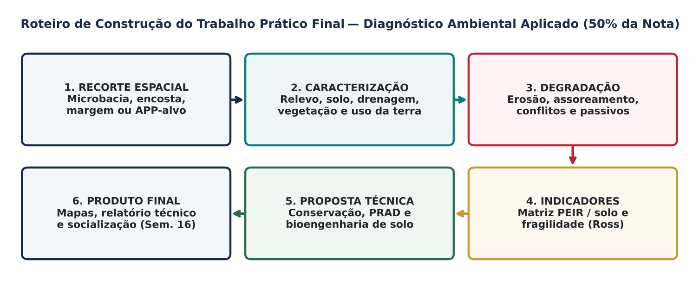

# Manual Prático do Diagnóstico Ambiental Aplicado e Produtos Técnicos

\noindent`TRABALHO PRÁTICO FINAL`

::: {.callout-note}
## Etapa 1 — O que você vai aprender neste capítulo

Ao concluir este capítulo, você será capaz de:

- Delimitar com rigor geográfico e cartográfico o recorte espacial do **Trabalho Prático Final** (Semana 16 do Plano CHF662, correspondente a $50%$ da nota semestral), selecionando microbacia, encosta, margem fluvial, Área de Preservação Permanente (APP) ou área degradada compatível com a escala de análise (IBGE, 2018; Cavalcanti, 2006).
- Levantar, compatibilizar em ambiente SIG (QGIS) e validar bases cartográficas e dados abertos oficiais (MapBiomas, SRTM/TOPODATA, SICAR/CAR, IBGE e INEMA/SEI-BA) sob o sistema de referência geodésico oficial **SIRGAS 2000**.
- Integrar a caracterização físico-biótica e socioespacial ao mapeamento de processos de degradação e à montagem da **Matriz de Indicadores** (combinando o modelo PEIR, a qualidade do solo e a fragilidade ambiental de Ross).
- Calcular o **Índice Composto de Priorização de Intervenção ($IPI$)** para hierarquizar setores críticos e dimensionar propostas preliminares de conservação, bioengenharia e PRAD (Vital et al., 2020).
- Elaborar os produtos técnicos exigidos (mapas temáticos com elementos cartográficos obrigatórios e relatório técnico interpretativo) e auditar o trabalho pelo **Checklist de Entrega e Rubrica de Avaliação** ($5{,}0$ pontos) antes da socialização na Semana 16.

:::

::: {.callout-tip}
## Etapa 2 — Revisando o que você precisa saber

Este capítulo integra todos os módulos da disciplina CHF662 em um roteiro único de execução profissional:

- **Fundamentos e AIA (Módulos 1 e 2):** a distinção entre atividade, aspecto e impacto ambiental (Sánchez, 2013), o olhar socioambiental (Mendonça, 2001) e a articulação entre escalas espaciais e temporais orientam o recorte do diagnóstico.
- **Bacia, Morfopedologia e Ross (Módulo 3):** a microbacia hidrográfica (Capítulos 7 e 8) e os graus de Fragilidade Potencial e Emergente (Ross, 1994, Capítulo 9) formam a base territorial do mapeamento.
- **Indicadores, Solo e Degradação (Módulo 4):** o modelo PEIR (Capítulo 10), o Índice de Qualidade do Solo ($IQS$, Capítulo 11) e o diagnóstico de erosão linear e USLE (Capítulo 12) fornecem as métricas auditáveis.
- **Bioengenharia, Legislação e PRAD (Capítulos 13 e 14):** as técnicas de estabilização vegetativa e estrutural leve, o Código Florestal (Lei nº 12.651/2012) e as diretrizes do PRAD convertem o diagnóstico em proposta técnica exequível.

:::

## Etapa 3: Guia Operacional do Trabalho Prático Final (Semana 16 — 5,0 Pontos)

::: {.callout-note}
## Vocabulário Técnico e Símbolos do Capítulo 15

- \textbf{Recorte Espacial ($A_{\text{rec}}$):} unidade territorial delimitada para o diagnóstico (preferencialmente microbacia hidrográfica, sub-bacia, vertente completa ou trecho de APP/área degradada).
- **SIRGAS 2000:** Sistema de Referência Geocêntrico para as Américas, datum geodésico oficial do Brasil, obrigatório nos projetos em QGIS e nos mapas finais.
- $A_{\min}$: **área mínima mapeável** no terreno correspondente a $4\text{ mm}^2$ no mapa impresso ($A_{\min} = 4 \times 10^{-6} \cdot E^2\text{ m}^2$, onde $E$ é o denominador da escala $1:E$).
- **Matriz de Indicadores:** tabela analítica que cruza Pressão, Estado, Impacto e Resposta (PEIR) com atributos de qualidade do solo ($IQS$) e fragilidade emergente ($FE$).
- $IPI$: **Índice Composto de Priorização de Intervenção** (adimensional entre $0$ e $1$), usado para ranquear setores críticos na alocação de bioengenharia e PRAD.
- $CE$: **Custo-Efetividade** de uma intervenção ($\text{t}\cdot\text{ano}^{-1}$ de sedimentos retidos por $R$ 1.000,00$ investidos).

:::

O Trabalho Prático Final da disciplina CHF662 representa $50%$ da avaliação semestral ($5{,}0$ pontos) e simula a entrega de um diagnóstico técnico profissional em Análise Ambiental. Conforme ilustra a Figura indicada acima, o fluxo metodológico articula sete etapas encadeadas, da delimitação espacial à socialização dos resultados.

## Etapa 1: Escolha e Delimitação do Recorte Espacial

A escolha da área de estudo deve equilibrar **relevância socioambiental** e **viabilidade de levantamento** no prazo semestral (IBGE, 2018; Cavalcanti, 2006). O recorte pode ser:

1. **Microbacia hidrográfica:** unidade preferencial por integrar divisores de água, rede de drenagem, conectividade hidrossedimentológica e uso da terra (área sugerida entre $1\text{ km}^2$ e $50\text{ km}^2$).
2. **Encosta ou vertente representativa:** indicada quando o foco recai sobre processos erosivos lineares (sulcos, ravinas, voçorocas) ou movimentos de massa em áreas urbanas e rurais.
3. **Margem de curso d'água, APP ou área degradada pontual:** adequada para diagnósticos de passivo florestal (Lei nº 12.651/2012), assoreamento de açudes, antigas cascalheiras ou acessos de empreendimentos energéticos (como observado no campo do Semiárido).

A delimitação deve ser vetorizada em polígono fechado no QGIS (formato GeoPackage `.gpkg` ou Shapefile `.shp`), com justificativa clara dos critérios naturais (divisores topográficos) ou legais/administrativos (limites de APP ou poligonal de empreendimento) adotados.

## Etapa 2: Levantamento de Bases Cartográficas e Dados Abertos

Todo diagnóstico ambiental auditável depende de fontes públicas rastreáveis, organizadas em um banco geográfico padronizado em **SIRGAS 2000** (coordenadas geográficas para abrangência regional ou projeção UTM, fuso 24S para a maior parte da Bahia, para cálculos de área e comprimento):

\small

| p{2.9cm} p{3.8cm} >{\raggedright\arraybackslash}X@{}} \bfseries Base / Plataforma | \bfseries Dados Extraídos | \bfseries Aplicação Direta no Trabalho Final |
| --- | --- | --- |
| **IBGE** | Limites municipais, malha censitária, hidrografia e pedologia | Contextualização territorial, caracterização socioespacial e classes de solo. |
| **SRTM / TOPODATA (INPE)** | Modelo Digital de Elevação ($30\text{ m}$), declividade e curvas de nível | Delimitação automática da microbacia, perfil de vertente, fator $LS$ e mapa clinográfico (Ross). |
| **MapBiomas** | Séries anuais de uso e cobertura da terra ($30\text{ m}$) | Análise multitemporal (ex.: $1985$--$2024$), supressão de vegetação nativa e fator $C$ da USLE. |
| **SICAR / CAR** | Perímetros de imóveis rurais, APPs e Reserva Legal declaradas | Verificação de passivo ambiental em APPs marginais e nascentes (Lei nº 12.651/2012). |
| **INEMA / SEI-BA** | Outorgas, licenças ambientais, bacias estaduais e dados climáticos | Identificação de empreendimentos licenciados, conflitos hídricos e erosividade regional ($R$). |

## Etapa 3: Caracterização Integrada Físico-Biótica e Socioespacial

Seguindo a abordagem sistêmica de Cavalcanti (2006) e IBGE (2018), o texto diagnóstico não deve apresentar compartimentos isolados (clima, solo, vegetação e sociedade em blocos desconexos), mas explicar suas **interações causais**:

- **Meio físico-biótico:** articular regime pluviométrico (concentração sazonal das chuvas), compartimentos do relevo (topo, meia encosta, sopé e planície), classes de solo (espessura, textura e suscetibilidade erosiva) e fisionomia vegetal remanescente (Caatinga, Mata Atlântica, Cerrado ou vegetação ripária).
- **Dinâmica socioespacial:** relacionar formas de uso e ocupação da terra (pecuária extensiva, agricultura de sequeiro, expansão urbana, infraestrutura energética ou mineração), estrutura fundiária, pressões sobre os recursos hídricos e percepção/vulnerabilidade das comunidades locais.

## Etapa 4: Identificação e Mapeamento de Processos de Degradação

Com apoio de imagens de alta resolução (Google/Bing/CBERS-4A no QGIS) e, quando viável, verificação de campo com registro fotográfico georreferenciado e escala métrica, devem ser inventariados os processos ativos:

1. **Erosão hídrica:** selamento superficial, erosão laminar, sulcos ($<0{,}5\text{ m}$), ravinas ($>0{,}5\text{ m}$) e voçorocas (com eventual exfiltração e *piping*).
2. **Degradação física do solo:** compactação em trilhas, estradas não pavimentadas e áreas de pisoteio intenso.
3. **Degradação ripária e fluvial:** supressão de mata ciliar em APPs, solapamento de margens e assoreamento de córregos, barreiros ou açudes.
4. **Passivos de resíduos ou contaminação:** disposição irregular de resíduos sólidos, efluentes domésticos ou rejeitos minerários sem contenção.

## Etapa 5: Montagem da Matriz de Indicadores e Índice de Priorização

Para evitar diagnósticos puramente descritivos, o Trabalho Prático Final exige uma **Matriz de Indicadores** que integre o modelo **PEIR** (Capítulo 10), os atributos de **Qualidade do Solo** (Capítulo 11) e a **Fragilidade Emergente de Ross** (Capítulo 9). Quando houver múltiplos setores ou subunidades na área de estudo, aplica-se o Índice Composto de Priorização de Intervenção ($IPI$) para hierarquizar onde agir primeiro.

::: {.callout-tip}
## Índice Composto de Priorização de Intervenção ($IPI$)

Para cada setor homogêneo avaliado na área de estudo, o Índice Composto de Priorização de Intervenção ($IPI \in [0,\,1]$) combina três dimensões normalizadas:

$$

IPI = w_F \cdot F_{\text{norm}} + w_S \cdot (1 - IQS) + w_P \cdot P_{\text{norm}}

$$

em que:

- $F_{\text{norm}} = \dfrac{FE - 1}{4}$: **Fragilidade Emergente de Ross normalizada** ($FE \in \{1, 2, 3, 4, 5\}$ convertida para a escala $[0,\,1]$; logo $FE=1 \Rightarrow 0{,}00$ e $FE=5 \Rightarrow 1{,}00$).
- $(1 - IQS)$: **Déficit de Qualidade do Solo**, obtido a partir do Índice de Qualidade do Solo ($IQS \in [0,\,1]$; quanto menor o $IQS$, maior o déficit edáfico).
- $P_{\text{norm}} \in [0,\,1]$: **Pressão/Impacto Antrópico normalizado** na matriz PEIR (por exemplo, razão entre a densidade de focos erosivos ou o déficit de APP do setor e o valor crítico de referência).
- $w_F, w_S, w_P$: pesos técnicos atribuídos conforme o objetivo do diagnóstico ($w_F + w_S + w_P = 1{,}00$; padrão sugerido na apostila: $w_F = 0{,}35$, $w_S = 0{,}35$ e $w_P = 0{,}30$).

**Faixas Operacionais de Priorização:**

\small

| cll@{}} **Intervalo de $IPI$** | **Classe de Prioridade** | **Diretriz de Gestão e Intervenção** |
| --- | --- | --- |
| $0{,}00 \le IPI < 0{,}35$ | **Baixa** | Conservação preventiva e monitoramento periódico. |
| $0{,}35 \le IPI < 0{,}60$ | **Média** | Práticas conservacionistas ($C$ e $P$) e manejo sustentável. |
| $0{,}60 \le IPI < 0{,}80$ | **Alta** | Bioengenharia leve (biomantas, estacas vivas) e recomposição de APP. |
| $0{,}80 \le IPI \le 1{,}00$ | **Crítica** | Intervenção imediata integrada (PRAD, paliçadas, drenagem e isolamento). |

:::

::: {.callout-note}
## Exemplo Estrutural da Matriz Integrada de Indicadores

\small

| p{2.0cm} p{2.8cm} p{2.8cm} p{2.6cm} >{\raggedright\arraybackslash}X@{}} \bfseries Dimensão | \bfseries Indicador Medido | \bfseries Fonte / Método | \bfseries Valor / Classe | \bfseries Papel na Resposta (PRAD) |
| --- | --- | --- | --- | --- |
| **PEIR (P)** | Déficit de APP marginal | SICAR + MapBiomas | $35%$ suprimido | Recomposição legal obrigatória (Lei 12.651/12). |
| **PEIR (E) / Solo** | Densidade do solo ($D_s$) e $IQS$ | Anel volumétrico / MDS | $IQS = 0{,}42$ (Baixo) | Descompactação e aporte de matéria orgânica. |
| **Ross (FE)** | Fragilidade Emergente | Cruzamento decliv./solo/uso | $FE = 4$ (Forte) | Restrição de uso e cobertura permanente. |
| **PEIR (I)** | Focos erosivos lineares | Campo / Imagem alta res. | $4\text{ ravinas/km}^2$ | Paliçadas permeáveis e dissipadores de energia. |

:::

## Etapa 6: Produtos Técnicos Obrigatórios e Proposta de Intervenção

O trabalho entregue deve conter três produtos técnicos articulados:

1. **Conjunto de Mapas Temáticos (mínimo de 3 mapas):** (a) Mapa de Localização e Delimitação do Recorte Espacial; (b) Mapa de Uso e Cobertura da Terra / APPs; e (c) Mapa de Fragilidade Ambiental e Pontos de Degradação. Todos devem conter os **seis elementos cartográficos obrigatórios**: título informativo, orientação (seta Norte), escala gráfica e numérica, grade de coordenadas com indicação do datum (**SIRGAS 2000**), legenda legível e quadro de fontes/autoria.
2. **Relatório Técnico Interpretativo:** texto estruturado com introdução e objetivos, localização e métodos, resultados integrados (com tabelas, gráficos e matriz de indicadores) e discussão crítica apoiada na bibliografia da disciplina.
3. **Proposta Preliminar de Conservação, Bioengenharia ou PRAD:** conjunto de medidas vinculadas diretamente aos indicadores diagnosticados (Vital et al., 2020), especificando técnica selecionada (paliçadas, biomantas, plantio em contorno, isolamento de APP, espécies nativas), cronograma físico simplificado e metas mensuráveis de monitoramento pós-implantação (ex.: taxa de sobrevivência $\ge 80%$, redução de recuo de borda).

## Etapa 7: Checklist de Entrega e Rubrica Oficial de Avaliação (5,0 Pontos)

Na Semana 16, o trabalho é entregue e socializado em apresentação oral breve. Utilize a rubrica oficial abaixo para auditar seu projeto antes da submissão final:

\small

| p{3.6cm} c >{\raggedright\arraybackslash}X@{}} \bfseries Critério Avaliativo | \bfseries Peso (pts) | \bfseries Descritor de Desempenho Pleno (100%) |
| --- | --- | --- |
| **1. Delimitação e Bases Cartográficas** | $1{,}0$ | Recorte espacial justificado; bases abertas validadas (IBGE, TOPODATA, MapBiomas, SICAR); todos os mapas em SIRGAS 2000 com os 6 elementos obrigatórios. |
| **2. Caracterização Integrada e Degradação** | $1{,}0$ | Articulação físico-biótica e socioespacial sem fragmentação; processos erosivos e passivos em APP corretamente classificados e georreferenciados. |
| **3. Matriz de Indicadores ($IPI$ / PEIR / Solo / Ross)** | $1{,}0$ | Matriz completa e coerente, sem inversão de categorias PEIR; cálculos de $IQS$, Ross e $IPI$ auditáveis e interpretados. |
| **4. Produtos Técnicos e Proposta de PRAD/Bioengenharia** | $1{,}2$ | Proposta tecnicamente compatível com os processos diagnosticados (Vital et al., 2020), respeitando a Lei nº 12.651/2012 e com metas de monitoramento. |
| **5. Redação Técnica e Socialização (Semana 16)** | $0{,}8$ | Clareza, norma culta, citações padronizadas (ABNT) e defesa oral objetiva, respeitando o tempo e respondendo com domínio conceitual. |
| **TOTAL GERAL** | $\mathbf{5{,}0}$ | **Correspondente a $50%$ da média semestral de CHF662.** |

## Etapa 4: Estudos de Caso e Exemplos Resolvidos Passo a Passo

::: {.callout-tip}
## Estudo de Caso / Exemplo 15.1 (Básico) — Escolha da Escala Cartográfica e Área Mínima Mapeável ($A_{\min
$)}

**1. Situação-problema / Enunciado:** Uma equipe escolheu uma microbacia de $12{,}5\text{ km}^2$ no Piemonte do Paraguaçu (BA) para o Trabalho Prático Final, onde existem voçorocas com cerca de $0{,}40\text{ ha}$ de área em planta e trechos de APP marginal com $30\text{ m}$ de largura. Os discentes precisam decidir entre produzir os mapas temáticos finais na escala $1:25.000$ ou na escala regional $1:100.000$.

**2. Dados e informações fornecidas:** Critério cartográfico padrão de área mínima mapeável no papel: $a_{\text{papel}} = 4\text{ mm}^2 = 4 \times 10^{-6}\text{ m}^2$. Escala 1: $E_1 = 25.000$. Escala 2: $E_2 = 100.000$. Área da feição erosiva alvo: $A_{\text{alvo}} = 0{,}40\text{ ha} = 4.000\text{ m}^2$.

**3. O que a análise solicita:** Calcular a área mínima mapeável no terreno ($A_{\min}$) para ambas as escalas e justificar qual escala atende ao diagnóstico da microbacia.

**4. Referencial e método adotado:** Conversão quadrática da área no papel para o terreno pela relação $A_{\min} = a_{\text{papel}} \cdot E^2$, seguida da conversão de $\text{m}^2$ para hectares ($1\text{ ha} = 10.000\text{ m}^2$).

**5. Desenvolvimento passo a passo:**

**1. Escala $1:25.000$:**

$$

A_{\min,1} = 4 \times 10^{-6} \times (25.000)^2 = 4 \times 10^{-6} \times 6{,}25 \times 10^8 = 2.500\text{ m}^2 = \mathbf{0{,}25\text{ ha}}.

$$

**2. Escala $1:100.000$:**

$$

A_{\min,2} = 4 \times 10^{-6} \times (100.000)^2 = 4 \times 10^{-6} \times 10^{10} = 40.000\text{ m}^2 = \mathbf{4{,}00\text{ ha}}.

$$

Comparando com a voçoroca alvo ($0{,}40\text{ ha}$): na escala $1:25.000$, $0{,}40\text{ ha} > 0{,}25\text{ ha}$ (feição representável em polígono); na escala $1:100.000$, $0{,}40\text{ ha} < 4{,}00\text{ ha}$ (feição $10$ vezes menor que o limite legível, desaparecendo no mapa).

**6. Síntese / Resposta:** Deve-se adotar a escala **$1:25.000$** (ou mais detalhada, como $1:15.000$), pois $A_{\min} = 0{,}25\text{ ha}$ permite cartografar a voçoroca de $0{,}40\text{ ha}$, ao passo que $1:100.000$ ($A_{\min} = 4{,}00\text{ ha}$) ocultaria o processo erosivo.

**7. Verificação crítica:** Além da área mínima, uma faixa de APP de $30\text{ m}$ mede $1{,}2\text{ mm}$ em $1:25.000$ (visível), mas apenas $0{,}3\text{ mm}$ em $1:100.000$ (espessura inferior a uma linha padrão de impressão). A escolha é cartograficamente consistente.

:::

::: {.callout-tip}
## Estudo de Caso / Exemplo 15.2 (Intermediário) — Montagem da Matriz Integrada e Cálculo do $IPI$ por Setor

**1. Situação-problema / Enunciado:** Ao organizar a Matriz de Indicadores do Trabalho Final, uma equipe dividiu uma microbacia em três setores homogêneos e levantou, por meio de QGIS, campo e análise de solo, os valores de Fragilidade Emergente ($FE$), Índice de Qualidade do Solo ($IQS$) e Pressão/Impacto PEIR normalizado ($P_{\text{norm}}$).

**2. Dados e informações fornecidas:** 
**Setor A (Cabeceira com voçoroca):** $FE = 5$, $IQS = 0{,}36$, $P_{\text{norm}} = 0{,}90$. 

**Setor B (Meia encosta com pastagem):** $FE = 3$, $IQS = 0{,}60$, $P_{\text{norm}} = 0{,}50$. 

**Setor C (Remanescente de Caatinga/APP):** $FE = 2$, $IQS = 0{,}88$, $P_{\text{norm}} = 0{,}10$. 

Pesos adotados: $w_F = 0{,}35$, $w_S = 0{,}35$, $w_P = 0{,}30$.}

**3. O que a análise solicita:** Calcular $F_{\text{norm}}$, $(1 - IQS)$ e o Índice Composto de Priorização ($IPI$) para cada setor, classificando a prioridade de intervenção.

**4. Referencial e método adotado:** Normalização de $FE$ por $F_{\text{norm}} = (FE - 1)/4$ e aplicação da soma ponderada $IPI = 0{,}35\,F_{\text{norm}} + 0{,}35\,(1 - IQS) + 0{,}30\,P_{\text{norm}}$.

**5. Desenvolvimento passo a passo:**

**Setor A:** $F_{\text{norm}} = (5 - 1)/4 = 1{,}00$; $(1 - IQS) = 1 - 0{,}36 = 0{,}64$.

$$

IPI_A = 0{,}35(1{,}00) + 0{,}35(0{,}64) + 0{,}30(0{,}90) = 0{,}350 + 0{,}224 + 0{,}270 = \mathbf{0{,}844} (\text{Prioridade Crítica}).

$$

**Setor B:** $F_{\text{norm}} = (3 - 1)/4 = 0{,}50$; $(1 - IQS) = 1 - 0{,}60 = 0{,}40$.

$$

IPI_B = 0{,}35(0{,}50) + 0{,}35(0{,}40) + 0{,}30(0{,}50) = 0{,}175 + 0{,}140 + 0{,}150 = \mathbf{0{,}465} (\text{Prioridade Média}).

$$

**Setor C:** $F_{\text{norm}} = (2 - 1)/4 = 0{,}25$; $(1 - IQS) = 1 - 0{,}88 = 0{,}12$.

$$

IPI_C = 0{,}35(0{,}25) + 0{,}35(0{,}12) + 0{,}30(0{,}10) = 0{,}0875 + 0{,}0420 + 0{,}0300 = \mathbf{0{,}1595}\approx \mathbf{0{,}160} (\text{Prioridade Baixa}).

$$

**6. Síntese / Resposta:** $IPI_A = \mathbf{0{,}844}$ (Crítica — PRAD e bioengenharia imediatos); $IPI_B = \mathbf{0{,}465}$ (Média — manejo conservacionista); $IPI_C = \mathbf{0{,}160}$ (Baixa — manutenção e monitoramento).

**7. Verificação crítica:** Todos os valores permanecem dentro do intervalo teórico $[0,\,1]$, e a ordenação ($A > B > C$) reflete fielmente o gradiente de degradação observado.

:::

::: {.callout-tip}
## Estudo de Caso / Exemplo 15.3 (Intermediário) — Quantificação de Passivo em APP Marginal e Demanda de Mudas

**1. Situação-problema / Enunciado:** Na sobreposição entre a hidrografia vetorial, o SICAR e o MapBiomas, uma equipe diagnosticou um trecho de $2.000\text{ m}$ de curso d'água com $12\text{ m}$ de largura regular, no qual a mata ciliar foi parcialmente substituída por pastagem degradada.

**2. Dados e informações fornecidas:** Comprimento do trecho: $L = 2.000\text{ m}$. Largura do rio: $12\text{ m}$ (pela Lei nº 12.651/2012, cursos d'água entre $10\text{ m}$ e $50\text{ m}$ exigem APP mínima de $50\text{ m}$ em cada margem). Percentual degradado diagnosticado nas duas margens: $35%$ da área total de APP. Espaçamento adotado no PRAD: $2{,}5\text{ m} \times 2{,}0\text{ m}$ ($5{,}0\text{ m}^2$ por muda, equivalente a $2.000\text{ mudas}\cdot\text{ha}^{-1}$), prevendo $10%$ adicionais para replantio.

**3. O que a análise solicita:** Calcular a área total de APP legal no trecho, o passivo ambiental em hectares a ser recomposto e o número total de mudas nativas necessário.

**4. Referencial e método adotado:** Cálculo geométrico da área retangular equivalente das duas faixas marginais, aplicação do percentual de déficit e multiplicação pela densidade de plantio ajustada para replantio.

**5. Desenvolvimento passo a passo:**

**1. Área total de APP legal (duas margens):**

$$

A_{\text{APP}} = 2 \times 50\text{ m} \times 2.000\text{ m} = 200.000\text{ m}^2 = \mathbf{20{,}0\text{ ha}}.

$$

**2. Passivo ambiental a recompor ($35%$):**

$$

A_{\text{passivo}} = 0{,}35 \times 20{,}0\text{ ha} = \mathbf{7{,}0\text{ ha}}.

$$

**3. Quantidade de mudas (plantio inicial + $10%$ de replantio):**

$$

N_{\text{inicial}} = 7{,}0\text{ ha} \times 2.000\text{ mudas}\cdot\text{ha}^{-1} = 14.000\text{ mudas}.

$$

$$

N_{\text{total}} = 14.000 \times 1{,}10 = \mathbf{15.400\text{ mudas}}.

$$

**6. Síntese / Resposta:** APP total $= \mathbf{20{,}0\text{ ha}}$; passivo a recompor $= \mathbf{7{,}0\text{ ha}}$; demanda total do viveiro $= \mathbf{15.400\text{ mudas nativas}}$.

**7. Verificação crítica:** Para $7{,}0\text{ ha}$, o número inicial de $14.000$ mudas equivale exatamente a $1$ muda a cada $5\text{ m}^2$ ($70.000 / 5 = 14.000$), e o acréscimo de $10%$ ($1.400$ mudas) garante a reposição de eventuais perdas no primeiro ciclo seco.

:::

::: {.callout-tip}
## Estudo de Caso / Exemplo 15.4 (Avançado) — Seleção de Alternativa de Intervenção por Custo-Efetividade ($CE$)

**1. Situação-problema / Enunciado:** Para conter o aporte de sedimentos em uma ravina crítica ($IPI = 0{,}84$) identificada no Trabalho Final, a equipe comparou duas propostas preliminares de intervenção: Pacote 1 (paliçadas permeáveis de bambu, biomanta e revegetação com espécies nativas) e Pacote 2 (enrocamento com gabiões de pedra e canaleta rígida de concreto).

**2. Dados e informações fornecidas:** 
**Pacote 1 (Bioengenharia + PRAD):** custo estimado $= R$ 18.000,00$; retenção anual estimada $= 180\text{ t}\cdot\text{ano}^{-1}$ de sedimentos. 

**Pacote 2 (Obra Rígida Convencional):** custo estimado $= R$ 45.000,00$; retenção anual estimada $= 225\text{ t}\cdot\text{ano}^{-1}$ de sedimentos.}

**3. O que a análise solicita:** Calcular o Custo-Efetividade ($CE$) de cada pacote em $\text{t}\cdot\text{ano}^{-1}$ retidas por $R$ 1.000,00$ investidos e justificar a recomendação técnica no relatório.

**4. Referencial e método adotado:** Divisão da massa anual de sedimentos retida pelo custo total expresso em milhares de reais.

**5. Desenvolvimento passo a passo:**

**1. Pacote 1 (Bioengenharia):**

$$

CE_1 = \frac{180\text{ t}\cdot\text{ano}^{-1}}{18{,}0\text{ (milhares de reais)}} = \mathbf{10{,}0\text{ t}\cdot\text{ano}^{-1}\text{ por }R$ 1.000,00}.

$$

**2. Pacote 2 (Obra Rígida):**

$$

CE_2 = \frac{225\text{ t}\cdot\text{ano}^{-1}}{45{,}0\text{ (milhares de reais)}} = \mathbf{5{,}0\text{ t}\cdot\text{ano}^{-1}\text{ por }R$ 1.000,00}.

$$

**6. Síntese / Resposta:** $CE_1 = \mathbf{10{,}0\text{ t}\cdot\text{ano}^{-1}\text{ por }R$ 1.000,00}$ e $CE_2 = \mathbf{5{,}0\text{ t}\cdot\text{ano}^{-1}\text{ por }R$ 1.000,00}$. O Pacote 1 (Bioengenharia + PRAD) é **duas vezes mais custo-efetivo**, além de restabelecer funções ecológicas e infiltração.

**7. Verificação crítica:** O Pacote 2 retém apenas $25%$ a mais de sedimentos ($225$ contra $180\text{ t}\cdot\text{ano}^{-1}$), mas custa $2{,}5$ vezes mais ($R$ 45.000$ contra $R$ 18.000$), confirmando a vantagem técnica e econômica da bioengenharia em ravinas de pequeno e médio porte.

:::

::: {.callout-tip}
## Estudo de Caso / Exemplo 15.5 (Aplicado) — Auditoria Pré-Entrega pela Rubrica Oficial CHF662 ($5{,
0$ Pontos)}

**1. Situação-problema / Enunciado:** Uma semana antes da socialização da Semana 16, um grupo realizou uma simulação de autoavaliação de seu rascunho de Trabalho Prático Final utilizando a Rubrica Oficial de $5{,}0$ pontos da disciplina CHF662.

**2. Dados e informações fornecidas:** Notas parciais diagnosticadas pelo próprio grupo na pré-auditoria:

- Critério 1 (Delimitação e bases, máx. $1{,}0$): $0{,}70$ (faltou indicar o datum SIRGAS 2000 e a escala gráfica em um dos mapas).
- Critério 2 (Caracterização e degradação, máx. $1{,}0$): $0{,}90$.
- Critério 3 (Matriz de Indicadores, máx. $1{,}0$): $1{,}00$.
- Critério 4 (Produtos técnicos e PRAD, máx. $1{,}2$): $0{,}85$ (a proposta de PRAD não apresentou metas mensuráveis de monitoramento).
- Critério 5 (Redação e socialização, máx. $0{,}8$): $0{,}75$.

**3. O que a análise solicita:** Calcular a pontuação atual do rascunho, o percentual atingido sobre os $5{,}0$ pontos e identificar quais duas correções rápidas recuperam o maior ganho de nota antes da entrega.

**4. Referencial e método adotado:** Soma ponderada direta das notas obtidas nos cinco critérios e cálculo do déficit por critério.

**5. Desenvolvimento passo a passo:**

**1. Pontuação atual do rascunho:**

$$

N_{\text{atual}} = 0{,}70 + 0{,}90 + 1{,}00 + 0{,}85 + 0{,}75 = \mathbf{4{,}20\text{ pontos}}.

$$

\textbf{2. Percentual atingido sobre $5{,}0$ pontos:}

$$

\frac{4{,}20}{5{,}00} \times 100% = \mathbf{84{,}0%}.

$$

**3. Maiores déficits:** Critério 4 ($1{,}20 - 0{,}85 = 0{,}35\text{ pt}$) e Critério 1 ($1{,}00 - 0{,}70 = 0{,}30\text{ pt}$).

**6. Síntese / Resposta:** Pontuação atual $= \mathbf{4{,}20\text{ pts}}$ ($84{,}0%$). Inserir metas mensuráveis de monitoramento no PRAD ($+0{,}35\text{ pt}$) e completar o datum SIRGAS 2000 e a escala gráfica no mapa ($+0{,}30\text{ pt}$) eleva o trabalho para $4{,}85\text{ pts}$ ($97{,}0%$).

**7. Verificação crítica:** A soma das perdas totais ($0{,}30 + 0{,}10 + 0{,}00 + 0{,}35 + 0{,}05 = 0{,}80\text{ pt}$) fecha exatamente com $5{,}00 - 4{,}20 = 0{,}80\text{ pt}$.

:::

## Etapa 5: Erros Mais Comuns e Como Evitá-los

::: {.callout-warning}
## Erro 1 — Produzir Mapas sem Datum, Escala Gráfica ou Grade de Coordenadas

**Equívoco frequente:** Exportar layouts do QGIS apenas com o desenho colorido da microbacia, omitindo o sistema de referência (SIRGAS 2000), a barra de escala, a seta Norte ou a fonte dos dados.

**Correção técnica:** Mapa sem elementos cartográficos obrigatórios perde validade técnica e sofre desconto imediato na rubrica de avaliação. Utilize um modelo padronizado no Compositor de Impressão do QGIS com os seis elementos conferidos antes de exportar em PDF/PNG de alta resolução ($300\text{ dpi}$).

:::

::: {.callout-warning}
## Erro 2 — Calcular Áreas e Comprimentos em Graus Decimais (Coordenadas Geográficas)

**Equívoco frequente:** Deixar as camadas em SIRGAS 2000 geográfico (EPSG:4674) ao calcular áreas de APPs ou comprimentos de canais na calculadora de campo do QGIS.

**Correção técnica:** Reprojete sempre as camadas de trabalho para o sistema métrico plano **SIRGAS 2000 / UTM** (por exemplo, Fuso 24S, EPSG:31984, na maior parte da Bahia) antes de mensurar hectares, perímetros ou densidades de drenagem.

:::

::: {.callout-warning}
## Erro 3 — Apresentar Diagnóstico Desconectado da Proposta de Intervenção

**Equívoco frequente:** Descrever no relatório uma voçoroca ativa com *piping* e compactação severa, mas propor na conclusão apenas "conscientização ambiental" ou "plantio aleatório de mudas" sem controle de escoamento.

**Correção técnica:** Cada medida da proposta de PRAD ou bioengenharia deve responder diretamente a um indicador crítico da Matriz de Indicadores ($IPI$), articulando controle hidráulico a montante, estabilização mecânica (paliçadas/biomantas) e recomposição vegetal adaptada ao bioma.

:::

::: {.callout-warning}
## Erro 4 — Confundir Indicadores de Pressão, Estado, Impacto e Resposta na Matriz

**Equívoco frequente:** Listar a execução do PRAD como "Impacto" ou classificar a declividade natural do relevo como "Pressão antrópica".

**Correção técnica:** Lembre a cadeia causal do modelo PEIR: **P** é o vetor ou atividade humana modificadora; **E** é a condição atual do meio; **I** é o efeito físico, ecológico ou social mensurável; e **R** é a ação corretiva, legal ou de manejo proposta pelo poder público ou empreendedor.

:::

## Etapa 6: Exercícios de Fixação

### Nível Básico (Conceitos, Bases Abertas e Fluxo do Trabalho Final)

1. Explique por que a **microbacia hidrográfica** é considerada a unidade espacial preferencial para o Trabalho Prático Final da disciplina CHF662, citando ao menos duas vantagens analíticas em relação a recortes puramente administrativos.
  
*Espaço reservado para resolução na versão impressa.*
2. Relacione as cinco plataformas abertas (**IBGE**, **TOPODATA/SRTM**, **MapBiomas**, **SICAR/CAR** e **INEMA/SEI-BA**) ao tipo específico de dado que cada uma fornece para o diagnóstico ambiental.
  
*Espaço reservado para resolução na versão impressa.*
3. Liste os **seis elementos cartográficos obrigatórios** que devem constar em todos os mapas temáticos do Trabalho Prático Final e explique qual datum oficial deve ser adotado no Brasil.
  
*Espaço reservado para resolução na versão impressa.*
4. Diferencie **diagnóstico descritivo fragmentado** de **caracterização integrada físico-biótica e socioespacial**, exemplificando com uma relação causal entre uso da terra e processo erosivo.
  
*Espaço reservado para resolução na versão impressa.*
5. Descreva os três componentes integrados na fórmula do **Índice Composto de Priorização de Intervenção ($IPI$)** e explique por que um setor com $IPI \ge 0{,}80$ demanda ação imediata.
  
*Espaço reservado para resolução na versão impressa.*

### Nível Intermediário (Escala, Matriz $IPI$, Passivo de APP e Rubrica)

1. Considerando o critério cartográfico de área mínima legível no papel de $4\text{ mm}^2$, calcule a área mínima mapeável no terreno ($A_{\min}$, em $\text{m}^2$ e em $\text{ha}$) para as escalas $1:15.000$ e $1:50.000$.
  
*Espaço reservado para resolução na versão impressa.*
2. Uma vertente analisada no Trabalho Final apresentou Fragilidade Emergente de Ross $FE = 4$, Índice de Qualidade do Solo $IQS = 0{,}48$ e Pressão/Impacto normalizado $P_{\text{norm}} = 0{,}80$. Adotando os pesos padrão ($w_F = 0{,}35$, $w_S = 0{,}35$, $w_P = 0{,}30$), calcule o $IPI$ e classifique a prioridade de intervenção.
  
*Espaço reservado para resolução na versão impressa.*
3. Um córrego com $8\text{ m}$ de largura atravessa $1.500\text{ m}$ de uma microbacia (APP legal de $30\text{ m}$ em cada margem). Verificou-se que $40%$ da APP da margem esquerda e $20%$ da APP da margem direita estão degradadas. Calcule a área total a recompor (em $\text{ha}$) e o número de mudas necessário no espaçamento de $2{,}5\text{ m} \times 2{,}0\text{ m}$ ($2.000\text{ mudas}\cdot\text{ha}^{-1}$), sem considerar replantio adicional.
  
*Espaço reservado para resolução na versão impressa.*
4. Para estabilizar uma margem fluvial, o Pacote A (estacas vivas + biomanta) custa $R$ 12.000,00$ e retém $144\text{ t}\cdot\text{ano}^{-1}$ de sedimentos, enquanto o Pacote B (muro de concreto) custa $R$ 25.000,00$ e retém $200\text{ t}\cdot\text{ano}^{-1}$. Calcule o Custo-Efetividade ($CE$) de ambos em $\text{t}\cdot\text{ano}^{-1}$ por $R$ 1.000,00$ e indique o mais vantajoso.
  
*Espaço reservado para resolução na versão impressa.*
5. Na avaliação da Semana 16, um grupo obteve as seguintes notas nos cinco critérios da rubrica oficial: $0{,}90$ (Critério 1), $0{,}80$ (Critério 2), $0{,}80$ (Critério 3), $1{,}00$ (Critério 4) e $0{,}70$ (Critério 5). Calcule a nota final do Trabalho Prático (de $0$ a $5{,}0$) e o percentual de aproveitamento.
  
*Espaço reservado para resolução na versão impressa.*

### Nível Aplicado (Questões Objetivas A--E)

1. Na elaboração de mapas temáticos em QGIS para o Diagnóstico Ambiental Aplicado no Estado da Bahia, o procedimento correto para calcular áreas de uso da terra e extensão de APPs em hectares e metros é:
  

7. Para mapear o relevo, extrair curvas de nível, delimitar automaticamente uma microbacia e calcular o mapa de declividades da matriz de Ross em um diagnóstico com dados abertos, a fonte prioritária é:
  

13. Na etapa de verificação de passivos florestais em propriedades rurais dentro da microbacia de estudo, o cruzamento de dados abertos mais indicado é:
  

19. Um setor de uma microbacia recebeu Fragilidade Emergente $FE = 5$, Índice de Qualidade do Solo $IQS = 0{,}40$ e Pressão/Impacto normalizado $P_{\text{norm}} = 0{,}70$. Usando os pesos padrão ($w_F = 0{,}35$, $w_S = 0{,}35$, $w_P = 0{,}30$), o valor de $IPI$ e sua classe de prioridade são:
  

25. Sobre a estrutura dos produtos técnicos e a rubrica de avaliação da Semana 16 (CHF662), assinale a alternativa **INCORRETA**:
  

## Etapa 7: Questões no Estilo ENADE e Concursos Ambientais

::: {.callout-tip}
## Da Universidade para a Prática Profissional

Em editais de Analista Ambiental (IBAMA, ICMBio, INEMA) e no ENADE de Geografia, exige-se que o candidato saiba encadear **base cartográfica $\rightarrow$ indicador mensurável $\rightarrow$ enquadramento legal $\rightarrow$ técnica de recuperação**. Domine esse fluxo completo: ele é a essência tanto do Trabalho Prático Final quanto da atuação profissional em consultoria e gestão pública.

:::

1. **[Questão Autoral — Estilo ENADE / Geografia]** Ao coordenar um diagnóstico ambiental aplicado em uma microbacia rural do Semiárido baiano (IBGE, 2018; Cavalcanti, 2006), um geógrafo constatou que os dados altimétricos tinham resolução de $30\text{ m}$ (TOPODATA), o uso da terra provinha do MapBiomas ($30\text{ m}$) e as feições erosivas críticas (ravinas de $2\text{ m}$ de largura) foram georreferenciadas em campo com GPS e fotografadas com escala métrica. A postura metodológica mais rigorosa ao integrar essas fontes no relatório final é:
  

7. **[Questão Autoral — Estilo Concurso Analista Ambiental / PRAD]** Em um diagnóstico integrado para subsidiar um PRAD (Vital et al., 2020), identificaram-se três problemas simultâneos em uma área degradada: (i) solo superficial compactado ($D_s = 1{,}66\text{ g}\cdot\text{cm}^{-3}$); (ii) escoamento pluvial concentrado descendo de uma estrada vicinal sem drenagem; e (iii) ausência de vegetação em $45\text{ m}$ de APP marginal. Qual sequência de ações respeita a lógica física e legal da recuperação ambiental?
  

13. **[Questão Autoral — Estilo Concurso Geógrafo / Gestão Territorial]** Um órgão ambiental estadual recebeu dois relatórios de diagnóstico para análise. O Relatório X apresentou apenas descrições gerais do município, sem delimitação de bacia, sem indicadores quantitativos e sem proposta de monitoramento. O Relatório Y delimitou a microbacia em SIRGAS 2000/UTM, integrou matriz PEIR, IQS e Fragilidade de Ross, quantificou o déficit de APP pelo Código Florestal e propôs técnicas de bioengenharia com metas semestrais auditáveis. Sob a ótica da Análise Ambiental (Sánchez, 2013; IBGE, 2018), o Relatório Y distingue-se por assegurar:
  

## Etapa 8: Gabarito Comentado do Capítulo 15

::: {.callout-note collapse=\"true\"}
## Resoluções Completas — Exercícios de Fixação (1 a 15)

1. A microbacia possui limites físicos naturais definidos pelos divisores topográficos e integra em um único sistema os fluxos de água, sedimentos, nutrientes e usos da terra. Duas vantagens: (a) permite fechar balanços hídricos e hidrossedimentológicos (erosão na vertente $\rightarrow$ assoreamento no exutório); e (b) evidencia interdependências entre propriedades a montante e a jusante que recortes municipais ou de lotes isolados ocultam.
2. **IBGE:** limites territoriais, malha censitária, hidrografia e pedologia; **TOPODATA/SRTM:** MDE ($30\text{ m}$), declividade, curvas de nível e delimitação de bacias; **MapBiomas:** séries históricas anuais de uso e cobertura da terra; **SICAR/CAR:** limites de imóveis rurais, APPs e Reserva Legal declaradas; **INEMA/SEI-BA:** outorgas, licenciamento, dados climáticos e informações socioeconômicas estaduais.
3. Os seis elementos obrigatórios são: (1) título informativo; (2) orientação (seta Norte); (3) escala gráfica e numérica; (4) grade de coordenadas com indicação do datum; (5) legenda; e (6) quadro de fontes e autoria. O datum oficial obrigatório no Brasil é o **SIRGAS 2000**.
4. Um diagnóstico descritivo fragmentado lista clima, solo, vegetação e população em seções isoladas sem explicar suas conexões. Já a caracterização integrada demonstra relações causais, como explicar de que modo a substituição da Caatinga por pastagem extensiva (dinâmica socioespacial) reduz a cobertura vegetal, eleva a compactação superficial e acelera o ravinamento em vertentes de Neossolo (meio físico-biótico).
5. O $IPI$ combina: (1) Fragilidade Emergente de Ross normalizada ($F_{\text{norm}}$); (2) Déficit de Qualidade do Solo ($1 - IQS$); e (3) Pressão/Impacto antrópico da matriz PEIR ($P_{\text{norm}}$). Valores $IPI \ge 0{,}80$ indicam convergência de alta fragilidade físico-ecológica, solo severamente degradado e forte pressão antrópica, exigindo intervenção imediata (PRAD e bioengenharia) para evitar colapso irreversível.
6. **Passo a passo:**
  Para $1:15.000$: $A_{\min} = 4 \times 10^{-6} \times (15.000)^2 = 4 \times 10^{-6} \times 2{,}25 \times 10^8 = \mathbf{900\text{ m}^2 = 0{,}09\text{ ha}}$. 

  Para $1:50.000$: $A_{\min} = 4 \times 10^{-6} \times (50.000)^2 = 4 \times 10^{-6} \times 2{,}5 \times 10^9 = \mathbf{10.000\text{ m}^2 = 1{,}00\text{ ha}}$.
7. **Passo a passo:**
  $F_{\text{norm}} = (4 - 1)/4 = 0{,}75$; $(1 - IQS) = 1 - 0{,}48 = 0{,}52$. 

  $IPI = 0{,}35(0{,}75) + 0{,}35(0{,}52) + 0{,}30(0{,}80) = 0{,}2625 + 0{,}1820 + 0{,}2400 = \mathbf{0{,}6845}$ ($\approx \mathbf{0{,}685}$). 

  Como $0{,}60 \le 0{,}6845 < 0{,}80$, classifica-se em **Prioridade Alta** (bioengenharia leve e recomposição).
8. **Passo a passo:**
  Cada margem tem área de APP $= 30\text{ m} \times 1.500\text{ m} = 45.000\text{ m}^2 = 4{,}50\text{ ha}$ (total $= 9{,}00\text{ ha}$). 

  Área degradada: margem esquerda $= 0{,}40 \times 4{,}50 = 1{,}80\text{ ha}$; margem direita $= 0{,}20 \times 4{,}50 = 0{,}90\text{ ha}$. Total a recompor $= 1{,}80 + 0{,}90 = \mathbf{2{,}70\text{ ha}}$. 

  Mudas necessárias: $2{,}70\text{ ha} \times 2.000\text{ mudas}\cdot\text{ha}^{-1} = \mathbf{5.400\text{ mudas}}$.
9. **Passo a passo:**
  $CE_A = 144 / 12 = \mathbf{12{,}0\text{ t}\cdot\text{ano}^{-1}\text{ por }R$ 1.000,00}$. 

  $CE_B = 200 / 25 = \mathbf{8{,}0\text{ t}\cdot\text{ano}^{-1}\text{ por }R$ 1.000,00}$. 

  O **Pacote A** (bioengenharia) é $50%$ mais custo-efetivo ($12{,}0$ contra $8{,}0\text{ t}\cdot\text{ano}^{-1}$ por $R$ 1.000,00$).
10. **Passo a passo:**
  Nota final $= 0{,}90 + 0{,}80 + 0{,}80 + 1{,}00 + 0{,}70 = \mathbf{4{,}20\text{ pontos}}$ (de $5{,}00$). 

  Aproveitamento $= (4{,}20 / 5{,}00) \times 100% = \mathbf{84{,}0%}$.
11. **Gabarito: (B).** Medições métricas de área e comprimento exigem projeção plana métrica (SIRGAS 2000 / UTM) compatível com o fuso da área de estudo.
12. **Gabarito: (B).** Modelos Digitais de Elevação abertos (SRTM e TOPODATA/INPE) permitem derivar drenagem, bacias, declividade e curvas de nível.
13. **Gabarito: (B).** O cruzamento entre malhas fundiárias/APP (SICAR/CAR e hidrografia) e cobertura da terra (MapBiomas) quantifica déficits legais de vegetação.
14. **Gabarito: (C).** $F_{\text{norm}} = (5 - 1)/4 = 1{,}00$; $(1 - IQS) = 1 - 0{,}40 = 0{,}60$; $IPI = 0{,}35(1{,}00) + 0{,}35(0{,}60) + 0{,}30(0{,}70) = 0{,}350 + 0{,}210 + 0{,}210 = \mathbf{0{,}770}$ (Prioridade Alta, pois $0{,}60 \le 0{,}770 < 0{,}80$).
15. **Gabarito: (E).** Incorreta. A rubrica avalia rigor cartográfico, integração da matriz de indicadores, coerência técnica e legal do PRAD e clareza na socialização, jamais a simples contagem de páginas.

:::

::: {.callout-note collapse=\"true\"}
## Resoluções Completas — Questões ENADE e Concursos (1 a 3)

1. **Gabarito: (B).** O rigor cartográfico exige respeitar a resolução nativa dos produtos orbitais ($30\text{ m}$), explicitar seus limites e complementar o diagnóstico com levantamentos de campo georreferenciados em escala de detalhe.
2. **Gabarito: (C).** A recuperação efetiva atua na causa hidráulica primeiro (desvio e dissipação da enxurrada da estrada), corrige a compactação do solo, estabiliza fisicamente os pontos críticos e implanta a revegetação nativa na APP com monitoramento.
3. **Gabarito: (B).** Apenas relatórios georreferenciados, apoiados em indicadores mensuráveis e metas auditáveis permitem análise técnica objetiva e fiscalização pelo órgão ambiental.

:::

::: {.callout-note}
## Etapa 9 — Resumo do capítulo e síntese conceitual

- \textbf{Fluxo do Trabalho Final (Semana 16 — $5{,}0$ pts):} (1) delimitação em microbacia/encosta/APP; (2) bases abertas em SIRGAS 2000/UTM; (3) caracterização integrada; (4) mapeamento da degradação; (5) Matriz de Indicadores ($IPI = 0{,}35\,F_{\text{norm}} + 0{,}35\,(1-IQS) + 0{,}30\,P_{\text{norm}}$); (6) mapas + relatório + PRAD/bioengenharia; (7) auditoria pela rubrica e socialização.
- **Cartografia obrigatória:** todos os mapas devem exibir título, Norte, escala gráfica/numérica, coordenadas em SIRGAS 2000, legenda e fonte.
- **Coerência técnica:** cada medida de bioengenharia ou PRAD deve responder diretamente a um indicador crítico diagnosticado e respeitar a Lei nº 12.651/2012.

:::

::: {.callout-important}
## Etapa 10 — Teste de aprendizagem (Checkpoint)

Responda com **V** (Verdadeiro) ou **F** (Falso) e confira abaixo:

1. (   ) O Trabalho Prático Final (Semana 16) corresponde a $50%$ da nota da disciplina CHF662 e exige integração entre bases cartográficas abertas, Matriz de Indicadores e proposta preliminar de intervenção.
2. (   ) Para calcular áreas de APPs em hectares no QGIS, recomenda-se manter o projeto em coordenadas geográficas (graus decimais) sem reprojeção para UTM.
3. (   ) No Índice Composto de Priorização ($IPI$), quanto menor o Índice de Qualidade do Solo ($IQS$), maior é o déficit edáfico $(1 - IQS)$ e maior a prioridade de intervenção.
4. (   ) Mapas temáticos entregues sem escala, sem seta Norte e sem indicação de datum atendem integralmente aos critérios cartográficos da rubrica oficial.

{\footnotesize**Gabarito do Checkpoint:** 1-**V**  |  2-**F**\ (cálculos métricos exigem projeção plana SIRGAS 2000 / UTM)  |  3-**V**  |  4-**F**\ (os 6 elementos cartográficos e o datum SIRGAS 2000 são obrigatórios).}

:::
