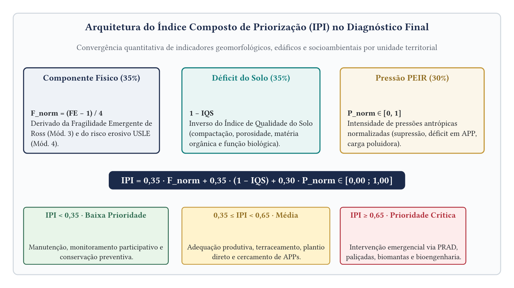

# Manual Prático do Diagnóstico Ambiental Aplicado e Produtos Técnicos {#cap:diagnostico_final_pratico}

O diagnóstico ambiental aplicado reúne evidências para explicar o funcionamento de uma área e orientar decisões. Mapas e indicadores sustentam a análise quando suas relações causais são explicitadas, permitindo compreender o problema, localizar as intervenções e verificar os resultados esperados.

::: {.callout-note title="O que você vai aprender neste capítulo"}
A aprendizagem envolve elaborar um diagnóstico com pergunta, recorte, dados, interpretação e proposta coerentes. O estudante deve justificar suas conclusões, reconhecer limitações de escala e resolução, calcular o Índice Composto de Priorização ($IPI$) e apresentar critérios de acompanhamento para revisar a intervenção.
:::

::: {.callout-tip title="Revisando o que você precisa saber"}
O trabalho articula leitura de paisagem, análise de bacia hidrográfica, fragilidade ambiental, qualidade do solo, indicadores PEIR, bioengenharia e instrumentos legais. A integração exige que mapas e tabelas utilizem unidades territoriais compatíveis e que diferenças de data e método sejam consideradas na interpretação.
:::

## Vocabulário Técnico e Símbolos do Capítulo 15

Para padronizar a comunicação técnica do Trabalho Prático Final, o **Recorte Espacial ($A_{\text{rec}}$)** designa a unidade territorial delimitada para o diagnóstico, correspondendo preferencialmente a uma microbacia hidrográfica, sub-bacia, vertente completa ou trecho de APP e área degradada. Todos os projetos em QGIS e os mapas finais devem adotar o **SIRGAS 2000** (Sistema de Referência Geocêntrico para as Américas), datum geodésico oficial do Brasil. Na definição da escala cartográfica, $A_{\min}$ indica a **área mínima mapeável** no terreno correspondente a $4\text{ mm}^2$ no mapa impresso, calculada por $A_{\min} = 4 \times 10^{-6} \cdot E^2\text{ m}^2$, em que $E$ é o denominador da escala $1:E$.

Na etapa de síntese quantitativa, a **Matriz de Indicadores** organiza os dados cruzando Pressão, Estado, Impacto e Resposta (PEIR) com atributos de qualidade do solo ($IQS$) e fragilidade emergente ($FE$). Desse cruzamento deriva-se o **Índice Composto de Priorização de Intervenção ($IPI$)**, parâmetro adimensional entre $0$ e $1$ empregado para ranquear setores críticos na alocação de bioengenharia e PRAD, enquanto $CE$ representa o **Custo-Efetividade** de uma intervenção, medido em $\text{t}\cdot\text{ano}^{-1}$ de sedimentos retidos por $\text{R\$ }1.000{,}00$ investidos.

O Trabalho Prático Final da disciplina CHF662 representa $50\%$ da avaliação semestral ($5{,}0$ pontos) e simula a entrega de um diagnóstico técnico profissional em Análise Ambiental. O fluxo metodológico articula sete etapas encadeadas, partindo da delimitação espacial e do levantamento de bases abertas até a matriz de indicadores, os produtos cartográficos, a proposta de intervenção e a socialização dos resultados (@fig-fluxo_diagnostico_final).

{#fig-fluxo_diagnostico_final}

## Etapa 1, Escolha e Delimitação do Recorte Espacial

A escolha da área de estudo deve equilibrar **relevância socioambiental** e **viabilidade de levantamento** no prazo semestral (IBGE, 2018; Cavalcanti, 2006). Entre as possibilidades de recorte, a **microbacia hidrográfica** constitui a unidade preferencial por integrar divisores de água, rede de drenagem, conectividade hidrossedimentológica e uso da terra, recomendando-se áreas entre $1\text{ km}^2$ e $50\text{ km}^2$. Quando o foco recai sobre processos erosivos lineares (sulcos, ravinas e voçorocas) ou movimentos de massa em áreas urbanas e rurais, a delimitação pode concentrar-se em uma **encosta ou vertente representativa**. De modo complementar, diagnósticos voltados a passivo florestal (Lei nº 12.651/2012), assoreamento de açudes, antigas cascalheiras ou acessos de empreendimentos energéticos (como observado no campo do Semiárido) ajustam-se bem ao recorte de uma **margem de curso d’água, APP ou área degradada pontual**.

Qualquer que seja o recorte selecionado, a delimitação deve ser vetorizada em polígono fechado no QGIS (formato GeoPackage `.gpkg` ou Shapefile `.shp`), acompanhada de justificativa clara dos critérios naturais (divisores topográficos) ou legais e administrativos (limites de APP ou poligonal de empreendimento) adotados.

## Etapa 2, Levantamento de Bases Cartográficas e Dados Abertos

Todo diagnóstico ambiental auditável depende de fontes públicas rastreáveis, organizadas em um banco geográfico padronizado em **SIRGAS 2000**, adotando-se coordenadas geográficas para contextualização regional e projeção UTM (fuso 24S para a maior parte da Bahia) nos cálculos de área e comprimento. As plataformas oficiais e suas aplicações diretas no trabalho final estão sistematizadas na @tbl-bases_abertas_tpf.

| **Base / Plataforma** | **Dados Extraídos** | **Aplicação Direta no Trabalho Final** |
|:---|:---|:---|
| **IBGE** | Limites municipais, malha censitária, hidrografia e pedologia | Contextualização territorial, caracterização socioespacial e classes de solo. |
| **SRTM / TOPODATA (INPE)** | Modelo Digital de Elevação ($30\text{ m}$), declividade e curvas de nível | Delimitação automática da microbacia, perfil de vertente, fator $LS$ e mapa clinográfico (Ross). |
| **MapBiomas** | Séries anuais de uso e cobertura da terra ($30\text{ m}$) | Análise multitemporal (por exemplo, $1985$-$2024$), supressão de vegetação nativa e fator $C$ da USLE. |
| **SICAR / CAR** | Perímetros de imóveis rurais, APPs e Reserva Legal declaradas | Verificação de passivo ambiental em APPs marginais e nascentes (Lei nº 12.651/2012). |
| **INEMA / SEI-BA** | Outorgas, licenças ambientais, bacias estaduais e dados climáticos | Identificação de empreendimentos licenciados, conflitos hídricos e erosividade regional ($R$). |

: Principais bases cartográficas e dados abertos oficiais aplicados ao Trabalho Prático Final em CHF662. {#tbl-bases_abertas_tpf}

Definidas as bases cartográficas de entrada, a equipe precisa compatibilizar a escala de apresentação dos mapas finais com o tamanho das feições erosivas e legais analisadas no terreno (Exemplo 15.1).

::: {.callout-tip appearance="simple"}
### Exemplo 15.1 (Básico). Escolha da Escala Cartográfica e Área Mínima Mapeável ($A_{\min}$)

**Situação analisada.** Uma equipe escolheu uma microbacia de $12{,}5\text{ km}^2$ no Piemonte do Paraguaçu (BA) para o Trabalho Prático Final, onde existem voçorocas com cerca de $0{,}40\text{ ha}$ de área em planta e trechos de APP marginal com $30\text{ m}$ de largura. Os discentes precisam decidir entre produzir os mapas temáticos finais na escala $1:25.000$ ou na escala regional $1:100.000$.

**Dados disponíveis.** Critério cartográfico padrão de área mínima mapeável no papel igual a $a_{\text{papel}} = 4\text{ mm}^2 = 4 \times 10^{-6}\text{ m}^2$; Escala 1 com $E_1 = 25.000$; Escala 2 com $E_2 = 100.000$; área da feição erosiva alvo de $A_{\text{alvo}} = 0{,}40\text{ ha} = 4.000\text{ m}^2$.

**Problema a resolver.** Calcular a área mínima mapeável no terreno ($A_{\min}$) para ambas as escalas e justificar qual escala atende ao diagnóstico da microbacia.

**Fundamento da análise.** Conversão quadrática da área no papel para o terreno pela relação $A_{\min} = a_{\text{papel}} \cdot E^2$, seguida da conversão de $\text{m}^2$ para hectares ($1\text{ ha} = 10.000\text{ m}^2$).

**Desenvolvimento.** Na **Etapa 1 (Escala $1:25.000$)** e na **Etapa 2 (Escala $1:100.000$)**,

$$
A_{\min,1} = 4 \times 10^{-6} \times (25.000)^2 = 2.500\text{ m}^2 = \mathbf{0{,}25\text{ ha}} \qquad A_{\min,2} = 4 \times 10^{-6} \times (100.000)^2 = 40.000\text{ m}^2 = \mathbf{4{,}00\text{ ha}}
$$

Comparando com a voçoroca alvo ($0{,}40\text{ ha}$), na escala $1:25.000$ tem-se $0{,}40\text{ ha} > 0{,}25\text{ ha}$ (feição representável em polígono), enquanto em $1:100.000$ tem-se $0{,}40\text{ ha} < 4{,}00\text{ ha}$, deixando a feição $10$ vezes abaixo do limite legível.

**Interpretação do resultado.** Deve-se adotar a escala **$1:25.000$** (ou mais detalhada, como $1:15.000$), pois $A_{\min} = 0{,}25\text{ ha}$ permite cartografar a voçoroca de $0{,}40\text{ ha}$, ao passo que $1:100.000$ ($A_{\min} = 4{,}00\text{ ha}$) ocultaria o processo erosivo.

**Condições de validade.** Além da área mínima, uma faixa de APP de $30\text{ m}$ mede $1{,}2\text{ mm}$ em $1:25.000$ (visível), mas apenas $0{,}3\text{ mm}$ em $1:100.000$ (espessura inferior a uma linha padrão de impressão). A escolha é cartograficamente consistente.
:::

Na preparação dos layouts e no cálculo de áreas no QGIS, dois descuidos cartográficos costumam comprometer a validade técnica dos mapas e das tabelas finais.

::: {.callout-warning appearance="simple"}
### Erro 1, Produzir Mapas sem Datum, Escala Gráfica ou Grade de Coordenadas

**Equívoco frequente.** Exportar layouts do QGIS apenas com o desenho colorido da microbacia, omitindo o sistema de referência (SIRGAS 2000), a barra de escala, a seta Norte ou a fonte dos dados.

**Correção técnica.** Mapa sem elementos cartográficos obrigatórios perde validade técnica e sofre desconto imediato na rubrica de avaliação. Utilize um modelo padronizado no Compositor de Impressão do QGIS com os seis elementos conferidos antes de exportar em PDF ou PNG de alta resolução ($300\text{ dpi}$).
:::

De modo análogo, calcular polígonos e comprimentos de canais sem reprojeção métrica distorce todos os indicadores derivados do SIG.

::: {.callout-warning appearance="simple"}
### Erro 2, Calcular Áreas e Comprimentos em Graus Decimais (Coordenadas Geográficas)

**Equívoco frequente.** Deixar as camadas em SIRGAS 2000 geográfico (EPSG:4674) ao calcular áreas de APPs ou comprimentos de canais na calculadora de campo do QGIS.

**Correção técnica.** Reprojete sempre as camadas de trabalho para o sistema métrico plano **SIRGAS 2000 / UTM** (por exemplo, Fuso 24S, EPSG:31984, na maior parte da Bahia) antes de mensurar hectares, perímetros ou densidades de drenagem.
:::

## Etapa 3, Caracterização Integrada Físico-Biótica e Socioespacial

Seguindo a abordagem sistêmica de Cavalcanti (2006) e IBGE (2018), o texto diagnóstico articula os compartimentos naturais e sociais explicando suas **interações causais**. No âmbito do **meio físico-biótico**, essa leitura integrada relaciona o regime pluviométrico (especialmente a concentração sazonal das chuvas), os compartimentos do relevo (topo, meia encosta, sopé e planície), as classes de solo (espessura, textura e suscetibilidade erosiva) e a fisionomia vegetal remanescente (Caatinga, Mata Atlântica, Cerrado ou vegetação ripária). Em conexão direta com essa base física, a análise da **dinâmica socioespacial** associa as formas de uso e ocupação da terra (pecuária extensiva, agricultura de sequeiro, expansão urbana, infraestrutura energética ou mineração) à estrutura fundiária, às pressões sobre os recursos hídricos e à percepção e vulnerabilidade das comunidades locais.

## Etapa 4, Identificação e Mapeamento de Processos de Degradação

Com apoio de imagens de alta resolução (Google, Bing ou CBERS-4A no QGIS) e, quando viável, verificação de campo com registro fotográfico georreferenciado e escala métrica, realiza-se o inventário espacial dos processos ativos na área de estudo. A investigação abrange inicialmente os processos de **erosão hídrica**, identificando áreas com selamento superficial, erosão laminar, sulcos ($<0{,}5\text{ m}$), ravinas ($>0{,}5\text{ m}$) e voçorocas (com eventual exfiltração e *piping*). Em paralelo, mapeiam-se a **degradação física do solo** decorrente da compactação em trilhas, estradas não pavimentadas e áreas de pisoteio intenso, bem como a **degradação ripária e fluvial**, expressa pela supressão de mata ciliar em APPs, pelo solapamento de margens e pelo assoreamento de córregos, barreiros ou açudes. Quando presentes no recorte, incluem-se ainda os **passivos de resíduos ou contaminação**, como disposição irregular de resíduos sólidos, efluentes domésticos ou rejeitos minerários sem contenção.

## Etapa 5, Montagem da Matriz de Indicadores e Índice de Priorização

Para conferir rigor analítico e evitar diagnósticos puramente descritivos, o Trabalho Prático Final exige uma **Matriz de Indicadores** que integre o modelo **PEIR** (Capítulo 10), os atributos de **Qualidade do Solo** (Capítulo 11) e a **Fragilidade Emergente de Ross** (Capítulo 9). Quando houver múltiplos setores ou subunidades na área de estudo, aplica-se o Índice Composto de Priorização de Intervenção ($IPI$) para hierarquizar onde agir primeiro.

### Índice Composto de Priorização de Intervenção ($IPI$)

$$
IPI = w_F \cdot F_{\text{norm}} + w_S \cdot (1 - IQS) + w_P \cdot P_{\text{norm}} \qquad \text{com} \quad F_{\text{norm}} = \frac{FE - 1}{4}
$$

Nessa equação normalizada no intervalo $[0,\,1]$, $F_{\text{norm}}$ converte a Fragilidade Emergente de Ross ($FE \in \{1, 2, 3, 4, 5\}$) para a escala de $0{,}00$ a $1{,}00$, $(1 - IQS)$ expressa o déficit de qualidade do solo a partir do Índice de Qualidade do Solo ($IQS \in [0,\,1]$), e $P_{\text{norm}} \in [0,\,1]$ quantifica a pressão ou o impacto antrópico normalizado na matriz PEIR. Os pesos técnicos respeitam $w_F + w_S + w_P = 1{,}00$, com padrão sugerido de $w_F = 0{,}35$, $w_S = 0{,}35$ e $w_P = 0{,}30$.

A arquitetura analítica do $IPI$ sintetiza de forma transparente três dimensões diagnósticas complementares (@fig-matriz-ipi-priorizacao). Enquanto o componente físico ($35\%$) capta a suscetibilidade morfopedológica e erosiva herdada dos Módulos 3 e 4, o déficit edáfico ($35\%$) reflete a perda de funcionalidade do solo por compactação, queda de porosidade e redução de matéria orgânica, e a pressão PEIR ($30\%$) traduz a intensidade dos vetores antrópicos sobre o recorte. Embora uma síntese visual simplificada possa agrupar o índice em três grandes patamares ($<0{,}35$, $0{,}35\text{-}0{,}65$ e $\ge 0{,}65$), a matriz operacional adotada nos cálculos da disciplina desdobra a faixa superior em quatro classes graduais (@tbl-faixas_ipi) para distinguir intervenções preventivas de ações emergenciais em voçorocas.

{#fig-matriz-ipi-priorizacao fig-alt="Diagrama com três blocos de entrada F_norm 35%, 1-IQS 35% e P_norm 30% convergindo para a fórmula do IPI e três blocos inferiores de prioridade"}

As quatro faixas operacionais empregadas na classificação detalhada dos setores da microbacia constam da @tbl-faixas_ipi, orientando desde o monitoramento preventivo em remanescentes conservados até obras integradas de drenagem e bioengenharia nos setores críticos.

| **Intervalo de $IPI$** | **Classe de Prioridade** | **Diretriz de Gestão e Intervenção** |
|:---|:---|:---|
| $0{,}00 \le IPI < 0{,}35$ | **Baixa** | Conservação preventiva e monitoramento periódico. |
| $0{,}35 \le IPI < 0{,}60$ | **Média** | Práticas conservacionistas ($C$ e $P$) e manejo sustentável. |
| $0{,}60 \le IPI < 0{,}80$ | **Alta** | Bioengenharia leve (biomantas, estacas vivas) e recomposição de APP. |
| $0{,}80 \le IPI \le 1{,}00$ | **Crítica** | Intervenção imediata integrada (PRAD, paliçadas, drenagem e isolamento). |

: Faixas operacionais de priorização do $IPI$ e diretrizes de gestão correspondentes. {#tbl-faixas_ipi}

Na organização prática do relatório, os indicadores levantados em SIG, campo e laboratório articulam-se em uma matriz integrada que vincula diretamente cada métrica mensurada à respectiva resposta corretiva de PRAD ou bioengenharia (@tbl-matriz_integrada_ipi). O Exemplo 15.2 demonstra o cálculo passo a passo do $IPI$ para três setores contrastantes de uma microbacia.

| **Dimensão** | **Indicador Medido** | **Fonte / Método** | **Valor / Classe** | **Papel na Resposta (PRAD)** |
|:---|:---|:---|:---|:---|
| **PEIR (P)** | Déficit de APP marginal | SICAR + MapBiomas | $35\%$ suprimido | Recomposição legal obrigatória (Lei 12.651/12). |
| **PEIR (E) / Solo** | Densidade do solo ($D_s$) e $IQS$ | Anel volumétrico / MDS | $IQS = 0{,}42$ (Baixo) | Descompactação e aporte de matéria orgânica. |
| **Ross (FE)** | Fragilidade Emergente | Cruzamento decliv., solo e uso | $FE = 4$ (Forte) | Restrição de uso e cobertura permanente. |
| **PEIR (I)** | Focos erosivos lineares | Campo / Imagem alta res. | $4\text{ ravinas/km}^2$ | Paliçadas permeáveis e dissipadores de energia. |

: Estrutura de referência da Matriz Integrada de Indicadores para o Trabalho Prático Final. {#tbl-matriz_integrada_ipi}

::: {.callout-tip appearance="simple"}
### Exemplo 15.2 (Intermediário). Montagem da Matriz Integrada e Cálculo do $IPI$ por Setor

**Situação analisada.** Ao organizar a Matriz de Indicadores do Trabalho Final, uma equipe dividiu uma microbacia em três setores homogêneos e levantou, por meio de QGIS, campo e análise de solo, os valores de Fragilidade Emergente ($FE$), Índice de Qualidade do Solo ($IQS$) e Pressão/Impacto PEIR normalizado ($P_{\text{norm}}$).

**Dados disponíveis.** **Setor A (Cabeceira com voçoroca),** $FE = 5$, $IQS = 0{,}36$, $P_{\text{norm}} = 0{,}90$. **Setor B (Meia encosta com pastagem),** $FE = 3$, $IQS = 0{,}60$, $P_{\text{norm}} = 0{,}50$. **Setor C (Remanescente de Caatinga/APP),** $FE = 2$, $IQS = 0{,}88$, $P_{\text{norm}} = 0{,}10$. Pesos adotados iguais a $w_F = 0{,}35$, $w_S = 0{,}35$ e $w_P = 0{,}30$.

**Problema a resolver.** Calcular $F_{\text{norm}}$, $(1 - IQS)$ e o Índice Composto de Priorização ($IPI$) para cada setor, classificando a prioridade de intervenção.

**Fundamento da análise.** Normalização de $FE$ por $F_{\text{norm}} = (FE - 1)/4$ e aplicação da soma ponderada $IPI = 0{,}35\,F_{\text{norm}} + 0{,}35\,(1 - IQS) + 0{,}30\,P_{\text{norm}}$.

**Desenvolvimento.** Para o **Setor A**, $F_{\text{norm}} = (5 - 1)/4 = 1{,}00$ e $(1 - IQS) = 1 - 0{,}36 = 0{,}64$,

$$
\begin{aligned}
IPI_A &= 0{,}35(1{,}00) + 0{,}35(0{,}64) + 0{,}30(0{,}90) \\
      &= 0{,}350 + 0{,}224 + 0{,}270 = \mathbf{0{,}844}\quad(\text{Prioridade Crítica})
\end{aligned}
$$

Para o **Setor B**, $F_{\text{norm}} = (3 - 1)/4 = 0{,}50$ e $(1 - IQS) = 1 - 0{,}60 = 0{,}40$,

$$
\begin{aligned}
IPI_B &= 0{,}35(0{,}50) + 0{,}35(0{,}40) + 0{,}30(0{,}50) \\
      &= 0{,}175 + 0{,}140 + 0{,}150 = \mathbf{0{,}465}\quad(\text{Prioridade Média})
\end{aligned}
$$

Para o **Setor C**, $F_{\text{norm}} = (2 - 1)/4 = 0{,}25$ e $(1 - IQS) = 1 - 0{,}88 = 0{,}12$,

$$
\begin{aligned}
IPI_C &= 0{,}35(0{,}25) + 0{,}35(0{,}12) + 0{,}30(0{,}10) \\
      &= 0{,}0875 + 0{,}0420 + 0{,}0300 = \mathbf{0{,}1595}\approx \mathbf{0{,}160}\quad(\text{Prioridade Baixa})
\end{aligned}
$$

**Interpretação do resultado.** $IPI_A = \mathbf{0{,}844}$ (Crítica, PRAD e bioengenharia imediatos); $IPI_B = \mathbf{0{,}465}$ (Média, manejo conservacionista); $IPI_C = \mathbf{0{,}160}$ (Baixa, manutenção e monitoramento).

**Condições de validade.** Todos os valores permanecem dentro do intervalo teórico $[0,\,1]$, e a ordenação ($A > B > C$) reflete fielmente o gradiente de degradação observado.
:::

## Etapa 6, Produtos Técnicos Obrigatórios e Proposta de Intervenção

O trabalho entregue deve conter três produtos técnicos articulados entre si. O primeiro produto consiste no **conjunto de mapas temáticos**, composto por no mínimo três cartas principais, sendo elas o Mapa de Localização e Delimitação do Recorte Espacial, o Mapa de Uso e Cobertura da Terra e APPs, e o Mapa de Fragilidade Ambiental e Pontos de Degradação; todos os layouts devem apresentar os **seis elementos cartográficos obrigatórios** (título informativo, orientação com seta Norte, escala gráfica e numérica, grade de coordenadas com indicação do datum **SIRGAS 2000**, legenda legível e quadro de fontes e autoria).

O segundo produto corresponde ao **relatório técnico interpretativo**, redigido de forma estruturada com introdução e objetivos, localização e métodos, resultados integrados (apoiados em tabelas, gráficos e matriz de indicadores) e discussão crítica fundamentada na bibliografia da disciplina. Articulando-se diretamente a esse diagnóstico, o terceiro produto reúne a **proposta preliminar de conservação, bioengenharia ou PRAD**, vinculando cada medida aos indicadores críticos diagnosticados (Vital et al., 2020) mediante especificação das técnicas selecionadas (paliçadas, biomantas, plantio em contorno, isolamento de APP e espécies nativas), cronograma físico simplificado e metas mensuráveis de monitoramento pós-implantação, como taxa de sobrevivência $\ge 80\%$ e redução do recuo de borda erosiva.

Toda recomendação técnica deve indicar qual processo físico será alterado e por qual mecanismo, respeitando o percurso da água entre fontes a montante, caminhos de escoamento e áreas receptoras a jusante. Além disso, cada conclusão precisa manter vínculo verificável com os dados coletados, explicitando o alcance descritivo de evidências fotográficas frente a medições instrumentais (como densidade do solo, infiltração e perfis transversais), justificando os pesos adotados na matriz de prioridade e registrando dados ausentes e eventuais incertezas sobre a decisão. Os Exemplos 15.3 e 15.4 ilustram, respectivamente, a quantificação do passivo em APP para o dimensionamento de mudas e a seleção de intervenções por custo-efetividade ($CE$).

::: {.callout-tip appearance="simple"}
### Exemplo 15.3 (Intermediário). Quantificação de Passivo em APP Marginal e Demanda de Mudas

**Situação analisada.** Na sobreposição entre a hidrografia vetorial, o SICAR e o MapBiomas, uma equipe diagnosticou um trecho de $2.000\text{ m}$ de curso d’água com $12\text{ m}$ de largura regular, no qual a mata ciliar foi parcialmente substituída por pastagem degradada.

**Dados disponíveis.** Comprimento do trecho $L = 2.000\text{ m}$; largura do rio de $12\text{ m}$ (pela Lei nº 12.651/2012, cursos d’água entre $10\text{ m}$ e $50\text{ m}$ exigem APP mínima de $50\text{ m}$ em cada margem); percentual degradado diagnosticado nas duas margens de $35\%$; espaçamento adotado no PRAD de $2{,}5\text{ m} \times 2{,}0\text{ m}$ ($5{,}0\text{ m}^2$ por muda, equivalente a $2.000\text{ mudas}\cdot\text{ha}^{-1}$), prevendo $10\%$ adicionais para replantio.

**Problema a resolver.** Calcular a área total de APP legal no trecho, o passivo ambiental em hectares a ser recomposto e o número total de mudas nativas necessário.

**Fundamento da análise.** Cálculo geométrico da área retangular equivalente das duas faixas marginais, aplicação do percentual de déficit e multiplicação pela densidade de plantio ajustada para replantio.

**Desenvolvimento.** Na **Etapa 1 (APP legal e passivo a recompor a $35\%$)**,

$$
A_{\text{APP}} = 2 \times 50\text{ m} \times 2.000\text{ m} = 200.000\text{ m}^2 = \mathbf{20{,}0\text{ ha}} \qquad A_{\text{passivo}} = 0{,}35 \times 20{,}0 = \mathbf{7{,}0\text{ ha}}
$$

Na **Etapa 2 (Mudas iniciais e acréscimo de $10\%$ para replantio)**,

$$
N_{\text{inicial}} = 7{,}0 \times 2.000 = 14.000\text{ mudas} \qquad\qquad N_{\text{total}} = 14.000 \times 1{,}10 = \mathbf{15.400\text{ mudas}}
$$

**Interpretação do resultado.** APP total $= \mathbf{20{,}0\text{ ha}}$; passivo a recompor $= \mathbf{7{,}0\text{ ha}}$; demanda total do viveiro $= \mathbf{15.400\text{ mudas nativas}}$.

**Condições de validade.** Para $7{,}0\text{ ha}$, o número inicial de $14.000$ mudas equivale exatamente a $1$ muda a cada $5\text{ m}^2$ ($70.000 / 5 = 14.000$), e o acréscimo de $10\%$ ($1.400$ mudas) garante a reposição de eventuais perdas no primeiro ciclo seco.
:::

Quando múltiplas alternativas técnicas atendem ao mesmo diagnóstico, a comparação financeira pela retenção anual de sedimentos orienta a alocação eficiente de recursos no relatório final (Exemplo 15.4).

::: {.callout-tip appearance="simple"}
### Exemplo 15.4 (Avançado). Seleção de Alternativa de Intervenção por Custo-Efetividade ($CE$)

**Situação analisada.** Para conter o aporte de sedimentos em uma ravina crítica ($IPI = 0{,}84$) identificada no Trabalho Final, a equipe comparou duas propostas preliminares de intervenção, confrontando o Pacote 1 (paliçadas permeáveis de bambu, biomanta e revegetação com espécies nativas) com o Pacote 2 (enrocamento com gabiões de pedra e canaleta rígida de concreto).

**Dados disponíveis.** **Pacote 1 (Bioengenharia e PRAD).** Custo estimado $= \text{R\$ }18.000,00$; retenção anual estimada $= 180\text{ t}\cdot\text{ano}^{-1}$ de sedimentos. **Pacote 2 (Obra Rígida Convencional).** Custo estimado $= \text{R\$ }45.000,00$; retenção anual estimada $= 225\text{ t}\cdot\text{ano}^{-1}$ de sedimentos.

**Problema a resolver.** Calcular o Custo-Efetividade ($CE$) de cada pacote em $\text{t}\cdot\text{ano}^{-1}$ retidas por $\text{R\$ }1.000,00$ investidos e justificar a recomendação técnica no relatório.

**Fundamento da análise.** Divisão da massa anual de sedimentos retida pelo custo total expresso em milhares de reais.

**Desenvolvimento.** Para o **Pacote 1 (Bioengenharia)** e o **Pacote 2 (Obra Rígida)**,

$$
CE_1 = \frac{180\text{ t}\cdot\text{ano}^{-1}}{18{,}0\text{ mil reais}} = \mathbf{10{,}0\text{ t}\cdot\text{ano}^{-1}\text{ por }\text{R\$ }1.000{,}00} \qquad CE_2 = \frac{225\text{ t}\cdot\text{ano}^{-1}}{45{,}0\text{ mil reais}} = \mathbf{5{,}0\text{ t}\cdot\text{ano}^{-1}\text{ por }\text{R\$ }1.000{,}00}
$$

**Interpretação do resultado.** O Pacote 1 apresenta retenção estimada de $10{,}0$ toneladas por ano a cada $\text{R\$ }1.000{,}00$ investidos, enquanto o Pacote 2 apresenta $5{,}0$ toneladas por ano para o mesmo custo de referência, exibindo o dobro da retenção por unidade de custo. A seleção final considera também compatibilidade técnica, duração e manutenção.

**Condições de validade.** O Pacote 2 retém $25\%$ a mais de sedimentos ($225$ contra $180\text{ t}\cdot\text{ano}^{-1}$), porém custa $2{,}5$ vezes mais ($\text{R\$ }45.000$ contra $\text{R\$ }18.000$), indicando vantagem técnica e econômica da bioengenharia em ravinas de pequeno e médio porte.
:::

Esse encadeamento entre diagnóstico espacial, matriz quantitativa e prescrição executiva previne propostas genéricas desconectadas das evidências de campo.

::: {.callout-warning appearance="simple"}
### Erro 3, Apresentar Diagnóstico Desconectado da Proposta de Intervenção

**Equívoco frequente,** Descrever no relatório uma voçoroca ativa com *piping* e compactação severa, mas propor na conclusão apenas “conscientização ambiental” ou “plantio aleatório de mudas” sem controle de escoamento.

**Correção técnica,** Cada medida da proposta de PRAD ou bioengenharia deve responder diretamente a um indicador crítico da Matriz de Indicadores ($IPI$), articulando controle hidráulico a montante, estabilização mecânica (paliçadas ou biomantas) e recomposição vegetal adaptada ao bioma.
:::

## Etapa 7, Checklist de Entrega e Rubrica Oficial de Avaliação (5,0 Pontos)

Na Semana 16, o trabalho é entregue e socializado em apresentação oral breve. Utilize a rubrica oficial apresentada na @tbl-rubrica_tpf para auditar seu projeto antes da submissão final.

| **Critério Avaliativo** | **Peso (pts)** | **Descritor de Desempenho Pleno (100%)** |
|:---|:---|:---|
| **1. Delimitação e Bases Cartográficas** | $1{,}0$ | Recorte espacial justificado; bases abertas validadas (IBGE, TOPODATA, MapBiomas, SICAR); todos os mapas em SIRGAS 2000 com os 6 elementos obrigatórios. |
| **2. Caracterização Integrada e Degradação** | $1{,}0$ | Articulação físico-biótica e socioespacial sem fragmentação; processos erosivos e passivos em APP corretamente classificados e georreferenciados. |
| **3. Matriz de Indicadores ($IPI$ / PEIR / Solo / Ross)** | $1{,}0$ | Matriz completa e coerente, sem inversão de categorias PEIR; cálculos de $IQS$, Ross e $IPI$ auditáveis e interpretados. |
| **4. Produtos Técnicos e Proposta de PRAD/Bioengenharia** | $1{,}2$ | Proposta tecnicamente compatível com os processos diagnosticados (Vital et al., 2020), respeitando a Lei nº 12.651/2012 e com metas de monitoramento. |
| **5. Redação Técnica e Socialização (Semana 16)** | $0{,}8$ | Clareza, norma culta, citações padronizadas (ABNT) e defesa oral objetiva, respeitando o tempo e respondendo com domínio conceitual. |
| **TOTAL GERAL** | $\mathbf{5{,}0}$ | **Correspondente a $50\%$ da média semestral de CHF662.** |

: Rubrica oficial de avaliação do Trabalho Prático Final da disciplina CHF662 (Semana 16, $5{,}0$ pontos). {#tbl-rubrica_tpf}

## Síntese Aplicada, Auditoria Pré-Entrega pela Rubrica Oficial

Antes de submeter a versão definitiva do relatório e dos mapas na Semana 16, recomenda-se executar uma auditoria interna com base nos cinco critérios da rubrica, identificando onde ajustes objetivos geram o maior ganho de qualidade técnica (Exemplo 15.5).

::: {.callout-tip appearance="simple"}
### Exemplo 15.5 (Aplicado). Auditoria Pré-Entrega pela Rubrica Oficial CHF662 ($5{,}0$ Pontos)

**Situação analisada.** Uma semana antes da socialização da Semana 16, um grupo realizou uma simulação de autoavaliação de seu rascunho de Trabalho Prático Final utilizando a Rubrica Oficial de $5{,}0$ pontos da disciplina CHF662.

**Dados disponíveis.** Notas parciais diagnosticadas na pré-auditoria, Critério 1 (Delimitação e bases, máx. $1{,}0$) igual a $0{,}70$ por ausência de datum SIRGAS 2000 e escala gráfica em um dos mapas; Critério 2 (Caracterização e degradação, máx. $1{,}0$) igual a $0{,}90$; Critério 3 (Matriz de Indicadores, máx. $1{,}0$) igual a $1{,}00$; Critério 4 (Produtos técnicos e PRAD, máx. $1{,}2$) igual a $0{,}85$ por ausência de metas mensuráveis de monitoramento no PRAD; e Critério 5 (Redação e socialização, máx. $0{,}8$) igual a $0{,}75$.

**Problema a resolver.** Calcular a pontuação atual do rascunho, o percentual atingido sobre os $5{,}0$ pontos e identificar quais duas correções rápidas recuperam o maior ganho de nota antes da entrega.

**Fundamento da análise.** Soma ponderada direta das notas obtidas nos cinco critérios e cálculo do déficit por critério.

**Desenvolvimento.** Na **Etapa 1 (Pontuação atual e percentual sobre $5{,}0$ pontos)**,

$$
N_{\text{atual}} = 0{,}70 + 0{,}90 + 1{,}00 + 0{,}85 + 0{,}75 = \mathbf{4{,}20\text{ pontos}} \qquad\qquad \frac{4{,}20}{5{,}00} \times 100\% = \mathbf{84{,}0\%}
$$

Na **Etapa 2 (Maiores déficits identificados)**, destacam-se o Critério 4 ($1{,}20 - 0{,}85 = 0{,}35\text{ pt}$) e o Critério 1 ($1{,}00 - 0{,}70 = 0{,}30\text{ pt}$).

**Interpretação do resultado.** Pontuação atual $= \mathbf{4{,}20\text{ pts}}$ ($84{,}0\%$). Inserir metas mensuráveis de monitoramento no PRAD ($+0{,}35\text{ pt}$) e completar o datum SIRGAS 2000 e a escala gráfica no mapa ($+0{,}30\text{ pt}$) eleva o trabalho para $4{,}85\text{ pts}$ ($97{,}0\%$).

**Condições de validade.** A soma das perdas totais ($0{,}30 + 0{,}10 + 0{,}00 + 0{,}35 + 0{,}05 = 0{,}80\text{ pt}$) fecha exatamente com $5{,}00 - 4{,}20 = 0{,}80\text{ pt}$.
:::

## Armadilha Conceitual e Materiais Audiovisuais de Apoio

Mesmo com mapas bem elaborados e cálculos corretos, a inversão causal entre os compartimentos da Matriz de Indicadores invalida a coerência entre diagnóstico e proposta de recuperação.

::: {.callout-warning appearance="simple"}
### Erro 4, Confundir Indicadores de Pressão, Estado, Impacto e Resposta na Matriz

**Equívoco frequente,** Listar a execução do PRAD como “Impacto” ou classificar a declividade natural do relevo como “Pressão antrópica”.

**Correção técnica,** Lembre a cadeia causal do modelo PEIR. O compartimento **P** reúne o vetor ou atividade humana modificadora; **E** retrata a condição atual do meio; **I** traduz o efeito físico, ecológico ou social mensurável; e **R** expressa a ação corretiva, legal ou de manejo proposta pelo poder público ou empreendedor.
:::

Para revisar a articulação entre legislação ambiental, Código Florestal e instrumentos de gestão aplicados ao Trabalho Prático Final, assista às videoaulas selecionadas na página da disciplina, iniciando por [Gestão Ambiental - Legislação e Certificação Ambiental](https://www.youtube.com/watch?v=L-WEcC2IlbA), prosseguindo com [Direito Ambiental: Código Florestal](https://www.youtube.com/watch?v=ApidLjWC4Dc) e concluindo com [Legislação Ambiental Brasileira](https://www.youtube.com/watch?v=gC4uHPJDiVA).

## Exercícios de fixação

#### Nível Básico (Conceitos, Bases Abertas e Fluxo do Trabalho Final)

1. Explique por que a **microbacia hidrográfica** é considerada a unidade espacial preferencial para o Trabalho Prático Final da disciplina CHF662, citando ao menos duas vantagens analíticas em relação a recortes puramente administrativos.

2. Relacione as cinco plataformas abertas (**IBGE**, **TOPODATA/SRTM**, **MapBiomas**, **SICAR/CAR** e **INEMA/SEI-BA**) ao tipo específico de dado que cada uma fornece para o diagnóstico ambiental.

3. Liste os **seis elementos cartográficos obrigatórios** que devem constar em todos os mapas temáticos do Trabalho Prático Final e explique qual datum oficial deve ser adotado no Brasil.

4. Diferencie **diagnóstico descritivo fragmentado** de **caracterização integrada físico-biótica e socioespacial**, exemplificando com uma relação causal entre uso da terra e processo erosivo.

5. Descreva os três componentes integrados na fórmula do **Índice Composto de Priorização de Intervenção ($IPI$)** e explique por que um setor com $IPI \ge 0{,}80$ demanda ação imediata.

#### Nível Intermediário (Escala, Matriz $IPI$, Passivo de APP e Rubrica)

6. Considerando o critério cartográfico de área mínima legível no papel de $4\text{ mm}^2$, calcule a área mínima mapeável no terreno ($A_{\min}$, em $\text{m}^2$ e em $\text{ha}$) para as escalas $1:15.000$ e $1:50.000$.

7. Uma vertente analisada no Trabalho Final apresentou Fragilidade Emergente de Ross $FE = 4$, Índice de Qualidade do Solo $IQS = 0{,}48$ e Pressão/Impacto normalizado $P_{\text{norm}} = 0{,}80$. Adotando os pesos padrão ($w_F = 0{,}35$, $w_S = 0{,}35$, $w_P = 0{,}30$), calcule o $IPI$ e classifique a prioridade de intervenção.

8. Um córrego com $8\text{ m}$ de largura atravessa $1.500\text{ m}$ de uma microbacia (APP legal de $30\text{ m}$ em cada margem). Verificou-se que $40\%$ da APP da margem esquerda e $20\%$ da APP da margem direita estão degradadas. Calcule a área total a recompor (em $\text{ha}$) e o número de mudas necessário no espaçamento de $2{,}5\text{ m} \times 2{,}0\text{ m}$ ($2.000\text{ mudas}\cdot\text{ha}^{-1}$), sem considerar replantio adicional.

9. Para estabilizar uma margem fluvial, o Pacote A (estacas vivas + biomanta) custa $\text{R\$ }12.000,00$ e retém $144\text{ t}\cdot\text{ano}^{-1}$ de sedimentos, enquanto o Pacote B (muro de concreto) custa $\text{R\$ }25.000,00$ e retém $200\text{ t}\cdot\text{ano}^{-1}$. Calcule o Custo-Efetividade ($CE$) de ambos em $\text{t}\cdot\text{ano}^{-1}$ por $\text{R\$ }1.000,00$ e indique o mais vantajoso.

10. Na avaliação da Semana 16, um grupo obteve as seguintes notas nos cinco critérios da rubrica oficial, $0{,}90$ (Critério 1), $0{,}80$ (Critério 2), $0{,}80$ (Critério 3), $1{,}00$ (Critério 4) e $0{,}70$ (Critério 5). Calcule a nota final do Trabalho Prático (de $0$ a $5{,}0$) e o percentual de aproveitamento.

#### Nível Aplicado (Questões Objetivas A-E) {#15-diagnostico-ambiental-aplicado-nível-aplicado-questões-objetivas-ae}

11. Na elaboração de mapas temáticos em QGIS para o Diagnóstico Ambiental Aplicado no Estado da Bahia, o procedimento correto para calcular áreas de uso da terra e extensão de APPs em hectares e metros é,

    (A) Manter as camadas em graus decimais sem projeção plana e multiplicar graus por $100$.

    (B) Reprojetar as camadas vetoriais e matriciais para o sistema de coordenadas planas métricas **SIRGAS 2000 / UTM** correspondente ao fuso local.

    (C) Utilizar apenas o sistema norte-americano NAD27 em milhas quadradas.

    (D) Desenhar o polígono manualmente sobre uma captura de tela sem escala.

    (E) Omitir a grade de coordenadas e o datum para simplificar o layout.

12. Para mapear o relevo, extrair curvas de nível, delimitar automaticamente uma microbacia e calcular o mapa de declividades da matriz de Ross em um diagnóstico com dados abertos, a fonte prioritária é,

    (A) Apenas o censo demográfico decenal do IBGE.

    (B) Modelos Digitais de Elevação gratuitos como **SRTM** ou **TOPODATA/INPE**.

    (C) Exclusivamente entrevistas orais sem base altimétrica.

    (D) Somente boletins de balneabilidade de praias oceânicas.

    (E) Plantas arquitetônicas internas de edificações urbanas.

13. Na etapa de verificação de passivos florestais em propriedades rurais dentro da microbacia de estudo, o cruzamento de dados abertos mais indicado é,

    (A) Rede viária federal cruzada com dados de radiação solar.

    (B) Perímetros do **SICAR/CAR** e hidrografia oficial cruzados com as séries de uso e cobertura da terra do **MapBiomas**.

    (C) Apenas mapas geológicos na escala $1:5.000.000$.

    (D) Exclusivamente dados de arrecadação tributária municipal.

    (E) Cartas náuticas oceânicas cruzadas com limites de bairros metropolitanos.

14. Um setor de uma microbacia recebeu Fragilidade Emergente $FE = 5$, Índice de Qualidade do Solo $IQS = 0{,}40$ e Pressão/Impacto normalizado $P_{\text{norm}} = 0{,}70$. Usando os pesos padrão ($w_F = 0{,}35$, $w_S = 0{,}35$, $w_P = 0{,}30$), o valor de $IPI$ e sua classe de prioridade são,

    (A) $0{,}560$ (Prioridade Média).

    (B) $0{,}665$ (Prioridade Alta).

    (C) $0{,}770$ (Prioridade Alta).

    (D) $0{,}840$ (Prioridade Crítica).

    (E) $0{,}910$ (Prioridade Crítica).

15. Sobre a estrutura dos produtos técnicos e a rubrica de avaliação da Semana 16 (CHF662), assinale a alternativa **INCORRETA**,

    (A) O Trabalho Prático Final corresponde a $5{,}0$ pontos ($50\%$ da média semestral) e inclui entrega técnica e socialização oral.

    (B) A Matriz de Indicadores deve articular o modelo PEIR, a qualidade do solo e a fragilidade ambiental de Ross.

    (C) A proposta preliminar de intervenção (PRAD/bioengenharia) deve conter metas mensuráveis de monitoramento pós-implantação.

    (D) Os mapas temáticos devem trazer título, Norte, escala, coordenadas/datum, legenda e fonte.

    (E) A rubrica atribui $100\%$ da nota apenas à quantidade de páginas do relatório, dispensando coerência entre diagnóstico, legislação e proposta técnica.

## Questões de aplicação

### Da Universidade para a Prática Profissional

Em editais de Analista Ambiental (IBAMA, ICMBio, INEMA) e no ENADE de Geografia, exige-se que o candidato saiba encadear base cartográfica, indicador mensurável, enquadramento legal e técnica de recuperação. Esse fluxo completo fundamenta tanto o Trabalho Prático Final quanto a atuação profissional em consultoria e gestão pública.

16. **\[Questão Autoral, Estilo ENADE / Geografia\]** Ao coordenar um diagnóstico ambiental aplicado em uma microbacia rural do Semiárido baiano (IBGE, 2018; Cavalcanti, 2006), um geógrafo constatou que os dados altimétricos tinham resolução de $30\text{ m}$ (TOPODATA), o uso da terra provinha do MapBiomas ($30\text{ m}$) e as feições erosivas críticas (ravinas de $2\text{ m}$ de largura) foram georreferenciadas em campo com GPS e fotografadas com escala métrica. A postura metodológica mais rigorosa ao integrar essas fontes no relatório final é,

    (A) Descartar os dados de campo para manter apenas pixels de $30\text{ m}$, ainda que ocultem ravinas estreitas.

    (B) Apresentar os mapas de bacia e uso na escala compatível com as bases regionais ($1:25.000$ a $1:50.000$), explicitando suas limitações de resolução, e representar as ravinas por pontos/linhas georreferenciados em escala de detalhe no diagnóstico local.

    (C) Redimensionar artificialmente o raster de $30\text{ m}$ para $0{,}10\text{ m}$ e afirmar no relatório que o satélite possui precisão centimétrica.

    (D) Omitir a escala gráfica e a fonte dos dados para evitar questionamentos metodológicos.

    (E) Misturar camadas em SIRGAS 2000 geográfico e UTM sem reprojeção, aceitando distorções de área.

17. **\[Questão Autoral, Estilo Concurso Analista Ambiental / PRAD\]** Em um diagnóstico integrado para subsidiar um PRAD (Vital et al., 2020), identificaram-se três problemas simultâneos em uma área degradada, (i) solo superficial compactado ($D_s = 1{,}66\text{ g}\cdot\text{cm}^{-3}$); (ii) escoamento pluvial concentrado descendo de uma estrada vicinal sem drenagem; e (iii) ausência de vegetação em $45\text{ m}$ de APP marginal. Qual sequência de ações respeita a lógica física e legal da recuperação ambiental?

    (A) Plantar árvores de grande porte dentro da estrada vicinal sem desviar a enxurrada e deixar o solo compactado.

    (B) Aplicar apenas herbicida na margem do rio e aguardar a regeneração espontânea sem controle hidráulico.

    (C) Implantar primeiro o disciplinamento e desvio das águas pluviais da estrada (dissipadores/terraços), realizar escarificação e incorporação de matéria orgânica no solo compactado, instalar contenções leves (paliçadas/biomantas) nos pontos críticos e executar o plantio de espécies nativas na APP com monitoramento periódico.

    (D) Substituir toda a APP por pavimentação asfáltica para impedir a infiltração da água da chuva.

    (E) Solicitar dispensa automática do PRAD alegando que estradas vicinais não produzem sedimentos.

18. **\[Questão Autoral, Estilo Concurso Geógrafo / Gestão Territorial\]** Um órgão ambiental estadual recebeu dois relatórios de diagnóstico para análise. O Relatório X apresentou apenas descrições gerais do município, sem delimitação de bacia, sem indicadores quantitativos e sem proposta de monitoramento. O Relatório Y delimitou a microbacia em SIRGAS 2000/UTM, integrou matriz PEIR, IQS e Fragilidade de Ross, quantificou o déficit de APP pelo Código Florestal e propôs técnicas de bioengenharia com metas semestrais auditáveis. Sob a ótica da Análise Ambiental (Sánchez, 2013; IBGE, 2018), o Relatório Y distingue-se por assegurar,

    (A) Subjetividade estética sem vínculo com parâmetros físicos ou legais.

    (B) Rastreabilidade metodológica, mensurabilidade de indicadores, conformidade jurídica e viabilidade de fiscalização das respostas propostas.

    (C) Substituição completa do trabalho de campo por opiniões informais.

    (D) Isenção de responsabilidade técnica do autor pela ausência de números.

    (E) Impossibilidade de comparação temporal futura em razão do uso de indicadores numéricos.

## Gabarito comentado {.unnumbered}

::: {.callout-tip collapse="true" title="Clique para abrir o Gabarito Comentado"}
### Resoluções Completas, Exercícios de Fixação (1 a 15)

1. A microbacia possui limites físicos naturais definidos pelos divisores topográficos e integra em um único sistema os fluxos de água, sedimentos, nutrientes e usos da terra. Duas vantagens, (a) permite fechar balanços hídricos e hidrossedimentológicos (erosão na vertente $\rightarrow$ assoreamento no exutório); e (b) evidencia interdependências entre propriedades a montante e a jusante que recortes municipais ou de lotes isolados ocultam.

2. **IBGE.** Limites territoriais, malha censitária, hidrografia e pedologia; **TOPODATA/SRTM,** MDE ($30\text{ m}$), declividade, curvas de nível e delimitação de bacias; **MapBiomas.** Séries históricas anuais de uso e cobertura da terra; **SICAR/CAR.** Limites de imóveis rurais, APPs e Reserva Legal declaradas; **INEMA/SEI-BA.** Outorgas, licenciamento, dados climáticos e informações socioeconômicas estaduais.

3. Os seis elementos obrigatórios são, (1) título informativo; (2) orientação (seta Norte); (3) escala gráfica e numérica; (4) grade de coordenadas com indicação do datum; (5) legenda; e (6) quadro de fontes e autoria. O datum oficial obrigatório no Brasil é o **SIRGAS 2000**.

4. Um diagnóstico descritivo fragmentado lista clima, solo, vegetação e população em seções isoladas sem explicar suas conexões. Já a caracterização integrada indica relações causais, como explicar de que modo a substituição da Caatinga por pastagem extensiva (dinâmica socioespacial) reduz a cobertura vegetal, eleva a compactação superficial e acelera o ravinamento em vertentes de Neossolo (meio físico-biótico).

5. O $IPI$ combina, (1) Fragilidade Emergente de Ross normalizada ($F_{\text{norm}}$); (2) Déficit de Qualidade do Solo ($1 - IQS$); e (3) Pressão/Impacto antrópico da matriz PEIR ($P_{\text{norm}}$). Valores $IPI \ge 0{,}80$ indicam convergência de alta fragilidade físico-ecológica, solo severamente degradado e forte pressão antrópica, exigindo intervenção imediata (PRAD e bioengenharia) para evitar colapso irreversível.

6. **Passo a passo,** Para $1:15.000$, $A_{\min} = 4 \times 10^{-6} \times (15.000)^2 = 4 \times 10^{-6} \times 2{,}25 \times 10^8 = \mathbf{900\text{ m}^2 = 0{,}09\text{ ha}}$.\
    Para $1:50.000$, $A_{\min} = 4 \times 10^{-6} \times (50.000)^2 = 4 \times 10^{-6} \times 2{,}5 \times 10^9 = \mathbf{10.000\text{ m}^2 = 1{,}00\text{ ha}}$.

7. **Passo a passo,** $F_{\text{norm}} = (4 - 1)/4 = 0{,}75$; $(1 - IQS) = 1 - 0{,}48 = 0{,}52$.\
    $IPI = 0{,}35(0{,}75) + 0{,}35(0{,}52) + 0{,}30(0{,}80) = 0{,}2625 + 0{,}1820 + 0{,}2400 = \mathbf{0{,}6845}$ ($\approx \mathbf{0{,}685}$).\
    Como $0{,}60 \le 0{,}6845 < 0{,}80$, classifica-se em **Prioridade Alta** (bioengenharia leve e recomposição).

8. **Passo a passo,** Cada margem tem área de APP $= 30\text{ m} \times 1.500\text{ m} = 45.000\text{ m}^2 = 4{,}50\text{ ha}$ (total $= 9{,}00\text{ ha}$).\
    Área degradada, margem esquerda $= 0{,}40 \times 4{,}50 = 1{,}80\text{ ha}$; margem direita $= 0{,}20 \times 4{,}50 = 0{,}90\text{ ha}$. Total a recompor $= 1{,}80 + 0{,}90 = \mathbf{2{,}70\text{ ha}}$.\
    Mudas necessárias, $2{,}70\text{ ha} \times 2.000\text{ mudas}\cdot\text{ha}^{-1} = \mathbf{5.400\text{ mudas}}$.

9. **Passo a passo,** $CE_A = 144 / 12 = \mathbf{12{,}0\text{ t}\cdot\text{ano}^{-1}\text{ por }\text{R\$ }1.000,00}$.\
    $CE_B = 200 / 25 = \mathbf{8{,}0\text{ t}\cdot\text{ano}^{-1}\text{ por }\text{R\$ }1.000,00}$.\
    O **Pacote A** (bioengenharia) é $50\%$ mais custo-efetivo ($12{,}0$ contra $8{,}0\text{ t}\cdot\text{ano}^{-1}$ por $\text{R\$ }1.000,00$).

10. **Passo a passo,** Nota final $= 0{,}90 + 0{,}80 + 0{,}80 + 1{,}00 + 0{,}70 = \mathbf{4{,}20\text{ pontos}}$ (de $5{,}00$).\
    Aproveitamento $= (4{,}20 / 5{,}00) \times 100\% = \mathbf{84{,}0\%}$.

11. **Gabarito, (B).** Medições métricas de área e comprimento exigem projeção plana métrica (SIRGAS 2000 / UTM) compatível com o fuso da área de estudo.

12. **Gabarito, (B).** Modelos Digitais de Elevação abertos (SRTM e TOPODATA/INPE) permitem derivar drenagem, bacias, declividade e curvas de nível.

13. **Gabarito, (B).** O cruzamento entre malhas fundiárias/APP (SICAR/CAR e hidrografia) e cobertura da terra (MapBiomas) quantifica déficits legais de vegetação.

14. **Gabarito, (C).** $F_{\text{norm}} = (5 - 1)/4 = 1{,}00$; $(1 - IQS) = 1 - 0{,}40 = 0{,}60$; $IPI = 0{,}35(1{,}00) + 0{,}35(0{,}60) + 0{,}30(0{,}70) = 0{,}350 + 0{,}210 + 0{,}210 = \mathbf{0{,}770}$ (Prioridade Alta, pois $0{,}60 \le 0{,}770 < 0{,}80$).

15. **Gabarito, (E).** Incorreta. A rubrica avalia rigor cartográfico, integração da matriz de indicadores, coerência técnica e legal do PRAD e clareza na socialização, desconsiderando a simples contagem de páginas.

### Resoluções Completas, Questões ENADE e Concursos (16 a 18)

16. **Gabarito, (B).** O rigor cartográfico exige respeitar a resolução nativa dos produtos orbitais ($30\text{ m}$), explicitar seus limites e complementar o diagnóstico com levantamentos de campo georreferenciados em escala de detalhe.

17. **Gabarito, (C).** A recuperação efetiva atua na causa hidráulica primeiro (desvio e dissipação da enxurrada da estrada), corrige a compactação do solo, estabiliza fisicamente os pontos críticos e implanta a revegetação nativa na APP com monitoramento.

18. **Gabarito, (B).** Apenas relatórios georreferenciados, apoiados em indicadores mensuráveis e metas auditáveis permitem análise técnica objetiva e fiscalização pelo órgão ambiental.
:::

## Síntese conceitual {.unnumbered}

::: {.callout-important title="Síntese Conceitual do Capítulo"}
**Fluxo do Trabalho Final (Semana 16, $5{,}0$ pts),** (1) delimitação em microbacia, encosta ou APP; (2) bases abertas em SIRGAS 2000/UTM; (3) caracterização integrada; (4) mapeamento da degradação; (5) Matriz de Indicadores ($IPI = 0{,}35\,F_{\text{norm}} + 0{,}35\,(1-IQS) + 0{,}30\,P_{\text{norm}}$); (6) mapas + relatório + PRAD/bioengenharia; (7) auditoria pela rubrica e socialização. **Cartografia obrigatória.** Todos os mapas devem exibir título, Norte, escala gráfica/numérica, coordenadas em SIRGAS 2000, legenda e fonte. **Coerência técnica.** Cada medida de bioengenharia ou PRAD deve responder diretamente a um indicador crítico diagnosticado e respeitar a Lei nº 12.651/2012.
:::

## Autoavaliação {.unnumbered}

::: {.callout-caution title="Autoavaliação e Checkpoint"}
Responda com **V** (Verdadeiro) ou **F** (Falso) e confira abaixo,

1. ( ) O Trabalho Prático Final (Semana 16) corresponde a $50\%$ da nota da disciplina CHF662 e exige integração entre bases cartográficas abertas, Matriz de Indicadores e proposta preliminar de intervenção.

2. ( ) Para calcular áreas de APPs em hectares no QGIS, recomenda-se manter o projeto em coordenadas geográficas (graus decimais) sem reprojeção para UTM.

3. ( ) No Índice Composto de Priorização ($IPI$), quanto menor o Índice de Qualidade do Solo ($IQS$), maior é o déficit edáfico $(1 - IQS)$ e maior a prioridade de intervenção.

4. ( ) Mapas temáticos entregues sem escala, sem seta Norte e sem indicação de datum atendem integralmente aos critérios cartográficos da rubrica oficial.

**Gabarito da verificação da aprendizagem,** 1-**V** | 2-**F** (cálculos métricos exigem projeção plana SIRGAS 2000 / UTM) | 3-**V** | 4-**F** (os 6 elementos cartográficos e o datum SIRGAS 2000 são obrigatórios).
:::
