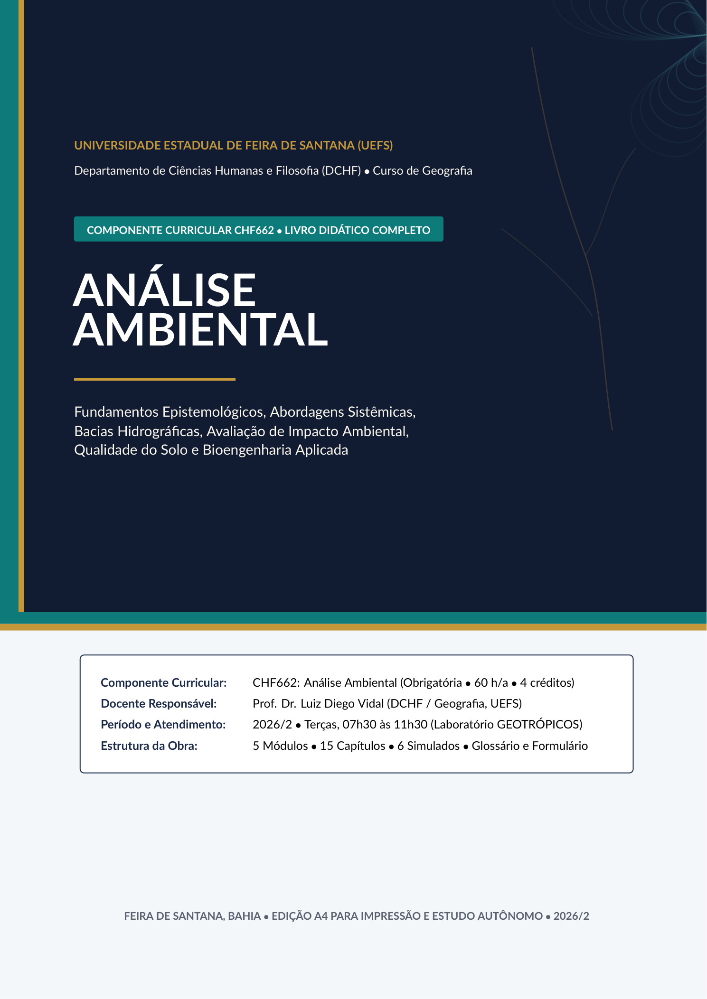

# Apresentação e orientação de estudo {.unnumbered}

{.book-cover fig-alt="Capa da apostila de Análise Ambiental da UEFS"}

[{width="18px" style="vertical-align:-3px; filter: invert(1); margin-right:6px;"} Baixar a apostila em PDF (Versão A4 Diagramada)](../../aulas/analise_ambiental/apostila/APOSTILA_ANALISE_AMBIENTAL_CHF662_UEFS.pdf){.btn .btn-primary target="_blank"}

## A análise ambiental como leitura integrada do território

A análise ambiental investiga como processos físicos, organismos, usos da terra e relações sociais participam da transformação do território. Seu trabalho envolve reconhecer problemas, formular explicações, selecionar dados e justificar decisões. A observação de um processo erosivo exige relacionar chuva, materiais do terreno, circulação da água e formas de ocupação, acompanhando suas consequências sobre ecossistemas e populações.

Esta apostila acompanha o componente **CHF662, Análise Ambiental**, do Curso de Geografia da Universidade Estadual de Feira de Santana, vinculado ao Departamento de Ciências Humanas e Filosofia. O percurso reúne fundamentos epistemológicos, conceitos operacionais e métodos aplicados a bacias hidrográficas, vertentes, solos e áreas degradadas. O Semiárido baiano e os usos múltiplos do Rio São Francisco aproximam esse percurso das situações examinadas em campo.

O objetivo é capacitar o estudante a compreender e aplicar os fundamentos teórico-metodológicos da análise ambiental, integrando componentes físico-bióticos e socioespaciais ao diagnóstico, à interpretação e à proposição de medidas de planejamento, conservação e recuperação. A formação envolve explicar os mecanismos observados, conferir números e unidades, reconhecer limites dos métodos e comunicar os resultados com clareza.

## Organização do conteúdo

Os cinco módulos compreendem 15 capítulos de conteúdo. Os simulados são atividades de revisão e mantêm numeração independente dos capítulos. Ao final, uma avaliação integrada, o formulário técnico, o glossário e as referências apoiam a consulta e a preparação dos produtos da disciplina.

| Módulo | Capítulos | Relação entre os conteúdos |
|:--|:--|:--|
| Fundamentos epistemológicos e conceituais | 1 a 4 | Questão ambiental, relação sociedade-natureza, abordagens geográficas e conceitos que sustentam o diagnóstico. |
| Avaliação de impacto e análise integrada | 5 e 6 | Construção de cenários, comparação de alternativas e relações entre componentes e escalas ambientais. |
| Bacias, vertentes e fragilidade | 7 a 9 | Circulação da água, organização do relevo e dos solos e interpretação da transformação da paisagem. |
| Indicadores, solos e erosão | 10 a 12 | Desenho do monitoramento, avaliação de funções do solo e quantificação da degradação. |
| Bioengenharia, legislação e diagnóstico | 13 a 15 | Seleção de intervenções, enquadramento e elaboração de um diagnóstico ambiental aplicado. |

A ementa articula a questão ambiental contemporânea às abordagens sistêmicas e integradoras, ao planejamento territorial e à bacia hidrográfica como unidade de análise. Inclui avaliação de impacto ambiental, indicadores de qualidade do solo, morfopedologia, fragilidade, vulnerabilidade, risco, bioengenharia de água e solo, legislação e recuperação de áreas degradadas.

## Como desenvolver o estudo

Cada capítulo apresenta dez momentos de aprendizagem. Os objetivos e a retomada dos conhecimentos necessários situam o tema, enquanto a fundamentação teórica desenvolve conceitos, mecanismos e condições de aplicação. Os exemplos resolvidos explicitam dados, unidades, cálculos e interpretação, permitindo acompanhar como uma pergunta é transformada em uma resposta técnica.

A discussão dos erros frequentes ajuda a conferir o raciocínio antes da resolução dos exercícios. As atividades de fixação e as questões autorais no estilo de exames permitem aplicar o conteúdo em situações novas. O gabarito comentado deve ser consultado após a tentativa de resolução, confrontando o método utilizado, o resultado e sua interpretação. A síntese e a verificação final orientam a revisão das dificuldades identificadas.

Nos exemplos numéricos, os valores fornecidos para treinamento representam **dados didáticos**. Resultados de pesquisas são identificados por sua fonte e por suas condições de obtenção. A transferência de um resultado para outra área depende da compatibilidade entre materiais, escala, clima, método e objetivo de análise.

A rotina sugerida combina leitura prévia, participação nas discussões e retomada dos exemplos após a aula. O registro das dúvidas deve indicar onde o raciocínio ficou incompleto, como na escolha de uma variável, na conversão de unidade ou na interpretação de uma hipótese. Esse registro ajuda a dirigir a revisão.

## Avaliação da disciplina

O plano organiza a avaliação por estudos orientados, prova teórica e trabalho prático. Os simulados apoiam o estudo e a autoavaliação. As orientações institucionais e as instruções fornecidas em aula definem as condições das atividades avaliativas.

| Instrumento | Produto e abrangência | Pontos máximos | Participação |
|:--|:--|--:|--:|
| Estudos orientados EO1 a EO4 | Quatro atividades individuais associadas aos textos-base e aos capítulos 2 a 5. Cada atividade vale 0,5 ponto. | 2,0 | 20% |
| Avaliação teórica individual | Prova predominantemente dissertativa, abrangendo os capítulos 1 a 9. | 3,0 | 30% |
| Trabalho prático final | Diagnóstico aplicado, com caracterização, interpretação, indicadores e proposta de intervenção. | 5,0 | 50% |
| Total | Soma dos pontos obtidos nos instrumentos. | 10,0 | 100% |

A nota final resulta da soma das pontuações efetivamente obtidas. Os limites de 0,5 ponto por estudo orientado, 3,0 pontos para a prova e 5,0 pontos para o trabalho evitam a aplicação duplicada de pesos sobre valores já expressos em pontos.

## Cronograma e articulação com o trabalho final

O quadro organiza o percurso temático em 16 entradas semanais do plano. A carga horária do componente é de **60 horas-aula**. A distribuição dos encontros, das avaliações e do campo acompanha o calendário acadêmico e as orientações da disciplina.

| Semana | Tema e leitura | Atividade e produto de estudo |
|--:|:--|:--|
| 1 | Capítulo 1, questão ambiental e Geografia. | Reconhecimento dos problemas e de suas relações territoriais. |
| 2 | Capítulo 2, modernidade e sociedade-natureza. | Estudo orientado EO1. |
| 3 | Capítulo 3, abordagens socioambientais e GTP. | Estudo orientado EO2. |
| 4 | Capítulo 4, conceitos e risco. | Estudo orientado EO3 e revisão do módulo 1. |
| 5 | Capítulo 5, avaliação de impacto ambiental. | Estudo orientado EO4. |
| 6 | Capítulo 6, análise integrada e escalas. | Revisão do módulo 2 e definição preliminar da área do trabalho. |
| 7 | Capítulo 7, bacias e morfometria. | Delimitação da bacia e conferência das medidas e unidades. |
| 8 | Capítulo 8, morfopedologia e vertentes. | Relações entre relevo, solos e circulação da água. |
| 9 | Capítulo 9, geossistemas e fragilidade. | Construção e interpretação de sínteses ambientais. |
| 10 | Revisão dos capítulos 1 a 9. | Avaliação teórica e simulado preparatório do módulo 3. |
| 11 | Capítulo 10, indicadores e campo. | Observação do eixo energético e matriz de monitoramento. |
| 12 | Capítulo 11, qualidade do solo. | Seleção de indicadores e comparação com referência. |
| 13 | Capítulo 12, degradação e erosão. | Quantificação, limites dos modelos e revisão do módulo 4. |
| 14 | Capítulo 13, bioengenharia. | Seleção de intervenções e critérios de acompanhamento. |
| 15 | Capítulo 14, legislação e PRAD. | Enquadramento e metas de recuperação. |
| 16 | Capítulo 15, diagnóstico aplicado. | Integração, apresentação do trabalho e revisão do módulo 5. |

O trabalho final pode examinar uma microbacia, uma encosta, uma margem ou outra unidade justificada pela pergunta de análise. Sua elaboração deve avançar com o estudo, mantendo os dados organizados por fonte, data, unidade e método. As conclusões devem distinguir observação, hipótese e previsão, relacionando cada proposta ao processo que se pretende modificar.

## Fontes, figuras e condições de uso

As imagens utilizam referências da disciplina, o acervo disponibilizado pelo docente e figuras de estudos identificados nas legendas. Imagens externas mantêm créditos e licenças específicas. As versões submetidas de estudos são identificadas como manuscritos.

O texto é disponibilizado sob licença [Creative Commons Atribuição-NãoComercial-CompartilhaIgual 4.0](https://creativecommons.org/licenses/by-nc-sa/4.0/). As licenças próprias das imagens estão indicadas junto às reproduções e no registro de fontes ao final do livro.
