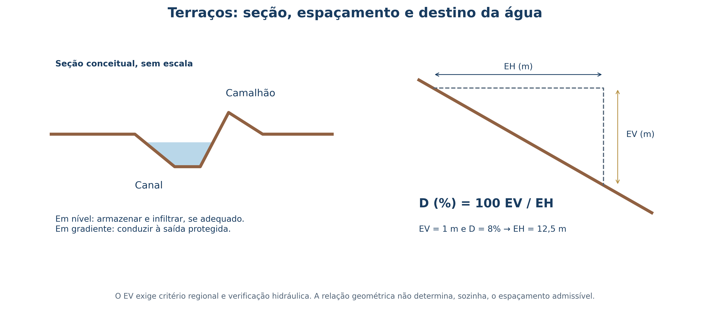
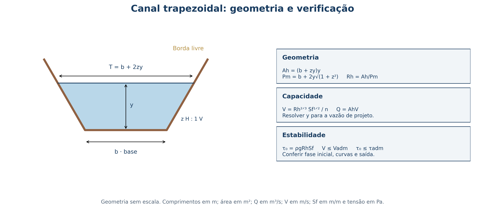

# Planejamento Conservacionista, Terraceamento e Canais Escoadouros {#sec-planejamento-terraceamento}

## Objetivos de aprendizagem

Ao final deste capítulo, o leitor deverá ser capaz de:

1. Medir desníveis e distâncias em campo, calcular a declividade média ponderada de encostas heterogêneas e conferir o fechamento de levantamentos altimétricos;
2. Enquadrar glebas rurais no Sistema de Capacidade de Uso das Terras (Classes I a VIII) utilizando a microbacia hidrográfica como unidade de planejamento;
3. Integrar práticas edáficas, vegetativas (Sistema Plantio Direto, adubação verde, cobertura morta e rotação de culturas) e mecânicas antes de dimensionar obras de terra;
4. Dimensionar o espaçamento vertical ($EV$) e horizontal ($EH$) e a seção transversal de terraços em nível e em gradiente;
5. Dimensionar canais escoadouros vegetados pela equação de Manning, verificando velocidade e tensão trativa admissíveis passo a passo.

## Clinometria e levantamento altimétrico em campo

Todo projeto de manejo e conservação do solo e da água começa pela medição rigorosa do relevo. Em campo, é comum confundir a **declividade em porcentagem ($D\%$)** com o **ângulo de inclinação ($\theta$)** em graus. Embora ambas descrevam a inclinação da superfície em relação à horizontal, suas escalas numéricas são completamente distintas:

$$
D(\%) = 100\,\frac{\Delta z}{L_h} \qquad \theta = \arctan\!\left(\frac{\Delta z}{L_h}\right)
$$ {#eq-declividade}

Na @eq-declividade, $\Delta z$ representa o desnível vertical entre dois pontos e $L_h$ representa a distância horizontal medida entre eles, expressas na mesma unidade de comprimento (metros com metros, ou centímetros com centímetros). Uma encosta em que se sobe $100\text{ m}$ na vertical ao longo de $100\text{ m}$ horizontais apresenta $\theta = 45^\circ$, mas sua declividade é $D = 100\%$, e não $45\%$. Quando uma rampa de $100\text{ m}$ apresenta $8\text{ m}$ de desnível, tem-se $D = 8\%$ e $\theta = \arctan(0{,}08) \approx 4{,}57^\circ$.

Em terrenos agrícolas reais, a inclinação raramente é uniforme do topo ao sopé. Um erro frequente consiste em medir três ou quatro segmentos de encosta de comprimentos diferentes e calcular a média aritmética simples das porcentagens. O procedimento fisicamente correto consiste em ponderar cada segmento pelo seu comprimento horizontal, dividindo o desnível acumulado pela distância horizontal total:

$$
D_{\mathrm{média}}(\%) = 100\,\frac{\sum_{i=1}^{n} \Delta z_i}{\sum_{i=1}^{n} L_{h,i}}
$$ {#eq-declividade-media}

::: {.callout-tip}
## Exemplo resolvido 1: Declividade média e cálculo de campo com nível de mangueira
Um levantamento com **nível de mangueira** foi executado em quatro lances consecutivos descendo uma vertente, registrando-se as leituras nas réguas de montante ($L_{\mathrm{mont}}$) e de jusante ($L_{\mathrm{jus}}$) e as respectivas distâncias horizontais ($L_{h,i}$):

- Lance 1 ($L_{h,1} = 12\text{ m}$): $L_1 = 32{,}0\text{ cm}$, $L_2 = 23{,}0\text{ cm} \implies \Delta z_1 = 32{,}0 - 23{,}0 = 9{,}0\text{ cm}$;
- Lance 2 ($L_{h,2} = 8\text{ m}$): $L_3 = 38{,}0\text{ cm}$, $L_4 = 21{,}0\text{ cm} \implies \Delta z_2 = 38{,}0 - 21{,}0 = 17{,}0\text{ cm}$;
- Lance 3 ($L_{h,3} = 11\text{ m}$): $L_5 = 28{,}0\text{ cm}$, $L_6 = 19{,}8\text{ cm} \implies \Delta z_3 = 28{,}0 - 19{,}8 = 8{,}2\text{ cm}$;
- Lance 4 ($L_{h,4} = 15\text{ m}$): $L_7 = 25{,}9\text{ cm}$, $L_8 = 22{,}3\text{ cm} \implies \Delta z_4 = 25{,}9 - 22{,}3 = 3{,}6\text{ cm}$.

Somando os desníveis no mesmo sentido, obtém-se $\sum \Delta z_i = 9{,}0 + 17{,}0 + 8{,}2 + 3{,}6 = 37{,}8\text{ cm} = 0{,}378\text{ m}$. A distância horizontal total é $\sum L_{h,i} = 12 + 8 + 11 + 15 = 46{,}0\text{ m}$. Aplicando a @eq-declividade-media:

$$
D_{\mathrm{média}} = 100 \times \frac{0{,}378}{46{,}0} = 0{,}822\%
$$

Caso o mesmo levantamento tivesse sido feito com um **pé-de-galinha** de abertura fixa igual a $3{,}0\text{ m}$ em seis lances consecutivos, registrando desníveis individuais de $4, 8, 5, 10, 8$ e $7\text{ cm}$, teríamos $\sum \Delta z_i = 42\text{ cm} = 0{,}42\text{ m}$ em $L_h = 6 \times 3{,}0 = 18{,}0\text{ m}$, resultando em $D = 100 \times (0{,}42/18{,}0) = 2{,}33\%$.
:::

A escolha do instrumento depende diretamente da tolerância do projeto (@tbl-instrumentos-topografia). Pequenos erros de leitura que são aceitáveis ao locar uma faixa de capim-vetiver em nível podem inviabilizar um **terraço em gradiente** de $0{,}3\%$, invertendo a declividade do canal e causando acúmulo localizado de água seguido de rompimento do camalhão.

| Equipamento | Aplicação Principal | Cuidado Crítico de Calibração e Operação |
|:---|:---|:---|
| **Pé-de-galinha (nível tipo A)** | Locação de curvas em nível e cordões vegetativos | Calibrar por inversão dos apoios nos mesmos dois pontos; a referência real de nível é o ponto médio entre as duas marcas |
| **Nível de mangueira** | Transferência de cotas e declividades suaves em campo | Eliminar completamente bolhas de ar, evitar dobras e aguardar a estabilização dos meniscos antes da leitura |
| **Clinômetro** | Reconhecimento expedito da declividade de encostas | Manter visada paralela ao terreno usando alvo na mesma altura do olho do observador |
| **Nível óptico ou laser** | Locação de terraços em gradiente ($0{,}2\text{--}0{,}5\%$) e canais escoadouros | Verificar nivelamento da bolha e executar contranivelamento de fechamento ao retornar ao ponto de partida |
| **Estação total / GNSS-RTK** | Levantamento planialtimétrico completo de microbacias e projetos executivos | Garantir amarração a marcos de referência e correção diferencial adequada |

: Seleção de equipamentos topográficos conforme a finalidade conservacionista. {#tbl-instrumentos-topografia .striped .hover}

## Capacidade de uso das terras e planejamento em microbacias

Na Engenharia Agronômica, não se projeta a conservação do solo talhão por talhão de forma isolada. A unidade territorial correta de planejamento é a **microbacia hidrográfica**, pois a água da chuva desconhece divisas de cercas e carreadores: o escoamento gerado em uma estrada rural mal drenada no terço superior da bacia destrói terraços e abre voçorocas nas lavouras situadas a jusante.

Dentro da microbacia, cada gleba deve ser enquadrada segundo o **Sistema de Capacidade de Uso das Terras** (Classes I a VIII), que hierarquiza os solos conforme suas limitações permanentes de declividade, profundidade efetiva, drenagem, pedregosidade e susceptibilidade à erosão (@tbl-capacidade-uso). O princípio fundamental é ajustar a intensidade de uso à capacidade natural de sustentação do terreno, evitando exigir de um solo raso ou muito declivoso um cultivo anual intensivo que o degradará em poucos ciclos.

| Grupo | Classes | Características e Limitações Dominantes | Práticas Conservacionistas Indicadas |
|:---|:---|:---|:---|
| **A** | **I e II** | Solos profundos, bem drenados, relevo plano a suave ondulado ($D < 6\%$), baixa erodibilidade | Práticas edáficas e vegetativas (SPD, rotação de culturas, adubação verde, cultivo em contorno) |
| **A** | **III e IV** | Declividade moderada a forte ($6\text{--}20\%$), gradiente textural ($A/Bt$) ou risco erosivo elevado | Associação obrigatória de SPD + **terraceamento e canais escoadouros vegetados** |
| **B** | **V, VI e VII** | Limitações severas de declividade ($> 20\%$), pedregosidade, afloramentos ou drenagem restrita | Pastagens permanentes bem manejadas, silvicultura, sistemas agroflorestais, **cordões vegetativos** |
| **C** | **VIII** | Escarpas, solos muito rasos, várzeas alagáveis e Áreas de Preservação Permanente (APPs) | Preservação integral da vegetação nativa, **PRAD e estabilização biotécnica** |

: Enquadramento de terras no Sistema de Capacidade de Uso (Classes I–VIII) e diretrizes conservacionistas. {#tbl-capacidade-uso .striped .hover}

## Práticas edáficas e vegetativas na base do sistema

Um erro recorrente em projetos conservacionistas consiste em iniciar o planejamento pelas obras de terra (práticas mecânicas) e negligenciar a superfície do solo. Terraços e canais escoadouros atuam sobre o **escoamento superficial já formado**; eles não impedem o impacto direto da gota de chuva (*splash*), que destrói os agregados superficiais, entope os poros e reduz a taxa de infiltração. Por isso, as práticas mecânicas devem sempre atuar em conjunto com duas linhas de defesa prévias:

1. **Práticas edáficas:** conjunto de intervenções que melhoram a estrutura, a estabilidade de agregados e a fertilidade do perfil. A **calagem** eleva o pH e fornece $\text{Ca}^{2+}$ e $\text{Mg}^{2+}$, favorecendo o crescimento radicular e a atividade microbiana; a **gessagem** ($\text{CaSO}_4\cdot 2\text{H}_2\text{O}$) leva cálcio em profundidade para neutralizar alumínio tóxico e flocular argilas dispersas (especialmente em solos sódicos do Semiárido); a **adubação orgânica** fornece carbono lábil para cimentação biológica dos agregados; e a **descompactação mecânica** (escarificação ou subsolagem em condição friável) rompe camadas adensadas diagnosticadas ($RP > 2{,}0\text{ MPa}$), sendo sempre seguida pelo plantio de espécies de raízes agressivas (*bioporing*) para estabilizar os novos poros.
2. **Práticas vegetativas:** conjunto de estratégias que mantêm o solo permanentemente coberto por dossel vivo ou palhada. O **Sistema Plantio Direto (SPD)** — apoiado no não revolvimento do solo, na rotação de culturas e na manutenção de cobertura morta ($\ge 70\%$ da superfície) — intercepta a energia cinética das gotas de chuva antes que atinjam o solo e reduz o fator $C$ da RUSLE em mais de $90\%$. Associam-se ao SPD a **adubação verde** (consórcio de leguminosas fixadoras de nitrogênio com gramíneas de alta relação C/N para persistência da palhada), o **cultivo em contorno** (preparo e semeadura seguindo as curvas de nível), as **faixas de retenção** e os **quebra-ventos** contra a erosão eólica.

## Terraceamento agrícola: tipos, espaçamento e seção

Quando a intensidade das chuvas tropicais excede a capacidade de infiltração mesmo sob manejo conservacionista da superfície, torna-se necessário implantar **terraços**. Um terraço agrícola é uma estrutura formada por um **canal (corte)** e um **camalhão ou dique (aterro)** construídos transversalmente ao declive da encosta, cuja função primordial é **fragmentar o comprimento de rampa ($L$)** (@fig-terraceamento-bs). Ao interromper o percurso livre da enxurrada em intervalos regulares, o terraço impede que a lâmina escoada ganhe profundidade e velocidade suficientes para ultrapassar a tensão cisalhante crítica do solo ($\tau_c$) e abrir sulcos.

{#fig-terraceamento-bs fig-alt="Esquema de espaçamento vertical e horizontal e seção transversal de terraço agrícola" width="94%"}

### Seleção do tipo de terraço

Quanto ao destino hidráulico da água interceptada, distinguem-se dois tipos principais:

- **Terraços em nível (de absorção ou retenção):** construídos com cota zero ao longo do eixo longitudinal e extremidades bloqueadas. Retêm todo o volume de enxurrada gerado na faixa a montante para que infiltre gradualmente no canal. São indicados para solos profundos e de alta permeabilidade (como Latossolos bem estruturados), contribuindo diretamente para a recarga hídrica no Semiárido e no Cerrado.
- **Terraços em gradiente (de drenagem ou escoamento):** construídos com declividade longitudinal controlada de $0{,}2\%$ a $0{,}5\%$ em direção a uma extremidade aberta conectada a um **canal escoadouro vegetado**. São obrigatórios em solos com baixa permeabilidade subsuperficial, horizonte $Bt$ adensado ou mudança textural abrupta (como Argissolos, Planossolos e Luvissolos) e em regiões de chuvas muito concentradas, onde o armazenamento em nível provocaria saturação, perda de coesão e ruptura do camalhão.

### Cálculo do espaçamento entre terraços

O **espaçamento vertical ($EV$)** é o desnível, em metros, entre dois terraços consecutivos; o **espaçamento horizontal ($EH$)** é a distância medida em planta entre eles. Pela equação clássica de Bentley/IAC, amplamente empregada no Brasil:

$$
EV = \left(\frac{D}{X} + 2\right) \times 0{,}305 \qquad EH = \frac{EV \times 100}{D}
$$ {#eq-espacamento-terracos}

onde $D$ é a declividade média do terreno ($\%$) e $X$ é um fator adimensional que reflete a resistência do solo à erosão e o nível de proteção conferido pelo manejo (variando de $2{,}0$ para solos muito erodíveis e preparo convencional até $4{,}0\text{--}4{,}5$ para solos profundos sob plantio direto). Métodos hidrodinâmicos mais recentes, como o de Pruski (UFV), determinam $EH$ igualando a tensão ou energia do escoamento ao limite crítico de incisão em sulcos do solo local.

::: {.callout-tip}
## Exemplo resolvido 2: Espaçamento e verificação de armazenamento de terraço
Considere uma rampa agrícola com comprimento total de $200\text{ m}$ e declividade uniforme $D = 10\%$, em solo de média resistência sob preparo conservacionista ($X = 3{,}5$).

1. **Espaçamento vertical e horizontal:**
   $$EV = \left(\frac{10}{3{,}5} + 2\right) \times 0{,}305 = (2{,}857 + 2) \times 0{,}305 = 1{,}48\text{ m}$$
   $$EH = \frac{1{,}48 \times 100}{10} = 14{,}8\text{ m}$$
2. **Número de terraços na rampa:** $N = 200 / 14{,}8 \approx 13{,}5 \implies$ adotam-se **14 terraços** ao longo da encosta, locados a partir do ponto mais alto do terreno.
3. **Verificação da seção em nível:** se a lâmina máxima de escoamento gerada pela chuva de projeto (via NRCS-CN) for $P_e = 35\text{ mm}$ ($0{,}035\text{ m}$), o volume gerado por metro linear de terraço é $V_{\mathrm{m}} = P_e \times EH = 0{,}035 \times 14{,}8 = 0{,}518\text{ m}^3\text{ m}^{-1}$. Logo, a área útil da seção transversal do canal do terraço deve ser $A_{\mathrm{útil}} \ge 0{,}52\text{ m}^2$, mantendo-se uma **borda livre mínima ($f \ge 0{,}15\text{ m}$)** acima do nível máximo d'água após o recalque do aterro.
:::

## Canais escoadouros vegetados: dimensionamento por Manning

Os **canais escoadouros vegetados** são canais rasos e largos, revestidos com gramíneas estoloníferas ou rizomatosas densas (como grama-batatais *Paspalum notatum*, capim-estrela *Cynodon* spp. ou quicuio *Pennisetum clandestinum*), projetados para receber a água descarregada pelos terraços em gradiente e conduzi-la com segurança até um talvegue estável. À medida que o canal avança encosta abaixo e intercepta sucessivos terraços, a vazão acumulada cresce progressivamente ($Q_i = \sum C I A_i / 360$), exigindo que a largura da base menor ($b_i$) da seção trapezoidal aumente de montante para jusante (@fig-canal-escoadouro-bs).

{#fig-canal-escoadouro-bs fig-alt="Seção trapezoidal de canal escoadouro e gráfico de escalonamento de vazão" width="94%"}

Para uma seção trapezoidal com base menor $b$ ($\text{m}$), lâmina d'água $h$ ($\text{m}$) e inclinação dos taludes $Z:1$ ($Z$ metros na horizontal para $1\text{ m}$ na vertical; usualmente $Z \ge 2$ para facilitar o trânsito de máquinas e a estabilidade lateral), os parâmetros geométricos são:

$$
A_h = (b + Z h)h \qquad P_m = b + 2h\sqrt{1 + Z^2} \qquad R_h = \frac{A_h}{P_m}
$$ {#eq-geometria-canal}

onde $A_h$ é a área molhada ($\text{m}^2$), $P_m$ é o perímetro molhado ($\text{m}$) e $R_h$ é o raio hidráulico ($\text{m}$). Pela equação da continuidade ($Q = A_h V$) e pela equação de Manning, a velocidade média de escoamento ($V$) e a tensão trativa média exercida pela água sobre o leito ($\tau_0$) devem atender simultaneamente aos limites admissíveis do revestimento vivo:

$$
V = \frac{1}{n} R_h^{2/3} S_f^{1/2} \le V_{\mathrm{adm}} \qquad \tau_0 = \rho g R_h S_f \le \tau_{\mathrm{adm}}
$$ {#eq-manning-tensao}

onde $n$ é o coeficiente de rugosidade de Manning (tabelado por classe de retardância da vegetação no USDA-NRCS; tipicamente $0{,}04$ a $0{,}10$), $S_f$ é a declividade longitudinal do canal ($\text{m m}^{-1}$), $\rho = 1000\text{ kg m}^{-3}$ é a massa específica da água e $g = 9{,}81\text{ m s}^{-2}$.

::: {.callout-tip}
## Exemplo resolvido 3: Verificação hidráulica completa em Planossolo (8 ha)
Considere um talhão de $400 \times 200\text{ m}$ ($A = 8{,}0\text{ ha}$) cultivado com milho em sucessão com feijão sobre **Planossolo Háplico Eutrófico vértico** ($71\%$ de silte na camada superficial e horizonte $Bt$ adensado), declividade do terreno $D = 8\%$, chuva de projeto $I = 190\text{ mm h}^{-1}$ ($TR = 5\text{ anos}$) e coeficiente de escoamento $C = 0{,}58$. O canal escoadouro acompanha um trecho com declividade $S_f = 6\% = 0{,}06\text{ m m}^{-1}$ e será revestido com gramíneas de densidade média ($V_{\mathrm{adm}} = 1{,}35\text{ m s}^{-1}$; $n = 0{,}08$ em estande estabelecido).

1. **Vazão de projeto na saída do canal (Método Racional):**
   $$Q_p = \frac{C \cdot I \cdot A}{360} = \frac{0{,}58 \times 190 \times 8{,}0}{360} = 2{,}45\text{ m}^3\text{ s}^{-1}$$
2. **Pré-dimensionamento pela velocidade admissível:**
   $$A_{\min} = \frac{Q_p}{V_{\mathrm{adm}}} = \frac{2{,}45}{1{,}35} = 1{,}81\text{ m}^2$$
3. **Teste de uma seção trapezoidal inicial ($b = 4{,}0\text{ m}$, $h = 0{,}65\text{ m}$, $Z = 2$):**
   - $A_h = (4{,}0 + 2 \times 0{,}65) \times 0{,}65 = 3{,}445\text{ m}^2$;
   - $P_m = 4{,}0 + 2 \times 0{,}65 \times \sqrt{1 + 2^2} = 4{,}0 + 1{,}30 \times 2{,}236 = 6{,}907\text{ m}$;
   - $R_h = 3{,}445 / 6{,}907 = 0{,}499\text{ m}$.
   Aplicando a equação de Manning (@eq-manning-tensao):
   $$V = \frac{1}{0{,}08} (0{,}499)^{2/3} (0{,}06)^{1/2} = 12{,}5 \times 0{,}629 \times 0{,}2449 = 1{,}93\text{ m s}^{-1}$$
   E a tensão trativa no leito será:
   $$\tau_0 = 1000 \times 9{,}81 \times 0{,}499 \times 0{,}06 = 293{,}7\text{ Pa}$$
   **Diagnóstico crítico:** $V = 1{,}93\text{ m s}^{-1} > V_{\mathrm{adm}} = 1{,}35\text{ m s}^{-1}$ (e $\tau_0 \approx 294\text{ Pa}$ excede a resistência de gramíneas em solo siltoso!). A seção **não atende** com declividade de $6\%$ e lâmina de $0{,}65\text{ m}$, pois o canal entraria em erosão severa.
4. **Soluções de engenharia para adequar o projeto:**
   - **Alternativa A (Alargar a base e reduzir a lâmina):** mantendo $S_f = 6\%$, ao adotar seção muito rasa e larga ($b = 8{,}5\text{ m}$, $h = 0{,}25\text{ m}$, $Z = 2$), tem-se $A_h = 2{,}25\text{ m}^2$, $P_m = 9{,}62\text{ m}$ e $R_h = 0{,}234\text{ m}$, reduzindo a velocidade para $V = \frac{1}{0{,}10}(0{,}234)^{2/3}(0{,}06)^{1/2} = 0{,}93\text{ m s}^{-1} < 1{,}35\text{ m s}^{-1}$ (com revestimento denso $n = 0{,}10$);
   - **Alternativa B (Escalonamento com soleiras dissipadoras):** reduzir a declividade efetiva entre trechos de $S_f = 6\%$ para $S_f = 1\%\text{ a }1{,}5\%$ por meio de **degraus ou soleiras de pedra/madeira** espaçadas ao longo do canal, abatendo simultaneamente $V$ e $\tau_0$ sem exigir faixas excessivamente largas no terreno.
   - Em qualquer alternativa, adiciona-se **borda livre de $0{,}20\text{ m}$** ($H_{\mathrm{total}} = h + 0{,}20\text{ m}$) e só se conectam os terraços ao canal **após o pleno fechamento do tapete de gramíneas**.
:::

::: {.callout-tip}
## Questões para estudo
1. Por que o uso de terraços em nível é contraindicado em Planossolos e Argissolos com mudança textural abrupta, mesmo em declividades moderadas?
2. Calcule o espaçamento vertical ($EV$) e horizontal ($EH$) pelo método de Bentley/IAC para uma encosta com $D = 12\%$ e fator $X = 3{,}0$. Quantos terraços são necessários em uma rampa de $250\text{ m}$?
3. No Exemplo Resolvido 3, demonstre numericamente qual seria a nova velocidade média ($V$) e a nova tensão trativa ($\tau_0$) caso a declividade do canal ($b = 4{,}0\text{ m}$, $h = 0{,}65\text{ m}$, $Z = 2$, $n = 0{,}08$) fosse reduzida de $6\%$ para $1\%$ por meio de soleiras dissipadoras.
:::
