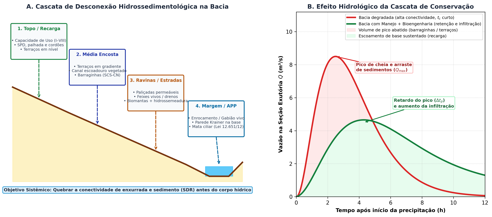

# Bioengenharia de Água na Escala da Bacia {#sec-bioengenharia-agua}

::: {.callout-note}
## Objetivos de aprendizagem
Ao final deste capítulo, o leitor deverá ser capaz de interpretar a conectividade hidrossedimentológica como variável de projeto e justificar a desconexão controlada como objetivo da intervenção, posicionar cada técnica na cascata que vai da área de contribuição à margem do curso d'água, estimar o tempo de concentração e a vazão de projeto que alimentam o dimensionamento hidráulico das estruturas, selecionar técnicas de estabilização de margens por zona de solicitação hidrodinâmica, reconhecer os indicadores de desempenho hídrico que devem compor o monitoramento, e identificar os instrumentos de governança por bacia que viabilizam o financiamento das intervenções.
:::

## Da feição isolada à bacia

As técnicas apresentadas nas partes anteriores tratam feições individuais, sejam vertentes, ravinas, taludes ou margens. A eficácia hidrológica da intervenção, porém, é determinada na escala da bacia, porque o escoamento que chega a uma feição foi gerado a montante e o sedimento que escapa dela será entregue a jusante. Deslocar a análise para a bacia converte o projeto de bioengenharia em instrumento de manejo da conectividade entre fontes de sedimento e corpos receptores, perspectiva que organiza este capítulo.

A diferença de escala altera também o indicador de sucesso. Em uma ravina, o indicador é a estabilização morfológica da feição, medida por taxa de recuo de cabeceira e por volume retido. Na bacia, o indicador é a redução da carga sólida e do pico de vazão no exutório, grandezas que respondem ao arranjo espacial do conjunto de intervenções, com o desempenho de cada estrutura isolada contribuindo apenas em parte [@keesstra_et_al_2019].

## Conectividade hidrossedimentológica como variável de projeto

A conectividade hidrossedimentológica descreve o grau de ligação funcional entre as áreas que produzem sedimento e os pontos que o recebem, abrangendo tanto os caminhos de escoamento superficial quanto os canais que concentram a descarga. Feições erosivas lineares operam como conectores de alta eficiência, porque convertem escoamento difuso em feixe concentrado e transportam material por distâncias muito superiores às alcançadas em escoamento laminar [@frankl_et_al_2021].

A fração do material mobilizado na bacia que efetivamente alcança o exutório é quantificada pela razão de aporte de sedimentos:

$$
SDR = \frac{Y}{E}
$$ {#eq-sdr}

onde $Y$ é a produção de sedimentos medida no exutório (t ha^-1^ ano^-1^) e $E$ é a erosão bruta estimada para a área de contribuição pela mesma unidade, conforme a RUSLE apresentada em @sec-erosao. Valores de $SDR$ próximos da unidade indicam bacia fortemente conectada, na qual quase todo o material destacado é entregue, enquanto valores baixos revelam armazenamento interno em depressões, planícies e trechos de baixa declividade.

::: {.callout-important}
## Desconexão controlada como objetivo
O propósito hidrológico das técnicas de bioengenharia é reduzir a conectividade sem interromper o fluxo, condição que diferencia a desconexão controlada do barramento. Barreiras transversais permeáveis em talvegues, bacias de captação em estradas e cordões vegetativos em vertentes criam armazenamento distribuído e aumentam a rugosidade do caminho hidráulico, elevando o tempo de trânsito e reduzindo a fração entregue a jusante [@galia_et_al_2022]. A interrupção total do fluxo, por outro lado, transfere o problema para o primeiro evento que exceda a capacidade da estrutura, quando a ruptura entrega de uma só vez o material acumulado.
:::

## A cascata de intervenções

A posição da intervenção na cascata determina a natureza da solicitação e, portanto, o critério de dimensionamento aplicável (@tbl-cascata). A leitura da tabela em sentido descendente reproduz a trajetória de uma gota de chuva, do ponto de impacto até a margem do curso d'água receptor.

| Posição na cascata | Solicitação dominante | Critério de dimensionamento | Técnicas |
|---|---|---|---|
| Área de contribuição | Geração de escoamento por excesso de infiltração | Velocidade de infiltração básica e curva-número | Cobertura vegetal, hidrossemeadura (@sec-hidrossemeadura), biomantas (@sec-biomantas) |
| Vertente | Comprimento de rampa e velocidade do escoamento difuso | Espaçamento por declividade e altura de barreira | Cordões vegetativos e fascinas (@sec-cordoes-fascinas), feixes vivos (@sec-feixes-drenos) |
| Estrada e caminho concentrador | Volume de enxurrada interceptado | Volume de retenção por evento de projeto | Bacias de captação e barraginhas (@sec-bacias-captacao) |
| Talvegue de feição linear | Tensão cisalhante de leito | Altura efetiva, declividade de compensação e espaçamento | Paliçadas permeáveis (@sec-palicadas-protocolo) |
| Canal de condução | Vazão de projeto e tensão trativa admissível | Equação de Manning e tensão admissível do revestimento vivo | Canaletas verdes (@sec-canaleta-verde) |
| Margem fluvial | Solicitação hidrodinâmica permanente e variação de nível | Estabilidade de talude submerso e resistência ao arraste | Enrocamento vegetado (@sec-enrocamento), gabião vivo (@sec-gabiao-vivo), biotêxteis (@sec-biotexteis) |

: Cascata hidrossedimentológica, com a solicitação dominante, o critério de dimensionamento e as técnicas correspondentes a cada posição. {#tbl-cascata .striped .hover}

{#fig-cascata-bacia fig-alt="Cascata de intervenções na bacia hidrográfica e hidrograma comparativo" width="94%"}

## Vazão de projeto e lâmina de dimensionamento

O dimensionamento hidráulico das estruturas depende da vazão de projeto associada a um período de retorno, cuja estimativa encadeia três etapas. A primeira é a determinação do tempo de concentração da área de contribuição, intervalo necessário para que a contribuição mais distante alcance a seção de interesse, estimado para pequenas bacias rurais pela expressão de Kirpich:

$$
t_c = 0{,}0195 \left( \frac{L^3}{H} \right)^{0{,}385}
$$ {#eq-kirpich}

onde $t_c$ é o tempo de concentração (min), $L$ é o comprimento do talvegue principal (m) e $H$ é o desnível entre a cabeceira e a seção de controle (m). A estrutura da @eq-kirpich informa que o tempo de concentração responde mais ao comprimento do caminho hidráulico que ao desnível, razão pela qual intervenções que aumentam a sinuosidade e a rugosidade do percurso elevam $t_c$ e reduzem o pico de vazão sem alterar o volume escoado.

A segunda etapa converte a intensidade da chuva de projeto, obtida de curvas de intensidade, duração e frequência locais para duração igual a $t_c$, em vazão de pico pelo método da curva-número apresentado em @sec-erosao. A terceira etapa converte a vazão em lâmina e raio hidráulico por fórmula de resistência ao escoamento, com coeficiente de rugosidade compatível com a condição de superfície do leito, procedimento detalhado em @sec-canaleta-verde para canais de condução e aplicável ao leito de feições lineares.

::: {.callout-warning}
## A lacuna hidrológica mais comum em projetos de bioengenharia
Grande parte das intervenções documentadas adota lâminas de referência arbitradas, sem derivá-las da vazão de projeto, prática que compromete a comparabilidade entre sítios e impede a verificação do período de retorno efetivamente atendido. A limitação aparece declarada no protocolo de paliçadas de @sec-palicadas-protocolo e deve ser tratada como pendência metodológica em projetos que pretendam sustentar afirmações quantitativas de desempenho.
:::

## Bioengenharia de margens fluviais

Margens de cursos d'água impõem condição de contorno distinta das vertentes, porque a solicitação hidrodinâmica é permanente, o nível de água oscila e a zona submersa permanece saturada. O projeto organiza-se por zonas de solicitação, cada uma com técnica e material compatíveis (@tbl-zonas-margem).

| Zona | Condição hidráulica | Técnica recomendada |
|---|---|---|
| Submersa, abaixo do nível mínimo | Arraste permanente e saturação contínua | Enrocamento vegetado com pedra dimensionada por estabilidade ao arraste (@sec-enrocamento) |
| Variação de nível | Ciclos de molhamento e secagem, ondas e esteira de embarcações | Biotêxteis e geotêxteis naturais ancorados, com estacas vivas (@sec-biotexteis) |
| Talude superior | Escoamento superficial da vertente e salpico | Revegetação com espécies ripárias e geotêxteis híbridos (@sec-geotexteis) |
| Crista e faixa ripária | Infiltração e aporte difuso de nutrientes | Faixa tampão vegetada com espécies arbóreas nativas |

: Zonação da margem fluvial por condição hidráulica e técnicas correspondentes. {#tbl-zonas-margem .striped .hover}

A erosão marginal acelerada no Baixo São Francisco ilustra a necessidade dessa zonação. A alteração do regime hidrológico natural pela operação de barragens reduziu a frequência de cheias formadoras e expôs margens arenosas de baixa coesão a flutuações de nível não sazonais, condição em que a associação de enrocamento vegetado na linha d'água, biotêxteis de taboa na zona de variação de nível e geotêxteis no talude superior reduziu a taxa de recuo marginal, conforme monitoramento topográfico por GNSS em levantamentos semestrais [@antonio_2021_avaliacao_de_eficiencia_da_; @fontes_2021_erosion_control_with_geotext; @holanda_et_al_2021]. A alteração do regime de vazões e do aporte sedimentar modifica a geometria de equilíbrio do canal, de modo que intervenções pontuais em margens precisam ser lidas contra a trajetória de ajuste do sistema fluvial [@grabowski_et_al_2011].

## Bacias intermitentes do semiárido

O regime intermitente muda o que significa projetar para a bacia. Em cursos d'água que só correm durante e logo após os eventos de maior intensidade, a produção de sedimento não se distribui ao longo do ano, e sim se concentra nas poucas horas em que o canal conduz água, de modo que a série temporal de aporte é fortemente assimétrica e a eficiência de uma estrutura de retenção precisa ser avaliada contra os eventos extremos, e não contra a média anual. A mesma assimetria explica por que a ravina do semiárido avança por saltos, permanecendo estável durante meses e recuando metros em uma única chuva, comportamento que já aparece na resposta chuva-sedimento discutida em @sec-palicadas-execucao.

O dano que organiza a prioridade de intervenção no sertão é o assoreamento dos reservatórios. A água armazenada em açudes é o recurso que sustenta abastecimento, dessedentação animal e irrigação no período seco, e cada metro cúbico de sedimento depositado no reservatório é um metro cúbico de água que deixa de ser armazenado. Como o volume útil perdido não se recupera sem obra de desassoreamento, de custo muito superior ao da contenção a montante, a retenção de sedimento na vertente e nos canais afluentes passa a ter valor hídrico direto, e não apenas conservacionista. O açude de Cocorobó, no Vaza-Barris, e os reservatórios do médio São Francisco em território baiano recebem a carga produzida em terrenos cristalinos rasos, onde a lâmina escoada encontra pouca capacidade de infiltração e muita superfície desprotegida no fim da estação seca.

A cascata de intervenções apresentada acima se traduz, nesse contexto, em uma sequência de prioridades que começa longe do reservatório. Bacias de captação em estradas rurais interceptam o escoamento concentrado antes que ele atinja a cabeceira das ravinas, paliçadas permeáveis instaladas nos canais afluentes retêm a fração grosseira e elevam o nível de base local, e faixas ripárias vegetadas filtram o aporte difuso que chega à zona de flutuação do nível do reservatório. A ordem importa porque a estrutura instalada junto ao espelho d'água recebe a carga integral da bacia e falha por colmatação em poucos eventos quando a montante permanece sem tratamento.

A condição interestadual dessas duas bacias também tem consequência prática de governança. Tanto o São Francisco quanto o Vaza-Barris nascem ou percorrem o sertão baiano e desaguam em Sergipe, de modo que a decisão de intervenção tomada a montante altera o aporte sedimentar que chega ao estado vizinho, e os instrumentos de financiamento por bacia discutidos adiante operam sobre um território que não coincide com a divisa administrativa.

## Retenção, infiltração e amortecimento de cheias

A função hidrológica das estruturas de bioengenharia abrange, além do controle de sedimentos, a recomposição parcial da capacidade de armazenamento da paisagem. Bacias de captação implantadas em estradas rurais interceptam o escoamento antes que ele atinja velocidades erosivas e promovem infiltração por evento, convertendo escoamento superficial em recarga, conforme o dimensionamento apresentado em @sec-bacias-captacao. Drenos verdes e canaletas vegetadas conduzem a vazão interceptada com tensão trativa inferior à admissível do revestimento vivo, mantendo a condução sem gerar nova feição erosiva (@sec-canaleta-verde).

O efeito agregado dessas estruturas sobre o hidrograma manifesta-se pelo amortecimento do pico e pelo retardo do tempo de resposta, ambos consequência do aumento do armazenamento distribuído e da rugosidade do caminho hidráulico. O volume escoado reduz-se na proporção da fração infiltrada, enquanto o pico reduz-se também pelo efeito de dessincronização entre as contribuições das sub-bacias, mecanismo que confere ao arranjo espacial das intervenções importância comparável à do dimensionamento individual de cada uma.

## Qualidade da água e faixas tampão

A retenção de sedimento a montante das estruturas remove simultaneamente os nutrientes e os agroquímicos adsorvidos às partículas finas, de modo que o controle da erosão opera como medida de proteção da qualidade da água. Faixas tampão vegetadas na interface entre a área de produção e o corpo receptor completam esse controle, atuando sobre a fração dissolvida por absorção radicular e por transformação microbiológica na camada superficial do solo.

O desempenho da faixa tampão depende da manutenção do escoamento em regime difuso ao longo de toda a sua largura, condição que se perde quando o fluxo se concentra em caminhos preferenciais e atravessa a faixa em poucos metros. Essa dependência explica por que faixas tampão e técnicas de fragmentação de rampa a montante são complementares, uma vez que a segunda preserva a condição hidráulica que a primeira exige para funcionar.

## Indicadores de desempenho hídrico

O monitoramento na escala da bacia acrescenta variáveis hidrológicas aos indicadores morfológicos tratados em @sec-classificacao-feicoes e em @sec-palicadas-execucao. A seleção mínima combina medição de vazão em seção de controle, concentração de sedimentos em suspensão por turbidez calibrada contra amostragem gravimétrica, nível de água em poços de observação para verificar a resposta de recarga, e precipitação registrada na própria área de contribuição, sem a qual nenhuma das demais séries pode ser interpretada.

A combinação dessas séries permite construir a relação entre chuva e resposta hidrossedimentológica, cuja comparação entre períodos anterior e posterior à intervenção fornece a evidência de desempenho. Na ausência de período de referência pré-intervenção, o delineamento com sub-bacia controle de uso e relevo equivalentes substitui a comparação temporal, arranjo preferível quando a variabilidade interanual da precipitação é elevada, situação corrente em climas tropicais sazonais.

## Governança por bacia, marco legal e instrumentos de financiamento

A escala de bacia é também a escala institucional e jurídica da gestão ambiental e hídrica brasileira. Do ponto de vista da política de águas, a Política Nacional de Recursos Hídricos, instituída pela Lei nº 9.433/1997, estabelece a bacia hidrográfica como unidade territorial de planejamento e cria os comitês de bacia como instância deliberativa, fórum no qual projetos de conservação de solo e água competem por recursos (como os provenientes da cobrança pelo uso da água) e obtêm respaldo institucional. Em complemento, a Política Nacional de Pagamento por Serviços Ambientais, instituída pela Lei nº 14.119/2021, fornece o instrumento econômico de remuneração de práticas conservacionistas, incluindo o controle de erosão por bioengenharia e a restauração de áreas de recarga, viabilizando o financiamento de intervenções em propriedades familiares cuja escala individual não justificaria investimento próprio.

No plano do ordenamento territorial da propriedade rural, o Código Florestal (Lei nº 12.651/2012) impõe restrições e deveres diretos sobre as zonas hidrologicamente mais sensíveis da microbacia por meio das **Áreas de Preservação Permanente (APP)**. Como visto na cascata hidrossedimentológica, as faixas marginais de cursos d'água, o entorno de nascentes e olhos d'água (raio mínimo de 50 m), os topos de morro e as encostas com declividade superior a $45^\circ$ (100%) atuam como filtros tampão que retêm sedimentos antes que atinjam a calha fluvial, protegem as margens contra o solapamento e mantêm a conectividade da zona ripária. A supressão ou degradação dessas faixas rompe a última barreira da bacia e obriga a recomposição pelo proprietário ou possuidor rural.

Quando uma área sofre perda severa da cobertura vegetal e da estrutura do solo — como ocorre em voçorocas ativas, taludes de corte rodoviário, áreas de empréstimo ou APPs degradadas por pisoteio e fogo —, a exigência legal e técnica materializa-se no **Plano de Recuperação de Áreas Degradadas (PRAD)**. Diferentemente de uma simples recomendação agronômica isolada, o PRAD é um documento técnico executivo com responsabilidade profissional (ART) que integra, de forma sequencial, o diagnóstico físico-hídrico e edáfico da área, o controle mecânico e de drenagem do escoamento superficial (como terraços de desvio a montante e suavização de taludes), as obras de bioengenharia para estabilização de fundo e paredes (paliçadas, retentores e biotêxteis), a correção química e orgânica do substrato e o cronograma de revegetação com espécies pioneiras e secundárias, acompanhado de indicadores mensuráveis de monitoramento até a autossustentação ecológica do sítio.

A articulação entre esses instrumentos legais e o projeto técnico ocorre por meio da demonstração de benefício hidrológico mensurável, exigência que reconduz o projetista aos indicadores da seção anterior. Um projeto de bioengenharia ou um PRAD submetido a órgão ambiental, comitê de bacia ou programa de pagamento por serviços ambientais precisa quantificar a redução esperada de carga sólida, a estabilização do fator de segurança dos taludes ou o incremento esperado de recarga, estimativas que decorrem diretamente do dimensionamento das estruturas e do seu arranjo espacial na cascata.

## Síntese do capítulo

A eficácia hidrológica da bioengenharia é determinada na escala da bacia, onde o indicador de sucesso deixa de ser a estabilização de uma feição e passa a ser a redução da carga sólida e do pico de vazão no exutório. A conectividade hidrossedimentológica fornece a variável de projeto que organiza esse deslocamento de escala, e a razão de aporte de sedimentos quantifica a fração do material mobilizado que efetivamente alcança o corpo receptor. O objetivo da intervenção é a desconexão controlada, obtida por armazenamento distribuído e aumento de rugosidade do caminho hidráulico, com preservação do fluxo. A posição na cascata, da área de contribuição à margem fluvial, determina a solicitação dominante e o critério de dimensionamento aplicável, encadeamento no qual a vazão de projeto estimada a partir do tempo de concentração e da curva-número alimenta o cálculo de lâmina e raio hidráulico das estruturas. Em margens, a zonação por condição hidráulica define técnica e material por faixa de solicitação. O monitoramento na escala da bacia exige séries de vazão, sedimento em suspensão, nível de água e precipitação local, cuja combinação fornece a evidência de desempenho requerida pelos instrumentos de governança e financiamento que operam nessa mesma escala.

::: {.callout-tip}
## Questões para estudo
1. Uma bacia rural apresenta erosão bruta estimada em 22 t ha^-1^ ano^-1^ e produção de sedimentos medida no exutório de 7 t ha^-1^ ano^-1^. Calcule a razão de aporte de sedimentos e interprete o resultado em termos de armazenamento interno.
2. O talvegue principal de uma área de contribuição tem 850 m de comprimento e desnível de 34 m. Estime o tempo de concentração pela expressão de Kirpich e discuta o efeito esperado da implantação de uma sequência de bacias de captação sobre esse valor.
3. Explique por que a interrupção total do fluxo por barramento impermeável transfere o problema para o primeiro evento que exceda a capacidade da estrutura, e contraste esse comportamento com o da desconexão controlada.
4. Para uma margem fluvial com variação sazonal de nível de 2,5 m, especifique a técnica adequada a cada zona de solicitação e justifique a escolha do material em cada faixa.
5. Um projeto de controle de erosão em propriedade familiar pretende acessar pagamento por serviços ambientais. Indique quais indicadores devem compor o monitoramento e como cada um se vincula ao benefício hidrológico declarado.
:::
