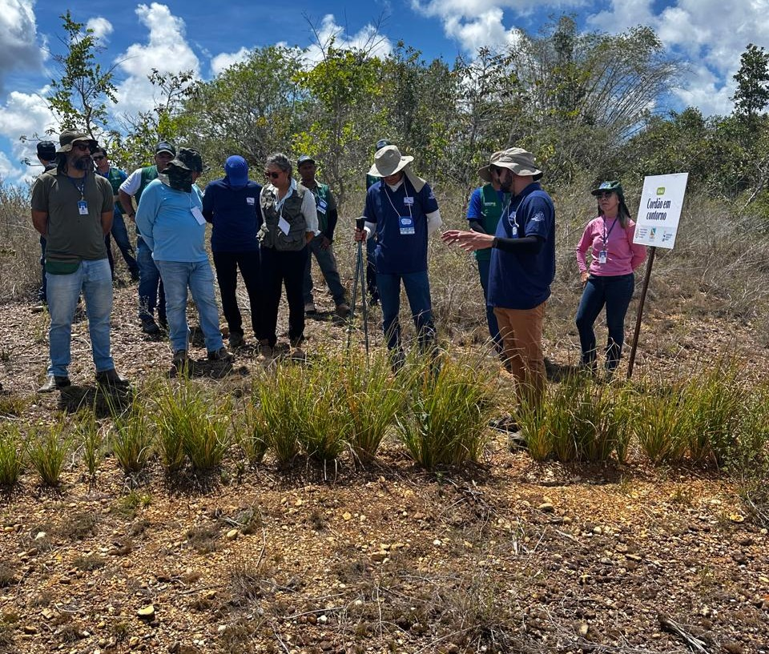
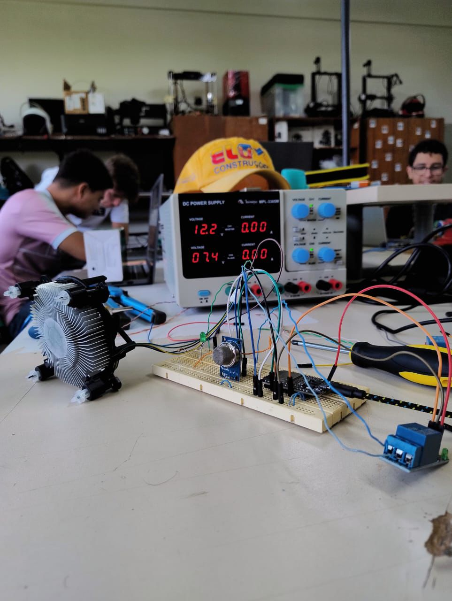
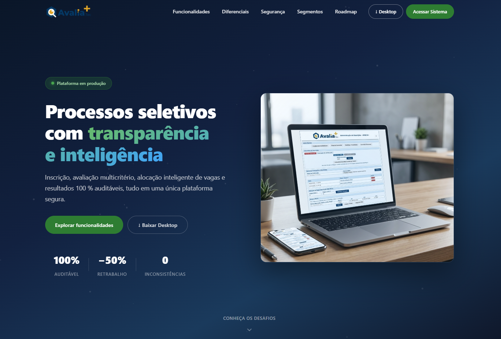
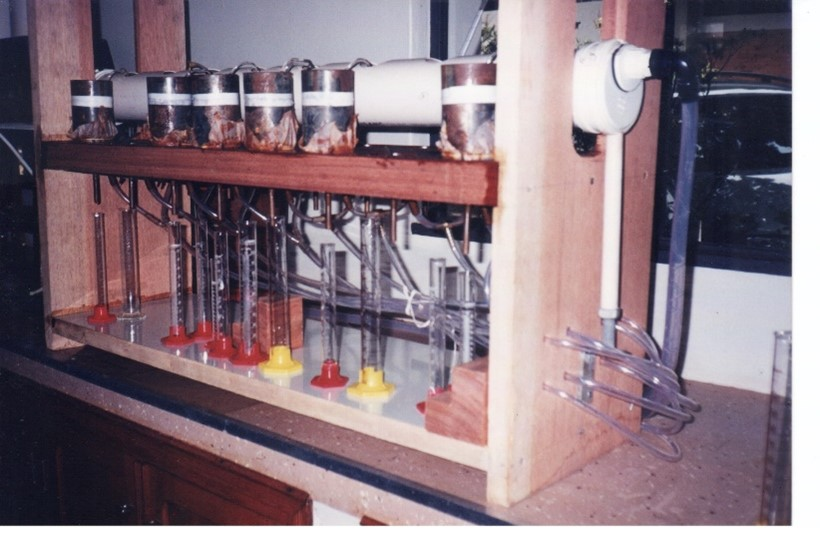
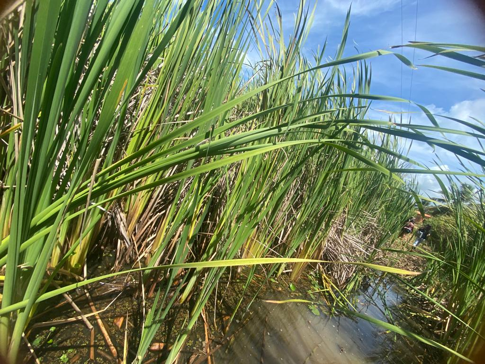
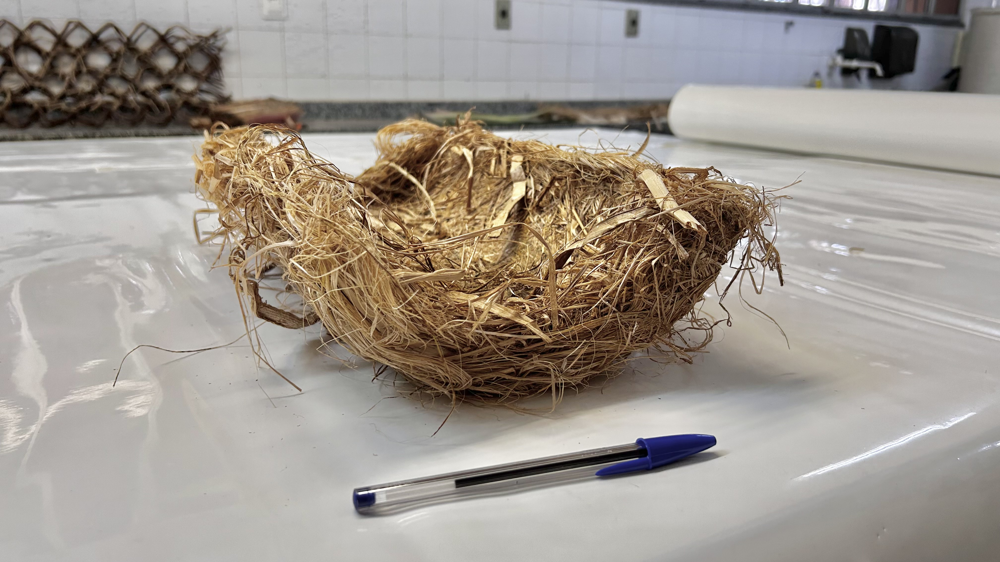
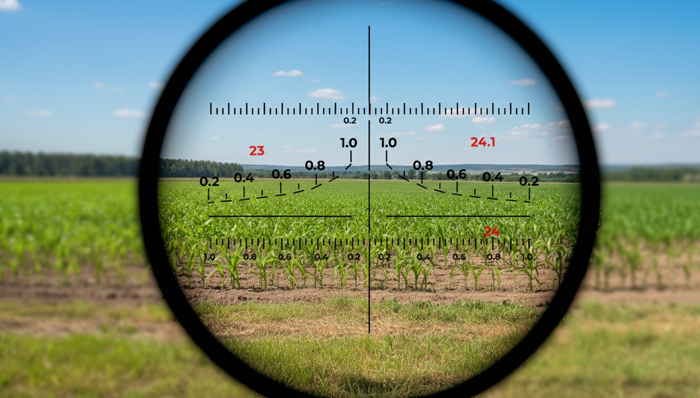
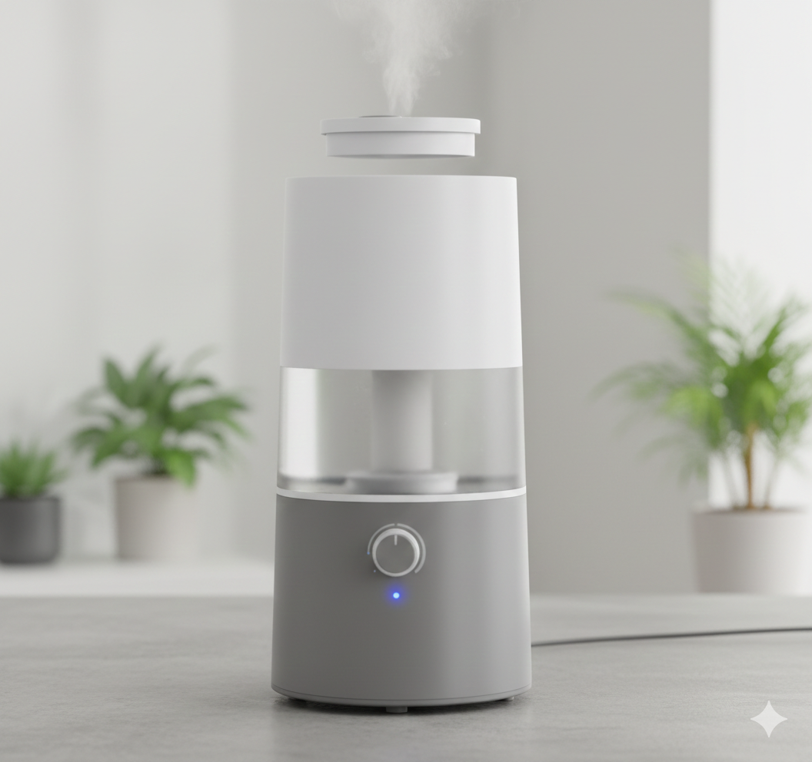
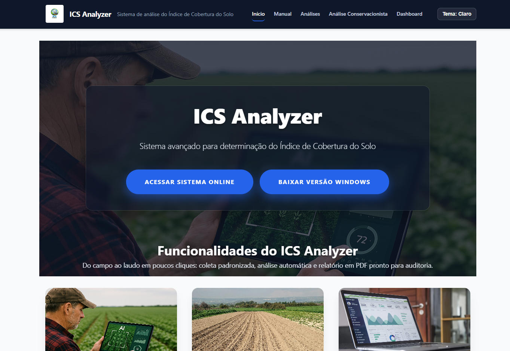

::: {.text-end .mb-3}
[Português](index.qmd) | **English** | [Español](index-es.qmd) | [Français](index-fr.qmd) | [ Download CV](cv-luiz-diego-en.pdf){.btn .btn-outline-primary .btn-sm}
:::

::: {.hero-value-statement}
> **I transform territories with nature-based solutions, intellectual property and sustainable innovation - bridging scientific research and real-world impact in Brazil's Semi-Arid and beyond.**
:::

::: {.text-center .mb-4}
[ Hire Me](mailto:ldvsantos@uefs.br?subject=Professional%20Opportunity%20-%20Luiz%20Diego%20Vidal%20Santos){.btn .btn-primary .btn-lg .me-2}
[ WhatsApp](https://wa.me/5579999063350?text=Hello%20Prof.%20Luiz%20Diego%2C%20I'd%20like%20to%20discuss%20an%20opportunity.){.btn .btn-success .btn-lg}
:::

##  About me

I am an **Agricultural Engineer** (UFS) and hold a **PhD in Intellectual Property and Innovation** (UFS, 2023), with emphasis on sustainable agroforestry commercialization. I am currently a Visiting Professor at the Graduate Program in Territorial Planning at the [State University of Feira de Santana (UEFS)](https://www.uefs.br/) and a researcher at the Incubator for Popular and Solidarity Economy Initiatives (UEFS).

I lead the **PLANeT-Inova** group (Territorial Planning, *Nature-Based Solutions* and Sustainable Innovation) and participate in the Research Groups on Hydroenvironmental Management of the Lower São Francisco River and on Soil Management and Sustainability, both affiliated with UFS.

I co-founded the Academic League for Sustainable Agriculture **(L-AGROS)** and the Unit for Technology Diffusion and Innovation in Soil and Water Conservation **(UDTI)**.

---

##  Education

| Period | Degree | Institution |
|--------|--------|-------------|
| 2026-present | **Postdoctoral Research** - Agricultural Sciences / Forestry (CNPq Fellow) | UFRPE |
| 2024-2026 | **Postdoctoral Research** - Agricultural Sciences / Agronomy (CNPq Fellow) | UFS |
| 2021-2023 | **PhD** - Intellectual Property Science | UFS |
| 2019-2020 | **MSc** - Intellectual Property Science | UFS |
| 2019-2022 | **Specialization** - Rural Production and Development | Unyleya |
| 2013-2014 | **Specialization** - Quality, Health and Environmental Management | AVM Educacional |
| 2016-2021 | **BSc** - Agricultural Engineering | UFS |

: {.striped .hover}

---

##  Professional Experience

::: {.callout-note appearance="minimal" icon=false}
### Federal Rural University of Pernambuco (UFRPE)
**Postdoctoral Researcher** · 2026 - Present

Agricultural Sciences / Forestry · CNPq Fellow
:::

::: {.callout-note appearance="minimal" icon=false}
### State University of Feira de Santana (UEFS)
**Visiting Professor** · 2024 - Present

Graduate Program in Territorial Planning · Full-time
:::

::: {.callout-note appearance="minimal" icon=false}
### Federal University of Sergipe (UFS)
**Postdoctoral Researcher** · 2019 - 2026

Center for Applied Agricultural Sciences - Research, Extension and Development
:::

::: {.callout-note appearance="minimal" icon=false}
### Regional Council of Physical Education (CREF 13)
**Inspection Supervisor** · 2021-2024

Public servant - Full-time
:::

::: {.callout-note appearance="minimal" icon=false}
### Federal Institute of Sergipe (IFS) - São Cristóvão Campus
**Professor** · 2021-2023
:::

---

##  Current Projects {#projects}

::: {.panel-tabset}

### Research

::: {.card .mb-3}
#### Safeguarding Traditional Agricultural Systems
**2025 - Present**

Development and application of mapping questionnaires, creation of a georeferenced database and development of an evaluation scale (*Likert*) across five constructs. The project aims to protect traditional knowledge of peoples and communities in the Northeastern Semi-Arid region.

**Team:** L.D.V. Santos (PI), C.O.V. Santana, P.R. Gagá, S.K.A. Sousa, R.A.S. Machado, T.C. Azevedo
:::

::: {.card .mb-3}
#### Technical Reference Unit for Geotextiles in Erosion Control
**2025 - Present**

Development of a technical reference unit for geotextile application in soil erosion control, involving undergraduate, master's and doctoral students.

**Team:** L.D.V. Santos (PI), R.H. Marino, F.S.R. Holanda, A.S.N. Souza, R.A.S. Machado, T.C. Azevedo, K.R. Andrade, V.P. Neto, E.S. Santos
:::

### Technological Development

::: {.card .mb-3}
#### CLEANBONER: Intelligent Monitoring System
**2025 - Present**

Technological development project for an intelligent environmental monitoring system.

**Team:** L.D.V. Santos (PI), C.O.V. Santana, S.K.A. Sousa
:::

::: {.card .mb-3}
#### Biospeckle Laser - Frequency Analysis
**2017-2020** (Completed)

Series of projects on biospeckle laser application for frequency analysis and correlation with soil moisture values. Development of screening algorithms and Fourier Transform analysis.
:::

::: {.card .mb-3}
#### Mycorrhizal Inoculants in Cherry Tomato
**Completed**

Study of the effect of mycorrhizal fungi on the development and production of common cherry tomato.
:::

### Extension

::: {.card .mb-3}
#### Empreenda AgroCast
**2020 - Present**

Educational tool (podcast) promoting entrepreneurship in the agricultural sector. Created in response to the COVID-19 pandemic as an alternative for developing entrepreneurial competencies in Agricultural Sciences.
:::

::: {.card .mb-3}
#### Academic League for Sustainable Agriculture (L-AGROS)
**2020 - Present**

University extension at the UFS Center for Applied Agricultural Sciences, promoting sustainable agriculture and innovation.
:::

::: {.card .mb-3}
#### Safeguarding Agricultural Systems - Extension
**2024 - Present**

Extension project aimed at protecting traditional agricultural systems in the Northeastern Semi-Arid region.
:::

:::

---

##  Research Areas

::: {.grid}

::: {.g-col-12 .g-col-md-6}
My research fronts articulate **territorial planning and nature-based solutions**, focusing on **soil and water conservation through sustainable management**.
:::

::: {.g-col-12 .g-col-md-6}
Concomitantly, I develop research in **intellectual property, technological prospection and patentometry**, integrating these fields with **sustainable innovation, entrepreneurship and technology transfer**.
:::

:::

---

##  Featured Projects

::: {.grid}

::: {.g-col-12 .g-col-md-6}
::: {.card .featured-project}
{.project-img fig-alt="Field research on traditional agricultural systems in Brazil's Semi-Arid"}

#### Safeguarding Traditional Agricultural Systems

Protecting traditional knowledge of Semi-Arid communities. Georeferenced database with 5-construct Likert scale.

**Result:** Community mapping and creation of an unprecedented safeguarding protocol in Brazil.
:::
:::

::: {.g-col-12 .g-col-md-6}
::: {.card .featured-project}
{.project-img fig-alt="Geotextiles deployed on slopes for erosion control in the Lower São Francisco"}

#### Geotextiles for Erosion Control

Development of technical reference unit for geotextile application in soil erosion control, with resloping, revegetation and sisal fiber techniques.

**Result:** Measurable soil loss reduction in critical areas of the Lower São Francisco.
:::
:::

::: {.g-col-12 .g-col-md-6}
::: {.card .featured-project}
{.project-img fig-alt="CLEANBONER intelligent environmental monitoring system"}

#### CLEANBONER: Intelligent Monitoring

IoT-based intelligent environmental monitoring system with real-time data analysis.

**Result:** Functional IoT prototype applied to semi-arid conditions.
:::
:::

::: {.g-col-12 .g-col-md-6}
::: {.card .featured-project}
{.project-img fig-alt="Biospeckle Laser equipment for frequency analysis and soil moisture"}

#### Biospeckle Laser - Frequency Analysis

Biospeckle laser application for frequency analysis and correlation with soil moisture values. Development of screening algorithms and Fourier Transform analysis.

**Result:** Innovative non-destructive soil property analysis method via laser.
:::
:::

::: {.g-col-12 .g-col-md-6}
::: {.card .featured-project}
{.project-img fig-alt="Avalia+ platform for innovation project submission and evaluation"}

#### Avalia+: Project Submission Platform

Web platform for innovation project submission with CPF validation, PDF generation with protocol and verifiable SHA-256 hash, blind review, and admin panel.

**Result:** Complete production system ensuring submission integrity and traceability.
:::
:::

::: {.g-col-12 .g-col-md-6}
::: {.card .featured-project}
{.project-img fig-alt="Mechanical system for collecting undisturbed soil samples"}

#### Patent: Undisturbed Soil Sampler

Constructive arrangement of a mechanical system for collecting undisturbed soil samples with structural preservation method. INPI Registration: BR10202401648.

**Result:** Patent filed in 2024. Solves the problem of preserving original soil structure during sampling.
:::
:::

::: {.g-col-12 .g-col-md-6}
::: {.card .featured-project}
{.project-img fig-alt="Continuous constant and decreasing head permeameter"}

#### Patent: Continuous Permeameter

Equipment for determining hydraulic conductivity in porous media, enabling constant and decreasing head tests in a single device. INPI Registration: BR10202301830.

**Result:** Patent **granted in 2025**. Innovation in soil physical analysis instrumentation.
:::
:::

::: {.g-col-12 .g-col-md-6}
::: {.card .featured-project}
{.project-img fig-alt="Geogrid-type geotextile with Typha domingensis fibers"}

#### Patent: Rush (Cattail) Geotextile

Woven geogrid-type geotextile made with *Typha domingensis* (cattail) fibers with high tensile strength for soil erosion control. INPI Registration: BR10202302221.

**Result:** Patent **granted in 2025**. Low-cost Nature-Based Solution (NBS) for slopes and degraded areas.
:::
:::

::: {.g-col-12 .g-col-md-6}
::: {.card .featured-project}
{.project-img fig-alt="Biodegradable vegetal geodrain for slope stabilization"}

#### Patent: Vegetal Geodrain

Double-plate geodrain geotextile with natural cattail and banana fibers, bound with vegetal resin. Biodegradable porous drainage tube installed in a "fishbone" pattern.

**Result:** TRL 6 prototype field-tested. 100% biodegradable solution replacing concrete structures.
:::
:::

::: {.g-col-12 .g-col-md-6}
::: {.card .featured-project}
{.project-img fig-alt="Hybrid geocomposite for soil protection combining reinforcement and drainage"}

#### Patent: Soil Protection Geocomposite

Geocomposite combining two or more geotechnical functions in a single product, integrating fiber mat with reinforcement mesh for slope application in the Semi-Arid.

**Result:** Documentation phase for INPI filing. Field experimental application with integrated erosion protection.
:::
:::

::: {.g-col-12 .g-col-md-6}
::: {.card .featured-project}
{.project-img fig-alt="3D geocells installed in the field for erosion control"}

#### Project: Geocells for Erosion Control

Application of **geocells** (3D confinement) for slope and channel stabilization, with installation and performance assessment in a field experiment.

**Result:** Field implementation with photographic documentation and performance evaluation.
:::
:::

::: {.g-col-12 .g-col-md-6}
::: {.card .featured-project}
{.project-img fig-alt="Vegetated resloping on degraded slope as a natural engineering step"}

#### NBS: Vegetated Resloping

Integrated **Nature-Based Solutions** protocol for stabilizing degraded slopes - combining vegetated resloping, geosynthetics (geotextiles, geocomposites, geogrid) and revegetation with native species in a natural engineering trial.

**Result:** 40-60% reduction in soil loss, 30% lower cost than conventional solutions, and vegetation establishment in 90% of the treated area. [Read more →](/posts/nbs-retaludamento/)
:::
:::

::: {.g-col-12 .g-col-md-6}
::: {.card .featured-project}
{.project-img fig-alt="Apparatus for visual analysis of soil samples"}

#### Patent: Soil Sample Analysis Apparatus

Device for visual analysis and classification of soil samples with standardized lighting and image capture system.

**Result:** Patent under development with associated scientific paper.
:::
:::

::: {.g-col-12 .g-col-md-6}
::: {.card .featured-project}
{.project-img fig-alt="Residential sanitizing humidifier with ozone mist"}

#### Patent: Ozone Sanitizing Humidifier

Residential sanitizing humidifier with ozone mist, combining humidification and air disinfection functions. INPI Registration: BR20202500452.

**Result:** Patent filed in 2025. Application in residential environmental health.
:::
:::

::: {.g-col-12 .g-col-md-6}
::: {.card .featured-project}
{.project-img fig-alt="ICS Analyzer interface for Soil Cover Index analysis with dashboard and machine learning"}

#### ICS Analyzer: Soil Cover Index Analysis

Cross-platform system for ICS determination with machine learning pipeline (Ridge + K-Fold CV), fuzzy conservation diagnostics (ISPC), interactive dashboard and automated PDF report generation.

**Result:** Software in production with web version (GitHub Pages) and desktop (Electron), CI/CD via GitHub Actions and 12 unit tests. [Read more →](/posts/projeto-ics-analyzer/)
:::
:::

:::

---

##  Awards and Distinctions

| Year | Award |
|------|-------|
| 2020 | 1st Place - Honorable Mention (Oral Presentation), Brazilian Congress of Agricultural Engineering |
| 2020 | 1st Place - Honorable Mention (Poster), Brazilian Congress of Agricultural Engineering |
| 2019 | Best Paper, International Symposium on Technological Innovation |
| 2018 | Outstanding Award SEMAC, UFS |
| 2017 | Outstanding Award SEMAC, UFS |

: {.striped .hover}

---

##  Teaching and Supervision

I work at [UEFS](https://www.uefs.br/) in the **Graduate Program in Territorial Planning**, supervising undergraduate, master's and doctoral students in sustainable agriculture and nature-based solutions, soil conservation and biodiversity, intellectual property and technological innovation, as well as agribusiness entrepreneurship. Learn more in the [Teaching](teaching/index-en.qmd) section.

---

##  Publications

I have published **over 98 articles** in national and international journals, covering areas such as soil conservation, bioengineering, intellectual property, sustainable innovation and environmental branding.

See the full list in the [Publications](papers/publicacoes-en.qmd) section, or visit my [ORCID](https://orcid.org/0000-0001-8659-8557) profile.

---

##  Contact

::: {.grid}

::: {.g-col-12 .g-col-md-6}
**Email:** [ldvsantos@uefs.br](mailto:ldvsantos@uefs.br)

**Institution:** [UEFS](https://www.uefs.br/) - Graduate Program in Territorial Planning
:::

::: {.g-col-12 .g-col-md-6}
**ORCID:** [0000-0001-8659-8557](https://orcid.org/0000-0001-8659-8557)

**Lattes:** [7491112603328096](http://lattes.cnpq.br/7491112603328096)
:::

:::

---

##  Skills and Tools

::: {.grid}

::: {.g-col-12 .g-col-md-4}
**Research & Analysis**

{fig-alt="R"}
{fig-alt="Python"}
{fig-alt="SPSS"}
{fig-alt="Excel"}
:::

::: {.g-col-12 .g-col-md-4}
**GIS & Geospatial**

{fig-alt="QGIS"}
{fig-alt="ArcGIS"}
{fig-alt="Google Earth Engine"}
:::

::: {.g-col-12 .g-col-md-4}
**IP & Management**

{fig-alt="PatentSight"}
{fig-alt="Scopus"}
{fig-alt="Web of Science"}
{fig-alt="Project Management"}
:::

:::

::: {.text-center .mt-2}
{fig-alt="ORCID"}
{fig-alt="Lattes CNPq"}
{fig-alt="CNPq Fellow"}
:::

---

##  Let's Talk?

I’m open to **academic partnerships**, **consulting**, **supervision**, and **professional opportunities** in my areas of expertise.

::: {.text-center .mt-3}
[ Send Email](mailto:ldvsantos@uefs.br?subject=Contact%20via%20Website%20-%20Luiz%20Diego){.btn .btn-primary .btn-lg .me-2}
[ WhatsApp](https://wa.me/5579999063350?text=Hello%20Prof.%20Luiz%20Diego%2C%20I%20saw%20your%20website%20and%20would%20like%20to%20talk.){.btn .btn-success .btn-lg}
:::
