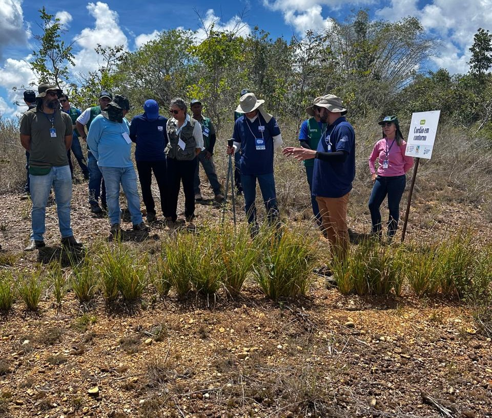
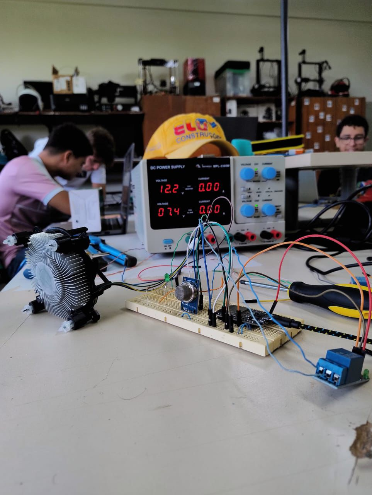
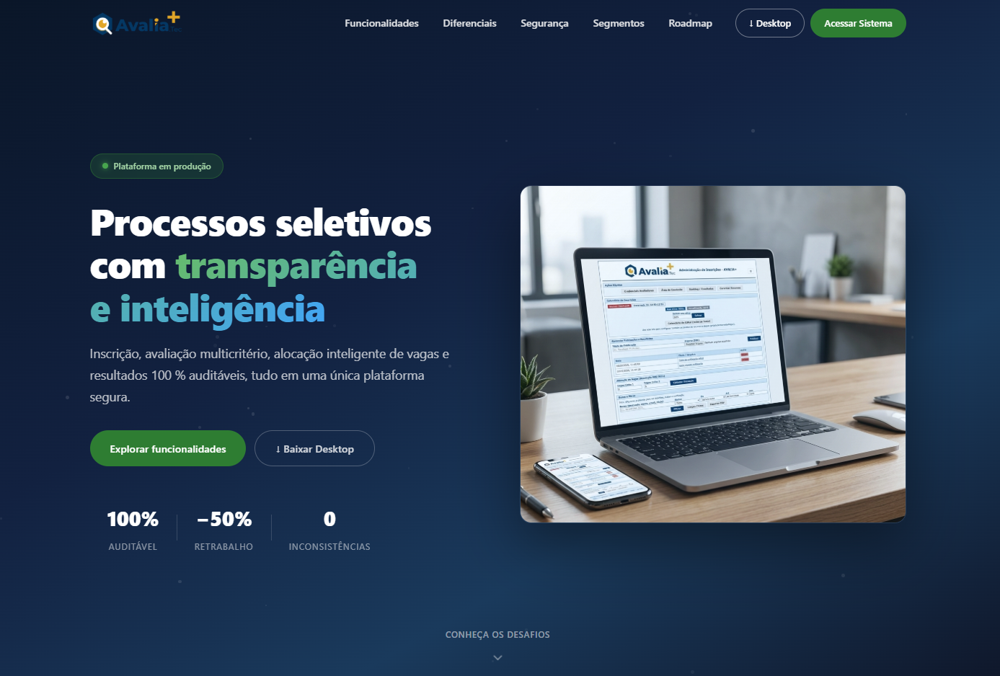
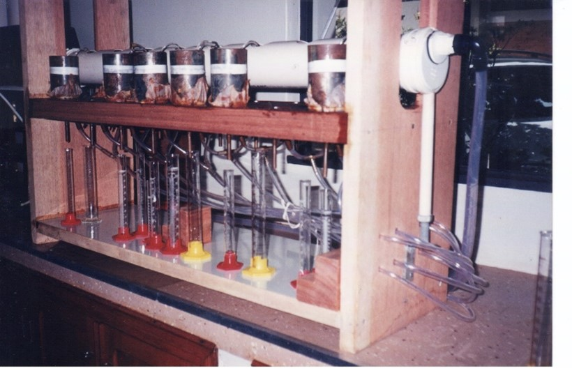
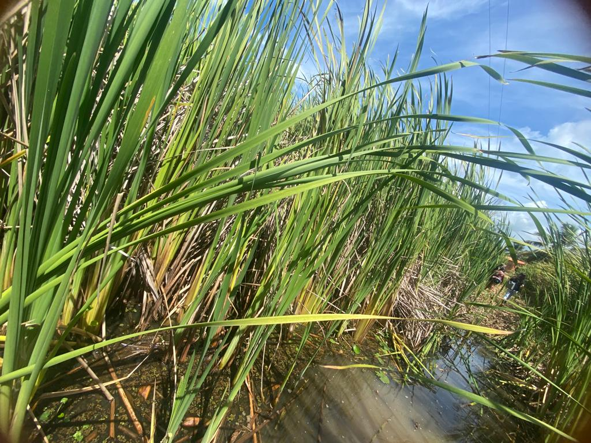
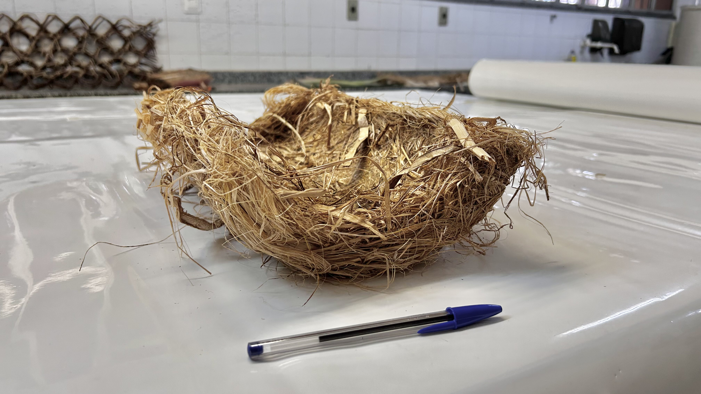
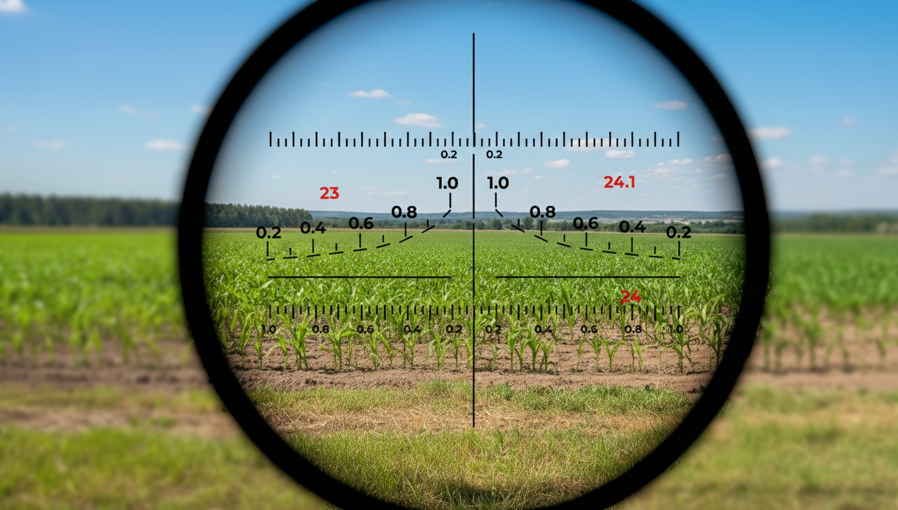
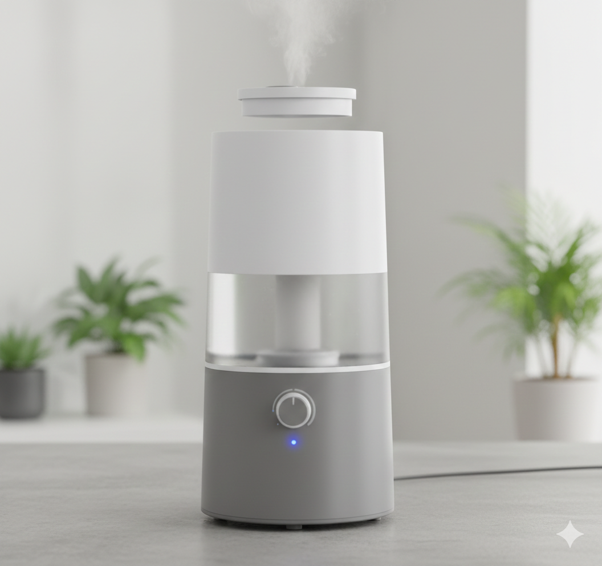
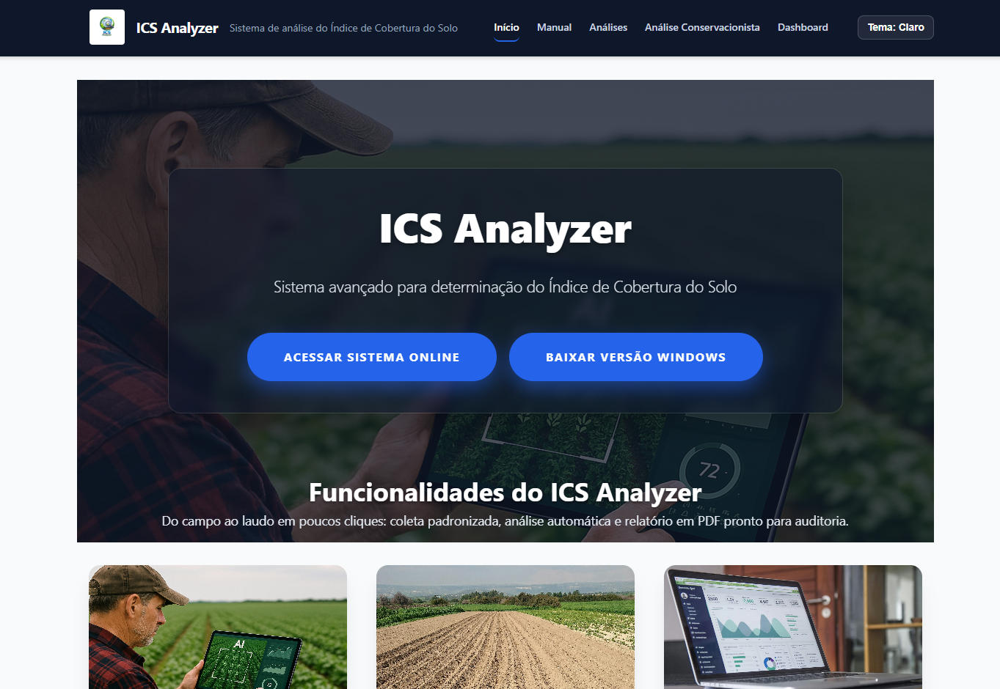

::: {.text-end .mb-3}
[Português](index.qmd) | [English](index-en.qmd) | **Español** | [Français](index-fr.qmd) | [ Descargar CV](cv-luiz-diego-es.pdf){.btn .btn-outline-primary .btn-sm}
:::

::: {.hero-value-statement}
> **Transformo territorios con soluciones basadas en la naturaleza, propiedad intelectual e innovación sostenible - uniendo investigación científica e impacto real en el Semiárido y más allá.**
:::

::: {.text-center .mb-4}
[ Contrátame](mailto:ldvsantos@uefs.br?subject=Oportunidad%20Profesional%20-%20Luiz%20Diego%20Vidal%20Santos){.btn .btn-primary .btn-lg .me-2}
[ WhatsApp](https://wa.me/5579999063350?text=Hola%20Prof.%20Luiz%20Diego%2C%20me%20gustar%C3%ADa%20conversar%20sobre%20una%20oportunidad.){.btn .btn-success .btn-lg}
:::

##  Sobre mí

Soy **Ingeniero Agrónomo** (UFS) y **Doctor en Propiedad Intelectual e Innovación** (UFS, 2023), con énfasis en comercialización agroforestal sostenible. Actualmente, soy Profesor Visitante en el Programa de Posgrado en Planificación Territorial de la [Universidad Estatal de Feira de Santana (UEFS)](https://www.uefs.br/) e investigador en la Incubadora de Iniciativas de Economía Popular y Solidaria (UEFS).

Lidero el grupo **PLANeT-Inova** (Planificación Territorial, *Nature-Based Solutions* e Innovación Sostenible) e integro los Grupos de Investigación en Gestión Hidroambiental del Bajo São Francisco y en Manejo de Suelos y Sostenibilidad, ambos vinculados a la UFS.

Cofundé la Liga Académica del Agro Sostenible **(L-AGROS)** y la Unidad de Difusión de Tecnología e Innovación en Conservación del Suelo y del Agua **(UDTI)**.

---

##  Formación Académica

| Período | Título | Institución |
|---------|--------|-------------|
| 2026-actual | **Posdoctorado** - Ciencias Agrarias / Ciencias Forestales (Becario CNPq) | UFRPE |
| 2024-2026 | **Posdoctorado** - Ciencias Agrarias / Agronomía (Becario CNPq) | UFS |
| 2021-2023 | **Doctorado** - Ciencia de la Propiedad Intelectual | UFS |
| 2019-2020 | **Maestría** - Ciencia de la Propiedad Intelectual | UFS |
| 2019-2022 | **Especialización** - Producción y Desarrollo Rural | Unyleya |
| 2013-2014 | **Especialización** - Gestión de Calidad, Salud y Medio Ambiente | AVM Educacional |
| 2016-2021 | **Licenciatura** - Ingeniería Agronómica | UFS |

: {.striped .hover}

---

##  Experiencia Profesional

::: {.callout-note appearance="minimal" icon=false}
### Universidad Federal Rural de Pernambuco (UFRPE)
**Posdoctorando / Investigador** · 2026 - Actual

Ciencias Agrarias / Ciencias Forestales · Becario CNPq
:::

::: {.callout-note appearance="minimal" icon=false}
### Universidad Estatal de Feira de Santana (UEFS)
**Profesor Visitante** · 2024 - Actual

Posgrado en Planificación Territorial · Dedicación Exclusiva
:::

::: {.callout-note appearance="minimal" icon=false}
### Universidad Federal de Sergipe (UFS)
**Posdoctorando / Investigador** · 2019 - 2026

Centro de Ciencias Agrarias Aplicadas - Investigación, Extensión y Desarrollo
:::

::: {.callout-note appearance="minimal" icon=false}
### Consejo Regional de Educación Física (CREF 13)
**Supervisor de Fiscalización** · 2021-2024

Servidor público - Régimen integral
:::

::: {.callout-note appearance="minimal" icon=false}
### Instituto Federal de Sergipe (IFS) - Campus São Cristóvão
**Profesor** · 2021-2023
:::

---

##  Proyectos en Curso {#proyectos}

::: {.panel-tabset}

### Investigación

::: {.card .mb-3}
#### Salvaguardia de Sistemas Agrícolas Tradicionales
**2025 - Actual**

Desarrollo y aplicación de cuestionarios de mapeo, creación de base de datos georreferenciada y desarrollo de escala de evaluación (*Likert*) en cinco constructos. El proyecto busca proteger saberes tradicionales de pueblos y comunidades del Semiárido Nordestino.

**Equipo:** L.D.V. Santos (Resp.), C.O.V. Santana, P.R. Gagá, S.K.A. Sousa, R.A.S. Machado, T.C. Azevedo
:::

::: {.card .mb-3}
#### Unidad de Referencia Técnica en Geotextiles para Control de Erosión
**2025 - Actual**

Desarrollo de unidad técnica de referencia para aplicación de geotextiles en el control de erosión del suelo, involucrando alumnos de grado, maestría y doctorado.

**Equipo:** L.D.V. Santos (Resp.), R.H. Marino, F.S.R. Holanda, A.S.N. Souza, R.A.S. Machado, T.C. Azevedo, K.R. Andrade, V.P. Neto, E.S. Santos
:::

### Desarrollo Tecnológico

::: {.card .mb-3}
#### CLEANBONER: Sistema Inteligente de Monitoreo
**2025 - Actual**

Proyecto de desarrollo tecnológico de sistema inteligente de monitoreo ambiental.

**Equipo:** L.D.V. Santos (Resp.), C.O.V. Santana, S.K.A. Sousa
:::

::: {.card .mb-3}
#### Biospeckle Laser - Análisis de Frecuencias
**2017-2020** (Concluido)

Serie de proyectos sobre aplicación de biospeckle laser para análisis de frecuencias y correlación con valores de humedad del suelo. Desarrollo de algoritmos de tamizaje y análisis por Transformada de Fourier.
:::

::: {.card .mb-3}
#### Inoculantes Micorrízicos en Tomate Cherry
**Concluido**

Estudio del efecto de hongos micorrízicos en el desarrollo y producción de tomate tipo cherry común.
:::

### Extensión

::: {.card .mb-3}
#### Empreenda AgroCast
**2020 - Actual**

Herramienta educativa (podcast) para promoción del emprendimiento en el sector agrícola. Creado en respuesta a la pandemia de COVID-19 como alternativa para formación de competencias emprendedoras en Ciencias Agrarias.
:::

::: {.card .mb-3}
#### Liga Académica del Agro Sostenible (L-AGROS)
**2020 - Actual**

Extensión universitaria en el Centro de Ciencias Agrarias Aplicadas de la UFS, promoviendo agricultura sostenible e innovación.
:::

::: {.card .mb-3}
#### Salvaguardia de Sistemas Agrícolas - Extensión
**2024 - Actual**

Proyecto de extensión orientado a la protección de sistemas agrícolas tradicionales en el Semiárido Nordestino.
:::

:::

---

##  Áreas de Investigación

::: {.grid}

::: {.g-col-12 .g-col-md-6}
Mis frentes de investigación articulan **planificación territorial y soluciones basadas en la naturaleza** (*Nature-Based Solutions*), con foco en **conservación del suelo y del agua por medio de manejo sostenible**.
:::

::: {.g-col-12 .g-col-md-6}
Concomitantemente, desarrollo investigaciones en **propiedad intelectual, prospección tecnológica y patentometría**, integrando estos saberes con **innovación sostenible, emprendimiento y transferencia de tecnología**.
:::

:::

---

##  Proyectos Destacados

::: {.grid}

::: {.g-col-12 .g-col-md-6}
::: {.card .featured-project}
{.project-img fig-alt="Investigación de campo sobre sistemas agrícolas tradicionales en el Semiárido"}

#### Salvaguardia de Sistemas Agrícolas Tradicionales

Protección de saberes tradicionales de pueblos del Semiárido Nordestino. Base de datos georreferenciada con escala Likert en 5 constructos.

**Resultado:** Mapeo de comunidades tradicionales y creación de protocolo de salvaguardia inédito en Brasil.
:::
:::

::: {.g-col-12 .g-col-md-6}
::: {.card .featured-project}
{.project-img fig-alt="Geotextiles desplegados en talud para control de erosión en el Bajo São Francisco"}

#### Geotextiles para Control de Erosión

Desarrollo de unidad técnica de referencia para aplicación de geotextiles en el control de erosión del suelo, con técnicas de retaludamiento, revegetación y fibra de sisal.

**Resultado:** Reducción mensurable de pérdida de suelo en áreas críticas del Bajo São Francisco.
:::
:::

::: {.g-col-12 .g-col-md-6}
::: {.card .featured-project}
{.project-img fig-alt="Sistema inteligente de monitoreo ambiental CLEANBONER"}

#### CLEANBONER: Monitoreo Inteligente

Sistema inteligente de monitoreo ambiental con sensores y análisis de datos en tiempo real.

**Resultado:** Prototipo funcional de IoT aplicado al semiárido.
:::
:::

::: {.g-col-12 .g-col-md-6}
::: {.card .featured-project}
{.project-img fig-alt="Equipo de Biospeckle Laser para análisis de frecuencias y humedad del suelo"}

#### Biospeckle Laser - Análisis de Frecuencias

Aplicación de biospeckle laser para análisis de frecuencias y correlación con valores de humedad del suelo. Desarrollo de algoritmos de tamizaje y análisis por Transformada de Fourier.

**Resultado:** Método innovador de análisis no destructivo de propiedades del suelo vía láser.
:::
:::

::: {.g-col-12 .g-col-md-6}
::: {.card .featured-project}
{.project-img fig-alt="Plataforma Avalia+ para envío y evaluación de proyectos de innovación"}

#### Avalia+: Plataforma de Envío de Proyectos

Plataforma web para envío de proyectos de innovación con validación de CPF, generación de PDF con protocolo y hash SHA-256 verificable, revisión ciega y panel administrativo.

**Resultado:** Sistema completo en producción con garantía de integridad y trazabilidad de los envíos.
:::
:::

::: {.g-col-12 .g-col-md-6}
::: {.card .featured-project}
{.project-img fig-alt="Sistema mecánico para recolección de muestras inalteradas de suelo"}

#### Patente: Muestreador de Suelo Inalterado

Disposición constructiva de sistema mecánico para recolección de muestras inalteradas de suelo con método de preservación estructural. Registro INPI: BR10202401648.

**Resultado:** Patente depositada en 2024. Resuelve el problema de preservación de la estructura original del suelo durante el muestreo.
:::
:::

::: {.g-col-12 .g-col-md-6}
::: {.card .featured-project}
{.project-img fig-alt="Permeámetro continuo de carga constante y decreciente"}

#### Patente: Permeámetro Continuo

Equipo para determinación de conductividad hidráulica en medios porosos, permitiendo ensayos bajo carga constante y decreciente en un mismo dispositivo. Registro INPI: BR10202301830.

**Resultado:** Patente **concedida en 2025**. Innovación en instrumentación para análisis físico de suelos.
:::
:::

::: {.g-col-12 .g-col-md-6}
::: {.card .featured-project}
{.project-img fig-alt="Geotextil tipo geogrid con fibras de Typha domingensis"}

#### Patente: Geotextil de Junco (Espadaña)

Geotextil tejido tipo geogrid confeccionado con fibras de *Typha domingensis* (Espadaña) con alta resistencia a la tracción, destinado al control de erosión del suelo. Registro INPI: BR10202302221.

**Resultado:** Patente **concedida en 2025**. Solución basada en la naturaleza (NBS) de bajo costo para taludes y áreas degradadas.
:::
:::

::: {.g-col-12 .g-col-md-6}
::: {.card .featured-project}
{.project-img fig-alt="Geodrén vegetal biodegradable para estabilización de laderas"}

#### Patente: Geodrén Vegetal

Geotextil tipo geodrén en doble placa con fibras naturales de Espadaña y Banano, aglutinadas con resina vegetal. Tubo drenante poroso biodegradable instalado en formato "espina de pez".

**Resultado:** Prototipo TRL 6 probado en campo. Solución 100% biodegradable que sustituye estructuras de concreto.
:::
:::

::: {.g-col-12 .g-col-md-6}
::: {.card .featured-project}
{.project-img fig-alt="Geocompuesto híbrido para protección de suelos combinando refuerzo y drenaje"}

#### Patente: Geocompuesto para Protección de Suelos

Geocompuesto que combina dos o más funciones geotécnicas en un único producto, integrando manta de fibra con malla de refuerzo para taludes del Semiárido.

**Resultado:** En fase de documentación para depósito en el INPI. Aplicación experimental en campo con protección integrada contra erosión.
:::
:::

::: {.g-col-12 .g-col-md-6}
::: {.card .featured-project}
{.project-img fig-alt="Geoceldas tridimensionales instaladas en campo para control de erosión"}

#### Proyecto: Geoceldas para Control de Erosión

Aplicación de **geoceldas** (confinamiento tridimensional) para estabilización de taludes y canales, con instalación y evaluación en campo experimental.

**Resultado:** Implementación en campo con documentación fotográfica y evaluación de desempeño.
:::
:::

::: {.g-col-12 .g-col-md-6}
::: {.card .featured-project}
{.project-img fig-alt="Retaludamiento vegetado en talud degradado como etapa de ingeniería natural"}

#### NBS: Retaludamiento Vegetado

Protocolo integrado de **Soluciones Basadas en la Naturaleza** para estabilización de laderas degradadas - combinando retaludamiento vegetado, geosintéticos (geotextiles, geocompuestos, geogrid) y revegetación con especies nativas en ensayo de ingeniería natural.

**Resultado:** Reducción del 40-60% en la pérdida de suelo, costo 30% inferior a soluciones convencionales y establecimiento vegetal en el 90% del área tratada. [Más información →](/posts/nbs-retaludamento/)
:::
:::

::: {.g-col-12 .g-col-md-6}
::: {.card .featured-project}
{.project-img fig-alt="Aparato para análisis visual de muestras de suelo"}

#### Patente: Aparato para Análisis de Muestra de Suelo

Dispositivo para análisis visual y clasificación de muestras de suelo con sistema estandarizado de iluminación y captura de imagen.

**Resultado:** Patente en desarrollo con artículo científico asociado.
:::
:::

::: {.g-col-12 .g-col-md-6}
::: {.card .featured-project}
{.project-img fig-alt="Humidificador residencial sanitizante con niebla de ozono"}

#### Patente: Humidificador Sanitizante con Ozono

Humidificador residencial sanitizante de ambiente con niebla de ozono, combinando funciones de humidificación y desinfección del aire. Registro INPI: BR20202500452.

**Resultado:** Patente depositada en 2025. Aplicación en salud ambiental residencial.
:::
:::

::: {.g-col-12 .g-col-md-6}
::: {.card .featured-project}
{.project-img fig-alt="Interfaz del ICS Analyzer para análisis del Índice de Cobertura del Suelo con dashboard y machine learning"}

#### ICS Analyzer: Análisis del Índice de Cobertura del Suelo

Sistema multiplataforma para determinación del ICS con pipeline de machine learning (Ridge + K-Fold CV), diagnóstico conservacionista fuzzy (ISPC), dashboard interactivo y generación automatizada de informes en PDF.

**Resultado:** Software en producción con versión web (GitHub Pages) y desktop (Electron), CI/CD via GitHub Actions y 12 pruebas unitarias. [Más información →](/posts/projeto-ics-analyzer/)
:::
:::

:::

---

##  Premios y Distinciones

| Año | Premio |
|-----|-------|
| 2020 | 1er Lugar - Mención de Honor (Presentación Oral), Congreso Brasileño de Ingeniería Agrícola |
| 2020 | 1er Lugar - Mención de Honor (Póster), Congreso Brasileño de Ingeniería Agrícola |
| 2019 | Best Paper, International Symposium on Technological Innovation |
| 2018 | Premio Destaque del Año SEMAC, UFS |
| 2017 | Premio Destaque del Año SEMAC, UFS |

: {.striped .hover}

---

##  Enseñanza y Orientación

Actúo en la [UEFS](https://www.uefs.br/) en el **Posgrado en Planificación Territorial**, orientando estudiantes de grado, maestría y doctorado en agricultura sostenible y *nature-based solutions*, conservación de suelos y biodiversidad, propiedad intelectual e innovación tecnológica, además de emprendimiento en el agronegocio. Más información en la sección [Enseñanza](teaching/index-es.qmd).

---

##  Publicaciones

Tengo **más de 98 artículos** publicados en revistas nacionales e internacionales, abarcando áreas de conservación del suelo, bioingeniería, propiedad intelectual, innovación sostenible y branding ambiental.

Consulte la lista completa en la sección [Publicaciones](papers/publicacoes-es.qmd), o acceda a mi perfil en [ORCID](https://orcid.org/0000-0001-8659-8557).

---

##  Contacto

::: {.grid}

::: {.g-col-12 .g-col-md-6}
**Email:** [ldvsantos@uefs.br](mailto:ldvsantos@uefs.br)

**Institución:** [UEFS](https://www.uefs.br/) - Posgrado en Planificación Territorial
:::

::: {.g-col-12 .g-col-md-6}
**ORCID:** [0000-0001-8659-8557](https://orcid.org/0000-0001-8659-8557)

**Lattes:** [7491112603328096](http://lattes.cnpq.br/7491112603328096)
:::

:::

---

##  Habilidades y Herramientas

::: {.grid}

::: {.g-col-12 .g-col-md-4}
**Investigación & Análisis**

{fig-alt="R"}
{fig-alt="Python"}
{fig-alt="SPSS"}
{fig-alt="Excel"}
:::

::: {.g-col-12 .g-col-md-4}
**Geoprocesamiento & SIG**

{fig-alt="QGIS"}
{fig-alt="ArcGIS"}
{fig-alt="Google Earth Engine"}
:::

::: {.g-col-12 .g-col-md-4}
**Propiedad Intelectual & Gestión**

{fig-alt="PatentSight"}
{fig-alt="Scopus"}
{fig-alt="Web of Science"}
{fig-alt="Gestión de Proyectos"}
:::

:::

::: {.text-center .mt-2}
{fig-alt="ORCID"}
{fig-alt="Lattes CNPq"}
{fig-alt="Becario CNPq"}
:::

---

##  ¿Conversamos?

Estoy abierto a **alianzas académicas**, **consultorías**, **orientaciones** y **oportunidades profesionales** en mis áreas de actuación.

::: {.text-center .mt-3}
[ Enviar Email](mailto:ldvsantos@uefs.br?subject=Contacto%20via%20Sitio%20Web%20-%20Luiz%20Diego){.btn .btn-primary .btn-lg .me-2}
[ WhatsApp](https://wa.me/5579999063350?text=Hola%20Prof.%20Luiz%20Diego%2C%20vi%20su%20sitio%20y%20me%20gustar%C3%ADa%20conversar.){.btn .btn-success .btn-lg}
:::
