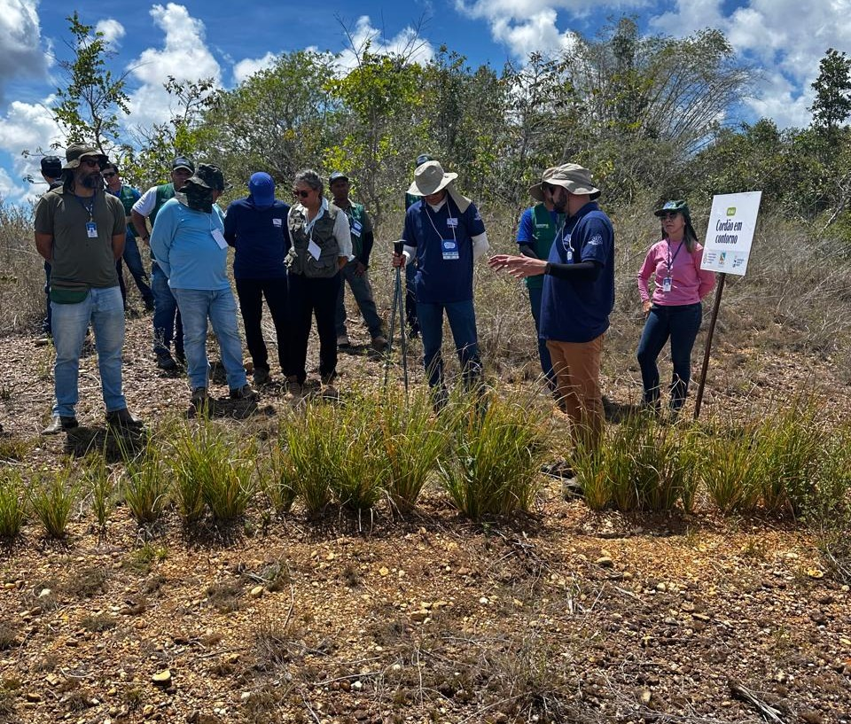
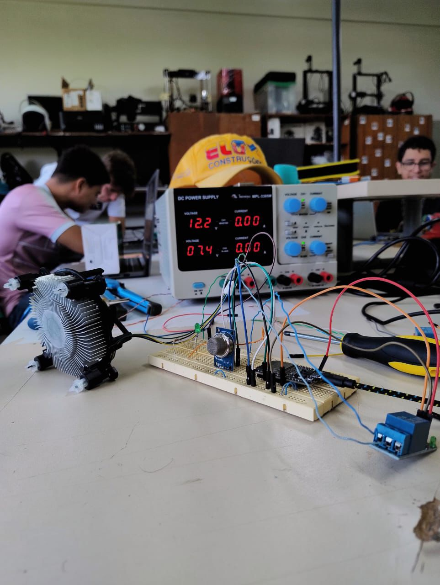
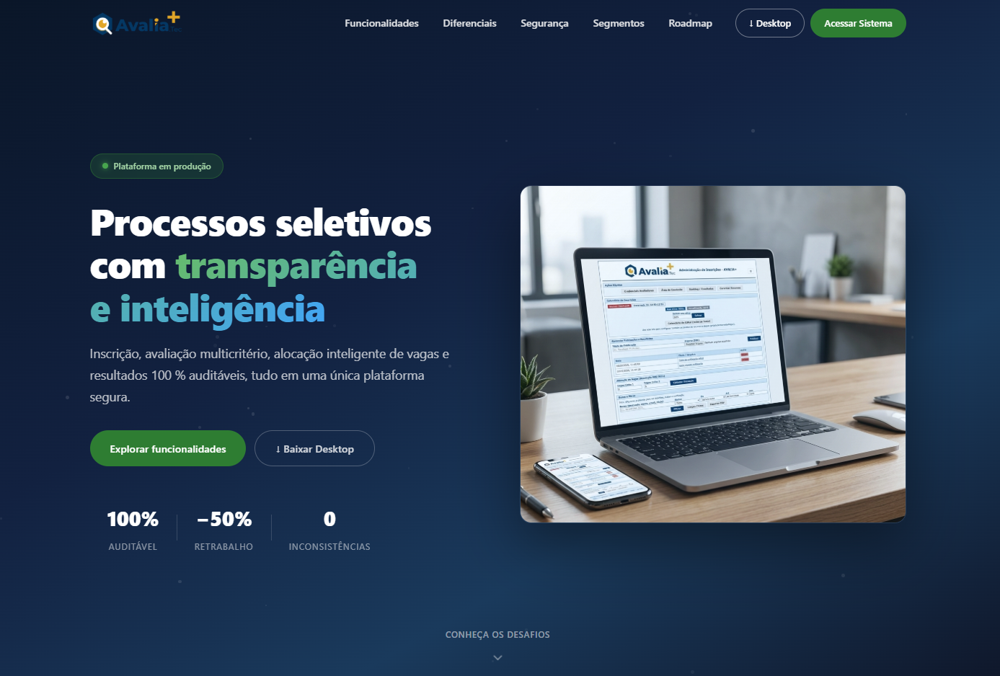
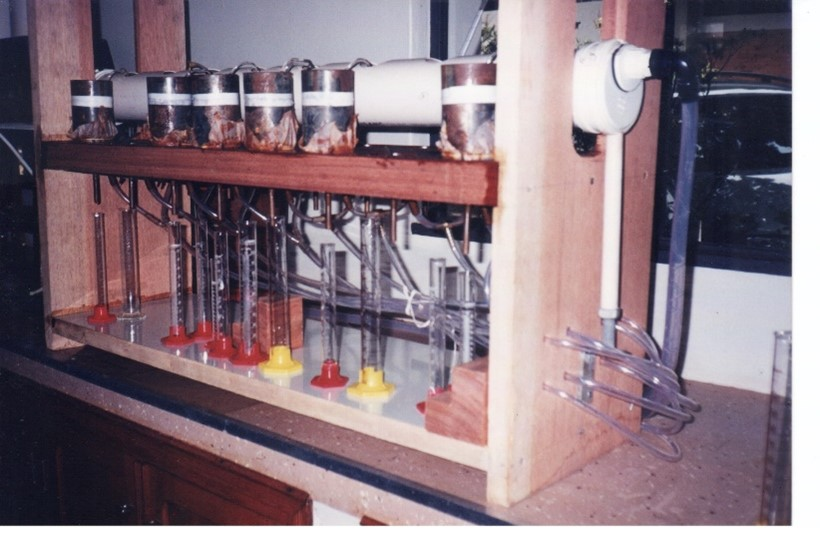
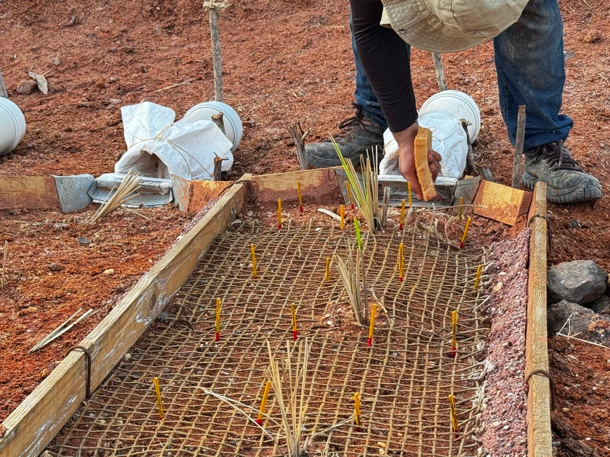
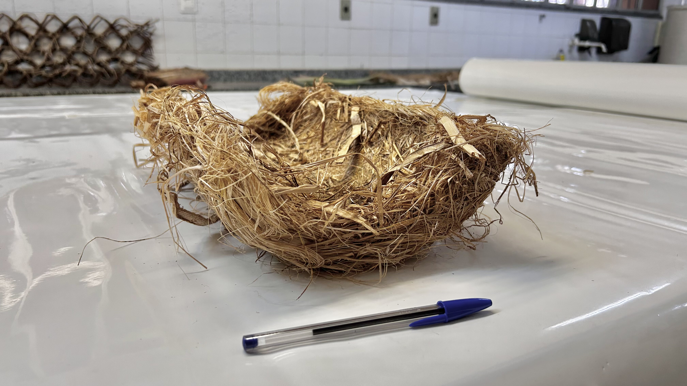
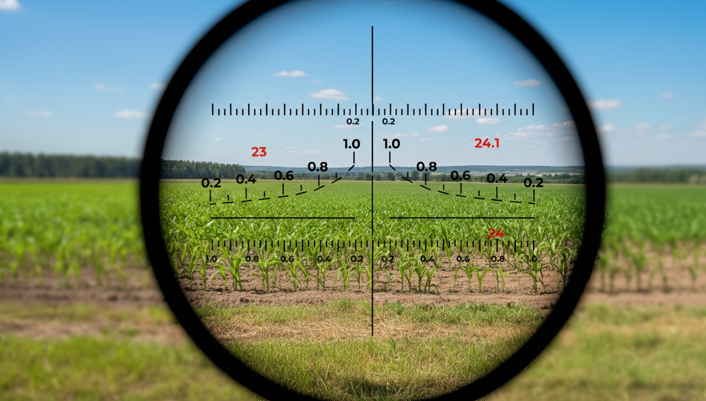
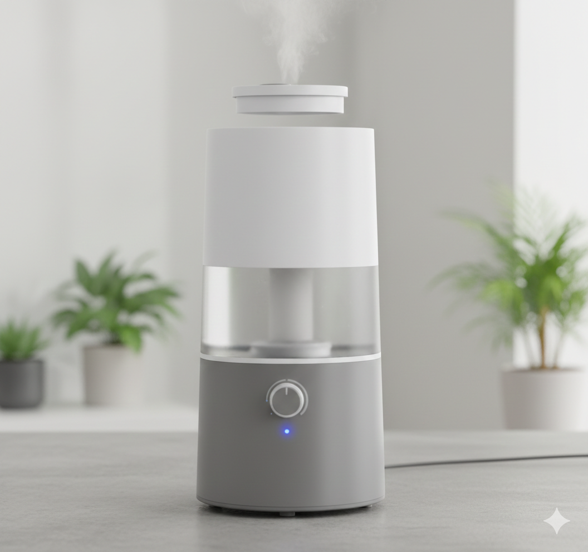
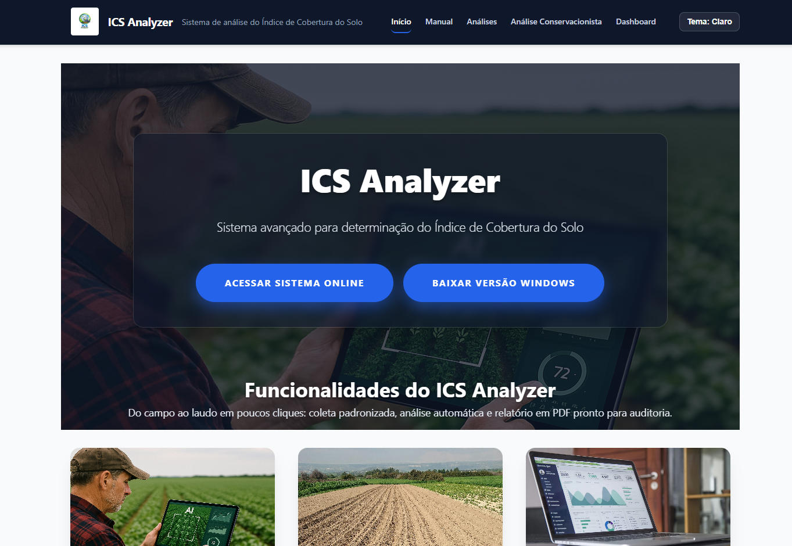

::: {.text-end .mb-3}
**Português** | [English](index-en.qmd) | [Español](index-es.qmd) | [Français](index-fr.qmd) | [ Baixar CV](cv-luiz-diego.pdf){.btn .btn-outline-primary .btn-sm}
:::

::: {.hero-value-statement}
> **Transformo territórios com soluções baseadas na natureza, unindo pesquisa científica a impacto real no Semiárido e além.**
:::

::: {.text-center .mb-4}
[ Contrate-me](mailto:ldvsantos@uefs.br?subject=Oportunidade%20Profissional%20-%20Luiz%20Diego%20Vidal%20Santos){.btn .btn-primary .btn-lg .me-2}
[ WhatsApp](https://wa.me/5579999063350?text=Ol%C3%A1%20Prof.%20Luiz%20Diego%2C%20gostaria%20de%20conversar%20sobre%20uma%20oportunidade.){.btn .btn-success .btn-lg}
:::

##  Sobre mim

Sou **Engenheiro Agrônomo** (UFS) e **Doutor em Propriedade Intelectual e Inovação** (UFS, 2023), com ênfase em comercialização agroflorestal sustentável. Atualmente, sou Professor Visitante no Programa de Pós-Graduação em Planejamento Territorial da [Universidade Estadual de Feira de Santana (UEFS)](https://www.uefs.br/) e pesquisador na Incubadora de Iniciativas da Economia Popular e Solidária (UEFS).

Lidero o grupo **PLANeT-Inova** (Planejamento Territorial, *Nature-Based Solutions* e Inovação Sustentável) e integro os Grupos de Pesquisa em Gerenciamento Hidroambiental do Baixo São Francisco e em Manejo de Solos e Sustentabilidade, ambos vinculados à UFS.

Cofundei a Liga Acadêmica do Agro Sustentável **(L-AGROS)** e a Unidade de Difusão de Tecnologia e Inovação em Conservação do Solo e da Água **(UDTI)**.

---

##  Formação Acadêmica

| Período | Título | Instituição |
|---------|--------|-------------|
| 2026-atual | **Pós-Doutorado** - Ciências Agrárias / Ciências Florestais (Bolsista CNPq) | UFRPE |
| 2024-2026 | **Pós-Doutorado** - Ciências Agrárias / Agronomia (Bolsista CNPq) | UFS |
| 2021-2023 | **Doutorado** - Ciência da Propriedade Intelectual | UFS |
| 2019-2020 | **Mestrado** - Ciência da Propriedade Intelectual | UFS |
| 2019-2022 | **Especialização** - Produção e Desenvolvimento Rural | Unyleya |
| 2013-2014 | **Especialização** - Gestão de Qualidade, Saúde e Meio Ambiente | AVM Educacional |
| 2016-2021 | **Graduação** - Engenharia Agronômica | UFS |

: {.striped .hover}

---

##  Experiência Profissional

::: {.callout-note appearance="minimal" icon=false}
### Universidade Federal Rural de Pernambuco (UFRPE)
**Pós-Doutorando / Pesquisador** · 2026 - Atual

Ciências Agrárias / Ciências Florestais · Bolsista CNPq
:::

::: {.callout-note appearance="minimal" icon=false}
### Universidade Estadual de Feira de Santana (UEFS)
**Professor Visitante** · 2024 - Atual

PPG em Planejamento Territorial · Dedicação Exclusiva
:::

::: {.callout-note appearance="minimal" icon=false}
### Universidade Federal de Sergipe (UFS)
**Pós-Doutorando / Pesquisador** · 2019 - 2026

Centro de Ciências Agrárias Aplicadas - Pesquisa, Extensão e Desenvolvimento
:::

::: {.callout-note appearance="minimal" icon=false}
### Conselho Regional de Educação Física (CREF 13)
**Supervisor de Fiscalização** · 2021-2024

Servidor público - Regime integral
:::

::: {.callout-note appearance="minimal" icon=false}
### Instituto Federal de Sergipe (IFS) - Campus São Cristóvão
**Professor** · 2021-2023
:::

---

##  Projetos em Andamento {#projetos}

::: {.panel-tabset}

### Pesquisa

::: {.card .mb-3}
#### Salvaguarda de Sistemas Agrícolas Tradicionais
**2025 - Atual**

Desenvolvimento e aplicação de questionários de mapeamento, criação de banco de dados georreferenciado e desenvolvimento de escala de avaliação (*Likert*) em cinco construtos. O projeto visa proteger saberes tradicionais de povos e comunidades do Semiárido Nordestino.

**Equipe:** L.D.V. Santos (Resp.), C.O.V. Santana, P.R. Gagá, S.K.A. Sousa, R.A.S. Machado, T.C. Azevedo
:::

::: {.card .mb-3}
#### Unidade de Referência Técnica em Geotêxteis para Controle de Erosão
**2025 - Atual**

Desenvolvimento de unidade técnica de referência para aplicação de geotêxteis no controle de erosão do solo, envolvendo alunos de graduação, mestrado e doutorado.

**Equipe:** L.D.V. Santos (Resp.), R.H. Marino, F.S.R. Holanda, A.S.N. Souza, R.A.S. Machado, T.C. Azevedo, K.R. Andrade, V.P. Neto, E.S. Santos
:::

### Desenvolvimento Tecnológico

::: {.card .mb-3}
#### CLEANBONER: Sistema Inteligente de Monitoramento
**2025 - Atual**

Projeto de desenvolvimento tecnológico de sistema inteligente de monitoramento ambiental.

**Equipe:** L.D.V. Santos (Resp.), C.O.V. Santana, S.K.A. Sousa
:::

::: {.card .mb-3}
#### Biospeckle Laser - Análise de Frequências
**2017-2020** (Concluído)

Série de projetos sobre aplicação de biospeckle laser para análise de frequências e correlação com valores de umidade do solo. Desenvolvimento de algoritmos de triagem e análise por Transformada de Fourier.
:::

::: {.card .mb-3}
#### Inoculantes Micorrízicos em Tomate Cereja
**Concluído**

Estudo do efeito de fungos micorrízicos no desenvolvimento e produção de tomate tipo cereja comum.
:::

### Extensão

::: {.card .mb-3}
#### Empreenda AgroCast
**2020 - Atual**

Ferramenta educacional (podcast) para promoção do empreendedorismo no setor agrícola. Criado em resposta à pandemia de COVID-19 como alternativa para formação de competências empreendedoras nas Ciências Agrárias.
:::

::: {.card .mb-3}
#### Liga Acadêmica do Agro Sustentável (L-AGROS)
**2020 - Atual**

Extensão universitária no Centro de Ciências Agrárias Aplicadas da UFS, promovendo agricultura sustentável e inovação.
:::

::: {.card .mb-3}
#### Salvaguarda de Sistemas Agrícolas - Extensão
**2024 - Atual**

Projeto de extensão voltado para proteção de sistemas agrícolas tradicionais no Semiárido Nordestino.
:::

:::

---

##  Áreas de Pesquisa

::: {.grid}

::: {.g-col-12 .g-col-md-6}
Minhas frentes de investigação articulam **planejamento territorial e soluções baseadas na natureza** (*Nature-Based Solutions*), com foco em **conservação do solo e da água por meio de manejo sustentável**.
:::

::: {.g-col-12 .g-col-md-6}
Concomitantemente, desenvolvo pesquisas em **propriedade intelectual, prospecção tecnológica e patentometria**, integrando esses saberes com **inovação sustentável, empreendedorismo e transferência de tecnologia**.
:::

:::

---

##  Projetos de Destaque

::: {.grid}

::: {.g-col-12 .g-col-md-6}
::: {.card .featured-project}
{.project-img fig-alt="Pesquisa de campo sobre sistemas agrícolas tradicionais no Semiárido"}

#### Salvaguarda de Sistemas Agrícolas Tradicionais

Proteção de saberes tradicionais de povos do Semiárido Nordestino. Banco de dados georreferenciado com escala Likert em 5 construtos.

**Resultado:** Mapeamento de comunidades tradicionais e criação de protocolo de salvaguarda inédito no Brasil. [Saiba mais →](/posts/projeto-salvaguarda-sistemas-tradicionais/)
:::
:::

::: {.g-col-12 .g-col-md-6}
::: {.card .featured-project}
{.project-img fig-alt="Geotêxteis expostos em talude para controle de erosão no Baixo São Francisco"}

#### Geotêxteis para Controle de Erosão

Desenvolvimento de unidade técnica de referência para aplicação de geotêxteis no controle de erosão do solo, com técnicas de retaludamento, revegetação e fibra de sisal.

**Resultado:** Redução mensurável da perda de solo em áreas críticas do Baixo São Francisco. [Saiba mais →](/posts/projeto-geotexteis-controle-erosao/)
:::
:::

::: {.g-col-12 .g-col-md-6}
::: {.card .featured-project}
{.project-img fig-alt="Sistema inteligente de monitoramento ambiental CLEANBONER"}

#### CLEANBONER: Monitoramento Inteligente

Sistema inteligente de monitoramento ambiental com sensores e análise de dados em tempo real.

**Resultado:** Protótipo funcional de IoT aplicado ao semiárido. [Saiba mais →](/posts/projeto-cleanboner-monitoramento/)
:::
:::

::: {.g-col-12 .g-col-md-6}
::: {.card .featured-project}
{.project-img fig-alt="Equipamento de Biospeckle Laser para análise de frequências e umidade do solo"}

#### Biospeckle Laser - Análise de Frequências

Aplicação de biospeckle laser para análise de frequências e correlação com valores de umidade do solo. Desenvolvimento de algoritmos de triagem e análise por Transformada de Fourier.

**Resultado:** Método inovador de análise não destrutiva de propriedades do solo via laser. [Saiba mais →](/posts/projeto-biospeckle-laser/)
:::
:::

::: {.g-col-12 .g-col-md-6}
::: {.card .featured-project}
{.project-img fig-alt="Plataforma Avalia+ para submissão e avaliação de projetos de inovação"}

#### Avalia+: Plataforma de Submissão de Projetos

Plataforma web para submissão de projetos de inovação com validação de CPF, geração de PDF com protocolo e hash SHA-256 verificável, blind review e painel administrativo.

**Resultado:** Sistema completo em produção com garantia de integridade e rastreabilidade das submissões. [Saiba mais →](/posts/projeto-avalia-mais/)
:::
:::

::: {.g-col-12 .g-col-md-6}
::: {.card .featured-project}
{.project-img fig-alt="Sistema mecânico para coleta de amostras indeformadas de solo"}

#### Patente: Amostrador de Solo Indeformado

Disposição construtiva de sistema mecânico para coleta de amostras indeformadas de solo com método de preservação estrutural. Registro INPI: BR10202401648.

**Resultado:** Patente depositada em 2024. Resolve o problema de preservação da estrutura original do solo durante a amostragem. [Saiba mais →](/posts/patente-amostrador-solo/)
:::
:::

::: {.g-col-12 .g-col-md-6}
::: {.card .featured-project}
{.project-img fig-alt="Permeâmetro contínuo de carga constante e decrescente"}

#### Patente: Permeâmetro Contínuo

Equipamento para determinação de condutividade hidráulica em meios porosos, permitindo ensaios sob carga constante e decrescente em um mesmo dispositivo. Registro INPI: BR10202301830.

**Resultado:** Patente **concedida em 2025**. Inovação em instrumentação para análise física de solos. [Saiba mais →](/posts/patente-permeametro/)
:::
:::

::: {.g-col-12 .g-col-md-6}
::: {.card .featured-project}
{.project-img fig-alt="Geogrid de fibras naturais de Typha domingensis"}

#### Patente: Geotêxtil de Taboa

Geotêxtil tecido tipo geogrid confeccionado com fibras de *Typha domingensis* (Taboa) com alta resistência à tração, voltado para controle de erosão do solo. Registro INPI: BR10202302221.

**Resultado:** Patente **concedida em 2025**. Solução baseada na natureza (NBS) de baixo custo para taludes e áreas degradadas. [Saiba mais →](/posts/patente-geotextil-taboa/)
:::
:::

::: {.g-col-12 .g-col-md-6}
::: {.card .featured-project}
{.project-img fig-alt="Geodreno vegetal biodegradável para estabilização de encostas"}

#### Patente: Geodreno Vegetal

Geotêxtil do tipo geodreno em dupla placa com fibras naturais de Taboa e Bananeira, aglutinadas com resina vegetal. Tubo drenante poroso biodegradável instalado no formato "espinha de peixe".

**Resultado:** Protótipo TRL 6 testado em campo. Solução 100% biodegradável que substitui estruturas de concreto. [Saiba mais →](/posts/patente-geodreno/)
:::
:::

::: {.g-col-12 .g-col-md-6}
::: {.card .featured-project}
{.project-img fig-alt="Geocomposto híbrído para proteção de solos combinando reforço e drenagem"}

#### Patente: Geocomposto para Proteção de Solos

Geoccomposto que combina duas ou mais funções geotécnicas em um único produto, integrando manta de fibra com malha de reforço para aplicação em taludes do Semiárido.

**Resultado:** Em fase de documentação para depósito no INPI. Aplicação em campo experimental com proteção integrada contra erosão. [Saiba mais →](/posts/patente-geocomposto/)
:::
:::

::: {.g-col-12 .g-col-md-6}
::: {.card .featured-project}
{.project-img fig-alt="Geocélulas tridimensionais instaladas em campo para controle de erosão"}

#### Projeto: Geocélulas para Controle de Erosão

Aplicação de **geocélulas** (confinamento tridimensional) para estabilização de taludes e canais, com instalação e avaliação em campo experimental.

**Resultado:** Implementação em campo com documentação fotográfica e avaliação de desempenho. [Saiba mais →](/posts/projeto-geocelulas/)
:::
:::

::: {.g-col-12 .g-col-md-6}
::: {.card .featured-project}
{.project-img fig-alt="Retaludamento vegetado em talude degradado como etapa de engenharia natural"}

#### NBS: Retaludamento Vegetado

Protocolo integrado de **Soluções Baseadas na Natureza** para estabilização de encostas degradadas - combinando retaludamento vegetado, geossintéticos (geotêxteis, geocompostos, geogrid) e revegetação com espécies nativas em ensaio de engenharia natural.

**Resultado:** Redução de 40-60% na perda de solo, custo 30% inferior a soluções convencionais e estabelecimento vegetal em 90% da área tratada. [Saiba mais →](/posts/nbs-retaludamento/)
:::
:::

::: {.g-col-12 .g-col-md-6}
::: {.card .featured-project}
{.project-img fig-alt="Aparato para análise visual de amostras de solo"}

#### Patente: Aparato para Análise de Amostra de Solo

Dispositivo para análise visual e classificação de amostras de solo com sistema padronizado de iluminação e captura de imagem.

**Resultado:** Patente em desenvolvimento com artigo científico associado. [Saiba mais →](/posts/patente-vistada-amostra-solo/)
:::
:::

::: {.g-col-12 .g-col-md-6}
::: {.card .featured-project}
{.project-img fig-alt="Umificador residencial sanitizante com névoa de ozônio"}

#### Patente: Umificador Sanitizante com Ozônio

Umificador residencial sanitizante de ambiente com névoa de ozônio, combinando funções de umidificação e desinfecção do ar. Registro INPI: BR20202500452.

**Resultado:** Patente depositada em 2025. Aplicação em saúde ambiental residencial. [Saiba mais →](/posts/patente-ozonio/)
:::
:::

::: {.g-col-12 .g-col-md-6}
::: {.card .featured-project}
{.project-img fig-alt="EviChain Desktop: Plataforma de Inovação Probatória com Blockchain e IA"}

#### EviChain: Plataforma de Inovação Probatória

Aplicação desktop para gestão de processos de inovação integrando blockchain, autenticação descentralizada e inteligência artificial. Sistema de auditoria imutável, rastreamento de cadeia probatória e análise inteligente de denúncias.

**Resultado:** Prototipagem avançada (TRL 6) com interface intuitiva para investigadores, auditores e gestores de conformidade em ecossistemas de inovação. [Saiba mais →](/posts/projeto-evichain/)
:::
:::

::: {.g-col-12 .g-col-md-6}
::: {.card .featured-project}
{.project-img fig-alt="Interface do ICS Analyzer para análise do Índice de Cobertura do Solo com dashboard e machine learning"}

#### ICS Analyzer: Análise do Índice de Cobertura do Solo

Sistema multiplataforma para determinação do ICS com pipeline de machine learning (Ridge + K-Fold CV), diagnóstico conservacionista fuzzy (ISPC), dashboard interativo e geração automatizada de laudos em PDF.

**Resultado:** Software em produção com versão web (GitHub Pages) e desktop (Electron), CI/CD via GitHub Actions e 12 testes unitários. [Saiba mais →](/posts/projeto-ics-analyzer/)
:::
:::

:::

---

##  Prêmios e Distinções

| Ano | Prêmio |
|-----|--------|
| 2020 | 1º Lugar - Menção Honrosa (Apresentação Oral), Congresso Brasileiro de Engenharia Agrícola |
| 2020 | 1º Lugar - Menção Honrosa (Pôster), Congresso Brasileiro de Engenharia Agrícola |
| 2019 | Best Paper, International Symposium on Technological Innovation |
| 2018 | Prêmio Destaque do Ano SEMAC, UFS |
| 2017 | Prêmio Destaque do Ano SEMAC, UFS |

: {.striped .hover}

---

##  Ensino e Orientação

Atuo na [UEFS](https://www.uefs.br/) no **PPG em Planejamento Territorial**, orientando estudantes de graduação, mestrado e doutorado em agricultura sustentável e *nature-based solutions*, conservação de solos e biodiversidade, propriedade intelectual e inovação tecnológica, além de empreendedorismo no agronegócio. Saiba mais na seção [Ensino](teaching).

---

##  Publicações

Tenho **mais de 60 artigos** publicados em periódicos nacionais e internacionais, abrangendo áreas de conservação do solo, bioengenharia, propriedade intelectual, inovação sustentável e branding ambiental.

Consulte a lista completa na seção [Publicações](papers/publicacoes.qmd), ou acesse meu perfil no [ORCID](https://orcid.org/0000-0001-8659-8557).

---

##  Contato

::: {.grid}

::: {.g-col-12 .g-col-md-6}
**Email:** [ldvsantos@uefs.br](mailto:ldvsantos@uefs.br)

**Instituição:** [UEFS](https://www.uefs.br/) - PPG em Planejamento Territorial
:::

::: {.g-col-12 .g-col-md-6}
**ORCID:** [0000-0001-8659-8557](https://orcid.org/0000-0001-8659-8557)

**Lattes:** [7491112603328096](http://lattes.cnpq.br/7491112603328096)
:::

:::

---

##  Habilidades e Ferramentas

::: {.grid}

::: {.g-col-12 .g-col-md-4}
**Pesquisa & Análise**

{fig-alt="R"}
{fig-alt="Python"}
{fig-alt="SPSS"}
{fig-alt="Excel"}
:::

::: {.g-col-12 .g-col-md-4}
**Geoprocessamento & SIG**

{fig-alt="QGIS"}
{fig-alt="ArcGIS"}
{fig-alt="Google Earth Engine"}
:::

::: {.g-col-12 .g-col-md-4}
**Propriedade Intelectual & Gestão**

{fig-alt="PatentSight"}
{fig-alt="Scopus"}
{fig-alt="Web of Science"}
{fig-alt="Gestão de Projetos"}
:::

:::

::: {.text-center .mt-2}
{fig-alt="ORCID"}
{fig-alt="Lattes CNPq"}
{fig-alt="Bolsista CNPq"}
:::

---

##  Vamos Conversar?

Estou aberto a **parcerias acadêmicas**, **consultorias**, **orientações** e **oportunidades profissionais** nas minhas áreas de atuação.

::: {.text-center .mt-3}
[ Enviar Email](mailto:ldvsantos@uefs.br?subject=Contato%20via%20Site%20-%20Luiz%20Diego){.btn .btn-primary .btn-lg .me-2}
[ WhatsApp](https://wa.me/5579999063350?text=Ol%C3%A1%20Prof.%20Luiz%20Diego%2C%20vi%20seu%20site%20e%20gostaria%20de%20conversar.){.btn .btn-success .btn-lg}
:::
