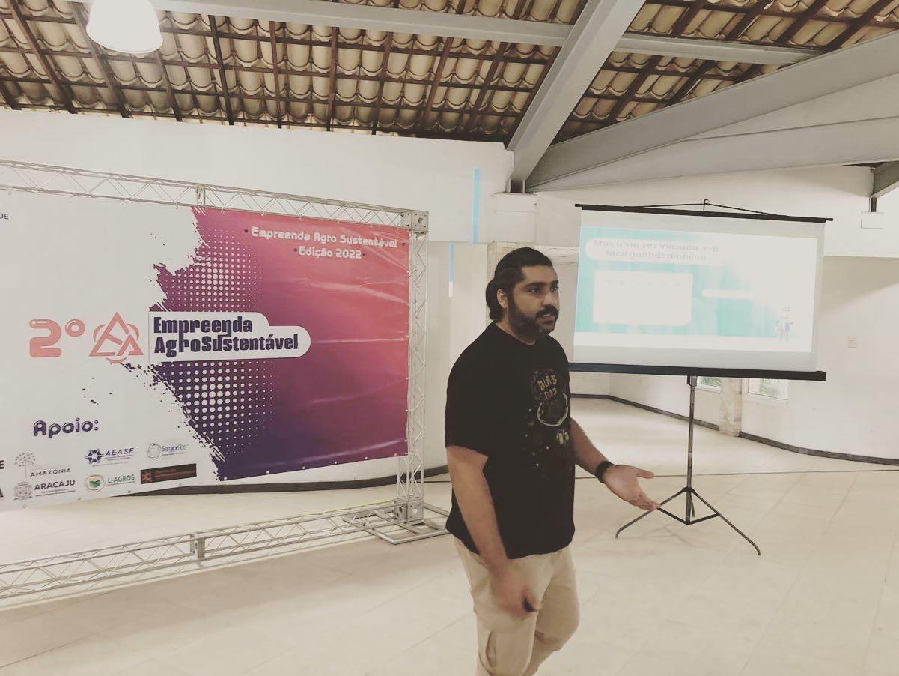
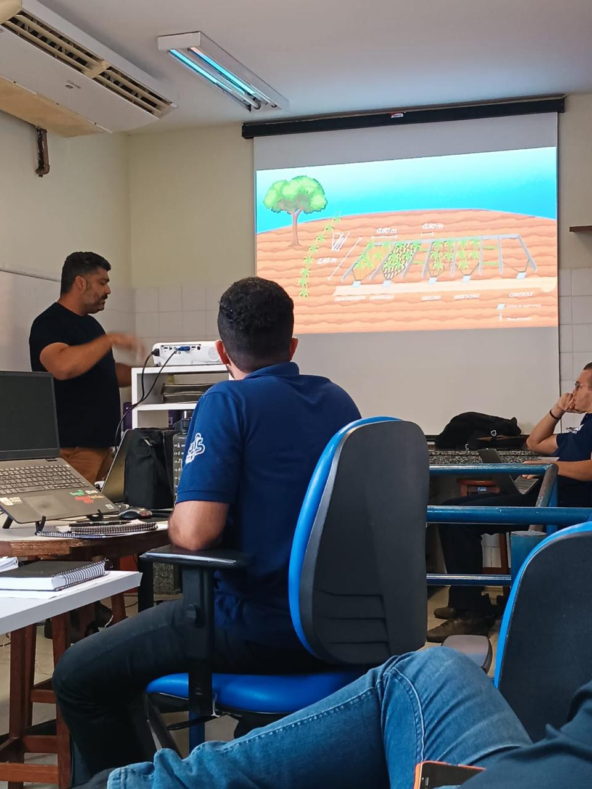

::: {.text-end .mb-3}
[Português](index.qmd) | [English](index-en.qmd) | **Español** | [Français](index-fr.qmd)
:::

##  En el Aula

::: {.columns}
::: {.column width="50%"}
{fig-alt="Profesor Luiz Diego en clase práctica" width="100%" .rounded}
:::
::: {.column width="50%"}
{fig-alt="Profesor Luiz Diego en clase expositiva" width="100%" .rounded}
:::
:::

---

::: {.callout-note}
## Contenido en Portugués

El contenido de medios está disponible actualmente solo en portugués. Por favor visite la [versión en portugués](index.qmd) para ver entrevistas y apariciones en medios.
:::
