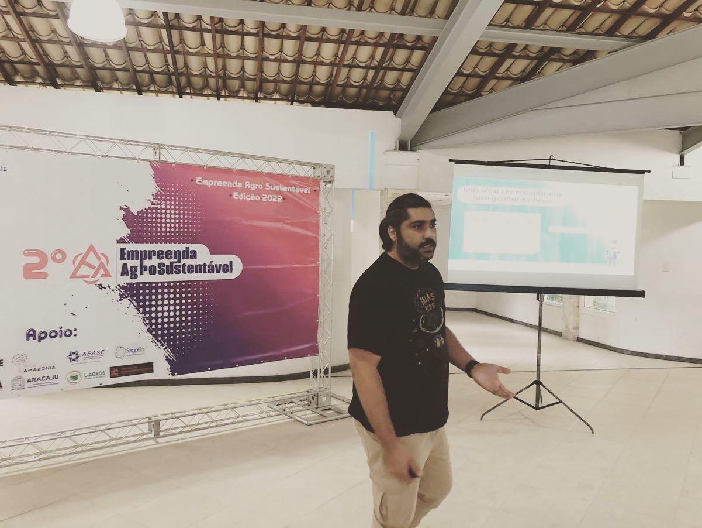
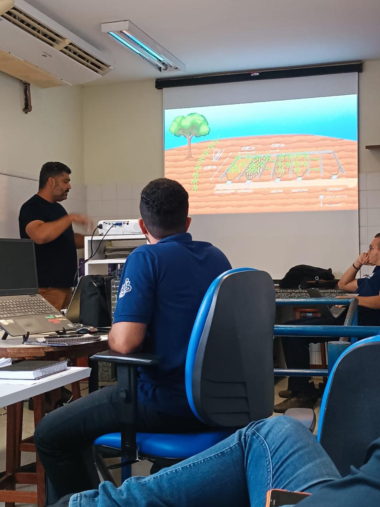

::: {.text-end .mb-3}
[Português](index.qmd) | [English](index-en.qmd) | [Español](index-es.qmd) | **Français**
:::

##  En classe

::: {.columns}
::: {.column width="50%"}
{fig-alt="Professeur Luiz Diego donnant un cours pratique" width="100%" .rounded}
:::
::: {.column width="50%"}
{fig-alt="Professeur Luiz Diego donnant une conférence" width="100%" .rounded}
:::
:::

---

::: {.callout-note}
## Contenu en portugais

Le contenu médiatique est actuellement disponible uniquement en portugais. Veuillez consulter la [version portugaise](index.qmd) pour voir les interviews et les apparitions médiatiques.
:::
