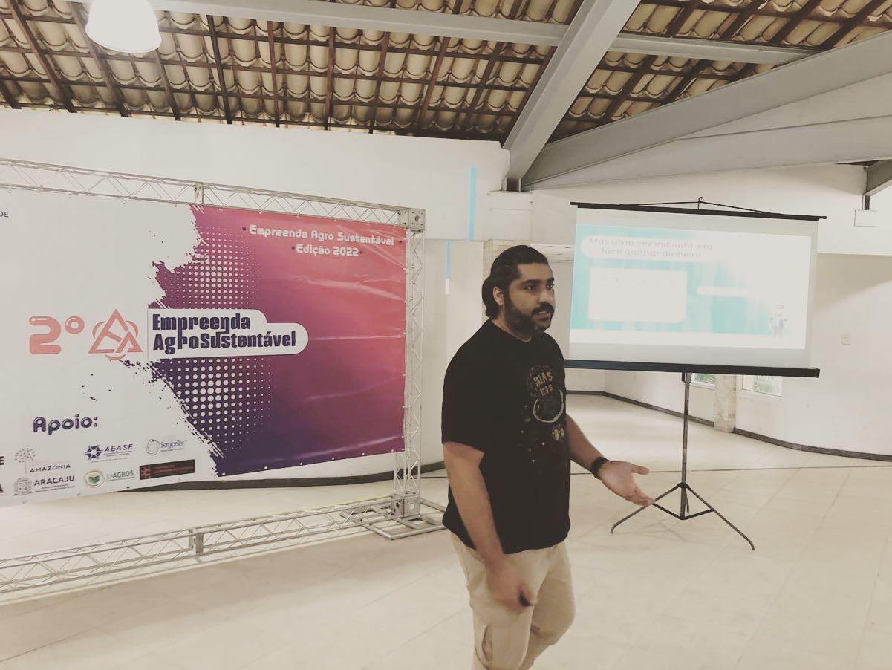
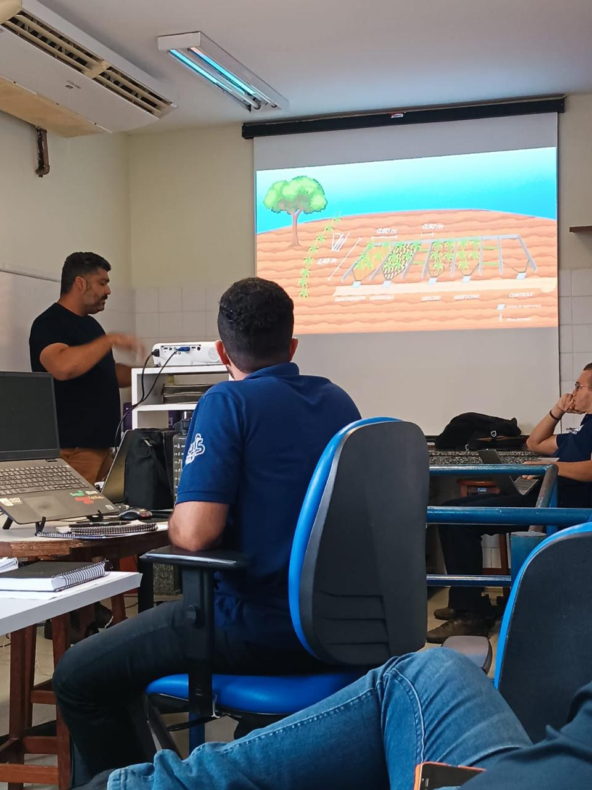

::: {.text-end .mb-3}
**Português** | [English](index-en.qmd) | [Español](index-es.qmd) | [Français](index-fr.qmd)
:::

##  Em Sala de Aula

::: {.columns}
::: {.column width="50%"}
{fig-alt="Professor Luiz Diego em aula prática" width="100%" .rounded}
:::
::: {.column width="50%"}
{fig-alt="Professor Luiz Diego em aula expositiva" width="100%" .rounded}
:::
:::

---
