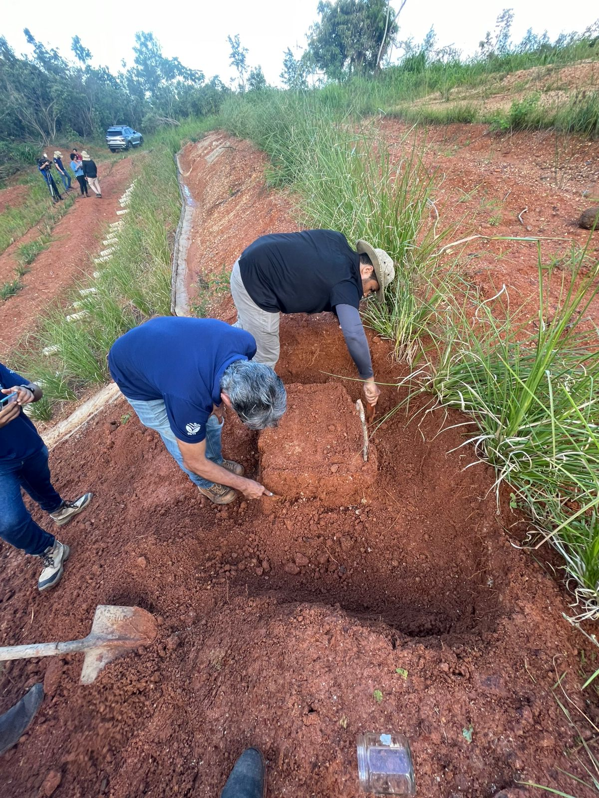

{fig-alt="Ortomosaico mostrando feições erosivas" width="100%"}

Ravina ou voçoroca? Parece uma pergunta simples, mas a classificação de feições erosivas constitui uma das áreas mais controversas da geomorfologia. O estudo conduzido em Tabuleiros Costeiros de Sergipe demonstra as razões dessa ambiguidade e propõe caminhos para resolvê-la.

::: {layout-ncol=2}
{fig-alt="Ravina ativa em Plintossolo"}

{fig-alt="Perfil de solo em feição erosiva"}
:::

## Área de estudo em Plintossolo

O trabalho de campo foi conduzido em uma área de tabuleiros costeiros no Campus Rural da UFS, em São Cristóvão, onde feições erosivas avançam há pelo menos 16 anos (análise multitemporal 2007 a 2023). O solo predominante é um Plintossolo Háplico Distrófico, argiloso, com baixa condutividade hidráulica, que gera escoamento superficial rápido quando chove.

São exatamente as condições perfeitas para erosão linear: a água não infiltra, concentra-se em linhas preferenciais e escava o solo.

::: {layout-ncol=2}
{fig-alt="Talude com erosão ativa em Tabuleiro Costeiro"}

{fig-alt="Retaludamento de encosta em área experimental"}
:::

## Ambiguidade terminológica

Na literatura, os termos "ravina" (*rill/gully*) e "voçoroca" (*gully/mega-gully*) são usados de forma inconsistente. Diferentes autores empregam critérios distintos, baseando-se ora na profundidade (acima de 50 cm configura voçoroca, ou de 30 cm?), ora na durabilidade (feições permanentes vs. efêmeras), ora no regime de fluxo (permanente vs. intermitente), ora na posição na paisagem (topo de vale, encosta, fundo de vale). Essa confusão terminológica prejudica a comunicação científica e, mais importante, as decisões de manejo, pois o tratamento para uma ravina ativa difere completamente do tratamento para uma voçoroca estabilizada.

## Elementary Gully Classification (EGC)

Foi aplicada a EGC de Thwaites et al. (2022), um sistema de classificação que integra múltiplos atributos em uma chave decisória sequencial, avaliando progressivamente a posição na paisagem (topo de vale, encosta, fundo de vale), a atividade (ativa ou inativa), a forma em planta (linear, composta/digitada), a seção transversal (V, U, trapezoidal), o tipo de cabeça (abrupta, gradual, difusa) e a profundidade (rasa, moderada, profunda).

::: {layout-ncol=2}
{fig-alt="Cisalhamento do solo em talude de Plintossolo"}

{fig-alt="Bloco de cisalhamento em ensaio de campo"}
:::

## Aquisição de dados com drone e fotogrametria

Para medir as feições com precisão, empregou-se um DJI Phantom 4 PRO com voos planejados (80% sobreposição longitudinal, 60% lateral), gerando ortomosaicos com resolução de 1 m, Modelo Digital de Elevação (MDE) e nuvem densa de pontos. Essa abordagem permite medir largura, comprimento, profundidade e volume de cada incisão com precisão centimétrica, muito além do que se consegue com trena em campo.

## Resultados e feições intermediárias

Das 6 feições inventariadas, emergiu um padrão que desafia a classificação binária, pois todas foram classificadas como permanentes e ativas, com morfologia predominantemente em V (material argiloso coesivo), sendo a feição 1 composta ou digitada com múltiplas ramificações (a mais complexa) e as feições 4 e 5 lineares em topo de vale. O problema reside no fato de que as feições apresentam características intermediárias entre ravina e voçoroca, dado que a seção em V e o material coesivo sugerem ravina, enquanto a permanência, profundidade e atividade contínua apontam para voçoroca.

## Interação solo-erosão no Plintossolo

A interação entre o solo e a erosão é determinante nesse contexto. No Plintossolo, a infiltração muito baixa gera escoamento concentrado rapidamente, a argila coesiva confere resistência aos taludes quando secos porém colapso quando saturados, e a sazonalidade marcada (chuvas concentradas de abril a setembro) cria pulsos erosivos cíclicos.

{fig-alt="Gráfico de série temporal de precipitação" width="80%"}

Essa dinâmica cria feições que evoluem episodicamente - avançam durante a estação chuvosa e estabilizam superficialmente na seca, mascarando a severidade real do processo.

## Limitações da EGC em solos tropicais

A EGC foi desenvolvida principalmente para ambientes temperados e semiáridos. Em Plintossolos de Tabuleiros Costeiros, foram identificadas limitações significativas, uma vez que o sistema não diferencia claramente ravinas de voçorocas em estágios intermediários, não incorpora comprimento como critério (uma feição de 80 m é qualitativamente distinta de uma de 5 m), não considera o clima regional (concentração de chuvas, potencial erosivo) e não captura a dinâmica de saturação-dessecação que governa a estabilidade de taludes argilosos.

## Conclusão

Classificar erosão não se resume a exercício acadêmico, constituindo antes a base para decidir o tratamento correto. O estudo demonstra que as feições erosivas em Plintossolos de Tabuleiros Costeiros ocupam uma zona cinzenta entre ravinas e voçorocas, que os sistemas classificatórios atuais não capturam adequadamente.

Propõe-se que a EGC seja adaptada para contextos tropicais, incorporando comprimento, regime pluviométrico e propriedades hidráulicas do solo como critérios adicionais. Enquanto isso, a combinação de drones, fotogrametria e análise de solo fornece a base de dados necessária para classificações mais robustas.

---

*Este post é baseado em artigo em preparação. Para saber mais sobre nossos projetos de conservação do solo, visite a [página de projetos](/#projetos) ou entre em [contato](mailto:ldvsantos@uefs.br).*
