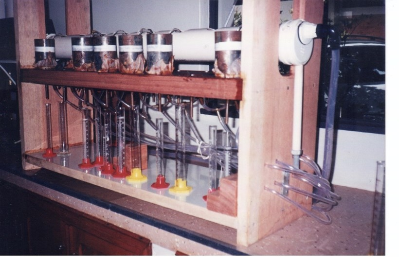

{fig-alt="Permeâmetro de campo para determinação de condutividade hidráulica" width="80%"}

A consolidação do geoprocessamento como disciplina científica resulta da convergência entre cartografia analítica, geodésia de precisão e teoria da informação espacial. Da cartografia temática de Humboldt à formalização da álgebra de mapas por Tomlin (1990), o espaço geográfico deixou de constituir suporte passivo para tornar-se variável de estado central na modelagem de sistemas ambientais. Nesse paradigma, o geoprocessamento articula ontologias espaciais, estruturas de dados, algoritmos numéricos e inferência estatística em cadeia capaz de traduzir observações físicas em estimativas quantitativas verificáveis. No semiárido, a sazonalidade fenológica e a intermitência hidrológica exigem que recorte espacial e janela de aquisição sejam coerentes com o mecanismo físico investigado, sob pena de invalidar o produto resultante.

## Representação do espaço geográfico

A modelagem do espaço geográfico exige a eleição prévia de uma ontologia entre objetos discretos e campos contínuos, decisão que condiciona toda a cadeia analítica subsequente. Na ontologia de objetos, entidades dotadas de identidade e limites finitos (parcelas, vias, corpos hídricos) são codificadas pelo modelo vetorial, no qual pontos, linhas e polígonos carregam coordenadas explícitas e atributos estruturados em esquemas de entidade-relacionamento. A força desse modelo reside na preservação topológica, pois regras de adjacência, incidência e conectividade (arc-node, winged-edge) garantem que feições compartilhem arcos sem sobreposição nem lacunas, preservando a integridade lógica indispensável a operações de rede e partição territorial. Na ontologia de campos, variáveis contínuas (elevação, temperatura, concentração de contaminantes) são amostradas em grades matriciais regulares, adequadas à representação de processos difusivos e ao cálculo matricial de alta performance. Operações de convolução de vizinhança, cálculo de declividade e estatísticas de textura dependem da isotropia implícita na malha raster, ao passo que consultas de rede, identificação de ciclos e métricas de grafos exigem a topologia rigorosa do modelo vetorial.

A geometria computacional complementa esse arcabouço com algoritmos de interseção, varredura angular, triangulação de Delaunay e polígonos de Voronoi, indispensáveis à partição espacial e à análise de proximidade. Em escala corporativa, bancos de dados espaciais (PostGIS) e protocolos do Open Geospatial Consortium (WMS, WFS, WCS) asseguram integridade transacional e interoperabilidade entre plataformas heterogêneas.

## Álgebra de mapas e análise espacial

A álgebra de mapas combina camadas como aplicação de operadores sobre domínios compartilhados. Operações locais transformam cada célula de forma independente, operações focais incorporam a vizinhança imediata mediante filtragem de convolução e estatísticas de janela móvel, e operações zonais agregam valores segundo partições poligonais, permitindo quantificar balanço hídrico por sub-bacia ou estoque de carbono por unidade de manejo. No domínio vetorial, o overlay executa interseções, uniões e diferenças simétricas, fundindo geometrias e instaurando novas relações topológicas.

Modelos digitais de terreno possibilitam derivar declividade, orientação e curvatura via diferenças finitas, enquanto algoritmos de fluxo (D8, D-infinity) e bacias de contribuição sustentam estudos hidrossedimentológicos. Na integração multicritério, a modelagem difusa (Fuzzy Sets) captura transições graduais de aptidão e risco, superando a rigidez booleana e representando a ambiguidade inerente aos limiares de decisão.

## Inferência e estatística espacial

A dependência espacial impõe violação controlada do pressuposto de independência amostral da estatística clássica. A Primeira Lei da Geografia, enunciada por Tobler (1970), postula que entidades próximas tendem a ser mais similares que entidades distantes, propriedade quantificada pelo Índice Global de Moran, cujos valores positivos indicam agrupamento e negativos sugerem dissimilaridade entre vizinhos. Os indicadores locais de associação espacial (LISA) decompõem esse índice global, localizando clusters e anomalias que denunciam processos erosivos incipientes ou pressão antrópica.

A geoestatística modela a continuidade espacial pelo semivariograma $\gamma(h) = \frac{1}{2}\operatorname{Var}[Z(s) - Z(s+h)]$, que alimenta a krigagem ordinária como estimador linear não enviesado de variância mínima. A superioridade desse estimador sobre métodos determinísticos reside na entrega simultânea de superfície estimada e superfície de variância, permitindo incorporar o risco associado a cada predição, condição essencial para a gestão adaptativa de sistemas naturais sob variabilidade climática.

::: {.callout-tip}
## 📷 Sugestão de imagem
**algebra-mapas.png** - Diagrama conceitual de operações de álgebra de mapas (camadas empilhadas com operadores +, ×, overlay) sobre paisagem semiárida estilizada.

**kriging-semivariograma.png** - Semivariograma experimental com ajuste esférico, ao lado de superfície interpolada por krigagem com mapa de variância associado.

**geoprocessamento-cover.png** - Visualização 3D de MDE com camadas sobrepostas (vetorial + raster), cores de heatmap e grade geodésica.
:::

---

*Para saber mais, confira os posts sobre [SIG na Exploração Mineral](/posts/sig-exploracao-mineral/), [Geoprocessamento na Mineração](/posts/geoprocessamento-mineracao/) e [Sensoriamento Remoto](/posts/sensoriamento-remoto-uso-cobertura/). Visite também nossas [publicações](/papers/) e [projetos](/#projetos).*
