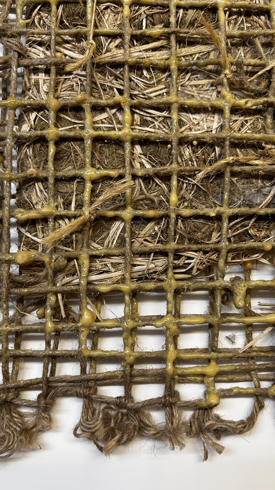
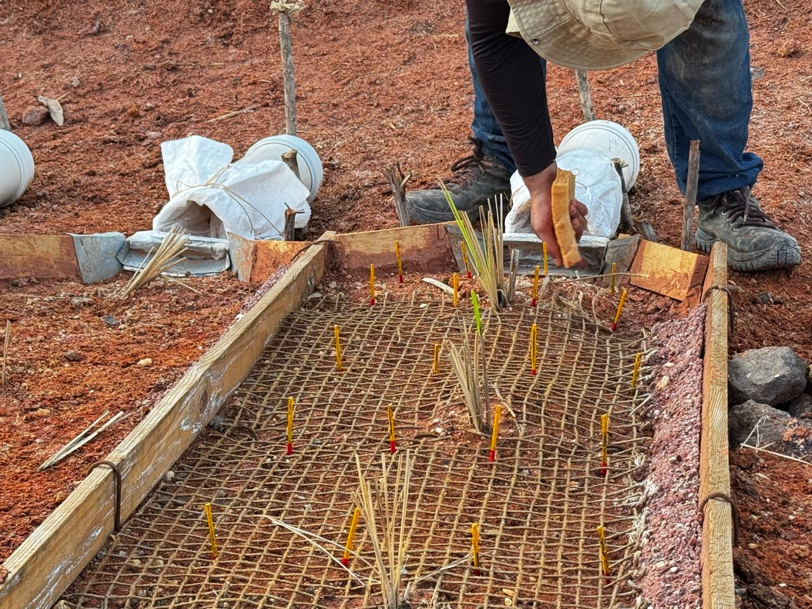

A erosão do solo constitui um dos desafios ambientais mais severos do Baixo São Francisco, onde encostas desprotegidas, taludes instáveis e a remoção da cobertura vegetal configuram um cenário de degradação acelerada. Geotêxteis (mantas permeáveis de fibras naturais ou sintéticas) figuram entre as soluções mais eficazes e econômicas para reverter esse processo, e os diferentes tipos de geossintéticos empregados no campo experimental do projeto de pesquisa ilustram a versatilidade dessa abordagem.

## Conceitos fundamentais

Geotêxteis são materiais têxteis permeáveis aplicados em contato direto com o solo para desempenhar funções simultâneas de filtração, separação, reforço e proteção superficial. Quando fabricados com fibras naturais (sisal, juta ou coco), recebem a denominação de *biogeotêxteis* e apresentam a vantagem da biodegradabilidade, integrando-se ao solo em 2 a 5 anos enquanto viabilizam o estabelecimento da vegetação nativa.

{fig-alt="Fibra de sisal para fabricação de geotêxteis" width="80%"}

## Processos erosivos em taludes do Baixo São Francisco

No Baixo São Francisco, taludes de encosta sofrem com processos erosivos severos, pois a retirada da vegetação ciliar (como a taboa), aliada ao regime de chuvas concentradas, provoca deslizamentos e perda massiva de solo.

::: {layout-ncol=2}
{fig-alt="Talude exposto com erosão visível no Baixo São Francisco"}

{fig-alt="Processo erosivo em talude no Baixo São Francisco"}
:::

O retaludamento (reconfiguração do perfil da encosta) é o primeiro passo antes da instalação dos geossintéticos.

{fig-alt="Operação de retaludamento em talude do Baixo São Francisco" width="80%"}

## Geotêxteis expostos e proteção imediata do solo

A aplicação de geotêxteis sobre os taludes retaludados cria uma barreira física contra o impacto das gotas de chuva (*splash erosion*), reduz a velocidade do escoamento superficial e retém sedimentos, sendo a manta fixada com estacas de modo a permitir a infiltração da água.

::: {layout-ncol=2}
{fig-alt="Geotêxteis instalados sobre talude para controle de erosão"}

{fig-alt="Detalhe de geotêxtil exposto sobre talude"}
:::

{fig-alt="Geotêxtil em área experimental no Baixo São Francisco" width="80%"}

## Geocélulas e confinamento tridimensional do solo

As geocélulas são estruturas tridimensionais em formato de colmeia que confinam o solo e impedem sua movimentação lateral, revelando-se especialmente eficazes em taludes íngremes e canais de escoamento, onde a força gravitacional e hidráulica tende a arrastar o material.

::: {layout-ncol=3}
{fig-alt="Geocélula tridimensional instalada em talude"}

{fig-alt="Estrutura alveolar de geocélula preenchida com solo"}

{fig-alt="Geocélula em processo de preenchimento no campo"}
:::

::: {layout-ncol=3}
{fig-alt="Preenchimento de geocélula com solo"}

{fig-alt="Geocélula aplicada em encosta para estabilização"}

{fig-alt="Área experimental com geocélulas instaladas"}
:::

A grande vantagem das geocélulas reside na possibilidade de plantio de vegetação dentro dos alvéolos, unindo engenharia geotécnica e revegetação em uma única solução.

## Geocompostos e proteção integrada

Os geocompostos combinam duas ou mais funções em um único produto (reforço com drenagem, ou filtração com proteção superficial, por exemplo). No campo experimental, foram utilizados geocompostos que integram uma manta de fibra com uma malha de reforço.

::: {layout-ncol=2}
{fig-alt="Geocomposto instalado sobre talude para proteção integrada"}

{fig-alt="Detalhe de geocomposto híbrido Typha-rami com malha de reforço e núcleo Bio-SAP"}
:::

## Geogrid e reforço estrutural com fibras naturais

O geogrid é uma malha aberta de reforço fabricada com fios de rami (*Boehmeria nivea*), que confere resistência à tração e estabilidade dimensional ao geocomposto. A estrutura em grade permite o crescimento da vegetação através das aberturas, integrando reforço mecânico com revegetação.

{fig-alt="Geogrid de fibra natural de rami com vegetação emergente em campo experimental" width="80%"}

## Técnicas complementares

A eficácia dos geossintéticos é potencializada quando combinada com outras técnicas de bioengenharia de solos. Os cordões de contorno, que funcionam como barreiras de contenção ao longo das curvas de nível, reduzem a velocidade do escoamento superficial e promovem a infiltração.

::: {layout-ncol=3}
{fig-alt="Construção de cordão de contorno em área experimental"}

{fig-alt="Cordão de contorno instalado em encosta"}

{fig-alt="Vista panorâmica dos cordões de contorno em área de pesquisa"}
:::

A revegetação com plantio de espécies nativas completa o protocolo ao fornecer estabilização biológica definitiva.

{fig-alt="Área revegetada como parte do programa de recuperação de taludes" width="80%"}

## Resultados e impacto

Os resultados obtidos no campo experimental do Baixo São Francisco demonstram que a combinação de geossintéticos com técnicas de bioengenharia reduz em 40 a 60% a perda de solo por erosão hídrica e custa até 30% menos que soluções de engenharia convencional (muros de arrimo, gabiões), ao mesmo tempo em que favorece a regeneração natural da vegetação. A replicabilidade em escala com materiais locais (fibra de sisal e mão de obra regional) e a biodegradação programada dos biogeotêxteis em 2 a 5 anos, quando a vegetação já assume a função protetora, conferem ao sistema a lógica operacional das *Nature-Based Solutions* (NBS), soluções que trabalham *com* a natureza e não contra ela.

{fig-alt="Canal de escoamento com geossintéticos para controle de erosão" width="80%"}

## Conclusão

Geotêxteis, geocélulas e geocompostos transcendem a condição de meros materiais de engenharia para operar como ferramentas de transformação territorial. Em um contexto em que o Semiárido perde solo, água e produtividade a cada evento pluviométrico, essas tecnologias oferecem um caminho viável, econômico e sustentável para a recuperação ambiental, cuja integração à prática de conservação do solo, planejamento territorial e engenharia ambiental se justifica pelos resultados de campo obtidos.

---

*Para saber mais sobre nossos projetos de pesquisa, visite a [página de projetos](/#projetos) ou confira nossas [publicações](/papers/).*
