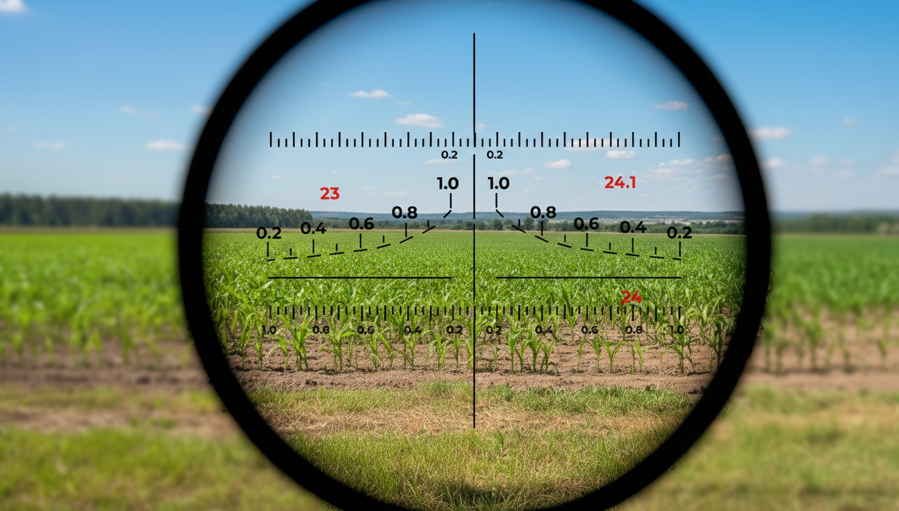

{fig-alt="Área revegetada como resultado de intervenção ambiental mensurável" width="80%"}

A aplicação da Inteligência Artificial nas ciências ambientais não constitui uma ruptura epistemológica, mas uma evolução dos métodos estatísticos para a aproximação de funções não lineares em espaços de alta dimensionalidade. O desafio central da pesquisa de qualidade não reside no ajuste dos dados de treino, mas na capacidade de generalização do modelo para cenários não observados. Em termos de engenharia de dados, o Erro de Generalização decompõe-se no dilema Viés-Variância ($E[(y - \hat{f}(x))^2] = \text{Viés}^2 + \text{Variância} + \sigma^2$), onde modelos excessivamente complexos tendem a ter baixo viés porém alta variância (overfitting), memorizando o ruído estocástico dos dados em vez de aprender o sinal determinístico do fenômeno ambiental. A qualidade científica é, portanto, medida pela robustez do modelo em manter o erro controlado quando exposto a novos dados, evitando conclusões espúrias que poderiam fundamentar decisões de gestão equivocadas.

## Autocorrelação espacial e validação

Um erro metodológico recorrente na pesquisa ambiental é a violação da premissa de independência das amostras (i.i.d.) assumida pela maioria dos algoritmos de aprendizado de máquina. Dados ambientais obedecem à Primeira Lei da Geografia, onde locais próximos são mais semelhantes entre si, criando uma autocorrelação espacial que infla artificialmente as métricas de desempenho se a validação for feita por sorteio aleatório simples. A integridade da pesquisa exige a adoção de Validação Cruzada por Blocos Espaciais (Spatial Block Cross-Validation), que força o modelo a prever regiões desconhecidas, simulando a operação real e evitando o vazamento de informações entre os conjuntos de treino e teste. A área sob a curva ROC, a RMSE e o R² ajustado devem ser reportados com intervalos de confiança derivados dessa validação espacialmente estruturada, e não de partições aleatórias que ignoram a dependência geográfica.

## Reprodutibilidade e princípios FAIR

A credibilidade da IA ambiental depende de sua auditabilidade. Modelos de tipo "caixa-preta" são inadmissíveis em contextos de licenciamento ou definição de políticas públicas, pois carecem de explicabilidade causal. A pesquisa de alta qualidade adere aos princípios FAIR (Findable, Accessible, Interoperable, Reusable), garantindo que não apenas os resultados, mas o código, os hiperparâmetros e os dados brutos sejam acessíveis à verificação pela comunidade científica e pelos órgãos de controle. Técnicas de explicabilidade como SHAP (SHapley Additive exPlanations) e LIME (Local Interpretable Model-agnostic Explanations) permitem descompor a contribuição de cada variável preditora na saída do modelo, conferindo transparência causal à predição sem sacrificar a capacidade de capturar não-linearidades.

## Especificidades do semiárido e parcimônia

No contexto do semiárido brasileiro, a escassez de séries históricas longas e a alta variabilidade climática impõem restrições adicionais à modelagem. A aplicação de algoritmos complexos (Redes Neurais Profundas) em datasets pequenos (*small data*) frequentemente resulta em soluções instáveis, razão pela qual a engenharia de conhecimento deve priorizar modelos mais parcimoniosos, como Random Forests, que oferecem melhor interpretabilidade e resistência ao ruído. A validação não deve se limitar a métricas de acurácia global, mas investigar a distribuição espacial do erro e a sensibilidade do modelo às variáveis de entrada. Somente através de uma governança de algoritmos transparente e tecnicamente fundamentada será possível transformar dados massivos em inteligência acionável para a conservação da biodiversidade e a gestão de recursos hídricos.

{fig-alt="Visão reticular de dados geoespaciais processados" width="80%"}

::: {.callout-tip}
## 📷 Sugestão de imagem
**vies-variancia.png** - Diagrama clássico do dilema viés-variância (alvo com tiros agrupados mas deslocados vs. dispersos vs. centrados e agrupados).

**spatial-block-cv.png** - Mapa com área de estudo dividida em blocos espaciais coloridos (treino em azul, teste em laranja), ilustrando validação cruzada espacial vs. sorteio aleatório.
:::

---

*Para saber mais, confira os posts sobre [Terroir Digital e Machine Learning](/posts/terroir-digital-ml/), [Sensoriamento Remoto](/posts/sensoriamento-remoto-uso-cobertura/) e [Índice Fuzzy de Sustentabilidade](/posts/indice-fuzzy-sustentabilidade/). Visite também nossas [publicações](/papers/) e [projetos](/#projetos).*
