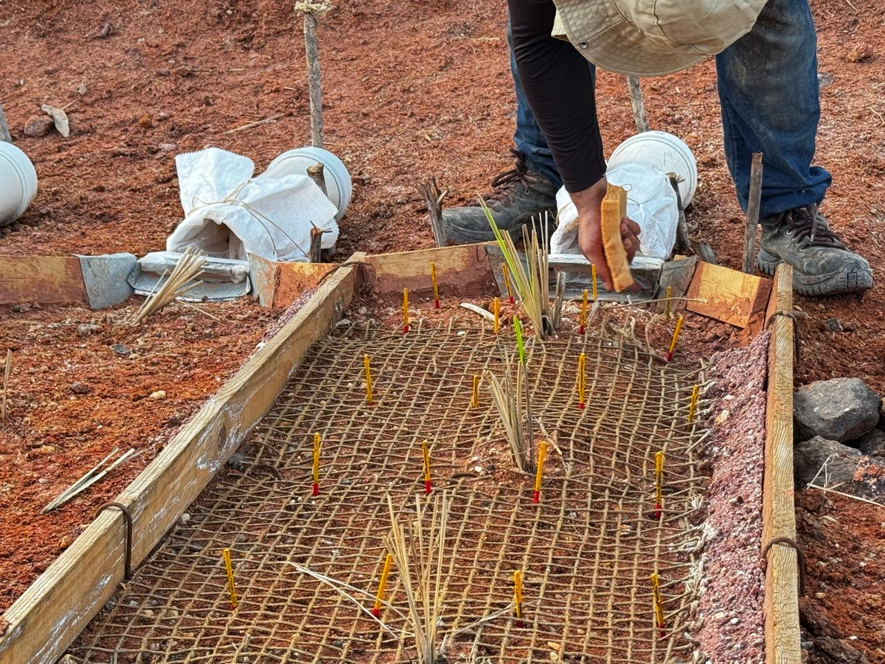
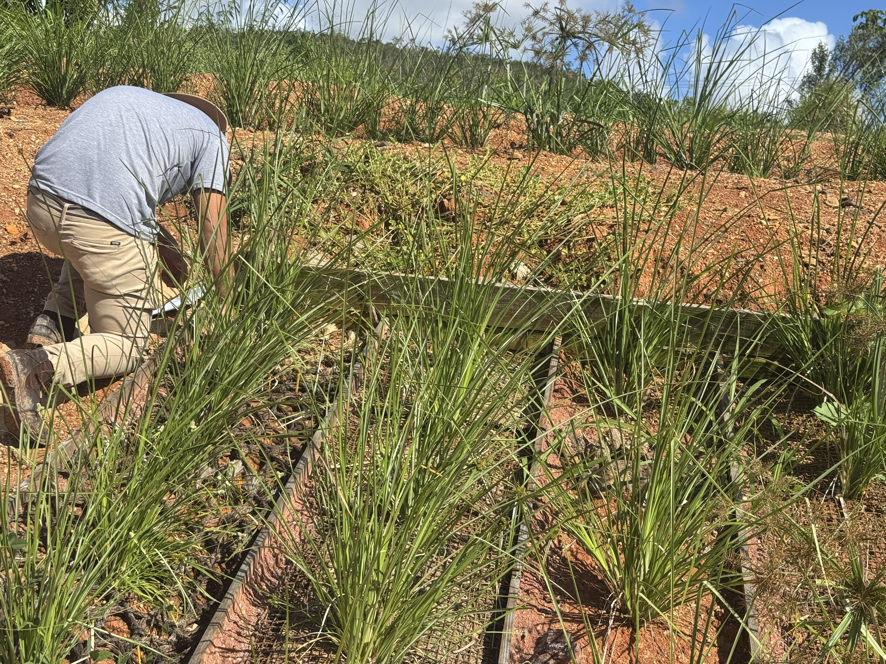

A estabilização de taludes degradados no Semiárido brasileiro exige uma abordagem integrada que combine engenharia geotécnica com processos ecológicos. O retaludamento, definido como a reconfiguração do perfil geométrico de encostas instáveis, constitui a etapa inicial e indispensável de qualquer protocolo de Soluções Baseadas na Natureza (NBS) para o controle de erosão e a recuperação ambiental de áreas degradadas.

## Conceito de retaludamento

O retaludamento consiste na modificação controlada da geometria de um talude, reduzindo sua inclinação original para um ângulo de equilíbrio compatível com as propriedades mecânicas do solo local. Na prática, trata-se de cortar e reperfilar a encosta, transformando um perfil íngreme e instável em uma superfície suavizada que favorece a infiltração da água, reduz a velocidade do escoamento superficial e cria condições adequadas para o enraizamento da vegetação.

::: {layout-ncol=2}
{fig-alt="Talude exposto com erosão visível no Baixo São Francisco"}

{fig-alt="Processo erosivo em talude no Baixo São Francisco"}
:::

## Fundamentos do retaludamento como NBS

As Soluções Baseadas na Natureza são intervenções que utilizam ou replicam processos naturais para enfrentar desafios ambientais. O retaludamento se enquadra nessa categoria porque restabelece a geometria natural (taludes com ângulos suavizados reproduzem perfis de equilíbrio encontrados em encostas naturais estáveis), facilita processos ecológicos (a superfície reperfilada permite a colonização vegetal espontânea e o desenvolvimento de raízes estabilizadoras), reduz a energia hidráulica (a diminuição da inclinação reduz a velocidade do escoamento e a capacidade de transporte de sedimentos) e cria a base para intervenções complementares, dado que geotêxteis, geocompostos e revegetação dependem de um perfil estável para funcionar adequadamente.

{fig-alt="Operação de retaludamento em encosta degradada no Baixo São Francisco" width="80%"}

## Protocolo integrado de NBS

O retaludamento é a primeira etapa de um protocolo escalonado de NBS desenvolvido no Baixo São Francisco. A reconfiguração geométrica da encosta é executada com equipamento mecânico, estabelecendo inclinação de 1V:2H (26,6°) ou inferior conforme análise de estabilidade do talude, e o material removido é redistribuído na base para formação de bermas de equilíbrio.

Sobre o talude reperfilado, instalam-se geotêxteis biodegradáveis (fibras de sisal ou taboa) para proteção imediata contra erosão por splash e escoamento superficial. Em áreas de maior solicitação, aplicam-se geocompostos híbridos Typha-rami com núcleos de Bio-SAP, que além do reforço mecânico proporcionam gestão hídrica e nutricional ativa.

::: {layout-ncol=2}
{fig-alt="Geocomposto instalado sobre talude reperfilado"}

{fig-alt="Detalhe do geocomposto híbrido com malha de reforço e núcleo hidroretentor"}
:::

Na sequência, o geogrid de rami confere reforço estrutural à camada superficial do solo, permitindo o crescimento da vegetação através das aberturas da malha, e a combinação geogrid + geocomposto cria um sistema de proteção multifuncional.

{fig-alt="Geogrid de fibra natural com vegetação emergente em campo experimental" width="80%"}

O plantio de espécies nativas adaptadas ao Semiárido complementa o protocolo, dado que o sistema radicular assumirá progressivamente a função de estabilização do solo à medida que os biogeotêxteis se biodegradarem (2 a 5 anos).

{fig-alt="Área revegetada como resultado do protocolo integrado de NBS" width="80%"}

Cordões de contorno e paliçadas dispostos ao longo das curvas de nível interceptam o escoamento superficial e reduzem a velocidade da água, complementando a proteção oferecida pelos geossintéticos.

::: {layout-ncol=3}
{fig-alt="Construção de cordão de contorno em área experimental"}

{fig-alt="Cordão de contorno instalado em encosta"}

{fig-alt="Vista panorâmica dos cordões de contorno"}
:::

## Resultados de campo

Os resultados do protocolo integrado de NBS no Baixo São Francisco evidenciam redução de 40 a 60% na perda de solo por erosão hídrica, com custo até 30% inferior comparado a soluções convencionais (muros de arrimo, gabiões, enrocamento). O estabelecimento vegetal alcançou 90% da área tratada após 12 meses, enquanto a biodegradação controlada dos geossintéticos ocorre em 2 a 5 anos sem geração de microplásticos. Um benefício adicional reside no duplo serviço ambiental proporcionado pela remoção de taboa invasora de corpos d'água eutrofizados e sua conversão em insumo de engenharia.

{fig-alt="Canal de escoamento com geossintéticos para controle de erosão" width="80%"}

## Implicações para o planejamento territorial

O retaludamento como NBS demonstra que a engenharia geotécnica e a ecologia não são abordagens concorrentes, mas complementares. Para gestores públicos e planejadores territoriais do Semiárido, essa abordagem oferece escalabilidade (uso de materiais locais como taboa, sisal e rami, além de mão de obra regional), sustentabilidade (materiais biodegradáveis que se integram ao solo), multifuncionalidade (controle de erosão conjugado com gestão hídrica, regulação nutricional e sequestro de carbono) e viabilidade econômica (custos competitivos com retornos ambientais mensuráveis).

O grupo PLANeT-Inova (UEFS) continua desenvolvendo e validando protocolos de NBS para o Semiárido, com foco na transferência de tecnologia para municípios com orçamentos limitados.

---

*Para saber mais sobre geossintéticos e bioengenharia, confira os posts sobre [Geotêxteis no Controle de Erosão](/posts/geotexteis-controle-erosao/) e [Geocompostos Hidrorretentores Typha-Rami](/posts/geocompostos-hidrorretentores-typha-rami/). Visite também nossas [publicações](/papers/) e [projetos](/#projetos).*
