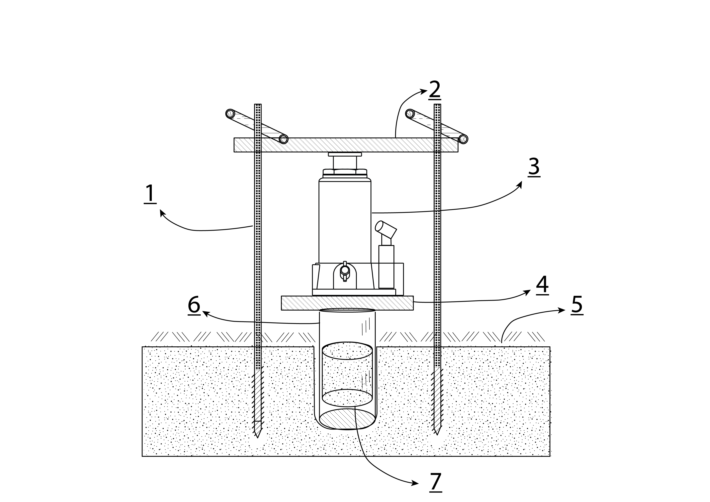
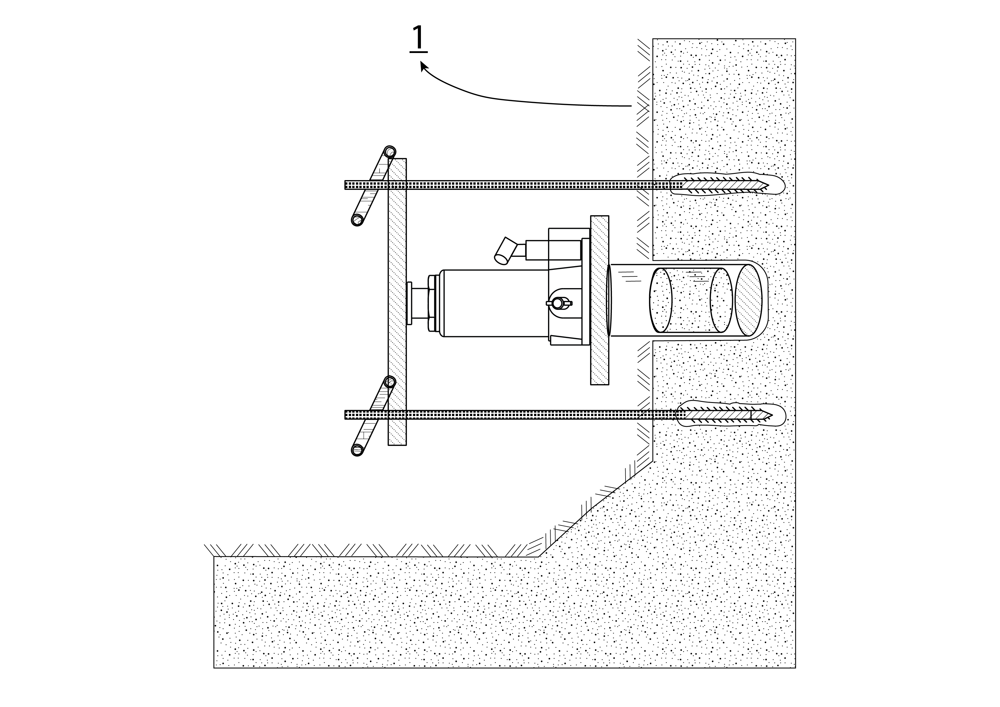

A determinação confiável de propriedades físicas e hidráulicas do solo, como condutividade hidráulica saturada, porosidade e densidade aparente, depende da integridade estrutural da amostra coletada. Métodos convencionais de amostragem com anéis volumétricos frequentemente introduzem perturbações mecânicas (compactação lateral, cisalhamento de agregados, deformação do anel) que comprometem a representatividade dos resultados. O amostrador de solo indeformado patenteado (INPI BR10202401648) resolve esse problema por meio de uma disposição construtiva que combina sistema mecânico de cravação controlada com método de preservação estrutural da amostra.

{fig-alt="Amostrador de solo indeformado patenteado" width="80%"}

## Princípio de funcionamento

O dispositivo opera por cravação vertical controlada de corpo cilíndrico no perfil de solo, com mecanismo de avanço que aplica força distribuída uniformemente, minimizando tensões laterais parasitas. O sistema de corte periférico na base do amostrador secciona a amostra na profundidade desejada sem propagação de fissuras. O método de selagem integrado preserva a umidade e a estrutura original da amostra desde o momento da extração até a chegada ao laboratório.

::: {layout-ncol=2}
{fig-alt="Componentes internos do amostrador de solo"}

{fig-alt="Amostrador montado para coleta em campo"}
:::

## Desenhos técnicos

Os desenhos de patente detalham a geometria construtiva, as dimensões funcionais e a sequência operacional de montagem e uso do equipamento, incluindo a disposição dos componentes de fixação, guia e selagem.

::: {layout-ncol=2}
{fig-alt="Desenho técnico prancha 1 do amostrador"}

{fig-alt="Desenho técnico prancha 3 do amostrador"}
:::

## Inovação e aplicabilidade

A inovação central reside na integração de cravação controlada e preservação estrutural em um único dispositivo portátil, eliminando a necessidade de equipamentos auxiliares pesados e reduzindo o tempo de coleta em campo. O amostrador é compatível com anéis volumétricos padronizados e pode ser operado por um único técnico. A patente foi depositada em 2024 no INPI sob registro BR10202401648, com aplicação direta em estudos de física do solo, geotecnia ambiental e monitoramento de áreas degradadas.

---

*Para saber mais sobre instrumentação e análise de solos, confira os posts sobre [Propriedades Físicas e Hidrológicas](/posts/prop-fisicas-hidrologicas/), [Infiltração e Hidrologia de Campo](/posts/infiltracao-hidrologia/) e a [Patente do Permeâmetro](/posts/patente-permeametro/). Visite os [projetos](/#projetos) para uma visão geral.*
