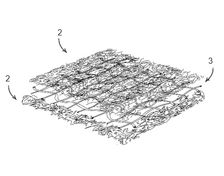
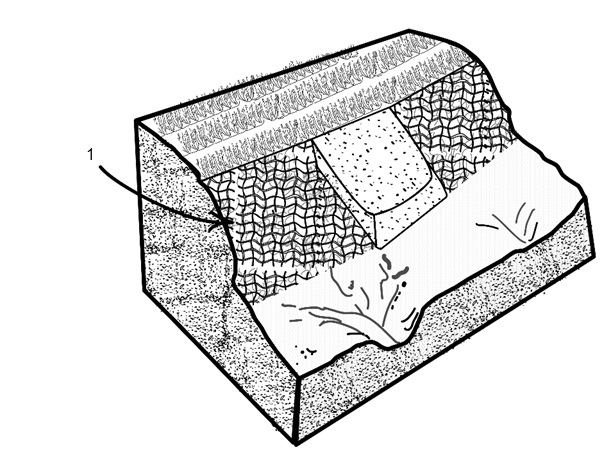

O controle de erosão em taludes e encostas frequentemente demanda a associação de múltiplas funções geotécnicas (proteção superficial, reforço estrutural, drenagem e filtragem) que, em soluções convencionais, são providas por camadas sobrepostas de geossintéticos distintos. O geocomposto híbrido em desenvolvimento integra duas ou mais dessas funções em um único produto, combinando manta de fibra vegetal (proteção e filtragem) com malha de reforço tipo geogrid (estabilidade mecânica) em uma estrutura compacta aplicável diretamente sobre a superfície do talude.

{fig-alt="Geocomposto híbrido para proteção de solos" width="80%"}

## Estrutura e fabricação

O produto é composto por uma camada externa de manta de fibras naturais (Taboa, junco ou sisal) que opera como proteção contra impacto de gotas de chuva e como filtro para retenção de partículas finas, vinculada a uma malha interna de reforço que confere resistência à tração e estabilidade dimensional ao conjunto. A vinculação entre camadas é feita por costura ou aglutinação com resina vegetal, mantendo a permeabilidade necessária para drenagem e crescimento de raízes.

::: {layout-ncol=2}
{fig-alt="Geocomposto em ensaio laboratorial de resistência"}

{fig-alt="Detalhe da estrutura do geocomposto híbrido"}
:::

## Aplicação em campo experimental

O geocomposto foi instalado em parcelas experimentais no Baixo São Francisco, sobre taludes retaludados e preparados com protocolo de NBS. A avaliação de desempenho comparou parcelas com geocomposto, com geotêxtil simples e sem cobertura (controle), monitorando perda de solo, escoamento superficial e estabelecimento vegetal ao longo de ciclos de chuva.

{fig-alt="Geocomposto instalado em talude com revegetação" width="80%"}

## Inovação e estado atual

O geocomposto está em fase de documentação para depósito no INPI. A integração multifuncional reduz custos de instalação (uma única operação substitui múltiplas camadas), melhora a aderência ao solo por conformação da manta e permite o estabelecimento vegetal por aberturas da malha. A compatibilidade com os demais geossintéticos do portfólio (geogrid de Taboa, geodreno vegetal) permite configurações customizadas para diferentes cenários geomorfológicos e climáticos.

---

*Para saber mais sobre geossintéticos e proteção de solos, confira os posts sobre [Geocompostos para NBS](/posts/geocompostos-nbs/), [Geotêxteis para Controle de Erosão](/posts/projeto-geotexteis-controle-erosao/), [Patente Geogrid de Taboa](/posts/patente-geotextil-taboa/) e [Patente Geodreno](/posts/patente-geodreno/). Visite os [projetos](/#projetos) para uma visão geral.*
