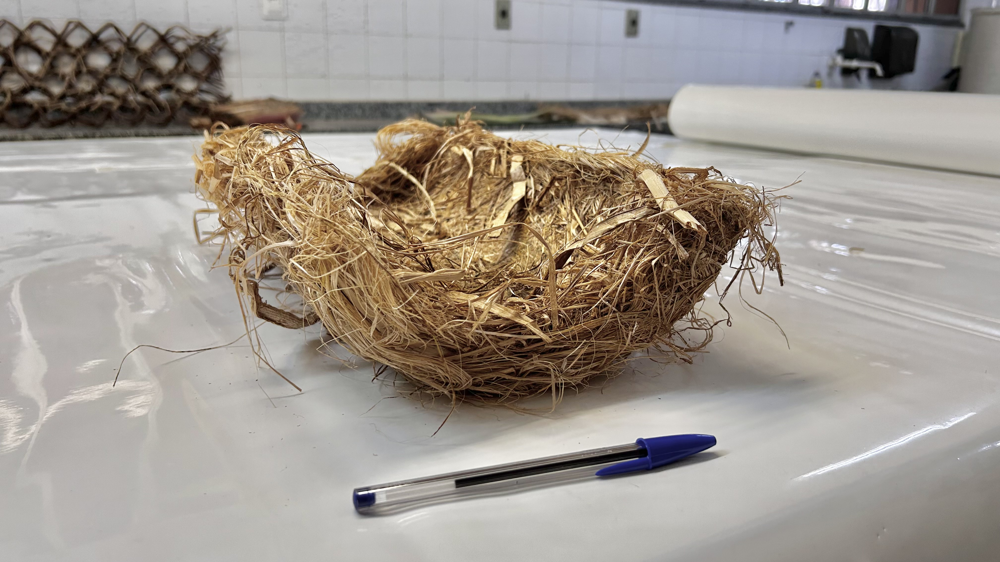
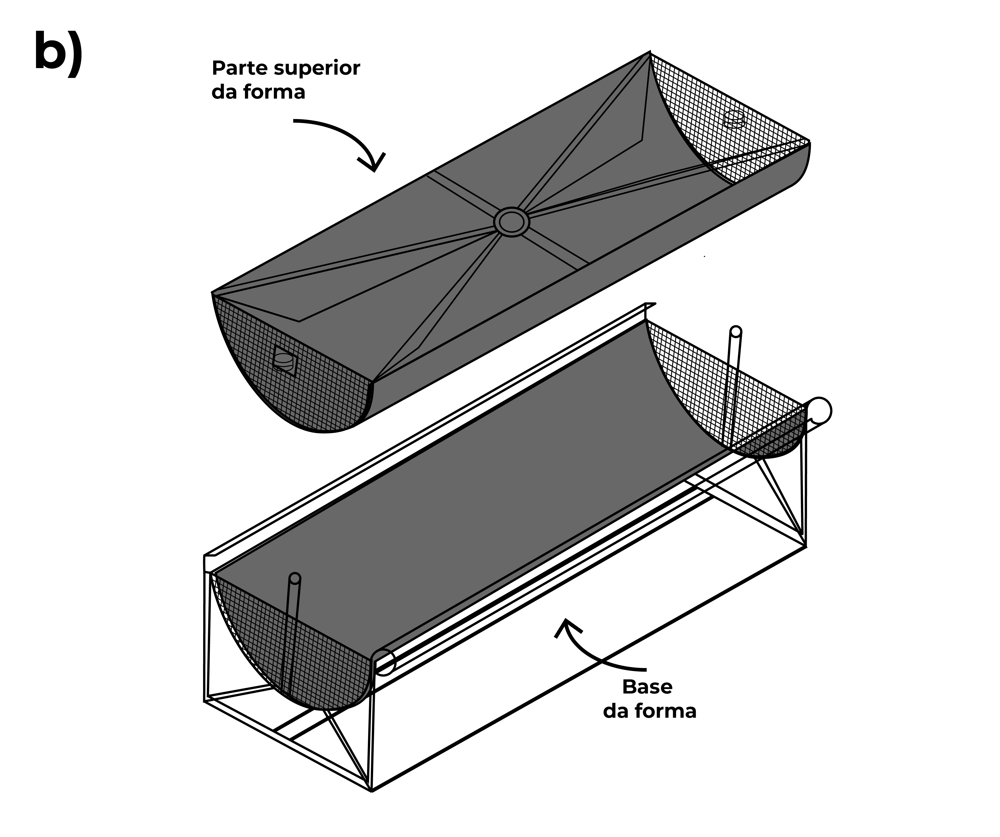
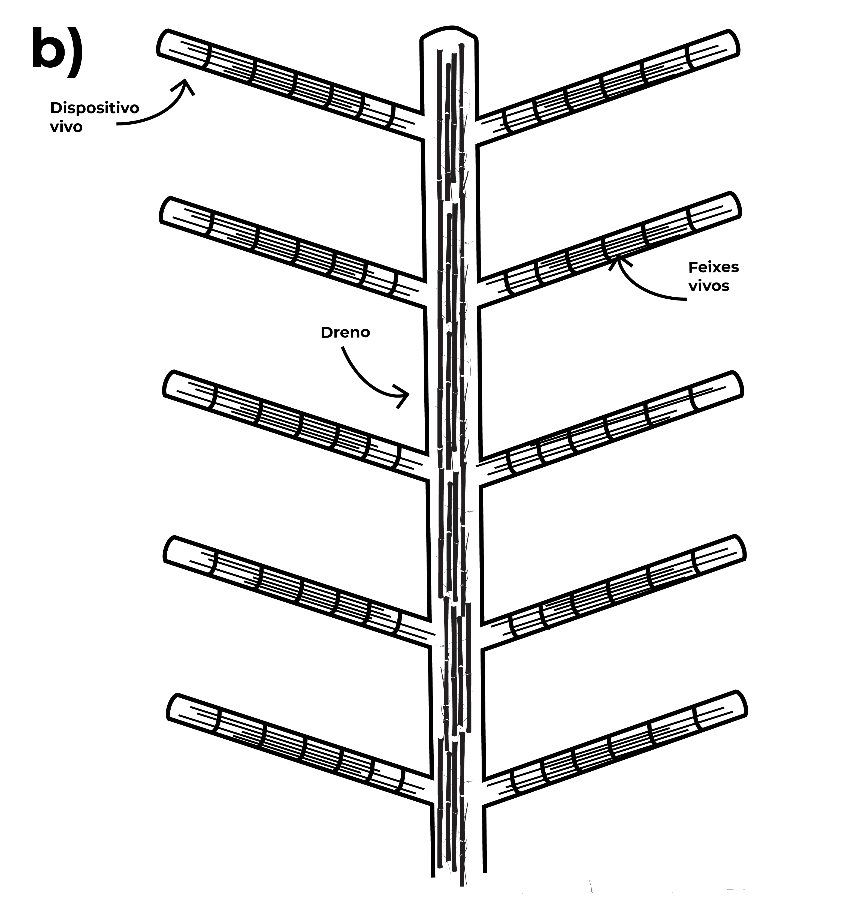
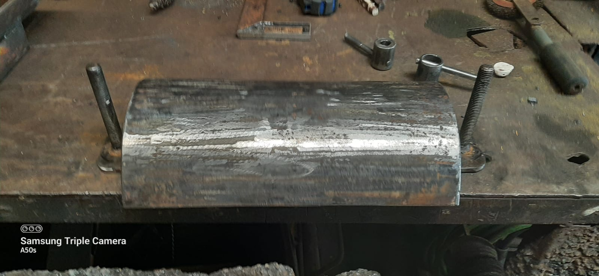

A drenagem subsuperficial em taludes e encostas é um fator determinante para a estabilidade geotécnica, pois a elevação do nível freático e o desenvolvimento de poropressões positivas são mecanismos clássicos de ruptura. As soluções convencionais (drenos de areia, geocompostos drenantes sintéticos, tubos de PVC com manta geotêxtil) são eficazes mas geram passivos ambientais por materiais não biodegradáveis. O geodreno vegetal patenteado integra fibras naturais de Taboa (*Typha domingensis*) e Bananeira (*Musa* spp.) aglutinadas com resina vegetal em uma configuração de dupla placa drenante com tubo poroso central instalado em geometria "espinha de peixe".

{fig-alt="Geodreno vegetal biodegradável" width="80%"}

## Concepção construtiva

O geodreno é composto por duas placas de manta de fibras vegetais prensadas e aglutinadas com resina de base vegetal, que confinam um tubo drenante poroso fabricado também com material natural. As placas operam como filtro, permitindo a entrada de água e retendo partículas finas, enquanto o tubo central conduz o fluxo drenado para pontos de descarga. A instalação em geometria "espinha de peixe" maximiza a área de captação e reduz o comprimento de caminho de fluxo no interior do talude.

::: {layout-ncol=2}
{fig-alt="Desenho técnico prancha 1 do geodreno vegetal"}

{fig-alt="Desenho técnico prancha 2 do geodreno vegetal"}
:::

## Ensaios e desempenho

O protótipo TRL 6 foi testado em campo experimental no Baixo São Francisco, demonstrando capacidade de drenagem compatível com as demandas de rebaixamento de nível freático em taludes de até 3 metros de altura. A condutividade hidráulica do sistema filtrante (placas de fibra) foi ajustada pela gramatura e compactação das fibras para atender ao critério de retenção sem colmatação prematura.

{fig-alt="Geodreno vegetal instalado em campo no Baixo São Francisco" width="80%"}

## Inovação e impacto ambiental

A solução é 100% biodegradável, eliminando a necessidade de remoção após a vida útil funcional e substituindo estruturas de concreto e materiais sintéticos. A utilização de matéria-prima local (Taboa e Bananeira) reduz custos logísticos e gera oportunidades socioeconômicas em comunidades rurais. O geodreno é compatível com os demais geossintéticos do portfólio (geogrid de Taboa, geocompostos), permitindo soluções integradas de proteção e drenagem em um mesmo talude.

---

*Para saber mais sobre geossintéticos e drenagem, confira os posts sobre [Geotêxteis para Controle de Erosão](/posts/projeto-geotexteis-controle-erosao/), [Patente Geogrid de Taboa](/posts/patente-geotextil-taboa/), [Patente Geocomposto](/posts/patente-geocomposto/) e [NBS Retaludamento Vegetado](/posts/nbs-retaludamento/). Visite os [projetos](/#projetos) para uma visão geral.*
