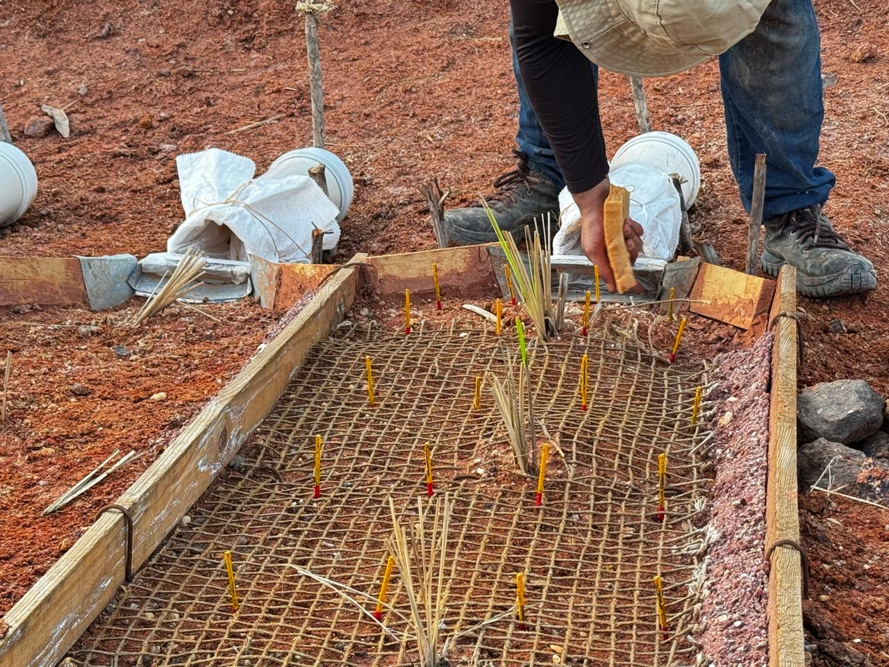
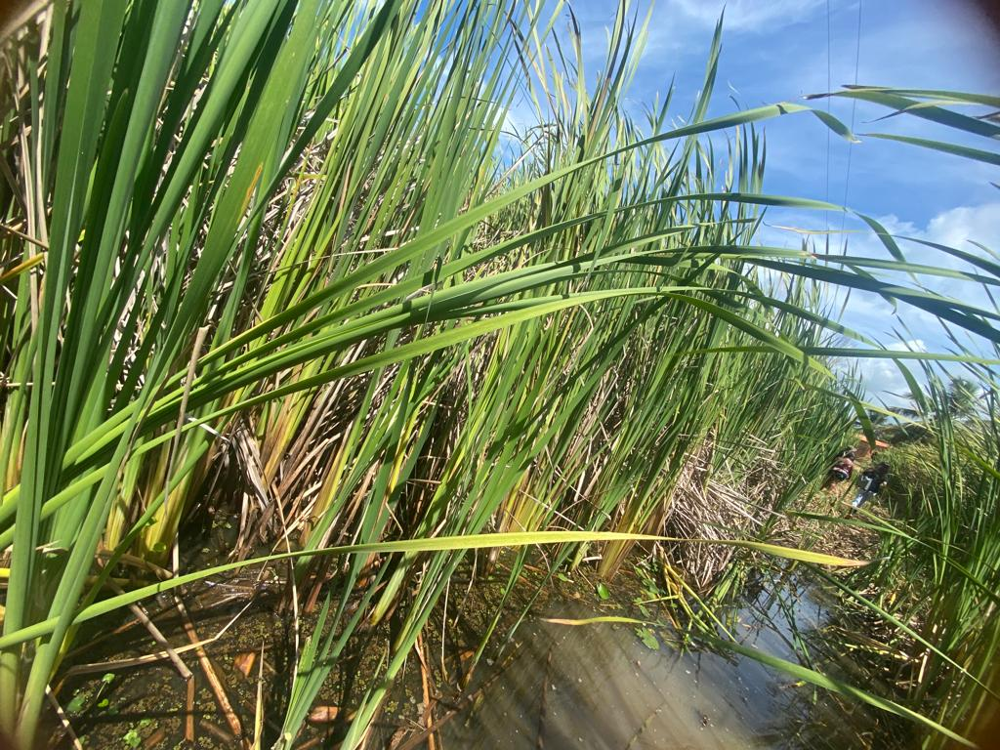
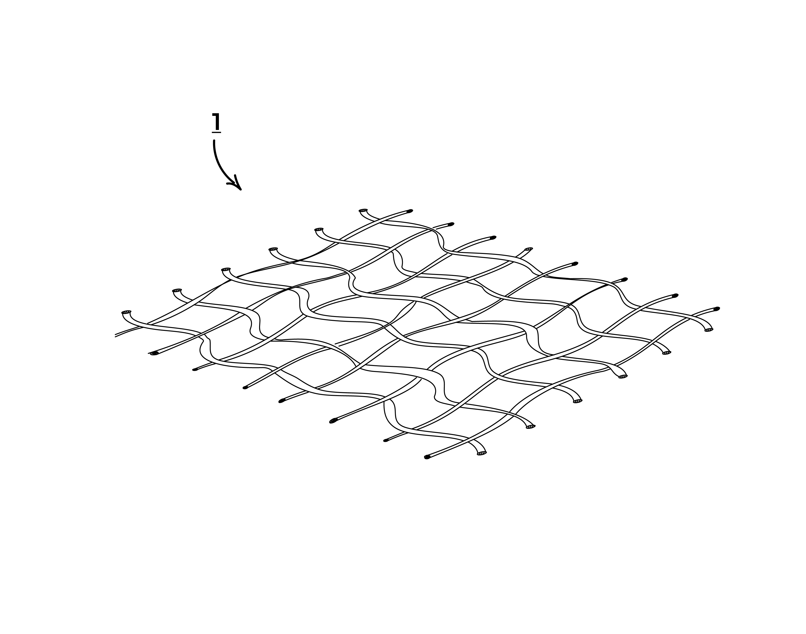

A demanda por geossintéticos biodegradáveis de baixo custo para aplicação em controle de erosão em países tropicais impulsiona a pesquisa com fibras vegetais nativas. A *Typha domingensis* (Taboa, ou junco) é uma macrófita aquática abundante em áreas alagadas do Nordeste brasileiro, com fibras de alta resistência à tração e disponibilidade praticamente ilimitada. A patente do geotêxtil tecido tipo geogrid (INPI BR10202302221, **concedida em 2025**) formaliza o processo de fabricação de uma malha estrutural tecida com fibras de Taboa, dimensionada para reforço e proteção de taludes e áreas degradadas.

{fig-alt="Geogrid de taboa instalado em talude" width="80%"}

## Matéria-prima e processamento

As fibras de Taboa são extraídas dos colmos da planta, desidratadas em condições controladas e processadas por técnicas de torção e trançamento que maximizam a resistência mecânica longitudinal. O padrão de tecedura tipo geogrid (malha aberta com aberturas regulares) permite a interação solo-geossintético, favorecendo o intertravamento de partículas e a passagem de raízes, o que potencializa a estabilização geotécnica ao longo do tempo por ancoragem vegetal.

::: {layout-ncol=2}
{fig-alt="Fibras de Typha processadas para fabricação de geotêxtil"}

{fig-alt="Esquema de tecedura do geogrid de taboa"}
:::

## Desempenho mecânico e campo

Os ensaios de resistência à tração demonstraram que o geogrid de Taboa atende aos requisitos mínimos de resistência para aplicação em taludes de baixa a média declividade, com comportamento comparável ao de geotêxteis sintéticos de gramatura equivalente durante a vida útil funcional (estimada em 12 a 24 meses). A biodegradabilidade controlada do material é uma vantagem estratégica, pois o geotêxtil cede lugar progressivamente ao sistema radicular da vegetação estabelecida, eliminando a necessidade de remoção e reduzindo a geração de resíduos sintéticos em campo.

## Inovação e aplicabilidade

A patente **concedida em 2025** representa uma Solução Baseada na Natureza (NBS) de baixo custo, replicável e ambientalmente sustentável para taludes e áreas degradadas. A utilização de matéria-prima local e abundante reduz custos logísticos e gera oportunidades de renda em comunidades ribeirinhas. O produto é compatível com os protocolos de retaludamento vegetado e revegetação com espécies nativas desenvolvidos no âmbito dos projetos de geossintéticos do grupo de pesquisa.

---

*Para saber mais sobre geossintéticos e NBS, confira os posts sobre [Geotêxteis para Controle de Erosão](/posts/projeto-geotexteis-controle-erosao/), [NBS Retaludamento Vegetado](/posts/nbs-retaludamento/), [Patente Geodreno](/posts/patente-geodreno/) e [Patente Geocomposto](/posts/patente-geocomposto/). Visite os [projetos](/#projetos) para uma visão geral.*
