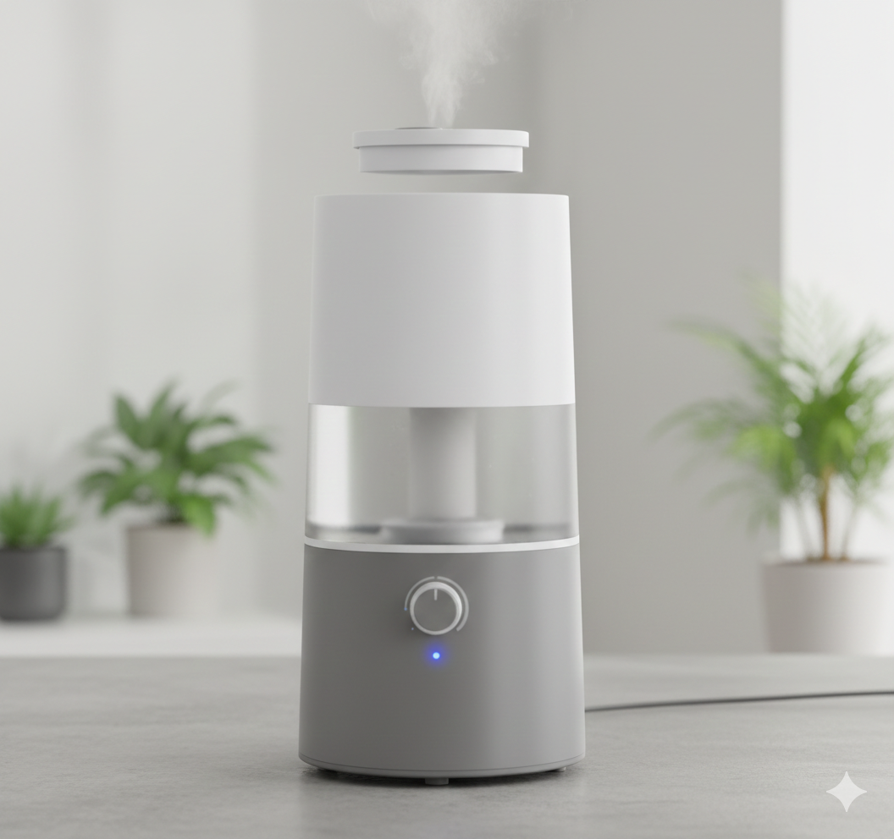

A qualidade do ar em ambientes internos residenciais é impactada pela presença de microrganismos, compostos orgânicos voláteis e partículas em suspensão, especialmente em regiões de clima seco onde a umidade relativa cai a níveis críticos por longos períodos. O umificador sanitizante com névoa de ozônio (INPI BR20202500452, depositado em 2025) integra as funções de umidificação do ambiente e desinfecção microbiológica do ar em um único equipamento residencial compacto, utilizando ozônio ($O_3$) como agente oxidante em concentrações controladas e seguras para ocupantes.

{fig-alt="Diagrama do umificador sanitizante com ozônio" width="80%"}

## Princípio de funcionamento

O equipamento opera pela atomização ultrassônica de água em névoa micrométrica, que é enriquecida com ozônio gerado in situ por descarga corona em oxigênio do ar ambiente. A névoa ozonizada é dispersa no ambiente por ventilação forçada de baixo ruído. O ozônio em fase gasosa e disperso na névoa age como oxidante sobre microrganismos (bactérias, fungos, vírus) e compostos orgânicos voláteis, enquanto a névoa de água eleva a umidade relativa. Um sensor de concentração de $O_3$ integrado ao circuito de controle mantém os níveis dentro do limite de segurança ocupacional (< 0,05 ppm conforme NR-15).

## Componentes e segurança

O sistema é composto por reservatório de água com refil removível, atomizador ultrassônico piezoelétrico, câmara de geração de ozônio por descarga corona, sensor eletroquímico de $O_3$ com realimentação para controle de dosagem, ventilador centrífugo de baixo ruído e carcaça em material plástico com certificação para uso residencial. O controle eletrônico permite programação de ciclos de sanitização (intervalos, duração, intensidade) e desligamento automático por segurança quando a concentração atinge o limiar.

## Inovação e aplicabilidade

A integração de umidificação e sanitização em equipamento residencial acessível é a inovação central da patente, depositada em 2025 no INPI. O produto é direcionado a ambientes com necessidade simultânea de controle de umidade e qualidade microbiológica do ar, como quartos de crianças, idosos e pacientes com doenças respiratórias, além de espaços de trabalho em regiões de clima seco. A aplicação em saúde ambiental residencial representa uma extensão do portfólio de inovações do grupo para além da engenharia de solos, mantendo o foco em soluções tecnológicas com impacto social direto.

---

*Para saber mais sobre as patentes do grupo, confira a [Patente do Amostrador](/posts/patente-amostrador-solo/), a [Patente do Permeâmetro](/posts/patente-permeametro/) e a [Patente Vistada](/posts/patente-vistada-amostra-solo/). Visite os [projetos](/#projetos) para uma visão geral.*
