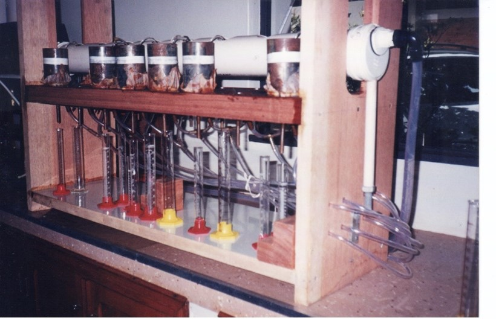
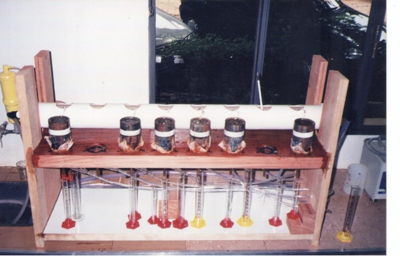
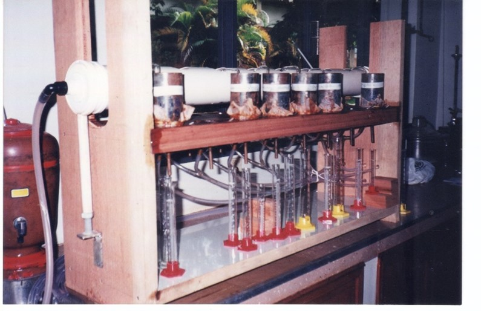
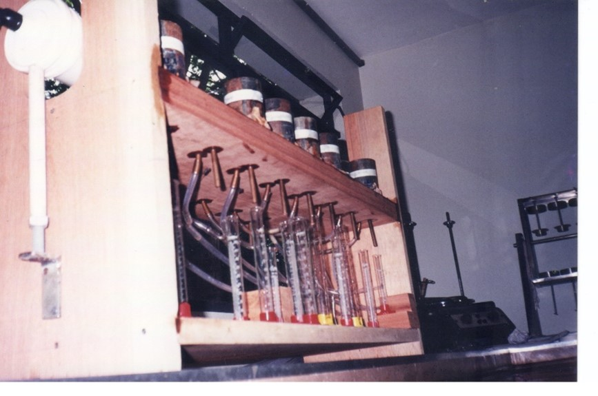

A condutividade hidráulica saturada ($K_{sat}$) é o parâmetro governante dos processos de infiltração, redistribuição de água no perfil e drenagem interna do solo. Sua determinação laboratorial tradicionalmente requer dois equipamentos distintos (permeâmetro de carga constante para solos permeáveis e de carga decrescente para solos de baixa condutividade), o que implica duplicação de infraestrutura, amostras e tempo de análise. O permeâmetro contínuo patenteado (INPI BR10202301830, concedido em 2025) integra ambos os métodos em um único dispositivo, com transição automática entre regimes de ensaio.

{fig-alt="Permeâmetro contínuo de carga constante e decrescente" width="80%"}

## Princípio de operação

O equipamento permite a submissão de uma mesma amostra a ensaios sob carga constante (regime permanente) e carga decrescente (regime transiente) sem desmontagem ou remontagem. O reservatório de alimentação com controle de nível mantém carga constante enquanto houver fluxo suficiente; quando a vazão cai abaixo de um limiar, o sistema transiciona automaticamente para o regime de carga decrescente, registrando a queda de nível ao longo do tempo. Essa transição contínua permite determinar $K_{sat}$ em solos com condutividade variando de $10^{-3}$ a $10^{-7}$ m/s em um único ensaio.

::: {layout-ncol=2}
{fig-alt="Detalhe do sistema de alimentação do permeâmetro"}

{fig-alt="Sistema de coleta e medição de vazão"}
:::

## Desenho técnico e componentes

O projeto construtivo integra componentes fabricáveis com materiais acessíveis (acrílico, PVC, conexões hidráulicas padronizadas), o que viabiliza a replicação em laboratórios de ensino e pesquisa com orçamento limitado. A modularidade do sistema permite adaptação para diferentes diâmetros de amostra e alturas de coluna.

{fig-alt="Desenho técnico do permeâmetro contínuo" width="80%"}

## Inovação e impacto

A patente foi concedida em 2025 pelo INPI, consolidando a inovação em instrumentação para análise física de solos. A integração de dois regimes de ensaio em um único dispositivo reduz pela metade o número de amostras necessárias e o tempo de laboratório, além de eliminar a variabilidade inter-amostras que compromete comparações entre métodos. O permeâmetro é especialmente indicado para solos tropicais com horizontes de condutividade contrastante, como os Plintossolos e Argissolos do Semiárido e do Baixo São Francisco.

---

*Para saber mais sobre instrumentação e análise de solos, confira os posts sobre [Propriedades Físicas e Hidrológicas](/posts/prop-fisicas-hidrologicas/), a [Patente do Amostrador](/posts/patente-amostrador-solo/) e [Infiltração e Hidrologia](/posts/infiltracao-hidrologia/). Visite os [projetos](/#projetos) para uma visão geral.*
