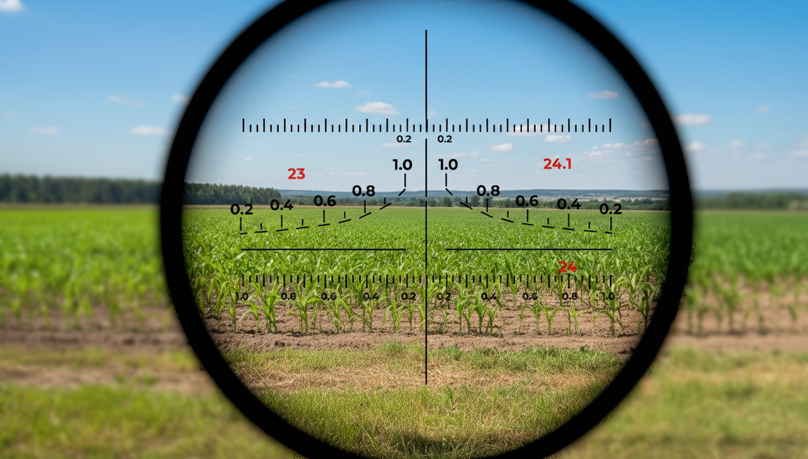
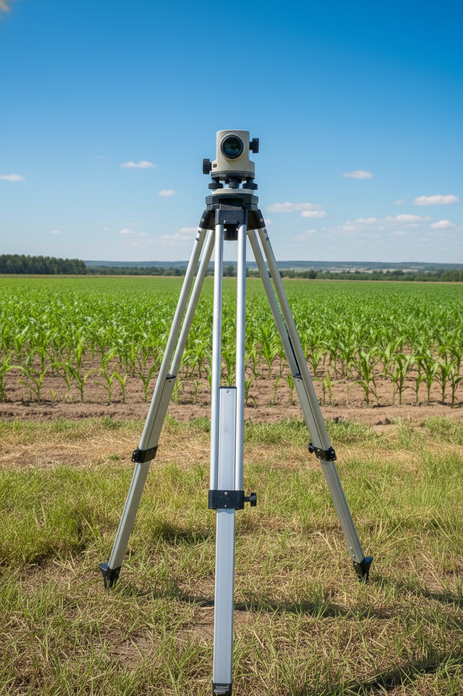
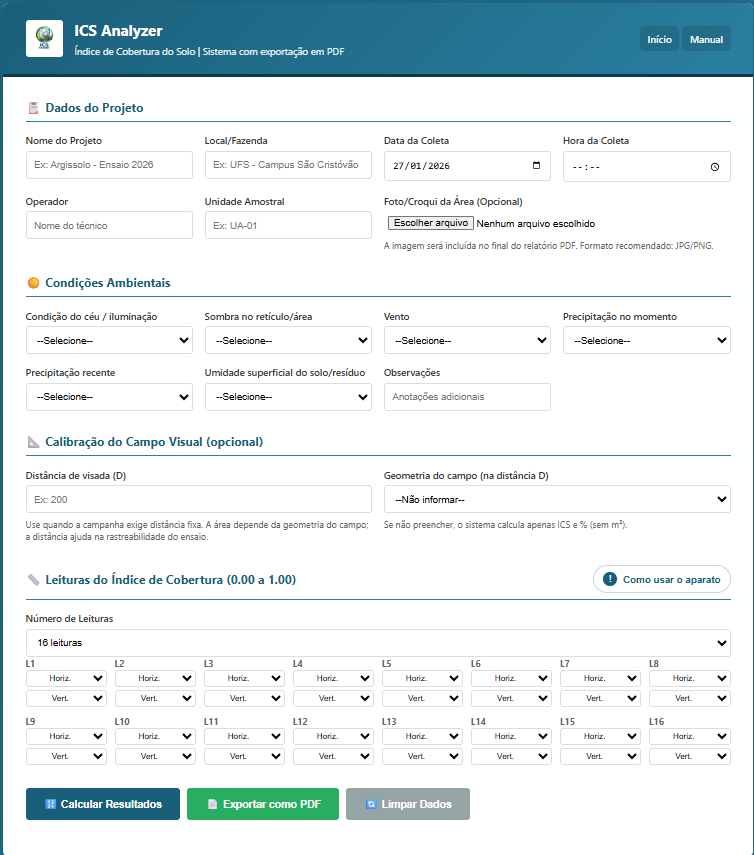
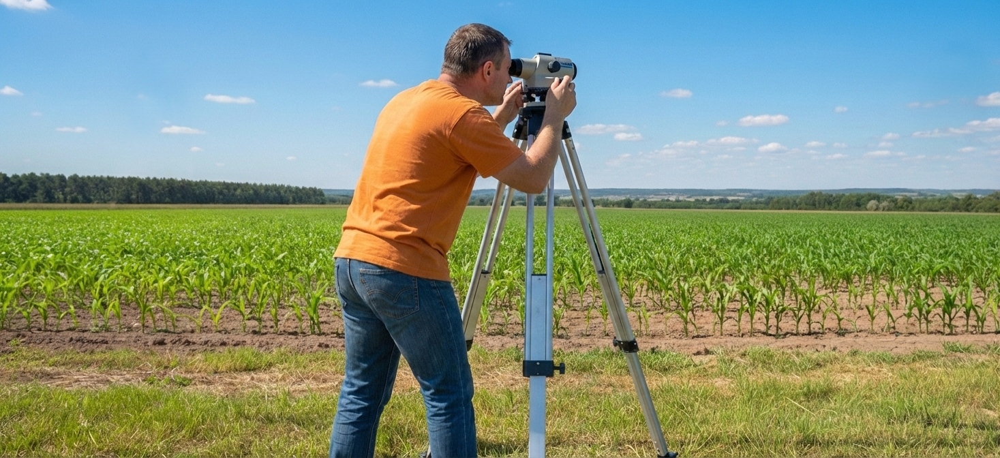
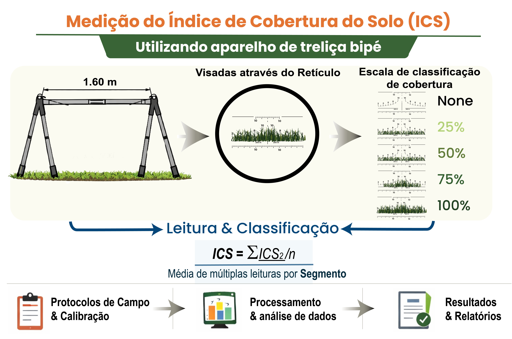

A classificação visual de amostras de solo é tradicionalmente realizada por métodos táteis e subjetivos, com alta dependência da experiência do operador e sem padronização das condições de observação (iluminação, ângulo, ampliação). O aparato para análise visual de amostras de solo (Vistada) propõe um sistema padronizado que integra câmara de iluminação controlada, retículo de referência sobreposto à amostra, captura digital de imagem e software de apoio à classificação, eliminando variáveis ambientais e subjetivas do processo.

{fig-alt="Retículo de referência do aparato Vistada para análise de amostras de solo" width="80%"}

## Componentes do aparato

O sistema é composto por câmara fechada com iluminação LED difusa de temperatura de cor controlada (5500 K, simulando luz natural padronizada), suporte para amostra com ajuste de altura, lente com retículo de referência calibrado e câmera digital de alta resolução integrada ao conjunto. O retículo projeta uma grade de referência sobre a superfície da amostra, permitindo a medição direta de agregados, poros visíveis e feições texturais sem instrumentos auxiliares.

::: {layout-ncol=2}
{fig-alt="Aparato Vistada montado para análise de amostras"}

{fig-alt="Detalhe interno do aparato Vistada"}
:::

## Software de apoio e operação

O software associado (ICS Analyzer) processa as imagens capturadas para extração de descritores de cor (espaço Munsell e CIE L\*a\*b\*), textura (granulometria aparente por análise de partículas) e estrutura (classificação de agregados). O operador posiciona a amostra, aciona a captura, e o sistema retorna um laudo padronizado com parâmetros quantitativos, reduzindo a subjetividade e melhorando a reprodutibilidade inter-laboratorial.

::: {layout-ncol=2}
{fig-alt="Interface do software ICS Analyzer do aparato Vistada"}

{fig-alt="Operador utilizando o aparato Vistada em laboratório"}
:::

## Inovação e estado de desenvolvimento

O aparato encontra-se em desenvolvimento com artigo científico associado em preparação. A padronização das condições de análise visual representa um avanço significativo para a classificação de solos em levantamentos pedológicos, controle de qualidade em obras geotécnicas e ensino de ciência do solo, onde a reprodutibilidade e a rastreabilidade dos resultados são requisitos crescentes.

{fig-alt="Diagrama conceitual do aparato Vistada" width="80%"}

---

*Para saber mais sobre instrumentação e análise de solos, confira os posts sobre [Patente do Amostrador](/posts/patente-amostrador-solo/), [Patente do Permeâmetro](/posts/patente-permeametro/) e [Propriedades Físicas e Hidrológicas](/posts/prop-fisicas-hidrologicas/). Visite os [projetos](/#projetos) para uma visão geral.*
