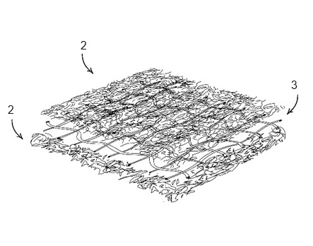
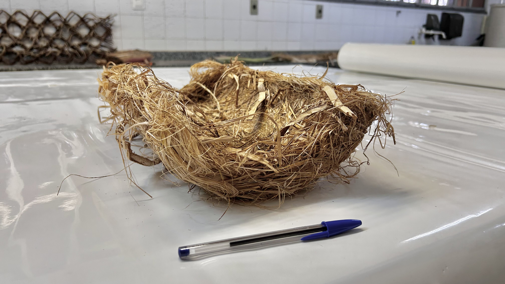
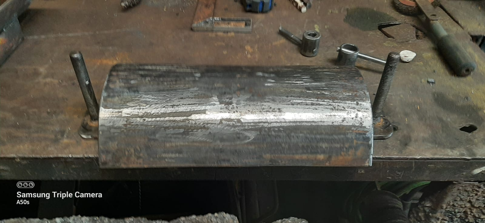
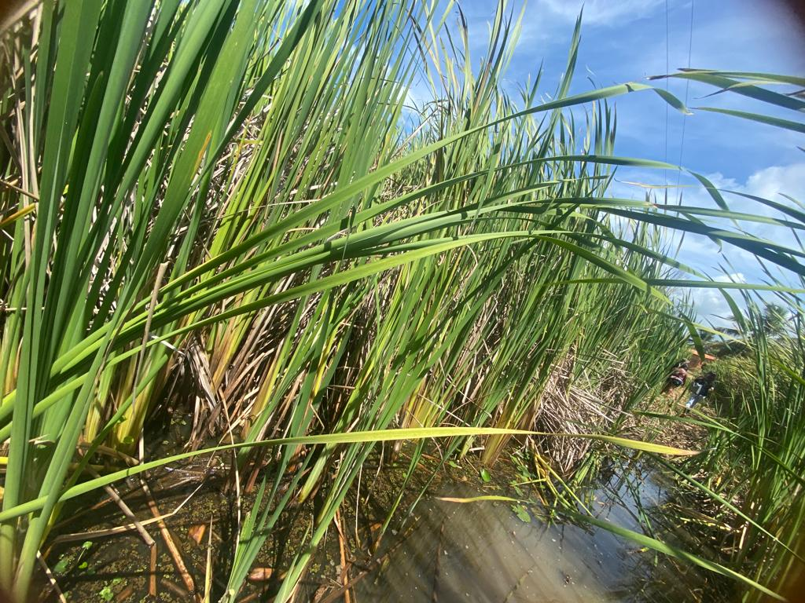

## Panorama da propriedade intelectual no agro

O Brasil é uma potência agrícola mundial, com o setor respondendo por 27% do PIB e empregando milhões de pessoas. Contudo, quando se examina a proteção da propriedade intelectual (PI) no agro, emerge um cenário surpreendentemente débil, pois apenas 3% das patentes depositadas no INPI são relacionadas a tecnologias agrícolas, o Brasil possui menos de 100 Indicações Geográficas registradas (contra mais de 3.000 na União Europeia) e a maioria dos produtores desconhece mecanismos de proteção de cultivares. Esse paradoxo entre alta produção e baixa proteção representa uma perda bilionária de valor agregado e competitividade internacional.

## Modalidades de PI no setor agrícola

::: {layout-ncol=2}
{fig-alt="Documento de patente de geocomposto biodegrável"}

{fig-alt="Documento de patente de geodreno para gestão hídrica"}
:::

No setor agrícola, a PI se manifesta de diversas formas. As patentes protegem invenções técnicas como novos processos de irrigação, formulações de bioinsumos, equipamentos agrícolas e sistemas de monitoramento ambiental. A proteção de cultivares, equivalente à patente para variedades vegetais, é assegurada pelo Serviço Nacional de Proteção de Cultivares (SNPC), que garante ao obtentor o direito exclusivo de comercializar a variedade por 15 a 18 anos. As Indicações Geográficas (IG) protegem produtos cuja qualidade ou reputação está vinculada a uma região específica (como Café do Cerrado Mineiro, Cacau de Ilhéus ou Mel de Sergipe). Os segredos industriais, por sua vez, abrangem processos de produção, receitas de beneficiamento e técnicas de manejo específicas que conferem vantagem competitiva.

## Justificativa econômica da proteção

A proteção da PI no agro se justifica por múltiplos vetores econômicos e estratégicos. Em termos de valorização econômica, produtos com IG custam, em média, 2,5 vezes mais que similares sem proteção, e uma patente de bioinsumo pode gerar royalties por 20 anos. No acesso a mercados internacionais, a União Europeia (principal destino do agro brasileiro) exige cada vez mais rastreabilidade e certificações que frequentemente se baseiam em mecanismos de PI. Na proteção do conhecimento tradicional, comunidades tradicionais do Semiárido detêm saberes agrícolas valiosos (técnicas de convivência com a seca, sementes crioulas, sistemas agroflorestais) que, sem proteção adequada, podem ser apropriados indevidamente por terceiros.

## Prospecção tecnológica como ferramenta estratégica

A prospecção tecnológica (*technology foresight*) consiste no processo de mapear sistematicamente patentes, publicações acadêmicas e tendências tecnológicas para identificar oportunidades de inovação e proteção.

Na pesquisa de doutorado conduzida na UFS, ferramentas como PatentSight e bases como Scopus e Web of Science foram utilizadas para mapear o panorama global de inovações em conservação do solo e da água, geotêxteis e bioengenharia, além de agroecologia e sistemas sustentáveis. Os resultados revelaram nichos promissores onde o Brasil possui vantagem comparativa mas pouca proteção formal, uma janela de oportunidade que se fecha à medida que outros países avançam.

::: {layout-ncol=3}
{fig-alt="Protótipo do geodreno patenteado"}

{fig-alt="Detalhamento técnico do geodreno"}

{fig-alt="Documento de patente de geotêxtil de junco"}
:::

## Recomendações práticas

Para pesquisadores, extensionistas e produtores, a estratégia de proteção deve começar pelo mapeamento do que já existe (busca de anterioridade no INPI e bases internacionais), seguido da identificação do que é protegível nas práticas e inovações correntes. O apoio dos Núcleos de Inovação Tecnológica (NITs) das universidades é fundamental, assim como a consideração de IGs para produtos regionais com identidade territorial forte e a documentação de saberes tradicionais antes que se percam.

## Conclusão

A propriedade intelectual não configura um luxo burocrático, mas uma ferramenta de desenvolvimento sustentável. No Semiárido, onde inovação e tradição coexistem, proteger conhecimento é proteger comunidades, biodiversidade e oportunidades econômicas para gerações futuras.

---

*O grupo PLANeT-Inova (UEFS) trabalha na interface entre inovação e propriedade intelectual para o desenvolvimento territorial sustentável. Confira também os posts sobre [Bio-SAP: Biopolímero de Taboa](/posts/bio-sap-biopolimero-taboa/), [Geocompostos Hidrorretentores](/posts/geocompostos-hidrorretentores-typha-rami/) e [Geotêxteis no Controle de Erosão](/posts/geotexteis-controle-erosao/). Conheça nossos [projetos](/#projetos) ou entre em [contato](/index.qmd#contato).*
